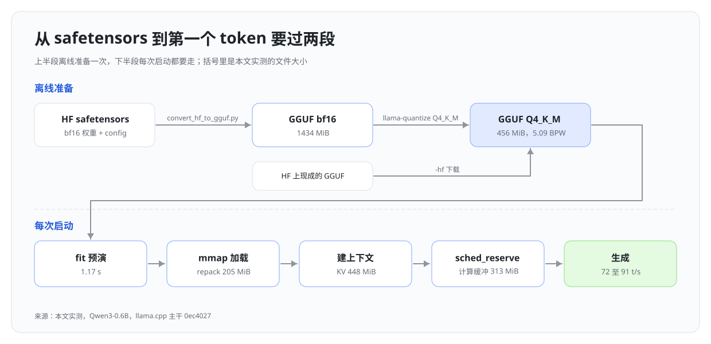
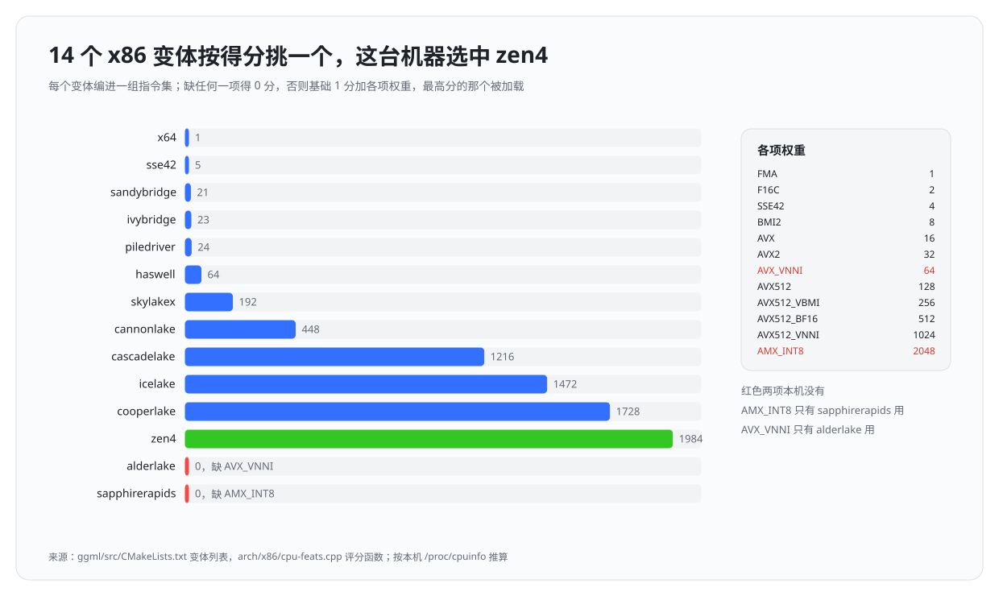
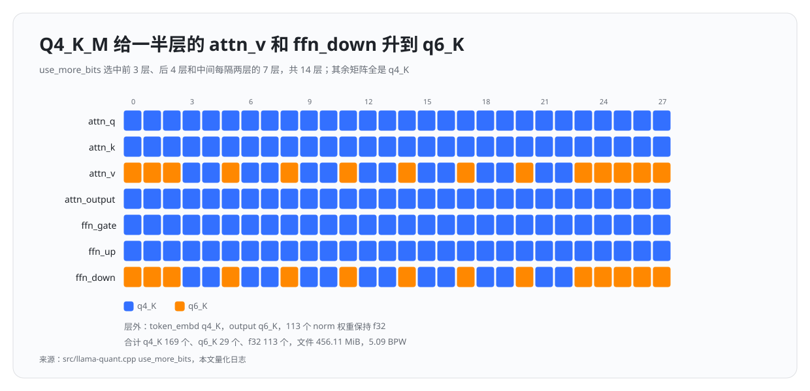
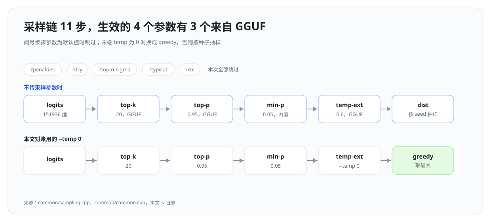
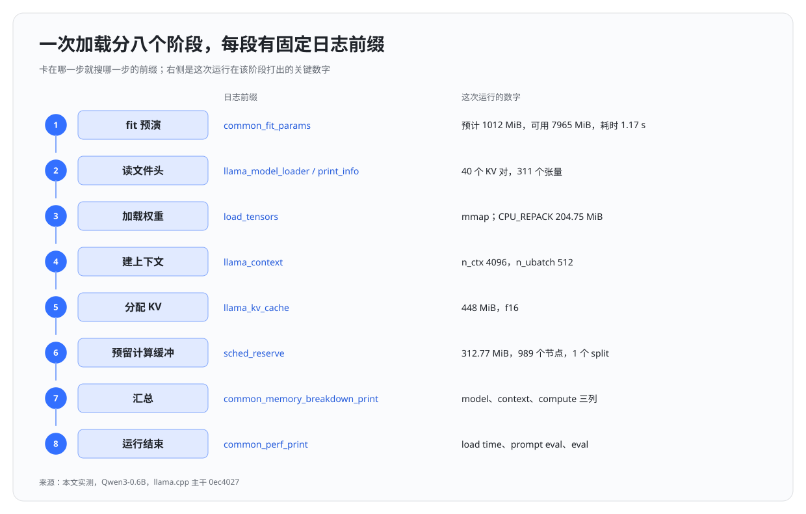
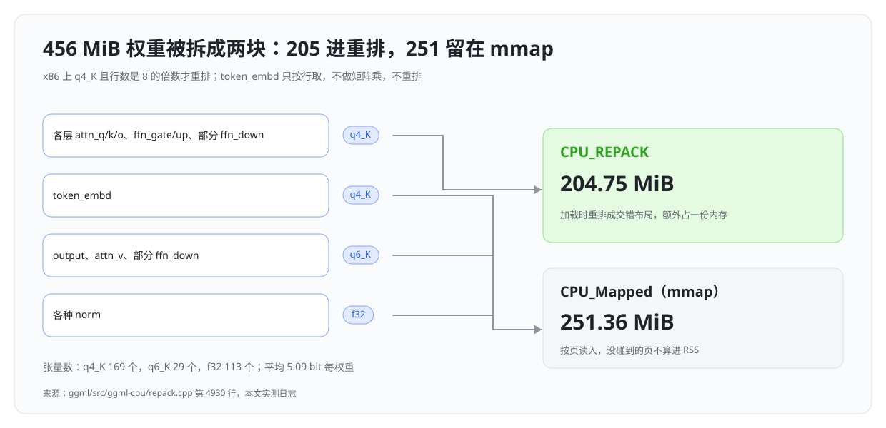
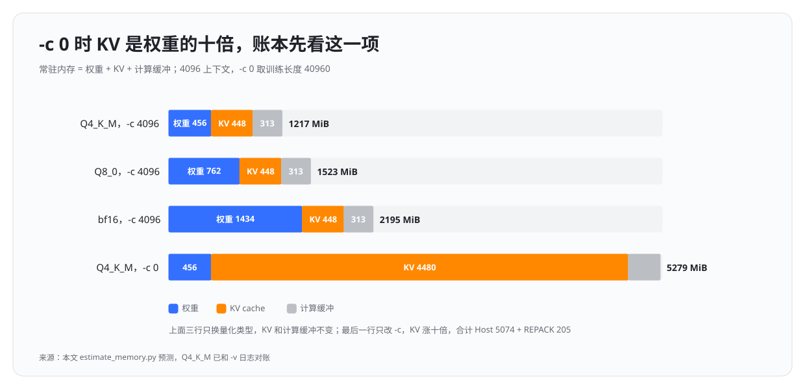
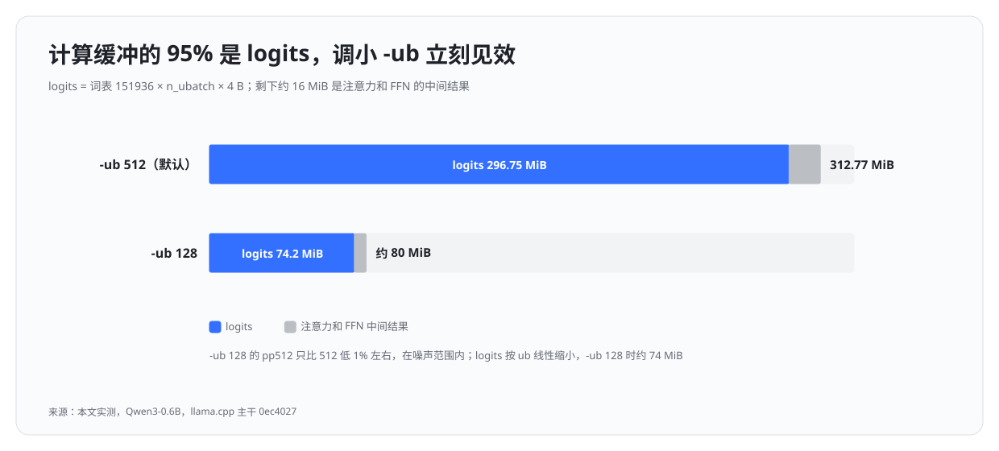
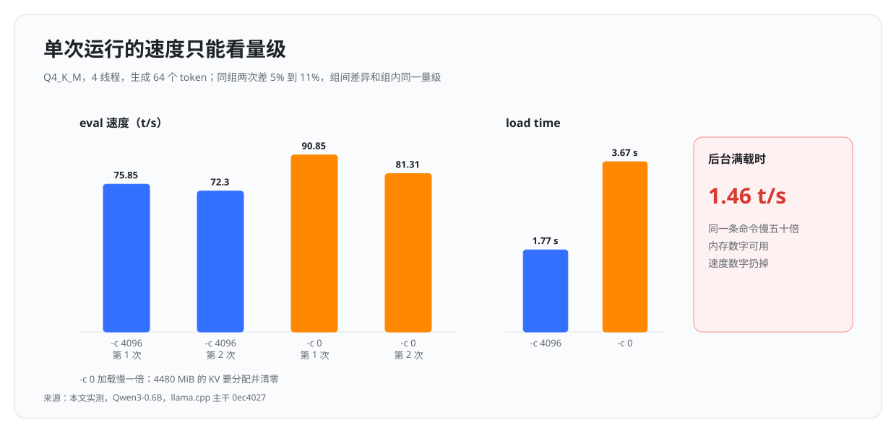
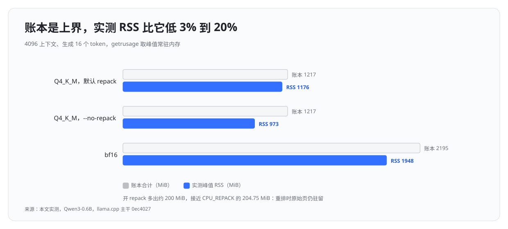

# LCPP-01｜上手｜第一次运行：编译、转换、加载和读懂内存账单

> 🎯 **这篇文档解决什么问题**：这一篇从源码编译 llama.cpp，把 Hugging Face 上的 Qwen3-0.6B 转成 GGUF 并量化，跑出第一段文本。更要紧的是在启动之前就算出权重、KV cache 和计算缓冲各占多少内存，跑完以后拿 -v 日志逐行对账。主线一句话：加载日志末尾那张 memory breakdown 表，每一格都能在启动前用 GGUF 文件头和三五个参数算出来。
>
> 使用方式：只想跑起来，看第 2 至 6 章；关心内存，直接看第 7 至 10 章；第 11 章讲单次运行的速度数字怎么读、RSS 为什么比账本低，以及排障表。文中版本和数字核对于 2026 年 10 月 31 日。
>
> **代码**：[zero-to-llama/01-first-run](../01-first-run)。预测器和日志解析器只依赖 Python 标准库，不装 llama.cpp 也能跑；仓库里带一份录好的 -v 日志当测试夹具。基线是主干 0ec4027，模型是 Qwen3-0.6B Q4_K_M GGUF，机器是 4 核 EPYC 云主机无 GPU。

# 导读 · 先给结论

- **编译完先看 system_info 那一行。**默认 GGML_NATIVE=ON 按本机指令集编译，日志里的 AVX512、AVX512_VNNI、REPACK 决定哪些量化类型能走快路径。预编译包和 Docker 镜像关掉 NATIVE，编出 14 个 x86 变体，运行时按 CPU 特性打分挑一个，我这台 EPYC 选中 zen4[[1]](https://github.com/ggml-org/llama.cpp/blob/0ec4027/docs/build.md)[[2]](https://github.com/ggml-org/llama.cpp/blob/0ec4027/ggml/src/CMakeLists.txt)[[3]](https://github.com/ggml-org/llama.cpp/blob/0ec4027/ggml/src/ggml-cpu/arch/x86/cpu-feats.cpp)。
- **常驻内存 = 权重 + KV cache + 计算缓冲，三项都能事先算。**Q4_K_M、4096 上下文，预测器给出权重 251.36 + 204.75 MiB（后者进 CPU_REPACK）、KV 448 MiB、计算缓冲 312.77 MiB，-v 日志是 251、204.75、448、312.77，偏差在 0.4 MiB 以内[[4]](https://arxiv.org/abs/2211.05102)[[5]](https://github.com/ggml-org/llama.cpp/pull/15860)。
- **计算缓冲里最大的一块是 logits。**Qwen3 词表 151936，n_ubatch 512，logits 就是 151936 × 512 × 4 B = 296.75 MiB，占计算缓冲的 95%。小模型、大词表时这一项比 mmap 里的权重还大，内存紧先把 -ub 降到 128。
- **-c 0 时 KV 是权重的十倍。**-c 0 取训练长度 40960，KV 从 448 MiB 涨到 4480 MiB，合计从 1217 MiB 涨到 5279 MiB；不写 -c 时 -fit 会按可用内存往下压，最低到 4096，所以同一条命令换台机器上下文就变了[[6]](https://github.com/ggml-org/llama.cpp/pull/16653)。
- **采样默认值有三项来自 GGUF。**Qwen3 的 GGUF 带 general.sampling.top_k 20、top_p 0.95、temp 0.6，覆盖内置的 40、0.95、0.8；只有 min_p 0.05 是内置值。跨引擎对比输出必须把采样参数写全[[7]](https://github.com/ggml-org/llama.cpp/pull/17120)。
- **单次运行的速度只看量级。**同一条命令空闲时 72 到 91 t/s，后台满载时 1.46 t/s；同组两次差 5% 到 11%。内存数字和负载无关可以直接用，测速交给 [LCPP-03｜上手｜测量方法：llama-bench、PPL、KLD 和噪声](./03-bench-ppl.md) 的 llama-bench[[8]](https://doi.org/10.1145/2807591.2807644)。



**📎 与系列其他文档的分工**：本篇只讲单机 CPU 的第一次运行。账本推广到 GPU、MoE 和任意架构见 [LCPP-02｜上手｜推理账本：带宽、算力和启动前算出速度上限](./02-ledger.md)，测速方法见 [LCPP-03｜上手｜测量方法：llama-bench、PPL、KLD 和噪声](./03-bench-ppl.md)，GGUF 内部结构见 [LCPP-04｜内部｜GGUF：文件结构、元数据、加载方式和分卷](./04-gguf.md)，后端和编译选项的全貌见 [LCPP-06｜内部｜后端与编译：CPU 变体、BLAS、repack 和 GPU 架构](./06-backends-build.md)，量化类型的选择见 [LCPP-07｜内部｜量化：块结构、配方、imatrix 和用 KLD 选类型](./07-quantization.md)，采样链逐个拆开见 [LCPP-09｜内部｜采样、语法与聊天模板：截断链、温度、惩罚、GBNF 和模板](./09-sampling-grammar.md)，CPU 线程和 repack 的调优见 [LCPP-10｜内部｜CPU 调优：线程、绑核、repack、加载方式和带宽上限](./10-cpu-tuning.md)。路线和全部章节见 [LCPP-00｜索引｜从 0 开始 llama.cpp：路线、章节与练习](./README.md)。

# 第 1 章 · 问题：跑起来了，然后呢

## 1.1 跑起来以后冒出的疑问

llama.cpp 的上手已经简化到一条命令：装好以后 llama-cli -hf 加一个仓库名，自动下载、自动选参数、直接进入对话。麻烦出在之后。换一台机器，同样的命令，上下文长度变了。换一个模型，内存爆了。同一台机器跑两次，速度差了一截，输出还和别人贴出来的不一样。这些问题的答案几乎都写在加载日志里，只是默认日志级别下大部分行看不到，看到了也很少有人逐行对。

| 现象 | 根因通常在 | 本篇位置 |
|-|-|-|
| 换台机器，同样命令的上下文长度变了 | -fit 根据可用内存压缩了 n_ctx | 第 10 章 |
| 小模型占的内存比文件大好几倍 | KV 按训练长度分配，计算缓冲里 logits 很大 | 第 8、9 章 |
| 同一个 GGUF 在两台机器上速度差很多 | 编译时指令集不同，repack 路径没走上 | 第 3、7 章 |
| 输出和别人贴的不一样 | 采样参数默认取 GGUF 里的推荐值 | 第 6 章 |
| 两次运行速度差 10% 以上 | 后台负载、CPU 频率、页缓存冷热 | 第 11 章 |

## 1.2 把第一次运行当成实验

我把第一次运行当成一次实验来做，分四步。第一步预测：只读 GGUF 文件头，算出权重、KV 和计算缓冲三项。第二步运行：固定参数、贪心解码、带 -v 运行，日志落盘。第三步对账：从日志抽数字和预测比较，偏差超过 1% 就去源码里找原因。第四步复盘：把对不上的地方记成踩坑条目。

对不上比跑不起来更值得查。跑不起来会报错；对不上说明我对内存分配的理解有偏差，这个偏差会在后面每一次调 -c、-ngl、-ub 时被放大。并行计算领域的测量指南把这一点说得很直白：先写下预期，再看结果，结果和预期不符时要能解释，否则测量本身就不可信[[8]](https://doi.org/10.1145/2807591.2807644)。

## 1.3 实验环境要写清楚

测量结果对环境非常敏感。Mytkowicz 等人发现，仅仅改变环境变量的总长度或链接顺序，就能让同一个程序的测量结果偏移到足以推翻结论的程度，而且这种偏差不随机，重复多少次都去不掉[[9]](https://doi.org/10.1145/1508244.1508275)。所以本系列每一篇开头都写死基线：主干 0ec4027，Qwen3-0.6B，4 核 EPYC 云主机、8 GB 内存、无 GPU。读者换了机器，内存数字应当完全一致，速度数字只能比量级。

> 🔑 **本章要点**：第一次运行的目标是能预测、能对账，跑起来只是第一步。每一个对不上的数字都记下来，它们是后面调参时最常见的坑。

# 第 2 章 · 编译

## 2.1 最小编译

官方给了一键安装脚本和预编译包，日常用没问题。学这套手册我建议从源码编，理由有两个：后面要读源码、对行号；预编译包为了兼容会关掉 GGML_NATIVE，和本机最优路径未必一致[[1]](https://github.com/ggml-org/llama.cpp/blob/0ec4027/docs/build.md)。

```bash
git clone https://github.com/ggml-org/llama.cpp
cd llama.cpp
git checkout 0ec4027          # 和本系列基线对齐
cmake -B build -DCMAKE_BUILD_TYPE=Release
cmake --build build -j $(nproc)
./build/bin/llama version
```

编完 build/bin 下有六十多个可执行文件。主干把常用入口收进了一个统一的 llama 命令，llama serve 对应 llama-server，llama cli 对应 llama-cli，llama download 只下载模型。老的 llama-xxx 二进制仍然都在，本系列为了和日志前缀对应，多数时候直接写老名字。

## 2.2 几个要知道缺省值的 CMake 选项

| CMake 选项 | 缺省 | 什么时候改 |
|---|---|---|
| GGML_NATIVE | ON（交叉编译或设了 SOURCE_DATE_EPOCH 时为 OFF） | 要分发给别的机器时关掉，改用 GGML_CPU_ALL_VARIANTS 加 GGML_BACKEND_DL |
| GGML_CPU_REPACK | ON | 几乎不用关；运行时可以用 --no-repack 单独对比，第 11 章有实测 |
| GGML_OPENMP | ON | 极少数平台 OpenMP 有问题时关掉，回退到 ggml 自己的线程池 |
| GGML_CUDA、GGML_VULKAN、GGML_METAL 等 | OFF（Metal 在苹果上缺省 ON） | 有对应硬件时打开，细节在 [LCPP-06｜内部｜后端与编译：CPU 变体、BLAS、repack 和 GPU 架构](./06-backends-build.md) |
| GGML_BACKEND_DL | OFF | 想让后端编成独立的动态库、运行时再加载时打开，要求 BUILD_SHARED_LIBS |

这些缺省值都写在 ggml/CMakeLists.txt 里[[10]](https://github.com/ggml-org/llama.cpp/blob/0ec4027/ggml/CMakeLists.txt)。GGML_NATIVE 有一个容易被忽略的条件：检测到交叉编译，或者环境里设了 SOURCE_DATE_EPOCH，缺省就变成 OFF。后者是可复现构建的约定，很多发行版的打包流程会设它，于是发行版仓库里的 llama.cpp 天然不是按本机指令集编的。

## 2.3 NATIVE 到底改了什么

GGML_NATIVE=ON 时，CPU 后端的 CMakeLists 直接给编译器加 -march=native[[11]](https://github.com/ggml-org/llama.cpp/blob/0ec4027/ggml/src/ggml-cpu/CMakeLists.txt)。GCC 的文档对它的定义是：探测本机 CPU 支持的全部指令集扩展并据此生成代码，同时按本机微架构调度指令[[12]](https://gcc.gnu.org/onlinedocs/gcc/x86-Options.html)。好处是 AVX512 这类扩展全部打开；代价是二进制只保证在同型号或更新的 CPU 上能跑。

关掉 NATIVE 时，CMake 改为按 GGML_AVX2、GGML_AVX512 这些开关逐项加 -m 参数。x86-64 的 psABI 把常用扩展打包成几个微架构级别：v2 加了 SSE4.2 和 POPCNT，v3 加了 AVX2、FMA、BMI2、F16C，v4 加了 AVX512 的 F、BW、CD、DQ、VL 五项[[13]](https://gitlab.com/x86-psABIs/x86-64-ABI)。后面 CPU 变体的划分和这几个级别大致对得上，haswell 变体约等于 v3，skylakex 约等于 v4。

> 💡 **常见误区**：Docker 里编译时，GGML_NATIVE 按的是构建机的 CPU。构建机有 AVX512、运行机没有，会直接报非法指令；反过来不报错，只是慢。官方镜像早就改成 GGML_NATIVE=OFF 加多变体[[14]](https://github.com/ggml-org/llama.cpp/pull/10368)[[15]](https://github.com/ggml-org/llama.cpp/blob/0ec4027/docs/docker.md)，自己写 Dockerfile 时也要这样做。

# 第 3 章 · CPU 变体与 system_info

## 3.1 读 system_info

每次运行，日志里都有一行 system_info，列出这次二进制实际启用的 CPU 特性。我这台机器是这样：

```text
system_info: n_threads = 4 (n_threads_batch = 4) / 4 | CPU : SSE3 = 1 | SSSE3 = 1 | AVX = 1 | AVX2 = 1 | F16C = 1 | FMA = 1 | BMI2 = 1 | AVX512 = 1 | AVX512_VBMI = 1 | AVX512_VNNI = 1 | AVX512_BF16 = 1 | LLAMAFILE = 1 | OPENMP = 1 | REPACK = 1 |
```

这一行由 llama_print_system_info 拼出来，逐个询问已加载后端的特性[[16]](https://github.com/ggml-org/llama.cpp/blob/0ec4027/src/llama.cpp)。我会盯三个地方。AVX2 和 AVX512 决定 k-quants 的点积内核走哪条路径。REPACK = 1 表示编进了在线重排，加载时会把 Q4_0、Q4_K 这类权重重排成适合 SIMD 的交错布局[[17]](https://github.com/ggml-org/llama.cpp/pull/10446)。OPENMP = 1 表示线程池用 OpenMP。某个标志是 0 而 CPU 明明支持，基本就是 NATIVE 被关了，或者二进制是在别的机器上编的。

CPU 实际支持什么，看 /proc/cpuinfo 的 flags 行。内核文档列了每个 flag 的含义[[18]](https://docs.kernel.org/arch/x86/cpuinfo.html)，我这台机器有 avx2、bmi2、avx512f、avx512bw、avx512_vnni、avx512_bf16、avx512vbmi，没有 avx_vnni，也没有 amx 系列。

## 3.2 多变体：14 个里按得分挑一个

预编译包要在各种 CPU 上都能跑，又不想全按最低标准编。ggml 的做法是把 CPU 后端编成多个动态库，每个库针对一组指令集，运行时挑最合适的那个。这套机制分两步合进主干：先是后端动态加载[[19]](https://github.com/ggml-org/llama.cpp/pull/10469)，再是预定义的 CPU 变体列表[[20]](https://github.com/ggml-org/llama.cpp/pull/10626)。打开方式是 GGML_BACKEND_DL=ON 加 GGML_CPU_ALL_VARIANTS=ON，前者要求 BUILD_SHARED_LIBS，后者要求前者，ggml/src/CMakeLists.txt 里列了 14 个 x86 变体[[2]](https://github.com/ggml-org/llama.cpp/blob/0ec4027/ggml/src/CMakeLists.txt)。



挑选靠一个打分函数[[3]](https://github.com/ggml-org/llama.cpp/blob/0ec4027/ggml/src/ggml-cpu/arch/x86/cpu-feats.cpp)。每个变体编进去的指令集都要检查，缺任何一项直接得 0 分；全都有就从 1 分起，按 FMA 1、F16C 2、SSE42 4、BMI2 8、AVX 16、AVX2 32、AVX_VNNI 64、AVX512 128、AVX512_VBMI 256、AVX512_BF16 512、AVX512_VNNI 1024、AMX_INT8 2048 累加，分数最高的被加载。

权重是 2 的幂，所以只要多一项更高级的扩展，分数一定更高。按本机的 flags 推算，zen4 得 1984 分最高；sapphirerapids 缺 AMX_INT8、alderlake 缺 AVX_VNNI，都是 0 分。

打分函数里有一句注释：它不检查操作系统是否支持这些指令。AVX512 需要内核保存更宽的寄存器状态，老内核或某些虚拟化环境下 CPU 有、系统不让用，这时选中的变体会在运行中报非法指令。遇到这种情况，把出问题的那个变体库从可执行文件目录里移走，加载器会退到次高分的变体；或者干脆本机编译。

## 3.3 线程数的缺省值

system_info 开头的 n_threads = 4 是缺省值。common 在 x86 Linux 上用 common_cpu_get_num_math 数物理核，跳过超线程的兄弟核；数不出来时退回 hardware_concurrency，超过 4 时再减半[[21]](https://github.com/ggml-org/llama.cpp/blob/0ec4027/common/common.cpp)。矩阵乘是算力和带宽密集的，两个超线程抢同一个核的执行单元，多开反而慢，所以缺省只用物理核。

线程池缺省用 OpenMP。2024 年加 OpenMP 支持的 PR 说得很清楚：原来每生成一个 token 都要 pthread_create 一批线程再 join，按线程号做性能分析很难，绑核也不灵活；OpenMP 复用同一组线程，还能用 OMP_PROC_BIND 控制亲和性[[22]](https://github.com/ggml-org/llama.cpp/pull/7606)。线程数和 repack、NUMA 的组合怎么调，在 [LCPP-10｜内部｜CPU 调优：线程、绑核、repack、加载方式和带宽上限](./10-cpu-tuning.md) 里有完整的扫描。本篇所有实验固定 -t 4，和缺省值一致。

> 🔑 **本章要点**：先看 system_info 确认指令集和 REPACK，再看 /proc/cpuinfo 确认 CPU 本来支持什么，两者对不上就是编译方式的问题。多变体构建按得分挑库，权重是 2 的幂，最高分就是指令集最全的那个。

# 第 4 章 · GGUF 与加载方式

## 4.1 拿到 GGUF 的三条路

llama.cpp 只吃 GGUF。拿到 GGUF 有三条路。第一条直接下载：llama-cli -hf 仓库名加可选的量化类型，从 Hugging Face 拉现成的 GGUF 缓存在本地，最快，但量化方式和 imatrix 用的校准集都由上传者决定。第二条自己转换：convert_hf_to_gguf.py 把 safetensors 转成 bf16 或 f16 的 GGUF，新模型发布当天常常只能走这条路。第三条自己量化：llama-quantize 从 bf16 GGUF 量化到任意类型，质量自己把控。导读里的流程图把三条路画在了一起，本篇走第二、三条。

## 4.2 GGUF 是什么

GGUF 把超参数、分词器、聊天模板和所有张量放进一个文件：文件头是魔数和版本，接着是键值对形式的元数据，然后是张量目录（名字、形状、类型、偏移），最后是按对齐填充过的张量数据，缺省对齐 32 字节[[23]](https://github.com/ggml-org/ggml/blob/master/docs/gguf.md)。它在 2023 年替换了更早的 GGML、GGJT 格式，主要动机是让元数据可扩展，新加字段不再破坏老文件[[24]](https://github.com/ggml-org/llama.cpp/pull/2398)。

对内存账本来说，GGUF 的好处是权重字节数不用估。张量目录里每个张量的类型和形状都写着，按类型的块大小算出字节累加就是。本篇的 Q4_K_M 文件，日志第一行就是“loaded meta data with 40 key-value pairs and 311 tensors”，文件格式 GGUF V3。文件内部的细节在 [LCPP-04｜内部｜GGUF：文件结构、元数据、加载方式和分卷](./04-gguf.md) 里逐字节拆。

## 4.3 mmap 和 load_mode

张量数据按页对齐，加载时可以直接 mmap，不需要反序列化。2023 年的 PR #613 把加载改成 mmap，号称快了 10 到 100 倍，这个设计一直沿用到今天[[25]](https://github.com/ggml-org/llama.cpp/pull/613)。mmap 只是建立映射，真正读盘发生在第一次访问某一页时的缺页中断里[[26]](https://man7.org/linux/man-pages/man2/mmap.2.html)，所以“加载”很快，第一次推理会慢一点。

mmap 也有代价。Crotty 等人分析数据库系统时指出，mmap 把换页交给内核，应用失去了对 I/O 时机和淘汰顺序的控制，缺页的延迟也不可预测[[27]](https://db.cs.cmu.edu/papers/2022/cidr2022-p13-crotty.pdf)。llama.cpp 因此保留了几种读法：主干现在用一个 -lm/--load-mode 参数统一管理，可选 auto、none、mmap、mlock、mmap+mlock 和 dio，替代了原来零散的 --mlock、--no-mmap 和 direct I/O 开关[[28]](https://github.com/ggml-org/llama.cpp/pull/20834)。auto 是缺省，用 mmap，除非某个设备不支持 mmap，这时退回直接读[[29]](https://github.com/ggml-org/llama.cpp/blob/0ec4027/src/llama-model.cpp)。

底层实现在 llama-mmap.cpp 和 llama-model-loader.cpp：mmap 之后会按需调用 fadvise、madvise，mlock 把页锁在内存里不让换出，dio 用 O_DIRECT 绕过页缓存[[30]](https://github.com/ggml-org/llama.cpp/blob/0ec4027/src/llama-mmap.cpp)[[31]](https://github.com/ggml-org/llama.cpp/blob/0ec4027/src/llama-model-loader.cpp)。本篇的日志里能看到 load_mode 出现两次：fit 预演那一次是 none，真正加载那一次是 mmap。

> 🔑 **本章要点**：GGUF 把元数据和张量放在一个文件里，张量按页对齐可以直接 mmap。缺省的 load_mode auto 走 mmap，权重页按需读入，这是第 11 章 RSS 比账本低的根源。

# 第 5 章 · 转换与量化

## 5.1 实测模型 Qwen3-0.6B

本系列的实测模型是 Qwen3-0.6B[[32]](https://arxiv.org/abs/2505.09388)[[33]](https://huggingface.co/Qwen/Qwen3-0.6B)：28 层，隐藏维度 1024，16 个注意力头、8 个 KV 头，head_dim 128，FFN 中间维度 3072，词表 151936，训练上下文 40960，参数量 7.5 亿，其中 1.56 亿在词嵌入里。选它是因为在 4 核 8 GB 的机器上，十几个量化变体的 perplexity 和 KLD 能在一个下午跑完。

有两个结构细节会直接出现在内存账本里。一个是 GQA：16 个查询头共享 8 组 K、V，KV cache 只有多头注意力的一半[[34]](https://arxiv.org/abs/2305.13245)。另一个是 head_dim 128 乘 16 头等于 2048，比隐藏维度 1024 大，所以 attn_q 的形状是 1024 × 2048，attn_output 反过来是 2048 × 1024。缩放点积注意力本身的定义来自 Transformer 原论文[[35]](https://arxiv.org/abs/1706.03762)，后面算 KV 和计算缓冲都以它为准。

## 5.2 safetensors 到 GGUF

```bash
pip install --user -r requirements/requirements-convert_hf_to_gguf.txt
# 下载 Qwen/Qwen3-0.6B 到 models/Qwen3-0.6B（safetensors + config + tokenizer）
python3 convert_hf_to_gguf.py models/Qwen3-0.6B \
  --outtype bf16 --outfile models/qwen3-0.6b-bf16.gguf
```

Hugging Face 的权重是 safetensors：一个 8 字节的头长度，一段 JSON 头描述每个张量的 dtype、形状和偏移，后面是原始字节，没有可执行代码，读起来安全[[36]](https://github.com/huggingface/safetensors)。Qwen3-0.6B 的 model.safetensors 里有 311 个张量加一条元数据，dtype 都是 BF16。

转换脚本读 config.json 里的 architectures 字段（这里是 Qwen3ForCausalLM），找到注册过的转换类，把张量改名、按需转置，再把分词器、chat_template 和超参数写进元数据[[37]](https://github.com/ggml-org/llama.cpp/blob/0ec4027/convert_hf_to_gguf.py)。写完的文件 311 个张量，张量数据 1433.75 MiB。--outtype 可选 f32、f16、bf16、q8_0 等，原始权重是 bf16 时我选 bf16，省掉一次无谓的精度转换。

有一个容易忽略的细节：config.json 写着 tie_word_embeddings 为 true，意思是输出层和词嵌入共用一份权重，但这个仓库的 safetensors 里 lm_head.weight 和 model.embed_tokens.weight 是两个独立张量，转出来的 GGUF 也有独立的 output.weight。量化后它是 q6_K，121.7 MiB；token_embd 是 q4_K，83.5 MiB。两者加起来 205 MiB，接近整个 Q4_K_M 文件的一半，这是小模型大词表的典型形态。

## 5.3 Q4_K_M 怎么分配位宽

```bash
./build/bin/llama-quantize models/qwen3-0.6b-bf16.gguf models/q-Q4_K_M.gguf Q4_K_M 4
```

Q4_K_M 不是所有张量都 4 bit。k-quants 把 256 个权重组成一个超块，再分成小块各带缩放因子；M 档会给对质量敏感的张量分配更高的位宽[[38]](https://github.com/ggml-org/llama.cpp/pull/1684)。分配规则写在 llama-quant.cpp 里：attn_v 和 ffn_down 用一个 use_more_bits 函数挑层，选中的层升到 q6_K；output 张量在 nx 能被块大小整除时也给 q6_K[[39]](https://github.com/ggml-org/llama.cpp/blob/0ec4027/src/llama-quant.cpp)。



use_more_bits 的条件是：层号小于 n/8，或者不小于 7n/8，或者层号减 n/8 后除以 3 余 2。28 层时 n/8 是 3、7n/8 是 24，选中第 0 至 2 层、第 24 至 27 层，中间是第 5、8、11、14、17、20、23 层，共 14 层。attn_v 和 ffn_down 各 14 个，加上 output，正好是日志里的 29 个 q6_K。其余 169 个 q4_K 里有 168 个是各层矩阵，1 个是 token_embd；113 个 f32 是各种 norm 的权重，合计只有 0.25 MiB，量化它们省不了几个字节。

文件最终 456.11 MiB，平均 5.09 bit 每权重。比名义上的 4.5 bit 高，主要是 q6_K 的 output 和 attn_v、ffn_down 拉上去的。加 imatrix 能让同样的位宽损失更小，做法是先在校准文本上统计每个权重的激活重要性，量化时按重要性加权误差[[40]](https://github.com/ggml-org/llama.cpp/pull/4861)。各种类型的取舍和怎么用 KLD 选，是 [LCPP-07｜内部｜量化：块结构、配方、imatrix 和用 KLD 选类型](./07-quantization.md) 的主题。

> 🔑 **本章要点**：转换只改格式不改精度，bf16 进 bf16 出；量化时 Q4_K_M 按 use_more_bits 给 14 层的 attn_v、ffn_down 和 output 升到 q6_K，所以 5.09 BPW 高于名义的 4.5。

# 第 6 章 · 第一次生成与采样

## 6.1 用哪个命令

主干现在有两个文本生成入口。llama-cli 默认进入对话模式，会套聊天模板，适合人用；llama-completion 是原来的 main 程序改名而来，做纯文本续写，参数和输出都更好控制。对账实验我用 llama-completion：

```bash
./build/bin/llama-completion -m models/q-Q4_K_M.gguf -c 4096 -n 64 -t 4 \
  -p "The capital of France is" -no-cnv --temp 0 -v \
  > logs/run.out 2> logs/run.log
```

几个参数的用意：-c 4096 固定上下文，避免 -fit 替我挑。--temp 0 是贪心解码，两次运行输出一致。-no-cnv 跑完 -n 个 token 就退出。-v 打开调试日志，fit 阶段和张量放置的细节只有这个级别才打印。stdout 和 stderr 分开落盘，前者是生成的文本，后者是日志。输出是这样的：

```text
The capital of France is Paris, and the capital of the United States is Washington, D.C. The capital of the United States is Washington, D.C. The capital of the United
```

事实是对的，然后开始复读。0.6B 模型续写加贪心解码，复读几乎是必然的。Holtzman 等人把这种现象叫作文本退化：按最大概率逐个取词，会陷进高概率的重复循环，这正是采样存在的理由[[41]](https://arxiv.org/abs/1904.09751)。

## 6.2 提示词先变成 token

-p 给的字符串先过分词器。Qwen3 的 GGUF 里 tokenizer.ggml.model 是 gpt2，也就是字节级 BPE：从字节出发，按训练时学到的合并规则把高频相邻片段合成一个 token[[42]](https://arxiv.org/abs/1508.07909)，元数据里存了 151387 条合并规则。"The capital of France is" 切成 5 个 token，日志里 prompt eval 那一行的 5 tokens 就是它。

llama-completion 不套聊天模板，所以这里看到的是基座式的续写。用 llama-cli 进对话模式时，GGUF 里的 tokenizer.chat_template 会把用户消息包进 im_start、im_end 这样的特殊标记，格式和 transformers 的 apply_chat_template 一致[[43]](https://huggingface.co/docs/transformers/main/en/chat_templating)。同一个问题，套不套模板，输出可能完全不同；和别人对比输出时，先确认双方用的是同一个入口。

## 6.3 采样参数默认从哪来

我原以为不传参数就是 llama.cpp 的内置默认值：top_k 40、top_p 0.95、min_p 0.05、temp 0.8。日志里打印的却是 top_k = 20。原因是 Qwen3 的 GGUF 里带了 general.sampling.top_k = 20、general.sampling.top_p = 0.95、general.sampling.temp = 0.6 三个键，转换脚本从仓库的 generation_config.json 抄过来。

common 加载模型后，会用这些推荐值覆盖用户没有显式设置的参数，用一个位图记录哪些是用户给的[[7]](https://github.com/ggml-org/llama.cpp/pull/17120)[[44]](https://github.com/ggml-org/llama.cpp/blob/0ec4027/common/common.cpp)。键名的完整列表在 llama-arch.cpp 里，除了这三个还有 sequence、min_p、xtc 和重复惩罚等[[45]](https://github.com/ggml-org/llama.cpp/blob/0ec4027/src/llama-arch.cpp)。



采样链的顺序也打在日志里：logits → ?penalties → ?dry → ?top-n-sigma → top-k → ?typical → top-p → min-p → ?xtc → temp-ext → greedy。带问号的步骤在参数为缺省值时跳过[[46]](https://github.com/ggml-org/llama.cpp/blob/0ec4027/common/sampling.cpp)。

top-k 截断来自故事生成的工作[[47]](https://arxiv.org/abs/1805.04833)，top-p 就是上面的 nucleus sampling，min-p 按最高概率的比例设门槛[[48]](https://arxiv.org/abs/2407.01082)，typical 按信息量接近期望值来挑词[[49]](https://arxiv.org/abs/2202.00666)。这套以链为单位组合采样器的结构是 2024 年重构出来的[[50]](https://github.com/ggml-org/llama.cpp/pull/9294)，每个采样器的实现都在 llama-sampler.cpp[[51]](https://github.com/ggml-org/llama.cpp/blob/0ec4027/src/llama-sampler.cpp)。

末端是 greedy 还是 dist，由一条规则决定：没有要求输出概率，并且链的最后一步是 temperature 且温度为 0，或者最后一步是 top-k 且 k 为 1，就用 greedy；否则用 dist 按种子抽样。种子缺省是 4294967295，表示每次随机。所以 --temp 0 除了把温度设成 0，还把末端换成了确定性的 argmax，两次运行逐 token 一致。

> 💡 **常见误区**：跨引擎、跨版本对比输出时，必须显式写全采样参数和种子。同一个模型，一份 GGUF 带了 general.sampling.\*，另一份没带，缺省行为就不一样。这和别的推理引擎默认读 generation_config.json 是同一类问题，llama.cpp 把推荐值存进了 GGUF。

# 第 7 章 · 读懂加载日志

## 7.1 一次加载经过的阶段

我把一次加载的日志从头读到尾。带 -v 的日志有 4551 行，大部分是逐个张量的放置记录。去掉这些以后，一次加载可以分成八个阶段，每个阶段都有固定前缀的日志行。卡在哪一步，就去搜哪一步的前缀。



几个阶段要多说一句。读文件头时，llama_model_loader 把 40 个键值对逐个打印出来，接着是按类型统计的张量个数（f32 113、q4_K 169、q6_K 29）和文件大小，print_info 再把超参数列一遍：n_embd 1024、n_layer 28、n_head 16、n_head_kv 8、n_ff 3072，参数量 751.63 M。

建上下文时打印 n_ctx 4096、n_batch 2048、n_ubatch 512、flash_attn auto，还有一行提醒：n_ctx_seq 4096 小于 n_ctx_train 40960，模型的全部能力用不上。flash_attn auto 的解析在 llama-context.cpp，CPU 后端支持时自动打开，日志里对应 resolve_fused_ops: Flash Attention enabled[[52]](https://github.com/ggml-org/llama.cpp/blob/0ec4027/src/llama-context.cpp)。

预留计算缓冲之后有一次预热：用一个空的 batch 跑一遍前向，让内核和缓存进入稳态，可以用 --no-warmup 关掉。这一次运行里预热从 4.18 秒跑到 7.37 秒，紧接着打印 system_info[[16]](https://github.com/ggml-org/llama.cpp/blob/0ec4027/src/llama.cpp)。

## 7.2 fit 预演和真实加载各打一遍

一个容易误会的细节：同一份日志里 load_tensors 出现两次。第一次在开头，load_mode = none，CPU model buffer size = 0.00 MiB，那是 -fit 在 no_alloc 模式下的试算，只算大小不分配；fit 预演里 sched_reserve 也跑了一遍，耗时 499.30 ms。真正的加载在后面，load_mode = mmap，这一次的 sched_reserve 是 426.95 ms。对账时要取最后一次出现的数字，仓库里的解析器有一个用例专门测这件事。

## 7.3 权重拆成两块：CPU_Mapped 和 CPU_REPACK

日志末尾的 memory breakdown 表把权重拆成两行：

```text
| memory breakdown [MiB] | total   free    self   model   context   compute    unaccounted |
|   - Host               |                 1012 =   251 +     448 +     312                |
|   - CPU_REPACK         |                  204 =   204 +       0 +       0                |
```

拆分规则在 repack.cpp 第 4930 行的 ggml_repack_get_optimal_repack_type[[53]](https://github.com/ggml-org/llama.cpp/blob/0ec4027/ggml/src/ggml-cpu/repack.cpp)：x86 上 Q4_0、Q4_K、IQ4_NL、MXFP4 需要 AVX2，Q2_K 需要 AVX512，而且矩阵行数 ne[1] 必须是 8 的倍数，才重排进 CPU_REPACK buffer。

q6_K、q5_K 的重排只有 ARM 的 NEON 路径，在 x86 上不重排；f32 也不在列表里。token_embd 虽然是 q4_K，但它在计算图里走 GET_ROWS 按行取，不做矩阵乘[[54]](https://github.com/ggml-org/llama.cpp/blob/0ec4027/src/llama-graph.cpp)，日志里有一行 token_embd.weight (q4_K) (and 142 others) cannot be used with preferred buffer type CPU_REPACK。



按这个规则，168 个各层 q4_K 矩阵合计 204.75 MiB 进 CPU_REPACK，和日志一字不差；剩下的 token_embd、29 个 q6_K 和 113 个 f32 合计 251.36 MiB 留在 mmap 里，日志按整数截断成 251。

重排后的布局把 8 行交错存放，矩阵乘时 src1 超过 3 行走 gemm，否则走 gemv，x86 上对应 ggml_gemm_q4_K_8x8_q8_K 和 ggml_gemv_q4_K_8x8_q8_K[[55]](https://github.com/ggml-org/llama.cpp/blob/0ec4027/ggml/src/ggml-cpu/arch/x86/repack.cpp)。换成没有 AVX2 的 CPU，预测器给出全部 456 MiB 留在 Host，这就是老 CPU 上看不到 CPU_REPACK 那一行的原因。

> 🔑 **本章要点**：一次加载分八个阶段，每段有固定前缀；fit 预演会把 load_tensors 和 sched_reserve 各打一遍，对账取最后一次。权重被拆成 204.75 MiB 的 CPU_REPACK 和 251.36 MiB 的 mmap，规则是 x86 上 AVX2 加 q4_K 加行数整除 8，token_embd 例外。

# 第 8 章 · KV cache：context 列

## 8.1 公式和 448 MiB

自回归生成时，每个已处理的 token 都要把各层的 K、V 留下来，后面的 token 做注意力时要读。所以 KV cache 的大小只和形状有关，和权重怎么量化无关[[4]](https://arxiv.org/abs/2211.05102)：

```text
KV 字节 = 层数 × 2（K 和 V）× KV 头数 × head_dim × 槽位数 × 每元素字节
        = 28 × 2 × 8 × 128 × 4096 × 2 B（f16）
        = 469762048 B = 448 MiB
```

日志里对应 llama_kv_cache: size = 448.00 MiB，K 和 V 各 224 MiB，一字不差。这里用的是 KV 头数 8 而不是查询头数 16，GQA 省下的一半就在这一项。每个 token 占 28 × 2 × 8 × 128 × 2 B = 112 KiB，记住这个数，换上下文长度时直接乘。



## 8.2 槽位数补到 256 的倍数

槽位数不完全等于 -c。llama-context.cpp 第 387 行把 n_ctx 用 GGML_PAD 补到 256 的倍数[[56]](https://github.com/ggml-org/llama.cpp/blob/0ec4027/src/llama-context.cpp)，所以 -c 4000 实际分配 4096 个槽位，-c 4097 会分配 4352 个。这条规则来自 2025 年的一个 PR，标题写明是为了性能[[57]](https://github.com/ggml-org/llama.cpp/pull/17046)。KV cache 内部每步参与计算的长度 n_kv 也按 256 对齐，K、V 的写入走 cpy_k、cpy_v[[58]](https://github.com/ggml-org/llama.cpp/blob/0ec4027/src/llama-kv-cache.cpp)。

KV 缓冲分配好以后会整块清零。注释写得直白：填充出来的槽位如果留着旧数据，掩码之后仍可能参与运算产生 NaN。清零发生在 llama-kv-cache.cpp 第 434 行，统一入口在 llama-memory.cpp 第 93 行，调的都是 ggml_backend_buffer_clear[[59]](https://github.com/ggml-org/llama.cpp/blob/0ec4027/src/llama-memory.cpp)。这一步是实打实的内存写入，KV 越大加载越慢，第 11 章的加载时间里能看到。

## 8.3 -c 0 和 KV 量化

-c 0 表示取 GGUF 里的训练长度 40960。代入公式，KV 从 448 MiB 变成 4480 MiB，是全部权重的十倍；Host 侧从 1012 MiB 涨到 5074 MiB，加上 CPU_REPACK 一共 5279 MiB。我在 8 GB 机器上跑 -c 0，fit 预演发现留够 1024 MiB 余量后仍放得下，所以没有出手；4 GB 的机器就会被压缩，见第 10 章。

另一个省 KV 的办法是量化它。-ctk q8_0 -ctv q8_0 时每 32 个元素存 34 字节，KV 从 448 MiB 降到 238 MiB，合计从 1217 MiB 降到 1007 MiB。有一个前提：V 量化要求 Flash Attention 打开，FA 关着时 llama-context.cpp 会直接报错退出。质量损失要用 KLD 量，留给 [LCPP-07｜内部｜量化：块结构、配方、imatrix 和用 KLD 选类型](./07-quantization.md)；这里只说内存账怎么算。

# 第 9 章 · 计算缓冲：compute 列

## 9.1 按最坏情况预留

计算缓冲是一次前向里所有中间张量的空间。ggml 的做法是先建图，再让图分配器算出需要多大的一块，然后整块分配、反复复用。图分配器 2023 年加进来，核心是按张量的生命周期做空闲块复用，能原地计算的算子直接覆盖输入[[60]](https://github.com/ggml-org/llama.cpp/pull/2411)[[61]](https://github.com/ggml-org/llama.cpp/blob/0ec4027/ggml/src/ggml-alloc.c)。调度器在这之上负责切图和分配到各后端，CPU 单后端时只有 1 个 split[[62]](https://github.com/ggml-org/llama.cpp/blob/0ec4027/ggml/src/ggml-backend.cpp)。

sched_reserve 建的是最坏情况的图：一个 ubatch 塞满 min(n_ctx, n_ubatch) = 512 个 token，每个 token 都输出 logits。输出个数的上限是 n_outputs_max，0 表示等于 n_batch，这里是 2048；这个字段是 2026 年加的，调用方不需要每个 token 都输出时可以把它调小，少预留输出空间[[63]](https://github.com/ggml-org/llama.cpp/pull/23861)[[64]](https://github.com/ggml-org/llama.cpp/blob/0ec4027/include/llama.h)。日志里另有一行 CPU output buffer size = 0.58 MiB，恰好是一行 logits 151936 × 4 B，是存放结果给调用方读的，不在 compute 列里。

## 9.2 logits 占 95%

中间张量大多能复用同一块内存，但 logits 这个输出张量必须完整存在，它的大小是词表 × ubatch × 4 B = 151936 × 512 × 4 B = 296.75 MiB。日志的 compute 是 312.77 MiB，剩下约 16 MiB 是注意力和 FFN 的中间结果。



剩下这一块和 ubatch、上下文长度都有关。我在 6 组 (ubatch, ctx) 上实测，拟合出 compute = 4·V·ub + A·ub + B·ub·cells，A = 25982 字节，B = 5/3 字节，6 组都能对到 0.01 MiB。这两个系数只对 Qwen3-0.6B 精确，换架构只能当量级参考，一般形式在 [LCPP-02｜上手｜推理账本：带宽、算力和启动前算出速度上限](./02-ledger.md) 推导。FA 关掉时 compute 是 318.77 MiB，多 6 MiB，差别不大。

按这个式子，-ub 128 时 logits 降到 74.19 MiB，compute 约 78 MiB，合计从 1217 MiB 降到 982 MiB。-c 8192、-ub 256 时 KV 896 MiB、logits 148.38 MiB、compute 约 158 MiB，Host 1305 MiB，合计 1510 MiB。小模型、大词表、内存紧时，先降 -ub 比降 -c 见效快。

## 9.3 对账结果

memory breakdown 表是 2025 年加的，退出时按设备和三列打印，正是为了让用户能对这本账[[5]](https://github.com/ggml-org/llama.cpp/pull/15860)。parse_load_log.py 从 -v 日志抽数字，和 estimate_memory.py 的预测逐项对比：

| 项（MiB） | 预测 | 日志 | 偏差 |
|-|-|-|-|
| model（Host） | 251.36 | 251.00 | −0.36，日志截断到整数 |
| KV | 448.00 | 448.00 | 0 |
| compute | 312.77 | 312.77 | 0 |
| Host 合计 | 1012.13 | 1012 | −0.13 |
| CPU_REPACK | 204.75 | 204.75 | 0 |

同一个预测器换到其他变体上：Q8_0 是 762 + 448 + 313 = 1523 MiB，没有 CPU_REPACK，因为 q8_0 不在 x86 的重排列表里。Q4_0 有 236 MiB 进 CPU_REPACK。bf16 是 1434 + 448 + 313 = 2195 MiB。日志末尾还有 graphs reused = 14、reallocs 0：生成阶段每步的图形状一样，直接复用上一步的图和分配结果，不重新建图[[65]](https://github.com/ggml-org/llama.cpp/pull/14482)。图有 989 个节点，splits 1。

> 🔑 **本章要点**：KV 只和形状有关，每 token 112 KiB，槽位补到 256 的倍数；计算缓冲按最坏情况预留，95% 是 logits。两项都能用一行公式算出来，和日志的偏差为 0。

# 第 10 章 · -fit 在背后做了什么

## 10.1 先假加载，再压上下文和层数

-fit 是 2025 年 12 月合进主干的功能，目标是把用户没设置的参数自动设到最大化利用设备内存[[6]](https://github.com/ggml-org/llama.cpp/pull/16653)。现在它缺省开启，这也是一条命令就能跑起来的原因之一。流程分四步，实现在 common/fit.cpp[[66]](https://github.com/ggml-org/llama.cpp/blob/0ec4027/common/fit.cpp)：

1. 用 no_alloc 模式把模型和上下文假加载一遍，得到每个设备的预计占用，就是日志开头那次 load_tensors 0.00 MiB。
2. 和每个设备的可用内存比较，要求留出余量，缺省每个设备 1024 MiB，用 -fitt 改；后来又支持按设备分别指定[[67]](https://github.com/ggml-org/llama.cpp/pull/18679)。
3. 放不下时先压缩上下文，最低压到 4096，用 -fitc 改；还放不下就减少 GPU 上的层数、把 MoE 专家挪回内存，并把对应的 -ngl 和 -ot 填好。
4. 只改用户没显式设置的参数。写了 -c 4096 不动上下文；写了 -c 0 表示明确要训练长度，arg.cpp 第 1588 至 1597 行把最小上下文设成 UINT32_MAX，也不再压缩。

## 10.2 这次的 fit 日志

我这次放得下，fit 日志只有三行：

```text
common_params_fit_impl: projected to use 1012 MiB of host memory vs. 7965 MiB of total host memory
common_params_fit_impl: will leave 6953 >= 1024 MiB of system memory, no changes needed
common_fit_params: fitting params to free memory took 1.17 seconds
```

1012 MiB 正是 Host 一行的合计。注意最后一行：fit 预演花了 1.17 秒，而真正的加载约 1.8 秒。需要频繁冷启动的场景，把参数定死再加 -fit off，能省下这一段。

## 10.3 固化参数

主干提供了 llama-fit-params，单独跑一次 fit，把选出的参数打印成命令行，README 里给的例子是在 RTX 4090 上为 Qwen3-30B-A3B F16 定 -c 和 -ot[[68]](https://github.com/ggml-org/llama.cpp/blob/0ec4027/tools/fit-params/README.md)。我的做法是：开发机上用它探一次，把结果抄进部署脚本，线上一律显式写 -c 并加 -fit off，这样启动行为不随机器变。

> 💡 **常见误区**：不写 -c 时 n_ctx 缺省为 0，也就是训练长度，-fit 再按可用内存往下压。同一条不带 -c 的命令，在 64 GB 机器上可能拿到 40960 上下文，在 4 GB 机器上只有 4096。上线永远显式写 -c。

# 第 11 章 · 速度、RSS 和排障

## 11.1 单次运行的速度只看量级

运行结束时 common_perf_print 打印时间统计。下面是机器空闲时同一条命令各跑两次的结果，Q4_K_M，4 线程，生成 64 个 token：-c 4096 时加载 1.77 秒，生成 75.85 和 72.30 t/s；-c 0 时加载 3.67 秒，生成 90.85 和 81.31 t/s。



-c 0 的加载慢了一倍，因为 4480 MiB 的 KV 要分配并清零，就是 8.2 节那次整块写入。-c 0 的生成反而更快，和上下文越大越慢的直觉相反；但这里只处理了 69 个 token，KV 再大，注意力也只读用到的那一段。两组的差异和同组两次的差异是一个量级，我不认为它说明了什么。云主机上这种波动很常见，Leitner 和 Cito 测了几家公有云，同一规格实例之间、同一实例不同时段的性能都有明显差异[[69]](https://doi.org/10.1145/2885497)。

更极端的一次是我第一次带 -v 跑的日志：prompt 1.41 t/s，生成 1.46 t/s，加载 5976.95 ms，慢了五十倍。翻时间戳才发现，后台正在跑十几个变体的 perplexity，4 个核全被占满。这份日志的内存数字完全可用，内存账和负载无关；速度数字必须扔掉。正经比较要多次重复、报置信区间[[70]](https://doi.org/10.1145/1297027.1297033)，llama-bench 的 -r 参数就是干这个的[[71]](https://github.com/ggml-org/llama.cpp/blob/0ec4027/tools/llama-bench/README.md)，方法在 [LCPP-03｜上手｜测量方法：llama-bench、PPL、KLD 和噪声](./03-bench-ppl.md)。

## 11.2 RSS 为什么比账本低

用 getrusage 的 ru_maxrss 量峰值常驻内存[[72]](https://man7.org/linux/man-pages/man2/getrusage.2.html)，4096 上下文、生成 16 个 token。Q4_K_M 缺省 repack 时账本 1217 MiB、实测 1176 MiB，加 --no-repack 时账本不变、实测 973 MiB。bf16 账本 2195 MiB、实测 1948 MiB。



账本是分配了多少，RSS 是实际碰过多少页。mmap 的权重是文件页，只有读到的页才算进 RSS；token_embd 有 83 MiB，一次只按 token 取几行。计算缓冲按最坏情况预留，短 prompt 用不满，没写过的匿名页也不占物理内存[[73]](https://docs.kernel.org/admin-guide/mm/concepts.html)。所以 RSS 通常比账本低，账本是上界，做容量规划正合适。

开 repack 比不开多出约 200 MiB，和 CPU_REPACK 的 204.75 MiB 很接近。我的理解是重排时先从 mmap 读原始权重，再写一份重排后的副本，原始页在这次运行里仍然驻留在页缓存里并计入 RSS。内存特别紧的机器上，--no-repack 能省 200 MiB；在我这台机器上它对生成速度几乎没影响，76.4 对 75.6 t/s，prompt 处理反而是关掉更快，原因在 [LCPP-10｜内部｜CPU 调优：线程、绑核、repack、加载方式和带宽上限](./10-cpu-tuning.md) 里拆。

## 11.3 排障表

| 现象 | 根因 | 处理 |
|-|-|-|
| parse_load_log.py 的 fit 和张量放置字段显示“—” | 没带 -v，这些行是 DEBUG 级别 | 重新带 -v 跑；或只看 memory breakdown 表 |
| 日志里看不到 CPU_REPACK | CPU 没有 AVX2，或量化类型不在重排列表里 | 看 system_info，对照 7.3 节的规则 |
| Illegal instruction | 二进制在指令集更高的机器上用 NATIVE 编译 | 本机重编，或关 NATIVE 用多变体 |
| 小模型一启动就吃掉几个 GB | 没写 -c，KV 按训练长度分配 | 显式写 -c，先用预测器算 |
| 换机器后上下文变成 4096 | -fit 压缩了上下文 | 看 fit 日志，显式写 -c |
| 同一 prompt 输出和别人不一样 | GGUF 自带的 general.sampling.\* 覆盖了缺省值 | 显式写 --temp、--top-k、--top-p、--min-p、--seed |
| 速度忽高忽低 | 后台负载、频率、页缓存冷热 | 用 llama-bench -r 5 以上，看标准差 |

## 11.4 练习

```bash
cd zero-to-llama/01-first-run
python3 test_first_run.py                       # 9 个用例，用仓库里的日志夹具
python3 parse_load_log.py sample_load.log       # 解析一份录制好的 -v 日志
python3 estimate_memory.py MODEL.gguf --ctx 4096 --ubatch 512
bash run.sh MODEL.gguf 4096 64                  # 需要编好的 llama.cpp
python3 parse_load_log.py logs/run-*.log --model MODEL.gguf
```

1. 编译后在 system_info 行里找到自己 CPU 的最高 SIMD 标志，说出 REPACK 的含义。
2. 把 Qwen3-0.6B 或任意小模型从 safetensors 转成 bf16 GGUF，再量化成 Q4_K_M，说出哪些张量没有被量化成 q4_K、为什么。
3. 不看日志，手算 -c 8192、-ub 256 时的 KV 和 logits，再跑一次对账，偏差小于 1%。
4. 在内存较小的机器上不写 -c 启动，找到 fit 压缩上下文的日志行，解释压到多少。
5. 解释峰值 RSS 为什么比 memory breakdown 合计低，开 repack 为什么多出约 200 MiB。

> 📌 **上线前核对清单**：一次 CPU 部署上线之前，我会逐条过一遍。
> - system_info 里的指令集和 /proc/cpuinfo 一致，REPACK = 1
> - 启动前用预测器算过权重、KV、计算缓冲三项，-v 日志对账偏差小于 1%
> - 显式写了 -c，并且确认没有被 -fit 改动；冷启动敏感时加了 -fit off
> - 内存紧时先试 -ub 128，再考虑量化 KV
> - 对比输出时采样参数和种子写全
> - 速度数字来自空闲机器上的多次重复，不拿单次运行下结论

回头看，这一篇的核心只有一条：常驻内存等于权重、KV cache 和计算缓冲三项之和，三项都能在启动前从 GGUF 文件头和 -c、-ub 算出来。下一步读 [LCPP-02｜上手｜推理账本：带宽、算力和启动前算出速度上限](./02-ledger.md)，把同样的账扩展到速度上限；再读 [LCPP-03｜上手｜测量方法：llama-bench、PPL、KLD 和噪声](./03-bench-ppl.md)，学会判断两个速度数字的差是不是噪声[[8]](https://doi.org/10.1145/2807591.2807644)。

# 参考文献

按正文首次引用顺序编号，资料截至 2026 年 10 月初。

[1] llama.cpp 0ec4027. docs/build.md：本地编译总说明，CPU、BLAS、CUDA、HIP、Vulkan、Metal、SYCL 各节。 [docs/build.md](https://github.com/ggml-org/llama.cpp/blob/0ec4027/docs/build.md)

[2] llama.cpp 0ec4027. ggml/src/CMakeLists.txt：GGML_CPU_ALL_VARIANTS 的 x86 变体列表。 [ggml/src/CMakeLists.txt](https://github.com/ggml-org/llama.cpp/blob/0ec4027/ggml/src/CMakeLists.txt)

[3] llama.cpp 0ec4027. ggml/src/ggml-cpu/arch/x86/cpu-feats.cpp：x86 变体的 score 函数。 [cpu-feats.cpp](https://github.com/ggml-org/llama.cpp/blob/0ec4027/ggml/src/ggml-cpu/arch/x86/cpu-feats.cpp)

[4] Pope R et al. Efficiently Scaling Transformer Inference. MLSys 2023. [arXiv:2211.05102](https://arxiv.org/abs/2211.05102)

[5] JohannesGaessler. llama: print memory breakdown on exit. llama.cpp PR #15860, 2025. [PR #15860](https://github.com/ggml-org/llama.cpp/pull/15860)

[6] JohannesGaessler. llama: automatically set parameters not set by the user in such a way that maximizes GPU utilization. llama.cpp PR #16653, 2025. [PR #16653](https://github.com/ggml-org/llama.cpp/pull/16653)

[7] taronaeo. llama: introduce support for model-embedded sampling parameters. llama.cpp PR #17120, 2025. [PR #17120](https://github.com/ggml-org/llama.cpp/pull/17120)

[8] Hoefler T, Belli R. Scientific Benchmarking of Parallel Computing Systems. SC 2015. [doi:10.1145/2807591.2807644](https://doi.org/10.1145/2807591.2807644)

[9] Mytkowicz T, Diwan A, Hauswirth M, Sweeney P F. Producing Wrong Data Without Doing Anything Obviously Wrong! ASPLOS 2009. [doi:10.1145/1508244.1508275](https://doi.org/10.1145/1508244.1508275)

[10] llama.cpp 0ec4027. ggml/CMakeLists.txt：GGML_NATIVE、指令集开关、GGML_BACKEND_DL 等选项和缺省值。 [ggml/CMakeLists.txt](https://github.com/ggml-org/llama.cpp/blob/0ec4027/ggml/CMakeLists.txt)

[11] llama.cpp 0ec4027. ggml/src/ggml-cpu/CMakeLists.txt：-march=native 和逐项 -m 编译参数。 [ggml-cpu/CMakeLists.txt](https://github.com/ggml-org/llama.cpp/blob/0ec4027/ggml/src/ggml-cpu/CMakeLists.txt)

[12] GNU. GCC x86 Options：-march、-mtune 和各指令集开关。 [gcc.gnu.org x86-Options](https://gcc.gnu.org/onlinedocs/gcc/x86-Options.html)

[13] x86-64 psABI. System V Application Binary Interface: x86-64-v2、v3、v4 微架构级别。 [gitlab.com x86-64-ABI](https://gitlab.com/x86-psABIs/x86-64-ABI)

[14] JohannesGaessler. docker: use GGML_NATIVE=OFF. llama.cpp PR #10368, 2024. [PR #10368](https://github.com/ggml-org/llama.cpp/pull/10368)

[15] llama.cpp 0ec4027. docs/docker.md：官方镜像的 full、light、server 和各后端变体。 [docs/docker.md](https://github.com/ggml-org/llama.cpp/blob/0ec4027/docs/docker.md)

[16] llama.cpp 0ec4027. src/llama.cpp：llama_print_system_info。 [src/llama.cpp](https://github.com/ggml-org/llama.cpp/blob/0ec4027/src/llama.cpp)

[17] Djip007. Refactor/online repacking. llama.cpp PR #10446, 2024. [PR #10446](https://github.com/ggml-org/llama.cpp/pull/10446)

[18] Linux kernel. x86 Feature Flags：/proc/cpuinfo 里 flags 的含义。 [docs.kernel.org cpuinfo](https://docs.kernel.org/arch/x86/cpuinfo.html)

[19] slaren. ggml : add support for dynamic loading of backends. llama.cpp PR #10469, 2024. [PR #10469](https://github.com/ggml-org/llama.cpp/pull/10469)

[20] slaren. ggml : add predefined list of CPU backend variants to build. llama.cpp PR #10626, 2024. [PR #10626](https://github.com/ggml-org/llama.cpp/pull/10626)

[21] llama.cpp 0ec4027. common/common.cpp：common_cpu_get_num_math 在 x86 Linux 上返回物理核数，作为 -t 的缺省。 [common/common.cpp](https://github.com/ggml-org/llama.cpp/blob/0ec4027/common/common.cpp)

[22] msy-kato. ggml: Support OpenMP for multi-thread processing. llama.cpp PR #7606, 2024. [PR #7606](https://github.com/ggml-org/llama.cpp/pull/7606)

[23] ggml-org. GGUF 格式规范 docs/gguf.md。 [ggml/docs/gguf.md](https://github.com/ggml-org/ggml/blob/master/docs/gguf.md)

[24] ggerganov. GGUF. llama.cpp PR #2398, 2023. [PR #2398](https://github.com/ggml-org/llama.cpp/pull/2398)

[25] jart. Make loading weights 10-100x faster. llama.cpp PR #613, 2023. [PR #613](https://github.com/ggml-org/llama.cpp/pull/613)

[26] Linux man-pages. mmap(2)。 [man7.org mmap.2](https://man7.org/linux/man-pages/man2/mmap.2.html)

[27] Crotty A, Leis V, Pavlo A. Are You Sure You Want to Use MMAP in Your Database Management System? CIDR 2022. [cidr2022-p13-crotty](https://db.cs.cmu.edu/papers/2022/cidr2022-p13-crotty.pdf)

[28] taronaeo. args: refactor mlock/mmap/directio into load-mode. llama.cpp PR #20834, 2026. [PR #20834](https://github.com/ggml-org/llama.cpp/pull/20834)

[29] llama.cpp 0ec4027. src/llama-model.cpp：load_mode 的解析和 AUTO 的回退。 [llama-model.cpp](https://github.com/ggml-org/llama.cpp/blob/0ec4027/src/llama-model.cpp)

[30] llama.cpp 0ec4027. src/llama-mmap.cpp：mmap、fadvise、madvise、mlock 和 O_DIRECT。 [llama-mmap.cpp](https://github.com/ggml-org/llama.cpp/blob/0ec4027/src/llama-mmap.cpp)

[31] llama.cpp 0ec4027. src/llama-model-loader.cpp：分卷、mmap 对齐检查和三种读法。 [llama-model-loader.cpp](https://github.com/ggml-org/llama.cpp/blob/0ec4027/src/llama-model-loader.cpp)

[32] Qwen Team. Qwen3 Technical Report. arXiv 2025. [arXiv:2505.09388](https://arxiv.org/abs/2505.09388)

[33] Qwen. Qwen3-0.6B 模型卡与 config.json。 [huggingface.co/Qwen/Qwen3-0.6B](https://huggingface.co/Qwen/Qwen3-0.6B)

[34] Ainslie J et al. GQA: Training Generalized Multi-Query Transformer Models from Multi-Head Checkpoints. EMNLP 2023. [arXiv:2305.13245](https://arxiv.org/abs/2305.13245)

[35] Vaswani A et al. Attention Is All You Need. NeurIPS 2017. [arXiv:1706.03762](https://arxiv.org/abs/1706.03762)

[36] Hugging Face. safetensors：简单、安全的张量存储格式。 [github.com/huggingface/safetensors](https://github.com/huggingface/safetensors)

[37] llama.cpp 0ec4027. convert_hf_to_gguf.py：从 Hugging Face 权重转 GGUF。 [convert_hf_to_gguf.py](https://github.com/ggml-org/llama.cpp/blob/0ec4027/convert_hf_to_gguf.py)

[38] Kawrakow I. k-quants. llama.cpp PR #1684, 2023. [PR #1684](https://github.com/ggml-org/llama.cpp/pull/1684)

[39] llama.cpp 0ec4027. src/llama-quant.cpp：use_more_bits 和 output 张量的类型选择。 [llama-quant.cpp](https://github.com/ggml-org/llama.cpp/blob/0ec4027/src/llama-quant.cpp)

[40] ikawrakow. Importance Matrix calculation. llama.cpp PR #4861, 2024. [PR #4861](https://github.com/ggml-org/llama.cpp/pull/4861)

[41] Holtzman A, et al. The Curious Case of Neural Text Degeneration. ICLR 2020. [arXiv:1904.09751](https://arxiv.org/abs/1904.09751)

[42] Sennrich R, Haddow B, Birch A. Neural Machine Translation of Rare Words with Subword Units. ACL 2016. [arXiv:1508.07909](https://arxiv.org/abs/1508.07909)

[43] Hugging Face. Transformers 文档：Chat templates。 [huggingface.co chat_templating](https://huggingface.co/docs/transformers/main/en/chat_templating)

[44] llama.cpp 0ec4027. common/common.cpp：common_init_sampler_from_model 读 GGUF 里的采样参数。 [common/common.cpp](https://github.com/ggml-org/llama.cpp/blob/0ec4027/common/common.cpp)

[45] llama.cpp 0ec4027. src/llama-arch.cpp：general.sampling.\* 键名。 [llama-arch.cpp](https://github.com/ggml-org/llama.cpp/blob/0ec4027/src/llama-arch.cpp)

[46] llama.cpp 0ec4027. common/sampling.cpp：按 samplers 建链、何时用 greedy、语法的先采样后检查、何时关掉后端采样。 [common/sampling.cpp](https://github.com/ggml-org/llama.cpp/blob/0ec4027/common/sampling.cpp)

[47] Fan A, et al. Hierarchical Neural Story Generation. ACL 2018. [arXiv:1805.04833](https://arxiv.org/abs/1805.04833)

[48] Nguyen M N, et al. Turning Up the Heat: Min-p Sampling for Creative and Coherent LLM Outputs. ICLR 2025. [arXiv:2407.01082](https://arxiv.org/abs/2407.01082)

[49] Meister C, et al. Locally Typical Sampling. TACL 2023. [arXiv:2202.00666](https://arxiv.org/abs/2202.00666)

[50] ggerganov. llama : refactor sampling v2. llama.cpp PR #9294, 2024. [PR #9294](https://github.com/ggml-org/llama.cpp/pull/9294)

[51] llama.cpp 0ec4027. src/llama-sampler.cpp：greedy、dist、top_k、top_p、min_p、typical、temp_ext、xtc、grammar、penalties、top_n_sigma、dry 的实现。 [llama-sampler.cpp](https://github.com/ggml-org/llama.cpp/blob/0ec4027/src/llama-sampler.cpp)

[52] llama.cpp 0ec4027. src/llama-context.cpp：flash_attn auto 的解析和量化 V 强制打开 FA。 [src/llama-context.cpp](https://github.com/ggml-org/llama.cpp/blob/0ec4027/src/llama-context.cpp)

[53] llama.cpp 0ec4027. ggml/src/ggml-cpu/repack.cpp：加载时重排和 forward_mul_mat 的 gemm、gemv 分流。 [ggml-cpu/repack.cpp](https://github.com/ggml-org/llama.cpp/blob/0ec4027/ggml/src/ggml-cpu/repack.cpp)

[54] llama.cpp 0ec4027. src/llama-graph.cpp：token_embd 走 GET_ROWS。 [src/llama-graph.cpp](https://github.com/ggml-org/llama.cpp/blob/0ec4027/src/llama-graph.cpp)

[55] llama.cpp 0ec4027. ggml/src/ggml-cpu/arch/x86/repack.cpp：ggml_gemv_q4_K_8x8_q8_K 和 ggml_gemm_q4_K_8x8_q8_K。 [arch/x86/repack.cpp](https://github.com/ggml-org/llama.cpp/blob/0ec4027/ggml/src/ggml-cpu/arch/x86/repack.cpp)

[56] llama.cpp 0ec4027. src/llama-context.cpp：n_ctx 补到 256 的倍数，不统一时按序列数切分 n_ctx_seq。 [llama-context.cpp](https://github.com/ggml-org/llama.cpp/blob/0ec4027/src/llama-context.cpp)

[57] ggerganov. kv-cache : pad the cache size to 256 for performance. llama.cpp PR #17046, 2025. [PR #17046](https://github.com/ggml-org/llama.cpp/pull/17046)

[58] llama.cpp 0ec4027. src/llama-kv-cache.cpp：n_kv 按 256 对齐和 cpy_k、cpy_v。 [llama-kv-cache.cpp](https://github.com/ggml-org/llama.cpp/blob/0ec4027/src/llama-kv-cache.cpp)

[59] llama.cpp 0ec4027. src/llama-memory.cpp：KV 缓冲分配后整块清零，避免填充区出 NaN。 [llama-memory.cpp](https://github.com/ggml-org/llama.cpp/blob/0ec4027/src/llama-memory.cpp)

[60] slaren. ggml : add graph tensor allocator. llama.cpp PR #2411, 2023. [PR #2411](https://github.com/ggml-org/llama.cpp/pull/2411)

[61] llama.cpp 0ec4027. ggml/src/ggml-alloc.c：gallocr 的空闲块、原地复用和 reserve。 [ggml-alloc.c](https://github.com/ggml-org/llama.cpp/blob/0ec4027/ggml/src/ggml-alloc.c)

[62] llama.cpp 0ec4027. ggml/src/ggml-backend.cpp：调度器六步切图和调试环境变量。 [ggml-backend.cpp](https://github.com/ggml-org/llama.cpp/blob/0ec4027/ggml/src/ggml-backend.cpp)

[63] am17an. llama: limit max outputs of llama_context. llama.cpp PR #23861, 2026. [PR #23861](https://github.com/ggml-org/llama.cpp/pull/23861)

[64] llama.cpp 0ec4027. include/llama.h：llama_context_params 的 n_outputs_max 字段。 [llama.h](https://github.com/ggml-org/llama.cpp/blob/0ec4027/include/llama.h)

[65] ggerganov. llama : reuse compute graphs. llama.cpp PR #14482, 2025. [PR #14482](https://github.com/ggml-org/llama.cpp/pull/14482)

[66] llama.cpp 0ec4027. common/fit.cpp：--fit 的搜索过程、放弃条件和主存统计。 [common/fit.cpp](https://github.com/ggml-org/llama.cpp/blob/0ec4027/common/fit.cpp)

[67] JohannesGaessler. llama-fit-params: free memory target per device. llama.cpp PR #18679, 2026. [PR #18679](https://github.com/ggml-org/llama.cpp/pull/18679)

[68] llama.cpp 0ec4027. tools/fit-params/README.md：llama-fit-params 在 RTX 4090 上给 Qwen3-30B-A3B F16 定参数的示例输出。 [fit-params/README.md](https://github.com/ggml-org/llama.cpp/blob/0ec4027/tools/fit-params/README.md)

[69] Leitner P, Cito J. Patterns in the Chaos: A Study of Performance Variation and Predictability in Public IaaS Clouds. ACM TOIT, 2016. [doi:10.1145/2885497](https://doi.org/10.1145/2885497)

[70] Georges A, Buytaert D, Eeckhout L. Statistically Rigorous Java Performance Evaluation. OOPSLA 2007. [doi:10.1145/1297027.1297033](https://doi.org/10.1145/1297027.1297033)

[71] llama.cpp 0ec4027. tools/llama-bench/README.md。 [tools/llama-bench](https://github.com/ggml-org/llama.cpp/blob/0ec4027/tools/llama-bench/README.md)

[72] Linux man-pages. getrusage(2)：ru_maxrss、ru_minflt、ru_majflt 的含义。 [man7.org getrusage.2](https://man7.org/linux/man-pages/man2/getrusage.2.html)

[73] Linux kernel documentation. Concepts overview：页缓存、匿名内存和回收。 [docs.kernel.org mm/concepts](https://docs.kernel.org/admin-guide/mm/concepts.html)

---

[在 Colab 里跑本章 CPU 练习](https://colab.research.google.com/github/chenziyaos/zero-to-llama/blob/main/colab/01-first-run.ipynb) · [目录](./README.md) · 下一章：[LCPP-02｜上手｜推理账本：带宽、算力和启动前算出速度上限](./02-ledger.md)
