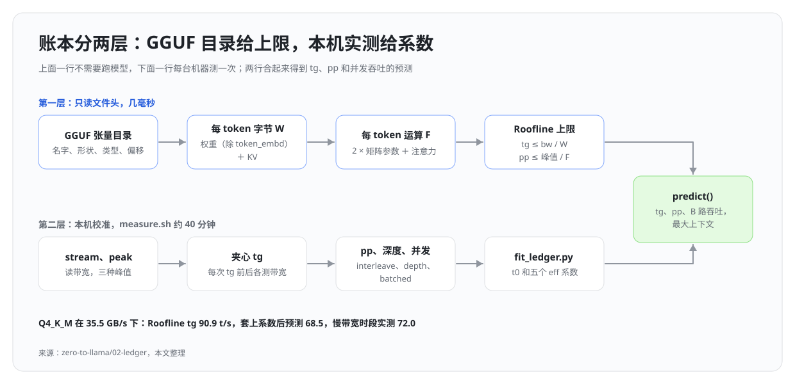
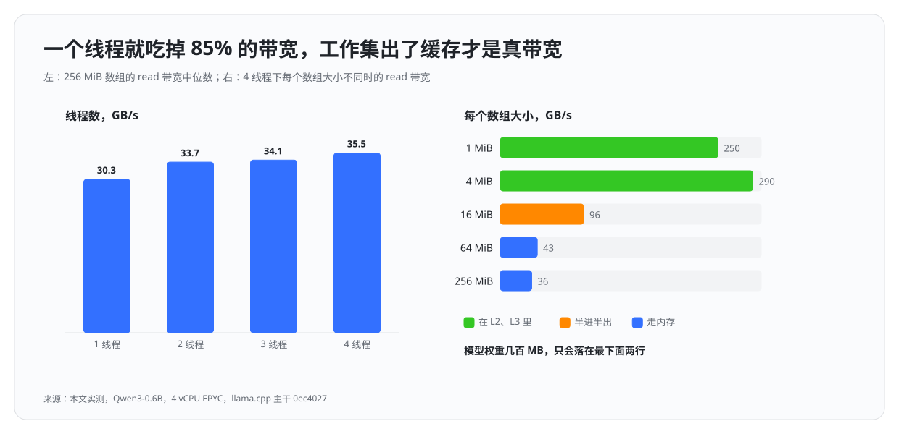
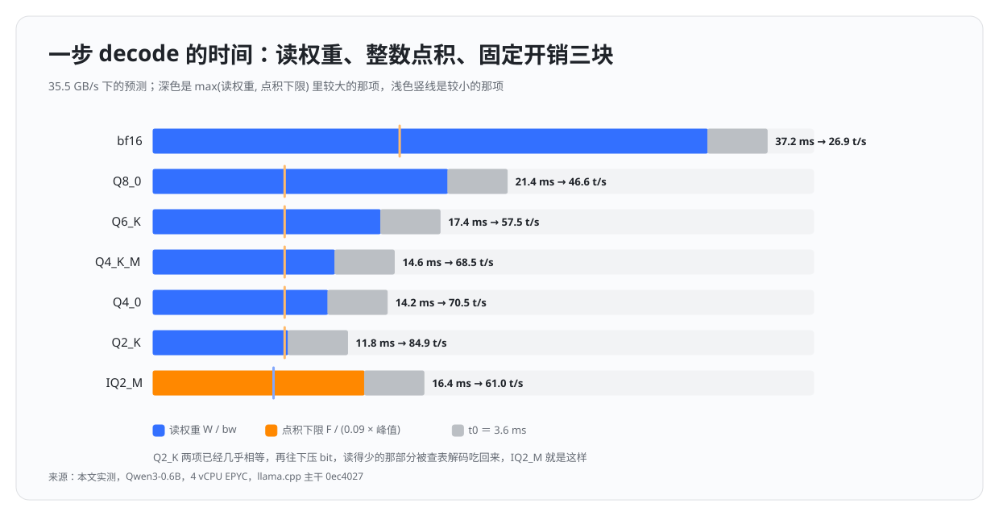
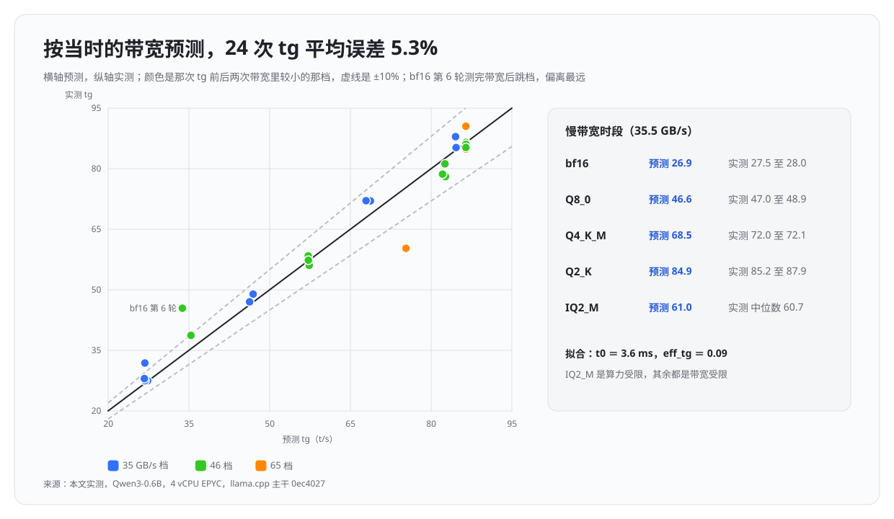
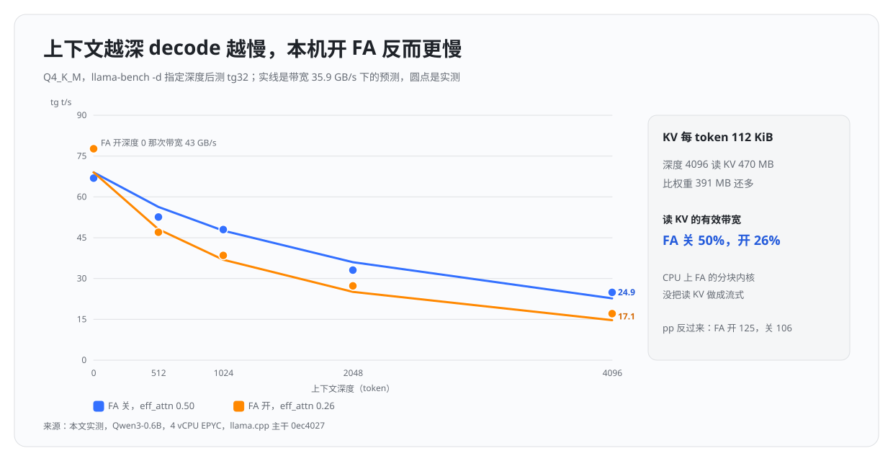
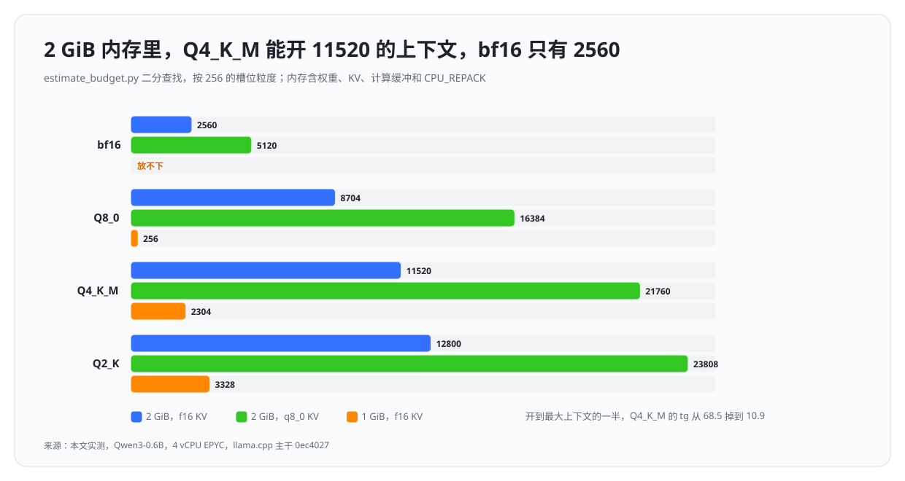

# LCPP-02｜上手｜推理账本：带宽、算力和启动前算出速度上限

> 🎯 **这篇文档解决什么问题**：我想在启动模型之前就知道它在一台机器上能跑多快、能开多长的上下文。这篇把速度拆成两层账：GGUF 的张量目录给出每个 token 要读多少字节、做多少运算，机器给出带宽和峰值算力，两者一除就是上限；再用本机实测拟合五个系数，把上限换成误差 5% 左右的预测。主线一句话：单序列 decode 的速度就是读权重的速度，上限用字节除以带宽算出来，实测和上限之间隔着一张系数表。
>
> 使用方式：先读导读和第 1 至 4 章拿到上限公式，再按第 6 章的夹心法在自己的机器上校准一遍。文中版本和数字核对于 2026 年 10 月 31 日。
>
> **代码**：[zero-to-llama/02-ledger](../02-ledger)。stream.c 和 peak.c 测机器，estimate_speed.py 和 estimate_budget.py 出预测，fit_ledger.py 从日志拟合系数，test_ledger.py 有 17 个用例，没有模型文件也能跑。基线是主干 0ec4027，模型是 Qwen3-0.6B，机器是 4 核 EPYC 云主机无 GPU。

# 导读 · 先给结论

- **单序列 decode 的速度就是读权重的速度。**Qwen3-0.6B 的 Q4_K_M 每生成一个 token 要读 390.8 MB 权重、做 1.19 G 次运算，算术强度 3 op/B，本机 int8 的屋脊点是 47 op/B。上限只看带宽：35.5 GB/s 除以 390.8 MB，得 90.9 t/s[[1]](https://doi.org/10.1145/1498765.1498785)。
- **上限和实测之间隔着一张系数表。**本机实测在 72 t/s 左右，差的部分来自每步 3.6 ms 的固定开销，以及 decode 走的 gemv 内核只用到 int8 峰值的 9%。五个系数拟合一次，24 次 tg 的平均误差是 5.3%。
- **云主机的带宽会跳。**同一台机器在 35、46、65 GB/s 三档之间切换[[2]](https://doi.org/10.1145/2885497)。拿一次带宽去配所有 tg，误差会翻倍；每个 tg 前后各测一次带宽，取较小的那个。
- **prompt 处理看算力，decode 看带宽。**pp512 在 380 至 540 t/s 之间，相当于 int8 峰值的 20%。关掉 repack 之后 pp 反而更快，tg 几乎不变。
- **上下文越深越慢，这台机器上开 FA 更慢。**深度 4096 时 FA 关 24.9 t/s，开 17.1 t/s。flash_attn 默认的 auto 在 CPU 上等于开，量化 V cache 还会强制打开它。
- **并发把带宽墙推成算力墙。**32 路并发时总吞吐 199 t/s，单路只剩 6 t/s；总吞吐的一半在三四路并发时就拿到了。
- **内存预算决定能开多长。**2 GiB 内存里 Q4_K_M 能开 11520 的上下文，bf16 只有 2560；KV 改成 q8_0 能开到 21760，代价是 decode 更慢。

**📎 与系列其他文档的分工**：本篇只算速度和上下文长度这两笔账。加载日志里权重、KV、计算缓冲三项内存从哪来，见 [LCPP-01｜上手｜第一次运行：编译、转换、加载和读懂内存账单](./01-first-run.md)；测量的噪声和显著性怎么判断，见 [LCPP-03｜上手｜测量方法：llama-bench、PPL、KLD 和噪声](./03-bench-ppl.md)；量化类型本身怎么选，见 [LCPP-07｜内部｜量化：块结构、配方、imatrix 和用 KLD 选类型](./07-quantization.md)。KV 量化、SWA 和 RoPE 缩放的细节放在 LCPP-08，线程、ubatch、mmap 的调优放在 LCPP-10。

# 第 1 章 · 先算账再开跑

## 1.1 我想回答的三个问题

每次拿到一台新机器和一个新模型，我最先被问到的总是三个问题：decode 能跑多快，prompt 处理能跑多快，最多能开多长的上下文。以前我的做法是直接跑 llama-bench，跑完再解释。这样的问题是解释永远在数字后面，换一台机器又要从头跑。

推理的性能模型其实很成熟。Roofline 模型把一个计算核的速度上限归结为两条线：内存带宽乘以算术强度，和峰值算力[[1]](https://doi.org/10.1145/1498765.1498785)。Horace He 用同样的思路解释过深度学习里大部分算子为什么受内存带宽限制[[3]](https://horace.io/brrr_intro.html)，Pope 等人在 TPU 上把 Transformer 推理的 prefill 和 decode 分别放进这个框架里推导[[4]](https://arxiv.org/abs/2211.05102)。这些分析告诉我，decode 一个 token 的时间几乎可以在纸上算出来。

针对大模型推理的综述也给出了同样的结论：单序列 decode 的算术强度很低，硬件算力的增长远快于内存带宽，瓶颈长期在搬数据上[[5]](https://arxiv.org/abs/2402.16363)[[6]](https://arxiv.org/abs/2403.14123)。Kim 等人的全栈综述和 Ivanov 等人对 Transformer 数据搬运的测量也指向同一处：真正花时间的是读写内存，浮点运算反而便宜[[7]](https://arxiv.org/abs/2302.14017)[[8]](https://arxiv.org/abs/2007.00072)。

## 1.2 账本分两层

我把这本账分成两层：第一层只用 GGUF 的张量目录和机器的两个数，算出的是 Roofline 上限，任何人拿到文件都能复现。第二层是本机校准：用几十次实测拟合出固定开销和内核效率这些系数，把上限换成预测。第一层告诉我天花板在哪，第二层告诉我实际能摸到多高。



分层的好处是出了偏差知道往哪查。上限算错了，说明字节或运算量数错了，去查张量目录。上限对而预测偏了，说明某个系数在新场景下不成立，比如换了线程数或者换了量化类型。两层混在一起，就只剩一句“实测比预期慢”。

## 1.3 本文的机器和模型

全部实测在一台云主机上：AMD EPYC Zen 4，lscpu 报告 4 个 vCPU，实际是 2 个物理核各开 2 路 SMT，每核 1 MiB L2，共享 32 MiB L3，8 GB 内存，没有 GPU，CPU 支持 AVX-512、VNNI 和 BF16 指令。模型是 Qwen3-0.6B[[9]](https://arxiv.org/abs/2505.09388)，28 层，16 个 query 头、8 个 KV 头，head_dim 128，我用它量化出 19 个 GGUF 变体。

选 0.6B 的小模型是有意的：它小到能在 8 GB 机器上同时放下 bf16 和所有量化版本，又大到权重远超 L3，读权重必须走内存。苹果在“LLM in a flash”里讨论的是模型比内存还大的情形[[10]](https://arxiv.org/abs/2312.11514)，本文不碰这个区间：所有变体都完整放在内存里，账本里只有内存带宽，没有磁盘带宽。

## 1.4 开场实验：KV cache 开和关

动手测机器之前，我先用一个小实验确认「decode 是读内存的题」从哪里来。[02-ledger](../02-ledger) 的 `kv_cache_timing.py` 用 numpy 写了一个 4 层的小 decoder（d=128，4 个头，d_ff=512，vocab=512，float64 随机权重），同一个 prompt 用两种做法各 greedy 生成 96 个 token：不带 cache 时，每生成一个 token 都把整段序列重新过一遍模型；带 cache 时只算新 token 一行，K、V 从缓存里取。两种做法生成的 token 必须完全相同，脚本会检查。


```bash
python3 kv_cache_timing.py
python3 kv_cache_timing.py --prompt 128 --gen 256
python3 kv_cache_timing.py --params-b 0.6 --layers 28 --d-model 1024 --prompt 512 --gen 256
python3 test_kv_cache_timing.py
```

这个实验我是在 Apple M4 Pro 上跑的，不是 1.3 节的 EPYC 云主机，时间随机器变，运算量和 token 一致性不变。prompt 32 个 token、每种做法跑 3 遍取最短：带 cache 用时 0.018 秒、0.23 GFLOP，每 token 0.18 毫秒；不带 cache 用时 0.114 秒、12.72 GFLOP，每 token 1.19 毫秒。运算量差 55.6 倍，时间只差 6.5 倍左右，多次运行在 6.5 到 6.9 倍之间。时间差得少，是因为带 cache 的每一步只算一行，矩阵太小，时间主要花在 Python 和 numpy 的调用开销上；把 prompt 和生成长度调大，时间差会随之拉大。

第三条命令换成本文 Qwen3-0.6B 的尺寸只算账（28 层，d=1024，prompt 512，生成 256）：带 cache 0.95 TFLOP，不带 cache 202.55 TFLOP，差 212.3 倍。llama.cpp 当然一直开着 KV cache。这个实验说明的是：每步只算一个 token 以后，运算量小到喂不饱 CPU，速度就由读权重和读 KV 的字节数决定，这正是第 3 章数字节、第 4 章算上限的出发点；第 8 章会看到，上下文每深一个 token，就要多读 112 KiB 的 KV。

# 第 2 章 · 机器的两个数：带宽和峰值

## 2.1 用 STREAM 测读带宽

带宽我用 McCalpin 的 STREAM 测[[11]](https://www.cs.virginia.edu/stream/ref.html)，仓库里的 stream.c 是一个最小版本，跑 copy、scale、add、triad 四个经典核，再加一个只读的 read 核。推理时读权重是纯读，几乎不写，所以账本用 read 的结果。每个数组默认 256 MiB，1 到 4 线程各跑 12 轮，取中位数。

```bash
gcc -O3 -march=native -ffast-math -fopenmp stream.c -o stream
for t in 1 2 3 4; do OMP_NUM_THREADS=$t ./stream 256; done
# {"threads": 4, "mib_per_array": 256, ..., "read_GBps": 36.15}
```

结果是 1 到 4 线程分别 30.3、33.7、34.1、35.5 GB/s，一个线程就拿到了四线程带宽的 85%，后面三个线程加起来只多了 5 GB/s。这个形状很重要：它说明 decode 加线程的收益很快见顶，第 7 章的线程扫描会再次看到这一点。



## 2.2 工作集要比 L3 大

STREAM 的规则是数组要远大于最后一级缓存，否则测到的是缓存带宽。我扫了一遍每个数组的大小：1 MiB 时读带宽 250 GB/s，4 MiB 时 290 GB/s，16 MiB 时掉到 96 GB/s，64 MiB 时 43 GB/s，256 MiB 时 36 GB/s。工作集超出 32 MiB 的 L3 之后，数字才稳定下来。

模型权重是几百 MB 的量级，每生成一个 token 都要从头扫一遍，缓存帮不上忙。所以账本里的带宽必须用大数组测，用 4 MiB 测出的 290 GB/s 去算 decode，会得到一个高出八倍的假上限。

## 2.3 用依赖链测峰值

峰值算力用 peak.c 测，它分别跑 AVX-512 的 fp32 FMA、BF16 点积 vdpbf16ps 和 int8 点积 vpdpbusd，每个线程开 12 条互不依赖的累加链，让指令的延迟被流水线盖住[[12]](https://www.agner.org/optimize/instruction_tables.pdf)[[13]](https://www.intel.com/content/www/us/en/docs/intrinsics-guide/index.html)。编译必须带 -O3，否则编译器会把累加器放回内存，测出来只有一半。

```bash
gcc -O3 -march=native -fopenmp peak.c -o peak
for t in 1 2 4; do OMP_NUM_THREADS=$t ./peak; done
# {"threads": 4, "fp32_fma_GFLOPS": 454.1, "bf16_dp_GFLOPS": 887.0, "int8_vnni_GOPS": 1662.4}
```

四线程下三个峰值分别是 fp32 454、bf16 887、int8 1662 G op/s，每一档正好是上一档的两倍左右，和每条指令处理的元素数一致。和带宽不同，峰值随线程数接近线性增长：int8 从单线程的 471 涨到四线程的 1662。

## 2.4 四个 vCPU 只有两个物理核

lscpu 里 Thread(s) per core 是 2，Core(s) per socket 是 2，四个 vCPU 其实是两个物理核的四个超线程，每对超线程共享执行端口和 L2。Zen 4 的 512 位指令在内部拆成两个 256 位操作执行[[14]](https://www.agner.org/optimize/microarchitecture.pdf)，所以 AVX-512 在这颗芯片上省的是指令数，峰值没有翻倍。

所以云主机的 vCPU 数不等于物理核数。四个 vCPU 开四个线程，有两个是在和自己的兄弟线程抢执行端口。算峰值和定线程数之前，先看 lscpu 的 Thread(s) per core。

> 🔑 **本章要点**：读带宽 35.5 GB/s，四线程 int8 峰值 1662 G op/s。带宽一个线程就吃掉 85%，峰值随线程线性涨。测带宽的数组必须远大于 L3。

# 第 3 章 · 模型的两个数：字节和运算量

## 3.1 从张量目录数字节

我先数字节。每生成一个 token 要读的字节，从 GGUF 的张量目录就能数出来。规则只有一条例外：token_embd 在图里走 GET_ROWS，每个 token 只取一行，不需要整张读[[15]](https://github.com/ggml-org/llama.cpp/blob/0ec4027/src/llama-graph.cpp)。所以权重字节等于除 token_embd 以外所有张量的字节数之和；Qwen3-0.6B 的 Q4_K_M 文件 478.3 MB，去掉 87.5 MB 的 token_embd，剩下 390.8 MB。

这 390.8 MB 里有一笔容易被忽略的大头：output 张量 127.6 MB，占三分之一。Q4_K_M 的配方把 output 放在 Q6_K，而它的形状是 1024 乘 151936，词表有多大它就有多大。小模型的词表占比高，这是 0.6B 模型量化后体积降不下来的主要原因。

| 张量组 | Q4_K_M 字节 | 类型 | decode 时 |
|-|-|-|-|
| token_embd | 87.5 MB | Q4_K | 只读一行，不计入 |
| output | 127.6 MB | Q6_K | 整张读 |
| ffn_up、gate、down | 159.9 MB | Q4_K 和 Q6_K | 整张读 |
| attn_q、k、v、output | 102.8 MB | Q4_K 和 Q6_K | 整张读 |
| norm 等一维张量 | 0.2 MB | F32 | 整张读 |

如果模型共享输入和输出词表，GGUF 里就没有 output 张量，图里的 output 投影直接复用 token_embd。这时 token_embd 要整张读一遍，ledger() 会把它加回去。estimate_speed.py 处理了这两种情况，test_ledger.py 里各有一个用例。

## 3.2 运算量是参数量的两倍

一次矩阵向量乘，每个权重贡献一次乘法和一次加法，所以 decode 一个 token 的运算量约等于参与矩阵乘的参数量的两倍。Q4_K_M 参与矩阵乘的参数是 5.96 亿，运算量 1.192 G 次。注意力本身的运算量随深度增长，每层每个头每个历史 token 约 4 乘 head_dim 次，深度为 0 时可以忽略。

prompt 处理的口径略有不同：llama-bench 测 pp 时只要最后一个 token 的 logits，所以 output 那次大矩阵乘只算一行。pp 的每 token 运算量因此是 0.881 G，比 decode 少 26%，少掉的正是 output。

## 3.3 KV 每个 token 112 KiB

KV cache 每个 token 的字节数等于层数乘 KV 头数乘 head_dim 乘 2（K 和 V）乘每个元素的字节数。Qwen3-0.6B 用分组查询注意力，16 个 query 头共享 8 个 KV 头[[16]](https://arxiv.org/abs/2305.13245)，f16 下每个 token 是 28 乘 8 乘 128 乘 2 乘 2，共 114688 字节，也就是 112 KiB。如果是多查询注意力，所有头共用一组 KV，这个数还能再降到八分之一[[17]](https://arxiv.org/abs/1911.02150)。

decode 第 n 个 token 时，要把前面 n 个 token 的 K 和 V 都读一遍。深度 4096 时这是 448 MiB，比全部权重还多。所以长上下文的 decode，账本里 KV 读取会反客为主，第 8 章专门算这一笔。

## 3.4 激活先量化成 int8

一个容易弄错的地方是峰值该用哪一档。Q4_K 这类量化权重在 CPU 上做点积，并不会把权重解压成浮点。ggml-cpu.c 的类型表里，Q4_K 的 vec_dot_type 是 Q8_K：激活先被量化成 8 位整数，再和 4 位权重做整数点积[[18]](https://github.com/ggml-org/llama.cpp/blob/0ec4027/ggml/src/ggml-cpu/ggml-cpu.c)，k-quants 引入时就是这样设计的[[19]](https://github.com/ggml-org/llama.cpp/pull/1684)。

所以 K-quant、legacy 和 i-quant 都对应 int8 峰值，bf16 权重对应 vdpbf16ps 的 bf16 峰值，f16 和 f32 对应 fp32 FMA。estimate_speed.py 按张量类型把参数分到这三条路径上，取占比最大的那条作为整个模型的峰值。

**📎 展开阅读：**K-quant 超级块里 144 字节的布局、scale 和 min 的存法，见 [LCPP-07｜内部｜量化：块结构、配方、imatrix 和用 KLD 选类型](./07-quantization.md) 的块格式一章。

# 第 4 章 · Roofline 上限

## 4.1 算术强度和屋脊点

算术强度是运算量除以字节数，Q4_K_M 单序列 decode 是 1.192 G 次运算除以 390.8 MB，约 3.05 op/B。机器的屋脊点是峰值除以带宽，int8 下 1662 除以 35.5，约 46.8 op/B[[1]](https://doi.org/10.1145/1498765.1498785)。算术强度落在屋脊点左边，速度由带宽决定；落在右边，由峰值决定。


单序列 decode 离屋脊点差了 15 倍，这意味着即便内核把整数点积做到峰值，速度也一点不会涨，因为瓶颈在读内存。上限就是带宽除以字节：35.5 GB/s 除以 390.8 MB，90.9 t/s。按峰值算的上限是 1395 t/s，高出一个数量级，可以直接忽略。

这个结论在其他硬件上也成立。llama.cpp 社区收集的苹果 M 系列测试里，同一个模型的 tg 速度几乎按芯片的内存带宽排序，和 GPU 核数关系不大[[20]](https://github.com/ggml-org/llama.cpp/discussions/4167)。

## 4.2 七个变体的上限

同样的算法套到不同量化变体上，上限只和每 token 字节数成反比。下表是 35.5 GB/s 带宽下的结果，实测取第 6 章夹心测量里落在慢带宽档的那几次。

| 变体 | Roofline tg | 预测 tg | 慢带宽档实测 |
|-|-|-|-|
| bf16 | 29.8 | 26.9 | 27.5 至 28.0 |
| Q8_0 | 56.0 | 46.6 | 47.0 至 48.9 |
| Q4_K_M | 90.9 | 68.5 | 72.0 至 72.1 |
| Q2_K | 122.3 | 84.9 | 85.2 至 87.9 |
| IQ2_M | 137.1 | 61.0（算力受限） | 中位数 60.7 |

bf16 的实测离上限只差 7%，Q2_K 差了 30%，IQ2_M 差了一半还多。字节越少，上限越高，离上限也越远。这说明权重越小，带宽以外的成本占比越大：固定开销和整数点积的时间开始露出来。下一章就是把这部分算清楚。

## 4.3 上限能回答什么

只有上限也已经能回答不少问题。从 Q8_0 换到 Q4_K_M，上限从 56 涨到 91，最多快 62%；实测只快了 50%，但方向和量级都对。从 Q4_K_M 换到 Q2_K，上限涨 35%，实测只涨了 20%，在精度上付出的代价换不回等比例的速度。

上限也给了测量一个校验：实测超过上限，一定是测错了：要么带宽测小了，要么模型其实小于你以为的大小，要么 llama-bench 测的不是你以为的配置[[21]](https://github.com/ggml-org/llama.cpp/blob/0ec4027/tools/llama-bench/README.md)。我在调试中遇到过一次 tg 超过上限，最后发现是带宽恰好跳到了 65 GB/s 那一档。

> 🔑 **本章要点**：单序列 decode 的算术强度 3 op/B，屋脊点 47 op/B，上限只看带宽。Q4_K_M 上限 90.9 t/s。权重越小，离上限越远。

# 第 5 章 · 离上限还差多少：固定开销和内核效率

## 5.1 一步 decode 拆成三块

Q4_K_M 的上限 90.9 t/s 对应每步 11.0 ms，实测 72 t/s 对应每步 13.9 ms，中间差了将近 3 ms。我把一步 decode 的时间拆成三块：读权重、整数点积和固定开销。读权重的时间是字节除以带宽，整数点积的时间是运算量除以内核的实际吞吐。固定开销包括建图、线程同步、采样，和模型大小基本无关。



读权重和整数点积在 CPU 上是重叠的：一个线程在等内存时，另一个线程可能正在算。所以我取两者的较大值，再加上固定开销。写成公式就是一步时间等于 max（权重字节除以带宽，运算量除以 eff_tg 乘峰值） 加 t0，其中 t0 和 eff_tg 是要拟合的两个系数。

```text
step = max(W / bw, F / (eff_tg * peak)) + KV * depth / (bw * eff_attn) + t0
pp   = eff_pp * peak / F_pp
B 路 = step + (B - 1) * (F / (eff_batch * peak) + t_kv)
```

## 5.2 t0 是 3.6 毫秒

t0 和 eff_tg 从第 6 章的夹心数据里联合拟合。四个变体的权重从 1.2 GB 到 0.27 GB，横跨四倍多，读权重的时间随之变化，t0 不变，两者可以分开；拟合结果是 t0 等于 3.6 ms，eff_tg 等于 0.09。

3.6 ms 是一个不小的数，对 Q4_K_M 来说它占了每步时间的四分之一，对更小的 Q2_K 占到三分之一。权重越小，t0 的占比越大，这就是第 4 章里看到的“字节越少离上限越远”。想让一个很小的模型跑得更快，再压权重收效有限，更该减少每步的固定开销，比如减少线程同步次数。

## 5.3 eff_tg 只有 0.09

eff_tg 等于 0.09 意味着 decode 的整数点积只用到 int8 峰值的 9%。这个数一开始让我怀疑拟合错了，于是我去读了实际执行的内核。llama.cpp 默认在加载时把 Q4_K 权重重排成 8 行交错的 q4_K_8x8 布局，这一步叫 repack[[22]](https://github.com/ggml-org/llama.cpp/blob/0ec4027/ggml/src/ggml-cpu/repack.cpp)[[23]](https://github.com/ggml-org/llama.cpp/pull/10446)。forward_mul_mat 按激活的行数分流：多于 3 行走 gemm，否则走 gemv，而 decode 每步只有 1 行激活，走的是 gemv。

在 x86 上，ggml_gemv_q4_K_8x8_q8_K 只有 AVX2 实现[[24]](https://github.com/ggml-org/llama.cpp/blob/0ec4027/ggml/src/ggml-cpu/arch/x86/repack.cpp)，我数了它的内循环：48 条 \_mm256_maddubs_epi16，15 条 \_mm256_madd_epi16，没有一条 512 位指令，也没有 VNNI 的 vpdpbusd。peak.c 测的 1662 G op/s 是 AVX-512 VNNI 的峰值，用 AVX2 的乘加对拼出整数点积，每条指令处理的元素少一半，还要多一步扩宽和相加[[13]](https://www.intel.com/content/www/us/en/docs/intrinsics-guide/index.html)。9% 的效率就是这样来的。

相比之下，同一文件里的 gemm 内核在支持 AVX512VNNI 时会用 \_mm512_dpbusd_epi32。prompt 处理走 gemm，所以第 7 章看到的 eff_pp 是 0.20，比 eff_tg 高一倍多。

## 5.4 Q2_K 封顶在 86 t/s

eff_tg 只在权重很小时才露面：Q4_K_M 读权重要 11.0 ms，整数点积按 0.09 的效率算是 8.0 ms，前者更大，所以是带宽受限。Q2_K 在 65 GB/s 的快带宽档里读权重只要 4.1 ms，点积却要 7.9 ms，变成算力受限：不管带宽再涨多少，预测都封顶在 86.5 t/s。实测三档带宽下 Q2_K 分别是 86.0、86.5、90.5 t/s，几乎不随带宽变化，正好印证了这一点。

单线程是另一个算力受限的例子。单线程 int8 峰值只有 471 G op/s，点积要 28.1 ms，远超读权重的 12.9 ms，预测 31.5 t/s，实测 48.9 t/s。这里预测偏低了 36%，说明 eff_tg 在单线程时更高：一个线程独占物理核，不和兄弟超线程抢端口。四线程的系数不能直接外推到一线程，这是这本账目前最大的短板。

## 5.5 码本类型另算

IQ2_M、IQ3_XXS 这些 i-quant 用码本存权重，点积前要先查表。我把它们的效率单独拟合成 eff_tg_codebook。IQ2_M 实测中位数 60.7 t/s，码本张量占参数的 74%，按加权平均反解出 eff_tg_codebook 等于 0.044，只有普通 K-quant 的一半。

所以 IQ2_M 虽然只有 259 MB，比 Q4_K_M 小三分之一，decode 反而更慢：预测 61.0 t/s，算力受限。在 CPU 上用 i-quant 只省内存，不省时间。

所以权重越小不一定越快。Q2_K 在快带宽下封顶，IQ2_M 因为查码本比 Q4_K_M 还慢。先看账本里 max() 的哪一项更大，再决定往哪个方向压。

> 🔑 **本章要点**：一步 decode 等于 max（读权重，整数点积） 加 3.6 ms 固定开销。decode 走 AVX2 的 gemv 内核，效率 9%。小权重和单线程会变成算力受限。

# 第 6 章 · 带宽会跳：夹心测量

## 6.1 同一台机器有三档带宽

拟合系数时我遇到的第一个麻烦是数字不稳：同一个 Q4_K_M，上午测 72 t/s，下午测 85 t/s。后来我在每次 llama-bench 之前都测一次带宽，发现这台云主机的读带宽在 35、46、65 GB/s 三档之间跳，每档持续几分钟到几十分钟。公有云上的性能波动早有系统研究，Leitner 和 Cito 测过多家云厂商，发现同规格实例的性能随时间和位置都会变化[[2]](https://doi.org/10.1145/2885497)。



带宽一跳，tg 跟着跳，任何没有同时记录带宽的 tg 数字都无法解释。Hoefler 和 Belli 在并行计算的基准规范里强调过，测量要报告足以复现的环境状态[[25]](https://doi.org/10.1145/2807591.2807644)，对云主机来说，这个状态里必须包括当时的带宽。

## 6.2 夹心法

我的做法是夹心：每次 tg 之前测一次带宽，之后再测一次，两次都在同一档才算有效，拟合时取两次里较小的值。measure.sh 里这一段跑 6 轮，每轮 4 个变体，共 24 个点。

```bash
b0=$(OMP_NUM_THREADS=4 ./stream 256 | sed 's/.*"read_GBps": \([0-9.]*\).*/\1/')
j=$($B/llama-bench -m $M/$v.gguf -t 4 -p 0 -n 64 -r 2 -o jsonl 2>/dev/null)
b1=$(OMP_NUM_THREADS=4 ./stream 256 | sed 's/.*"read_GBps": \([0-9.]*\).*/\1/')
```

24 个点按各自的带宽代入公式，拟合出 t0 和 eff_tg，平均误差 5.3%。如果所有点都用 35.5 GB/s 这一个中位数，平均误差会翻一倍多，快带宽档的点全部被低估。


## 6.3 误差大的几个点

24 个点里误差最大的两个是 bf16 在第 6 轮和 Q8_0 在第 3 轮。bf16 那次前后带宽都是 45.9 GB/s，实测 45.4 t/s，预测 33.8 t/s，实测高出 34%；Q8_0 那次带宽 65.5 GB/s，实测 60.3 t/s，预测 75.3 t/s，实测低了 20%。

我的判断是这两次带宽在测量间隙里跳了档：前后两次 STREAM 落在同一档，中间的 llama-bench 却跨进了另一档。夹心法只能保证两端，保证不了中间。我没有把这两个点剔掉，平均误差 5.3% 是带着它们算出来的。

## 6.4 怎么判断一个差异是真的

带宽漂移给所有 A/B 比较都埋了雷。我现在的规矩是两个配置交替跑，每轮先测带宽，同一轮内比较，跨轮的数字不直接相减。仓库里的 interleave.jsonl 就是按这个规矩跑的：5 轮，每轮先测带宽，再把 7 个变体各测一遍 pp512 和 tg64。噪声和显著性的完整方法见 [LCPP-03｜上手｜测量方法：llama-bench、PPL、KLD 和噪声](./03-bench-ppl.md)。

> 💡 **常见误区**：只测一次带宽就拿去配所有 tg，等于假设这台机器的带宽是常数。云主机上这个假设几乎总是错的。

> 🔑 **本章要点**：云主机带宽在 35、46、65 GB/s 三档跳。每个 tg 前后各测一次带宽，按当时带宽对账，24 次平均误差 5.3%。A/B 比较只在同一轮内做。

# 第 7 章 · prompt 处理、repack 和线程

## 7.1 pp 看的是算力

prompt 处理一次喂进几百个 token，同一份权重被几百行激活复用，算术强度从 3 op/B 涨到上千 op/B，远在屋脊点右边。所以 pp 的上限是峰值除以每 token 运算量：1662 G op/s 除以 0.881 G，约 1887 t/s。实测 pp512 在 380 至 540 t/s 之间，效率 eff_pp 约 0.20。

bf16 的 eff_pp 是 0.42，比 int8 高一倍，因为 bf16 权重的矩阵乘走 llamafile 的 tinyBLAS，它用 AVX-512 BF16 的 \_mm512_dpbf16_ps 指令[[26]](https://github.com/ggml-org/llama.cpp/blob/0ec4027/ggml/src/ggml-cpu/llamafile/sgemm.cpp)[[27]](https://github.com/ggml-org/llama.cpp/pull/6414)。tinyBLAS 覆盖 F32、BF16、F16、Q8_0、Q4_0、Q5_0 和 IQ4_NL，不覆盖 K-quant，K-quant 的 prompt 处理走 repack 的 gemm 或者普通的 vec_dot。

| 变体 | eff_pp | 路径 |
|-|-|-|
| bf16 | 0.42 | tinyBLAS，vdpbf16ps |
| Q8_0 | 0.19 | tinyBLAS 或 repack |
| Q6_K | 0.22 | repack gemm |
| Q4_K_M | 0.20 | repack gemm |
| Q4_0 | 0.20 | tinyBLAS 或 repack |
| Q2_K | 0.17 | repack gemm |
| IQ2_M | 0.25 | vec_dot |

## 7.2 关掉 repack，pp 反而更快

repack 本意是让 CPU 的矩阵乘更快，llama-bench 的 --repack 默认是 1[[21]](https://github.com/ggml-org/llama.cpp/blob/0ec4027/tools/llama-bench/README.md)。我把它关掉对比了两组，同一时段交替跑。第一组 repack 关时 pp512 是 484.0，开时 390.8。第二组关时 539.4，开时 384.0。tg 两组都几乎不变，开 repack 时快 1 至 2 t/s。

pp 慢了 20% 到 30%，这和我对 repack 的预期相反。我的推测是关掉 repack 后，Q4_K 的 prompt 处理改走普通 vec_dot，它在这颗 CPU 上有 AVX-512 实现，而 repack 的 gemm 每处理 8 行要做一次重排的额外工作。这个推测我没有用 perf 验证，只能说在本机、本模型上，长 prompt 为主的负载可以试一下 --no-repack。

另外有一次关 repack 的测量只有 pp 116.1、tg 42.8，tg 的标准差 25.7，和前后两组都对不上。我把它当成噪声，没有计入结论，日志原样留在 repack2.jsonl 里。

## 7.3 线程数：tg 在 3 线程见顶

线程扫描的结果如下：1 到 4 线程的 pp512 是 136.5、268.0、380.8、480.4，几乎线性增长；tg 是 48.9、66.8、74.6、71.0，3 线程最快，4 线程反而略慢。

| 线程 | pp512 | tg128 | pp 每线程 |
|-|-|-|-|
| 1 | 136.5 | 48.9 | 136.5 |
| 2 | 268.0 | 66.8 | 134.0 |
| 3 | 380.8 | 74.6 | 126.9 |
| 4 | 480.4 | 71.0 | 120.1 |

这和第 2 章的两条曲线完全吻合。pp 受算力限制，峰值随线程线性涨，pp 也线性涨。tg 受带宽限制，带宽一个线程就吃掉了 85%，加线程只能多拿一点点，第四个线程带来的同步开销已经超过它多拿的带宽。线程数和 ubatch 的完整调法见 LCPP-10。

## 7.4 ubatch 到 256 就够了

ubatch 是一次送进计算图的 token 数，我扫了 64、128、256、512 四档，pp512 分别是 474.1、495.1、503.4、501.3，256 以后就平了。ubatch 越大，计算缓冲越大，在内存紧张时可以放心把它降到 256。

# 第 8 章 · 上下文越深越慢：KV 和 Flash Attention

## 8.1 每多一个 token，多读 112 KiB

decode 第 n 个 token 时，每一层都要把前 n 个 token 的 K 和 V 读一遍。账本里这一项是 KV 每 token 字节乘以深度，再除以带宽和一个效率系数 eff_attn。我用 depth_sweep.sh 扫了深度 0 到 4096，FA 关和开各一遍，每个点前面都测一次带宽。



FA 关时，深度 0、512、1024、2048、4096 的 tg 分别是 66.9、52.6、48.0、33.1、24.9 t/s。按带宽算，深度 4096 读 KV 只要 13.1 ms，实测多出来的时间是 25.2 ms，有效带宽只有一半，所以 eff_attn 拟合成 0.50。

## 8.2 这台机器上开 FA 更慢

Flash Attention 在 GPU 上的价值是不把注意力矩阵写回显存，用分块和在线 softmax 把读写降到最少[[28]](https://arxiv.org/abs/2205.14135)[[29]](https://arxiv.org/abs/2307.08691)。在线 softmax 的思路来自 Milakov 和 Gimelshein[[30]](https://arxiv.org/abs/1805.02867)，Rabe 和 Staats 证明了注意力可以只用 O(√n) 的额外内存算完[[31]](https://arxiv.org/abs/2112.05682)；llama.cpp 在 2024 年加入了 CPU 和 GPU 上的 FA 实现[[32]](https://github.com/ggml-org/llama.cpp/pull/5021)。

可在我的 CPU 上，FA 开时深度 4096 只有 17.1 t/s，比关时的 24.9 慢了三分之一，eff_attn 只有 0.26。我读了 ops.cpp 里 decode 走的路径：单个 query 且 KV 是 f16、长度不少于 512 时，KV 按线程切块，每个线程在自己那块里逐个 key 处理，每个 key 做一次点积、一次标量 expf 更新最大值，再把 V 乘加进累加器，最后合并各线程的部分结果[[33]](https://github.com/ggml-org/llama.cpp/blob/0ec4027/ggml/src/ggml-cpu/ops.cpp)。每个 key 的 expf 是标量调用，V 的乘加只有 128 维，SIMD 刚热身就结束了；FA 关时的路径是两次批量矩阵乘加一次 softmax，向量化收益大得多。

llama-bench 单独测的 FA 对比也一致：深度 4096 时 FA 关 27.2 t/s，开 16.0 t/s。但在深度 0 时 FA 开反而快，83.7 对 65.6，prompt 处理也是开时快。所以“开不开 FA”要看负载：短上下文开，长上下文的 decode 在这台机器上关掉更快。

## 8.3 auto 在 CPU 上就是开

这件事的麻烦在于默认值：llama-bench 和 llama-cli 的 -fa 默认是 auto，llama-context.cpp 解析 auto 时会做一次探测，只要没有设备不匹配就打开 FA[[34]](https://github.com/ggml-org/llama.cpp/blob/0ec4027/src/llama-context.cpp)。在纯 CPU 的机器上，auto 等于开，我在深度扫描里的 bench-depth.jsonl 用的就是默认值，深度 4096 时是 17.3 t/s，和显式开 FA 的 17.1 一致。

> 💡 **常见误区**：-fa 的默认值 auto 在 CPU 上等于开。长上下文 decode 在本机开 FA 慢三分之一，要显式写 -fa off。

## 8.4 量化 V cache 会强制打开 FA

把 KV cache 量化是省内存的常见手段，KIVI 和 KVQuant 都证明了 KV 可以压到很低的位数而不明显损失精度[[35]](https://arxiv.org/abs/2402.02750)[[36]](https://arxiv.org/abs/2401.18079)。但在 llama.cpp 里，V cache 一旦是量化类型，FA 就必须打开：auto 会被改成开，显式关会直接报错退出[[34]](https://github.com/ggml-org/llama.cpp/blob/0ec4027/src/llama-context.cpp)。

这在 CPU 上代价很大：深度 4096、FA 开时，K 和 V 都是 f16 的 tg 是 18.0 t/s；V 改成 q8_0 掉到 8.3，改成 q4_0 掉到 7.1。原因还在那个逐 key 的循环里：V 是量化类型时，每个 key 都要先把 V 的一行解量化成 f32，再做乘加。KV 量化的取舍和 SWA、RoPE 缩放放在 LCPP-08 里讲。

| K 类型 \ V 类型 | f16 | q8_0 | q4_0 |
|-|-|-|-|
| f16 | 18.0 | 8.3 | 7.1 |
| q8_0 | 10.6 | 7.9 | 7.5 |
| q4_0 | 8.4 | 7.6 | 10.1 |

**📎 展开阅读：**K 和 V 的量化误差怎么用 KLD 衡量，见 [LCPP-07｜内部｜量化：块结构、配方、imatrix 和用 KLD 选类型](./07-quantization.md)。

> 🔑 **本章要点**：深度 4096 时 KV 读取比权重还多。本机 CPU 上 FA 的 decode 路径是逐 key 标量循环，长上下文开 FA 慢三分之一。auto 等于开，量化 V 强制开，都要算进账本。

# 第 9 章 · 并发：带宽墙变成算力墙

## 9.1 一份权重喂给多路请求

单序列 decode 慢在每生成一个 token 都要把全部权重扫一遍，而算力几乎闲着。如果同时有 B 路请求，把它们的当前 token 拼成一个 B 行的批次，权重只读一遍，就能给 B 路各算出一个 token。服务系统里管这叫连续批处理：Orca 按迭代粒度调度，每一步都允许新请求加入、完成的请求离开[[37]](https://www.usenix.org/conference/osdi22/presentation/yu)。llama.cpp 在 2023 年加入了自定义注意力掩码和多序列并行解码，同一个 KV cache 里能放多条互不可见的序列[[38]](https://github.com/ggml-org/llama.cpp/pull/3228)。

放进账本里，B 路一步的时间是单路一步再加上 B 减 1 份额外开销。权重只读一遍，所以额外开销里没有读权重这一项，只有多出来那几行的矩阵乘，以及每路各自读自己的 KV。B 越大，读权重这笔固定成本摊得越薄，瓶颈就从带宽一侧慢慢挪到算力一侧。

## 9.2 用 batched-bench 测

测并发我用 llama-batched-bench，它能在一个进程里模拟 B 路同时 decode，不用起服务[[39]](https://github.com/ggml-org/llama.cpp/blob/0ec4027/tools/batched-bench/README.md)。下面这条命令每路 prompt 128 个 token、生成 32 个，并发数扫 1 到 32。

```bash
llama-batched-bench -m q-Q4_K_M.gguf -t 4 -c 8192 -b 2048 -ub 512 \
  -npp 128 -ntg 32 -npl 1,2,4,8,16,32
# |  PP |  TG |  B | N_KV | ... | S_TG t/s | ...
# | 128 |  32 | 32 | 5120 | ... |   199.12 | ...
```

| 并发 B | 总 S_TG | 单路 | 每步耗时 |
|-|-|-|-|
| 1 | 62.3 | 62.3 | 16.0 ms |
| 2 | 94.4 | 47.2 | 21.2 ms |
| 4 | 126.7 | 31.7 | 31.6 ms |
| 8 | 132.2 | 16.5 | 60.5 ms |
| 16 | 182.3 | 11.4 | 87.8 ms |
| 32 | 199.1 | 6.2 | 160.7 ms |

总吞吐从 62 涨到 199，涨了 3.2 倍；单路速度从 62 掉到 6，掉了 10 倍。并发换来的是机器的总产出，代价落在每个用户身上。B 等于 1 这一行比第 6 章的 72 t/s 慢，因为 batched-bench 的 c 是 8192，生成从深度 128 开始，而且那次测量正好落在慢带宽档。


## 9.3 每多一路多 4.62 毫秒

把每步耗时对 B 做线性拟合，得到 14.5 加 4.62 乘 B 毫秒。截距是读权重和固定开销，斜率是每多一路要多做的那一行矩阵乘。Q4_K_M 每 token 1.192 G 次运算，4.62 ms 意味着这部分只跑到 int8 峰值的 15.5%，这就是 eff_batch 等于 0.155 的来历。它比 decode 的 0.09 高，比 prompt 处理的 0.20 低：B 大于 3 之后矩阵乘改走 gemm 内核，但行数还不够多，喂不饱。

按这个公式，B 趋于无穷时总吞吐的天花板是 1000 除以 4.62，216 t/s；总吞吐达到天花板一半的点在 B 约等于 3.2。在这台机器上开三四路并发就能拿到一半的潜力，再往上每多一路，总吞吐涨得越来越少，单路越来越慢。

有一个点对不上：B 等于 8 时实测 132.2，按拟合应该在 155 左右，低了 22%。这个点只跑了一次，我怀疑是那段时间带宽恰好掉档，但没有夹心测带宽，无法确认。我没把它从拟合里去掉，读者在自己机器上复测时可以重点看这一档。

## 9.4 用利特尔定律定并发数

服务该开几路，要从延迟目标倒推。利特尔定律说系统里的平均请求数等于到达率乘以平均停留时间[[40]](https://doi.org/10.1287/opre.9.3.383)。假设每个请求生成 200 个 token，要求单路不低于 20 t/s，查上表只能开到 4 路，这时每个请求要 6.3 秒，系统每秒能服务 0.63 个请求。想服务更多请求，只能放宽单路速度的要求，加线程帮不上忙。

更大的系统会把 prefill 和 decode 拆开调度。SARATHI 把长 prompt 切块，和 decode 拼在同一批里，减少 decode 被 prefill 卡住的时间[[41]](https://arxiv.org/abs/2308.16369)；Splitwise 和 DistServe 干脆把两个阶段放到不同机器上，各按自己的瓶颈配硬件[[42]](https://arxiv.org/abs/2311.18677)[[43]](https://arxiv.org/abs/2401.09670)。在一台 4 核 CPU 上这些都用不上，但思路一样：prefill 吃算力，decode 吃带宽，混在一起时要分开算账。

多路并发的另一笔账是 KV，B 路各自的上下文都要占 KV cache，PagedAttention 用分页管理来减少碎片和预留浪费[[44]](https://arxiv.org/abs/2309.06180)。llama.cpp 的做法更简单：不开 unified KV 时，总上下文按路数均分，每路 n_ctx 除以 B，再按 256 对齐[[34]](https://github.com/ggml-org/llama.cpp/blob/0ec4027/src/llama-context.cpp)。c 设 8192、开 32 路，每路只有 256，prompt 稍长就放不下。

> 💡 **常见误区**：server 的 -np 默认是 auto，会开 4 个槽位并打开 unified KV。显式写 -np 而不写 -kvu 时，-c 会被槽位数均分，每路能开的上下文比你以为的短得多[[45]](https://github.com/ggml-org/llama.cpp/blob/0ec4027/common/arg.cpp)。

> 🔑 **本章要点**：B 路一步约 14.5 加 4.62 乘 B 毫秒。32 路总吞吐 199 t/s，单路 6 t/s，天花板 216 t/s，三四路就拿到一半。并发数从单路延迟目标倒推，KV 按路数分摊。

# 第 10 章 · 内存预算：能开多长的上下文

## 10.1 预算里有四笔

速度之外的另一个问题是能开多长。一个进程的内存由四笔组成：权重、KV cache、计算缓冲，以及 repack 的副本。前三笔的来历和加载日志里的对应行见 [LCPP-01｜上手｜第一次运行：编译、转换、加载和读懂内存账单](./01-first-run.md)，这里只用结论。repack 把能重排的张量复制一份放进 CPU_REPACK 缓冲，原来那份不再保留，所以总量不会翻倍，但 estimate_memory.py 要把两部分分开记。

KV 随上下文线性增长，f16 下每个 token 112 KiB；计算缓冲主要由 ubatch 和词表决定，Qwen3-0.6B 在 ubatch 512 时约 310 MiB，和上下文关系不大，权重是常数，所以给定一个内存预算，能开的上下文就是预算减去权重和计算缓冲，再除以每 token 的 KV。

## 10.2 estimate_budget.py 二分查找

estimate_budget.py 对每个模型二分查找最大的上下文，步长 256，和 llama.cpp 里 n_ctx 的对齐粒度一致。找到之后，它再调 estimate_speed.py 预测上下文为 0 和开到一半时的 tg，一次给出长度和速度两个答案。

```bash
PYTHONPATH=. python3 estimate_budget.py --budget 2048 models/*.gguf
# budget 2048 MiB  bw 35.5 GB/s  K f16 V f16 FA on
# model          max ctx  mem MiB   tg@0  tg@ctx/2
# q-Q4_K_M         11520     2035   68.5      10.9
```

| 变体 | 最大上下文 | tg@0 | tg@一半 | 主要占用 |
|-|-|-|-|-|
| bf16 | 2560 | 26.9 | 18.8 | 权重 1434 MiB |
| Q8_0 | 8704 | 46.6 | 13.2 | 权重和 KV 各半 |
| Q4_K_M | 11520 | 68.5 | 10.9 | KV 1260 MiB |
| Q2_K | 12800 | 84.9 | 9.9 | KV 1400 MiB |



bf16 的权重就吃掉了 1.4 GiB，剩给 KV 的不到 300 MiB，只能开 2560。量化到 Q4_K_M 后权重省下一个多 GiB，全部换成了 KV，上下文涨到四倍多。再压到 Q2_K，权重只少了 80 MiB，上下文只多 1280。权重小到一定程度之后，长度的瓶颈就变成 KV 本身。

## 10.3 开到最长，速度会掉到多少

表里最容易被忽略的是最后一列。Q4_K_M 开到 11520 的一半，深度 5760，每步要读 630 MiB 的 KV，比权重还多一倍，tg 从 68.5 掉到 10.9。四个变体在深度一半时的 tg 挤在 10 到 19 之间，差距比深度 0 时小得多，因为此时大家都在读 KV，权重大小已经不重要了。

所以评估一个模型能不能用，要看开到我需要的长度时还有多快，深度 0 的 tg 只是起点。这本账把两个数放在同一行，就是为了不让人只看前一个。

## 10.4 量化 KV 和缩小 ubatch

想在同样的内存里开更长，有两个开关。第一个是把 KV 改成 q8_0：每 token 的 KV 从 112 KiB 降到 59.5 KiB，Q4_K_M 的最大上下文从 11520 涨到 21760。代价是第 8 章那张表：量化 V 会强制打开 FA，深度一半时的预测 tg 是 10.0，和 f16 的 10.9 差不多，但深度相同时会慢一半以上。

第二个是缩小 ubatch：ubatch 从 512 降到 256，计算缓冲小了一半左右，Q4_K_M 能开到 13056，bf16 从 2560 涨到 4096。第 7 章测过，ubatch 256 时 pp 只比 512 低不到 1%，在内存紧张时这几乎是免费的。

```bash
PYTHONPATH=. python3 estimate_budget.py --budget 2048 --ctk q8_0 --ctv q8_0 models/q-Q4_K_M.gguf
# q-Q4_K_M   21760 ...
PYTHONPATH=. python3 estimate_budget.py --budget 2048 --ubatch 256 models/q-Q4_K_M.gguf
# q-Q4_K_M   13056 ...
```

最后别忘了，预算要扣掉系统和其他进程。8 GB 的机器不等于能给 llama.cpp 8 GB，--headroom 参数就是为这个留的。

> 🔑 **本章要点**：内存等于权重加 KV 加计算缓冲。2 GiB 下 Q4_K_M 能开 11520，bf16 只有 2560。开到一半时各变体 tg 都掉到 10 到 19。q8_0 KV 让长度翻倍，ubatch 256 几乎免费多开 1500。

# 第 11 章 · 怎么选与上线清单

## 11.1 先问瓶颈在哪一项

拿到一个具体需求，我先把它代进账本，看 max() 里哪一项更大、KV 那项占多少，再决定往哪个方向调。下表是这台机器上几种典型负载的结论，换机器之后数字会变，判断的方法不变。

| 负载 | 瓶颈 | 先做什么 | 别做什么 |
|-|-|-|-|
| 单用户聊天，短上下文 | 读权重 | 换更小的 K-quant，3 线程 | 换 i-quant，加线程 |
| 长文档问答，深度 4K 以上 | 读 KV | -fa off，按需量化 K | 量化 V，只看深度 0 的 tg |
| 批量摘要，prompt 为主 | pp 算力 | 试 --no-repack，ubatch 256 | 盯着 tg 调参 |
| 多用户服务 | 矩阵乘 | 按延迟目标定 -np，开 -kvu | 开满 32 路 |
| 小内存设备 | 内存 | q8_0 KV，ubatch 256 | 为长度用 bf16 |

## 11.2 换一台机器要重测什么

第一层账只要两个数：STREAM 的 read 带宽和 peak.c 的 int8 峰值，各跑一分钟。第二层的五个系数要重新拟合：t0 和 eff_tg 跑一遍夹心测量，eff_pp 跟着同一批数据出来，eff_attn 跑深度扫描，eff_batch 跑 batched-bench；measure.sh 和 depth_sweep.sh 加起来不到一小时。

如果机器换了架构，比如从 x86 换到 ARM，eff_tg 一定要重测，因为 gemv 内核换了一套实现；如果只换了同架构的核数，t0 和 eff_tg 大概率还能用，带宽和峰值重测就够。单线程时 eff_tg 偏高的问题，第 5 章说过，账本目前不处理。

## 11.3 这本账的边界

账本有几个前提：权重全在内存里，不换页。线程数是 4，批次是单序列或均匀的 B 路。KV 是普通全注意力。SWA、MoE、投机解码都不在里面：SWA 让 KV 读取不再随深度线性增长，MoE 每个 token 只读一部分专家，投机解码把一步变成验证多个 token。这些分别放在 LCPP-08、LCPP-11 和 LCPP-13，到时候都在这本账上加项。

GPU 上的账也是同样的结构，只是带宽换成显存带宽，峰值换成 Tensor Core 的峰值，还多一笔 PCIe 搬运。我没有 GPU 机器，这部分的系数没法给出实测值。下一步先读 [LCPP-03｜上手｜测量方法：llama-bench、PPL、KLD 和噪声](./03-bench-ppl.md)，把测量噪声的判断方法补上，再回来拟合自己机器的系数。

> 📌 **上线前核对清单**：上线一个 CPU 推理配置之前，我会逐条过一遍。
> - 用 256 MiB 以上的数组测过读带宽，并且知道这台机器有没有带宽档位
> - 看过 lscpu 的 Thread(s) per core，线程数按物理核和 tg 扫描结果定
> - 用 estimate_speed.py 算过上限，实测没有超过上限
> - 长上下文负载显式写了 -fa off 或测过 FA 开关两种情况
> - 量化 V cache 之前，在目标深度上测过 tg
> - 用 estimate_budget.py 按目标长度和 --headroom 算过内存
> - 服务的 -np 从单路延迟目标倒推，确认了 -kvu 或每路分到的上下文
> - 同一轮内交替跑 A 和 B 配置，跨轮的数字没有直接相减

# 参考文献

按正文首次引用顺序编号，资料截至 2026 年 10 月初。

[1] Williams S, Waterman A, Patterson D. Roofline: An Insightful Visual Performance Model for Multicore Architectures. Communications of the ACM, 2009. [doi:10.1145/1498765.1498785](https://doi.org/10.1145/1498765.1498785)

[2] Leitner P, Cito J. Patterns in the Chaos: A Study of Performance Variation and Predictability in Public IaaS Clouds. ACM TOIT, 2016. [doi:10.1145/2885497](https://doi.org/10.1145/2885497)

[3] He H. Making Deep Learning Go Brrrr From First Principles. 2022. [horace.io/brrr_intro](https://horace.io/brrr_intro.html)

[4] Pope R et al. Efficiently Scaling Transformer Inference. MLSys 2023. [arXiv:2211.05102](https://arxiv.org/abs/2211.05102)

[5] Yuan Z et al. LLM Inference Unveiled: Survey and Roofline Model Insights. arXiv 2024. [arXiv:2402.16363](https://arxiv.org/abs/2402.16363)

[6] Gholami A et al. AI and Memory Wall. IEEE Micro, 2024. [arXiv:2403.14123](https://arxiv.org/abs/2403.14123)

[7] Kim S et al. Full Stack Optimization of Transformer Inference: a Survey. arXiv 2023. [arXiv:2302.14017](https://arxiv.org/abs/2302.14017)

[8] Ivanov A et al. Data Movement Is All You Need: A Case Study on Optimizing Transformers. MLSys 2021. [arXiv:2007.00072](https://arxiv.org/abs/2007.00072)

[9] Qwen Team. Qwen3 Technical Report. arXiv 2025. [arXiv:2505.09388](https://arxiv.org/abs/2505.09388)

[10] Alizadeh K et al. LLM in a flash: Efficient Large Language Model Inference with Limited Memory. ACL 2024. [arXiv:2312.11514](https://arxiv.org/abs/2312.11514)

[11] McCalpin J D. Memory Bandwidth and Machine Balance in Current High Performance Computers. IEEE TCCA Newsletter, 1995. [cs.virginia.edu/stream](https://www.cs.virginia.edu/stream/ref.html)

[12] Fog A. Instruction tables: Lists of instruction latencies, throughputs and micro-operation breakdowns. 2024. [agner.org/optimize/instruction_tables.pdf](https://www.agner.org/optimize/instruction_tables.pdf)

[13] Intel. Intel Intrinsics Guide: \_mm512_dpbusd_epi32, \_mm256_maddubs_epi16, \_mm512_dpbf16_ps. [intel.com/intrinsics-guide](https://www.intel.com/content/www/us/en/docs/intrinsics-guide/index.html)

[14] Fog A. The microarchitecture of Intel, AMD and VIA CPUs. 2024. [agner.org/optimize/microarchitecture.pdf](https://www.agner.org/optimize/microarchitecture.pdf)

[15] llama.cpp 0ec4027. src/llama-graph.cpp：token_embd 走 GET_ROWS。 [src/llama-graph.cpp](https://github.com/ggml-org/llama.cpp/blob/0ec4027/src/llama-graph.cpp)

[16] Ainslie J et al. GQA: Training Generalized Multi-Query Transformer Models from Multi-Head Checkpoints. EMNLP 2023. [arXiv:2305.13245](https://arxiv.org/abs/2305.13245)

[17] Shazeer N. Fast Transformer Decoding: One Write-Head is All You Need. arXiv 2019. [arXiv:1911.02150](https://arxiv.org/abs/1911.02150)

[18] llama.cpp 0ec4027. ggml/src/ggml-cpu/ggml-cpu.c：type_traits_cpu 里各权重类型的 vec_dot_type。 [ggml-cpu.c](https://github.com/ggml-org/llama.cpp/blob/0ec4027/ggml/src/ggml-cpu/ggml-cpu.c)

[19] Kawrakow I. k-quants. llama.cpp PR #1684, 2023. [PR #1684](https://github.com/ggml-org/llama.cpp/pull/1684)

[20] Gerganov G et al. Performance of llama.cpp on Apple Silicon M-series. llama.cpp Discussion #4167. [Discussion #4167](https://github.com/ggml-org/llama.cpp/discussions/4167)

[21] llama.cpp 0ec4027. tools/llama-bench/README.md。 [tools/llama-bench](https://github.com/ggml-org/llama.cpp/blob/0ec4027/tools/llama-bench/README.md)

[22] llama.cpp 0ec4027. ggml/src/ggml-cpu/repack.cpp：加载时重排和 forward_mul_mat 的 gemm、gemv 分流。 [ggml-cpu/repack.cpp](https://github.com/ggml-org/llama.cpp/blob/0ec4027/ggml/src/ggml-cpu/repack.cpp)

[23] Djip007. Refactor/online repacking. llama.cpp PR #10446, 2024. [PR #10446](https://github.com/ggml-org/llama.cpp/pull/10446)

[24] llama.cpp 0ec4027. ggml/src/ggml-cpu/arch/x86/repack.cpp：ggml_gemv_q4_K_8x8_q8_K 和 ggml_gemm_q4_K_8x8_q8_K。 [arch/x86/repack.cpp](https://github.com/ggml-org/llama.cpp/blob/0ec4027/ggml/src/ggml-cpu/arch/x86/repack.cpp)

[25] Hoefler T, Belli R. Scientific Benchmarking of Parallel Computing Systems. SC 2015. [doi:10.1145/2807591.2807644](https://doi.org/10.1145/2807591.2807644)

[26] llama.cpp 0ec4027. ggml/src/ggml-cpu/llamafile/sgemm.cpp：tinyBLAS 支持的权重类型。 [llamafile/sgemm.cpp](https://github.com/ggml-org/llama.cpp/blob/0ec4027/ggml/src/ggml-cpu/llamafile/sgemm.cpp)

[27] jart. Improve cpu prompt eval speed. llama.cpp PR #6414, 2024. [PR #6414](https://github.com/ggml-org/llama.cpp/pull/6414)

[28] Dao T et al. FlashAttention: Fast and Memory-Efficient Exact Attention with IO-Awareness. NeurIPS 2022. [arXiv:2205.14135](https://arxiv.org/abs/2205.14135)

[29] Dao T. FlashAttention-2: Faster Attention with Better Parallelism and Work Partitioning. ICLR 2024. [arXiv:2307.08691](https://arxiv.org/abs/2307.08691)

[30] Milakov M, Gimelshein N. Online normalizer calculation for softmax. arXiv 2018. [arXiv:1805.02867](https://arxiv.org/abs/1805.02867)

[31] Rabe M N, Staats C. Self-attention Does Not Need O(n^2) Memory. arXiv 2021. [arXiv:2112.05682](https://arxiv.org/abs/2112.05682)

[32] Gerganov G. ggml : add Flash Attention. llama.cpp PR #5021, 2024. [PR #5021](https://github.com/ggml-org/llama.cpp/pull/5021)

[33] llama.cpp 0ec4027. ggml/src/ggml-cpu/ops.cpp：CPU flash attention 的单 key 循环和 split-KV 路径。 [ggml-cpu/ops.cpp](https://github.com/ggml-org/llama.cpp/blob/0ec4027/ggml/src/ggml-cpu/ops.cpp)

[34] llama.cpp 0ec4027. src/llama-context.cpp：flash_attn auto 的解析和量化 V 强制打开 FA。 [src/llama-context.cpp](https://github.com/ggml-org/llama.cpp/blob/0ec4027/src/llama-context.cpp)

[35] Liu Z et al. KIVI: A Tuning-Free Asymmetric 2bit Quantization for KV Cache. ICML 2024. [arXiv:2402.02750](https://arxiv.org/abs/2402.02750)

[36] Hooper C et al. KVQuant: Towards 10 Million Context Length LLM Inference with KV Cache Quantization. NeurIPS 2024. [arXiv:2401.18079](https://arxiv.org/abs/2401.18079)

[37] Yu G-I et al. Orca: A Distributed Serving System for Transformer-Based Generative Models. OSDI 2022. [usenix.org/osdi22/yu](https://www.usenix.org/conference/osdi22/presentation/yu)

[38] Gerganov G. llama : custom attention mask + parallel decoding + no context swaps. llama.cpp PR #3228, 2023. [PR #3228](https://github.com/ggml-org/llama.cpp/pull/3228)

[39] llama.cpp 0ec4027. tools/batched-bench/README.md。 [tools/batched-bench](https://github.com/ggml-org/llama.cpp/blob/0ec4027/tools/batched-bench/README.md)

[40] Little J D C. A Proof for the Queuing Formula: L = λW. Operations Research, 1961. [doi:10.1287/opre.9.3.383](https://doi.org/10.1287/opre.9.3.383)

[41] Agrawal A et al. SARATHI: Efficient LLM Inference by Piggybacking Decodes with Chunked Prefills. arXiv 2023. [arXiv:2308.16369](https://arxiv.org/abs/2308.16369)

[42] Patel P et al. Splitwise: Efficient Generative LLM Inference Using Phase Splitting. ISCA 2024. [arXiv:2311.18677](https://arxiv.org/abs/2311.18677)

[43] Zhong Y et al. DistServe: Disaggregating Prefill and Decoding for Goodput-optimized Large Language Model Serving. OSDI 2024. [arXiv:2401.09670](https://arxiv.org/abs/2401.09670)

[44] Kwon W et al. Efficient Memory Management for Large Language Model Serving with PagedAttention. SOSP 2023. [arXiv:2309.06180](https://arxiv.org/abs/2309.06180)

[45] llama.cpp 0ec4027. common/arg.cpp：-np、-kvu 的默认值和说明。 [common/arg.cpp](https://github.com/ggml-org/llama.cpp/blob/0ec4027/common/arg.cpp)

---

[在 Colab 里跑本章 CPU 练习](https://colab.research.google.com/github/chenziyaos/zero-to-llama/blob/main/colab/02-ledger.ipynb) · 上一章：[LCPP-01｜上手｜第一次运行：编译、转换、加载和读懂内存账单](./01-first-run.md) · [目录](./README.md) · 下一章：[LCPP-03｜上手｜测量方法：llama-bench、PPL、KLD 和噪声](./03-bench-ppl.md)
