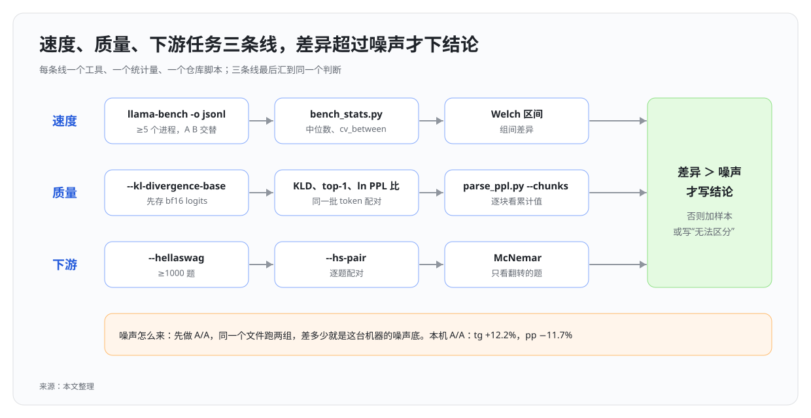
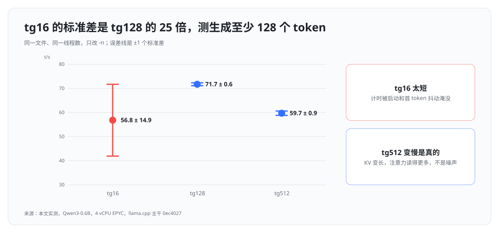
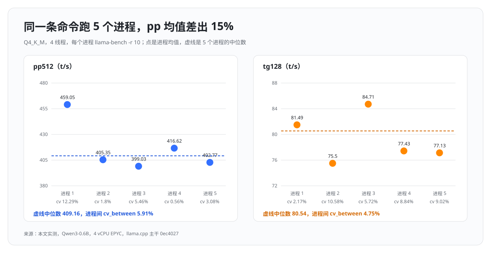
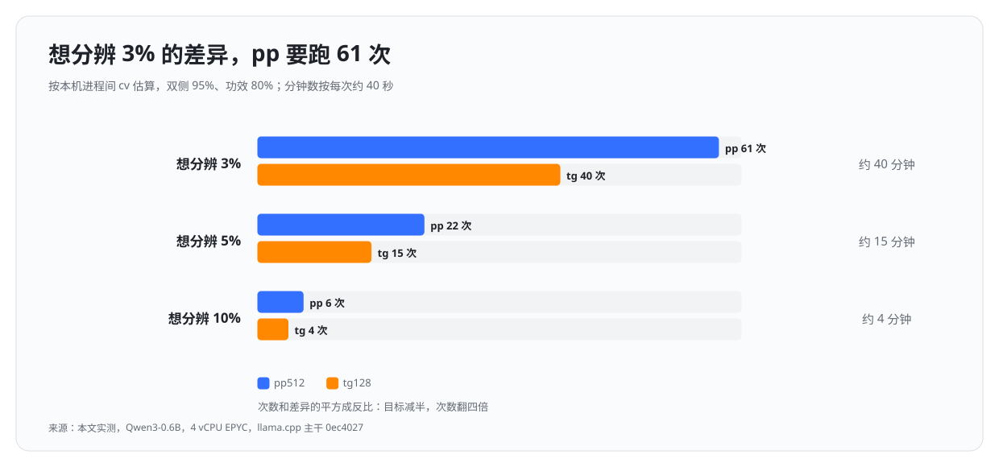
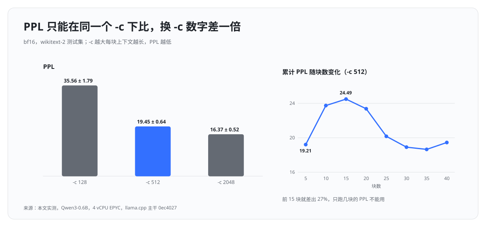
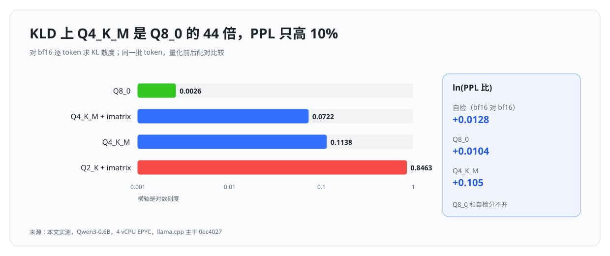
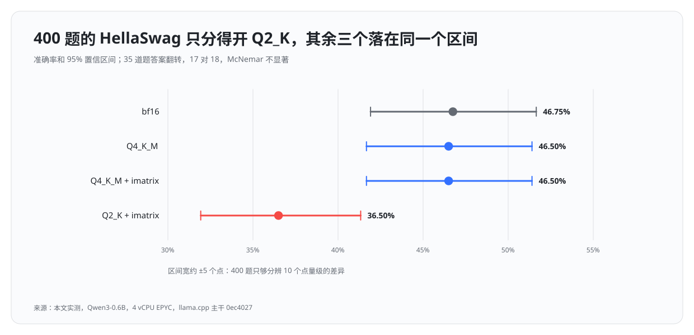
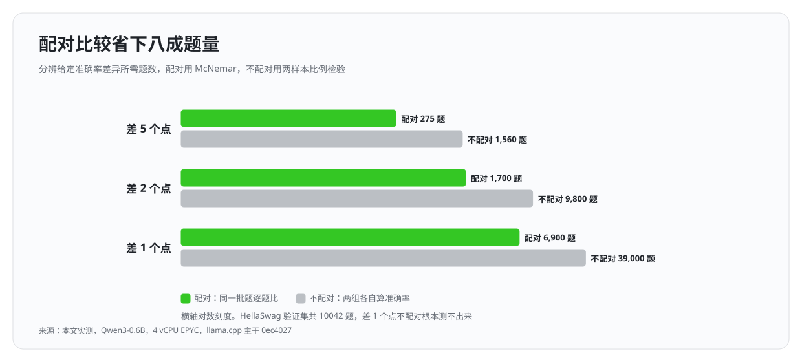
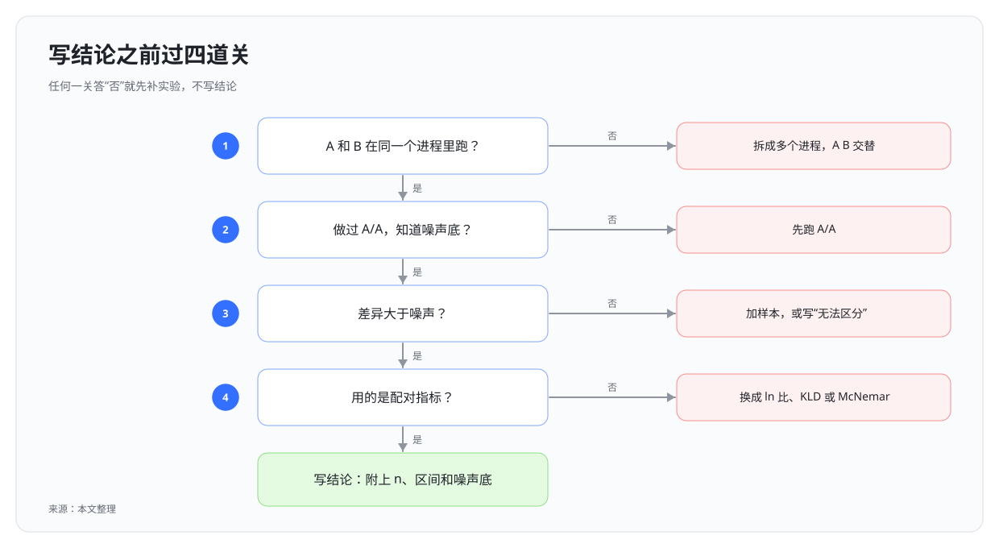

# LCPP-03｜上手｜测量方法：llama-bench、PPL、KLD 和噪声

> 🎯 **这篇文档解决什么问题**：改一个参数，llama-bench 的 tg 从 75 跳到 85，是参数起了作用，还是机器抖了一下？换一个量化，PPL 从 23.4 变成 25.6，±1.25 的误差条几乎重叠，算不算变差？HellaSwag 掉了 0.25 个点，要不要在意？后面每一篇都要拿数字下结论，这一篇先把尺子校准。主线一句话：任何一个“A 比 B 好”，都要先说清测的是什么量、噪声多大、样本够不够。
>
> 使用方式：只关心速度，看第 2 至 4 章；关心量化质量，看第 5 至 8 章；第 9 章讲 HellaSwag，第 10 章是测量清单，第 11 章是排障和练习。文中版本和数字核对于 2026 年 10 月 31 日。
>
> **代码**：[zero-to-llama/03-bench-ppl](../03-bench-ppl)。bench_stats.py 和 parse_ppl.py 只依赖 Python 标准库，所有日志随仓库提供，不下载模型也能复现文中每一个数字。基线是主干 0ec4027，模型是 Qwen3-0.6B（bf16 和多个量化变体），机器是 4 核 EPYC 云主机无 GPU。

# 导读 · 先给结论

- **llama-bench 的 ± 只描述一个进程内部。**stddev_ts 是同一进程里 -r 次重复的样本标准差[[1]](https://github.com/ggml-org/llama.cpp/blob/0ec4027/tools/llama-bench/llama-bench.cpp)。同一配置起 5 个进程、每个 -r 10，tg128 的进程均值从 75.5 到 84.7，pp512 从 399 到 459；任挑两个进程做 Welch 检验，有一半组合判成“显著不同”。
- **云主机上分辨 3% 的速度差，每组要 40 到 60 个独立进程。**本机 pp512 进程间 cv 5.9%，tg128 4.8%，按 95% 置信、80% 功效，3% 要 61 次和 40 次，10% 只要 6 次和 4 次[[2]](https://doi.org/10.1145/1297027.1297033)[[3]](https://doi.org/10.1145/2491894.2464160)。
- **PPL 的绝对值取决于 -c 和块数，跨设置不可比。**同一个 bf16、同样 10240 个 token，-c 128、512、2048 得到 35.6、19.5、16.4。日志里 Final estimate 的 ± 把 token 当独立样本，按块重估后真实标准误是它的 1.4 到 4.7 倍[[4]](https://github.com/ggml-org/llama.cpp/blob/0ec4027/tools/perplexity/perplexity.cpp)。
- **CPU 上的 PPL 逐位可复现。**同一个 Q4_K_M，-t 1、-t 4、-t 4 -b 128 三次都是 25.6211 ± 1.25012，20 个累计值完全一致。PPL 只要变了，就是模型或代码变了。
- **判断量化有没有变差，看配对量。**Q4_K_M 的 PPL 25.62 ± 1.25 和 bf16 的 23.08 ± 1.08 误差条重叠；同一份日志里 ln(PPL(Q)/PPL(base)) 是 +0.105 ± 0.009，离 0 有 11 倍标准误。KLD 自检还暴露一个零点偏差：bf16 跟自己比，ln 比值也有 +0.0128[[5]](https://github.com/ggml-org/llama.cpp/pull/5076)[[6]](https://github.com/ggml-org/llama.cpp/pull/6936)。
- **HellaSwag 400 题分不开 bf16、Q4_K_M 和带 imatrix 的 Q4_K_M。**三者 46.75%、46.50%、46.50%，区间半宽约 4.9 个点，逐题配对的 McNemar 检验 p 值都在 0.87 以上；同样两个 Q4_K_M 在 KLD 上差了 10 倍块级标准误[[7]](https://arxiv.org/abs/1905.07830)[[8]](https://doi.org/10.1007/BF02295996)。



**📎 与系列其他文档的分工**：本篇只讲测量：工具在源码里做了什么、噪声多大、怎么判断差异显著。pp 吃算力、tg 吃带宽的原因在 [LCPP-02｜上手｜推理账本：带宽、算力和启动前算出速度上限](./02-ledger.md)；第一次跑通 llama-bench 和 llama-perplexity 的命令在 [LCPP-01｜上手｜第一次运行：编译、转换、加载和读懂内存账单](./01-first-run.md)；量化类型的完整 PPL、KLD 结果表在 [LCPP-07｜内部｜量化：块结构、配方、imatrix 和用 KLD 选类型](./07-quantization.md)；长上下文的 -d 测试在 [LCPP-08｜内部｜KV cache 与长上下文：账本、深度、量化、SWA 和上下文写满](./08-kv-context.md)；线程和 repack 怎么调在 [LCPP-10｜内部｜CPU 调优：线程、绑核、repack、加载方式和带宽上限](./10-cpu-tuning.md)；两次提交之间的性能对比在 [LCPP-19｜内部｜测试与贡献：ctest、test-backend-ops、性能对比和 PR](./19-test-contrib.md)。路线和全部章节见 [LCPP-00｜索引｜从 0 开始 llama.cpp：路线、章节与练习](./README.md)。

# 第 1 章 · 问题：同一个文件，三轮差 40%

## 1.1 一次失败的选型

写量化那一篇时，我对 15 个变体各跑了三轮 llama-bench，每轮 -r 5，打算挑出最快的那个。结果同一个 Q4_K_M 文件，三轮的 tg 落在 62 到 88 t/s 之间，最大最小差 40%；而 15 个变体之间的 tg 差异，大部分不到 15%。单看任意一轮，我能“证明”几乎任何一个变体比另一个快。那一篇最后只敢下两个速度结论，其余都标成“在噪声里”，见 [LCPP-07｜内部｜量化：块结构、配方、imatrix 和用 KLD 选类型](./07-quantization.md)。

PPL 那边有同样的问题。日志里每个 PPL 后面都挂着 ±，两个量化的 ± 几乎总是重叠，按“误差条不重叠才算数”的规则什么都比不出来；可 KLD 又能把它们分得清清楚楚。两边的结论互相打架，说明至少有一边的误差条被我读错了。

## 1.2 文献早就讨论过

Georges 等人统计过 Java 性能论文的做法，很多结论建立在单次运行或“取最好一次”上，换成带置信区间的方法，部分结论直接反转[[2]](https://doi.org/10.1145/1297027.1297033)。Mytkowicz 等人发现，仅仅改变环境变量的总长度或链接顺序，就能让同一个程序的耗时偏移到足以推翻结论的程度[[9]](https://doi.org/10.1145/1508244.1508275)。Kalibera 和 Jones 指出，进程之间的差异常常比进程内部的重复更大，重复应该放在方差最大的那一层[[3]](https://doi.org/10.1145/2491894.2464160)。Hoefler 和 Belli 把这些要求整理成并行计算领域的测量规则：报告离散程度，说明样本单位，先写下预期再看结果[[10]](https://doi.org/10.1145/2807591.2807644)。

云主机让问题更严重。Leitner 和 Cito 测了几家公有云，同一规格的实例之间、同一实例不同时段，性能都有明显差异[[11]](https://doi.org/10.1145/2885497)；Laaber 等人在云上跑微基准，发现不同实例之间的变异系数能到两位数百分比，单次比较的假阳性很高[[12]](https://doi.org/10.1007/s10664-019-09681-1)。我的测试机就是这样一台 4 核云主机。

## 1.3 拆解顺序

1. **速度**：llama-bench 的一次测试在源码里怎么跑，± 怎么算。同一配置测 5 个进程，噪声有多大。要分辨一个差异，需要多少次。
2. **语言模型质量**：PPL 怎么切块打分，为什么绝对值跨设置不可比，日志里的 ± 偏窄多少；KLD 为什么比 PPL 灵敏，它自己有什么零点偏差。
3. **下游任务**：HellaSwag 的置信区间怎么来，400 题能分辨多大的差异，怎么做配对检验。

# 第 2 章 · llama-bench 到底测了什么

## 2.1 一次测试的生命周期

llama-bench 是 2023 年 8 月加进来的[[13]](https://github.com/ggml-org/llama.cpp/pull/2626)，现在在 tools/llama-bench/llama-bench.cpp。命令行里每个参数可以给逗号分隔的多个值，程序对所有组合做笛卡尔积，每个组合是一个测试实例。对每个实例，它按需加载模型、建上下文，跑一次预热，再跑 -r 次计时[[1]](https://github.com/ggml-org/llama.cpp/blob/0ec4027/tools/llama-bench/llama-bench.cpp)[[14]](https://github.com/ggml-org/llama.cpp/blob/0ec4027/tools/llama-bench/README.md)。几处细节决定了数字的含义：

- **上下文长度**：n_ctx = n_prompt + n_gen + n_depth（第 1308 行），刚好装下这一次测试，不会按缺省的 4096 多分配 KV。
- **pp 测试**：test_prompt（第 2168 行）用 std::rand() 生成随机 token，按 n_batch 一批批送进去，最后 llama_synchronize。token 内容和真实文本无关，测的是纯计算吞吐。
- **tg 测试**：test_gen（第 2198 行）每次只送 1 个 token，算完再送下一个，一共 n_gen 次。每一步都要读一遍全部权重，测的是带宽。
- **深度**：-d N 先往 KV 里灌 N 个 token，再测 pp 或 tg，模拟已经聊了很久的状态[[15]](https://github.com/ggml-org/llama.cpp/pull/13096)。灌好的上下文状态会存下来，后续重复直接恢复，不重复计时[[16]](https://github.com/ggml-org/llama.cpp/pull/16944)。
- **预热**：计时前跑一次完整的 pp 和一次 1 个 token 的 tg（第 2415 至 2440 行），让权重进页缓存、线程池起来，--no-warmup 关掉它。
- **每次重复之前**：清空 KV（llama_memory_clear），所以每次 tg128 都从空上下文开始生成 128 个 token。

pp 和 tg 测的是两种瓶颈：pp 一次处理几百个 token，矩阵乘的算术强度高，受算力限制；tg 一次一个 token，每读一遍权重只做很少的计算，受内存带宽限制。按 Roofline 模型，两者落在屋顶线的两侧[[17]](https://doi.org/10.1145/1498765.1498785)；tg 的上限可以拿 STREAM 测出的带宽直接估[[18]](https://www.cs.virginia.edu/stream/ref.html)。具体的估算方法在 [LCPP-02｜上手｜推理账本：带宽、算力和启动前算出速度上限](./02-ledger.md)。

| 参数 | 缺省 | 作用 | 我什么时候改 |
|---|---|---|---|
| -p / -n | 512 / 128 | pp 的 prompt 长度、tg 的生成长度 | 比较不同长度时给多个值，如 -n 16,128,512 |
| -pg pp,tg | 无 | 先 prompt 再生成，按总 token 数和总时间算一个速度 | 想要接近真实请求的单一数字 |
| -d | 0 | KV 里预先放多少 token | 测长上下文下的 tg，见 [LCPP-08｜内部｜KV cache 与长上下文：账本、深度、量化、SWA 和上下文写满](./08-kv-context.md) |
| -r | 5 | 每个实例重复几次 | 噪声大时加到 10，但它替代不了多进程 |
| --delay | 0 | 每个测试之间休眠几秒 | 笔记本或会降频的机器给 5 到 10 |
| --prio | 0 | 进程和线程优先级 | 独占机器时给 2 或 3，云主机上作用有限 |
| -o | md | 输出格式：csv、json、jsonl、md、sql | 一律 jsonl，保留每次重复的原始样本 |

## 2.2 ± 是怎么算出来的

每次重复记录一个耗时 ns。get_ts（第 1564 行）把每次的耗时换成速度：t/s = (n_prompt + n_gen) × 1e9 / ns，然后对这 r 个速度求算术平均和样本标准差，第 110 行的 stdev 除以 n−1[[1]](https://github.com/ggml-org/llama.cpp/blob/0ec4027/tools/llama-bench/llama-bench.cpp)。markdown 表里的“138.00 ± 0.04”就是这两个数。

有两点要记住。平均的是速度而不是耗时，两者互为倒数，偶尔一次特别慢的重复对平均速度的影响比对平均耗时小，读数会偏乐观一点。更重要的一点：这 r 次重复发生在同一个进程里，模型只加载了一次、内存只分配了一次、线程只绑定了一次。进程级别的随机性，比如物理页落在哪里、邻居虚拟机这几分钟在干什么，对 r 次重复是同一个常数，不会体现在 ± 里。

```bash
llama-bench -m q-Q4_K_M.gguf -t 4 -p 512 -n 128 -r 10 -o jsonl > run1.jsonl
# 一行一个测试实例，关键字段：
#   build_commit, model_filename, n_threads, n_batch, n_ubatch, type_k, flash_attn, repack, ...
#   n_prompt, n_gen, n_depth, avg_ts, stddev_ts, samples_ns, samples_ts
python3 bench_stats.py run1.jsonl
```

## 2.3 生成长度本身就是一个变量

tg128 和 tg512 测的不是同一个东西。生成越往后 KV 越长，每个 token 要读的 KV 越多。我在同一个进程里各跑 3 次。tg16 是 56.2、42.2、72.1，均值 56.8 ± 14.9。tg128 是 71.5、71.3、72.3，均值 71.7 ± 0.6。tg512 是 59.5、60.7、58.8，均值 59.7 ± 0.9。



tg16 一次只有零点几秒，一点调度抖动就是几十个百分点，不能拿来比较速度。tg512 比 tg128 低 17%，是 KV 从 128 涨到 512 的代价。所以 tg 的数字一定要带上长度，不同长度之间不比较。想知道长上下文下的生成速度，用 -d 而不是把 -n 拉到几千，后者测的是从 0 到几千的平均。同一时期的 -d 实验里，tg128 在 depth 0、1024、4096 下是 76.1、35.3、17.3 t/s，4096 的 KV 让生成速度掉到四分之一，细节在 [LCPP-08｜内部｜KV cache 与长上下文：账本、深度、量化、SWA 和上下文写满](./08-kv-context.md)。

> 🔑 **本章要点**：llama-bench 的 pp 用随机 token 测算力，tg 每次从空 KV 生成 n 个 token 测带宽；± 是同一进程内 r 次速度的样本标准差。tg 至少 128，长上下文用 -d。

# 第 3 章 · 噪声：同一个配置测五次

## 3.1 实验设计

我想知道在这台机器上什么都不改，速度会漂多少。同一个 Q4_K_M、同一条命令，起 5 个独立进程依次跑，每个进程 -r 10，一共 50 个 pp512 样本和 50 个 tg128 样本：

```bash
for i in 1 2 3 4 5; do
  llama-bench -m q-Q4_K_M.gguf -t 4 -p 512 -n 128 -r 10 -o jsonl > logs/noise-$i.jsonl
done
python3 bench_stats.py --by-file logs/noise-*.jsonl     # 每个进程一行
python3 bench_stats.py logs/noise-*.jsonl --need 0.03   # 合并，并估算分辨 3% 要几次
```

| 进程 | pp512 均值 ± 95% CI | pp512 进程内 cv | tg128 均值 ± 95% CI | tg128 进程内 cv | tg128 慢样本 |
|-|-|-|-|-|-|
| 1 | 459.05 ± 40.35 | 12.29% | 81.49 ± 1.26 | 2.17% | 0 |
| 2 | 405.35 ± 5.22 | 1.80% | 75.50 ± 5.71 | 10.58% | 2 |
| 3 | 399.03 ± 15.58 | 5.46% | 84.71 ± 3.47 | 5.72% | 1 |
| 4 | 416.62 ± 1.67 | 0.56% | 77.43 ± 4.90 | 8.84% | 2 |
| 5 | 402.77 ± 8.87 | 3.08% | 77.13 ± 4.98 | 9.02% | 1 |
| **合并** | **416.57，中位数 409.16** | 均值 4.64% | **79.25，中位数 80.54** | 均值 7.27% | 6 / 50 |



慢样本指比 50 个样本的中位数低 10% 以上的那些。进程之间的变异系数 cv_between，即 5 个进程均值的标准差除以均值，pp512 是 5.91%，tg128 是 4.75%。4 号进程 pp512 的 95% 置信区间只有 ±1.67，相当于 0.4%；如果我只跑了这一个进程，会以为自己的测量精度是千分之几。

## 3.2 A/A 测试

A/A 测试是 A/B 测试的反面：两组用完全相同的配置，任何“显著差异”都是测量方法的假阳性。我用 bench_stats.py --compare 对两个进程做 Welch t 检验，它不假设两组方差相等[[19]](https://doi.org/10.1093/biomet/34.1-2.28)：

```text
$ python3 bench_stats.py --compare logs/noise-2.jsonl logs/noise-3.jsonl
test                     A         B     B/A      95% CI of diff  verdict
pp512               405.35    399.03   0.984  [  -22.50,    +9.86]  same
tg128                75.50     84.71   1.122  [   +2.88,   +15.55]  B faster

$ python3 bench_stats.py --compare logs/noise-1.jsonl logs/noise-2.jsonl
pp512               459.05    405.35   0.883  [  -94.38,   -13.01]  B slower
tg128                81.49     75.50   0.927  [  -11.84,    -0.14]  B slower
```

同一条命令，tg 快了 12.2%，pp 慢了 11.7%，置信区间都不含 0。如果这两个进程分别对应改参数前和改参数后，我会很有把握地写下一个错误结论。问题出在样本单位：检验把 10 次重复当成 10 个独立样本，可它们共享同一个进程的状态，真正独立的样本只有 1 个。

## 3.3 台阶和尖刺

把 50 个样本按时间顺序摊开，噪声有两种形态，处理方法不同。台阶：1 号进程的 pp512 前 5 次在 503 到 508，第 6、7 次掉到 466 和 455，最后 3 次停在 380 左右。这是某个时刻开始有别的负载占了核，一直没走；台阶让一个进程的均值整体偏移，多跑几次重复也平均不掉。尖刺：tg128 大部分样本在 78 到 88，偶尔单独掉到 56、58、64，是一次重复里被抢了一两百毫秒；尖刺让分布左侧拖尾，均值被拉低，中位数基本不动。

这台机器没有暴露 cpufreq 接口，/proc/cpuinfo 里频率恒定 2596 MHz，排除了本机降频，剩下的只能是同一台物理机上的其他租户。Maricq 等人在 CloudLab 上测了大量同型号物理机，发现即使是裸金属，机器之间和时间段之间的差异也足以让小样本实验得出相反结论，他们给出的办法同样是多次独立运行加非参数置信区间[[20]](https://www.usenix.org/conference/osdi18/presentation/maricq)。Abedi 和 Brecht 进一步指出，云上比较两个方案时要把它们交替多轮运行，否则背景负载的漂移会直接混进差异里[[21]](https://doi.org/10.1145/3030207.3030229)。

> 💡 **常见误区**：报告速度用中位数，不用均值；看稳定性用 cv_between，不用 llama-bench 的 stddev_ts。合并后 tg128 的均值 79.25 比中位数 80.54 低 1.6%，差的就是那 6 个尖刺。

# 第 4 章 · 要跑几次，怎么比

## 4.1 预热和页缓存

我原以为关掉预热，第一次重复会明显偏慢。实测 --no-warmup -r 6：pp512 六次是 500、508、510、509、504、510，tg128 是 71.7、71.2、72.1、63.0、69.7、71.0。第一次并不慢，掉下去的是第四次，那是尖刺。原因是模型文件早已在页缓存里，CPU 后端也没有 GPU 那样的内核编译和显存分配。想测真正的冷启动，要先用 /proc/sys/vm/drop_caches 清页缓存，这需要 root[[22]](https://docs.kernel.org/admin-guide/sysctl/vm.html)。预热在 CPU 上的作用小于噪声，但它花不了多少时间，我照样保留缺省。

## 4.2 样本量公式

既然真正的样本单位是进程，问题就变成要多少个进程才能分辨一个给定的相对差 δ。两组各 n 个独立样本、变异系数 cv，按 95% 置信度、80% 功效的正态近似，n ≈ 2 × ((1.96 + 0.84) × cv / δ)²。Kalibera 和 Jones 也是按哪一层方差最大就在哪一层重复来分配实验次数[[3]](https://doi.org/10.1145/2491894.2464160)。bench_stats.py --need 直接给出结果：3% 时 pp512 要 61 次、tg128 要 40 次，4 核机器上一组约 40 分钟。5% 时 22 次和 15 次，约 15 分钟。10% 时 6 次和 4 次，约 4 分钟。



这里的“次”是独立进程，每个进程内部 -r 3 到 5 取中位数就够了。这组数字决定了我后面各篇怎么写速度结论。10% 以上的差异，跑 6 轮就能下结论。5% 左右要么跑 20 轮，要么换一台独占的机器。3% 以下的差异，在云主机上我不下结论。

## 4.3 中位数、最小值和汇总

报哪个统计量有不同主张。Chen 和 Revels 从噪声只会让程序变慢这一点出发，主张微基准报最小值[[23]](https://arxiv.org/abs/1608.04295)。对 tg 这种秒级测试我更倾向中位数：最小值只用到一个样本，两组之间的比较缺少误差估计，而且台阶出现时最小值可能恰好来自一个特别空闲的进程。多个测试的加速比要汇总成一个数时，用几何平均而不是算术平均，Fleming 和 Wallace 证明过只有几何平均对归一化基准不随参照系变化[[24]](https://doi.org/10.1145/5666.5673)。

仓库里的 scripts/compare-llama-bench.py 可以把两次提交的 llama-bench 结果并排对比，给出每个测试的 Speedup 列[[25]](https://github.com/ggml-org/llama.cpp/blob/0ec4027/scripts/compare-llama-bench.py)[[26]](https://github.com/ggml-org/llama.cpp/pull/4844)；scripts/compare-commits.sh 再把两个提交分别编译、跑分、入库、对比串成一条命令[[27]](https://github.com/ggml-org/llama.cpp/blob/0ec4027/scripts/compare-commits.sh)[[28]](https://github.com/ggml-org/llama.cpp/pull/5521)。它们适合在 PR 里贴表，但只比较均值，不做显著性检验。我的做法是先用 bench_stats.py 确认差异超出噪声，再用它们出表。

> 📌 **上线前核对清单**：我现在的速度测量规则，每次实验前过一遍。
> - 输出一律 -o jsonl，保留 samples_ts 和 build_commit，原始文件进仓库
> - A、B 交替跑，A B A B 而不是 A A A B B B，让慢慢漂移的背景负载平均分到两组
> - 独立进程数按 4.2 节定，每个进程 -r 3 到 5；报告中位数和 cv_between
> - 先做一次 A/A，同一配置跑两组必须判成 same，否则说明重复次数不够或机器太吵
> - 固定 -t，记录 -b、-ub、-fa、-ctk、repack 等参数；只合并这些字段完全相同的行
> - 结论写成“B/A = 1.12，95% 区间 [1.04, 1.20]，n = 10 个进程”，别写成“快了 12%”

# 第 5 章 · PPL：一个数背后的三个选择

## 5.1 llama-perplexity 怎么打分

困惑度是平均负对数似然的指数：PPL = exp(−(1/N) Σ ln p(x_i | x\_＜i))，最早用来衡量语音识别任务的难度[[29]](https://doi.org/10.1121/1.2016299)。llama-perplexity 把整份文本分词后切成长度 n_ctx 的块，块与块之间不重叠、不共享上下文。每一块只对后半部分打分：first = n_ctx/2（perplexity.cpp 第 540 行），前半块只当上下文用[[4]](https://github.com/ggml-org/llama.cpp/blob/0ec4027/tools/perplexity/perplexity.cpp)。这样每个被打分的 token 至少看过 n_ctx/2 个前文，-c 512 时每块贡献 255 个 token 的损失。

逐块输出的 [1]13.07,[2]19.38,…… 是到这一块为止的累计 PPL，不是这一块自己的 PPL。最后的 Final estimate 后面跟着 ±，算法在第 641 到 647 行：对所有被打分 token 的 nll 求均值和方差，标准误 = sqrt(Var(nll)/(N−1))，再乘以 PPL 换算到 PPL 尺度[[30]](https://github.com/ggml-org/llama.cpp/blob/0ec4027/tools/perplexity/README.md)。这个公式把每个 token 当成独立样本，第 6 章会看到这个假设不成立。

## 5.2 上下文长度改变了被测的量

评测文本是 WikiText-2 的测试集[[31]](https://arxiv.org/abs/1609.07843)，用仓库里的 scripts/get-wikitext-2.sh 下载[[32]](https://github.com/ggml-org/llama.cpp/blob/0ec4027/scripts/get-wikitext-2.sh)，社区约定俗成用 -c 512。我固定输入 10240 个 token，只改 -c：

| -c | 块数 | 被打分 token | PPL ± 日志误差 | 块级标准误 / 日志误差 |
|-|-|-|-|-|
| 128 | 80 | 5040 | 35.564 ± 1.794（5.0%） | 1.41 |
| 512 | 40 | 10200 | 19.452 ± 0.639（3.3%） | 2.47 |
| 2048 | 10 | 10230 | 16.373 ± 0.521（3.2%） | 4.73 |



同一个模型，PPL 从 35.6 到 16.4，差了一倍多，因为每个被打分的 token 能看到的前文从 64 到 1024 个不等。PPL 的绝对值只在同一个 -c、同一份文本、同样的块数下才有意义。别人报的 Qwen3-0.6B PPL 和我的对不上，先对这三项，再怀疑模型。

## 5.3 累计值什么时候稳定

-c 512 的 40 块里，累计 PPL 的走势如下：

| 到第几块 | 5 | 10 | 15 | 20 | 25 | 30 | 35 | 40 |
|-|-|-|-|-|-|-|-|-|
| 累计 PPL | 19.21 | 23.74 | 24.49 | 23.37 | 20.17 | 18.91 | 18.65 | 19.45 |
| 相对最终值 | −1.2% | +22.1% | +25.9% | +20.2% | +3.7% | −2.8% | −4.1% | 0 |

它不是单调收敛的。第 6 到 20 块的文本恰好难一些，PPL 先冲上去再回落。WikiText 是一篇篇维基百科文章拼起来的，一篇讲游戏的文章和一篇讲化学的文章，难度能差很多。所以跑几块看个大概并不成立：前 5 块和 40 块只差 1%，是巧合；前 20 块差了 20%。[LCPP-07｜内部｜量化：块结构、配方、imatrix 和用 KLD 选类型](./07-quantization.md) 里所有模型都只跑前 20 块，它们之间可以比，但那组 PPL 的绝对值比全量测试集偏高。

> 🔑 **本章要点**：PPL 只对每块后一半打分，日志里的数字是累计值。-c、块数和文本三者任何一个不同，绝对值就不可比；块数少时累计值离全量能差 20%。

# 第 6 章 · PPL 的 ± 偏窄，但结果逐位可复现

## 6.1 按块重估标准误

5.2 那张表最后一列是用 parse_ppl.py --chunks 算的：把累计值还原成每一块自己的平均 nll，第 i 块 = i × c_i − (i−1) × c\_(i−1)，在对数域做；再把每块当一个样本求标准误，和日志里的 token 级标准误比。比值 1.4 到 4.7，块越大偏得越多。

```text
$ python3 parse_ppl.py --chunks logs/ppl-c512.log
量                  均值       块级SE       日志SE     倍数
ln_ppl        2.96796    0.08100    0.03285   2.47
倍数 > 1 说明 token 之间有相关，日志里的 ± 偏窄；块越少，块级 SE 本身越不稳。
```

原因是 token 的损失并不独立。同一篇文章里，一个生僻的人名第一次出现很难猜，后面再出现就容易了；一整段表格要么全都难，要么全都容易。样本相关时，有效样本数远小于 token 数。块级标准误把一块内部的相关吸收掉了，但块数少时它自己也不稳，10 块只有 9 个自由度。

## 6.2 误差条重叠说明不了什么

拿两个模型各自的 PPL ± 去判断差异，既偏窄又偏宽。偏窄是因为 token 级误差低估了文本带来的波动；偏宽是因为两个模型在同一份文本上测，文本难度对两者同涨同跌，这部分波动在差值里会抵消，单独看各自的 ± 却把它算了两遍。正确的做法是看配对差值，也就是第 7 章的 KLD 模式。

## 6.3 换线程数，PPL 不变

还有一个问题要先排除：同一个模型同一份文本，换线程数或 batch，PPL 会不会变。浮点加法不满足结合律，规约顺序一变，结果在最后几位上就可能不同[[33]](https://doi.org/10.1145/103162.103163)。我用 Q4_K_M 跑了三次：

| 设置 | Final estimate | 20 个累计值 | 耗时 |
|-|-|-|-|
| -t 1 | 25.6211 ± 1.25012 | 与下面两行逐个相同 | 89 秒 |
| -t 4 | 25.6211 ± 1.25012 | 同上 | 27 秒 |
| -t 4 -b 128 | 25.6211 ± 1.25012 | 同上 | 31 秒 |

三次完全一致。CPU 后端的矩阵乘按输出行切给线程，每个输出元素的点积由一个线程从头算到尾，线程数不改变单个点积的加法顺序；-b 128 时一次送进去的序列数从 4 变成 1，每块内部的计算没变。这个结论只对我测的 CPU 后端成立，GPU 后端的规约和分块方式不同，我没有测，不能直接套用。

> 💡 <p><b>常见误区</b>：这个性质可以直接当回归测试。在 CPU 上，同一份 20 块文本的 PPL 只要变了一位小数，就说明数值路径变了。[LCPP-16｜内部｜路由与运维：多模型、预设、内存余量和监控](./16-router-ops.md) 接入新模型、[LCPP-19｜内部｜测试与贡献：ctest、test-backend-ops、性能对比和 PR](./19-test-contrib.md) 调试融合算子时，我都把逐位相同当作第一道关。</p>

# 第 7 章 · KLD：拿原模型当尺子

## 7.1 先存原模型的 logits，再逐位置比

KL 散度衡量一个分布用另一个分布近似时损失的信息[[34]](https://doi.org/10.1214/aoms/1177729694)。llama-perplexity 的 KLD 模式是 2024 年 1 月加的[[5]](https://github.com/ggml-org/llama.cpp/pull/5076)，同年 4 月又补上了 ln PPL 比值、相关系数、Δp 等统计量和它们的误差估计[[6]](https://github.com/ggml-org/llama.cpp/pull/6936)。它分两步：

```bash
# 1. 用原模型跑一次，把每个被打分位置的完整 logits 存下来
llama-perplexity -m qwen3-0.6b-bf16.gguf -f wiki.test.raw -c 512 --chunks 20 \
  --kl-divergence-base base.kld
# 2. 用量化模型跑同一份 token，读 base.kld 逐位置比较，不用再给 -f
llama-perplexity -m q-Q4_K_M.gguf --kl-divergence-base base.kld --kl-divergence
```

base.kld 很大。Qwen3 的词表 151936[[35]](https://arxiv.org/abs/2505.09388)，每个位置每个词存 2 字节，20 块 × 255 个位置约 1.55 GB。为了压体积，每个位置的 log 概率被量化成 uint16：只保留比最大 logit 低 16 以内的部分，线性映射到 0 到 65535，更低的词全部截到下限，代码在 perplexity.cpp 第 79 到 107 行[[4]](https://github.com/ggml-org/llama.cpp/blob/0ec4027/tools/perplexity/perplexity.cpp)。

## 7.2 输出的每个 ± 从哪来

第二步对每个位置算三组量。第一组是 KLD(base‖Q) = Σ p_base × (ln p_base − ln p_Q)，只对 ln p_base 大于 −16 的词求和（第 230 行）。第二组看量化模型和原模型的 top-1 是否相同。第三组是两边对正确 token 的 nll 和它们的协方差。最后输出的每个 ± 来源不同：

| 输出项 | 含义 | ± 怎么算 |
|-|-|-|
| Mean PPL(Q) / PPL(base) | 两个模型各自的 PPL | token 级标准误，和普通 PPL 一样偏窄 |
| Cor(ln(PPL(Q)), ln(PPL(base))) | 两边逐 token nll 的相关系数 | 无 |
| Mean ln(PPL(Q)/PPL(base)) | 两边平均 nll 之差 | 扣掉协方差：sqrt(σ_Q² + σ_b² − 2cov)，第 1909 到 1911 行 |
| Mean KLD | 逐位置 KLD 的均值 | token 级标准误 |
| Same top p | top-1 一致率 | 二项分布 sqrt(p(1−p)/(n−1))，第 1982 行 |

Q4_K_M 那份日志里，两边 nll 的相关系数是 98.18%。PPL(Q) = 25.62 ± 1.25，PPL(base) = 23.08 ± 1.08，误差条重叠；ln 比值 = +0.1046 ± 0.0093，误差缩小了一个数量级，因为文本难度带来的共同波动在差值里被扣掉了。



## 7.3 自检：bf16 跟自己比

尺子拿来用之前，先量一下零点。我让 bf16 模型和自己存的 base.kld 比较：

```text
Mean PPL(Q)                   :  23.374417 ±   1.118681
Mean PPL(base)                :  23.077265 ±   1.084724
Cor(ln(PPL(Q)), ln(PPL(base))):  99.69%
Mean ln(PPL(Q)/PPL(base))     :   0.012794 ±   0.003837
Mean    KLD:  -0.000000 ±   0.000000
Maximum KLD:   0.000055
Same top p: 100.000 ± 0.000 %
```

KLD 和 top-1 符合预期：最大 KLD 5.5e-5，是 uint16 舍入的量级，top-1 百分之百一致。但 ln 比值是 +0.0128，离 0 有 3.3 倍标准误。PPL(Q) 23.374 正好等于普通模式下 bf16 的 PPL；PPL(base) 却是 23.077，低了 1.3%。

原因在截断。base 一侧对正确 token 的 nll 是从 uint16 还原的（第 214 行），正确 token 的 logit 比最大值低 16 以上时会被截到下限，nll 被封顶；量化模型一侧的 nll 从完整的 float logits 算，不封顶。WikiText 里总有一些模型完全没料到的 token，它们的损失在 base 一侧被压低，PPL(base) 就系统性偏低。

> 💡 **常见误区**：读 ln(PPL(Q)/PPL(base)) 时，先减去自检的 +0.0128。Q8_0 的 ln 比值是 +0.0104 ± 0.0039，比自检还小，说明 Q8_0 在 PPL 上和 bf16 分不开；它的 PPL(Q) 是 23.319，比 bf16 的 23.374 还略低。KLD 和 top-1 不受这个偏差影响，截掉的词对 KLD 求和的贡献本来就小于 e^−16。

# 第 8 章 · 比较两个量化

## 8.1 KLD 的 ± 也偏窄

和普通 PPL 一样，KLD 日志里的 ± 也是 token 级的。我对 4 个量化的日志用 --chunks 还原逐块值，比较块级标准误和日志标准误：

| 变体 | KLD ± 日志 | KLD 块级/日志 | ln 比值 块级/日志 | top-1 块级/日志 | ln PPL 块级/日志 |
|-|-|-|-|-|-|
| Q8_0 | 0.00259 ± 0.00005 | 1.77 | 0.99 | 0.97 | 2.05 |
| Q4_K_M | 0.11375 ± 0.00241 | 1.44 | 0.91 | 1.30 | 2.00 |
| Q4_K_M + imatrix | 0.07218 ± 0.00155 | 1.17 | 1.20 | 1.37 | 2.01 |
| Q2_K + imatrix | 0.84632 ± 0.01304 | 2.14 | 1.35 | 1.77 | 2.20 |

单个模型的 ln PPL 偏窄约 2 倍，因为它受文本难度影响。配对的 ln 比值在 0.9 到 1.35 倍之间，基本可信。KLD 和 top-1 偏窄 1.2 到 2 倍。保守起见，我把 KLD 和 top-1 日志里的 ± 乘以 2 再用。

## 8.2 配对比较

KLD 日志给的是 Q 和 base 之差的误差，两个量化之间的差没有现成的 ±，因为缺两者之间的协方差。parse_ppl.py --pair 给两个判断：各自的 2σ 区间是否分离，以及按独立假设算的 z 值。独立假设偏保守：两个量化在同一批 token 上测，误差正相关，差值的真实误差比独立假设下更小。

```text
$ python3 parse_ppl.py --pair ppl-q-Q4_K_M.log ppl-qi-Q4_K_M.log
Mean KLD                 A 0.11375±0.00241  B 0.07218±0.00155  diff -0.04157  z(独立假设)=14.5  显著
ln(PPL(Q)/PPL(base))     A 0.10457±0.00930  B 0.04719±0.00745  diff -0.05738  z(独立假设)=4.8  显著
Same top p               A 82.92200±0.52700  B 85.74500±0.49000  diff +2.82300  z(独立假设)=3.9  显著
```

换成块级标准误重算，KLD 的 z 是 10.6，ln 比值 4.7，top-1 2.9，依然显著。这两个文件体积完全一样，唯一区别是量化时有没有用 imatrix，也就是先在校准文本上统计激活重要性、量化时按重要性加权误差[[36]](https://github.com/ggml-org/llama.cpp/pull/4861)。KLD 在 20 块、5100 个 token 上就能把它们分开，第 9 章会看到 HellaSwag 400 题做不到。

Dutta 等人系统比较过压缩模型的评估方式，结论和这里一致：准确率这类聚合指标会掩盖大量原来对的变错、原来错的变对的翻转，KL 散度和翻转率才是和原模型差异更忠实的度量[[37]](https://arxiv.org/abs/2407.09141)。

## 8.3 多少块够用

块级标准误给了一个估算样本量的办法。Q4_K_M 的 ln 比值逐块标准差约 0.038，即块级标准误 0.0084 乘以 √20。要把 ln 比值的 95% 区间半宽压到 0.01，约等于 1% 的 PPL，需要 (1.96 × 0.038 / 0.01)² ≈ 55 块；压到 0.005 需要约 220 块。KLD 的逐块相对标准差约 14%，20 块时均值的相对误差约 3%，比较 KLD 相差 20% 以上的两个变体，20 块足够。

> 🔑 <p><b>本章要点</b>：比较量化看配对量：ln 比值先减自检偏差，KLD 和 top-1 的 ± 乘 2。KLD 差 20% 以上 20 块就够；要把 PPL 精确到 1%，至少 55 块。完整的量化对比表在 [LCPP-07｜内部｜量化：块结构、配方、imatrix 和用 KLD 选类型](./07-quantization.md)。</p>

# 第 9 章 · HellaSwag：400 题能分辨什么

## 9.1 llama-perplexity 怎么做 HellaSwag

HellaSwag 是 2019 年的常识推理数据集：给一段情境，从 4 个结尾里选最合理的一个，错误选项是用对抗过滤专门挑出来骗模型的[[7]](https://arxiv.org/abs/1905.07830)。llama.cpp 在 2023 年 7 月加上了这个评测[[38]](https://github.com/ggml-org/llama.cpp/pull/2312)[[39]](https://github.com/ggml-org/llama.cpp/pull/2389)，数据用 scripts/get-hellaswag.sh 下载的 hellaswag_val_full.txt，共 10042 题[[40]](https://github.com/ggml-org/llama.cpp/blob/0ec4027/scripts/get-hellaswag.sh)。

打分方式是 acc_norm：对每个结尾，把结尾部分的 log 概率加起来除以结尾的 token 数（perplexity.cpp 第 953 行），取平均 log 概率最高的那个。--hellaswag-tasks N 时，程序用固定种子 mt19937(1) 从 10042 题里随机抽 N 题（第 775 行），每做完一题输出一行累计准确率和 95% 置信区间。区间用 Wilson 区间（第 988 行）[[41]](https://doi.org/10.1080/01621459.1927.10502953)，它在样本少、准确率接近 0 或 1 时比正态近似可靠[[42]](https://doi.org/10.1214/ss/1009213286)。

固定种子带来一个重要性质：同一份数据、同样的 N，不同模型做的是同一组题，顺序也相同，两个模型的结果可以逐题配对。

## 9.2 四个模型的结果

| 模型 | acc_norm | 95% Wilson 区间 | 半宽 | 耗时（4 核） |
|-|-|-|-|-|
| bf16 | 46.75% | [41.91, 51.65] | 4.87 | 约 3.5 分钟 |
| Q4_K_M | 46.50% | [41.67, 51.40] | 4.86 | 约 3.5 分钟 |
| Q4_K_M + imatrix | 46.50% | [41.67, 51.40] | 4.86 | 约 3.5 分钟 |
| Q2_K + imatrix | 36.50% | [31.93, 41.33] | 4.70 | 约 4 分钟 |



前三个模型的区间几乎完全重合，Q2_K 和 bf16 的区间也只隔了 0.6 个点。只看区间是否重叠，400 题只能说 Q2_K 可能变差了。

## 9.3 配对：McNemar 检验

两个模型做同一组题，大部分题两者同对或同错，这些题对谁更好没有信息。McNemar 检验只看不一致的题：b 是 A 对 B 错的题数，c 是 B 对 A 错的题数，两个模型一样好时 b 和 c 应该差不多，统计量 (|b − c| − 1)² / (b + c) 服从自由度 1 的卡方分布[[8]](https://doi.org/10.1007/BF02295996)。Dietterich 比较过几种分类器对比检验，McNemar 在只能跑一次的场景下第一类错误控制得最好[[43]](https://doi.org/10.1162/089976698300017197)。

日志里没有逐题对错，只有累计准确率。parse_ppl.py 的 hs_outcomes 用 round(i × acc_i − (i−1) × acc\_(i−1)) 把第 i 题的对错还原出来，再交给 mcnemar：

```text
$ python3 parse_ppl.py --hs-pair hs-qwen3-0.6b-bf16.log hs-q-Q4_K_M.log
tasks=400  A 46.75%  B 46.50%  B 对 A 错=17  A 对 B 错=18  chi2=0.00  p=1.000  不显著
$ python3 parse_ppl.py --hs-pair hs-qwen3-0.6b-bf16.log hs-qi-Q4_K_M.log
tasks=400  A 46.75%  B 46.50%  B 对 A 错=12  A 对 B 错=13  chi2=0.00  p=1.000  不显著
$ python3 parse_ppl.py --hs-pair hs-q-Q4_K_M.log hs-qi-Q4_K_M.log
tasks=400  A 46.50%  B 46.50%  B 对 A 错=19  A 对 B 错=19  chi2=0.03  p=0.871  不显著
$ python3 parse_ppl.py --hs-pair hs-qwen3-0.6b-bf16.log hs-qi-Q2_K.log
tasks=400  A 46.75%  B 36.50%  B 对 A 错=13  A 对 B 错=54  chi2=23.88  p=0.000  显著
```

bf16 和 Q4_K_M 准确率只差 1 题，背后是 35 道题的答案变了：17 道从错变对，18 道从对变错。准确率掩盖了 9% 的翻转，正是第 8 章提到的现象。Q4_K_M 加不加 imatrix，HellaSwag 上 19 对 19 打平；KLD 上它们差了 10 倍块级标准误。Q2_K 的配对检验 p < 0.001，区间重叠时下不了的结论，配对检验能下。

## 9.4 要多少题

Miller 专门写过怎么给 LLM 评测加误差条，核心建议有两条：把题目看成从更大题库里抽出的样本，报告标准误；比较两个模型时用配对差值，因为同一题上两个模型的对错高度相关[[44]](https://arxiv.org/abs/2411.00640)。Madaan 等人的大规模实验也发现，很多基准上模型之间的差距小于基准本身的方差[[45]](https://arxiv.org/abs/2406.10229)。Biderman 等人总结评测复现的经验，同样要求报告样本量和不确定性，并固定题目抽样[[46]](https://arxiv.org/abs/2405.14782)。

按实测的不一致率，bf16 和 Q4_K_M 约 9%，配对检验以 80% 功效分辨 d 个百分点的差异，需要约 7.84 × 0.0875 / d² 题；不配对时按两个独立比例算，约 7.84 × 2 × 0.47 × 0.53 / d² 题：

| 要分辨的差异 | 配对（McNemar） | 不配对（两个区间比较） | 全量 10042 题的半宽 |
|-|-|-|-|
| 5 个点 | 约 275 题 | 约 1560 题 | 无 |
| 2 个点 | 约 1700 题 | 约 9800 题 | 无 |
| 1 个点 | 约 6900 题 | 约 39000 题，超过题库 | ±0.98 个点 |



配对能省 5 倍以上的题；量化带来的 1 个点以内的 HellaSwag 变化，用全部 10042 题也只能勉强分辨。量化质量的日常判断交给 KLD，HellaSwag 用来确认没有出大问题，或者对外报一个可比的数字。

> 🔑 **本章要点**：HellaSwag 400 题的区间半宽约 4.9 个点，配对的 McNemar 检验能多分辨一档；要分辨 2 个点要约 1700 题。和原模型比差异，KLD 更灵敏也更便宜。

# 第 10 章 · 测量清单

## 10.1 按问题选工具

我把前面的结论收拢成一张表，后面每一篇做实验都按它来：

| 我想回答的问题 | 工具和设置 | 最少样本 | 报告什么 |
|-|-|-|-|
| 改了参数，速度变了没有 | llama-bench -o jsonl，A B 交替 | 差异 10% 以上 6 个进程；5% 时 20 个 | 中位数、B/A 及 95% 区间、cv_between |
| tg 在长上下文下多快 | llama-bench -n 128 -d 0,1024,4096 | 同上 | 每个 depth 一个中位数 |
| 量化或改代码后质量变了没有 | llama-perplexity --kl-divergence | 20 块起；ln 比值精确到 1% 时 55 块 | Mean KLD、99% KLD、top-1、ln 比值减自检偏差 |
| 改代码后数值路径变了没有（CPU） | llama-perplexity，固定 -c 和 --chunks | 10 到 20 块 | Final estimate 是否逐位相同 |
| 和别人报的 PPL 对比 | llama-perplexity -c 512，全量 wiki.test | 全量 | PPL、-c、块数、提交号 |
| 下游任务有没有掉 | llama-perplexity --hellaswag | 1000 题起，配对比较 | acc_norm、Wilson 区间、McNemar p 值 |

## 10.2 看到一个差异时

判断流程画成下图。核心是三个问题：这个差异来自独立样本吗，做过 A/A 吗，用的是配对量吗。三个都答是，才写结论，并附上样本量和区间。



## 10.3 写数字之前问自己

1. 这个数是哪个工具、哪个提交、哪组参数测的，原始日志在哪里。
2. 它的 ± 是哪一层的方差：进程内、token 级、块级，还是进程间。
3. 同样的测量做 A/A，会不会也判出差异。
4. 比较两个东西时，用的是配对量，还是两个独立的误差条。
5. 样本量够不够分辨我关心的差异。不够时，结论写成“分不开”，别写成“一样”。

这五个问题对应的是 Hoefler 和 Belli 列的报告规则里最常被忽略的几条[[10]](https://doi.org/10.1145/2807591.2807644)。后面 [LCPP-07｜内部｜量化：块结构、配方、imatrix 和用 KLD 选类型](./07-quantization.md)、[LCPP-10｜内部｜CPU 调优：线程、绑核、repack、加载方式和带宽上限](./10-cpu-tuning.md) 和 [LCPP-19｜内部｜测试与贡献：ctest、test-backend-ops、性能对比和 PR](./19-test-contrib.md) 的每一个对比结论，都先过这一遍。

# 第 11 章 · 排障与练习

## 11.1 排障表

| 现象 | 根因 | 处理 |
|-|-|-|
| 两次 llama-bench 差 10%，± 却只有 1% | ± 只描述进程内；进程间漂移在云主机上 5% 左右 | 多进程，交替跑，看 cv_between |
| tg16、tg32 的数字忽高忽低 | 单次只有零点几秒，一次调度抖动就是几十个百分点 | tg 至少 128；长上下文用 -d |
| tg128 和 tg512 对不上 | KV 变长，后面的 token 更慢 | 比较时长度一致，报告时写明长度 |
| 跑了 10 块看 PPL，和全量差 20% | 文本难度不均匀，累计值不单调 | 要么全量，要么所有模型用同样的块数 |
| 我的 PPL 和别人报的差很多 | -c、块数、文本版本、BOS 处理不同 | 先对齐 -c 512 和全量 wiki.test.raw |
| 两个量化的 PPL 误差条重叠，不知道算不算变差 | 各自的 ± 包含文本难度波动，差值里会抵消 | 用 --kl-divergence，看 ln 比值和 KLD |
| Q8_0 的 ln(PPL(Q)/PPL(base)) 大于 0 | base.kld 截断了低于 −16 的 log 概率，PPL(base) 偏低约 1.3% | 先跑 bf16 自检，减去零点偏差 |
| --kl-divergence 报读取错误或 token 不匹配 | base.kld 和当前模型的分词器不同，或 -c 不一致 | base 和 Q 用同一个分词器、同一个 -c |
| base.kld 写满磁盘 | 每个位置存整个词表，15 万词表约 300 KB 一个位置 | 减少 --chunks，20 块约 1.5 GB |
| HellaSwag 掉了 1 个点 | 400 题的区间半宽 4.9 个点 | 用 --hs-pair 做配对检验；分辨 1 个点要数千题 |
| 两个模型 HellaSwag 题目对不上 | --hellaswag-tasks 不同，或数据文件不同 | 同一个文件、同一个 N，题目才相同 |

## 11.2 练习

```bash
cd zero-to-llama/03-bench-ppl
python3 test_bench_ppl.py                                 # 16 个用例，只需要仓库
python3 bench_stats.py --by-file logs/noise-*.jsonl
python3 bench_stats.py logs/noise-*.jsonl --need 0.05
python3 bench_stats.py --compare logs/noise-1.jsonl logs/noise-4.jsonl
python3 parse_ppl.py --curve  logs/ppl-c512.log
python3 parse_ppl.py --chunks logs/ppl-c2048.log
python3 parse_ppl.py --pair ../07-quantization/logs/ppl-q-Q4_0.log ../07-quantization/logs/ppl-q-Q4_K-pure.log
python3 parse_ppl.py --hs-pair logs/hs-q-Q4_K_M.log logs/hs-qi-Q2_K.log
# 在自己的机器上量噪声，4 核约 15 分钟
for i in 1 2 3 4 5; do llama-bench -m MODEL.gguf -t 4 -r 10 -o jsonl > mine-$i.jsonl; done
python3 bench_stats.py mine-*.jsonl --need 0.03
# 完整复现本篇，4 核约 40 分钟
LLAMA_BIN=~/llama.cpp/build/bin MODELS=~/models DATA=~/data ./measure.sh
```

- [ ] 在自己的机器上跑 5 个进程，写下 pp512 和 tg128 的 cv_between，算出分辨 5% 需要多少次。

- [ ] 对自己的两个进程做 A/A 比较；如果判出差异，解释是台阶还是尖刺造成的。

- [ ] 不看代码，说出 llama-bench 的 tg128 每次重复前做了什么、送了几次 token、n_ctx 是多少。

- [ ] 用 parse_ppl.py --curve 找出 -c 512 时累计 PPL 离最终值最远的块，打开 wiki.test.raw 看那几块是什么内容。

- [ ] 对自己的模型做一次 KLD 自检，记下 ln(PPL(Q)/PPL(base)) 的零点偏差。

- [ ] 挑两个量化，分别用 PPL 误差条、KLD --pair、HellaSwag --hs-pair 判断谁更好，写下三种方法的结论和你信哪个。

- [ ] 在 CPU 上用 -t 1 和 -t 4 各跑一次 10 块 PPL，确认 Final estimate 逐位相同。

## 11.3 比较两次结果先认样本单位

速度的样本单位是进程，云主机上分辨 5% 要 20 个进程。PPL 的绝对值跟着 -c 和块数走，比较质量要看 KLD 和 ln 比值这类配对量。下游准确率要配对检验，400 题只分得出 10 个点量级的差异。下一步读 [LCPP-07｜内部｜量化：块结构、配方、imatrix 和用 KLD 选类型](./07-quantization.md)，用这套尺子给十几个量化类型排序；想知道速度上限从哪来，读 [LCPP-02｜上手｜推理账本：带宽、算力和启动前算出速度上限](./02-ledger.md)。

# 参考文献

按正文首次引用顺序编号，资料截至 2026 年 10 月初。

[1] llama.cpp 0ec4027. tools/llama-bench/llama-bench.cpp：--repack、--device 和 jsonl 输出。 [llama-bench.cpp](https://github.com/ggml-org/llama.cpp/blob/0ec4027/tools/llama-bench/llama-bench.cpp)

[2] Georges A, Buytaert D, Eeckhout L. Statistically Rigorous Java Performance Evaluation. OOPSLA 2007. [doi:10.1145/1297027.1297033](https://doi.org/10.1145/1297027.1297033)

[3] Kalibera T, Jones R. Rigorous Benchmarking in Reasonable Time. ISMM 2013. [doi:10.1145/2491894.2464160](https://doi.org/10.1145/2491894.2464160)

[4] llama.cpp 0ec4027. tools/perplexity/perplexity.cpp：PPL 和 KLD 只统计每个窗口的后一半位置。 [perplexity.cpp](https://github.com/ggml-org/llama.cpp/blob/0ec4027/tools/perplexity/perplexity.cpp)

[5] ikawrakow. KL-divergence. llama.cpp PR #5076, 2024. [PR #5076](https://github.com/ggml-org/llama.cpp/pull/5076)

[6] JohannesGaessler. perplexity: more statistics, added documentation. llama.cpp PR #6936, 2024. [PR #6936](https://github.com/ggml-org/llama.cpp/pull/6936)

[7] Zellers R, Holtzman A, Bisk Y, Farhadi A, Choi Y. HellaSwag: Can a Machine Really Finish Your Sentence? ACL 2019. [arXiv:1905.07830](https://arxiv.org/abs/1905.07830)

[8] McNemar Q. Note on the Sampling Error of the Difference Between Correlated Proportions or Percentages. Psychometrika 12(2), 1947. [doi:10.1007/BF02295996](https://doi.org/10.1007/BF02295996)

[9] Mytkowicz T, Diwan A, Hauswirth M, Sweeney P F. Producing Wrong Data Without Doing Anything Obviously Wrong! ASPLOS 2009. [doi:10.1145/1508244.1508275](https://doi.org/10.1145/1508244.1508275)

[10] Hoefler T, Belli R. Scientific Benchmarking of Parallel Computing Systems. SC 2015. [doi:10.1145/2807591.2807644](https://doi.org/10.1145/2807591.2807644)

[11] Leitner P, Cito J. Patterns in the Chaos: A Study of Performance Variation and Predictability in Public IaaS Clouds. ACM TOIT, 2016. [doi:10.1145/2885497](https://doi.org/10.1145/2885497)

[12] Laaber C, Scheuner J, Leitner P. Software Microbenchmarking in the Cloud. How Bad is it Really? Empirical Software Engineering 24, 2019. [doi:10.1007/s10664-019-09681-1](https://doi.org/10.1007/s10664-019-09681-1)

[13] slaren. llama : add benchmark example. llama.cpp PR #2626, 2023. [PR #2626](https://github.com/ggml-org/llama.cpp/pull/2626)

[14] llama.cpp 0ec4027. tools/llama-bench/README.md。 [tools/llama-bench](https://github.com/ggml-org/llama.cpp/blob/0ec4027/tools/llama-bench/README.md)

[15] thevishalagarwal. llama-bench: add -d depth arg. llama.cpp PR #13096, 2025. [PR #13096](https://github.com/ggml-org/llama.cpp/pull/13096)

[16] ggerganov. bench : cache the llama_context state at computed depth. llama.cpp PR #16944, 2025. [PR #16944](https://github.com/ggml-org/llama.cpp/pull/16944)

[17] Williams S, Waterman A, Patterson D. Roofline: An Insightful Visual Performance Model for Multicore Architectures. Communications of the ACM, 2009. [doi:10.1145/1498765.1498785](https://doi.org/10.1145/1498765.1498785)

[18] McCalpin J D. Memory Bandwidth and Machine Balance in Current High Performance Computers. IEEE TCCA Newsletter, 1995. [cs.virginia.edu/stream](https://www.cs.virginia.edu/stream/ref.html)

[19] Welch B L. The Generalization of “Student’s” Problem when Several Different Population Variances are Involved. Biometrika 34(1-2), 1947. [doi:10.1093/biomet/34.1-2.28](https://doi.org/10.1093/biomet/34.1-2.28)

[20] Maricq A, Duplyakin D, Jimenez I, Maltzahn C, Stutsman R, Ricci R. Taming Performance Variability. OSDI 2018. [usenix.org/osdi18/maricq](https://www.usenix.org/conference/osdi18/presentation/maricq)

[21] Abedi A, Brecht T. Conducting Repeatable Experiments in Highly Variable Cloud Computing Environments. ICPE 2017. [doi:10.1145/3030207.3030229](https://doi.org/10.1145/3030207.3030229)

[22] Linux kernel. Documentation for /proc/sys/vm：drop_caches 清页缓存。 [kernel sysctl/vm](https://docs.kernel.org/admin-guide/sysctl/vm.html)

[23] Chen J, Revels J. Robust Benchmarking in Noisy Environments. arXiv 2016. [arXiv:1608.04295](https://arxiv.org/abs/1608.04295)

[24] Fleming P J, Wallace J J. How Not to Lie with Statistics: The Correct Way to Summarize Benchmark Results. CACM 29(3), 1986. [doi:10.1145/5666.5673](https://doi.org/10.1145/5666.5673)

[25] llama.cpp 0ec4027. scripts/compare-llama-bench.py：两次提交的 llama-bench 结果对比。 [compare-llama-bench.py](https://github.com/ggml-org/llama.cpp/blob/0ec4027/scripts/compare-llama-bench.py)

[26] JohannesGaessler. Python script to compare commits with llama-bench. llama.cpp PR #4844, 2024. [PR #4844](https://github.com/ggml-org/llama.cpp/pull/4844)

[27] llama.cpp 0ec4027. scripts/compare-commits.sh：两个 commit 分别编译、跑分、入库再对比。 [compare-commits.sh](https://github.com/ggml-org/llama.cpp/blob/0ec4027/scripts/compare-commits.sh)

[28] ggerganov. scripts : add helpers script for bench comparing commits. llama.cpp PR #5521, 2024. [PR #5521](https://github.com/ggml-org/llama.cpp/pull/5521)

[29] Jelinek F, Mercer R L, Bahl L R, Baker J K. Perplexity: A Measure of the Difficulty of Speech Recognition Tasks. JASA 62(S1), 1977. [doi:10.1121/1.2016299](https://doi.org/10.1121/1.2016299)

[30] llama.cpp 0ec4027. tools/perplexity/README.md：PPL 和 KLD 的算法与输出字段。 [perplexity README](https://github.com/ggml-org/llama.cpp/blob/0ec4027/tools/perplexity/README.md)

[31] Merity S, Xiong C, Bradbury J, Socher R. Pointer Sentinel Mixture Models. ICLR 2017. [arXiv:1609.07843](https://arxiv.org/abs/1609.07843)

[32] llama.cpp 0ec4027. scripts/get-wikitext-2.sh：下载 WikiText-2 原始文本。 [scripts/get-wikitext-2.sh](https://github.com/ggml-org/llama.cpp/blob/0ec4027/scripts/get-wikitext-2.sh)

[33] Goldberg D. What Every Computer Scientist Should Know About Floating-Point Arithmetic. ACM Computing Surveys 23(1), 1991. [doi:10.1145/103162.103163](https://doi.org/10.1145/103162.103163)

[34] Kullback S, Leibler R A. On Information and Sufficiency. Ann. Math. Statist. 22(1), 1951. [doi:10.1214/aoms/1177729694](https://doi.org/10.1214/aoms/1177729694)

[35] Qwen Team. Qwen3 Technical Report. arXiv 2025. [arXiv:2505.09388](https://arxiv.org/abs/2505.09388)

[36] ikawrakow. Importance Matrix calculation. llama.cpp PR #4861, 2024. [PR #4861](https://github.com/ggml-org/llama.cpp/pull/4861)

[37] Dutta A, et al. Accuracy is Not All You Need. NeurIPS 2024. [arXiv:2407.09141](https://arxiv.org/abs/2407.09141)

[38] klosax. Perplexity: Compute scores correlated to HellaSwag. llama.cpp PR #2312, 2023. [PR #2312](https://github.com/ggml-org/llama.cpp/pull/2312)

[39] klosax. Hellaswag scores. llama.cpp PR #2389, 2023. [PR #2389](https://github.com/ggml-org/llama.cpp/pull/2389)

[40] llama.cpp 0ec4027. scripts/get-hellaswag.sh：下载 hellaswag_val_full.txt。 [scripts/get-hellaswag.sh](https://github.com/ggml-org/llama.cpp/blob/0ec4027/scripts/get-hellaswag.sh)

[41] Wilson E B. Probable Inference, the Law of Succession, and Statistical Inference. JASA 22(158), 1927. [doi:10.1080/01621459.1927.10502953](https://doi.org/10.1080/01621459.1927.10502953)

[42] Brown L D, Cai T T, DasGupta A. Interval Estimation for a Binomial Proportion. Statistical Science 16(2), 2001. [doi:10.1214/ss/1009213286](https://doi.org/10.1214/ss/1009213286)

[43] Dietterich T G. Approximate Statistical Tests for Comparing Supervised Classification Learning Algorithms. Neural Computation 10(7), 1998. [doi:10.1162/089976698300017197](https://doi.org/10.1162/089976698300017197)

[44] Miller E. Adding Error Bars to Evals: A Statistical Approach to Language Model Evaluations. arXiv 2024. [arXiv:2411.00640](https://arxiv.org/abs/2411.00640)

[45] Madaan L, et al. Quantifying Variance in Evaluation Benchmarks. arXiv 2024. [arXiv:2406.10229](https://arxiv.org/abs/2406.10229)

[46] Biderman S, et al. Lessons from the Trenches on Reproducible Evaluation of Language Models. arXiv 2024. [arXiv:2405.14782](https://arxiv.org/abs/2405.14782)

---

[在 Colab 里跑本章 CPU 练习](https://colab.research.google.com/github/chenziyaos/zero-to-llama/blob/main/colab/03-bench-ppl.ipynb) · 上一章：[LCPP-02｜上手｜推理账本：带宽、算力和启动前算出速度上限](./02-ledger.md) · [目录](./README.md) · 下一章：[LCPP-04｜内部｜GGUF：文件结构、元数据、加载方式和分卷](./04-gguf.md)
