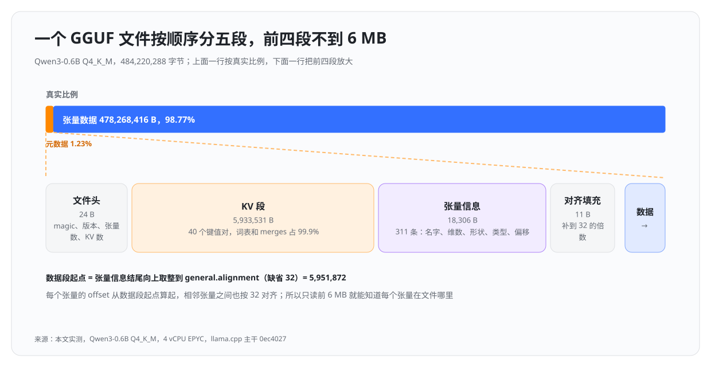
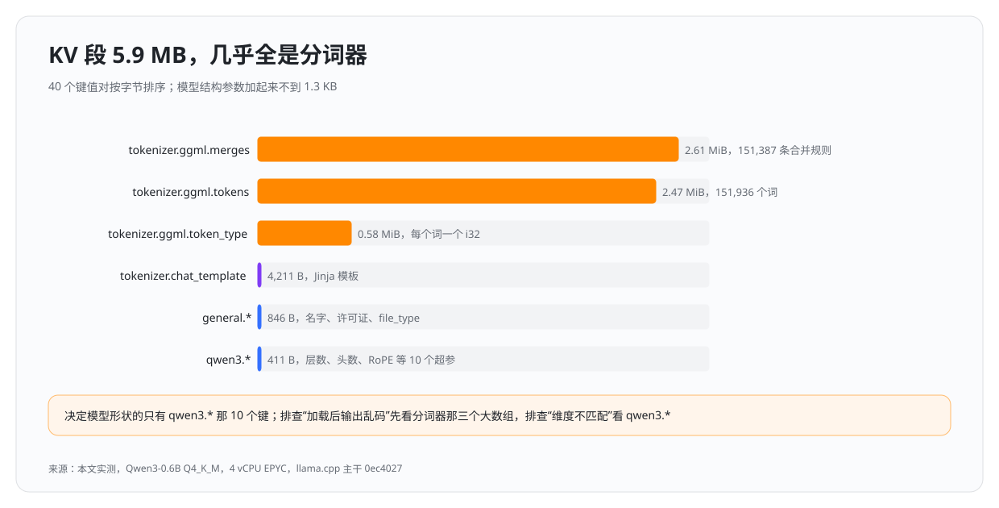
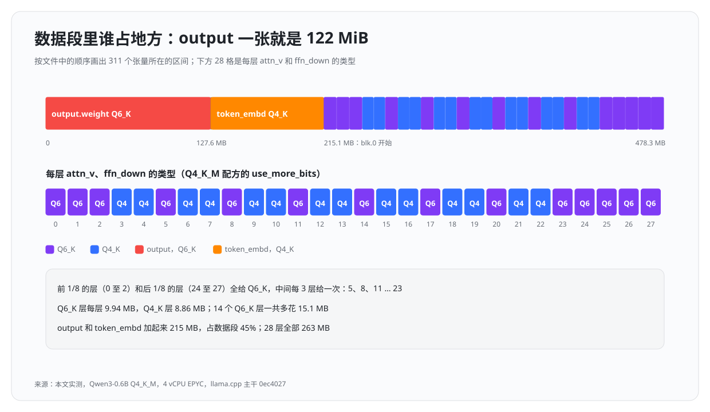
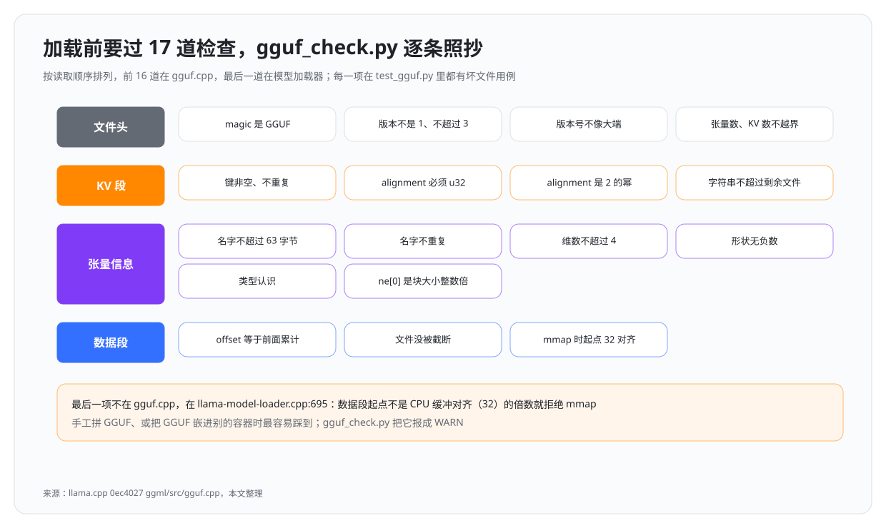
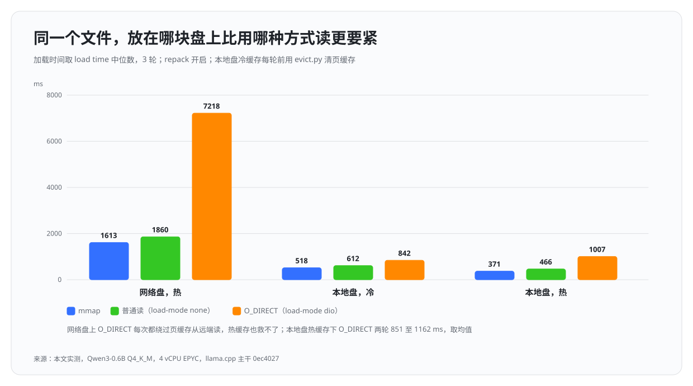
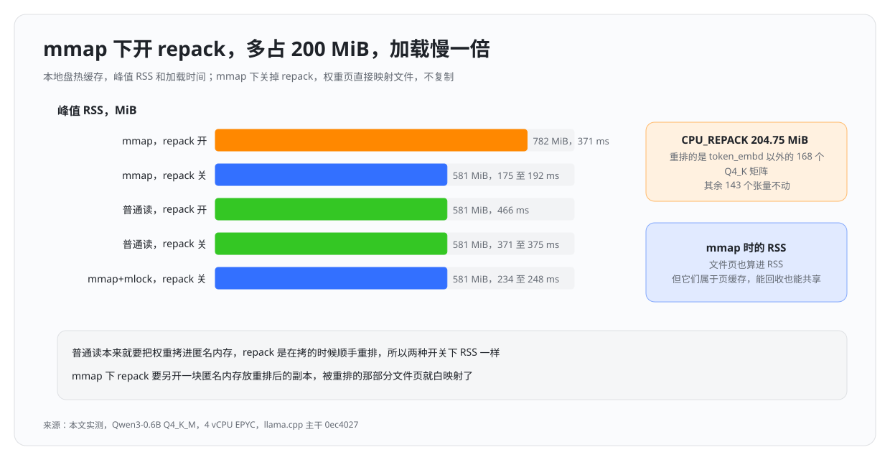
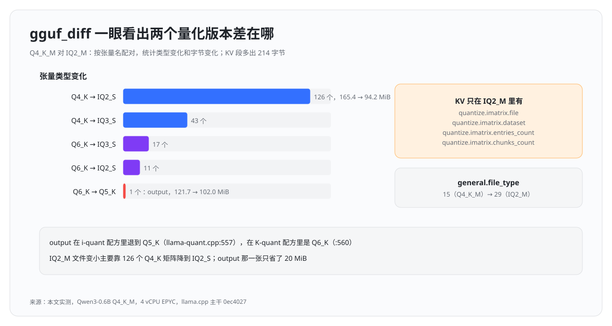
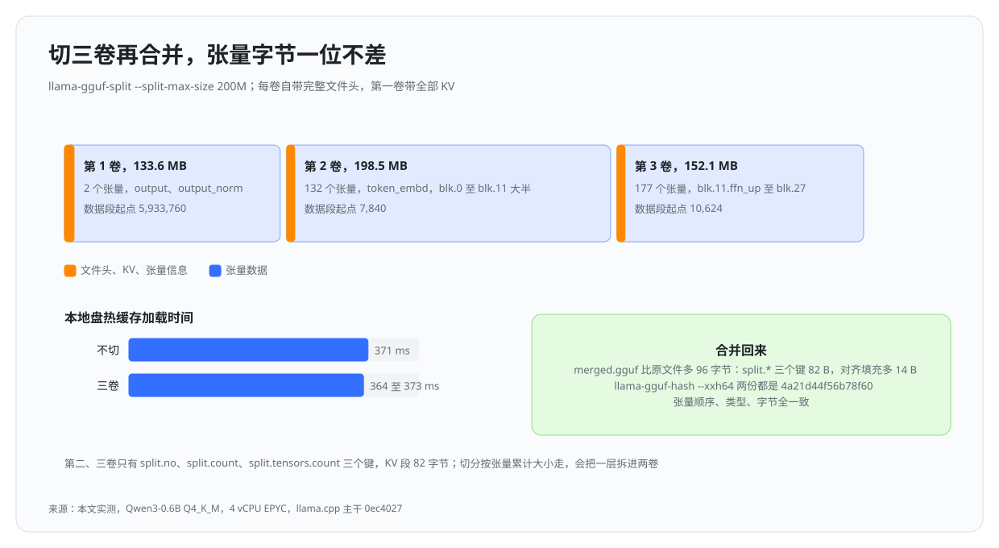

# LCPP-04｜内部｜GGUF：文件结构、元数据、加载方式和分卷

> 🎯 **这篇文档解决什么问题**：我拿到一个 GGUF 文件，想在加载之前就知道它里面装了什么：哪几段各占多少字节，分词器和聊天模板在哪，每个张量用的什么量化类型、放在文件哪个位置；加载时它为什么被拒绝，mmap、普通读和 O_DIRECT 三种读法各慢在哪里，repack 为什么多吃 200 MiB 内存。这篇把一个 484 MB 的 Qwen3-0.6B Q4_K_M 文件逐字节拆开，再在两种磁盘上把三种读法各跑一遍。主线一句话：一个 GGUF 文件 98.77% 是张量数据，加载快慢先看磁盘，读法排在后面。
>
> 使用方式：先读导读和第 1 至 4 章看懂文件结构，排查加载失败时直接翻第 5 章，调加载速度和内存看第 6、7 章，发版和分发看第 9、10 章。文中版本和数字核对于 2026 年 10 月 31 日。
>
> **代码**：[zero-to-llama/04-gguf](../04-gguf)。gguf_check.py 出分段账本和 17 道合法性检查，gguf_diff.py 比较两个文件，gguf_write.py 造合法和损坏的样本，test_gguf.py 有 26 个用例，全部只用 Python 标准库。基线是主干 0ec4027，模型是 Qwen3-0.6B，机器是 4 核 EPYC 云主机无 GPU。

# 导读 · 先给结论

- **一个 GGUF 文件 98.77% 是张量数据，元数据不到 6 MB。**文件头 24 字节，KV 段 5.93 MB，张量信息 18 KB，补齐到 32 字节对齐后数据段从 5,951,872 开始。读前 6 MB 就知道每个张量在哪[[1]](https://github.com/ggml-org/ggml/blob/master/docs/gguf.md)[[2]](https://github.com/ggml-org/llama.cpp/blob/0ec4027/ggml/src/gguf.cpp)。
- **KV 段几乎全是分词器。**merges、tokens、token_type 三个数组占 KV 段的 99.9%，决定模型形状的 qwen3.\* 只有 10 个键、411 字节。聊天模板 4,211 字节，用 Jinja 写成，可以单独替换。
- **Q4_K_M 里最大的张量是 output。**它是 Q6_K，121.7 MiB，约占文件 26%；28 层里有 14 层的 attn_v 和 ffn_down 也升到 Q6_K。Qwen3 共享输入输出词表，加载代码在缺这个张量时会退回 token_embd[[3]](https://github.com/ggml-org/llama.cpp/blob/0ec4027/src/llama-quant.cpp)[[4]](https://github.com/ggml-org/llama.cpp/blob/0ec4027/src/models/qwen3.cpp)。
- **加载前要过 17 道检查。**16 道在 gguf.cpp，1 道在模型加载器。gguf_check.py 逐条照抄，每一条在 test_gguf.py 里都有一个坏文件用例，报错能直接对到源码行号。
- **磁盘比读法更要紧。**同一个文件放在网络盘上，mmap 1.6 s，O_DIRECT 7.2 s；拷到本地盘热缓存，mmap 371 ms。本地盘上三种读法差两三倍，网络盘和本地盘之间差四倍以上。
- **mmap 下开 repack 会多占 200 MiB。**repack 把 168 个 Q4_K 矩阵复制到一块 204.75 MiB 的匿名内存里重排，原来的文件页白映射了。关掉 repack，峰值 RSS 从 782 MiB 降到 581 MiB，加载从 371 ms 降到 175 至 192 ms。
- **分卷不改变张量字节。**按 200M 切三卷，加载时间差不到 2%；合并回来比原文件多 96 字节，张量的 xxh64 一位不差[[5]](https://github.com/ggml-org/llama.cpp/pull/6135)[[6]](https://github.com/ggml-org/llama.cpp/blob/0ec4027/examples/gguf-hash/gguf-hash.cpp)。

**📎 与系列其他文档的分工**：本篇只讲文件和加载。加载日志里三项内存怎么读，见 [LCPP-01｜上手｜第一次运行：编译、转换、加载和读懂内存账单](./01-first-run.md)；加载完以后速度上限怎么算，见 [LCPP-02｜上手｜推理账本：带宽、算力和启动前算出速度上限](./02-ledger.md)；加载时间怎么测才有可比性，见 [LCPP-03｜上手｜测量方法：llama-bench、PPL、KLD 和噪声](./03-bench-ppl.md)；Q4_K、Q6_K 这些块格式本身和配方怎么选，见 [LCPP-07｜内部｜量化：块结构、配方、imatrix 和用 KLD 选类型](./07-quantization.md)。计算图和调度器放在 LCPP-05，CPU 线程和 NUMA 调优放在 LCPP-10。

# 第 1 章 · 为什么要拆开 GGUF

## 1.1 一个文件装下整个模型

拆文件之前，我先查了它为什么长成这样。GGUF 是 llama.cpp 在 2023 年 8 月换上的文件格式，取代了之前的 GGML、GGMF、GGJT 三代[[7]](https://github.com/ggml-org/llama.cpp/pull/2398)。设计目标写在规范第一段：单文件部署，加载时不依赖外部文件，加新字段不破坏旧模型，权重能 mmap，不必拷贝就能用[[1]](https://github.com/ggml-org/ggml/blob/master/docs/gguf.md)。一个 GGUF 里同时放着超参数、分词器、聊天模板和全部权重，拿到文件就能跑。

Hugging Face 上的原始权重一般是 safetensors 加一堆 json：config.json 放超参数，tokenizer.json 放分词器，tokenizer_config.json 里放聊天模板[[8]](https://github.com/huggingface/safetensors)。safetensors 本身只存张量，元数据是一段 JSON 头；GGUF 把这些 json 的内容都翻译成类型化的键值对，塞进同一个文件。Hub 上 GGUF 有自己的文档页和在线查看器，能直接看 KV 和张量列表[[9]](https://huggingface.co/docs/hub/gguf)。

## 1.2 我想回答的问题

我拆 GGUF 的起因都是排障。有人发来一个文件说加载失败，日志里只有一行 failed to read tensor info。有人问为什么同样 4 bit 量化，两个文件差了 20 MB。有人在网络盘上加载要 7 秒，换台机器只要不到半秒。这些问题的答案都在文件的字节里，或者在加载代码读这些字节的方式里。

所以这篇按读取顺序走一遍：先看文件分几段、每段多大，再看每段里装了什么，再看加载器拿到文件后做哪些检查，最后看三种把字节搬进内存的方式。每一步都用一个只依赖 Python 标准库的小工具复现，数字全部来自同一个 484,220,288 字节的文件。

## 1.3 本文用的文件

模型是 Qwen3-0.6B[[10]](https://arxiv.org/abs/2505.09388)，28 层，隐藏维度 1024，16 个 query 头、8 个 KV 头，词表 151,936[[11]](https://huggingface.co/Qwen/Qwen3-0.6B)。我用 convert_hf_to_gguf.py 从 Hugging Face 权重转出 bf16 的 GGUF[[12]](https://github.com/ggml-org/llama.cpp/blob/0ec4027/convert_hf_to_gguf.py)，再用 llama-quantize 出 Q4_K_M。转换脚本靠 gguf-py 的 GGUFWriter 写文件[[13]](https://github.com/ggml-org/llama.cpp/blob/0ec4027/gguf-py/gguf/gguf_writer.py)，键名、张量名和每种量化类型的块大小都在 constants.py 里一张表[[14]](https://github.com/ggml-org/llama.cpp/blob/0ec4027/gguf-py/gguf/constants.py)。

# 第 2 章 · 文件分五段

## 2.1 账本

我先按字节把文件切开。GGUF 的布局是顺序的五段：文件头、KV 段、张量信息、对齐填充、张量数据[[1]](https://github.com/ggml-org/ggml/blob/master/docs/gguf.md)。前四段加起来叫元数据，读完它就知道每个张量的名字、形状、类型和在数据段里的偏移。gguf.h 的注释把这个顺序写得很清楚，魔数、版本号和缺省对齐也定义在这里[[15]](https://github.com/ggml-org/llama.cpp/blob/0ec4027/ggml/include/gguf.h)。

```bash
python3 gguf_check.py models/q-Q4_K_M.gguf
# q-Q4_K_M.gguf  GGUF V3  40 KV  311 张量  对齐 32  文件 484,220,288 B
#   header                       24 B    0.00%
#   kv                    5,933,531 B    1.23%
#   tensor_info              18,306 B    0.00%
#   pad_before_data              11 B    0.00%
#   tensor_data         478,268,416 B   98.77%
#   数据段起点 5,951,872，模 4096 余 384
#   检查通过
```



文件头固定 24 字节：4 字节魔数 GGUF，4 字节版本号，8 字节张量数，8 字节 KV 数。版本 3 和版本 2 的区别是把张量数和 KV 数从 32 位扩成 64 位，版本 1 已经不再支持。KV 段占 5.93 MB，张量信息 311 条共 18 KB，然后补 11 个字节，让数据段起点落在 32 的倍数上。

## 2.2 对齐

对齐值由 general.alignment 这个键决定，缺省 32[[15]](https://github.com/ggml-org/llama.cpp/blob/0ec4027/ggml/include/gguf.h)。它管两件事：数据段起点要对齐，每个张量的 offset 也要对齐。转换工具写文件时在每个张量后面补零到下一个 32 的倍数；这个模型 311 个张量的大小恰好都是 32 的倍数，数据段内部的填充是 0 字节。

32 字节够 AVX2 的 256 位加载，但不够一页。数据段起点模 4096 余 384，说明 mmap 之后张量不在页边界上。mmap 本身只要求映射的起点在页边界[[16]](https://man7.org/linux/man-pages/man2/mmap.2.html)，llama.cpp 映射整个文件，再在映射里按偏移找张量，所以这没问题；它要求的只是张量地址满足 CPU 缓冲的 32 字节对齐，第 5 章会看到这条检查。

## 2.3 字符串和数组的编码

KV 段和张量信息里的字符串都是 8 字节长度加 UTF-8 字节，没有结尾的零。数组先写 4 字节元素类型，再写 8 字节元素个数，再写元素本身；字符串数组的每个元素又是长度加字节。这种编码让读取器可以不解析内容就跳过一整段：gguf-py 的 GGUFReader 用 numpy 的 memmap 映射整个文件，按长度前缀一路跳过去[[17]](https://github.com/ggml-org/llama.cpp/blob/0ec4027/gguf-py/gguf/gguf_reader.py)。

gguf_dump.py 打印的 KV 和张量目录就是这样读出来的[[18]](https://github.com/ggml-org/llama.cpp/blob/0ec4027/gguf-py/gguf/scripts/gguf_dump.py)。我自己写的 gguf_lite.py 走同一套规则，只是不依赖 numpy：数组超过一定长度时只记录起止偏移，不展开，这样 15 万个词的数组也只要几十毫秒。

# 第 3 章 · KV 段：分词器占了 99.9%

## 3.1 谁占地方

40 个键值对按字节排序，前三名全是分词器：merges 2.61 MiB，存 151,387 条合并规则。tokens 2.47 MiB，存 151,936 个词。token_type 0.58 MiB，每个词一个 32 位整数，标记它是普通词、控制符还是未知词。剩下的 37 个键加起来不到 6 KB。



merges 是 BPE 的合并表，按优先级排列，分词时从字节开始反复合并相邻的一对[[19]](https://arxiv.org/abs/1508.07909)。tokenizer.ggml.model 是 gpt2，表示字节级 BPE；tokenizer.ggml.pre 是 qwen2，决定分词前用哪个正则把文本切块。这两个字符串选错，模型能加载，输出会乱。

## 3.2 模型形状只有 10 个键

qwen3.\* 前缀下的 10 个键决定了计算图的形状：block_count 28，embedding_length 1024，feed_forward_length 3072，attention.head_count 16，head_count_kv 8，key_length 和 value_length 都是 128，context_length 40960，rope.freq_base 1e6，layer_norm_rms_epsilon 1e-6。加载器按 general.architecture 的值拼出键名前缀，再逐个读。

general.\* 下有 846 字节：名字、参数量标签 0.6B、许可证 apache-2.0、file_type 15（Q4_K_M），以及三个采样缺省值 top_k 20、top_p 0.95、temp 0.6。这三个采样键是转换脚本从 generation_config.json 读来的，llama.cpp 用它们做命令行没指定时的缺省。

| 前缀 | 键数 | 字节 | 排查什么 |
|-|-|-|-|
| tokenizer.ggml.\* | 12 | 5.93 MB | 输出乱码、特殊符号不停、多一个 BOS |
| tokenizer.chat_template | 1 | 4,211 B | 对话格式错、工具调用不生效 |
| qwen3.\* | 10 | 411 B | 维度不匹配、RoPE 外推异常 |
| general.\* | 17 | 846 B | 名字、许可证、量化类型、采样缺省 |
| split.\* | 0 或 3 | 82 B | 分卷缺失、卷数不对 |

## 3.3 聊天模板

tokenizer.chat_template 是一段 Jinja 模板，开头是 if tools，用来把消息列表和工具定义渲染成模型训练时见过的格式[[20]](https://jinja.palletsprojects.com/en/stable/templates/)[[21]](https://huggingface.co/docs/transformers/main/en/chat_templating)。llama.cpp 读取这个键的代码在 2025 年初修过一次键名[[22]](https://github.com/ggml-org/llama.cpp/pull/11201)，用旧版本排查模板不生效时，先确认键名对得上。

换模板不用重新转换。gguf-py 支持直接读 .jinja 文件[[23]](https://github.com/ggml-org/llama.cpp/pull/14508)，gguf_new_metadata.py 加了 --chat-template-file 参数[[24]](https://github.com/ggml-org/llama.cpp/pull/15075)，它把所有张量原样拷贝，只改 KV，写出一个新文件[[25]](https://github.com/ggml-org/llama.cpp/blob/0ec4027/gguf-py/gguf/scripts/gguf_new_metadata.py)。同一个脚本还能改 general.name、删键、改特殊符号 id。

```bash
python3 gguf-py/gguf/scripts/gguf_new_metadata.py models/q-Q4_K_M.gguf /tmp/new.gguf \
    --chat-template-file my_template.jinja --general-name "Qwen3 0.6B fix"
python3 gguf_diff.py models/q-Q4_K_M.gguf /tmp/new.gguf   # 只有两个 KV 变化，张量全同
```

要注意，改 KV 会改变 KV 段的长度，数据段起点跟着移动，整个文件都要重写。gguf_new_metadata.py 会重写全部 478 MB；想原地改一个字节的版本号这类事，不要手工去做。

> 🔑 **本章要点**：分词器三个数组占 KV 段 99.9%，模型形状只靠 10 个键。聊天模板是一段 Jinja，可以用 gguf_new_metadata.py 单独替换，代价是重写整个文件。

# 第 4 章 · 张量目录和量化配方

## 4.1 一条张量信息

每条张量信息是：名字（长度加字节）、维数、每一维的大小、类型编号、在数据段里的偏移。名字不超过 63 字节，维数不超过 4[[2]](https://github.com/ggml-org/llama.cpp/blob/0ec4027/ggml/src/gguf.cpp)。311 条一共 18,306 字节，平均每条 59 字节。顺序由写入者决定，加载器按名字查，不依赖顺序。

Qwen3-0.6B 每层 11 个张量：attn_q、attn_k、attn_v、attn_output 四个投影，attn_q_norm 和 attn_k_norm 两个 QK 归一化，attn_norm 和 ffn_norm 两个层归一化，ffn_gate、ffn_up、ffn_down 三个 FFN 矩阵。28 层是 308 个，加上 token_embd、output_norm、output，共 311 个。

## 4.2 数据段里谁占地方



这个文件里 output.weight 排在最前，offset 0，Q6_K，127,626,240 字节。紧跟着是 4 KB 的 output_norm 和 Q4_K 的 token_embd，后者 87.5 MB。blk.0 从 215,145,472 开始。数据段的前 45% 只是两张词表大小的矩阵，28 层 Transformer 一共才 263 MB。

中间层的类型由 Q4_K_M 配方的 use_more_bits 决定：前 1/8 和后 1/8 的层，加上中间每隔 3 层一层，attn_v 和 ffn_down 用 Q6_K，其余用 Q4_K[[3]](https://github.com/ggml-org/llama.cpp/blob/0ec4027/src/llama-quant.cpp)。这个规则来自 k-quants 最初的实现，作者在 PR 里用困惑度比较过几种分配[[26]](https://github.com/ggml-org/llama.cpp/pull/1684)。Q6_K 层每层 9.94 MB，Q4_K 层 8.86 MB，14 个 Q6_K 层一共多花 15.1 MB。

output 张量单独处理：K-quant 配方给 Q6_K，i-quant 配方退到 Q5_K。原因是它直接决定 logits，误差会原样传到采样上。类型统计是 Q4_K 169 个 288.2 MiB，Q6_K 29 个 167.7 MiB，F32 113 个只有 0.2 MiB；加载日志报 456.11 MiB、5.09 BPW。

## 4.3 共享词表

Qwen3-0.6B 的 config.json 里 tie_word_embeddings 是 true，输入嵌入和输出投影共用一张矩阵[[11]](https://huggingface.co/Qwen/Qwen3-0.6B)。权重共享的想法来自 2017 年的两篇论文：Press 和 Wolf 发现用输出嵌入当输入嵌入能降困惑度[[27]](https://arxiv.org/abs/1608.05859)，Inan 等人从损失函数的角度给出了理由[[28]](https://arxiv.org/abs/1611.01462)。

GGUF 里却同时有 token_embd 和 output 两张。llama-quantize 给 output 单独量化成 Q6_K，因为 token_embd 每步只取一行，可以压得狠一点，output 每步整张参与矩阵乘，精度更要紧。加载代码里 output 标为非必需，缺了就复用 token_embd[[4]](https://github.com/ggml-org/llama.cpp/blob/0ec4027/src/models/qwen3.cpp)。这意味着删掉 output 能省 122 MiB，代价是输出投影降到 Q4_K，我没有测过这样做的精度损失。

**📎 展开阅读：**Q4_K 和 Q6_K 每个超级块怎么存 scale、min 和量化值，以及 output 改用 Q4_K 时困惑度的变化，见 [LCPP-07｜内部｜量化：块结构、配方、imatrix 和用 KLD 选类型](./07-quantization.md)。

> 🔑 **本章要点**：每层 11 个张量，共 311 个。output 一张 121.7 MiB，加上 token_embd 占数据段 45%。中间层按 use_more_bits 隔层升到 Q6_K。Qwen3 共享词表，output 缺了会退回 token_embd。

# 第 5 章 · 加载前的 17 道检查

## 5.1 按读取顺序排

gguf.cpp 的 gguf_init_from_file_impl 一边读一边查，任何一条不过就打印一行错误、返回空指针[[2]](https://github.com/ggml-org/llama.cpp/blob/0ec4027/ggml/src/gguf.cpp)。我按它的读取顺序把检查列出来：文件头 4 道，KV 段 4 道，张量信息 6 道，数据段 2 道，一共 16 道；第 17 道不在这里，在模型加载器里，只有用 mmap 时才查[[29]](https://github.com/ggml-org/llama.cpp/blob/0ec4027/src/llama-model-loader.cpp)。



| 阶段 | 检查 | gguf.cpp 行号 | 典型来源 |
|-|-|-|-|
| 文件头 | magic、版本 1、大端、版本过高 | 482、495 至 516 | 下载不完整、拿错文件、老工具 |
| 文件头 | 张量数和 KV 数越界 | 527、538 | 文件头被覆盖 |
| KV 段 | 空键、重复键 | 572、576 | 手工拼的元数据 |
| KV 段 | alignment 类型和 2 的幂 | 624、633 | 写入工具用错类型 |
| KV 段 | 字符串长度超过剩余文件 | 349、353 | 截断在 KV 段中间 |
| 张量信息 | 名字超长、重名、维数、负形状 | 658、666、680、693 | 自定义转换脚本 |
| 张量信息 | 类型不认识、块大小不整除 | 731、741 | 新类型配旧版本 |
| 数据段 | offset 不连续、文件截断 | 796 及读数据时 | 下载中断、拼接错误 |
| 加载器 | 数据段起点不是 32 的倍数 | llama-model-loader.cpp:695 | 把 GGUF 嵌进别的容器 |

大端那一条有点意思：GGUF 是小端格式，大端机器上的文件版本号读出来是 3 左移 24 位，低 16 位全为 0。gguf.cpp 用这个特征提示用户换字节序，而不是只报版本不支持。版本 1 直接拒绝，因为 v1 的计数是 32 位，和 v2、v3 的布局不兼容。

## 5.2 照抄成 Python

gguf_check.py 把这 17 道检查逐条翻成 Python，错误信息写成中文，并且直接给出可能的原因。它只读元数据，数组超过阈值就跳过不展开，所以检查一个 30 GB 的文件也只读前几 MB。--json 输出一行 JSON，--strict 在有 ERROR 时退出码为 1，可以接进发版流水线。

```python
for i in range(n_t):
    name = r.string()
    if len(name.encode()) >= GGML_MAX_NAME:          # gguf.cpp:658，上限 63 字节
        raise Bad(f'张量名 {name} 有 {len(name.encode())} 字节')
    if name in names:                                # gguf.cpp:666
        raise Bad(f'张量名 {name} 重复')
    nd = r.take('<I')
    if nd > GGML_MAX_DIMS:                           # gguf.cpp:680，上限 4
        raise Bad(f'张量 {name} 有 {nd} 维')
```

最后那一条我报成 WARN 而不是 ERROR：数据段起点不对齐时，llama.cpp 换成普通读仍然能加载，只是 mmap 会被拒绝。手工拼 GGUF，或者把 GGUF 嵌进另一个文件里用 fd 加偏移的方式打开时，最容易踩到它。

## 5.3 每条检查一个坏文件

test_gguf.py 用 gguf_write.py 造样本：3 个合法文件，19 种坏法，2 个分卷键用例，1 个 mmap 对齐用例，设了 MODELS 环境变量时再加真实模型和只有文件头的夹具，一共 26 个。每种坏法只改一处字节，断言 gguf_check.py 报出的错误里含有预期的关键词。

```bash
python3 test_gguf.py
# Ran 26 tests in 0.004s
# OK (skipped=2)   # 没设 MODELS 时跳过真实模型的 2 个
python3 gguf_check.py --json broken.gguf | python3 -m json.tool | grep -A2 errors
```

只有文件头的夹具是个实用的技巧：把一个 30 GB 文件的前 8 MB 截下来，就得到一个能放进仓库的测试样本，KV 和张量目录完整，数据段缺失。gguf_check.py 会报截断，但分段账本和 KV 都能正常输出；gguf_diff.py 也能用它比较元数据。

> 💡 **常见误区**：gguf.cpp 不校验张量数据本身。字节翻转、量化值溢出这些问题，加载时一概不报，要么等推理输出出错，要么用 llama-gguf-hash 和发布方给的哈希对比。

> 🔑 **本章要点**：17 道检查，16 道在 gguf.cpp，1 道在加载器且只管 mmap。gguf_check.py 逐条照抄并给出中文原因，test_gguf.py 每条一个坏文件。数据本身不校验，靠哈希。

# 第 6 章 · 三种读法：mmap、普通读、O_DIRECT

## 6.1 load-mode 的来历

llama.cpp 用 mmap 加载权重是 2023 年 3 月的事，当时的 PR 标题是让加载快 10 到 100 倍[[30]](https://github.com/ggml-org/llama.cpp/pull/613)。之前的做法是 fread 进内存再转换格式；mmap 之后，权重页直接来自页缓存，第二次启动几乎不花时间，多个进程还能共享同一份物理内存。

2026 年 1 月加了 --direct-io 开关[[31]](https://github.com/ggml-org/llama.cpp/pull/18166)：用 O_DIRECT 绕过页缓存，直接从设备读进用户缓冲；它在 Linux 和 Windows 上缺省打开，并且优先于 mmap。不到三周又改回缺省关闭[[32]](https://github.com/ggml-org/llama.cpp/pull/19109)，后来还修掉了每个张量在内存里多出一份完整副本的问题[[33]](https://github.com/ggml-org/llama.cpp/pull/29749)。

随后 mlock、mmap、direct-io 三个开关合并成一个参数 -lm/--load-mode[[34]](https://github.com/ggml-org/llama.cpp/pull/20834)，取值 none、mmap、mlock、mmap+mlock、dio 和 auto。auto 是缺省值，在集成显卡这类不支持 mmap 的设备上自动退回普通读[[35]](https://github.com/ggml-org/llama.cpp/pull/26081)[[36]](https://github.com/ggml-org/llama.cpp/blob/0ec4027/src/llama-model.cpp)；旧的 --mmap、--no-mmap 随后迁移到新参数上[[37]](https://github.com/ggml-org/llama.cpp/pull/26934)。

## 6.2 每种读法做了什么

mmap 模式下，llama-mmap.cpp 先对整个文件调 posix_fadvise 的 SEQUENTIAL，告诉内核这是顺序读，预读窗口开大一点[[38]](https://man7.org/linux/man-pages/man2/posix_fadvise.2.html)；需要预取时加 MAP_POPULATE，映射时就把页填好，再对预取范围调 MADV_WILLNEED[[39]](https://github.com/ggml-org/llama.cpp/blob/0ec4027/src/llama-mmap.cpp)[[40]](https://man7.org/linux/man-pages/man2/madvise.2.html)。之后权重张量直接指向映射里的地址，不拷贝。

普通读（none）用 fread 把每个张量读进一块匿名内存，页缓存里还留一份。O_DIRECT 模式用 O_DIRECT 打开文件，按文件系统块大小对齐地读进用户缓冲，不经过页缓存[[41]](https://man7.org/linux/man-pages/man2/open.2.html)。mlock 在 mmap 的基础上把映射锁在物理内存里，不让内核换出去[[42]](https://man7.org/linux/man-pages/man2/mlock.2.html)。

| 读法 | 权重在哪 | 页缓存 | 多进程共享 | 适合 |
|-|-|-|-|-|
| mmap | 文件映射页 | 用 | 共享 | 缺省；本地盘、反复启动 |
| none | 匿名内存 | 用，另留一份 | 不共享 | 不支持 mmap 的文件系统和设备 |
| dio | 匿名内存 | 绕过 | 不共享 | 模型接近内存上限、不想挤掉页缓存 |
| mmap+mlock | 文件映射页，锁住 | 用 | 共享 | 内存够、怕被换出的常驻服务 |

## 6.3 实测：磁盘比读法更要紧

load_bench.sh 在两种磁盘上跑：模型放在家目录的网络盘上，和拷到本地 /tmp。每次用 rss.py 包一层，记下峰值 RSS、缺页次数和 llama.cpp 打印的 load time，三个数的含义见 getrusage 的手册[[43]](https://man7.org/linux/man-pages/man2/getrusage.2.html)。本地盘再分热缓存和冷缓存，冷缓存每次运行前用 evict.py 调 POSIX_FADV_DONTNEED 把文件踢出页缓存。



网络盘上 mmap 1.6 s，普通读 1.9 s，O_DIRECT 7.2 s。拷到本地盘热缓存后，mmap 371 ms，普通读 466 ms，O_DIRECT 851 至 1162 ms。冷缓存也只比热缓存多 150 ms 左右：mmap 515 至 560 ms，普通读 607 至 617 ms，O_DIRECT 824 至 895 ms。换一块盘带来的差距，比换读法大得多。

O_DIRECT 在网络盘上最吃亏：每次都要穿过网络从远端读，热缓存对它不起作用，三轮都在 7 秒以上。本地盘上它比 mmap 慢一倍多，因为每个张量都要先读进对齐缓冲，再拷进后端缓冲，还要多付一遍 repack。majflt 在所有情况下都在 140 左右，说明主要缺页都是 minflt，文件页早在页缓存或被预读进来了。

**📎 展开阅读：**加载时间怎么测才能跨机器比较，冷热缓存怎么控制，见 [LCPP-03｜上手｜测量方法：llama-bench、PPL、KLD 和噪声](./03-bench-ppl.md)。

## 6.4 文献里的 mmap

数据库社区对 mmap 的评价不高。Crotty 等人列举了 mmap 在 DBMS 里的问题：缺页处理不可控、TLB 击落、换出时机由内核决定，在高速 NVMe 上吞吐明显低于自己管理缓冲池[[44]](https://db.cs.cmu.edu/papers/2022/cidr2022-p13-crotty.pdf)。Papagiannis 等人在 Linux 内核里改了 mmap 的路径，才让它在高速设备上接近裸设备的带宽[[45]](https://www.usenix.org/conference/atc20/presentation/papagiannis)。

推理加载和数据库的负载不一样：一次性顺序读完，之后只读不写，读的时机也确定。这种模式下 mmap 的缺点基本不出现，优点是能共享和重启快。苹果的 LLM in a flash 讨论的是另一个极端：模型比内存还大，只能按需从闪存读一部分权重[[46]](https://arxiv.org/abs/2312.11514)，那才是 O_DIRECT 和精细预取有用的地方。页缓存和匿名内存的回收规则见内核文档[[47]](https://docs.kernel.org/admin-guide/mm/concepts.html)。

> 💡 **常见误区**：在网络盘上调 load-mode 收益很小。先把模型拷到本地盘，加载就能快四倍；O_DIRECT 在网络盘上要慢四倍以上，不要为了不占页缓存在网络盘上开它。

> 🔑 **本章要点**：mmap 最快、能共享，普通读多一份拷贝，O_DIRECT 绕过页缓存。网络盘对本地盘的差距是四倍以上，本地盘上三种读法之间只差两三倍。

# 第 7 章 · repack 的内存账

## 7.1 多出来的 200 MiB

同样是本地盘热缓存的 mmap，开 repack 峰值 RSS 782 MiB，关掉 581 MiB；加载时间也从 175 至 192 ms 涨到 371 ms。repack 是 CPU 后端的一个优化，把 Q4_K 矩阵按 8 行一组交错重排，让 AVX2 内核一次读到 8 行的同一段，矩阵乘更快。



重排的条件写在 repack.cpp 里：Q4_K 在有 AVX2 的机器上，ne[1] 是 8 的倍数就重排；Q6_K 只有 ARM 的 NEON 路径有重排实现，x86 上不动[[48]](https://github.com/ggml-org/llama.cpp/blob/0ec4027/ggml/src/ggml-cpu/repack.cpp)。token_embd 只走取行操作，不进矩阵乘，也不重排。所以这个模型里被重排的是 token_embd 以外的 168 个 Q4_K 矩阵，合计 204.74 MiB，和 -v 日志里 CPU_REPACK 缓冲的 204.75 MiB 对得上。

```text
load_tensors:   CPU_Mapped model buffer size =   205.18 MiB
load_tensors:   CPU_REPACK model buffer size =   204.75 MiB
... token_embd.weight (and 142 others) cannot be used with CPU_REPACK
```

## 7.2 为什么普通读没有这笔账

普通读本来就要把权重从文件拷进匿名内存，repack 是在拷的时候顺手重排，没有第二份，所以两种开关下 RSS 都是 581 MiB。mmap 下情况不同：文件页已经映射进来并算进了 RSS，repack 还要另开一块匿名内存放重排后的副本，被重排的那 205 MiB 文件页就白映射了。

还有一个细节：mmap 时 RSS 里的文件页属于页缓存，内存紧张时内核可以直接丢掉，下次用到再从盘上读回来，多个进程也能共享；匿名内存只能换到 swap。所以 782 MiB 里真正不可回收的部分，比数字看起来少。这也是我在 2 GiB 小机器上关 repack 的理由，而在大内存机器上可以不管它。

## 7.3 关掉之后慢在哪

关 repack 的代价在推理速度上：[LCPP-02｜上手｜推理账本：带宽、算力和启动前算出速度上限](./02-ledger.md) 测过这台机器上关掉 repack 后 pp 反而略快、tg 几乎不变，不同机器上结论可能相反。加载时间上，关掉 repack 让 mmap 从 371 ms 降到 175 至 192 ms，普通读从 466 ms 降到 371 至 375 ms，O_DIRECT 从 851 至 1162 ms 降到 714 至 742 ms。

mmap+mlock 在关 repack 时 234 至 248 ms，比纯 mmap 多 50 ms，多出来的是 mlock 逐页锁定的时间；开 repack 时 393 至 411 ms。mlock 受 RLIMIT_MEMLOCK 限制，普通用户默认只能锁很少的内存，锁不住时 llama.cpp 打印警告后继续运行，不会退出。

```bash
# 小内存机器：关 repack，省 200 MiB 匿名内存
llama-cli -m q-Q4_K_M.gguf -lm mmap --no-repack
# 想确认省了多少，用 rss.py 包一层
python3 rss.py llama-completion -m q-Q4_K_M.gguf -lm mmap -nr -c 512 -n 1 -p hi -no-cnv
```

> 🔑 **本章要点**：mmap 下开 repack 另开 204.75 MiB 匿名内存放重排副本，RSS 从 581 涨到 782 MiB。普通读没有这笔账。小内存机器关 repack，大内存机器先在自己机器上测速度再定。

# 第 8 章 · 比较两个文件

## 8.1 gguf_diff.py

有人问为什么两个 4 bit 量化文件大小不一样，或者想确认新转出来的文件和旧的差在哪，我就用 gguf_diff.py。它按段比较大小，按键名比较 KV 的增删改，按张量名配对比较形状和类型，最后把类型变化按方向汇总。只读元数据，比较两个大文件也是一两秒的事。

```bash
python3 gguf_diff.py models/q-Q4_K_M.gguf models/qi-IQ2_M.gguf
#   kv                    5,933,531 →      5,933,745  +214
#   tensor_data         478,268,416 →    325,809,152  -152,459,264
#   KV 只在 B： quantize.imatrix.chunks_count
#   KV 变了：general.file_type  15 → 29
#   类型 Q4_K → IQ2_S：126 个张量，165.4 → 94.2 MiB
#   类型 Q6_K → Q5_K：1 个张量，121.7 → 102.0 MiB
```



## 8.2 IQ2_M 差在哪

IQ2_M 多出 4 个 quantize.imatrix.\* 键，记录量化时用的重要性矩阵文件、数据集、条目数和块数，一共 214 字节。重要性矩阵在 2024 年初加入，用校准数据统计每个权重列对输出的贡献，量化时按贡献加权误差[[49]](https://github.com/ggml-org/llama.cpp/pull/4861)。思路和 GPTQ 用二阶信息补偿量化误差相近[[50]](https://arxiv.org/abs/2210.17323)，LLM.int8() 则指出少数离群维度对精度影响最大[[51]](https://arxiv.org/abs/2208.07339)。

张量类型按角色分开看更清楚。attn_q、attn_k、ffn_gate、ffn_up 全部从 Q4_K 降到 IQ2_S。attn_output 和 attn_v 降到 IQ3_S。ffn_down 大部分降到 IQ2_S，前 3 层留在 IQ3_S。token_embd 从 Q4_K 变成 IQ3_S，output 从 Q6_K 退到 Q5_K，只省了 20 MiB。文件变小主要靠 126 个 Q4_K 矩阵降到 IQ2_S。

## 8.3 bf16 到 Q4_K_M

同一个工具比较 bf16 和 Q4_K_M：169 个张量从 BF16 变成 Q4_K，1024.8 MiB 降到 288.2 MiB。29 个变成 Q6_K，408.8 MiB 降到 167.7 MiB。113 个一维张量保持 F32。KV 段只多了 quantize 相关的几个键和 file_type 的变化。

我把 gguf_diff.py 用在三个地方：发版前确认量化配方没有意外改动，排查别人发来的文件时和已知好文件对比，以及改了元数据之后确认张量全同。最后这件事更严格的做法是哈希，下一章讲。量化类型本身的选择见 [LCPP-07｜内部｜量化：块结构、配方、imatrix 和用 KLD 选类型](./07-quantization.md)。

> 🔑 **本章要点**：gguf_diff.py 按段、KV、张量三层比较。Q4_K_M 到 IQ2_M 多 4 个 imatrix 键，126 个矩阵降到 IQ2_S，output 只降到 Q5_K。只读元数据，大文件也是秒级。

# 第 9 章 · 分卷、合并和哈希

## 9.1 为什么要切

Hugging Face 单个文件有大小上限，几十 GB 的模型一般切成若干卷上传。llama-gguf-split 在 2024 年 3 月加入，按批次切分和合并[[5]](https://github.com/ggml-org/llama.cpp/pull/6135)；随后模型加载器学会了直接读多卷文件，用户只要指定第一卷[[52]](https://github.com/ggml-org/llama.cpp/pull/6187)。卷名的格式是 前缀-00001-of-00003.gguf，llama.h 里的 llama_split_path 和 llama_split_prefix 负责拼和拆这个名字。

```bash
llama-gguf-split --split --split-max-size 200M models/q-Q4_K_M.gguf /tmp/sp/q
# /tmp/sp/q-00001-of-00003.gguf  133,564,096 B   2 个张量
# /tmp/sp/q-00002-of-00003.gguf  198,520,480 B 132 个张量
# /tmp/sp/q-00003-of-00003.gguf  152,136,064 B 177 个张量
llama-gguf-split --merge /tmp/sp/q-00001-of-00003.gguf /tmp/merged.gguf
```



**📎 展开阅读：**分卷文件在 Hugging Face 上怎么命名、加载器怎么按名字找齐各卷，见第 10 章的下载部分。

## 9.2 每一卷长什么样

gguf-split.cpp 按张量顺序累计大小，超过上限就开新卷，不看层的边界[[53]](https://github.com/ggml-org/llama.cpp/blob/0ec4027/tools/gguf-split/gguf-split.cpp)。所以 blk.11 被拆进了第二、三两卷。第一卷只有 output 和 output_norm 两个张量，因为 output 一张就 122 MiB，再加 token_embd 就超了 200M。

每一卷都是完整的 GGUF：有自己的文件头、KV 段和张量信息。第一卷带全部 40 个 KV 再加三个 split.\* 键，数据段从 5,933,760 开始；第二、三卷只有 split.no、split.count、split.tensors.count 三个键，KV 段 82 字节，数据段起点分别是 7,840 和 10,624。加载器读第一卷拿到卷数，再按命名规则依次打开其余各卷。

另外几个选项：--split-max-tensors 按张量个数切，和 --split-max-size 二选一。--no-tensor-first-split 让第一卷只放元数据，不放张量，方便单独改 KV。--dry-run 只打印切法，不写文件。

## 9.3 合并之后一位不差

合并出来的文件 484,220,384 字节，比原文件多 96 字节：split.\* 三个键 82 字节，加上对齐填充多出 14 字节。字节数不同，sha256 自然也不同，所以比较两个文件要按张量算哈希。llama-gguf-hash 逐个张量算 xxh64、sha1 或 sha256，--no-layer 只输出整体一行[[6]](https://github.com/ggml-org/llama.cpp/blob/0ec4027/examples/gguf-hash/gguf-hash.cpp)。xxh64 是非加密哈希，速度接近内存带宽[[54]](https://github.com/Cyan4973/xxHash)。

```bash
llama-gguf-hash --xxh64 --no-layer models/q-Q4_K_M.gguf
# xxh64  4a21d44f56b78f60  models/q-Q4_K_M.gguf
llama-gguf-hash --xxh64 --no-layer /tmp/merged.gguf
# xxh64  4a21d44f56b78f60  /tmp/merged.gguf
llama-gguf-hash --all models/q-Q4_K_M.gguf > manifest.txt
llama-gguf-hash -c manifest.txt models/q-Q4_K_M.gguf   # 发布后对清单
```

加载速度上分卷几乎没有代价：本地盘热缓存下三卷 364 至 373 ms，不切 370 至 371 ms，差不到 2%。每一卷各自 mmap，张量指针指向各自的映射，不需要拼成连续内存。

分卷的文件名不能改。加载器按 -00001-of-00003 的格式找其余各卷，改了名字只会读到第一卷，然后报张量缺失。

> 🔑 **本章要点**：gguf-split 按张量累计大小切卷，每卷是完整 GGUF，第一卷带全部 KV。合并后多 96 字节，按张量算的 xxh64 一致。分卷加载差不到 2%。

# 第 10 章 · 远程下载和缓存

## 10.1 -hf 参数

llama.cpp 可以直接从 Hugging Face 拉模型：-hf 用户名/仓库名，后面可以跟冒号加量化类型，比如 :Q4_K_M。不写量化类型时先找 Q4_K_M，找不到就取仓库里第一个 GGUF。仓库里有 mmproj 文件时会一起下载，--no-mmproj 关掉。Hub 上的 GGUF 页面列了每个文件的类型和大小，可以先看再选[[9]](https://huggingface.co/docs/hub/gguf)。

```bash
llama-cli -hf Qwen/Qwen3-0.6B-GGUF:Q8_0 -p hi -n 8 -no-cnv
# 也可以用环境变量
LLAMA_ARG_HF_REPO=Qwen/Qwen3-0.6B-GGUF llama-cli -p hi -n 8 -no-cnv
# 缓存位置
LLAMA_CACHE=/data/models llama-cli -hf Qwen/Qwen3-0.6B-GGUF -p hi -n 8 -no-cnv
```

## 10.2 断点续传和分卷

下载代码先写到 文件名.downloadInProgress，完成后才改名。中断后再启动，用 HTTP Range 头从已有长度接着下；旁边还有一个 .etag 文件，记录服务端的 ETag，远端文件更新过就重新下载。仓库里的文件名能匹配 -00001-of-00003 这样的分卷格式时，所有卷会一起下完，再从第一卷加载。

缓存目录按顺序取 LLAMA_CACHE、HF_HUB_CACHE、HF_HOME/hub。和 huggingface_hub 共用目录时，Python 下过的文件 llama.cpp 能直接用。我在多机集群上的做法是把 LLAMA_CACHE 指到本地盘，第一次从网络下载，之后都从本地读，避开第 6 章看到的网络盘加载慢四倍的问题。

## 10.3 下载完先查一遍

远程拉下来的文件，我会先跑 gguf_check.py 看分段账本和 KV，再用 gguf_diff.py 和已知好的版本比一次，确认 tokenizer.ggml.pre 和 chat_template 没被换掉；发布方给了哈希清单的，再用 llama-gguf-hash -c 对一遍。这三步加起来只读元数据加一次顺序读，484 MB 的文件一秒多。上线前怎么在同一台机器上测加载时间，见 [LCPP-03｜上手｜测量方法：llama-bench、PPL、KLD 和噪声](./03-bench-ppl.md)。

还有一点，-hf 下载的文件名带着仓库前缀，放在缓存目录的子目录里。写死 -m 路径的脚本换成 -hf 之后，日志和监控里的模型路径会变，记得同步。

> 🔑 **本章要点**：-hf 默认找 Q4_K_M，支持断点续传、ETag 校验和分卷一起下。缓存目录用 LLAMA_CACHE 指到本地盘，下载完先跑检查、比较和哈希。

# 第 11 章 · 怎么选与上线清单

## 11.1 按场景选

| 场景 | 读法 | repack | 额外动作 |
|-|-|-|-|
| 本地盘、反复启动 | mmap（缺省） | 开 | 无 |
| 2 GiB 左右小内存机器 | mmap | 关（-nr） | 确认峰值 RSS |
| 模型在网络盘上 | 先拷到本地盘 | 按内存定 | 不要开 dio |
| 模型接近内存上限 | dio 或 mmap | 关 | 盯 swap 和页缓存 |
| 常驻服务、怕被换出 | mmap+mlock | 按内存定 | 调高 RLIMIT_MEMLOCK |
| 集成显卡 | auto（缺省） | 不适用 | 让它退回普通读 |

读法之外，发版和分发上我只做三件事：检查、比较、哈希。检查用 gguf_check.py --strict 接进流水线，比较用 gguf_diff.py 对上一版，哈希用 llama-gguf-hash 出清单随文件一起发。三步都只依赖标准库或 llama.cpp 自带工具。

## 11.2 上线清单

> 📌 **上线前核对清单**：一个 GGUF 文件上线之前，我会逐条过一遍。
> - gguf_check.py --strict 退出码为 0，分段账本里 KV 段和张量数符合预期
> - 和上一版跑过 gguf_diff.py，类型变化、KV 增删都能解释
> - tokenizer.ggml.pre 和 chat_template 和原始仓库一致
> - 用 llama-gguf-hash --all 出了清单，和文件一起发布
> - 模型放在本地盘，LLAMA_CACHE 指向本地盘
> - 小内存机器上用 rss.py 量过峰值 RSS，决定了 repack 开关
> - 网络盘上没有开 dio，mlock 的 RLIMIT_MEMLOCK 已调高
> - 嵌进别的容器时，数据段起点仍是 32 的倍数；大文件用 gguf-split 切卷，没有改卷名

## 11.3 下一步

文件进了内存以后，llama.cpp 要把这些张量连成计算图，再由调度器分给各个后端。LCPP-05 从 llm_build_qwen3 开始，看一层 Transformer 变成多少个 ggml 节点，KV cache 在图里怎么出现。CPU 线程数、NUMA 和大页的调优放在 LCPP-10；量化类型怎么选回到 [LCPP-07｜内部｜量化：块结构、配方、imatrix 和用 KLD 选类型](./07-quantization.md)。

# 参考文献

按正文首次引用顺序编号，资料截至 2026 年 10 月初。

[1] ggml-org. GGUF 格式规范 docs/gguf.md。 [ggml/docs/gguf.md](https://github.com/ggml-org/ggml/blob/master/docs/gguf.md)

[2] llama.cpp 0ec4027. ggml/src/gguf.cpp：gguf_init_from_file_impl 的读取和检查。 [gguf.cpp](https://github.com/ggml-org/llama.cpp/blob/0ec4027/ggml/src/gguf.cpp)

[3] llama.cpp 0ec4027. src/llama-quant.cpp：use_more_bits 和 output 张量的类型选择。 [llama-quant.cpp](https://github.com/ggml-org/llama.cpp/blob/0ec4027/src/llama-quant.cpp)

[4] llama.cpp 0ec4027. src/models/qwen3.cpp：output 缺失时复用 token_embd。 [qwen3.cpp](https://github.com/ggml-org/llama.cpp/blob/0ec4027/src/models/qwen3.cpp)

[5] phymbert. gguf-split: split and merge gguf per batch of tensors. llama.cpp PR #6135, 2024. [PR #6135](https://github.com/ggml-org/llama.cpp/pull/6135)

[6] llama.cpp 0ec4027. examples/gguf-hash/gguf-hash.cpp：按张量算 xxh64、sha1、sha256。 [gguf-hash.cpp](https://github.com/ggml-org/llama.cpp/blob/0ec4027/examples/gguf-hash/gguf-hash.cpp)

[7] ggerganov. GGUF. llama.cpp PR #2398, 2023. [PR #2398](https://github.com/ggml-org/llama.cpp/pull/2398)

[8] Hugging Face. safetensors：简单、安全的张量存储格式。 [github.com/huggingface/safetensors](https://github.com/huggingface/safetensors)

[9] Hugging Face. GGUF 在 Hub 上的文档。 [huggingface.co/docs/hub/gguf](https://huggingface.co/docs/hub/gguf)

[10] Qwen Team. Qwen3 Technical Report. arXiv 2025. [arXiv:2505.09388](https://arxiv.org/abs/2505.09388)

[11] Qwen. Qwen3-0.6B 模型卡与 config.json。 [huggingface.co/Qwen/Qwen3-0.6B](https://huggingface.co/Qwen/Qwen3-0.6B)

[12] llama.cpp 0ec4027. convert_hf_to_gguf.py：从 Hugging Face 权重转 GGUF。 [convert_hf_to_gguf.py](https://github.com/ggml-org/llama.cpp/blob/0ec4027/convert_hf_to_gguf.py)

[13] llama.cpp 0ec4027. gguf-py/gguf/gguf_writer.py：Python 写入器。 [gguf_writer.py](https://github.com/ggml-org/llama.cpp/blob/0ec4027/gguf-py/gguf/gguf_writer.py)

[14] llama.cpp 0ec4027. gguf-py/gguf/constants.py：键名、张量名和类型的块大小表。 [constants.py](https://github.com/ggml-org/llama.cpp/blob/0ec4027/gguf-py/gguf/constants.py)

[15] llama.cpp 0ec4027. ggml/include/gguf.h：格式说明、魔数、版本和缺省对齐。 [gguf.h](https://github.com/ggml-org/llama.cpp/blob/0ec4027/ggml/include/gguf.h)

[16] Linux man-pages. mmap(2)。 [man7.org mmap.2](https://man7.org/linux/man-pages/man2/mmap.2.html)

[17] llama.cpp 0ec4027. gguf-py/gguf/gguf_reader.py：Python 读取器，用 numpy memmap 映射整个文件。 [gguf_reader.py](https://github.com/ggml-org/llama.cpp/blob/0ec4027/gguf-py/gguf/gguf_reader.py)

[18] llama.cpp 0ec4027. gguf-py/gguf/scripts/gguf_dump.py：打印 KV 和张量目录。 [gguf_dump.py](https://github.com/ggml-org/llama.cpp/blob/0ec4027/gguf-py/gguf/scripts/gguf_dump.py)

[19] Sennrich R, Haddow B, Birch A. Neural Machine Translation of Rare Words with Subword Units. ACL 2016. [arXiv:1508.07909](https://arxiv.org/abs/1508.07909)

[20] Pallets. Jinja Template Designer Documentation. [jinja.palletsprojects.com](https://jinja.palletsprojects.com/en/stable/templates/)

[21] Hugging Face. Transformers 文档：Chat templates。 [huggingface.co chat_templating](https://huggingface.co/docs/transformers/main/en/chat_templating)

[22] ngxson. llama : fix chat template gguf key. llama.cpp PR #11201, 2025. [PR #11201](https://github.com/ggml-org/llama.cpp/pull/11201)

[23] CISC. gguf-py : add support for chat template jinja files. llama.cpp PR #14508, 2025. [PR #14508](https://github.com/ggml-org/llama.cpp/pull/14508)

[24] CISC. gguf-py : add --chat-template-file to gguf_new_metadata. llama.cpp PR #15075, 2025. [PR #15075](https://github.com/ggml-org/llama.cpp/pull/15075)

[25] llama.cpp 0ec4027. gguf-py/gguf/scripts/gguf_new_metadata.py：改 KV 后写出新文件。 [gguf_new_metadata.py](https://github.com/ggml-org/llama.cpp/blob/0ec4027/gguf-py/gguf/scripts/gguf_new_metadata.py)

[26] ikawrakow. k-quants. llama.cpp PR #1684, 2023. [PR #1684](https://github.com/ggml-org/llama.cpp/pull/1684)

[27] Press O, Wolf L. Using the Output Embedding to Improve Language Models. EACL 2017. [arXiv:1608.05859](https://arxiv.org/abs/1608.05859)

[28] Inan H, Khosravi K, Socher R. Tying Word Vectors and Word Classifiers: A Loss Framework for Language Modeling. ICLR 2017. [arXiv:1611.01462](https://arxiv.org/abs/1611.01462)

[29] llama.cpp 0ec4027. src/llama-model-loader.cpp：分卷、mmap 对齐检查和三种读法。 [llama-model-loader.cpp](https://github.com/ggml-org/llama.cpp/blob/0ec4027/src/llama-model-loader.cpp)

[30] jart. Make loading weights 10-100x faster. llama.cpp PR #613, 2023. [PR #613](https://github.com/ggml-org/llama.cpp/pull/613)

[31] JTischbein. Adding --direct-io flag for model loading. llama.cpp PR #18166, 2026. [PR #18166](https://github.com/ggml-org/llama.cpp/pull/18166)

[32] ggerganov. llama : disable Direct IO by default. llama.cpp PR #19109, 2026. [PR #19109](https://github.com/ggml-org/llama.cpp/pull/19109)

[33] praneshgo. Avoid a second full-size copy of each tensor with direct-io. llama.cpp PR #29749, 2026. [PR #29749](https://github.com/ggml-org/llama.cpp/pull/29749)

[34] taronaeo. args: refactor mlock/mmap/directio into load-mode. llama.cpp PR #20834, 2026. [PR #20834](https://github.com/ggml-org/llama.cpp/pull/20834)

[35] 0cc4m. llama: add default load-mode auto, which avoids mmap on iGPUs. llama.cpp PR #26081, 2026. [PR #26081](https://github.com/ggml-org/llama.cpp/pull/26081)

[36] llama.cpp 0ec4027. src/llama-model.cpp：load_mode 的解析和 AUTO 的回退。 [llama-model.cpp](https://github.com/ggml-org/llama.cpp/blob/0ec4027/src/llama-model.cpp)

[37] fboudra. common: migrate the deprecated --mmap/--no-mmap to --load-mode. llama.cpp PR #26934, 2026. [PR #26934](https://github.com/ggml-org/llama.cpp/pull/26934)

[38] Linux man-pages. posix_fadvise(2)。 [man7.org posix_fadvise.2](https://man7.org/linux/man-pages/man2/posix_fadvise.2.html)

[39] llama.cpp 0ec4027. src/llama-mmap.cpp：mmap、fadvise、madvise、mlock 和 O_DIRECT。 [llama-mmap.cpp](https://github.com/ggml-org/llama.cpp/blob/0ec4027/src/llama-mmap.cpp)

[40] Linux man-pages. madvise(2)。 [man7.org madvise.2](https://man7.org/linux/man-pages/man2/madvise.2.html)

[41] Linux man-pages. open(2)：O_DIRECT 的对齐要求。 [man7.org open.2](https://man7.org/linux/man-pages/man2/open.2.html)

[42] Linux man-pages. mlock(2)。 [man7.org mlock.2](https://man7.org/linux/man-pages/man2/mlock.2.html)

[43] Linux man-pages. getrusage(2)：ru_maxrss、ru_minflt、ru_majflt 的含义。 [man7.org getrusage.2](https://man7.org/linux/man-pages/man2/getrusage.2.html)

[44] Crotty A, Leis V, Pavlo A. Are You Sure You Want to Use MMAP in Your Database Management System? CIDR 2022. [cidr2022-p13-crotty](https://db.cs.cmu.edu/papers/2022/cidr2022-p13-crotty.pdf)

[45] Papagiannis A et al. Optimizing Memory-mapped I/O for Fast Storage Devices. USENIX ATC 2020. [usenix.org/atc20/papagiannis](https://www.usenix.org/conference/atc20/presentation/papagiannis)

[46] Alizadeh K et al. LLM in a flash: Efficient Large Language Model Inference with Limited Memory. ACL 2024. [arXiv:2312.11514](https://arxiv.org/abs/2312.11514)

[47] Linux kernel documentation. Concepts overview：页缓存、匿名内存和回收。 [docs.kernel.org mm/concepts](https://docs.kernel.org/admin-guide/mm/concepts.html)

[48] llama.cpp 0ec4027. ggml/src/ggml-cpu/repack.cpp：Q4_K 等类型的重排条件。 [repack.cpp](https://github.com/ggml-org/llama.cpp/blob/0ec4027/ggml/src/ggml-cpu/repack.cpp)

[49] ikawrakow. Importance Matrix calculation. llama.cpp PR #4861, 2024. [PR #4861](https://github.com/ggml-org/llama.cpp/pull/4861)

[50] Frantar E et al. GPTQ: Accurate Post-Training Quantization for Generative Pre-trained Transformers. ICLR 2023. [arXiv:2210.17323](https://arxiv.org/abs/2210.17323)

[51] Dettmers T et al. LLM.int8(): 8-bit Matrix Multiplication for Transformers at Scale. NeurIPS 2022. [arXiv:2208.07339](https://arxiv.org/abs/2208.07339)

[52] phymbert. llama_model_loader: support multiple split/shard GGUFs. llama.cpp PR #6187, 2024. [PR #6187](https://github.com/ggml-org/llama.cpp/pull/6187)

[53] llama.cpp 0ec4027. tools/gguf-split/gguf-split.cpp：按张量累计大小切卷和合并。 [gguf-split.cpp](https://github.com/ggml-org/llama.cpp/blob/0ec4027/tools/gguf-split/gguf-split.cpp)

[54] Collet Y. xxHash：Extremely fast non-cryptographic hash algorithm. [github.com/Cyan4973/xxHash](https://github.com/Cyan4973/xxHash)

---

[在 Colab 里跑本章 CPU 练习](https://colab.research.google.com/github/zyaochen/zero-to-llama/blob/main/colab/04-gguf.ipynb) · 上一章：[LCPP-03｜上手｜测量方法：llama-bench、PPL、KLD 和噪声](./03-bench-ppl.md) · [目录](./README.md) · 下一章：[LCPP-05｜内部｜ggml 与计算图：建图、内存规划、调度和复用](./05-ggml-graph.md)
