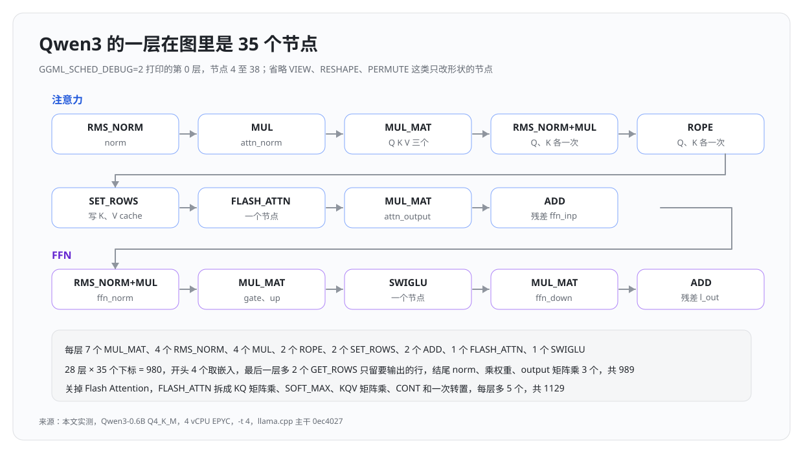
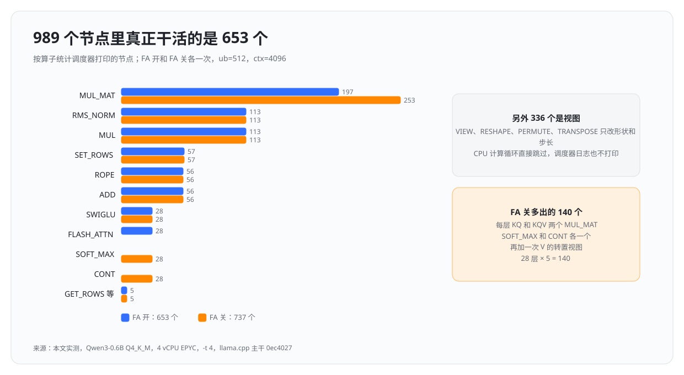
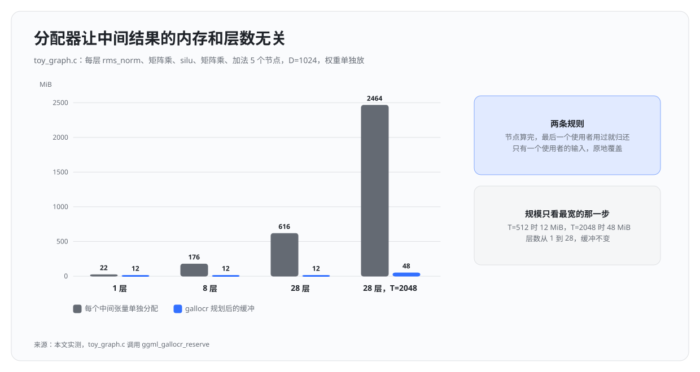
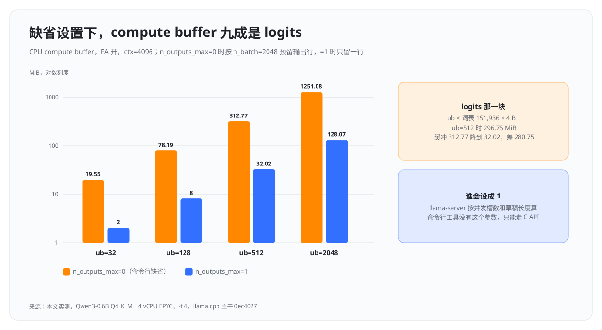
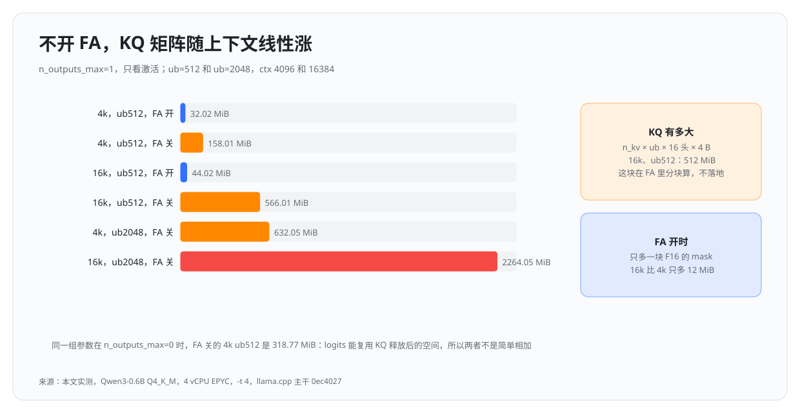
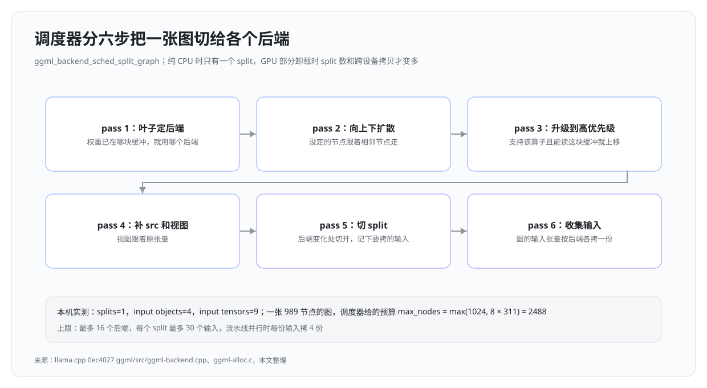
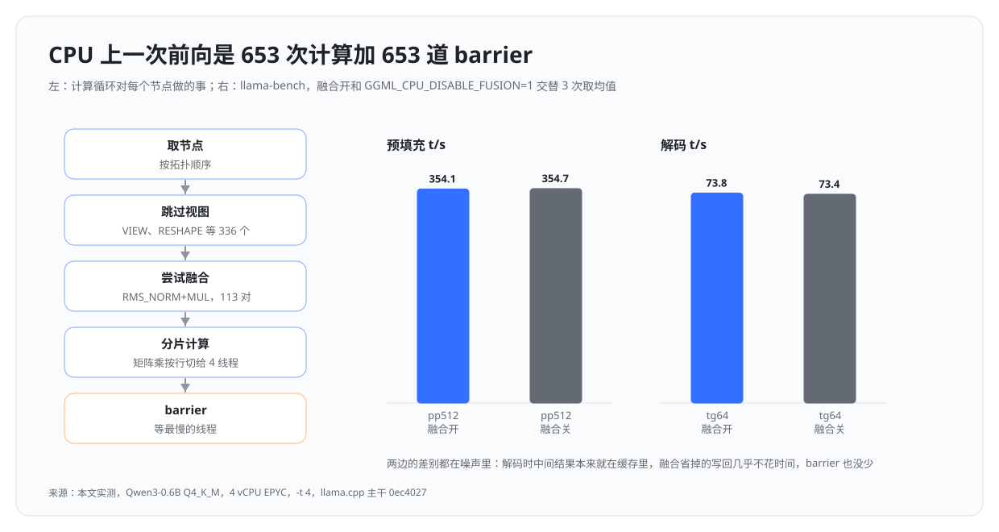
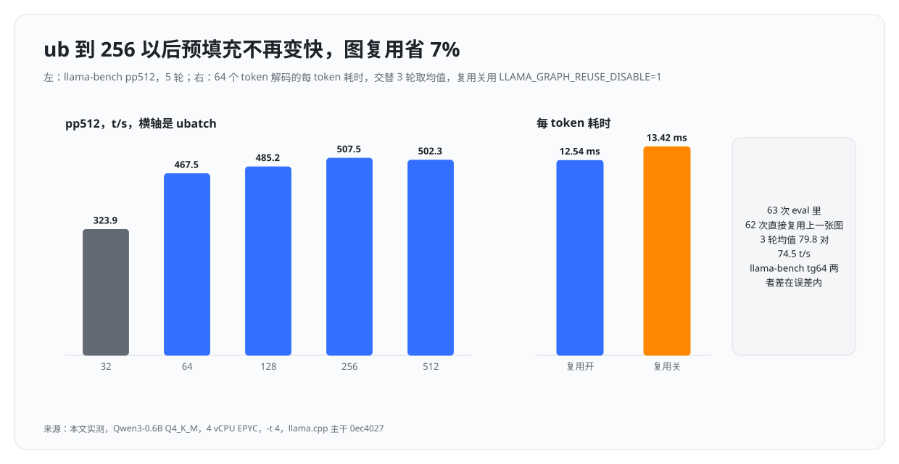

# LCPP-05｜内部｜ggml 与计算图：建图、内存规划、调度和复用

> 🎯 **这篇文档解决什么问题**：模型加载进内存以后，llama.cpp 每次 decode 都要先搭一张计算图，再给图里的中间结果分内存，再把图切给后端去算。我想弄清楚这三步各自花了多少：一层 Qwen3 变成多少个节点，compute buffer 为什么在缺省参数下有 300 MiB，Flash Attention 开关对内存差多少，调度器怎么切图，图复用到底省了多少时间。这篇用调度器的调试日志、一个 60 行的 ggml 小程序和一组对照实验把这些数逐个量出来。主线一句话：Qwen3-0.6B 的一次前向是 989 个节点的图，缺省参数下 compute buffer 九成是 logits，中间结果的内存和层数无关。
>
> 使用方式：先读导读和第 1、2 章建立概念，调内存看第 4 至 6 章，排查多后端和速度问题看第 7 至 9 章，第 10 章是调试开关的速查。文中版本和数字核对于 2026 年 10 月 31 日。
>
> **代码**：[zero-to-llama/05-ggml-graph](../05-ggml-graph)。toy_graph.c 演示 gallocr 怎么规划内存，nout.c 通过 C API 改 n_outputs_max，sched_parse.py 统计调度器日志里的算子，bench05.sh 复现融合和图复用的对照。基线是主干 0ec4027，模型是 Qwen3-0.6B，机器是 4 核 EPYC 云主机无 GPU。

# 导读 · 先给结论

- **Qwen3-0.6B 的一次前向是 989 个节点。**每层 35 个，28 层 980 个，前面 4 个取嵌入，最后一层多 2 个 GET_ROWS，结尾 3 个出 logits。关掉 Flash Attention 每层多 5 个，共 1129 个[[1]](https://github.com/ggml-org/llama.cpp/blob/0ec4027/src/models/qwen3.cpp)[[2]](https://github.com/ggml-org/llama.cpp/blob/0ec4027/src/llama-graph.cpp)。
- **真正要算的只有三分之二。**989 个节点里 336 个是 VIEW、RESHAPE、PERMUTE 这类只改形状的节点，CPU 计算循环直接跳过；剩下 653 个里 MUL_MAT 占 197 个。
- **中间结果的内存和层数无关。**gallocr 按节点顺序借还内存，节点算完、最后一个使用者用过就归还。我的 28 层小网络里中间张量加起来 616 MiB，规划后的缓冲只要 12 MiB[[3]](https://github.com/ggml-org/llama.cpp/blob/0ec4027/ggml/src/ggml-alloc.c)[[4]](https://arxiv.org/abs/2001.03288)。
- **缺省参数下 compute buffer 九成是 logits。**ub=512 时缓冲 312.77 MiB，其中 296.75 MiB 是 512 行乘 151,936 词表的输出。通过 C API 把 n_outputs_max 设成 1，缓冲降到 32.02 MiB[[5]](https://github.com/ggml-org/llama.cpp/pull/23861)。
- **不开 FA，KQ 矩阵随上下文线性涨。**16k 上下文、ub=512 时非 FA 路径的激活 566 MiB，FA 路径 44 MiB。FA 把 KQ 分块算完就丢，不落地[[6]](https://arxiv.org/abs/2205.14135)[[7]](https://github.com/ggml-org/llama.cpp/pull/5021)。
- **纯 CPU 时调度器只切出一个 split。**六步切图的逻辑都在，但只有一个后端时每个节点都分给 CPU，没有跨设备拷贝；它的价值在 GPU 部分卸载时才显出来。
- **图复用让解码快 7%。**64 个 token 的解码里 63 次 eval 有 62 次复用上一张图，每 token 12.3 至 12.8 ms，关掉复用是 13.4 ms。KV 的 n_kv 按 256 对齐，就是为了让相邻几步的图形状不变[[8]](https://github.com/ggml-org/llama.cpp/pull/14482)[[9]](https://github.com/ggml-org/llama.cpp/blob/0ec4027/src/llama-kv-cache.cpp)。

**📎 与系列其他文档的分工**：本篇只讲图、内存规划和调度。加载日志里 model buffer、KV buffer、compute buffer 三项内存怎么读，见 [LCPP-01｜上手｜第一次运行：编译、转换、加载和读懂内存账单](./01-first-run.md)；解码速度的带宽上限怎么算，见 [LCPP-02｜上手｜推理账本：带宽、算力和启动前算出速度上限](./02-ledger.md)；张量在 GGUF 里怎么存、加载时怎么 repack，见 [LCPP-04｜内部｜GGUF：文件结构、元数据、加载方式和分卷](./04-gguf.md)；矩阵乘里 Q4_K 的块格式见 [LCPP-07｜内部｜量化：块结构、配方、imatrix 和用 KLD 选类型](./07-quantization.md)。KV cache 的管理放在 LCPP-08，CPU 线程和 NUMA 调优放在 LCPP-10。

# 第 1 章 · 为什么要看计算图

## 1.1 ggml 先建图后计算

加载日志里 compute buffer 那一行在缺省参数下有 300 MiB，我想知道这块内存装的是什么，就得先弄懂 ggml 怎么建图。ggml 是 llama.cpp 底下的张量库，用 C 写成，没有第三方依赖[[10]](https://huggingface.co/blog/introduction-to-ggml)。它的用法分两段。先在一个 ggml_context 里调用 ggml_mul_mat、ggml_add 这类函数，每次调用只新建一个张量结构，记下算子和输入，不做任何计算。再把最终输出交给 ggml_build_forward_expand，它从输出往回走一遍，把所有依赖按拓扑顺序排进一张 ggml_cgraph，最后由后端按这个顺序逐个节点执行[[11]](https://github.com/ggml-org/llama.cpp/blob/0ec4027/ggml/src/ggml.c)。

这和 TensorFlow 1.x 的静态图是一个思路[[12]](https://arxiv.org/abs/1605.08695)，和 PyTorch 的即时执行相反[[13]](https://arxiv.org/abs/1912.01703)。区别在于 ggml 的图每次 decode 都重建一遍，形状跟着 batch 走，没有单独的编译期。XLA、TVM 这类编译器会在图上做算子融合和内存规划，再生成代码[[14]](https://openxla.org/xla/architecture)[[15]](https://arxiv.org/abs/1802.04799)；ggml 也做内存规划，融合只在后端里按固定模式做，不改图。

## 1.2 张量结构里有什么

ggml_tensor 是一个固定大小的结构体[[16]](https://github.com/ggml-org/llama.cpp/blob/0ec4027/ggml/include/ggml.h)。和计算图有关的字段有这些。type 是数据类型，ne[4] 是四个维度的元素数，nb[4] 是四个维度的字节步长。op 是产生它的算子，op_params 存算子的小参数，比如 RoPE 的维数、softmax 的缩放。src[10] 指向输入张量。view_src 不为空时，说明它是别人的视图，和原张量共用内存。data 指向真正的数据，flags 标记输入、输出、参数这些角色。

```c
struct ggml_init_params ip = { ggml_tensor_overhead() * 4096 + ggml_graph_overhead(), NULL, true };
struct ggml_context * ctx = ggml_init(ip);          // no_alloc = true：只放张量结构
struct ggml_tensor * x = ggml_new_tensor_2d(ctx, GGML_TYPE_F32, D, T);
struct ggml_tensor * h = ggml_rms_norm(ctx, x, 1e-6f); // 只记下 op 和 src[0]
struct ggml_tensor * u = ggml_mul_mat(ctx, w1, h);
struct ggml_cgraph * gf = ggml_new_graph(ctx);        // 缺省容量 2048 个节点
ggml_build_forward_expand(gf, u);                     // 从 u 往回收集依赖
```

ggml_init 的第三个参数 no_alloc 决定 context 里要不要给张量分数据内存。llama.cpp 建计算图时一律传 true，context 里只放张量结构和图结构，几百 KB；数据内存交给后面的分配器统一规划。ggml 仓库的 simple 示例走的是另一条路，no_alloc 为 false，数据和结构放在一起，适合小例子，放到大模型上会让每个中间结果都独占一块内存[[17]](https://github.com/ggml-org/ggml/tree/master/examples/simple)。

## 1.3 我要回答的问题

我看计算图的起因是 compute buffer。同一个模型，有人跑出来 20 MiB，有人跑出来 1.2 GiB，日志里只有一行 CPU compute buffer size。要解释这行数，得知道图里有哪些中间结果、分配器怎么复用它们、哪些参数决定最宽的那一步有多宽。顺着这条线，后面还会碰到调度器怎么切图、CPU 怎么逐个节点执行、相邻两步的图能不能复用。

所以这篇按执行顺序走：先数图里有多少节点，再看分配器怎么给它们分内存，再看几个参数怎么撑大 compute buffer，然后是调度器、CPU 计算循环和图复用。所有数字来自同一个模型、同一台机器和同一个主干提交。

**📎 展开阅读：**加载日志里三项内存的含义和估算方法，在 [LCPP-01｜上手｜第一次运行：编译、转换、加载和读懂内存账单](./01-first-run.md) 第 3 章有完整推导，本篇只展开 compute buffer 这一项。

# 第 2 章 · 一层 Qwen3 变成多少节点

## 2.1 让调度器把图打印出来

调度器有一个调试开关 GGML_SCHED_DEBUG。设成 1 只打印 split 的划分，设成 2 以上会把每个节点的序号、算子、名字、大小和分到的后端都打出来[[18]](https://github.com/ggml-org/llama.cpp/blob/0ec4027/ggml/src/ggml-backend.cpp)。打印要配合 -v，否则日志级别不够。llama.cpp 在 reserve 和解码时会建很多张图，每张都打一遍，我的日志里有 17 张。它们的节点数都一样，日志末尾那张可能被截断，所以我取打印行数最多的一张来数。

```bash
GGML_SCHED_DEBUG=2 llama-completion -m q-Q4_K_M.gguf -c 4096 -ub 512 -fa on \
    -n 1 -p hi -no-cnv -t 4 -v 2> sched.log
python3 sched_parse.py sched.log
# graphs printed 17，largest graph: listed 653, total nodes 989, views 336
# MUL_MAT 197  RMS_NORM 113  MUL 113  SET_ROWS 57  ROPE 56  ADD 56  SWIGLU 28  FLASH_ATTN 28 ...
```

日志里每个节点一行，下面跟着它的输入，比如 node #6 (MUL_MAT): Qcur-0，输入是 blk.0.attn_q.weight 和 attn_norm-0。序号从 0 排到 988，一共 989 个；但只列出了 653 行，中间跳过的序号都是视图节点，调度器打印时也略过它们。

## 2.2 一层 35 个节点



第 0 层占序号 4 到 38，正好 35 个。骨架还是标准的 Transformer 解码层[[19]](https://arxiv.org/abs/1706.03762)，归一化换成 RMSNorm[[20]](https://arxiv.org/abs/1910.07467)，位置编码用 RoPE[[21]](https://arxiv.org/abs/2104.09864)，FFN 用 SwiGLU[[22]](https://arxiv.org/abs/2002.05202)。llm_build_qwen3 的循环体按这个顺序建图：RMS_NORM 加 MUL 做 attn_norm，三个 MUL_MAT 出 Q、K、V。

Q 和 K 各自再过一次 RMS_NORM 加 MUL，这是 Qwen3 新加的 QK norm，然后各过一次 ROPE。接着两个 SET_ROWS 把这一步的 K、V 写进 cache，一个 FLASH_ATTN 算注意力，attn_output 一个 MUL_MAT，再用 ADD 做残差。FFN 那一半是 ffn_norm、gate 和 up 两个 MUL_MAT、SWIGLU、ffn_down，最后再一个残差 ADD[[1]](https://github.com/ggml-org/llama.cpp/blob/0ec4027/src/models/qwen3.cpp)。

图里每个张量的形状都来自模型配置。Qwen3-0.6B 有 28 层，隐藏维 1024，16 个查询头、8 个 KV 头，头维 128，FFN 中间维 3072，词表 151,936[[23]](https://huggingface.co/Qwen/Qwen3-0.6B)[[24]](https://arxiv.org/abs/2505.09388)。8 个 KV 头供 16 个查询头共用，这是分组查询注意力，两个查询头读同一份 K、V，KV cache 因此减半[[25]](https://arxiv.org/abs/2305.13245)。所以 Q 投影的输出是 2048 维，比隐藏维还宽，K、V 投影各 1024 维；后面算 KQ 和 logits 的大小时都要用到这几个数。

35 个里干活的 25 个：7 个 MUL_MAT、4 个 RMS_NORM、4 个 MUL、2 个 ROPE、2 个 SET_ROWS、2 个 ADD、1 个 FLASH_ATTN、1 个 SWIGLU。另外 10 个是 RESHAPE、VIEW、PERMUTE，把 Q 从 [2048, T] 变成 [128, 16, T]，把 cache 切出这一步要读的范围。

## 2.3 首尾和 FA 关时的差别

28 层是 980 个节点。前面 4 个是取嵌入：两个 GET_ROWS 从 token_embd 里查行，一个 DUP，一个 SET_ROWS。最后一层在注意力之后多了两个 GET_ROWS，用 inp_out_ids 只留下需要输出 logits 的那几行，后面的 FFN 就只对这几行算。结尾是 output_norm 的 RMS_NORM、乘权重的 MUL 和 output 矩阵乘，共 989 个[[1]](https://github.com/ggml-org/llama.cpp/blob/0ec4027/src/models/qwen3.cpp)。



关掉 Flash Attention，build_attn_mha 走另一条路：K 和 Q 做 MUL_MAT 得到 KQ，SOFT_MAX 带上 mask 和缩放，V 转置后和 KQ 再做一次 MUL_MAT，最后 CONT 把结果拷成连续内存[[2]](https://github.com/ggml-org/llama.cpp/blob/0ec4027/src/llama-graph.cpp)。每层多 5 个节点，28 层多 140 个，图变成 1129 个节点。实际要算的节点从 653 个涨到 737 个，多出来的是 56 个 MUL_MAT、28 个 SOFT_MAX、28 个 CONT，减去 28 个 FLASH_ATTN。

> 🔑 **本章要点**：一层 35 个节点，其中 25 个干活。28 层加首尾共 989 个，FA 关时 1129 个。336 个视图节点不算也不占新内存。最后一层的 GET_ROWS 只保留要输出的行，这一点在第 5 章还会用到。

# 第 3 章 · 图的容量和建图开销

## 3.1 节点数有上限

ggml_new_graph 建的图缺省容量 GGML_DEFAULT_GRAPH_SIZE 是 2048 个节点，超过就断言失败[[16]](https://github.com/ggml-org/llama.cpp/blob/0ec4027/ggml/include/ggml.h)。llama.cpp 不用缺省值，它调用 ggml_new_graph_custom，容量由 graph_max_nodes 算出来：大多数架构取 1024 和 8 倍张量数中的较大者，挂了 LoRA 再加上 LoRA 的节点数[[26]](https://github.com/ggml-org/llama.cpp/blob/0ec4027/src/llama-context.cpp)。Qwen3-0.6B 有 311 个张量，预算是 max(1024, 8 × 311) = 2488，日志里 sched_reserve: max_nodes = 2488 就是这个数。

989 个节点只用了预算的四成，FA 关时的 1129 个也够用。8 倍是一个经验系数：一个权重张量平均对应三四个节点。混合架构、带循环的架构会把系数调到 12、32 甚至 64，因为它们一个权重会被用很多次。自己加新架构时，如果建图报 GGML_ASSERT(cgraph->n_nodes ＜ cgraph->size)，先看这个函数。

## 3.2 每次 decode 都重建

llama.cpp 没有把图缓存成固定结构再反复喂数据。每次 llama_decode 都会根据这一批的 token 数、序列数和 KV 状态重新调用 llm_build_qwen3，在一块预先分好的元数据内存里重新建 989 个张量结构。这块内存只放结构，不放数据，大小由 max_nodes 决定，建一次图在本机是毫秒以下。

图建好以后还要做三件事：调度器给每个节点定后端，分配器给中间结果定地址，后端逐个节点计算。前两件在第 7 章和第 4 章讲，第 9 章讲 llama.cpp 怎么在相邻两步形状不变时跳过重建和重新分配。

## 3.3 reserve 阶段的最坏情况

创建 context 时 llama.cpp 会先做一次 sched_reserve：分别建一张单 token 的解码图和一张 n_ubatch 个 token 的预填充图，让分配器按最坏情况把 compute buffer 一次分够[[26]](https://github.com/ggml-org/llama.cpp/blob/0ec4027/src/llama-context.cpp)。之后正常 decode 时，只要图不比 reserve 时更宽，就不再重新分配。

日志里 graph_reserve: reserving a graph for ubatch with n_tokens = 512 就是在建这张最坏情况的图，reserve 一共 330 至 450 ms，开了 GGML_SCHED_DEBUG=2 以后因为要打印几千行，涨到 7 至 8 秒。

reserve 选最坏情况的依据是 n_ubatch、n_ctx 和 n_outputs_max 这几个参数，所以它们直接决定 compute buffer 的大小。第 5、6 章会逐个量它们的影响。

# 第 4 章 · gallocr：中间结果怎么分内存

## 4.1 用完就还，能原地就原地

ggml-alloc.c 里的 gallocr 是图分配器，2023 年随 llama.cpp 的图张量分配器一起加入[[27]](https://github.com/ggml-org/llama.cpp/pull/2411)，2024 年的 v3 改成支持多个缓冲和多个后端[[28]](https://github.com/ggml-org/ggml/pull/727)。它在真正分配之前先把整张图模拟走一遍，只做两件事[[3]](https://github.com/ggml-org/llama.cpp/blob/0ec4027/ggml/src/ggml-alloc.c)：

- **用完就还。**先数出每个张量有几个使用者。按节点顺序走，每算完一个节点，就给它的输入减一次计数；计数归零、又不是图的输出，这块内存就退回空闲列表。
- **能原地就原地。**ADD、MUL、RMS_NORM、ROPE、SOFT_MAX、SCALE 这类逐元素算子，如果某个输入只有它一个使用者、没有视图指着它、形状和步长和输出一样，输出直接写在这个输入上，不另开内存。

借内存时在空闲块里找最合适的那块，找不到才把缓冲末尾往后推。整个模拟走完，缓冲末尾到过的最远位置就是这张图需要的 compute buffer。之后每次真正分配，张量地址按模拟结果填，不再查找。

原地复用的条件比看上去严格。父节点的内存必须归 gallocr 管，权重和 KV cache 这类外部内存不能动。父节点也不能是图的输出，布局还必须完全一致。2025 年还修过一个对齐尺寸不一致时错误复用父节点的问题[[29]](https://github.com/ggml-org/llama.cpp/pull/17884)。

## 4.2 用 60 行代码验证

我写了一个 toy_graph.c，搭一个 L 层的小网络，每层 rms_norm、矩阵乘、silu、矩阵乘、残差加 5 个节点，隐藏维 1024，中间维 4096。权重放在单独的 context 里分配，图里只剩激活，然后调用 ggml_gallocr_reserve 看它规划出多大的缓冲，和把每个中间张量单独分配加起来的总量对比。

```bash
./toy_graph 28 1024 512
# L=28 D=1024 T=512 nodes=140 weights=896 MiB
# sum_of_intermediates=616.00 MiB planned=12.00 MiB ratio=51.3x
# largest_single=8.00 MiB (u: 4D x T x 4B)
for L in 1 8 28; do ./toy_graph $L 1024 512 | sed -n 2p; done
```



结果很干脆：1 层、8 层、28 层，规划后的缓冲都是 12 MiB，中间张量总量从 22 MiB 涨到 616 MiB。12 MiB 刚好是最宽那一步同时活着的张量：中间维的 u 是 4 × 1024 × 512 × 4 B = 8 MiB，加上残差流 cur 的 2 MiB 和下一步的输入 2 MiB。T 从 512 涨到 2048，缓冲跟着线性涨到 48 MiB。

## 4.3 和别的框架比

这套做法在深度学习框架里很常见。训练侧最早系统讲内存共享和原地操作的是 2016 年的亚线性内存论文，它在计算图上做存活分析，再用重计算换内存[[30]](https://arxiv.org/abs/1604.06174)。推理侧 TensorFlow Lite 的工程师在 2020 年比较过几种给中间张量排偏移的贪心策略，按大小排序的贪心在多数模型上离理论下界只差几个百分点[[4]](https://arxiv.org/abs/2001.03288)。gallocr 用的是最朴素的按执行顺序加最佳适配，好处是代码短、没有额外的排序开销。PyTorch 走的是另一条路：即时执行时不知道后面还有什么算子，只能靠缓存分配器在运行期回收和复用显存块，碎片和峰值都比静态规划难控制[[31]](https://pytorch.org/docs/stable/notes/cuda.html)。

推理不需要反向传播，激活用完就能扔，所以 gallocr 不做重计算。对一个层层串起来的 Transformer，这种简单策略已经接近下界：compute buffer 由最宽的那一步决定，和层数无关。

> 🔑 **本章要点**：gallocr 用存活计数加原地复用两条规则，先模拟再分配。toy_graph 里 28 层的中间结果 616 MiB，缓冲只要 12 MiB，层数不影响缓冲，token 数线性影响。要压 compute buffer，就去找最宽的那一步。

# 第 5 章 · compute buffer 九成是 logits

## 5.1 最宽的一步在最后

按第 4 章的结论，Qwen3-0.6B 的 compute buffer 应该由最宽那一步决定。层内最宽的是 FFN，ub=512 时 gate、up 各 512 × 3072 × 4 B = 6 MiB，加起来不过几十 MiB。但日志里 ub=512 的 compute buffer 是 312.77 MiB。

多出来的在图的最后一个节点。output 矩阵乘的结果是 [151,936, n_outputs]，n_outputs 是这一批里要出 logits 的行数。reserve 时 llama.cpp 按最坏情况假设每个 token 都要输出，于是这一步是 512 × 151,936 × 4 B = 296.75 MiB，占整个缓冲的 95%[[26]](https://github.com/ggml-org/llama.cpp/blob/0ec4027/src/llama-context.cpp)。第 2 章提到的最后一层两个 GET_ROWS 就是为了在正常推理时只留要输出的行，可 reserve 时留的是全部 512 行。

```text
c=4096 fa=on ub=32    CPU compute buffer size =    19.55 MiB
c=4096 fa=on ub=128   CPU compute buffer size =    78.19 MiB
c=4096 fa=on ub=512   CPU compute buffer size =   312.77 MiB
c=4096 fa=on ub=2048  CPU compute buffer size =  1251.08 MiB
```

## 5.2 n_outputs_max

2026 年主干加了一个上下文参数 n_outputs_max，限制一个 ubatch 里最多输出多少行[[5]](https://github.com/ggml-org/llama.cpp/pull/23861)[[32]](https://github.com/ggml-org/llama.cpp/blob/0ec4027/include/llama.h)。它为 0 时退回 n_batch，这是命令行工具的缺省行为，也就是上面的 312.77 MiB。我用 nout.c 直接调 C API，把它设成 1 再建一次 context：



ub=512 时缓冲从 312.77 MiB 降到 32.02 MiB，四种 ubatch 都降了九成。差值 280.75 MiB 比 logits 本身少 16 MiB，因为缓冲取的是峰值：n_outputs_max=0 时峰值在 output 矩阵乘，296.75 MiB 的 logits 加上同时活着的输入；设成 1 以后峰值回到层内，32 MiB。

## 5.3 谁会把它设小

llama-server 会。它按并发槽数和投机解码的草稿长度算：每个序列最多输出 1 + n_draft 行，总数是 n_parallel × (1 + n_draft)，再和 n_batch 取小[[33]](https://github.com/ggml-org/llama.cpp/blob/0ec4027/tools/server/server-context.cpp)。4 个槽、不开投机解码时只要 4 行，compute buffer 自然小。投机解码的验证步要一次输出整段草稿的 logits，所以算法里专门把草稿长度算进去，主干还修过一次这里算少了的问题[[34]](https://github.com/ggml-org/llama.cpp/pull/23988)。做 embedding 或带池化时，server 退回按 n_batch 预留。

llama-cli、llama-completion、llama-bench 这些命令行工具没有对应的参数，只能走缺省值。所以同一个模型，命令行跑出来 300 MiB 的 compute buffer，挂到 server 上只有 30 MiB，两边都没算错。

> 💡 **常见误区**：拿命令行工具的 compute buffer 估服务的内存，会高估十倍；反过来，自己用 C API 写批量打分、需要每个 token 的 logits 时，必须把 n_outputs_max 留成 0 或设成 n_batch，设小了 llama_decode 会直接报错。

> 🔑 **本章要点**：ub=512 时 compute buffer 312.77 MiB 里有 296.75 MiB 是 512 行 logits。n_outputs_max 设成 1 降到 32.02 MiB。server 按并发和草稿长度自动设，命令行工具没有这个参数。

# 第 6 章 · FA 和非 FA 两条路径

## 6.1 KQ 矩阵有多大

标准注意力先算 KQ = K^T Q，形状是 [n_kv, n_tokens, n_head]，过 softmax 后再乘 V。KQ 要完整写进内存再读出来，这是它的内存瓶颈[[6]](https://arxiv.org/abs/2205.14135)。FlashAttention 把 Q、K、V 切成小块，用在线 softmax 一边累加一边修正归一化因子，KQ 从不完整落地[[35]](https://arxiv.org/abs/1805.02867)[[36]](https://arxiv.org/abs/2307.08691)。不用 GPU 共享内存的分块算法在 2021 年就有人证明过，注意力的额外内存可以降到和序列长度无关[[37]](https://arxiv.org/abs/2112.05682)。

llama.cpp 在 2024 年加入了 ggml_flash_attn_ext 算子，CPU、CUDA、Metal 各有实现[[7]](https://github.com/ggml-org/llama.cpp/pull/5021)；2025 年起 -fa 的缺省值改成 auto，后端支持就开[[38]](https://github.com/ggml-org/llama.cpp/pull/15434)。build_attn_mha 里两条路径分得很清楚：开 FA 时一个 FLASH_ATTN 节点吃进 Q、K、V 和 mask；不开时是 MUL_MAT、SOFT_MAX、MUL_MAT 三步，KQ 是一个实实在在的中间张量[[2]](https://github.com/ggml-org/llama.cpp/blob/0ec4027/src/llama-graph.cpp)。

## 6.2 实测



我把 n_outputs_max 设成 1，先拿掉 logits 的干扰，只看层内激活。KQ 的大小是 n_kv × ub × 16 头 × 4 B：4k 上下文、ub=512 时 128 MiB，16k 时 512 MiB。非 FA 的缓冲 158.01 和 566.01 MiB，基本就是 KQ 加 30 MiB 左右的其他激活。ub=2048、16k 上下文时 KQ 涨到 2 GiB，缓冲 2264.05 MiB。

FA 开时只多一块 F16 的 mask，形状 [n_kv, ub]。4k 到 16k，mask 从 4 MiB 涨到 16 MiB，缓冲从 32.02 涨到 44.02 MiB，差值正好 12 MiB。

## 6.3 两个因素叠在一起

logits 和 KQ 的内存不能直接相加。缺省 n_outputs_max=0 时，4k、ub=512、FA 关的缓冲是 318.77 MiB，比 FA 开的 312.77 只多 6 MiB。因为 KQ 活在每层的注意力里，logits 活在图的最后，两者生命期不重叠，分配器让 logits 用的是 KQ 释放后的同一段地址。16k 时 KQ 512 MiB 比 logits 大，缓冲 566.02 MiB，又和 n_outputs_max=1 时几乎一样。

```text
c=4096  fa=off ub=512   318.77 MiB   nodes = 1129
c=16384 fa=on  ub=512   322.77 MiB   nodes = 989
c=16384 fa=off ub=512   566.02 MiB   nodes = 1129
c=16384 fa=off ub=2048 2264.06 MiB   nodes = 1129
```

## 6.4 auto 怎么决定开不开

-fa 缺省是 auto。创建 context 时，llama.cpp 先按 FA 开建一张探测图，交给调度器分后端，再逐个检查 FLASH_ATTN 节点落在哪个设备上[[26]](https://github.com/ggml-org/llama.cpp/blob/0ec4027/src/llama-context.cpp)。只要有一层的 FA 节点和这一层的其余节点不在同一个设备，通常是因为那个后端不支持这个算子，日志会打出 not supported, set to disabled，整个 context 退回非 FA。纯 CPU 时 CPU 后端支持 FA，日志是 enabled。

还有两条硬规则：V cache 用量化类型时 FA 必须开，auto 会被强制改成开，显式关掉则直接报错返回空 context。所以上线时我会在日志里搜 flash_attn 这一行确认最终状态，而不是只看命令行传了什么。

> 🔑 **本章要点**：非 FA 路径的 KQ 是 n_kv × ub × n_head × 4 B，随上下文线性涨，16k、ub=512 时 512 MiB。FA 只多一块 mask。logits 和 KQ 生命期不重叠，缓冲取两者中的大者，不是两者之和。

# 第 7 章 · 调度器怎么切图

## 7.1 后端和调度器

ggml 在 2023 年引入后端接口，把 CPU、CUDA、Metal 这些设备抽象成同一组函数：分配缓冲、拷贝张量、判断支不支持某个算子、执行一张图[[39]](https://github.com/ggml-org/ggml/pull/547)。2024 年 llama.cpp 改用 ggml_backend_sched 调度多个后端，GPU 部分卸载从此走同一套代码[[40]](https://github.com/ggml-org/llama.cpp/pull/4766)。调度器拿到一张完整的图，决定每个节点在哪个后端算，在后端切换的地方把图切成若干 split，并在 split 之间插入张量拷贝[[18]](https://github.com/ggml-org/llama.cpp/blob/0ec4027/ggml/src/ggml-backend.cpp)。

## 7.2 每个节点按权重位置定后端



1. 叶子和已经有缓冲的节点先定后端：权重在哪块缓冲，用到它的矩阵乘就去哪个后端。高优先级后端声明自己愿意接手的算子，可以把放在 CPU 内存里的权重算子抢过去。ROPE 和 FLASH_ATTN 的权重输入太小，不参与这条判断。
2. 没定的节点向前、向后扩散，跟着相邻节点走，避免一个元素级算子把图切碎。
3. 能升级就升级：某个节点的后端优先级不高，而更高优先级的后端既支持这个算子、又能读它的输入缓冲，就挪上去。
4. 剩下的输入张量和视图补上后端，视图跟着原张量。
5. 按顺序扫一遍，后端变化处切开；每个 split 记下哪些输入来自别的后端，要拷过来。
6. 图的输入张量按后端各拷一份，算完一个 split 再开下一个。

几个硬上限写在宏里：最多 16 个后端，每个 split 最多 30 个输入，流水线并行时每份输入最多拷 4 份。流水线并行在 2024 年加入，多张卡按层切分、全部层都卸载到 GPU 时自动打开，用多份输入拷贝让相邻 ubatch 在不同卡上重叠执行[[41]](https://github.com/ggml-org/llama.cpp/pull/6017)。

## 7.3 纯 CPU 时它做了什么

本机只有 CPU 后端。日志里 graph: nodes = 989, splits = 1, input objects = 4, input tensors = 9：整张图一个 split，没有跨设备拷贝。input tensors 的 9 个是 token id、位置、KV 写入下标、mask、输出行下标这些每步都要喂的输入，input objects 是它们所属的 4 组图输入。

所以纯 CPU 推理时调度器几乎是透明的，第 8 章的计算循环才是时间花掉的地方。GPU 部分卸载时，split 数会随卸载层数变化，每个 split 边界都有一次 PCIe 拷贝；这部分我没有在本机实测，留到 LCPP-11 在 GPU 上量。

**📎 展开阅读：**-ngl、-ot、--split-mode 这些控制卸载的参数怎么影响 split 数和拷贝量，放在 LCPP-11 和 LCPP-12。

> 🔑 **本章要点**：调度器六步：定叶子、扩散、升级、补视图、切 split、收输入。最多 16 个后端，每 split 最多 30 个输入。纯 CPU 时只有 1 个 split、9 个输入张量；它的成本在 GPU 部分卸载时才显出来。

# 第 8 章 · CPU 计算循环

## 8.1 逐个节点，节点之间一道 barrier

CPU 后端拿到一个 split 以后，开 n_threads 个线程，每个线程跑同一个循环：按顺序取节点，跳过空节点，算自己那一份，然后在 barrier 上等其他线程[[42]](https://github.com/ggml-org/llama.cpp/blob/0ec4027/ggml/src/ggml-cpu/ggml-cpu.c)。空节点有两种：算子是 NONE、RESHAPE、TRANSPOSE、VIEW、PERMUTE 的，只改元数据，不用算[[43]](https://github.com/ggml-org/llama.cpp/blob/0ec4027/ggml/src/ggml-impl.h)。建图时没有打上 COMPUTE 标记的节点也跳过。

```c
for (int node_n = 0; node_n < cgraph->n_nodes; node_n++) {
    struct ggml_tensor * node = cgraph->nodes[node_n];
    if (ggml_op_is_empty(node->op)) continue;                    // 视图类，跳过
    if ((node->flags & GGML_TENSOR_FLAG_COMPUTE) == 0) continue;
    const int n_fused = ggml_cpu_try_fuse_ops(cgraph, node_n, ...);
    if (n_fused > 0) node_n += n_fused;                          // RMS_NORM 吃掉后面的 MUL
    else ggml_compute_forward(&params, node);                   // 每个线程算自己那一片
    if (node_n + 1 < cgraph->n_nodes) ggml_barrier(threadpool); // 等所有线程
}
```

所以一次前向在 CPU 上就是 653 次分片计算加 653 次 barrier。矩阵乘按输出行切给各线程，元素级算子按元素切。barrier 本身是一个原子计数器加自旋，4 个线程时单次在微秒以下；但每个节点都要等最慢的那个线程，线程数越多、节点越小，等待占比越大。

## 8.2 CPU 上只融合 RMS_NORM 加 MUL

计算循环里有一个融合入口 ggml_cpu_try_fuse_ops。在 0ec4027 上它只认一个模式：RMS_NORM 后面紧跟一个乘权重的 MUL，输入、输出、权重都是 F32，权重长度等于行长。满足时一次算完归一化和缩放，省掉一次把中间结果写回内存再读出来。Qwen3 每层 4 对，加上结尾 1 对，一次前向融合 113 对。环境变量 GGML_CPU_DISABLE_FUSION=1 可以关掉它。

```text
                       pp512 t/s       tg64 t/s
融合开（缺省）          354.1 ± 2.5     75.0 ± 3.1
GGML_CPU_DISABLE_FUSION=1  354.7 ± 6.6     71.0 ± 0.9
```



预填充不受影响，矩阵乘占了绝大部分时间，省下的几次内存往返看不出来。解码第一次测出 75.0 对 71.0，看上去快了 5%，但融合开那组的误差是 ±3.1，已经和差值一样大。

我又交替各跑了 3 次 tg64，每次 2 轮：融合开 73.1、73.6、74.6 t/s，融合关 71.5、74.1、74.5 t/s，均值 73.8 对 73.4，差在噪声里。所以在这台 4 核机器上，融合省掉的 113 次读写对解码的收益不到 1%，第一次的 5% 是波动。原因也说得通：单 token 时一次 RMS_NORM 只处理 1024 个数，4 KB 的中间结果本来就在缓存里，省掉的写回几乎不花时间，节点数也没少，barrier 照样要过。

## 8.3 怎么用这个结论

CPU 解码时的节点数和 barrier 数是实打实的开销，现有的这种融合动不了它。第 9 章的图复用省掉的是建图和分配，节点调度本身也省不掉。想进一步压解码延迟，方向是让每个节点更大、节点更少，比如更大的融合；调线程数、绑核这些放在 LCPP-10。

> 🔑 **本章要点**：CPU 后端逐个节点算，节点之间一道 barrier，视图节点跳过。0ec4027 只融合 RMS_NORM 加 MUL 一种模式，交替 3 轮测下来预填充和解码的差别都在噪声里。单次测量看到的 5% 不可信，对照实验要交替多跑几轮。

# 第 9 章 · 图复用

## 9.1 相邻两步的图长得一样

解码时每步只喂一个 token，图的形状几乎不变。2025 年 llama.cpp 加入了图复用：建完一张图，先问上一张图能不能接着用；能用就只更新输入张量的数据，跳过建图、调度器切图和 gallocr 分配[[8]](https://github.com/ggml-org/llama.cpp/pull/14482)。

能不能复用分两层判断。先比 ubatch：token 数、序列数、每序列 token 数、是否混合嵌入都要一样[[44]](https://github.com/ggml-org/llama.cpp/blob/0ec4027/src/llama-graph.h)。再让每个图输入自己比，KV 输入要求写入下标的长度相同、mask 的形状相同。mask 的形状里有 n_kv，也就是这一步要读多少格 KV cache。如果 n_kv 每步加一，图每步都变，复用就没意义了。所以 KV cache 把 n_kv 按 256 向上对齐，源码注释直接写了目的：让图在相邻几个 batch 之间保持不变，从而能复用[[9]](https://github.com/ggml-org/llama.cpp/blob/0ec4027/src/llama-kv-cache.cpp)。

## 9.2 实测



我用 llama-completion 在 4096 上下文下生成 64 个 token，复用开和关交替各跑 3 轮。复用开时 63 次 eval 里 62 次复用，每 token 12.48、12.80、12.34 ms；关掉以后 0 次复用，13.44、13.37、13.45 ms。三轮都是开比关快 7% 左右，吞吐 78 至 81 对 74 至 75 t/s。

```bash
for i in 1 2 3; do for dis in 0 1; do
  LLAMA_GRAPH_REUSE_DISABLE=$dis llama-completion -m q-Q4_K_M.gguf -c 4096 -n 64 \
      -p "Explain how a compiler works." -no-cnv -t 4 --perf 2>&1 |
    grep -E "eval time|graphs reused" | tr "\n" " "; echo " dis=$dis"
done; done
```

预填充没有这笔收益：一次几百个 token，算的时间远大于建图的时间。llama-bench 的 tg64 也看不出差别，它每轮都重新开始、步数少、波动大，7% 埋在误差里。看复用效果要用 --perf 打印出的 graphs reused 计数和每 token 耗时。

## 9.3 和 CUDA Graph 的关系

GPU 上还有一层复用。CUDA Graph 把一串内核启动录下来，之后整串一次提交，省掉每个内核的启动开销[[45]](https://developer.nvidia.com/blog/cuda-graphs/)。llama.cpp 在 2024 年给 CUDA 后端加了 CUDA Graph，解码时每步几百个小内核，启动开销占比很高，收益明显[[46]](https://github.com/ggml-org/llama.cpp/pull/6766)。CUDA Graph 要求相邻两步的内核序列和参数基本不变，和上层的图复用是同一个前提，n_kv 按 256 对齐对它同样有用。这部分没有在本机实测，GPU 上的数字放到 LCPP-11。

## 9.4 哪些情况复用不了

只要 ubatch 的形状变了，复用就断。预填充那一步有几百个 token，下一步解码只有一个，第一步必然重建；63 次 eval 里那 1 次没复用的就是它。n_kv 跨过 256 的边界时 mask 形状变化，也要重建一次，4096 的上下文最多跨 16 次。多序列并发时，每步参与的序列数和每序列 token 数一变，图也就变了，所以 server 多槽场景下的复用率预计比单序列低，这一点我没有实测。

复用只跳过建图和分配，计算本身一个节点都没少。它省下的约 0.9 ms 主要是建 989 个张量结构、调度器六步和 gallocr 模拟的时间，单 token 解码总共才 13 ms，这块才显得出来。

> 🔑 **本章要点**：图复用跳过建图、切图和分配，只更新输入数据。前提是 ubatch 形状和 n_kv 不变，n_kv 因此按 256 对齐。本机解码 63 步复用 62 次，快 7%。预填充和 llama-bench 看不出差别。

# 第 10 章 · 调试开关

## 10.1 环境变量

| 开关 | 作用 | 什么时候用 |
|-|-|-|
| GGML_SCHED_DEBUG=1 | 打印 split 划分和每个 split 的输入 | 查 GPU 部分卸载时为什么拷贝多 |
| GGML_SCHED_DEBUG=2 | 再打印每个节点的算子、大小和后端 | 数节点、找某个算子分到了哪 |
| GGML_SCHED_DEBUG_REALLOC=1 | 图大小没变却重新分配时打印原因 | 查 compute buffer 反复重分配 |
| LLAMA_GRAPH_REUSE_DISABLE=1 | 关掉图复用 | 怀疑复用导致结果错，或做对照 |
| GGML_CPU_DISABLE_FUSION=1 | 关掉 CPU 上的 RMS_NORM 加 MUL 融合 | 怀疑融合算子有数值问题 |
| LLAMA_GRAPH_INPUT_DEBUG=1 | 打印图输入的设置过程 | 查 mask、位置这些输入填得对不对 |

GGML_SCHED_DEBUG 的输出必须配合 -v 才能看到，否则会被日志级别过滤掉。打印本身很慢：reserve 从 0.4 秒涨到 8 秒，只适合排查，不要留在压测脚本里。

## 10.2 把图画出来

ggml 自带 ggml_graph_dump_dot，把一张图写成 Graphviz 的 dot 文件，节点按算子着色，边是数据依赖[[16]](https://github.com/ggml-org/llama.cpp/blob/0ec4027/ggml/include/ggml.h)[[47]](https://graphviz.org/doc/info/lang.html)。989 个节点的图画出来很大，我一般在 toy_graph 这种小图上用它看结构，大模型上用 GGML_SCHED_DEBUG=2 的文本输出加 sched_parse.py 统计。

```c
// 在 ggml_build_forward_expand 之后加一行
ggml_graph_dump_dot(gf, NULL, "toy.dot");
// 然后 dot -Tsvg toy.dot -o toy.svg
```

## 10.3 看日志的顺序

排查内存问题时，我按这个顺序看 -v 日志。先看 sched_reserve 的 max_nodes 和 graph: nodes，确认图的规模。再看 compute buffer size，按第 5、6 章的公式拆成 logits、KQ 和层内激活。然后看 splits，纯 CPU 应该是 1。最后看 --perf 的 graphs reused，解码时应该接近总步数。四个数里哪个偏离预期，就去对应的章节找原因。

## 10.4 用本机的数走一遍

拿第 5 章 ub=2048 那一行当例子，假设有人反馈 compute buffer 有 1.2 GiB。按上面的顺序看日志。graph: nodes = 989，max_nodes = 2488，图的规模正常。splits = 1，没有跨设备拷贝。compute buffer 1251.08 MiB，这一项明显偏大。

套第 5 章的公式，2048 × 151,936 × 4 B 是 1187 MiB，再加上层内激活，就是日志里的数，所以这 1.2 GiB 里几乎全是按 n_batch 预留的 logits，和模型大小、上下文长度都没有关系。处理办法有两个：命令行工具把 -ub 降回 512，缓冲回到 312.77 MiB，而第 11 章的 pp512 曲线在 256 以后已经平了，吞吐基本不受影响；自己写 C API 的话，直接把 n_outputs_max 设成实际要输出的行数。

> 🔑 **本章要点**：GGML_SCHED_DEBUG 配合 -v 看节点和 split，REALLOC 查重分配，REUSE_DISABLE 和 DISABLE_FUSION 做对照。小图用 ggml_graph_dump_dot 画，大图用文本统计。

# 第 11 章 · 怎么选与上线清单

## 11.1 按场景选

| 场景 | FA | ubatch | n_outputs_max | 要盯的数 |
|-|-|-|-|-|
| 命令行调试、短上下文 | auto（缺省） | 512 | 缺省 0 | compute buffer 约 300 MiB |
| llama-server 多槽 | auto | 512 | server 自动算 | compute buffer 约 30 MiB 加 KV |
| 长上下文 16k 以上 | 必须开 | 512 或 256 | 按需 | 非 FA 时 KQ 线性涨 |
| 自写 C API 只要最后一个 token | 开 | 按吞吐定 | 1 | compute buffer 降九成 |
| 批量打分要全部 logits | 开 | 按内存定 | 0 或 n_batch | logits 占大头 |
| 小内存机器 | 开 | 128 至 256 | 尽量小 | pp 在 ub 256 后已不再变快 |

ubatch 的选择我看两个数。吞吐上，pp512 在 ub=32 到 64 之间涨得最多，到 256 以后基本持平，两次独立测量的绝对值差两到三成，但曲线形状一致；内存上，compute buffer 和 ubatch 严格成正比。所以 256 到 512 是 CPU 上的合理区间，再大只多占内存。

## 11.2 上线清单

> 📌 **上线前核对清单**：一个基于 llama.cpp 的服务上线之前，我会逐条过一遍。
> - -v 日志里 graph: nodes 和 max_nodes 都记下来，节点数没超过预算的一半
> - compute buffer 按 logits、KQ、层内激活拆过，和实测差不超过 10%
> - Flash Attention 实际开着，日志里没有因为后端不支持退回非 FA
> - 自写 C API 时 n_outputs_max 按真实输出行数设，不是缺省 0
> - ubatch 在 256 到 512 之间，或者有自己的吞吐和内存测量支撑
> - 纯 CPU 时 splits = 1；GPU 部分卸载时 split 数和拷贝量记录在案
> - --perf 的 graphs reused 接近解码步数，没有每步重建
> - 压测脚本里没有留着 GGML_SCHED_DEBUG 和 REUSE_DISABLE 这类调试开关

## 11.3 下一步

计算图里最占内存、又随上下文增长的，除了 KQ 就是 KV cache。LCPP-08 从这篇看到的 SET_ROWS、n_kv 对齐和 mask 出发，讲 KV cache 的布局、量化、多序列共享和上下文移位；各后端怎么编译、怎么确认编出来的是自己要的，在 LCPP-06。解码为什么受带宽限制，回到 [LCPP-02｜上手｜推理账本：带宽、算力和启动前算出速度上限](./02-ledger.md)；矩阵乘里的量化块格式见 [LCPP-07｜内部｜量化：块结构、配方、imatrix 和用 KLD 选类型](./07-quantization.md)。

# 参考文献

按正文首次引用顺序编号，资料截至 2026 年 10 月初。

[1] llama.cpp 0ec4027. src/models/qwen3.cpp：llm_build_qwen3 逐层建图。 [qwen3.cpp](https://github.com/ggml-org/llama.cpp/blob/0ec4027/src/models/qwen3.cpp)

[2] llama.cpp 0ec4027. src/llama-graph.cpp：build_attn_mha 的 FA 和非 FA 两条路径。 [llama-graph.cpp](https://github.com/ggml-org/llama.cpp/blob/0ec4027/src/llama-graph.cpp)

[3] llama.cpp 0ec4027. ggml/src/ggml-alloc.c：gallocr 的空闲块、原地复用和 reserve。 [ggml-alloc.c](https://github.com/ggml-org/llama.cpp/blob/0ec4027/ggml/src/ggml-alloc.c)

[4] Pisarchyk Y, Lee J. Efficient Memory Management for Deep Neural Net Inference. MLSys Workshop 2020. [arXiv:2001.03288](https://arxiv.org/abs/2001.03288)

[5] am17an. llama: limit max outputs of llama_context. llama.cpp PR #23861, 2026. [PR #23861](https://github.com/ggml-org/llama.cpp/pull/23861)

[6] Dao T et al. FlashAttention: Fast and Memory-Efficient Exact Attention with IO-Awareness. NeurIPS 2022. [arXiv:2205.14135](https://arxiv.org/abs/2205.14135)

[7] ggerganov. ggml : add Flash Attention. llama.cpp PR #5021, 2024. [PR #5021](https://github.com/ggml-org/llama.cpp/pull/5021)

[8] ggerganov. llama : reuse compute graphs. llama.cpp PR #14482, 2025. [PR #14482](https://github.com/ggml-org/llama.cpp/pull/14482)

[9] llama.cpp 0ec4027. src/llama-kv-cache.cpp：n_kv 按 256 对齐和 cpy_k、cpy_v。 [llama-kv-cache.cpp](https://github.com/ggml-org/llama.cpp/blob/0ec4027/src/llama-kv-cache.cpp)

[10] Hugging Face. Introduction to ggml. 2024. [huggingface.co/blog/introduction-to-ggml](https://huggingface.co/blog/introduction-to-ggml)

[11] llama.cpp 0ec4027. ggml/src/ggml.c：算子构造和 ggml_build_forward_expand。 [ggml.c](https://github.com/ggml-org/llama.cpp/blob/0ec4027/ggml/src/ggml.c)

[12] Abadi M et al. TensorFlow: A System for Large-Scale Machine Learning. OSDI 2016. [arXiv:1605.08695](https://arxiv.org/abs/1605.08695)

[13] Paszke A et al. PyTorch: An Imperative Style, High-Performance Deep Learning Library. NeurIPS 2019. [arXiv:1912.01703](https://arxiv.org/abs/1912.01703)

[14] OpenXLA. XLA architecture. [openxla.org/xla/architecture](https://openxla.org/xla/architecture)

[15] Chen T et al. TVM: An Automated End-to-End Optimizing Compiler for Deep Learning. OSDI 2018. [arXiv:1802.04799](https://arxiv.org/abs/1802.04799)

[16] llama.cpp 0ec4027. ggml/include/ggml.h：张量结构、上下文、no_alloc 和图的接口。 [ggml.h](https://github.com/ggml-org/llama.cpp/blob/0ec4027/ggml/include/ggml.h)

[17] ggml-org. ggml examples/simple：最小的 ggml 计算图示例。 [ggml/examples/simple](https://github.com/ggml-org/ggml/tree/master/examples/simple)

[18] llama.cpp 0ec4027. ggml/src/ggml-backend.cpp：调度器六步切图和调试环境变量。 [ggml-backend.cpp](https://github.com/ggml-org/llama.cpp/blob/0ec4027/ggml/src/ggml-backend.cpp)

[19] Vaswani A et al. Attention Is All You Need. NeurIPS 2017. [arXiv:1706.03762](https://arxiv.org/abs/1706.03762)

[20] Zhang B, Sennrich R. Root Mean Square Layer Normalization. NeurIPS 2019. [arXiv:1910.07467](https://arxiv.org/abs/1910.07467)

[21] Su J et al. RoFormer: Enhanced Transformer with Rotary Position Embedding. arXiv 2021. [arXiv:2104.09864](https://arxiv.org/abs/2104.09864)

[22] Shazeer N. GLU Variants Improve Transformer. arXiv 2020. [arXiv:2002.05202](https://arxiv.org/abs/2002.05202)

[23] Qwen. Qwen3-0.6B 模型卡与 config.json。 [huggingface.co/Qwen/Qwen3-0.6B](https://huggingface.co/Qwen/Qwen3-0.6B)

[24] Qwen Team. Qwen3 Technical Report. arXiv 2025. [arXiv:2505.09388](https://arxiv.org/abs/2505.09388)

[25] Ainslie J et al. GQA: Training Generalized Multi-Query Transformer Models from Multi-Head Checkpoints. EMNLP 2023. [arXiv:2305.13245](https://arxiv.org/abs/2305.13245)

[26] llama.cpp 0ec4027. src/llama-context.cpp：n_outputs_max、graph_max_nodes、sched_reserve 和图复用。 [llama-context.cpp](https://github.com/ggml-org/llama.cpp/blob/0ec4027/src/llama-context.cpp)

[27] slaren. ggml : add graph tensor allocator. llama.cpp PR #2411, 2023. [PR #2411](https://github.com/ggml-org/llama.cpp/pull/2411)

[28] slaren. ggml-alloc v3. ggml PR #727, 2024. [ggml PR #727](https://github.com/ggml-org/ggml/pull/727)

[29] ggml-alloc: fix reuse-parent logic for misaligned sizes. llama.cpp PR #17884, 2025. [PR #17884](https://github.com/ggml-org/llama.cpp/pull/17884)

[30] Chen T et al. Training Deep Nets with Sublinear Memory Cost. arXiv 2016. [arXiv:1604.06174](https://arxiv.org/abs/1604.06174)

[31] PyTorch. CUDA semantics: memory management. [pytorch.org cuda notes](https://pytorch.org/docs/stable/notes/cuda.html)

[32] llama.cpp 0ec4027. include/llama.h：llama_context_params 的 n_outputs_max 字段。 [llama.h](https://github.com/ggml-org/llama.cpp/blob/0ec4027/include/llama.h)

[33] llama.cpp 0ec4027. tools/server/server-context.cpp：服务端按并发和草稿长度设 n_outputs_max。 [server-context.cpp](https://github.com/ggml-org/llama.cpp/blob/0ec4027/tools/server/server-context.cpp)

[34] speculative : fix n_outputs_max. llama.cpp PR #23988, 2026. [PR #23988](https://github.com/ggml-org/llama.cpp/pull/23988)

[35] Milakov M, Gimelshein N. Online normalizer calculation for softmax. arXiv 2018. [arXiv:1805.02867](https://arxiv.org/abs/1805.02867)

[36] Dao T. FlashAttention-2: Faster Attention with Better Parallelism and Work Partitioning. ICLR 2024. [arXiv:2307.08691](https://arxiv.org/abs/2307.08691)

[37] Rabe M N, Staats C. Self-attention Does Not Need O(n^2) Memory. arXiv 2021. [arXiv:2112.05682](https://arxiv.org/abs/2112.05682)

[38] JohannesGaessler. llama: use FA + max. GPU layers by default. llama.cpp PR #15434, 2025. [PR #15434](https://github.com/ggml-org/llama.cpp/pull/15434)

[39] slaren. ggml backends interface v1. ggml PR #547, 2023. [ggml PR #547](https://github.com/ggml-org/ggml/pull/547)

[40] slaren. llama : ggml-backend integration. llama.cpp PR #4766, 2024. [PR #4766](https://github.com/ggml-org/llama.cpp/pull/4766)

[41] slaren. llama : add pipeline parallelism support. llama.cpp PR #6017, 2024. [PR #6017](https://github.com/ggml-org/llama.cpp/pull/6017)

[42] llama.cpp 0ec4027. ggml/src/ggml-cpu/ggml-cpu.c：CPU 计算循环、融合和 barrier。 [ggml-cpu.c](https://github.com/ggml-org/llama.cpp/blob/0ec4027/ggml/src/ggml-cpu/ggml-cpu.c)

[43] llama.cpp 0ec4027. ggml/src/ggml-impl.h：ggml_op_is_empty 的定义。 [ggml-impl.h](https://github.com/ggml-org/llama.cpp/blob/0ec4027/ggml/src/ggml-impl.h)

[44] llama.cpp 0ec4027. src/llama-graph.h：图输入和 can_reuse 的比较条件。 [llama-graph.h](https://github.com/ggml-org/llama.cpp/blob/0ec4027/src/llama-graph.h)

[45] NVIDIA Developer Blog. Getting Started with CUDA Graphs. [developer.nvidia.com cuda-graphs](https://developer.nvidia.com/blog/cuda-graphs/)

[46] agray3. Introduction of CUDA Graphs to LLama.cpp. llama.cpp PR #6766, 2024. [PR #6766](https://github.com/ggml-org/llama.cpp/pull/6766)

[47] Graphviz. The DOT Language. [graphviz.org DOT](https://graphviz.org/doc/info/lang.html)

---

[在 Colab 里跑本章 CPU 练习](https://colab.research.google.com/github/chenziyaos/zero-to-llama/blob/main/colab/05-ggml-graph.ipynb) · 上一章：[LCPP-04｜内部｜GGUF：文件结构、元数据、加载方式和分卷](./04-gguf.md) · [目录](./README.md) · 下一章：[LCPP-06｜内部｜后端与编译：CPU 变体、BLAS、repack 和 GPU 架构](./06-backends-build.md)
