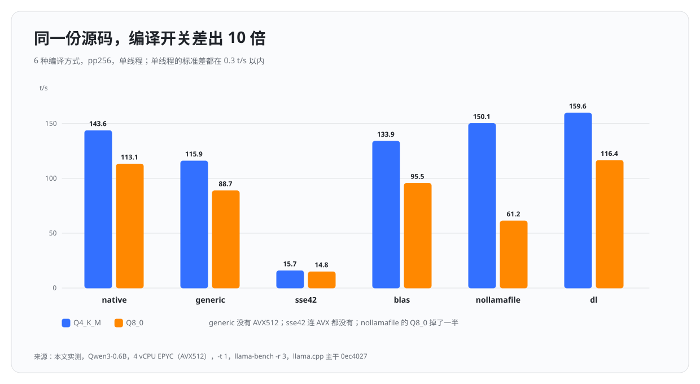
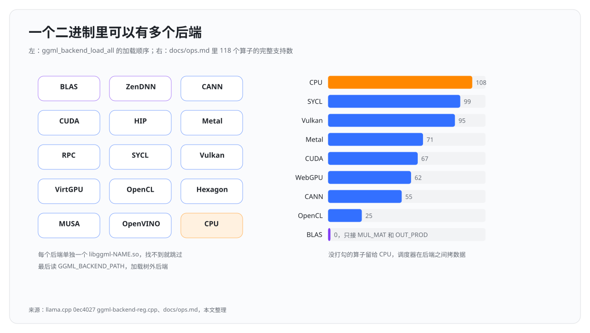
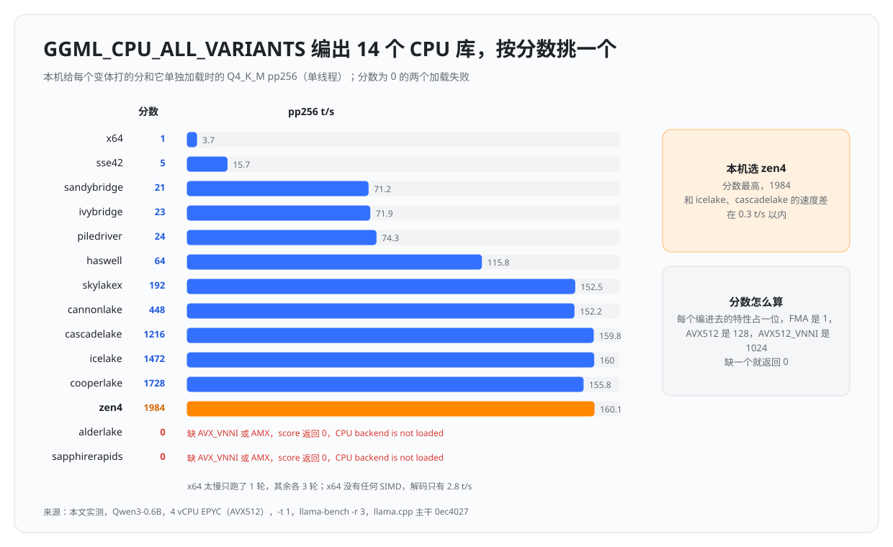
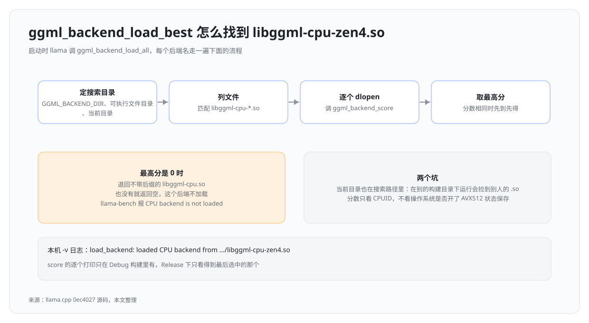
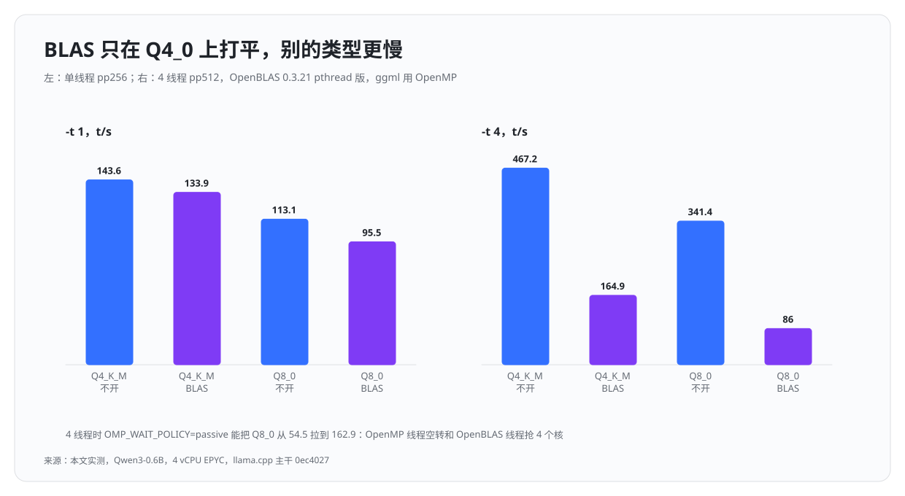
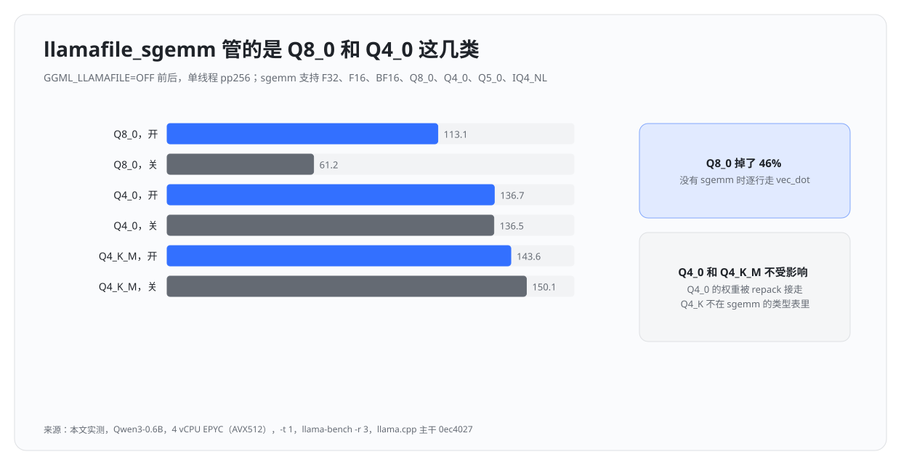
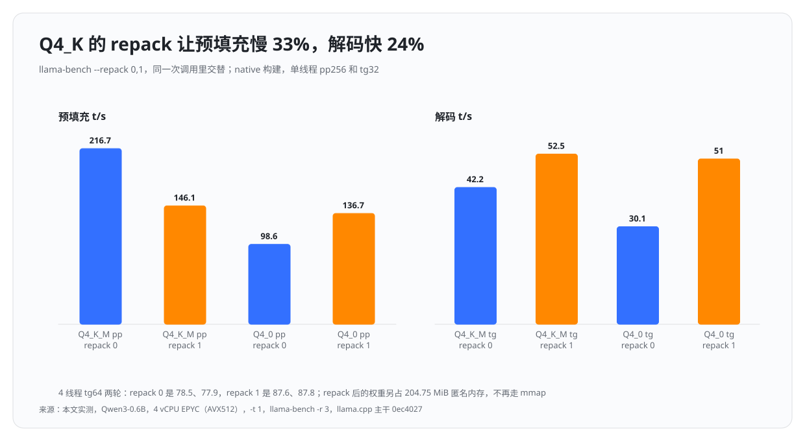
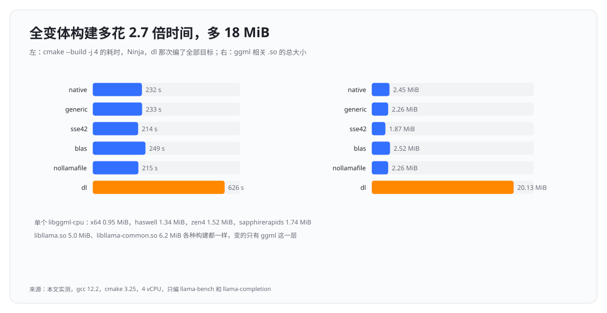
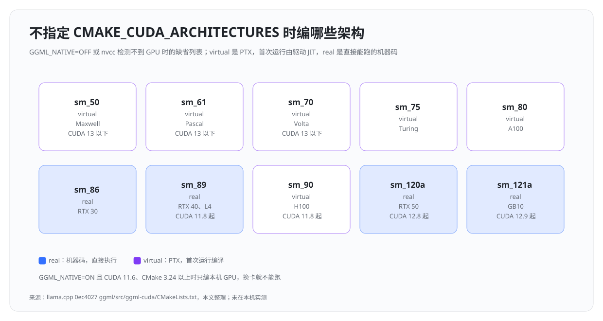
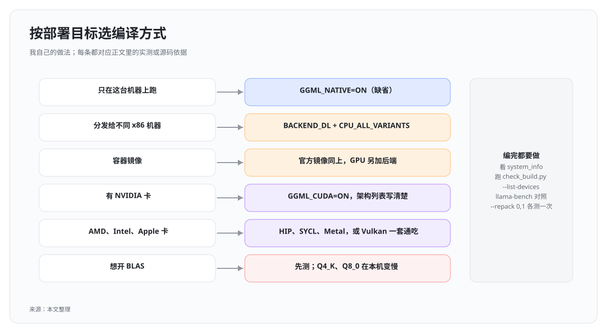

# LCPP-06｜内部｜后端与编译：CPU 变体、BLAS、repack 和 GPU 架构

> 🎯 **这篇文档解决什么问题**：同一份 llama.cpp 源码，换几个 CMake 开关，在同一台机器上跑同一个模型，预填充速度能差出 10 倍。我想弄清楚这些开关各自管什么：GGML_NATIVE 关掉以后丢了什么，一个发布包怎么在新老 CPU 上都挑到合适的代码，BLAS 为什么没有变快，llamafile 和 repack 到底接管了哪些矩阵乘，GPU 后端的架构列表该怎么写。这篇在一台 4 核云主机上把 6 种编译方式和 14 个 CPU 变体逐个编出来测，GPU 部分按源码和官方文档整理，标明未在本机实测。主线一句话：编译开关决定每类矩阵乘落到哪段内核上，挑错了，预填充能慢 10 倍。
>
> 使用方式：只想编一个能用的版本，看导读和第 11 章；要做分发包或容器镜像，看第 4、10 章；觉得自己编的比别人慢，看第 3、5、6 章；要上 GPU，看第 8、9 章。文中版本和数字核对于 2026 年 10 月 31 日。
>
> **代码**：[zero-to-llama/06-backends-build](../06-backends-build)。exp06.sh 按给定开关编一份并记时间和体积，run06.sh 编 6 种对照，bench06c.sh 跑单线程对照和 14 个变体，check_build.py 对比 system_info 和 /proc/cpuinfo 找出没编进去的指令集。基线是主干 0ec4027，模型是 Qwen3-0.6B，机器是 4 核 EPYC 云主机无 GPU。

# 导读 · 先给结论

- **编译开关能让预填充差 10 倍。**Q4_K_M 单线程 pp256，本机原生编译 143.6 t/s，关掉 AVX 只留 SSE 4.2 是 15.7 t/s，连 SSE 都不要的 x64 变体只有 3.7 t/s。解码受带宽限制，从 AVX2 往上几种编法都在 50 至 54 t/s[[1]](https://github.com/ggml-org/llama.cpp/blob/0ec4027/docs/build.md)[[2]](https://github.com/ggml-org/llama.cpp/blob/0ec4027/ggml/CMakeLists.txt)[[3]](https://dl.acm.org/doi/10.1145/1498765.1498785)。
- **GGML_NATIVE=OFF 不等于通用最快。**关掉以后缺省只开到 AVX2，AVX512 要自己打开。本机 generic 构建的 Q4_K_M 预填充比原生慢 19%，check_build.py 会把这 4 个没用上的 AVX512 子集列出来[[4]](https://github.com/ggml-org/llama.cpp/blob/0ec4027/ggml/src/ggml-cpu/CMakeLists.txt)[[5]](https://gitlab.com/x86-psABIs/x86-64-ABI)。
- **分发包用 GGML_BACKEND_DL 加 GGML_CPU_ALL_VARIANTS。**x86 上编出 14 个 CPU 库，启动时逐个 dlopen 打分，挑最高分。本机挑中 zen4，单线程 pp256 160.1 t/s，比原生编译还快 11%[[6]](https://github.com/ggml-org/llama.cpp/pull/10469)[[7]](https://github.com/ggml-org/llama.cpp/pull/10626)[[8]](https://github.com/ggml-org/llama.cpp/blob/0ec4027/ggml/src/ggml-cpu/arch/x86/cpu-feats.cpp)。
- **OpenBLAS 在本机没有一种量化类型变快。**单线程 Q4_0 打平，Q4_K_M 慢 7%，Q8_0 慢 16%。4 线程时 OpenBLAS 的线程和 ggml 的 OpenMP 线程抢核，Q8_0 预填充从 341 掉到 86 t/s[[9]](https://github.com/ggml-org/llama.cpp/blob/0ec4027/ggml/src/ggml-blas/ggml-blas.cpp)[[10]](https://github.com/OpenMathLib/OpenBLAS)。
- **缺省打开的 llamafile_sgemm 只管 Q8_0、Q4_0 这几类。**关掉它 Q8_0 预填充掉 46%，Q4_K_M 不受影响，因为 Q4_K 不在它的类型表里[[11]](https://github.com/ggml-org/llama.cpp/blob/0ec4027/ggml/src/ggml-cpu/llamafile/sgemm.cpp)[[12]](https://github.com/ggml-org/llama.cpp/pull/6414)。
- **Q4_K 的 repack 是一笔交换。**预填充慢 33%，解码快 24%，另占 204.75 MiB 匿名内存。Q4_0 的 repack 两头都快。服务以预填充为主时值得用 --repack 0 测一次[[13]](https://github.com/ggml-org/llama.cpp/blob/0ec4027/ggml/src/ggml-cpu/repack.cpp)[[14]](https://github.com/ggml-org/llama.cpp/blob/0ec4027/tools/llama-bench/llama-bench.cpp)。
- **CUDA 缺省架构列表最多 10 项，6 项是 PTX。**不写 CMAKE_CUDA_ARCHITECTURES 又关了 NATIVE 时，新卡首次运行要等驱动 JIT。只服务一两种卡，就把计算能力写死[[15]](https://github.com/ggml-org/llama.cpp/blob/0ec4027/ggml/src/ggml-cuda/CMakeLists.txt)[[16]](https://docs.nvidia.com/cuda/cuda-compiler-driver-nvcc/index.html)。

**📎 与系列其他文档的分工**：本篇只讲编译和后端选择。第一次编译和运行的完整步骤见 [LCPP-01｜上手｜第一次运行：编译、转换、加载和读懂内存账单](./01-first-run.md)；预填充和解码各自受什么限制见 [LCPP-02｜上手｜推理账本：带宽、算力和启动前算出速度上限](./02-ledger.md)；测速方法和噪声处理见 [LCPP-03｜上手｜测量方法：llama-bench、PPL、KLD 和噪声](./03-bench-ppl.md)；repack 发生在加载阶段，加载流程见 [LCPP-04｜内部｜GGUF：文件结构、元数据、加载方式和分卷](./04-gguf.md)；调度器怎么在后端之间切图见 [LCPP-05｜内部｜ggml 与计算图：建图、内存规划、调度和复用](./05-ggml-graph.md)；Q4_K、Q8_0 的块格式见 [LCPP-07｜内部｜量化：块结构、配方、imatrix 和用 KLD 选类型](./07-quantization.md)。线程数和 NUMA 放在 LCPP-10，GPU 层数卸载放在 LCPP-11，多卡和 RPC 放在 LCPP-12。

# 第 1 章 · 为什么要自己编

## 1.1 发布包和自己编的差别

llama.cpp 每个提交都会出发布包，Linux 有 CPU、Vulkan、CUDA 几种，Docker 镜像也按后端分了 full、light、server 三类[[17]](https://github.com/ggml-org/llama.cpp/blob/0ec4027/.github/workflows/release.yml)[[18]](https://github.com/ggml-org/llama.cpp/blob/0ec4027/docs/docker.md)。大多数人下载就能用。我自己编的原因有三个：要跟主干提交对齐，复现某个 PR 的数。要关掉或打开某个缺省开关做对照，比如 BLAS、llamafile。还要编发布包里没有的组合，比如只带 CUDA 不带 CPU 变体的小镜像。

发布包为了在任何 x86 机器上都能跑，不会用 -march=native。它靠运行时挑选 CPU 库来补回性能，第 4 章会拆开这套机制。自己编时缺省走 native，只保证在编译那台机器的这一代 CPU 上能跑，换一台老机器可能直接非法指令退出；两种做法各有用处，前提是知道自己编出来的是哪一种。

## 1.2 我测了哪 6 种编法



6 种编法用同一份源码、同一套 cmake 参数骨架：Release，Ninja，关掉测试、server 和 curl，只编 llama-bench 和 llama-completion[[19]](https://ninja-build.org/manual.html)，差别只在下面这些开关上。

| 名字 | 额外的 CMake 开关 | 想看什么 |
|-|-|-|
| native | 无，GGML_NATIVE 缺省 ON | 基线 |
| generic | GGML_NATIVE=OFF | 关掉 native 后缺省开到哪一级 |
| sse42 | NATIVE=OFF，再关 AVX、AVX2、FMA、F16C、BMI2 | 老机器或误配时的下限 |
| blas | GGML_BLAS=ON，GGML_BLAS_VENDOR=OpenBLAS | BLAS 对量化模型有没有用 |
| nollamafile | GGML_LLAMAFILE=OFF | llamafile_sgemm 管哪些类型 |
| dl | NATIVE=OFF，BACKEND_DL=ON，CPU_ALL_VARIANTS=ON | 官方发布包的做法 |

测量用 llama-bench 单线程跑 pp256 和 tg32，每项 3 轮。选单线程是因为这台 4 vCPU 的云主机在 -t 4 时受邻居干扰，同一个配置两次测的 pp512 能差两到三成；单线程的标准差都在 0.3 t/s 以内，变体之间的差别看得清楚。测量方法和噪声的处理见 [LCPP-03｜上手｜测量方法：llama-bench、PPL、KLD 和噪声](./03-bench-ppl.md)。

## 1.3 先看结论图

Q4_K_M 那一列从 sse42 的 15.7 到 dl 的 159.6，差了 10 倍；Q8_0 那一列 nollamafile 掉到 61.2，只有 native 的一半，其余几种都在 89 至 116 之间。blas 两列都比 native 低，后面几章会逐个解释这些柱子为什么是这个高度。

同一组实验我也在 4 线程下跑过两轮交替，绝对值更高，排序大体一致，但有几格两轮之间差了一倍以上，比如 generic 的 Q4_K_M 一轮 403.6、一轮 211.2。正文里的数字以单线程为准，4 线程只在 BLAS 那章用，因为它的问题恰好出在多线程上。

> 🔑 **本章要点**：编译开关对预填充影响很大，对解码影响小。我测了 6 种编法和 14 个 CPU 变体，主要证据用单线程 pp256 和 tg32，标准差在 0.3 t/s 以内。

# 第 2 章 · 后端全景与加载

## 2.1 后端是什么

ggml 把一种计算设备的全部支持叫一个后端：设备怎么枚举，内存怎么分，每个算子能不能算、怎么算。llama.cpp 在 2024 年初把模型执行整个搬到 ggml-backend 之上，之后加 GPU 支持就是加一个后端[[20]](https://github.com/ggml-org/llama.cpp/pull/4766)。同年秋天又拆出 device 和 backend reg 两层接口，一个后端注册表下面可以挂多个设备，命令行的 --device 和 --list-devices 就是从这时开始统一的[[21]](https://github.com/ggml-org/llama.cpp/pull/9707)[[22]](https://github.com/ggml-org/llama.cpp/blob/0ec4027/common/arg.cpp)。

后端的历史顺序大致是：2023 年 4 月用 cuBLAS 加速预填充[[23]](https://github.com/ggml-org/llama.cpp/pull/1044)，同月有了 ROCm 移植[[24]](https://github.com/ggml-org/llama.cpp/pull/1087)，6 月 Metal 能在 Apple GPU 上跑完整推理[[25]](https://github.com/ggml-org/llama.cpp/pull/1642)，同月 CUDA 把全部层和 KV cache 放进显存[[26]](https://github.com/ggml-org/llama.cpp/pull/1827)，2024 年初 Vulkan 和 SYCL 合入主干[[27]](https://github.com/ggml-org/llama.cpp/pull/2059)[[28]](https://github.com/ggml-org/llama.cpp/pull/2690)。现在主干里有十几个后端，CPU 后端始终在，其他后端算不了的算子都回落到它身上。

## 2.2 一个二进制里的多个后端



开了 GGML_BACKEND_DL 时，每个后端编成单独的 libggml-NAME.so，主程序启动时调 ggml_backend_load_all，按固定顺序逐个找：BLAS、ZenDNN、CANN、CUDA、HIP、Metal、RPC、SYCL、Vulkan、VirtGPU、OpenCL、Hexagon、MUSA、OpenVINO，最后是 CPU。找不到的就跳过，最后再读环境变量 GGML_BACKEND_PATH，加载一个树外的后端[[29]](https://github.com/ggml-org/llama.cpp/blob/0ec4027/ggml/src/ggml-backend-reg.cpp)。

不开 GGML_BACKEND_DL 时，所有后端在编译期静态注册，没有这一步查找，二进制只能在装了对应运行库的机器上启动。PR 里给出的动机就是这一点：一个发布包同时带 CUDA 和 Vulkan，机器上没有 CUDA 驱动时那个 .so 加载失败、跳过，程序照样用 Vulkan 或 CPU 跑[[6]](https://github.com/ggml-org/llama.cpp/pull/10469)。这依赖 dlopen 失败时只返回空句柄、不终止进程的语义[[30]](https://man7.org/linux/man-pages/man3/dlopen.3.html)。

## 2.3 算子覆盖率

docs/ops.md 是一张算子乘后端的支持表，由测试脚本生成。我数了完整支持的格数：118 个算子里 CPU 108 个，SYCL 99 个，Vulkan 95 个，Metal 71 个，CUDA 67 个，WebGPU 62 个，CANN 55 个，OpenCL 25 个[[31]](https://github.com/ggml-org/llama.cpp/blob/0ec4027/docs/ops.md)。CUDA 的格子少，有一部分是因为它把很多算子标成部分支持，只覆盖常用的类型组合，表里统计的是全支持。

没打勾的算子留给 CPU：调度器给每个节点挑后端时，优先权重所在的后端，算不了就退到下一个，跨后端的边界上插入拷贝[[20]](https://github.com/ggml-org/llama.cpp/pull/4766)。所以算子覆盖率低的后端也能跑模型，代价是频繁在设备和主存之间搬数据。图怎么切、split 怎么数，在 [LCPP-05｜内部｜ggml 与计算图：建图、内存规划、调度和复用](./05-ggml-graph.md) 第 7 章。

## 2.4 确认加载了哪些后端

```bash
$ build/bin/llama-bench --list-devices
load_backend: loaded CPU backend from .../libggml-cpu-zen4.so
Available devices:
  (none)

$ build/bin/llama-completion -m q-Q4_K_M.gguf -n 1 -p hi -no-cnv 2>&1 | grep system_info
system_info: n_threads = 4 ... | CPU : SSE3 = 1 | ... | AVX512 = 1 | ... | REPACK = 1 |
```

--list-devices 只列 GPU 这类加速设备，纯 CPU 机器上是空的，CPU 后端单独占一行 load_backend 日志。system_info 由 llama_print_system_info 打印，把每个已注册后端报告的特性拼成一行，CPU 那一段就是编进去的指令集[[32]](https://github.com/ggml-org/llama.cpp/blob/0ec4027/src/llama.cpp)。我每编完一个版本先看这两处，确认后端和指令集都对，再去测速。

> 🔑 **本章要点**：一个后端就是一种设备的完整支持，GGML_BACKEND_DL 把后端拆成 .so，启动时按固定顺序查找，缺哪个跳过哪个。算子覆盖率 CPU 最高，其他后端算不了的回落到 CPU，编完看 --list-devices 和 system_info 确认编出来的是什么。

# 第 3 章 · CPU 编译开关

## 3.1 GGML_NATIVE 做了什么

GGML_NATIVE 缺省是 ON，CPU 后端在 GCC 和 Clang 下直接加 -march=native，让编译器探测本机支持的所有指令集[[4]](https://github.com/ggml-org/llama.cpp/blob/0ec4027/ggml/src/ggml-cpu/CMakeLists.txt)[[33]](https://gcc.gnu.org/onlinedocs/gcc/x86-Options.html)。本机是 gcc 12.2，它还不认识 Zen 4，-march=native 解析成 znver3，但会把探测到的 AVX512F、AVX512_VNNI、AVX512_BF16 逐项补上，system_info 里能看到这些位都是 1。

有两种情况 GGML_NATIVE 的缺省值会变成 OFF：交叉编译，或者环境里设了 SOURCE_DATE_EPOCH。后者是可复现构建的通行做法，很多发行版的打包环境都会设。按 ggml/CMakeLists.txt 的逻辑，这时不光 native 关了，SSE 4.2、AVX、AVX2、FMA 这些开关的缺省值也一起变成 OFF，编出来相当于第 4 章的 x64 变体。这一条我按源码推断，没有单独设变量去编。

## 3.2 关掉 native 以后开到哪一级

正常机器上手动写 GGML_NATIVE=OFF，SSE 4.2、AVX、AVX2、BMI2、FMA、F16C 缺省 ON，AVX512 一族和 AVX_VNNI、AMX 缺省 OFF[[2]](https://github.com/ggml-org/llama.cpp/blob/0ec4027/ggml/CMakeLists.txt)，正好对应 x86-64 psABI 定义的 v3 级别：AVX2、FMA、BMI2、F16C 是 v3 的门槛，AVX512F、BW、CD、DQ、VL 是 v4 的门槛[[5]](https://gitlab.com/x86-psABIs/x86-64-ABI)。2013 年以后的主流 x86 服务器都在 v3 以上。

本机 generic 构建的 system_info 停在 BMI2，后面 4 个 AVX512 位都没有。单线程 pp256 下，Q4_K_M 115.9 对 native 143.6，慢 19%。Q4_0 96.5 对 136.7，慢 29%。Q8_0 88.7 对 113.1，慢 22%。三种类型的解码都在 1 t/s 以内，带宽是瓶颈，指令集宽一倍也拉不动。

```bash
$ python3 check_build.py --sysinfo "CPU : SSE3 = 1 | SSSE3 = 1 | AVX = 1 | AVX2 = 1 | F16C = 1 | FMA = 1 | BMI2 = 1 | ..."
UNUSED   AVX512 这台 CPU 有，system_info 里没有这一项，多半没编进去
UNUSED   AVX512_VBMI 这台 CPU 有，system_info 里没有这一项，多半没编进去
UNUSED   AVX512_VNNI 这台 CPU 有，system_info 里没有这一项，多半没编进去
UNUSED   AVX512_BF16 这台 CPU 有，system_info 里没有这一项，多半没编进去
missing 0 unused 4
```

check_build.py 把 system_info 里的指令集名映射到 /proc/cpuinfo 的 flags，两边一比就知道哪些编进去了而 CPU 没有，哪些 CPU 有却没编进去[[34]](https://docs.kernel.org/arch/x86/cpuinfo.html)。AVX512 一项对应 avx512f、cd、vl、dq、bw 五个 flag 同时存在。它只依赖标准库，给一个构建目录也能读 CMakeCache 报 Release、NATIVE、BACKEND_DL 这些开关。

## 3.3 AVX512 为什么只快两成

AVX512 的向量宽度是 AVX2 的两倍，实测预填充只快 19% 至 29%，原因有两层。按 roofline 模型，预填充的矩阵乘算术强度高，受算力限制，指令集宽度直接有用；解码每个 token 要把全部权重读一遍，受带宽限制，指令集再宽也没用[[3]](https://dl.acm.org/doi/10.1145/1498765.1498785)。我在 [LCPP-02｜上手｜推理账本：带宽、算力和启动前算出速度上限](./02-ledger.md) 里按这台机器的带宽算过解码上限，实测的 50 多 t/s 已经贴着那条线。

另一层在微架构：Zen 4 支持完整的 AVX512 指令，但执行单元是 256 位宽，一条 512 位指令拆成两个 256 位操作执行，峰值吞吐和 AVX2 相同[[35]](https://www.agner.org/optimize/microarchitecture.pdf)。收益主要来自寄存器数量翻倍、掩码寄存器和 VNNI 这类新指令，第 4 章的变体对比里能看到 VNNI 单独贡献了 5%。在 512 位执行单元的 Intel 服务器上，收益可能更大，我没有机器验证。

## 3.4 SSE 4.2 是下限

sse42 构建把 AVX 以上全部关掉，Q4_K_M 预填充 15.7 t/s，只有 native 的 11%；解码 10.2 t/s，只有五分之一。Q4_0 的预填充反而比 Q4_K_M 快一倍，30.3 t/s，因为 Q4_0 的点积在 SSSE3 下有专门的路径，Q4_K 的超块解包在没有 AVX2 时代价很高。

这组数的用处是认出误配。如果一台现代服务器上跑出来的速度只有预期的十分之一，先看 system_info 里 AVX 那几位是不是 0。容器里用了别人编的镜像，或者打包环境设了 SOURCE_DATE_EPOCH，都可能出现这种情况。

> 🔑 **本章要点**：GGML_NATIVE 缺省 ON，等于 -march=native；手动关掉后只开到 AVX2，相当于 x86-64-v3，本机慢 19% 至 29%。AVX512 在 Zen 4 上按两个 256 位执行，收益来自新指令和更多寄存器。速度只有十分之一时先查 system_info。

# 第 4 章 · 一个包跑所有 x86

## 4.1 14 个 CPU 变体

GGML_CPU_ALL_VARIANTS 要求同时开 GGML_BACKEND_DL，否则配置阶段直接报错[[36]](https://github.com/ggml-org/llama.cpp/blob/0ec4027/ggml/src/CMakeLists.txt)。它在 x86 上把 CPU 后端编 14 遍，每一遍用一组固定的指令集，按微架构命名：x64 什么都不开，sse42 只开 SSE 4.2，往上是 sandybridge、ivybridge、piledriver、haswell、skylakex、cannonlake、cascadelake、icelake、cooperlake、zen4，另有要求 AVX_VNNI 的 alderlake 和要求 AMX 的 sapphirerapids。ARM 上是另一套按 armv8.x 特性分的列表[[7]](https://github.com/ggml-org/llama.cpp/pull/10626)。



我把每个变体单独放进一个目录，只留它一个 CPU 库，测 Q4_K_M 单线程 pp256。曲线有三个台阶：AVX 把 x64 的 3.7 拉到 71 左右，AVX2 加 FMA 到 116，AVX512 到 152 至 160。台阶内部的差别都很小。VBMI 几乎不起作用，skylakex 152.5 对 cannonlake 152.2。VNNI 有 5%，skylakex 152.5 对 cascadelake 159.8。BF16 对 Q4_K 没有影响。

## 4.2 分数怎么算

每个变体库导出一个 ggml_backend_score 函数，编译时开了哪些特性就在运行时用 CPUID 检查哪些[[8]](https://github.com/ggml-org/llama.cpp/blob/0ec4027/ggml/src/ggml-cpu/arch/x86/cpu-feats.cpp)[[37]](https://www.intel.com/content/www/us/en/developer/articles/technical/intel-sdm.html)。缺任何一个直接返回 0，表示这台机器跑不了；全都有就从 1 开始，每个特性加一个固定的位：FMA 是 1，F16C 是 2，SSE 4.2 是 4，BMI2 是 8，AVX 是 16，AVX2 是 32，AVX_VNNI 是 64，AVX512 是 128，VBMI 是 256，BF16 是 512，AVX512_VNNI 是 1024，AMX_INT8 是 2048。

本机 zen4 得 1984 分，是最高分；alderlake 要 AVX_VNNI，sapphirerapids 要 AMX，这台 EPYC 都没有，两个变体的分数是 0，单独放时 llama-bench 报 CPU backend is not loaded。位的权重越往后越大，保证特性多的变体总是赢；但它只看特性有没有，不看哪个变体在这台机器上实际更快。icelake、cascadelake 和 zen4 的速度差在 0.3 t/s 以内，选哪个都行。

## 4.3 加载流程



ggml_backend_load_best 先定搜索目录：编译时指定的 GGML_BACKEND_DIR，可执行文件所在目录，当前工作目录。然后列出每个目录里匹配 libggml-cpu-\*.so 的文件，逐个 dlopen，调 score，记下分数最高的那个路径[[29]](https://github.com/ggml-org/llama.cpp/blob/0ec4027/ggml/src/ggml-backend-reg.cpp)。比较用的是严格大于，同分时先找到的那个赢。最高分是 0 时退回不带后缀的 libggml-cpu.so，也没有就返回空，这个后端不加载。

每个候选库都会被真正 dlopen 一次，库里的全局构造函数都会执行，挑完再把落选的卸载掉。14 个库在本机全部扫一遍只占启动时间里很小一块，但如果某个变体库本身有问题，比如依赖了机器上没有的运行库，它会在这一步就暴露出来。Release 构建下加载失败的错误信息被静默掉，逐个打分的日志也只在 Debug 构建里有，看得到的只有最后选中的那一行。

## 4.4 部署时要防的搜索路径和 XCR0

当前目录也在搜索路径里。我在一个构建目录下运行另一个构建目录的 llama-bench，它会把两个目录里的 libggml-cpu-\*.so 一起拿来打分。两边都是全变体时问题不大，大不了挑到别人的 zen4；一边是旧提交编的，就可能把 ABI 不兼容的库加载进来。我的 bench06c.sh 统一 cd /tmp 再运行，就是为了避开这一点。

分数只看 CPUID，不看操作系统有没有打开对应的寄存器状态保存。AVX 和 AVX512 都要求内核通过 XCR0 开启状态保存，用户态用 XGETBV 才能确认[[37]](https://www.intel.com/content/www/us/en/developer/articles/technical/intel-sdm.html)。正常的 Linux 内核都会开，某些虚拟化环境或者内核参数关掉 AVX512 时，CPUID 仍然报告支持，score 会选中 AVX512 变体，运行时非法指令。遇到这种情况，用 GGML_BACKEND_DIR 指向一个只放了 haswell 变体的目录最省事。

**📎 展开阅读：**dl 构建为什么比 native 还快：单线程 pp256 下 Q4_K_M 159.6 对 143.6，Q4_0 144.3 对 136.7。zen4 变体用逐项的 -mavx512f 这类开关，native 用 -march=native，在 gcc 12 下后者带上了 znver3 的调度模型。我推测差别来自指令调度，没有逐项验证。

> 🔑 **本章要点**：ALL_VARIANTS 在 x86 上编 14 个 CPU 库，按 CPUID 打分，缺特性记 0，取最高分，本机选中 zen4，比 native 快 11%。当前目录在搜索路径里，score 不检查 XCR0，这两点在部署时要防。

# 第 5 章 · BLAS 为什么没变快

## 5.1 BLAS 后端接管什么

很多教程把 GGML_BLAS=ON 写成 CPU 加速的第一步，我照着编了一版来比。build.md 的说法要克制得多：BLAS 只影响 batch 大于 32 的预填充，解码不受影响[[38]](https://github.com/ggml-org/llama.cpp/blob/0ec4027/docs/build.md#blas-build)。ggml-blas 是一个独立的后端，它只认 MUL_MAT 和 OUT_PROD 两个算子，这也是 ops.md 里它的完整支持数是 0 的原因：它连一个算子的全部类型组合都不覆盖[[31]](https://github.com/ggml-org/llama.cpp/blob/0ec4027/docs/ops.md)。

接管 MUL_MAT 的条件写在 supports_op 里：输出的行数、列数和输入的公共维都不小于 32，两个输入都是连续内存，激活是 F32，权重要么是 F32，要么有 to_float 能反量化成 F32[[9]](https://github.com/ggml-org/llama.cpp/blob/0ec4027/ggml/src/ggml-blas/ggml-blas.cpp)。量化权重走 BLAS 时，每次矩阵乘先把整块权重反量化成 F32 临时矩阵，再调 cblas_sgemm。这块临时矩阵和权重的 F32 尺寸一样大，反量化本身也要花时间。

cblas_sgemm 背后是 Goto 和 van de Geijn 那套分块方法：按 L1、L2、L3 的大小把矩阵切成面板，内层是手写的微内核[[39]](https://dl.acm.org/doi/10.1145/1356052.1356053)。OpenBLAS 和 BLIS 都沿用这个结构，BLIS 把微内核以外的部分做成可移植的框架[[40]](https://dl.acm.org/doi/10.1145/2764454)[[10]](https://github.com/OpenMathLib/OpenBLAS)。它们对 F32 矩阵乘的优化很成熟，问题出在量化模型的权重本来就不是 F32。

## 5.2 单线程和 4 线程



我用 Debian 自带的 OpenBLAS 0.3.21，CMake 用 FindBLAS 按 BLA_VENDOR=OpenBLAS 找到它[[41]](https://cmake.org/cmake/help/latest/module/FindBLAS.html)。单线程 pp256 下，Q4_0 136.6 对 native 136.7，打平。Q4_K_M 133.9 对 143.6，慢 7%。Q8_0 95.5 对 113.1，慢 16%。解码三种类型都在误差以内，和 build.md 说的一致。

4 线程 pp512 就难看了：Q4_K_M 164.9 对 467.2，Q8_0 86.0 对 341.4，只有原来的四分之一。交替跑两轮，blas 的 Q8_0 两次是 81.2 和 83.1，比单线程还慢，两轮结果几乎一致，慢是实打实的。

## 5.3 线程打架

Debian 的 libopenblas0-pthread 用 pthread 管自己的线程池，ggml 的 CPU 后端用 OpenMP；ggml-blas 在初始化时会检查 openblas_get_parallel，发现 OpenBLAS 不是 OpenMP 版就打一条警告，但这条警告是 debug 级别，Release 下看不到[[9]](https://github.com/ggml-org/llama.cpp/blob/0ec4027/ggml/src/ggml-blas/ggml-blas.cpp)。每次矩阵乘之前它调 openblas_set_num_threads 设成 4 个线程，反量化那一步又用 OpenMP 开 4 个线程。

结果是 OpenMP 的 4 个线程算完自己的节点以后继续自旋等下一个任务，OpenBLAS 的 4 个线程同时在抢这 4 个核。把 OMP_WAIT_POLICY 设成 passive，让 OpenMP 线程空闲时让出 CPU，Q8_0 的 4 线程 pp256 从 54.5 涨到 162.9 t/s。只设 OPENBLAS_NUM_THREADS=1 不管用，46.2 t/s，因为 ggml-blas 每次都会把线程数改回去。

```bash
for env in "X=1" "OMP_WAIT_POLICY=passive" "OPENBLAS_NUM_THREADS=1"; do for t in 1 2 4; do
  env $env b06/blas/bin/llama-bench -m q-Q8_0.gguf -p 256 -n 0 -r 3 -t $t -o jsonl 2>/dev/null |
    python3 -c "import json,sys; d=json.loads(sys.stdin.readline()); print('$env', $t, round(d['avg_ts'],1))"
done; done
# X=1                      t1 95.4  t2 175.7  t4 54.5
# OMP_WAIT_POLICY=passive  t1 96.3  t2 140.0  t4 162.9
# OPENBLAS_NUM_THREADS=1   t1 95.0  t2 187.6  t4 46.2
```

passive 只是止血，同样设 passive，native 构建 4 线程的 Q8_0 是 351.7，blas 是 125.5，还是差将近 3 倍。2 线程时默认设置反而最快，因为两套线程池加起来正好 4 个，没有超订。线程打架只是叠加上去的问题，根子还是量化权重要先反量化成 F32。

## 5.4 Q4_0 为什么打平

开 BLAS 的模型，调度器会把满足条件的 MUL_MAT 切给 BLAS 后端，每切一次就是一个 split，我用 GGML_SCHED_DEBUG 数了一下：Q4_K_M 58 个 split，Q8_0 282 个，Q4_0 只有 2 个。Q4_0 几乎没被切，原因是它的权重在加载时被 repack 进了 CPU_REPACK 缓冲，这种缓冲的 is_host 是空，BLAS 的 supports_buft 判它不是主存，不接[[13]](https://github.com/ggml-org/llama.cpp/blob/0ec4027/ggml/src/ggml-cpu/repack.cpp)[[9]](https://github.com/ggml-org/llama.cpp/blob/0ec4027/ggml/src/ggml-blas/ggml-blas.cpp)。

所以 Q4_0 打平的真相是 BLAS 根本没参与，跑的还是 CPU 后端自己的 repack 内核。拿 Q4_K_M 做反证：blas 构建加 --repack 0，单线程 pp256 从 135.0 掉到 94.1，因为 repack 关了以后 BLAS 把 Q4_K 的矩阵乘全接过去了。

最容易踩的坑是看到 GGML_BLAS=ON 以后 Q4_0 速度没变，就以为 BLAS 对量化模型无害。实际情况是它没被用上，代价一直在，换成 Q8_0 或者关掉 repack，BLAS 一接管就变慢。我的做法是量化模型在 CPU 上不开 BLAS，只在 F32、F16 模型的大批量预填充上拿它做对照。

> 🔑 **本章要点**：BLAS 后端只接管三个维度都不小于 32 的矩阵乘，量化权重要先反量化成 F32。本机单线程最多打平，4 线程时 OpenBLAS 的 pthread 线程和 ggml 的 OpenMP 线程超订，慢到四分之一，Q4_0 打平是因为 repack 缓冲不给 BLAS 用。

# 第 6 章 · llamafile 和 repack

## 6.1 llamafile_sgemm 接管哪些类型

llamafile_sgemm 是 2024 年从 llamafile 项目并进来的一组矩阵乘内核，PR 标题直接叫改进 CPU 预填充速度[[12]](https://github.com/ggml-org/llama.cpp/pull/6414)。作者在博客里解释了做法：不走 BLAS 那样的大块分层，用模板展开出一批固定尺寸的寄存器分块，在 L1 里把小块算完，对 llama.cpp 这种权重已经量化、批次不大的场景更合适[[42]](https://justine.lol/matmul/)。

ggml/CMakeLists.txt 里 GGML_LLAMAFILE 的缺省值是 OFF，但顶层 CMakeLists.txt 在用户没有显式设置时把它改成 ON，所以编 llama.cpp 时它缺省开着[[2]](https://github.com/ggml-org/llama.cpp/blob/0ec4027/ggml/CMakeLists.txt)。它的入口按权重类型分派，支持的有 F32、F16、BF16、Q8_0、Q4_0、Q5_0、IQ4_NL 七种[[11]](https://github.com/ggml-org/llama.cpp/blob/0ec4027/ggml/src/ggml-cpu/llamafile/sgemm.cpp)。不在这张表里的类型，比如 K 系列量化，返回 false，退回 ggml 自己逐行调 vec_dot 的路径。



GGML_LLAMAFILE=OFF 的构建里，Q8_0 单线程 pp256 从 113.1 掉到 61.2，少了 46%，解码 28.4 对 30.6 基本不变。Q8_0 在 x86 上没有 repack 格式，预填充的矩阵乘全靠 sgemm；关掉以后每一行激活都要单独和权重做一次点积，权重从缓存里反复读。

Q4_0 不受影响，136.7 对 136.5，因为它的权重被 repack 接走了，根本没走到 sgemm。Q4_K_M 关掉以后反而从 143.6 涨到 150.1，标准差 0.2，不像噪声；Q4_K 本来就不在 sgemm 的表里，这 4.5% 的差别出在哪个张量上我还没查清。

## 6.2 repack 是什么

repack 在加载时把权重换一种排列，以 Q4_0 为例，原始格式是一行一行存的块，repack 后变成 8 行交错的 block_q4_0x8，一次能把 8 行的同一段权重装进寄存器，和 8 列激活做分块乘[[13]](https://github.com/ggml-org/llama.cpp/blob/0ec4027/ggml/src/ggml-cpu/repack.cpp)。x86 上只要 CPU 有 AVX2、行数是 8 的倍数，Q4_0 和 Q4_K 都会被 repack，Q8_0 不会。重排发生在模型加载阶段，加载流程见 [LCPP-04｜内部｜GGUF：文件结构、元数据、加载方式和分卷](./04-gguf.md) 第 5 章。

repack 后的权重放进 CPU_REPACK 缓冲，这是一块匿名内存，不再走 mmap。本机加载 Q4_K_M 时，日志里 CPU_REPACK 一项 204.75 MiB；加 -nr 关掉 repack 后，权重全部留在 CPU_Mapped 里，456.11 MiB。开 repack 的进程实际多占了这 204.75 MiB 的私有内存，多个进程跑同一个模型时不能再共享页缓存。

## 6.3 Q4_K 的 repack 是一笔交换



llama-bench 的 --repack 可以同时给 0,1 两个值，同一次调用里交替测，排除时段漂移[[14]](https://github.com/ggml-org/llama.cpp/blob/0ec4027/tools/llama-bench/llama-bench.cpp)。native 构建单线程下，Q4_K_M 预填充 repack 0 是 216.7，repack 1 是 146.1，慢了 33%；解码 42.2 对 52.5，快了 24%。Q4_0 两头都是 repack 赢：预填充 98.6 对 136.7，解码 30.1 对 51.0。

4 线程 tg64 我交替跑了两轮，Q4_K_M repack 0 是 78.5、77.9，repack 1 是 87.6、87.8，快 12%；4 线程 pp512 下 Q4_K_M 498.6 对 369.4，方向和单线程一致。generic 和 dl 两个构建上我也各测了一遍，Q4_K_M 预填充都是 repack 0 更快，Q4_0 都是 repack 1 更快。

原因在内核上：Q4_K 的 repack 预填充走 gemm_q4_K_8x8_q8_K，解码走 gemv；不 repack 时 Q4_K 的点积 vec_dot_q4_K_q8_K 在 x86 上只有 AVX2 和 AVX 两条路径。按结果看，repack 的 gemv 在解码时更省带宽，gemm 在大批量时反而不如逐行点积高效。这是本机这一代 CPU、这一个提交上的结果，换一代 CPU 或者内核改了，结论可能反过来。

另一个常见做法是在 llama-bench 默认参数下只看 pp512 一个数，觉得 repack 慢，就全局关掉。这样一来 Q4_0 两头都慢，Q4_K 的解码慢 12% 到 24%。我会按自己的负载用 --repack 0,1 同时测预填充和解码，按请求的总延迟来定，而不是只看一个 pp 数。

**📎 展开阅读：**RAM 紧张时 repack 的 204.75 MiB 也是一个考量。内存账单怎么读见 [LCPP-01｜上手｜第一次运行：编译、转换、加载和读懂内存账单](./01-first-run.md) 第 3 章。

> 🔑 **本章要点**：llamafile_sgemm 缺省开，只管 F32、F16、BF16、Q8_0、Q4_0、Q5_0、IQ4_NL，关掉它 Q8_0 预填充掉 46%。repack 在加载时重排 Q4_0 和 Q4_K，另占匿名内存，Q4_0 两头都快，Q4_K 预填充慢 33%、解码快 24%。

# 第 7 章 · 构建时间与体积

## 7.1 实测



6 种构建都用 Ninja、-j 4，只编 llama-bench 和 llama-completion 两个目标时，单变体构建在 214 至 249 秒之间，BLAS 多了一个后端，最慢。dl 构建要把所有后端 .so 和全部目标都编出来，626 秒，是单变体的 2.7 倍。配置阶段都在 9 至 12 秒[[19]](https://ninja-build.org/manual.html)。

ggml 相关的 .so 加起来，单变体在 1.87 至 2.52 MiB，dl 构建 20.13 MiB，多出来的 18 MiB 几乎全是 14 个 CPU 库。单个 CPU 库从 x64 的 0.95 MiB 到 sapphirerapids 的 1.74 MiB，指令集越多体积越大，因为每多一级就多编一套内核分支。libllama.so 5.0 MiB 和 libllama-common.so 6.2 MiB 在各种构建里都一样，变的只有 ggml 这一层。

## 7.2 省时间的办法

build.md 推荐用 -j 或者 Ninja 并行，开 ccache[[1]](https://github.com/ggml-org/llama.cpp/blob/0ec4027/docs/build.md)，ccache 在 llama.cpp 里由 GGML_CCACHE 控制，缺省开，找到 ccache 就用。我的实验为了计时准确把它关了；日常开发时改一个文件重编，ccache 能省掉绝大部分时间。

只编要用的目标是另一个大头：cmake --build 加 --target llama-server，只编 server 和它依赖的库；不加 target 会把 tools 和 examples 下的几十个程序全编一遍。CI 里编 dl 构建时，我会先只编 ggml 的几个后端目标，确认没问题再编上层程序。

```bash
cmake -S . -B build -G Ninja -DCMAKE_BUILD_TYPE=Release \
      -DLLAMA_BUILD_TESTS=OFF -DLLAMA_CURL=OFF
cmake --build build -j 4 --target llama-bench llama-completion
# 本机 native：configure 9 s，build 232 s，ggml 相关 .so 2.45 MiB
```

## 7.3 共享库还是静态库

BUILD_SHARED_LIBS 除 MinGW 和 Emscripten 以外缺省 ON，编出来是一组 .so 加很薄的可执行文件。GGML_BACKEND_DL 要求共享库，否则配置报错[[36]](https://github.com/ggml-org/llama.cpp/blob/0ec4027/ggml/src/CMakeLists.txt)。想要一个能直接拷走的单文件，可以关掉共享库、关掉 BACKEND_DL，代价是失去运行时挑选 CPU 变体的能力，只能回到 native 或者固定一级指令集。

官方发布包用共享库加 RPATH=\$ORIGIN，可执行文件从自己所在目录找 .so。解压到任何位置都能跑，前提是不要把可执行文件单独拷出来。

> 🔑 **本章要点**：单变体构建 4 核约 4 分钟，全变体 10 分钟，体积多 18 MiB，变化都在 ggml 那一层。日常开 ccache、只编需要的目标，要用 BACKEND_DL 就得保留共享库。

# 第 8 章 · CUDA 架构列表

## 8.1 缺省编哪些架构

这一章和下一章都按源码和官方文档整理，未在本机实测，本机没有 GPU。CUDA 后端的编译命令只多一个开关，cmake -B build -DGGML_CUDA=ON，真正要想清楚的是 CMAKE_CUDA_ARCHITECTURES，也就是编出来的二进制能在哪些卡上跑[[43]](https://github.com/ggml-org/llama.cpp/blob/0ec4027/docs/build.md#cuda)。

ggml-cuda 的 CMakeLists.txt 在用户没写这个变量时分两种情况。GGML_NATIVE 开着、CUDA 不低于 11.6、CMake 不低于 3.24 时，它设成 native，只编构建机上插着的那几张卡。其余情况用一份缺省列表：CUDA 13 以下先加 50、61、70 三个 virtual，然后无条件加 75、80 两个 virtual 和 86 一个 real，CUDA 11.8 起加 89 real 和 90 virtual，12.8 起加 120a real，12.9 起再加 121a real[[15]](https://github.com/ggml-org/llama.cpp/blob/0ec4027/ggml/src/ggml-cuda/CMakeLists.txt)。



按 CUDA 版本数下来，12.8 是 9 项，12.9 到 13 以下是 10 项，其中 6 项是 PTX；CUDA 13 去掉 Maxwell、Pascal、Volta 那三项，剩 7 项。计算能力和卡型的对应查 NVIDIA 的表：8.6 是 RTX 30 系，8.9 是 RTX 40 系和 L4，9.0 是 H100，12.0 是 RTX 50 系[[44]](https://developer.nvidia.com/cuda-gpus)，所以缺省列表里 86、89、120a 三个 real 正好是 RTX 30、40、50 三代消费卡，121a 对应的是 GB10。

## 8.2 real 和 virtual

nvcc 的架构分两层：virtual 架构对应 PTX，一种中间表示，装进二进制以后由驱动在第一次加载时 JIT 成当前卡的机器码；real 架构对应 SASS，直接执行，但只能在主版本相同、次版本不低于它的卡上跑[[16]](https://docs.nvidia.com/cuda/cuda-compiler-driver-nvcc/index.html)。带 a 后缀的 120a、121a 用了该架构专有的指令，只能在这一代上跑，不向后兼容。

2025 年的 PR 把 GGML_NATIVE=OFF 时的大部分架构改成 virtual[[45]](https://github.com/ggml-org/llama.cpp/pull/13135)，PTX 只编一份，不为每种卡单独生成机器码，编译时间和二进制体积都小。代价落在运行时：一张只被 PTX 覆盖的卡，第一次启动要等驱动把几百个内核全部 JIT 一遍。驱动会把结果缓存到磁盘，位置和上限由 CUDA_CACHE_PATH、CUDA_CACHE_MAXSIZE 控制，CUDA_CACHE_DISABLE 能关掉缓存[[46]](https://docs.nvidia.com/cuda/cuda-c-programming-guide/index.html#env-vars)。

容器里跑时这一点特别容易被忽略，因为缓存目录缺省在用户主目录下，容器每次重建都是空的，每次冷启动都要重新 JIT。要么把 CUDA_CACHE_PATH 挂到持久卷上，要么编译时把目标卡的 real 架构写进去。

## 8.3 架构列表我怎么写

build.md 给的写法是用分号分隔计算能力，比如同时服务 4090 和 3080 Ti，就写 86;89[[43]](https://github.com/ggml-org/llama.cpp/blob/0ec4027/docs/build.md#cuda)。我的规则很简单：线上实际在用的卡，每种写一个 real；想给没见过的新卡留条路，再加一个最高的 virtual。构建机没有 GPU 又开着 GGML_NATIVE 时，nvcc 会报 Cannot find valid GPU for -arch=native 的警告，这时一定要显式写架构。

```bash
# 只服务 RTX 40 和 L4，再留一份 PTX 给更新的卡
cmake -B build -DGGML_CUDA=ON -DGGML_NATIVE=OFF \
      -DCMAKE_CUDA_ARCHITECTURES="89-real;90-virtual"

# 指定 CUDA 版本，运行时按 RPATH 找对应的库
cmake -B build -DGGML_CUDA=ON \
      -DCMAKE_CUDA_COMPILER=/usr/local/cuda-12.8/bin/nvcc \
      -DCMAKE_INSTALL_RPATH=/usr/local/cuda-12.8/lib64 \
      -DCMAKE_BUILD_WITH_INSTALL_RPATH=ON

# 确认编进去了哪些架构
cuobjdump --list-elf build/bin/libggml-cuda.so | head
cuobjdump --list-ptx build/bin/libggml-cuda.so | head
```

## 8.4 编译期和运行期开关

编译期常用的开关有三个：GGML_CUDA_FORCE_MMQ 强制量化矩阵乘走 ggml 自己的 MMQ 内核，GGML_CUDA_FORCE_CUBLAS 反过来强制走 cuBLAS，两者都只在怀疑内核选择有问题时拿来做对照。GGML_CUDA_FA_QUANTS 决定 Flash Attention 编进哪些 K、V 量化组合，缺省只有 q4_0、q8_0、f16、bf16 四种同类配对，写 all 会编出全部组合，编译时间长很多[[43]](https://github.com/ggml-org/llama.cpp/blob/0ec4027/docs/build.md#cuda)。KV cache 选哪种量化组合，要和这里编进去的组合对上，选法在 LCPP-08。

CUDA Graphs 把一串内核一次性提交给 GPU，省掉逐个 launch 的 CPU 开销[[47]](https://developer.nvidia.com/blog/cuda-graphs/)。解码时每个 token 有几百个很小的内核，launch 开销占比高，这是它被引入的原因[[48]](https://github.com/ggml-org/llama.cpp/pull/6766)；ggml 里 GGML_CUDA_GRAPHS 的缺省值是 OFF，但 llama.cpp 顶层 CMakeLists.txt 会把它改成 ON，所以正常编出来是开着的。

运行期最常用的是 CUDA_VISIBLE_DEVICES 选卡；Linux 上设 GGML_CUDA_ENABLE_UNIFIED_MEMORY=1，显存不够时把数据换到主存，不会直接报 OOM 退出，代价是速度掉得很厉害[[43]](https://github.com/ggml-org/llama.cpp/blob/0ec4027/docs/build.md#cuda)。还要注意 -ngl 0 并不保证不用 GPU，部分算子仍可能放到 GPU 上，要彻底不用就加 --device none。

> 🔑 **本章要点**：不写 CMAKE_CUDA_ARCHITECTURES 又关了 NATIVE，CUDA 12.9 下编 10 个架构，6 个是 PTX，新卡首次启动要 JIT。只服务固定几种卡时写 real 加一个最高的 virtual，容器里把 JIT 缓存挂到持久卷。

# 第 9 章 · HIP、Vulkan、SYCL 和 Metal

## 9.1 HIP

AMD 卡走 HIP 后端，它复用 ggml-cuda 的源码，用 HIP 编译器编成 AMD 的机器码。编译时加 -DGGML_HIP=ON，用 GPU_TARGETS 指定 gfx 架构名，比如 RX 7900 XTX 是 gfx1100；不写就只编当前系统里检测到的卡[[49]](https://github.com/ggml-org/llama.cpp/blob/0ec4027/docs/build.md#hip)。架构名用 rocminfo 查，支持的卡型和 ROCm 版本看 AMD 的文档[[50]](https://rocm.docs.amd.com/en/latest/)。

ROCm 官方不支持的消费卡可以用 HSA_OVERRIDE_GFX_VERSION 冒充一个相近的架构，RDNA2 写 10.3.0，RDNA3 写 11.0.0，Windows 上不可用[[49]](https://github.com/ggml-org/llama.cpp/blob/0ec4027/docs/build.md#hip)；GGML_CUDA_ENABLE_UNIFIED_MEMORY 在 HIP 上同样生效，对集成显卡有用，对独立显卡会拖慢速度。

## 9.2 Vulkan

Vulkan 是一套后端覆盖 NVIDIA、AMD、Intel 和移动 GPU 的办法，-DGGML_VULKAN=ON 即可。Linux 上要装 Vulkan 的开发头文件、glslc 和 SPIR-V 头文件，Windows 和 macOS 上装 LunarG 的 Vulkan SDK，装好以后先跑 vulkaninfo 确认驱动能看到卡[[51]](https://github.com/ggml-org/llama.cpp/blob/0ec4027/docs/build.md#vulkan)[[52]](https://vulkan.lunarg.com/sdk/home)。build.md 要求在 macOS 上编 Vulkan 时加 -DGGML_METAL=OFF。

第 2 章的算子覆盖表里 Vulkan 有 95 个完整支持，比 CUDA 的 67 个还多[[31]](https://github.com/ggml-org/llama.cpp/blob/0ec4027/docs/ops.md)，出问题时可以用 GGML_VK_DISABLE_F16、GGML_VK_DISABLE_COOPMAT 这类环境变量逐项关掉特性来定位，GGML_VK_VISIBLE_DEVICES 选卡。CUDA 和 Vulkan 可以编进同一个构建，配合 GGML_BACKEND_DL，机器上没有 CUDA 驱动时自动用 Vulkan。

## 9.3 SYCL 和 Metal

Intel GPU 走 SYCL 后端，依赖 oneAPI Base Toolkit[[53]](https://www.intel.com/content/www/us/en/developer/tools/oneapi/base-toolkit.html)：先 source oneAPI 的 setvars.sh，再用 icx、icpx 作编译器，加 -DGGML_SYCL=ON，想用 FP16 再加 -DGGML_SYCL_F16=ON；运行时用 ONEAPI_DEVICE_SELECTOR 选设备，缺省走 level_zero[[54]](https://github.com/ggml-org/llama.cpp/blob/0ec4027/docs/backend/SYCL.md)。

Metal 在 macOS 上缺省打开，不用加任何开关，关掉写 -DGGML_METAL=OFF；运行时 -ngl 0 不把层放上 GPU[[55]](https://github.com/ggml-org/llama.cpp/blob/0ec4027/docs/build.md#metal-build)。内核用 Metal Shading Language 写[[56]](https://developer.apple.com/metal/Metal-Shading-Language-Specification.pdf)，Apple 芯片的 CPU 和 GPU 共享内存，权重不需要在主存和显存之间拷贝。

## 9.4 多卡怎么切

一台机器有多张卡时，-sm 决定怎么切模型：none 只用一张，layer 按层分给各卡，这是缺省值，row 按行切已标为弃用，tensor 是实验性的张量并行。-ts 给每张卡的比例，-mg 指定主卡，--device 挑设备，--list-devices 列出可用设备[[57]](https://github.com/ggml-org/llama.cpp/blob/0ec4027/docs/multi-gpu.md)。CUDA_VISIBLE_DEVICES 在进程层面藏卡，--device 在 llama.cpp 内部挑卡，两者叠加时编号会重排。切分的代价和实测放在 LCPP-12。

> 🔑 **本章要点**：HIP 复用 CUDA 源码，按 gfx 名编；Vulkan 一套代码覆盖多家，算子覆盖率比 CUDA 高；SYCL 依赖 oneAPI；Metal 在 macOS 缺省开。几种后端可以编进同一个构建，靠 BACKEND_DL 在运行时挑。

# 第 10 章 · Docker 与发布包

## 10.1 官方发布包怎么编

release.yml 里 Linux 的 CPU、Vulkan、CUDA 三个包用同一组开关：GGML_BACKEND_DL=ON、GGML_NATIVE=OFF、GGML_CPU_ALL_VARIANTS=ON，RPATH 设成 \$ORIGIN，另外都开 GGML_RPC 和 server[[17]](https://github.com/ggml-org/llama.cpp/blob/0ec4027/.github/workflows/release.yml)。每个官方 Linux 包里都带着第 4 章那 14 个 CPU 库，GPU 包只是多了一个 GPU 后端的 .so。

CUDA 包分 12.8 和 13 两个版本，都不写 CMAKE_CUDA_ARCHITECTURES，注释写的是用缺省的宽架构列表。按第 8 章的源码逻辑，CUDA 13 的包不含 50、61、70，GTX 10 系这类 Pascal 卡要用 CUDA 12 的包。这一条是我从 CMakeLists.txt 推出来的，没有在 Pascal 卡上验证。

## 10.2 Docker 镜像

官方镜像按用途分 full、light、server 三类：full 带转换脚本和全部工具，light 只有命令行推理程序，server 只有 llama-server。每类再按后端出 CUDA、ROCm、Vulkan、SYCL 等变体，用标签后缀区分[[18]](https://github.com/ggml-org/llama.cpp/blob/0ec4027/docs/docker.md)。CPU 的 Dockerfile 和发布包一样，关 NATIVE、开 BACKEND_DL 和全变体。

镜像曾经用 native 编，编出来的程序和构建机的 CPU 绑在一起，2024 年的 PR 把 Docker 构建统一改成 GGML_NATIVE=OFF[[58]](https://github.com/ggml-org/llama.cpp/pull/10368)。在容器里用 GPU 需要宿主机装 NVIDIA Container Toolkit，再给 docker run 加 --gpus all[[59]](https://docs.nvidia.com/datacenter/cloud-native/container-toolkit/latest/install-guide.html)。server 镜像缺省监听 0.0.0.0 的 8080 端口，暴露到外网前要另加鉴权，这部分在 LCPP-14。

## 10.3 自己做镜像

我自己做镜像时会改官方 Dockerfile 的三处。第一处，只服务固定卡型就写死 CUDA 架构，镜像小、冷启动不用 JIT；第二处，用 GGML_BACKEND_DIR 把后端目录钉死，避开第 4 章说的当前目录搜索。第三处，构建阶段开 ccache 并把缓存目录挂成 BuildKit 的 cache mount，改一行代码不用重编全部。

```dockerfile
FROM nvidia/cuda:12.8.1-devel-ubuntu24.04 AS build
RUN apt-get update && apt-get install -y cmake ninja-build ccache git
COPY . /src
RUN --mount=type=cache,target=/root/.ccache \
    cmake -S /src -B /b -G Ninja -DCMAKE_BUILD_TYPE=Release \
      -DGGML_NATIVE=OFF -DGGML_BACKEND_DL=ON -DGGML_CPU_ALL_VARIANTS=ON \
      -DGGML_CUDA=ON -DCMAKE_CUDA_ARCHITECTURES="89-real;90-virtual" \
      -DCMAKE_INSTALL_RPATH='$ORIGIN' -DCMAKE_BUILD_WITH_INSTALL_RPATH=ON \
      -DLLAMA_BUILD_TESTS=OFF -DLLAMA_CURL=OFF && \
    cmake --build /b -j
# BACKEND_DL 下各后端是单独的模块，--target llama-server 不会把它们带出来，所以整体编

FROM nvidia/cuda:12.8.1-runtime-ubuntu24.04
RUN apt-get update && apt-get install -y libgomp1
COPY --from=build /b/bin/ /app/
ENV GGML_BACKEND_DIR=/app CUDA_CACHE_PATH=/cache/cuda
WORKDIR /app
```

运行阶段用 runtime 基础镜像，不带 nvcc，体积小很多；镜像建好以后，我先在目标机器上跑一次 --list-devices 和 system_info，确认 CPU 选中的变体和 GPU 都对，再上流量。

> 🔑 **本章要点**：官方 Linux 包都是 BACKEND_DL 加全变体，CUDA 包用缺省宽架构列表，CUDA 13 包不含 Pascal；自己做镜像时写死架构、钉死 GGML_BACKEND_DIR、开 ccache。

# 第 11 章 · 怎么选与上线清单

## 11.1 按部署目标选



| 部署目标 | 编译方式 | 依据 |
|-|-|-|
| 只在这台机器上跑 | 缺省，GGML_NATIVE=ON | 第 3 章：比 generic 快 19% 至 29% |
| 分发给不同 x86 机器 | BACKEND_DL + CPU_ALL_VARIANTS | 第 4 章：本机挑中 zen4，比 native 还快 11% |
| 容器镜像 | 同上，GPU 另加后端，钉死 GGML_BACKEND_DIR | 第 4、10 章 |
| NVIDIA 卡 | GGML_CUDA=ON，架构写 real 加一个 virtual | 第 8 章，未在本机实测 |
| AMD、Intel、Apple 卡 | HIP、SYCL、Metal，或者 Vulkan | 第 9 章，未在本机实测 |
| 量化模型想开 BLAS | 先别开 | 第 5 章：Q4_K_M 慢 7%，Q8_0 慢 16%，4 线程更差 |

剩下两个开关缺省值就是对的：llamafile_sgemm 保持开着，关掉它 Q8_0 预填充掉一半；repack 也保持开着，但服务以长提示词预填充为主、模型又是 Q4_K 系列时，用 --repack 0,1 实测一次，本机预填充差 33%。

## 11.2 上线清单

> 📌 **上线前核对清单**：每编一个版本、换一台机器，我都按这个顺序过一遍。
> - system_info 里的指令集和 /proc/cpuinfo 对得上，check_build.py 的 missing 和 unused 都是 0
> - dl 构建看 load_backend 那一行，选中的 CPU 变体符合预期，进程不在别的构建目录下启动
> - --list-devices 列出了要用的 GPU，-ngl 0 和 --device none 的区别心里有数
> - CUDA 构建用 cuobjdump 确认目标卡的 real 架构在里面，或者 JIT 缓存挂在持久卷上
> - 没开 BLAS；开了的话 OpenBLAS 是 OpenMP 版，并且用 llama-bench 和不开时对照过
> - 量化类型落在 sgemm 或 repack 能接管的范围里，Q4_K 系列用 --repack 0,1 测过预填充和解码
> - llama-bench 单线程和满线程各测一次，数字和同型号机器的历史记录差不超过 10%
> - 构建命令、提交号和 CMakeCache 里的关键开关都记进部署记录

## 11.3 下一步

编出来的后端怎么用满，取决于运行时参数。KV cache 的布局和量化在 LCPP-08；线程数、NUMA 和绑核在 LCPP-10；GPU 层数卸载和 MoE 专家放置在 LCPP-11；多卡切分和 RPC 在 LCPP-12。预填充和解码各自受什么限制，回到 [LCPP-02｜上手｜推理账本：带宽、算力和启动前算出速度上限](./02-ledger.md)；测速方法见 [LCPP-03｜上手｜测量方法：llama-bench、PPL、KLD 和噪声](./03-bench-ppl.md)。

# 参考文献

按正文首次引用顺序编号，资料截至 2026 年 10 月初。

[1] llama.cpp 0ec4027. docs/build.md：本地编译总说明，CPU、BLAS、CUDA、HIP、Vulkan、Metal、SYCL 各节。 [docs/build.md](https://github.com/ggml-org/llama.cpp/blob/0ec4027/docs/build.md)

[2] llama.cpp 0ec4027. ggml/CMakeLists.txt：GGML_NATIVE、指令集开关、GGML_BACKEND_DL 等选项和缺省值。 [ggml/CMakeLists.txt](https://github.com/ggml-org/llama.cpp/blob/0ec4027/ggml/CMakeLists.txt)

[3] Williams S, Waterman A, Patterson D. Roofline: An Insightful Visual Performance Model for Multicore Architectures. CACM 52(4), 2009. [doi:10.1145/1498765.1498785](https://dl.acm.org/doi/10.1145/1498765.1498785)

[4] llama.cpp 0ec4027. ggml/src/ggml-cpu/CMakeLists.txt：-march=native 和逐项 -m 编译参数。 [ggml-cpu/CMakeLists.txt](https://github.com/ggml-org/llama.cpp/blob/0ec4027/ggml/src/ggml-cpu/CMakeLists.txt)

[5] x86-64 psABI. System V Application Binary Interface: x86-64-v2、v3、v4 微架构级别。 [gitlab.com x86-64-ABI](https://gitlab.com/x86-psABIs/x86-64-ABI)

[6] slaren. ggml : add support for dynamic loading of backends. llama.cpp PR #10469, 2024. [PR #10469](https://github.com/ggml-org/llama.cpp/pull/10469)

[7] slaren. ggml : add predefined list of CPU backend variants to build. llama.cpp PR #10626, 2024. [PR #10626](https://github.com/ggml-org/llama.cpp/pull/10626)

[8] llama.cpp 0ec4027. ggml/src/ggml-cpu/arch/x86/cpu-feats.cpp：x86 变体的 score 函数。 [cpu-feats.cpp](https://github.com/ggml-org/llama.cpp/blob/0ec4027/ggml/src/ggml-cpu/arch/x86/cpu-feats.cpp)

[9] llama.cpp 0ec4027. ggml/src/ggml-blas/ggml-blas.cpp：BLAS 后端接管 MUL_MAT 的条件。 [ggml-blas.cpp](https://github.com/ggml-org/llama.cpp/blob/0ec4027/ggml/src/ggml-blas/ggml-blas.cpp)

[10] OpenMathLib. OpenBLAS: An optimized BLAS library. [github.com/OpenMathLib/OpenBLAS](https://github.com/OpenMathLib/OpenBLAS)

[11] llama.cpp 0ec4027. ggml/src/ggml-cpu/llamafile/sgemm.cpp：llamafile_sgemm 支持的类型。 [sgemm.cpp](https://github.com/ggml-org/llama.cpp/blob/0ec4027/ggml/src/ggml-cpu/llamafile/sgemm.cpp)

[12] jart. Improve cpu prompt eval speed. llama.cpp PR #6414, 2024. [PR #6414](https://github.com/ggml-org/llama.cpp/pull/6414)

[13] llama.cpp 0ec4027. ggml/src/ggml-cpu/repack.cpp：加载时按指令集选重排格式。 [repack.cpp](https://github.com/ggml-org/llama.cpp/blob/0ec4027/ggml/src/ggml-cpu/repack.cpp)

[14] llama.cpp 0ec4027. tools/llama-bench/llama-bench.cpp：--repack、--device 和 jsonl 输出。 [llama-bench.cpp](https://github.com/ggml-org/llama.cpp/blob/0ec4027/tools/llama-bench/llama-bench.cpp)

[15] llama.cpp 0ec4027. ggml/src/ggml-cuda/CMakeLists.txt：CMAKE_CUDA_ARCHITECTURES 的缺省列表。 [ggml-cuda/CMakeLists.txt](https://github.com/ggml-org/llama.cpp/blob/0ec4027/ggml/src/ggml-cuda/CMakeLists.txt)

[16] NVIDIA. NVCC: GPU Code Generation, virtual and real architectures. [docs.nvidia.com nvcc](https://docs.nvidia.com/cuda/cuda-compiler-driver-nvcc/index.html)

[17] llama.cpp 0ec4027. .github/workflows/release.yml：官方发布包的编译参数。 [release.yml](https://github.com/ggml-org/llama.cpp/blob/0ec4027/.github/workflows/release.yml)

[18] llama.cpp 0ec4027. docs/docker.md：官方镜像的 full、light、server 和各后端变体。 [docs/docker.md](https://github.com/ggml-org/llama.cpp/blob/0ec4027/docs/docker.md)

[19] Ninja build system manual. [ninja-build.org](https://ninja-build.org/manual.html)

[20] slaren. llama : ggml-backend integration. llama.cpp PR #4766, 2024. [PR #4766](https://github.com/ggml-org/llama.cpp/pull/4766)

[21] slaren. ggml-backend : add device and backend reg interfaces. llama.cpp PR #9707, 2024. [PR #9707](https://github.com/ggml-org/llama.cpp/pull/9707)

[22] llama.cpp 0ec4027. common/arg.cpp：ggml_backend_load_all、--device 和 --list-devices。 [common/arg.cpp](https://github.com/ggml-org/llama.cpp/blob/0ec4027/common/arg.cpp)

[23] slaren. Add NVIDIA cuBLAS support. llama.cpp PR #1044, 2023. [PR #1044](https://github.com/ggml-org/llama.cpp/pull/1044)

[24] SlyEcho. ROCm Port. llama.cpp PR #1087, 2023. [PR #1087](https://github.com/ggml-org/llama.cpp/pull/1087)

[25] ggerganov. llama : Metal inference. llama.cpp PR #1642, 2023. [PR #1642](https://github.com/ggml-org/llama.cpp/pull/1642)

[26] JohannesGaessler. CUDA full GPU acceleration, KV cache in VRAM. llama.cpp PR #1827, 2023. [PR #1827](https://github.com/ggml-org/llama.cpp/pull/1827)

[27] 0cc4m. Vulkan Implementation. llama.cpp PR #2059, 2024. [PR #2059](https://github.com/ggml-org/llama.cpp/pull/2059)

[28] abhilash1910. Feature: Integrate with unified SYCL backend for Intel GPUs. llama.cpp PR #2690, 2024. [PR #2690](https://github.com/ggml-org/llama.cpp/pull/2690)

[29] llama.cpp 0ec4027. ggml/src/ggml-backend-reg.cpp：后端注册、ggml_backend_load_best 的搜索和打分。 [ggml-backend-reg.cpp](https://github.com/ggml-org/llama.cpp/blob/0ec4027/ggml/src/ggml-backend-reg.cpp)

[30] Linux man-pages. dlopen(3). [man7.org dlopen](https://man7.org/linux/man-pages/man3/dlopen.3.html)

[31] llama.cpp 0ec4027. docs/ops.md：算子在各后端上的支持表。 [docs/ops.md](https://github.com/ggml-org/llama.cpp/blob/0ec4027/docs/ops.md)

[32] llama.cpp 0ec4027. src/llama.cpp：llama_print_system_info。 [src/llama.cpp](https://github.com/ggml-org/llama.cpp/blob/0ec4027/src/llama.cpp)

[33] GNU. GCC x86 Options：-march、-mtune 和各指令集开关。 [gcc.gnu.org x86-Options](https://gcc.gnu.org/onlinedocs/gcc/x86-Options.html)

[34] Linux kernel. x86 Feature Flags：/proc/cpuinfo 里 flags 的含义。 [docs.kernel.org cpuinfo](https://docs.kernel.org/arch/x86/cpuinfo.html)

[35] Fog A. The microarchitecture of Intel, AMD and VIA CPUs. [agner.org microarchitecture](https://www.agner.org/optimize/microarchitecture.pdf)

[36] llama.cpp 0ec4027. ggml/src/CMakeLists.txt：GGML_CPU_ALL_VARIANTS 的 x86 变体列表。 [ggml/src/CMakeLists.txt](https://github.com/ggml-org/llama.cpp/blob/0ec4027/ggml/src/CMakeLists.txt)

[37] Intel. Intel 64 and IA-32 Architectures Software Developer Manuals：CPUID 和 XGETBV。 [intel.com SDM](https://www.intel.com/content/www/us/en/developer/articles/technical/intel-sdm.html)

[38] llama.cpp 0ec4027. docs/build.md#blas-build：BLAS 只影响 batch 大于 32 的预填充。 [build.md BLAS](https://github.com/ggml-org/llama.cpp/blob/0ec4027/docs/build.md#blas-build)

[39] Goto K, van de Geijn R A. Anatomy of High-Performance Matrix Multiplication. ACM TOMS 34(3), 2008. [doi:10.1145/1356052.1356053](https://dl.acm.org/doi/10.1145/1356052.1356053)

[40] Van Zee F G, van de Geijn R A. BLIS: A Framework for Rapidly Instantiating BLAS Functionality. ACM TOMS 41(3), 2015. [doi:10.1145/2764454](https://dl.acm.org/doi/10.1145/2764454)

[41] Kitware. CMake FindBLAS 模块和 BLA_VENDOR。 [cmake.org FindBLAS](https://cmake.org/cmake/help/latest/module/FindBLAS.html)

[42] Tunney J. LLaMA Now Goes Faster on CPUs. 2024. [justine.lol/matmul](https://justine.lol/matmul/)

[43] llama.cpp 0ec4027. docs/build.md#cuda：非 native 构建、计算能力覆盖、运行时环境变量和性能开关。 [build.md CUDA](https://github.com/ggml-org/llama.cpp/blob/0ec4027/docs/build.md#cuda)

[44] NVIDIA. CUDA GPU Compute Capability. [developer.nvidia.com/cuda-gpus](https://developer.nvidia.com/cuda-gpus)

[45] JohannesGaessler. CUDA: build archs as virtual for GGML_NATIVE=OFF. llama.cpp PR #13135, 2025. [PR #13135](https://github.com/ggml-org/llama.cpp/pull/13135)

[46] NVIDIA. CUDA C++ Programming Guide: CUDA Environment Variables. [docs.nvidia.com env-vars](https://docs.nvidia.com/cuda/cuda-c-programming-guide/index.html#env-vars)

[47] NVIDIA Developer Blog. Getting Started with CUDA Graphs. [developer.nvidia.com cuda-graphs](https://developer.nvidia.com/blog/cuda-graphs/)

[48] agray3. Introduction of CUDA Graphs to LLama.cpp. llama.cpp PR #6766, 2024. [PR #6766](https://github.com/ggml-org/llama.cpp/pull/6766)

[49] llama.cpp 0ec4027. docs/build.md#hip：GPU_TARGETS 和 HSA_OVERRIDE_GFX_VERSION。 [build.md HIP](https://github.com/ggml-org/llama.cpp/blob/0ec4027/docs/build.md#hip)

[50] AMD. ROCm documentation：HIP 编程和支持的 GPU。 [rocm.docs.amd.com](https://rocm.docs.amd.com/en/latest/)

[51] llama.cpp 0ec4027. docs/build.md#vulkan：Windows、Docker、Linux、macOS 上的 Vulkan 构建。 [build.md Vulkan](https://github.com/ggml-org/llama.cpp/blob/0ec4027/docs/build.md#vulkan)

[52] LunarG. Vulkan SDK. [vulkan.lunarg.com](https://vulkan.lunarg.com/sdk/home)

[53] Intel. oneAPI Base Toolkit. [intel.com oneAPI](https://www.intel.com/content/www/us/en/developer/tools/oneapi/base-toolkit.html)

[54] llama.cpp 0ec4027. docs/backend/SYCL.md：Intel GPU 的 SYCL 后端。 [docs/backend/SYCL.md](https://github.com/ggml-org/llama.cpp/blob/0ec4027/docs/backend/SYCL.md)

[55] llama.cpp 0ec4027. docs/build.md#metal-build：macOS 缺省开启 Metal。 [build.md Metal](https://github.com/ggml-org/llama.cpp/blob/0ec4027/docs/build.md#metal-build)

[56] Apple. Metal Shading Language Specification. [developer.apple.com Metal](https://developer.apple.com/metal/Metal-Shading-Language-Specification.pdf)

[57] llama.cpp 0ec4027. docs/multi-gpu.md：多卡切分方式。 [docs/multi-gpu.md](https://github.com/ggml-org/llama.cpp/blob/0ec4027/docs/multi-gpu.md)

[58] JohannesGaessler. docker: use GGML_NATIVE=OFF. llama.cpp PR #10368, 2024. [PR #10368](https://github.com/ggml-org/llama.cpp/pull/10368)

[59] NVIDIA. NVIDIA Container Toolkit 安装说明。 [NVIDIA Container Toolkit](https://docs.nvidia.com/datacenter/cloud-native/container-toolkit/latest/install-guide.html)

---

[在 Colab 里跑本章 CPU 练习](https://colab.research.google.com/github/zyaochen/zero-to-llama/blob/main/colab/06-backends-build.ipynb) · 上一章：[LCPP-05｜内部｜ggml 与计算图：建图、内存规划、调度和复用](./05-ggml-graph.md) · [目录](./README.md) · 下一章：[LCPP-07｜内部｜量化：块结构、配方、imatrix 和用 KLD 选类型](./07-quantization.md)
