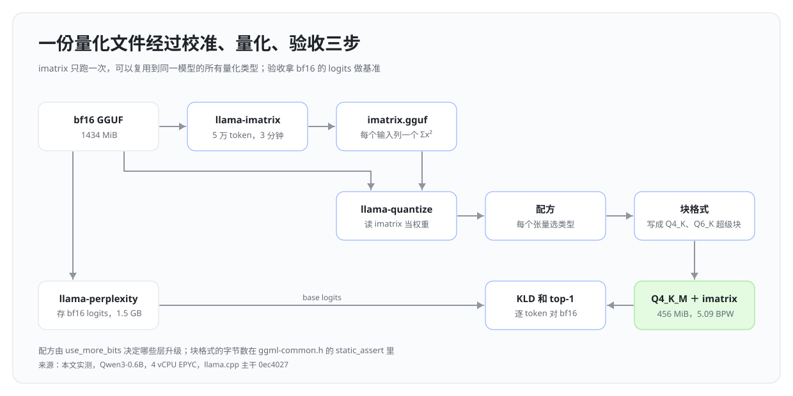
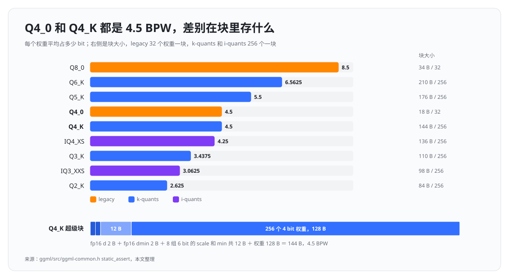
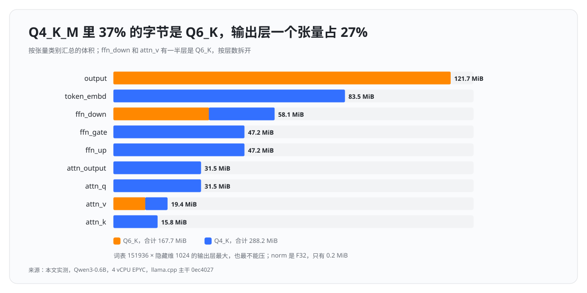
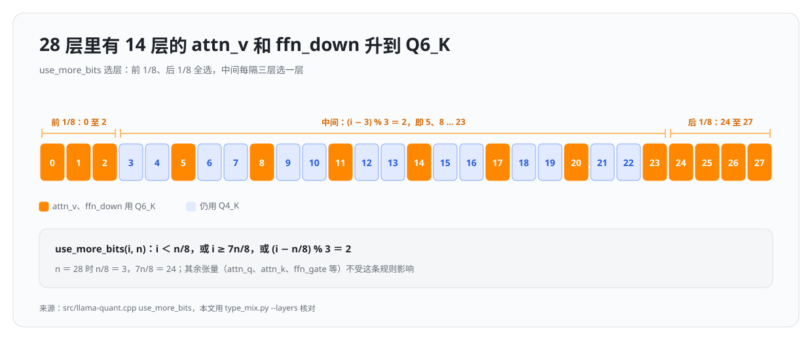
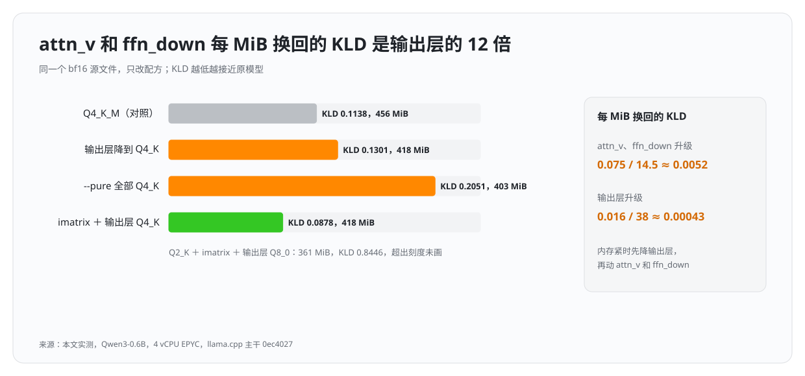
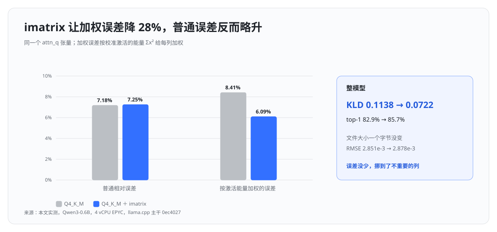
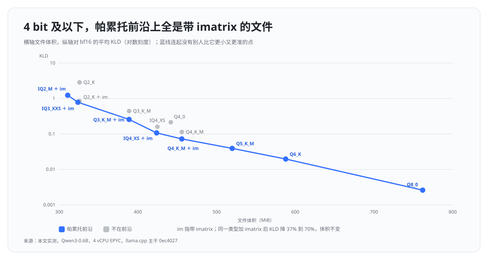
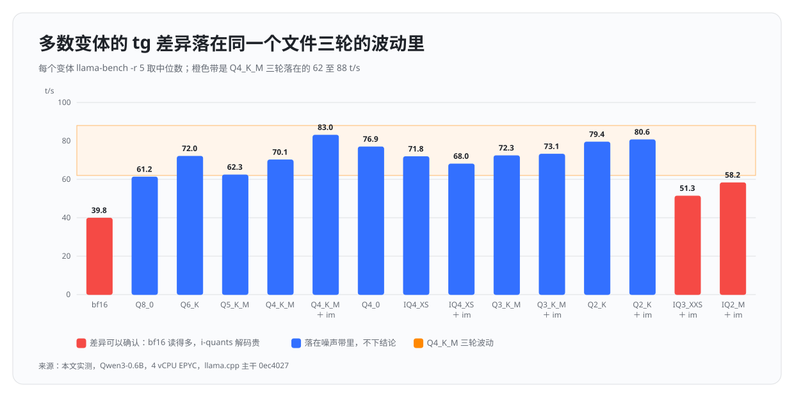
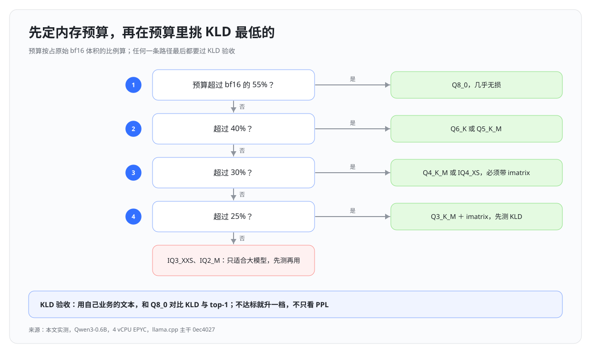

# LCPP-07｜内部｜量化：块结构、配方、imatrix 和用 KLD 选类型

> 🎯 **这篇文档解决什么问题**：Hugging Face 上一个模型的 GGUF 仓库常常挂着二十多个文件：Q8_0、Q6_K、Q5_K_M、Q4_K_M、IQ4_XS、Q3_K_M、IQ2_M。同样标着 4 bit 的两个文件，体积差 3%，KLD 差一倍；同一个 Q4_K_M，带不带 imatrix，KLD 又差 37%。多数人靠“Q4_K_M 是甜点”这句口诀选。这一篇把口诀拆开，主线一句话：量化文件 = 块格式 × 配方 × 校准，验收只看对原模型的 KL 散度。
>
> 使用方式：想知道文件名里的字母是什么意思，看第 2 至 4 章；想知道 imatrix 改了哪一行代码，看第 6、7 章；只想挑一个文件，直接看第 9、10 章。文中版本和数字核对于 2026 年 10 月 31 日。
>
> **代码**：[zero-to-llama/07-quantization](../07-quantization)。dequant.py、type_mix.py 和 collect_results.py 只依赖 Python 标准库，15 个变体和 4 组配方实验的日志随仓库提供。基线是主干 0ec4027，模型是 Qwen3-0.6B（bf16 和 19 个量化文件），机器是 4 核 EPYC 云主机无 GPU。

# 导读 · 先给结论

- **“4 bit”要换算成 BPW 看。**Q4_0 每 32 个权重一个 fp16 比例，4.5 BPW；Q4_K 每 256 个权重一个 144 字节的超级块，也是 4.5 BPW。Q4_K_M 这个文件类型在 Qwen3-0.6B 上实测 5.09 BPW，因为输出层和一半层的 attn_v、ffn_down 升到了 Q6_K。所有块的字节数都写在 ggml-common.h 的 static_assert 里[[1]](https://github.com/ggml-org/llama.cpp/blob/0ec4027/ggml/src/ggml-common.h)[[2]](https://github.com/ggml-org/llama.cpp/pull/1684)。
- **Q4_K_M 是一份配方。**我按 llama-quant.cpp 的规则逆推，311 个张量全部对上：输出层 Q6_K，占全文件 27%；28 层里 14 层的 attn_v 和 ffn_down 是 Q6_K，其余 Q4_K。升级哪些层由一行 use_more_bits 决定[[3]](https://github.com/ggml-org/llama.cpp/blob/0ec4027/src/llama-quant.cpp)。
- **attn_v、ffn_down 的升级比输出层的升级值钱 12 倍。**按每 MiB 换来的 KLD 算，前者 0.0052，后者 0.00043。内存紧时先降输出层。
- **imatrix 把误差挪到不重要的通道上。**同一个 attn_q，加 imatrix 后普通相对误差从 7.18% 变成 7.25%，按激活能量加权的误差从 8.41% 降到 6.09%。整模型 KLD 从 0.114 降到 0.072，文件一个字节没变，校准只花 3 分钟[[4]](https://github.com/ggml-org/llama.cpp/pull/4861)。
- **选类型看 KLD，PPL 只当旁证。**Q4_K_M --pure 的 PPL 27.68 比 Q4_0 的 26.27 高，KLD 却是 0.205 对 0.214，它离原模型更近。PPL 是平均值，量化误差会互相抵消[[5]](https://github.com/ggml-org/llama.cpp/pull/5076)[[6]](https://arxiv.org/abs/2407.09141)。
- **4 bit 及以下，前沿上全是带 imatrix 的变体。**15 个变体按体积和 KLD 取帕累托前沿：Q8_0、Q6_K、Q5_K_M，之后每个点都带 imatrix。Q2_K 不带 imatrix 时 PPL 291，带了 45.5。CPU 上的速度差异多数落在三轮波动里，能确定的只有三条，见第 10 章。



**📎 与系列其他文档的分工**：本篇只讲权重量化：块格式、配方、imatrix 和质量验收。第一次跑通 llama-quantize 的命令在 [LCPP-01｜上手｜第一次运行：编译、转换、加载和读懂内存账单](./01-first-run.md)；KLD 的 ± 怎么读、自检零点偏差和配对检验在 [LCPP-03｜上手｜测量方法：llama-bench、PPL、KLD 和噪声](./03-bench-ppl.md)；GGUF 怎么存这些张量在 [LCPP-04｜内部｜GGUF：文件结构、元数据、加载方式和分卷](./04-gguf.md)；KV cache 量化和激活旋转在 [LCPP-08｜内部｜KV cache 与长上下文：账本、深度、量化、SWA 和上下文写满](./08-kv-context.md)；量化类型在 CPU 上的内核和 repack 在 [LCPP-10｜内部｜CPU 调优：线程、绑核、repack、加载方式和带宽上限](./10-cpu-tuning.md)。路线和全部章节见 [LCPP-00｜索引｜从 0 开始 llama.cpp：路线、章节与练习](./README.md)。

# 第 1 章 · 问题：同样叫 4 bit，差别从哪来

## 1.1 两个 4 bit 文件

我第一次认真对比量化文件，是因为两个都标着 4 bit 的 Qwen3-0.6B：一个 Q4_0，442 MiB；一个 Q4_K_M，456 MiB。我原以为差 14 MiB 无关紧要，结果一个 KLD 0.214，一个 0.114，差了将近一倍。再加 imatrix，Q4_K_M 降到 0.072，体积不变。同样的 bit 预算，能做出 KLD 差三倍的文件。

## 1.2 块格式、配方和校准各管一层

差别来自三个互相独立的选择，后面按这三层拆：

1. **块格式**：一组权重怎么编码。块多大，比例和偏移用几 bit 存，量化值是均匀格点还是查码本。它决定 BPW 和单个张量的误差。
2. **配方**：每个张量用哪种块格式。哪些张量对误差敏感、值得多给 bit。它决定文件总大小和误差落在哪些张量上。
3. **校准**：量化时用什么权重衡量误差。不带 imatrix 时按权重本身的大小加权，带 imatrix 时按这一列输入激活的能量加权。它决定误差落在模型看得见还是看不见的通道上。

## 1.3 症状对照

| 现象 | 根因在哪一层 | 本篇位置 |
|-|-|-|
| 同样是 4 bit，文件大小差 10% 以上 | 配方：输出层、attn_v、ffn_down 的升级 | 第 4、5 章 |
| 同样大小，别人家的文件质量更好 | 校准：对方用了 imatrix，或校准数据更贴近用法 | 第 6、7 章 |
| PPL 只涨了一点，聊起来却明显变笨 | PPL 把误差平均掉了，要看 KLD 和 top-1 | 第 8 章 |
| IQ3_XXS 在这台 x86 CPU 上比更大的 Q4_K_M 还慢 | 块格式：i-quants 解码要查码本，也没有 repack 内核 | 第 3、10 章 |
| llama-quantize 报 Missing importance matrix | IQ1、IQ2、IQ3_XXS 等类型强制要求 imatrix | 第 3 章 |

# 第 2 章 · 块格式：legacy 和 k-quants

## 2.1 Q4_0 和 Q8_0

把浮点数映射到少数几个整数，最基本的做法是均匀仿射量化：x ≈ d × q + m，d 是步长，m 是偏移；只有 d 的叫对称量化[[7]](https://arxiv.org/abs/2103.13630)[[8]](https://arxiv.org/abs/2106.08295)。权重的动态范围在一个张量里差别很大，所以要分块，每块各自一个 d。llama.cpp 最早的格式就是这样：32 个权重一块，Q8_0 存一个比例和 32 个 int8，34 字节，8.5 BPW；Q4_0 存一个比例和 32 个 4 bit 值，18 字节，4.5 BPW，反量化是 x = d × (q − 8)。比例从 fp32 改成 fp16 是 2023 年 5 月的事，Q4_0 因此从 5 BPW 降到 4.5[[9]](https://github.com/ggml-org/llama.cpp/pull/1508)。

Q4_0 每块只有比例没有偏移。块内权重偏向一侧时，一半格点用不上。Q4_1、Q5_1 加了偏移，可 32 个权重配 4 字节元数据，开销太大。今天 Q4_0 在 CPU 上仍有一个优势：结构简单、对齐规整，x86、ARM、RISC-V 上都有 repack 内核，第 10 章会讲到。

## 2.2 k-quants：256 个权重一个超级块

k-quants 是 2023 年 6 月合入的，核心是两级量化：256 个权重组成一个超级块，切成 8 个或 16 个子块；每个子块有自己的比例和偏移，这些比例本身再量化成 4、6 或 8 bit，只在超级块级别存 fp16[[2]](https://github.com/ggml-org/llama.cpp/pull/1684)。比例变细了，元数据却摊得很薄。

以 Q4_K 为例，144 字节拆成四段：fp16 的 d 和 dmin 各 2 字节，8 个子块各一对 6 bit 的 scale 和 min 打包进 12 字节，256 个 4 bit 量化值占 128 字节。反量化公式是 x = d × scale_j × q − dmin × min_j。合计 144 × 8 / 256 = 4.5 BPW，和 Q4_0 一样，但多了每个子块的偏移。

| 类型 | 块大小 | 字节 | BPW | 结构 |
|-|-|-|-|-|
| Q8_0 | 32 | 34 | 8.50 | fp16 d + 32 个 int8 |
| Q4_0 | 32 | 18 | 4.50 | fp16 d + 32 个 4 bit |
| Q6_K | 256 | 210 | 6.5625 | 128 B 低 4 位 + 64 B 高 2 位 + 16 个 int8 scale + fp16 d |
| Q5_K | 256 | 176 | 5.50 | d、dmin + 12 B scale/min + 128 B 低 4 位 + 32 B 第 5 位 |
| Q4_K | 256 | 144 | 4.50 | d、dmin + 12 B 打包的 8 对 6 bit scale/min + 128 B |
| Q3_K | 256 | 110 | 3.4375 | fp16 d + 12 B 6 bit scale + 64 B 低 2 位 + 32 B 第 3 位 |
| Q2_K | 256 | 84 | 2.625 | d、dmin + 16 B 4 bit scale/min + 64 B |



字节数都能在 ggml-common.h 的 static_assert 上核对：Q2_K 在第 309 行，Q4_K 在第 338 行，Q6_K 在第 368 行，比如 sizeof(block_q6_K) == sizeof(ggml_half) + QK_K/16 + 3\*QK_K/4[[1]](https://github.com/ggml-org/llama.cpp/blob/0ec4027/ggml/src/ggml-common.h)。Hugging Face 的 GGUF 文档也有一张类型表，写了每种类型的反量化公式和 BPW，可以对照着看[[10]](https://huggingface.co/docs/hub/gguf)。

## 2.3 拆开一个超级块

为了确认自己真懂了，我写了 dequant.py，不依赖 llama.cpp，直接从 GGUF 里读出 blk.0.ffn_up.weight 的第一个超级块拆开：

```text
$ python3 dequant.py q-Q4_K_M.gguf blk.0.ffn_up.weight --ref qwen3-0.6b-bf16.gguf
第一个超级块 144 B = d 0.000198245（2 B）+ dmin 0.00157261（2 B）+ 8 组 6 bit scale/min（12 B）+ 256 个 4 bit 量化值（128 B）
  子块 0: scale=35 min=26 -> 实际步长 0.0069386，偏移 0.040888
  子块 1: scale=51 min=63 -> 实际步长 0.01011，偏移 0.099074
  ...
  子块 4: scale=63 min=63 -> 实际步长 0.012489，偏移 0.099074
和 BF16 原始权重比（4096 个值）：RMSE 1.668e-03，相对误差 7.19%，最大绝对误差 5.629e-03
```

输出里有两个细节。scale 和 min 都有顶到 63 的子块，6 bit 用满了，说明 d 和 dmin 按块内最大的子块定。4 bit 的相对误差在 7% 左右，后面每个 Q4 张量都是这个量级。真正拉开质量差距的，是误差落在哪些张量、哪些通道上。

> 💡 **常见误区**：6 bit scale 的打包顺序和直觉不同。前 4 个子块的 scale、min 放在 12 字节里前 8 字节的低 6 位；后 4 个子块的低 4 位放在后 4 字节，高 2 位借用前 8 字节的最高 2 位。我第一版反量化直接按顺序切 6 bit，误差 40%，对着 get_scale_min_k4 才改对。test_quantization.py 里专门留了打包往返的用例。

# 第 3 章 · 块格式：i-quants 和码本

## 3.1 从格点到码本

k-quants 的量化值仍落在均匀格点上。2024 年初 llama.cpp 陆续加了 IQ 系列：IQ2_XXS 在 1 月初，IQ3_XXS 在 1 月底，IQ1_S 在 2 月，IQ4_NL 和 IQ4_XS 在 2 月下旬[[11]](https://github.com/ggml-org/llama.cpp/pull/4773)[[12]](https://github.com/ggml-org/llama.cpp/pull/5196)[[13]](https://github.com/ggml-org/llama.cpp/pull/5453)[[14]](https://github.com/ggml-org/llama.cpp/pull/5590)[[15]](https://github.com/ggml-org/llama.cpp/pull/5747)。思路来自 QuIP 一脉：QuIP 先用随机正交变换让权重不相干，再做 2 bit 量化；QuIP# 换成 Hadamard 变换，并把 8 个权重当成一个向量，从 E8 格点构造的码本里挑最近的点存索引[[16]](https://arxiv.org/abs/2307.13304)[[17]](https://arxiv.org/abs/2402.04396)。E8 是 8 维里堆积密度最高的格，同样的码字数量下平均量化误差更小[[18]](https://doi.org/10.1007/978-1-4757-6568-7)。

IQ2_XXS 的 PR 说得很清楚，它借了 QuIP# 的两个点子，Hadamard 变换这类处理一概没用，块缩放沿用 ggml 原有的那一套：

- **符号位只存 7 个**：强制 8 个量化值里负号个数为偶数，第 8 个符号由奇偶性推出。凑不成偶数时，翻转 w × x² 最小的那个，w 来自 imatrix。ksigns_iq2xs 这张 128 项的表就是 7 bit 到 8 个符号的映射。
- **幅值查码本**：每个坐标只取 3 个幅值，3⁸ = 6561 个点，按 E8 要求坐标和为偶数剩 3281 个。作者在多个模型上统计每个点被用到的次数，挑出 256 个，用 8 bit 索引。源码里 iq2xxs_grid 每项 8 个字节，取值只有 8、25、43 三种，比例接近 1:3:5。
- **剩下的 bit 给 scale**：每 32 个权重，4 个 8 bit 索引加 4 组 7 bit 符号是 60 bit，剩 4 bit 存子块比例，正好 64 bit，即 2 BPW。再加超级块的 fp16，2.0625 BPW。

```c
// ggml/src/ggml-quants.c 2504 行起，dequantize_row_iq2_xxs 的内层
memcpy(aux32, x[i].qs + 4*ib32, 2*sizeof(uint32_t));        // 32 个权重 = 2 个 uint32
const float db = d * (0.5f + (aux32[1] >> 28)) * 0.25f;      // 高 4 位是子块 scale
for (int l = 0; l < 4; ++l) {
    const uint8_t * grid = (const uint8_t *)(iq2xxs_grid + aux8[l]);   // 8 bit 码本索引
    const uint8_t  signs = ksigns_iq2xs[(aux32[1] >> 7*l) & 127];     // 7 bit 符号
    for (int j = 0; j < 8; ++j) y[j] = db * grid[j] * (signs & kmask_iq2xs[j] ? -1.f : 1.f);
    y += 8;
}
```

## 3.2 非均匀电平：IQ4_NL 和 IQ4_XS

IQ4_NL 走另一条路：仍然逐个量化，但 16 个电平不等距。源码第 1120 行的 kvalues_iq4nl 是 −127、−104、−83、−65、−49、−35、−22、−10、1、13、25、38、53、69、89、113，越靠近 0 越密，贴合权重的钟形分布。均方误差最小的非均匀电平是 Lloyd 在 1982 年的经典问题[[19]](https://doi.org/10.1109/TIT.1982.1056489)。QLoRA 的 NF4 也是同一个思路，按正态分布的分位数放 16 个电平[[20]](https://arxiv.org/abs/2305.14314)。SqueezeLLM 更进一步，用按敏感度加权的 k-means 为每一行单独求电平[[21]](https://arxiv.org/abs/2306.07629)。

IQ4_NL 块大小 32，18 字节，4.5 BPW，和 Q4_0 一样大，只是电平换了。IQ4_XS 把它搬进 256 的超级块：fp16 d 加 8 个子块各一个 6 bit scale，scale 的低 4 位占 4 字节、高 2 位占 2 字节，再加 128 字节索引，136 字节，4.25 BPW。它比 Q4_K 少 8 字节，因为省掉了 dmin 和每个子块的 min。

| 类型 | 字节 / 256 权重 | BPW | 编码 | static_assert 行号 |
|-|-|-|-|-|
| IQ1_S | 50 | 1.5625 | 码本 + 3 bit scale | 430 |
| IQ2_XXS | 66 | 2.0625 | 256 项 E8 码本 + 7 bit 符号 + 4 bit scale | 385 |
| IQ2_XS | 74 | 2.3125 | 512 项码本 | 393 |
| IQ2_S | 82 | 2.5625 | 1024 项码本 | 402 |
| IQ3_XXS | 98 | 3.0625 | 256 项码本，4 个权重一组 | 411 |
| IQ3_S | 110 | 3.4375 | 512 项码本 | 422 |
| IQ4_XS | 136 | 4.25 | 16 个非均匀电平 + 6 bit scale | 460 |

## 3.3 码本类型离不开 imatrix，在 x86 上也更慢

低于 3 bit 的码本类型离不开 imatrix。llama-quant.cpp 第 902 行的 tensor_requires_imatrix 对 IQ1_S、IQ1_M、IQ2_XXS、IQ2_XS、IQ2_S、IQ3_XXS 以及 Q2_K_S 这个文件类型要求必须有 imatrix，token_embd 和 output 除外；源码注释写着 k-type 量化不需要 imatrix[[3]](https://github.com/ggml-org/llama.cpp/blob/0ec4027/src/llama-quant.cpp)。码本只有几百个点，挑哪个点、翻哪个符号都要靠重要性来定，没有它就只能按权重大小猜。

另一个后果是解码。每 8 个权重要查一次码本、一次符号表，GPU 和苹果芯片上很便宜。x86 CPU 上，repack.cpp 只给 IQ4_NL 做了重排，IQ3_XXS 和 IQ2 系列没有，第 10 章会看到它们的 tg 比体积相同的 Q2_K 慢三成左右。码本量化在学术上还在往前走，AQLM 用多个可学习码本相加表示一组权重，2 bit 附近质量更好，代价是解码更贵[[22]](https://arxiv.org/abs/2401.06118)。

> 🔑 **本章要点**：k-quants 是两级的均匀量化，i-quants 是码本或非均匀电平。IQ3_XXS 及以下的码本类型离不开 imatrix；IQ4_XS 比 Q4_K 小 6%，在这台 CPU 上速度和 Q4_K_M 分不开。

# 第 4 章 · 配方：Q4_K_M 不是全 Q4_K

## 4.1 读出一个文件的真实配方

文件名里的 Q4_K_M 是 llama_ftype，意思是以 Q4_K 为主的中号配方。每个张量最终用什么类型，由 llama-quant.cpp 的 llama_tensor_get_type_impl 一条条规则决定[[3]](https://github.com/ggml-org/llama.cpp/blob/0ec4027/src/llama-quant.cpp)。GGUF 头里的 general.file_type 也只是多数张量的类型，规范里写明它可以从张量类型推出来[[23]](https://github.com/ggml-org/ggml/blob/master/docs/gguf.md)。我写了 type_mix.py 按张量角色汇总：

```text
$ python3 type_mix.py q-Q4_K_M.gguf --check-q4km
q-Q4_K_M.gguf: 28 层, 张量 456.1 MiB, 5.09 BPW
  output            121.7 MiB  1×Q6_K
  token_embd         83.5 MiB  1×Q4_K
  ffn_down           58.1 MiB  14×Q4_K, 14×Q6_K
  ffn_gate           47.2 MiB  28×Q4_K
  ffn_up             47.2 MiB  28×Q4_K
  attn_output        31.5 MiB  28×Q4_K
  attn_q             31.5 MiB  28×Q4_K
  attn_v             19.4 MiB  14×Q4_K, 14×Q6_K
  attn_k             15.8 MiB  28×Q4_K
  attn_norm/ffn_norm/q_norm/k_norm/output_norm  F32
  按类型合计 Q4_K 288.2 MiB, Q6_K 167.7 MiB, F32 0.2 MiB
Q4_K_M 规则推导：311/311 个张量一致
```



最大的单个张量是输出层：词表 151936 × 隐藏维 1024，Q6_K 下 121.7 MiB，占全文件 27%[[24]](https://arxiv.org/abs/2505.09388)。小模型配大词表，输出层和嵌入层加起来接近一半体积。小模型比大模型更难压，这是原因之一：大头张量恰好是最不能随便压的那个。

## 4.2 use_more_bits：哪 14 层被升级

attn_v 和 ffn_down 的升级规则是一行 lambda：

```cpp
// src/llama-quant.cpp 490 行
auto use_more_bits = [](int i_layer, int n_layers) -> bool {
    return i_layer < n_layers/8 || i_layer >= 7*n_layers/8 || (i_layer - n_layers/8)%3 == 2;
};
```

Qwen3-0.6B 有 28 层，n_layers/8 = 3，7 × 28 / 8 = 24。前三层 0、1、2 和最后 24 至 27 全部升级，中间从第 3 层起每三层升一层：5、8、11、14、17、20、23。合计 14 层，type_mix.py --layers 打出来的正是这 14 层。Q4_K_M 和 Q5_K_M 在这些层上用 Q6_K，规则在第 637 行；ffn_down 的同类规则在第 697 行。



## 4.3 为什么偏偏是 attn_v 和 ffn_down

k-quants 的 PR 只给了结论：Q4_K_M 对一半的 attention.wv 和 feed_forward.w2 用 Q6_K，其余 Q4_K；Q3_K_M 对 wv、wo、w2 用 Q4_K[[2]](https://github.com/ggml-org/llama.cpp/pull/1684)。理由是逐个张量做消融得来的经验。我的理解是，这两类都是输出侧的投影，误差直接加到残差流上，后面没有 softmax 或激活函数把它压掉。

残差流的离群值让这件事更严重。LLM.int8() 发现 6.7B 以上的模型里会出现少数幅值极大的特征维度，把它们和普通维度一起量化，精度会崩[[25]](https://arxiv.org/abs/2208.07339)；Bondarenko 等人追到了源头，是注意力头为了“什么都不做”而学出来的极端值[[26]](https://arxiv.org/abs/2306.12929)。学术界的对策各不相同：SpQR 把少数离群权重单独用高精度存[[27]](https://arxiv.org/abs/2306.03078)，SmoothQuant 把激活的难度按通道挪到权重上[[28]](https://arxiv.org/abs/2211.10438)。llama.cpp 的配方是更粗的一刀：整张量多给 bit，再用 imatrix 在通道层面补。

规则之外，llama-quantize 也允许手动改配方：--output-tensor-type、--token-embedding-type 改两头，--tensor-type 按正则改任意张量、可以重复写，--pure 关掉所有按层升级[[29]](https://github.com/ggml-org/llama.cpp/blob/0ec4027/tools/quantize/README.md)。下一章就用它们做实验。

> 🔑 **本章要点**：Q4_K_M 是规则生成的混合配方：输出层 Q6_K，attn_v 和 ffn_down 按 use_more_bits 一半升 Q6_K。小模型的输出层占体积 27%，是配方里最大的一项。

# 第 5 章 · 配方实验：哪个 bit 最值钱

## 5.1 四组只改配方的实验

第 4 章读出了 Q4_K_M 的配方，下一步是问每一处升级值多少。我用同一个 bf16 源文件做了四组实验，块格式和校准都不动，只用 --output-tensor-type 和 --pure 改配方[[29]](https://github.com/ggml-org/llama.cpp/blob/0ec4027/tools/quantize/README.md)。评测是 wikitext-2 测试集前 20 块 × 512 token[[30]](https://arxiv.org/abs/1609.07843)，KLD 和 top-1 都是对 bf16 算的。

| 变体 | MiB | PPL | KLD | top-1 | 和对照组比 |
|-|-|-|-|-|-|
| Q4_K_M（对照） | 456 | 25.62 | 0.1138 | 82.9% | — |
| --output-tensor-type q4_k | 418 | 26.29 | 0.1301 | 80.8% | 省 38 MiB，KLD +0.016 |
| --pure | 403 | 27.68 | 0.2051 | 77.3% | 再去掉 attn_v、ffn_down 升级，又省 14.5 MiB，KLD +0.075 |
| imatrix，--output-tensor-type q4_k | 418 | 24.81 | 0.0878 | 83.9% | 比不带 imatrix 的对照组还好 |
| Q2_K imatrix，--output-tensor-type q8_0 | 361 | 45.28 | 0.8446 | 55.8% | 多花 36 MiB，KLD 几乎不变 |



## 5.2 按每 MiB 的回报排序

把 KLD 的变化除以体积的变化：attn_v、ffn_down 的升级是 0.075 / 14.5 ≈ 0.0052 每 MiB，输出层的升级是 0.016 / 38 ≈ 0.00043 每 MiB，相差 12 倍。输出层占的地方最大，多给的 bit 回报却最低。内存紧张时的顺序因此很明确：先把输出层降到 Q5_K 或 Q4_K，attn_v 和 ffn_down 的升级留到最后再动。

最后一行是反方向的验证。Q2_K 加 imatrix 后 KLD 0.8463，把输出层从默认升到 Q8_0，多花 36 MiB，KLD 只降到 0.8446。到了 2 bit，误差的大头在 28 层的主体张量上，输出层再精确也救不回来。

## 5.3 校准比配方更值钱

第四行是我做完这组实验后最在意的一行：带 imatrix 的 Q4_K_M 把输出层降到 Q4_K，418 MiB，KLD 0.0878，比 456 MiB、不带 imatrix 的原版 0.1138 还低。校准带来的收益比 38 MiB 的配方收益更大，而且它不花一个字节。第 6、7 章拆开看校准到底改了什么。

> 🔑 **本章要点**：attn_v、ffn_down 的升级每 MiB 换回的 KLD 是输出层的 12 倍，压体积先压输出层。这组数字来自 0.6B、输出层占 27% 的模型；7B 以上输出层占比小，省量和影响都会变小，动手前先用 type_mix.py 看自己模型的体积分布。

# 第 6 章 · imatrix：校准改了量化里的哪一行

## 6.1 从 OBD、OBS 到一张对角矩阵

量化真正要压低的是这一层输出 W·x 的误差，权重 W 本身的误差只是代理。把一行权重的扰动 Δw 代进去，输出误差的期望是 Δwᵀ E[x xᵀ] Δw，中间那个矩阵就是输入激活的二阶统计，也是逐层重建误差对这一行权重的 Hessian，差一个常数 2。Optimal Brain Damage 只取 Hessian 的对角线来估计删掉一个权重的代价[[31]](https://proceedings.neurips.cc/paper/1989/hash/6c9882bbac1c7093bd25041881277658-Abstract.html)；Optimal Brain Surgeon 用完整的逆 Hessian，删一个权重时顺带补偿其余权重[[32]](https://doi.org/10.1109/ICNN.1993.298572)。

这套思路后来被搬到量化上。OBC 把 OBS 的逐个补偿推广到量化，GPTQ 把它改成按列批量处理，几小时内能量化 175B 的模型[[33]](https://arxiv.org/abs/2208.11580)[[34]](https://arxiv.org/abs/2210.17323)。AWQ 换了一个角度：它观察到只有约 1% 的输入通道激活很大，对应的权重最怕误差，于是按激活幅值把这些通道放大后再量化[[35]](https://arxiv.org/abs/2306.00978)。这些方法都用到了激活统计，区别在用多少。

llama.cpp 的 imatrix 走了最省事的一步，只保留 E[x xᵀ] 的对角线，也就是每个输入通道上激活平方的均值。此时输出误差近似成 Σⱼ E[xⱼ²] Δwⱼ²，量化时把 E[xⱼ²] 当成第 j 列的误差权重即可。PR 作者的说法是，这比常见方法简单得多、小得多，但据他所知仍然能达到最好的量化结果；在他的 32 核机器上，7B 模型收集 5 万 token 约 10 分钟[[4]](https://github.com/ggml-org/llama.cpp/pull/4861)。

## 6.2 收集：一行累加

收集端在 tools/imatrix/imatrix.cpp 的回调里。调度器每算一个矩阵乘就问一次要不要这份数据，只有 blk. 开头的权重会被收下，少于 16 个 token 的小批次也跳过；收下以后对输入激活逐列累加平方，第 660 行就是全部的统计[[36]](https://github.com/ggml-org/llama.cpp/blob/0ec4027/tools/imatrix/imatrix.cpp)：

```cpp
// tools/imatrix/imatrix.cpp 660 行
e.counts[ex]++;
for (int64_t j = 0; j < ne0; ++j) { acc[j] += x[j] * x[j]; }
```

acc 除以 counts 就是 E[xⱼ²]。新版默认把它存成 GGUF，每个权重张量对应两项，名字是 张量名.in_sum2 和 张量名.counts，写入在第 971 至 983 行[[37]](https://github.com/ggml-org/llama.cpp/pull/9400)。旧的 .dat 格式仍能读，llama-imatrix 也能把两种格式互相转换。

> 💡 **常见误区**：imatrix 默认不收集 output.weight。README 写明 --process-output 才会收集它和绑定权重时的 token_embd.weight，默认关闭，因为量化这两个张量时通常不用 imatrix 更好[[38]](https://github.com/ggml-org/llama.cpp/blob/0ec4027/tools/imatrix/README.md)。所以带 imatrix 的 Q4_K_M 里，最大的输出层其实没被校准，收益全来自 28 层的主体张量。

## 6.3 使用：误差权重换了一个公式

imatrix 进入量化的地方在 ggml-quants.c 的 quantize_row_q4_K_impl[[39]](https://github.com/ggml-org/llama.cpp/blob/0ec4027/ggml/src/ggml-quants.c)。第 1580 行先按整个超级块算 sigma2 = 2 × Σx² / 256，然后每个 32 权重的子块在搜索最优 scale 和 min 之前，给每个权重分配一个误差权重：

```c
// ggml/src/ggml-quants.c 1583 至 1588 行
if (quant_weights) {
    const float * qw = quant_weights + QK_K*i + 32*j;
    for (int l = 0; l < 32; ++l) weights[l] = qw[l] * sqrtf(sigma2 + x[32*j + l]*x[32*j + l]);
} else {
    for (int l = 0; l < 32; ++l) weights[l] = av_x + fabsf(x[32*j + l]);
}
```

没有 imatrix 时，误差权重是 av_x + |x|，越大的权重越重要。有 imatrix 时乘上了 qw，也就是这一列输入激活的能量：权重本身再小，只要它乘的那个输入通道经常很大，它的误差就要压低。后面的 make_qkx3_quants 搜索和 make_qp_quants 对 scale 的二次量化完全一样，块格式也一样，所以文件一个字节都不会变大。

> 🔑 **本章要点**：imatrix 是只保留对角线的二阶统计：收集端一行累加 E[x²]，使用端一行改误差权重。块格式和文件大小不变，变的只是每个块里 scale、min 和量化值的取法。

# 第 7 章 · imatrix 实测与校准数据

## 7.1 生成一份 imatrix

quant.sh 里 imatrix 那一步是一条命令：100 块 × 512 token 的 wikitext-2 训练集，约 5 万 token，和 PR 作者用的量级一样。4 核机器上 7.4 秒一轮，总共约 3 分钟，输出的 imatrix.gguf 只有 2.3 MiB。

```bash
llama-imatrix -m qwen3-0.6b-bf16.gguf -f wiki.train.raw --chunks 100 -c 512 -t 4 -o imatrix.gguf
llama-imatrix -m qwen3-0.6b-bf16.gguf --in-file imatrix.gguf --show-statistics   # 看每个张量的统计
llama-quantize --imatrix imatrix.gguf qwen3-0.6b-bf16.gguf qi-Q4_K_M.gguf Q4_K_M
```

--show-statistics 会打印 imatrix 文件里每个张量的统计量，适合检查校准是否覆盖了所有层[[38]](https://github.com/ggml-org/llama.cpp/blob/0ec4027/tools/imatrix/README.md)。量化时 llama-quantize 会打印 loaded N importance matrix entries，并把 quantize.imatrix.file、quantize.imatrix.dataset、quantize.imatrix.entries_count、quantize.imatrix.chunks_count 四个键写进输出文件的元数据，拿到别人的 GGUF 时，看这几个键就知道它是不是带 imatrix、用什么数据校准的。

## 7.2 误差没少，只是换了地方

dequant.py 加上 --imatrix 参数，会同时算两种误差：普通相对误差，和每列按 E[x²] 加权的相对误差。拿第 13 层 attn_q 的前 16 行对比：

| 文件 | 普通相对误差 | 按激活能量加权的误差 | RMSE |
|-|-|-|-|
| Q4_K_M | 7.18% | 8.41% | 2.851e-03 |
| Q4_K_M + imatrix | 7.25% | 6.09% | 2.878e-03 |



imatrix 版本的普通误差反而略高，RMSE 也略高；模型真正看到的误差，即乘上激活之后的误差，降了 28%。不带 imatrix 时加权误差比普通误差高，说明激活大的那些列恰好被量化得更差；带了以后顺序反过来。整模型上 KLD 从 0.1138 降到 0.0722，top-1 一致率从 82.9% 升到 85.7%。量化是一个分配误差的问题，imatrix 决定误差往哪里放。

## 7.3 校准数据选什么

我这里用 wikitext 训练集校准、wikitext 测试集评测，同一个来源，结果偏乐观。Unsloth 的文档专门提醒过这一点：用维基百科校准再拿基于维基百科的集合评测，会过拟合评测集；他们的校准集超过 150 万 token，来源多样，按 agentic 编程、对话和多语言整理过，KLD 只在和校准集完全不同的数据上测。文档还指出，指令模型有自己的聊天模板，只用纯文本校准对它们效果不好[[40]](https://docs.unsloth.ai/basics/unsloth-dynamic-2.0-ggufs)。

自己量化给业务用时，我的做法是三条：校准集用真实业务里的提示词和回答，套上和线上一样的聊天模板。评测集和校准集不重叠。换了校准集以后，重跑一遍第 8 章的 KLD，用数字确认它确实更好。校准只花几分钟，换一份数据重做一遍的成本很低。

# 第 8 章 · 用 KLD 验收

## 8.1 两步测量

llama-perplexity 有两步式的 KLD 模式[[5]](https://github.com/ggml-org/llama.cpp/pull/5076)[[41]](https://github.com/ggml-org/llama.cpp/blob/0ec4027/tools/perplexity/README.md)：先用原始精度模型跑一遍，把每个位置的完整 log-prob 存进文件；再用量化模型跑同样的文本，逐位置算 KL(p_base ‖ p_quant) = Σ p_base log(p_base / p_quant)[[42]](https://doi.org/10.1214/aoms/1177729694)。同一次运行还会输出 top-1 一致率、Δp 的 RMS 和分位数、ln(PPL) 的相关系数和 ln(PPL(Q)/PPL(base))[[43]](https://github.com/ggml-org/llama.cpp/pull/6936)。

```bash
# 1. 存 bf16 的 log-prob，20 块 × 512 token，文件约 1.5 GB
llama-perplexity -m qwen3-0.6b-bf16.gguf -f wiki.test.raw -c 512 --chunks 20 \
  --kl-divergence-base base.kld
# 2. 每个量化文件读同样的 base，文本从 base 文件里取
llama-perplexity -m q-Q4_K_M.gguf --chunks 20 \
  --kl-divergence-base base.kld --kl-divergence
# 3. 速度：3 轮，每轮 -r 5
llama-bench -m q-Q4_K_M.gguf -p 512 -n 128 -t 4 -r 5 -o jsonl
```

base 文件为什么这么大可以从源码算出来。perplexity.cpp 只统计每个窗口的后一半位置，512 的窗口统计 255 个，20 块共 5100 个位置；每个位置存一整行 uint16 的 log-prob，Qwen3 词表 151936，补齐后每行 151940 项[[44]](https://github.com/ggml-org/llama.cpp/blob/0ec4027/tools/perplexity/perplexity.cpp)。5100 × 151940 × 2 字节约 1.55 GB。第 230 行还会跳过 log p_base 小于 −16 的词，它们在原模型里几乎不可能出现，计入只会放大舍入噪声。

## 8.2 PPL 为什么不够

PPL 是正确答案 token 的平均负对数似然。量化误差有时让正确答案的概率升高，有时降低，取平均会互相抵消；而且 PPL 只看正确 token 那一个位置，不管整个分布被扭成了什么样。Dutta 等人在 NeurIPS 2024 的论文里系统地展示了这一点：压缩后的模型在基准上准确率几乎不变，答案却有相当比例从对翻错、从错翻对，他们建议用 KLD 和翻转率评估压缩模型[[6]](https://arxiv.org/abs/2407.09141)。

我的数据里有一个现成的反例。Q4_K_M --pure 的 PPL 是 27.68，Q4_0 是 26.27，只看 PPL 应该选 Q4_0；KLD 却是 0.2051 对 0.2138，top-1 一致率 77.3% 对 76.5%，--pure 离原模型更近，而且体积还小 39 MiB。PPL 只看正确 token 那一个概率，--pure 在这一个位置上损失更多，在整个分布上却偏得更少，PPL 就这样把结论读反了。

## 8.3 读一份 KLD 日志

拿带 imatrix 的 Q4_K_M 为例，日志末尾的几行这样读：

| 字段 | 读数 | 怎么读 |
|-|-|-|
| Mean KLD | 0.072180 ± 0.001552 | 主指标，越小越接近原模型；± 是标准误 |
| Median / 99.9% / Maximum KLD | 0.048 / 1.036 / 3.218 | 长尾：少数位置分布被扭得很厉害，聊天时表现为偶尔一句跑偏 |
| Same top p | 85.745 ± 0.490% | 贪心解码下和原模型选同一个 token 的比例 |
| RMS Δp | 6.521% | 正确 token 概率变化的均方根 |
| Cor(ln PPL) | 98.81% | 两边逐块 ln PPL 的相关系数，配对比较能成立的前提 |
| Mean ln(PPL(Q)/PPL(base)) | 0.047186 ± 0.007455 | 配对后的 PPL 变化，先减去自检的 +0.0128 再读 |

ln 比值的 ± 怎么换算成显著性、为什么 bf16 跟自己比也有 +0.0128 的零点偏差、两个量化文件之间怎么做配对检验，都在 [LCPP-03｜上手｜测量方法：llama-bench、PPL、KLD 和噪声](./03-bench-ppl.md)。这里只用到结论：KLD 和 top-1 不受那个零点偏差影响，选类型时以它们为准，PPL 只当旁证。

> 🔑 **本章要点**：验收用两步式 KLD：bf16 存一次 base，每个量化文件对着它跑。主看 Mean KLD 和 top-1，再看 99.9% 分位的长尾；PPL 会被平均和抵消读反，只当旁证。

# 第 9 章 · 全表与帕累托前沿

## 9.1 15 个变体

Qwen3-0.6B，wikitext-2 测试集前 20 块 × 512 token，bf16 在同一批 token 上 PPL 23.08。基准是 bf16，它保留 fp32 的 8 位指数，只把尾数截到 7 位，转换 GGUF 时不丢动态范围[[45]](https://arxiv.org/abs/1905.12322)。速度是三轮的中位数，pp512 和 tg128，4 线程，第 10 章再解释怎么读。

| 变体 | MiB | BPW | PPL | KLD | KLD p99 | top-1 | pp t/s | tg t/s |
|-|-|-|-|-|-|-|-|-|
| bf16 | 1434 | 16.00 | 23.08 | — | — | — | 430 | 39.8 |
| Q8_0 | 762 | 8.50 | 23.32 | 0.0026 | 0.015 | 97.1% | 339 | 61.2 |
| Q6_K | 588 | 6.56 | 23.47 | 0.0196 | 0.117 | 92.3% | 443 | 72.0 |
| Q5_K_M | 520 | 5.81 | 24.26 | 0.0391 | 0.255 | 88.6% | 516 | 62.3 |
| Q4_K_M | 456 | 5.09 | 25.62 | 0.1138 | 0.673 | 82.9% | 414 | 70.1 |
| **Q4_K_M + imatrix** | 456 | 5.09 | 24.19 | **0.0722** | 0.457 | 85.7% | 378 | 83.0 |
| Q4_0 | 442 | 4.93 | 26.27 | 0.2138 | 1.285 | 76.5% | 408 | 76.9 |
| IQ4_XS | 425 | 4.75 | 26.75 | 0.1603 | 1.015 | 79.3% | 490 | 71.8 |
| **IQ4_XS + imatrix** | 424 | 4.73 | 25.17 | **0.1069** | 0.643 | 82.7% | 513 | 68.0 |
| Q3_K_M | 389 | 4.34 | 33.82 | 0.4427 | 2.580 | 67.3% | 406 | 72.3 |
| **Q3_K_M + imatrix** | 389 | 4.34 | 27.73 | **0.2561** | 1.643 | 75.2% | 438 | 73.1 |
| Q2_K | 326 | 3.63 | 291.09 | 2.8556 | 9.760 | 29.8% | 310 | 79.4 |
| Q2_K + imatrix | 326 | 3.63 | 45.50 | 0.8463 | 4.672 | 55.5% | 313 | 80.6 |
| IQ3_XXS + imatrix | 324 | 3.62 | 43.91 | 0.7824 | 4.029 | 57.9% | 475 | 51.3 |
| IQ2_M + imatrix | 311 | 3.47 | 73.18 | 1.2337 | 6.065 | 49.6% | 420 | 58.2 |

表里的 BPW 是整个文件的平均值，包含升级过的输出层和 attn_v、ffn_down，所以 Q4_K_M 是 5.09，Q2_K 是 3.63，都比块格式本身的 4.5 和 2.625 高。比较文件时用这一列，比较块格式时用第 2、3 章的表。

## 9.2 帕累托前沿

把体积和 KLD 画在一起，取没有别的变体比它更小且 KLD 更低的点，得到帕累托前沿：Q8_0、Q6_K、Q5_K_M、Q4_K_M+imatrix、IQ4_XS+imatrix、Q3_K_M+imatrix、IQ3_XXS+imatrix、IQ2_M+imatrix。collect_results.py --pareto 直接打印这条线。



Q4_K_M 以下，不带 imatrix 的变体全部掉出前沿。Q4_0 比 Q4_K_M+imatrix 只小 14 MiB，KLD 是它的 3 倍；Q2_K 不带 imatrix 的 PPL 是 291，几乎不可用，带上以后是 45.5。所有 4 bit 及以下的文件，第一件事是找带 imatrix 的版本。

## 9.3 4 bit 附近曲线开始变陡

- Q8_0 的 KLD 是 0.0026，top-1 一致率 97%，对绝大多数用途和原模型分不出来，体积减半。
- Q6_K 到 Q5_K_M 再到 Q4_K_M，每降一档 KLD 大约翻倍到三倍，曲线在 4 bit 附近开始变陡。
- Q3_K_M 加 imatrix 后 KLD 从 0.443 降到 0.256，PPL 从 33.8 降到 27.7，imatrix 在 3 bit 上的收益比 4 bit 更大。
- 3.6 BPW 附近有两个选择，Q2_K+imatrix 和 IQ3_XXS+imatrix，体积几乎一样，IQ3_XXS 质量略好，但在这台 CPU 上 tg 慢三成多。
- 0.6B 在 3.5 BPW 以下 top-1 一致率不到六成，已经基本不可用。

最后一条不要直接搬到大模型上。Dettmers 和 Zettlemoyer 在 35000 多组实验里比较了不同位宽，结论是在总 bit 数相同的条件下，4 bit 几乎总是零样本准确率最好的选择：同样的内存给更大的模型配 4 bit，往往胜过给小模型配高位宽[[46]](https://arxiv.org/abs/2212.09720)；QLoRA 也是在 4 bit 的 NF4 上微调 65B 模型，效果接近 16 bit[[20]](https://arxiv.org/abs/2305.14314)。0.6B 的阈值只适用于 0.6B，换模型就在那个模型上重测一遍前沿。

> 🔑 **本章要点**：前沿在 Q5_K_M 以下全是带 imatrix 的点。挑文件按体积预算在前沿上找，比较时用文件的平均 BPW，不用块格式的 BPW。阈值随模型变，换模型重测。

# 第 10 章 · 速度和选型

## 10.1 哪些速度差异是真的

速度列要谨慎读。我前后跑了三轮，每轮 llama-bench -r 5，取中位数。同一个 Q4_K_M 三轮的 tg 落在 62 到 88 t/s，最大最小差 40%；而表里大部分变体之间的 tg 差异不到 15%。云主机上邻居负载、频率和页缓存都会变，单轮数字不能比较，要报多轮和波动[[47]](https://doi.org/10.1145/2807591.2807644)[[48]](https://doi.org/10.1145/2491894.2464160)。测量方法和怎么判断差异显著见 [LCPP-03｜上手｜测量方法：llama-bench、PPL、KLD 和噪声](./03-bench-ppl.md)。



我只认三轮区间互不重叠的差异，能确定的有三条：

1. **bf16 的 tg 最慢**：三轮 37.5 至 49.5，Q8_0 是 60.1 至 63.7。decode 每生成一个 token 要把全部权重读一遍，是带宽受限的[[49]](https://www.cs.virginia.edu/stream/ref.html)[[50]](https://doi.org/10.1145/1498765.1498785)。1434 MiB 对 762 MiB 是 1.9 倍，速度比只有 1.5 倍左右，Q8_0 的解码也有开销。
2. **IQ3_XXS 和 IQ2_M 的 tg 慢于同体积的 Q2_K**：三轮 49.8 至 59.3，Q2_K 带不带 imatrix 都在 78.0 至 89.2。i-quants 每 8 个权重要查一次码本、解一次符号，第 3 章的那段内层循环在 CPU 上不便宜。
3. **Q2_K 的 pp 最低**：三轮 294 至 328，比所有其他变体的三轮最低值都低，包括 bf16。这台机器支持 AVX512，Q2_K 是走了 repack 的，pp 仍然最低。prefill 是算力受限的，文件小帮不上忙；我的理解是 Q2_K 每个块的解包和点积步骤多，拖慢了 GEMM。

## 10.2 repack 和码本在 CPU 上的代价

CPU 后端在加载时会把部分类型重排成交错布局，走专门的 GEMM 和 GEMV 内核[[51]](https://github.com/ggml-org/llama.cpp/pull/10446)。repack.cpp 里 x86 能用的只有几种：Q4_0、Q4_K、IQ4_NL 要求 AVX2，Q2_K 要求 AVX512；Q5_K、Q6_K、Q8_0 的重排只在 ARM 和 RISC-V 上有，IQ4_XS 和 IQ2、IQ3 系列都没有[[52]](https://github.com/ggml-org/llama.cpp/blob/0ec4027/ggml/src/ggml-cpu/repack.cpp)。llama-bench 有 --repack 0|1 开关，可以在同一台机器上对比开关前后[[53]](https://github.com/ggml-org/llama.cpp/blob/0ec4027/tools/llama-bench/llama-bench.cpp)。

我的数据里 repack 并不能解释全部差异。IQ4_XS 没有 repack，pp 三轮却是 463 至 540，整体高于有 repack 的 Q4_0（379 至 414）和 Q4_K_M（387 至 459）；Q8_0 也没有 repack，pp 是 336 至 366，整体低于 Q4_0。我没有拆到内核级别，这里只报数字，内核和 repack 的细节在 [LCPP-10｜内部｜CPU 调优：线程、绑核、repack、加载方式和带宽上限](./10-cpu-tuning.md)。

换一台机器，结论可能反过来。IQ2_XXS 的 PR 在 7B 上测过：Ryzen 5975WX 的 CPU 上 tg 是 24.3 t/s，Q4_0 是 15.4。RTX 4080 上是 155 对 130，M2 Max 上是 54 对 63.5[[11]](https://github.com/ggml-org/llama.cpp/pull/4773)。我的理解是，7B 的权重有几 GiB，CPU 和 CUDA 上少读的字节占了主导，码本反而更快；0.6B 只有几百 MiB，解码开销就露出来了。M2 Max 上 IQ2_XXS 比 Q4_0 慢，说明这个平衡点随硬件变。苹果芯片上不同类型的速度可以对照社区的 M 系列测速表[[54]](https://github.com/ggml-org/llama.cpp/discussions/4167)。部署机器不同，就在部署机器上重测。

## 10.3 按内存预算选

把前面的数据浓缩成一条选择路径：先确定内存预算占原始 bf16 体积的比例，再在预算内挑前沿上 KLD 最低的点；所有 4 bit 及以下的文件优先找带 imatrix 的版本。



| 场景 | 首选 | 备选 | 理由 |
|-|-|-|-|
| 内存充足，追求和原模型一致 | Q8_0 | Q6_K | KLD 0.003，top-1 97% |
| 通用本地部署 | Q4_K_M + imatrix | Q5_K_M | 前沿上体积和质量的拐点 |
| 内存再紧 5% 到 10% | IQ4_XS + imatrix | Q4_K_M imatrix + 输出层 Q4_K | 425 MiB，KLD 0.107；后者 418 MiB，KLD 0.088 |
| 只有 x86 CPU，追求 decode 速度 | Q4_0 或 Q4_K_M | 避开 IQ2、IQ3 | 在 AVX2 上能 repack，解码便宜 |
| 大模型塞不下，只能 3 bit 以下 | IQ3_XXS / IQ2_M + imatrix | Q2_K + imatrix | 必须用自己业务的提示词测 KLD |

> 📌 **上线前核对清单**：一个量化文件上线前逐条核对：
> - 元数据里有没有 quantize.imatrix.file 和 quantize.imatrix.dataset，校准数据是什么。
> - 用 type_mix.py 看一遍配方，输出层、attn_v、ffn_down 是什么类型。
> - 用自己业务的文本跑一次 KLD 和 top-1，和 Q8_0 对比，不只看 PPL。
> - 在部署机器上用 llama-bench -r 5 跑三轮，三轮区间重叠的差异当噪声处理。
> - 记下 llama.cpp 提交号，量化格式、配方规则和内核都会随版本变化。

# 第 11 章 · 排障清单与练习

## 11.1 症状和处理

| 现象 | 根因 | 处理 |
|-|-|-|
| llama-quantize 报 ERROR: this quantization requires an importance matrix! | IQ1、IQ2、IQ3_XXS、Q2_K_S 这些文件类型强制要求 imatrix，llama-quant.cpp 第 1184 行 | 先跑 llama-imatrix，或者换 Q2_K、Q3_K_S |
| 报 Missing importance matrix for tensor ... in a very low-bit quantization | imatrix 里缺这个张量，常见于来自另一个模型或另一个版本的 imatrix，第 1346 行 | 用同一个源文件重跑 imatrix |
| 加了 --imatrix 质量没变化 | 路径写错被忽略，或张量名对不上 | 看日志有没有 loaded N importance matrix entries from ... computed on N chunks |
| 自己量化的 Q4_K_M 比别人的大几 MiB | 版本不同，配方规则改过；或对方用了 --output-tensor-type | type_mix.py 对比两份文件的配方 |
| KLD 很低但长对话里胡言乱语 | 评测文本太短、和使用场景差太远；或聊天模板丢了 | 用真实对话做 KLD；看 99.9% 分位；检查 tokenizer.chat_template |
| base.kld 写满磁盘 | 每个位置存一整行 uint16 的 log-prob，15 万词表约 300 KB 一个位置 | 减少 --chunks，或换小一点的评测集 |
| 同一个文件两次 llama-bench 差 30% | 后台负载、CPU 频率、页缓存冷热 | 固定线程，多轮取中位数，看区间是否重叠 |

本篇只动权重。激活和 KV cache 的离群值是另一件事：QuaRot 用 Hadamard 旋转把激活里的离群值摊平，让权重、激活和 KV cache 都能压到 4 bit[[55]](https://arxiv.org/abs/2404.00456)；llama.cpp 2026 年合入的激活旋转把同样的思路用在 KV cache 量化上[[56]](https://github.com/ggml-org/llama.cpp/pull/21038)。KV cache 量化前后 KLD 的实测在 [LCPP-08｜内部｜KV cache 与长上下文：账本、深度、量化、SWA 和上下文写满](./08-kv-context.md)。

## 11.2 练习

```bash
cd zero-to-llama/07-quantization
python3 test_quantization.py                                  # 15 个用例，只需要仓库
python3 collect_results.py logs --more logs/round2 --md --pareto
# 有模型文件时
python3 type_mix.py MODEL-Q4_K_M.gguf --check-q4km --layers
python3 dequant.py MODEL-Q4_K_M.gguf blk.0.ffn_up.weight --ref MODEL-bf16.gguf
python3 dequant.py MODEL-Q4_K_M.gguf blk.13.attn_q.weight --rows 16 \
  --ref MODEL-bf16.gguf --imatrix imatrix.gguf
# 完整复现
LLAMA_BIN=~/llama.cpp/build/bin ./quant.sh   MODEL-bf16.gguf wiki.train.raw
LLAMA_BIN=~/llama.cpp/build/bin ./measure.sh MODEL-bf16.gguf wiki.test.raw
```

- [ ] 不看代码，写出 Q4_K、Q6_K、IQ4_XS 一个块的字节数和 BPW，再到 ggml-common.h 的 static_assert 里核对。

- [ ] 用 dequant.py 拆开自己模型某个张量的第一个 Q4_K 超级块，手算一个权重的反量化值，和脚本输出对上。

- [ ] 对一个 32 层的模型，手算 use_more_bits 会升级哪些层，再用 type_mix.py --layers 验证。

- [ ] 用 imatrix 和不用 imatrix 各量化一次 Q4_K_M，用 dequant.py 证明普通误差没变小、加权误差变小了。

- [ ] 跑一次 KLD，找出一对 PPL 和 KLD 结论相反的变体，解释原因。

- [ ] 给自己的内存预算写一份选型结论：前沿上的哪个点，KLD 多少，tg 多少，带三轮区间。

## 11.3 选量化先看 KLD 再看体积

一个量化文件由三层选择决定。块格式定 BPW 和单个张量的误差，k-quants 是两级均匀量化，i-quants 是码本和非均匀电平。配方定误差落在哪些张量上，Q4_K_M 把输出层和一半的 attn_v、ffn_down 升到 Q6_K，其中 attn_v、ffn_down 的升级每 MiB 最值钱。校准定误差落在哪些通道上，imatrix 只改误差权重这一行，不花一个字节，KLD 降 37%。

> 🔑 **全篇要点**：验收只看对原模型的 KLD 和 top-1，PPL 只当旁证。速度只认多轮区间不重叠的差异，换机器就重测。4 bit 及以下先找带 imatrix 的文件，再在体积预算内沿帕累托前沿挑。

**延伸阅读**：Maarten Grootendorst 的 [A Visual Guide to Quantization](https://newsletter.maartengrootendorst.com/p/a-visual-guide-to-quantization)（2024 年 7 月）用示意图讲对称和非对称量化、离群值裁剪、GPTQ、GGUF 的分块量化和 BitNet，适合在读本篇的账本之前先建立直觉。它不讲推理引擎里的 kernel 选择和 KV cache 量化，这两块以本篇为准。

# 参考文献

按正文首次引用顺序编号，资料截至 2026 年 10 月初。

[1] llama.cpp 0ec4027. ggml/src/ggml-common.h：各量化块的结构体和 static_assert。 [ggml/src/ggml-common.h](https://github.com/ggml-org/llama.cpp/blob/0ec4027/ggml/src/ggml-common.h)

[2] ikawrakow. k-quants. llama.cpp PR #1684, 2023. [PR #1684](https://github.com/ggml-org/llama.cpp/pull/1684)

[3] llama.cpp 0ec4027. src/llama-quant.cpp：use_more_bits 和 output 张量的类型选择。 [llama-quant.cpp](https://github.com/ggml-org/llama.cpp/blob/0ec4027/src/llama-quant.cpp)

[4] ikawrakow. Importance Matrix calculation. llama.cpp PR #4861, 2024. [PR #4861](https://github.com/ggml-org/llama.cpp/pull/4861)

[5] ikawrakow. KL-divergence. llama.cpp PR #5076, 2024. [PR #5076](https://github.com/ggml-org/llama.cpp/pull/5076)

[6] Dutta A, et al. Accuracy is Not All You Need. NeurIPS 2024. [arXiv:2407.09141](https://arxiv.org/abs/2407.09141)

[7] Gholami A, et al. A Survey of Quantization Methods for Efficient Neural Network Inference. arXiv 2021. [arXiv:2103.13630](https://arxiv.org/abs/2103.13630)

[8] Nagel M, et al. A White Paper on Neural Network Quantization. arXiv 2021. [arXiv:2106.08295](https://arxiv.org/abs/2106.08295)

[9] ggerganov. ggml : use F16 instead of F32 in Q4_0, Q4_1, Q8_0. llama.cpp PR #1508, 2023. [PR #1508](https://github.com/ggml-org/llama.cpp/pull/1508)

[10] Hugging Face. GGUF 在 Hub 上的文档。 [huggingface.co/docs/hub/gguf](https://huggingface.co/docs/hub/gguf)

[11] ikawrakow. SOTA 2-bit quants. llama.cpp PR #4773, 2024. [PR #4773](https://github.com/ggml-org/llama.cpp/pull/4773)

[12] ikawrakow. SOTA 3-bit quants. llama.cpp PR #5196, 2024. [PR #5196](https://github.com/ggml-org/llama.cpp/pull/5196)

[13] ikawrakow. 1.5 bit quantization. llama.cpp PR #5453, 2024. [PR #5453](https://github.com/ggml-org/llama.cpp/pull/5453)

[14] ikawrakow. IQ4_NL: 4-bit non-linear quants with blocks of 32. llama.cpp PR #5590, 2024. [PR #5590](https://github.com/ggml-org/llama.cpp/pull/5590)

[15] ikawrakow. IQ4_XS: a 4.25 bpw quantization. llama.cpp PR #5747, 2024. [PR #5747](https://github.com/ggml-org/llama.cpp/pull/5747)

[16] Chee J, et al. QuIP: 2-Bit Quantization of Large Language Models With Guarantees. NeurIPS 2023. [arXiv:2307.13304](https://arxiv.org/abs/2307.13304)

[17] Tseng A, et al. QuIP#: Even Better LLM Quantization with Hadamard Incoherence and Lattice Codebooks. ICML 2024. [arXiv:2402.04396](https://arxiv.org/abs/2402.04396)

[18] Conway J H, Sloane N J A. Sphere Packings, Lattices and Groups. Springer 1999. [doi:10.1007/978-1-4757-6568-7](https://doi.org/10.1007/978-1-4757-6568-7)

[19] Lloyd S P. Least squares quantization in PCM. IEEE Trans. Inf. Theory 28(2), 1982. [doi:10.1109/TIT.1982.1056489](https://doi.org/10.1109/TIT.1982.1056489)

[20] Dettmers T, et al. QLoRA: Efficient Finetuning of Quantized LLMs. NeurIPS 2023. [arXiv:2305.14314](https://arxiv.org/abs/2305.14314)

[21] Kim S, et al. SqueezeLLM: Dense-and-Sparse Quantization. ICML 2024. [arXiv:2306.07629](https://arxiv.org/abs/2306.07629)

[22] Egiazarian V, et al. Extreme Compression of Large Language Models via Additive Quantization. ICML 2024. [arXiv:2401.06118](https://arxiv.org/abs/2401.06118)

[23] ggml-org. GGUF 文件格式规范。ggml docs/gguf.md。 [gguf.md](https://github.com/ggml-org/ggml/blob/master/docs/gguf.md)

[24] Qwen Team. Qwen3 Technical Report. arXiv 2025. [arXiv:2505.09388](https://arxiv.org/abs/2505.09388)

[25] Dettmers T et al. LLM.int8(): 8-bit Matrix Multiplication for Transformers at Scale. NeurIPS 2022. [arXiv:2208.07339](https://arxiv.org/abs/2208.07339)

[26] Bondarenko Y et al. Quantizable Transformers: Removing Outliers by Helping Attention Heads Do Nothing. NeurIPS 2023. [arXiv:2306.12929](https://arxiv.org/abs/2306.12929)

[27] Dettmers T, et al. SpQR: A Sparse-Quantized Representation for Near-Lossless LLM Weight Compression. ICLR 2024. [arXiv:2306.03078](https://arxiv.org/abs/2306.03078)

[28] Xiao G, et al. SmoothQuant: Accurate and Efficient Post-Training Quantization for Large Language Models. ICML 2023. [arXiv:2211.10438](https://arxiv.org/abs/2211.10438)

[29] llama.cpp 0ec4027. tools/quantize/README.md：llama-quantize 的参数和类型列表。 [tools/quantize/README.md](https://github.com/ggml-org/llama.cpp/blob/0ec4027/tools/quantize/README.md)

[30] Merity S, Xiong C, Bradbury J, Socher R. Pointer Sentinel Mixture Models. ICLR 2017. [arXiv:1609.07843](https://arxiv.org/abs/1609.07843)

[31] LeCun Y, Denker J S, Solla S A. Optimal Brain Damage. NeurIPS 1989. [proceedings.neurips.cc/1989](https://proceedings.neurips.cc/paper/1989/hash/6c9882bbac1c7093bd25041881277658-Abstract.html)

[32] Hassibi B, Stork D G, Wolff G J. Optimal Brain Surgeon and general network pruning. IEEE ICNN 1993. [doi:10.1109/ICNN.1993.298572](https://doi.org/10.1109/ICNN.1993.298572)

[33] Frantar E, Singh S P, Alistarh D. Optimal Brain Compression: A Framework for Accurate Post-Training Quantization and Pruning. NeurIPS 2022. [arXiv:2208.11580](https://arxiv.org/abs/2208.11580)

[34] Frantar E et al. GPTQ: Accurate Post-Training Quantization for Generative Pre-trained Transformers. ICLR 2023. [arXiv:2210.17323](https://arxiv.org/abs/2210.17323)

[35] Lin J, et al. AWQ: Activation-aware Weight Quantization for LLM Compression and Acceleration. MLSys 2024. [arXiv:2306.00978](https://arxiv.org/abs/2306.00978)

[36] llama.cpp 0ec4027. tools/imatrix/imatrix.cpp：激活平方的累加和张量过滤。 [tools/imatrix/imatrix.cpp](https://github.com/ggml-org/llama.cpp/blob/0ec4027/tools/imatrix/imatrix.cpp)

[37] compilade. imatrix : use GGUF to store importance matrices. llama.cpp PR #9400, 2025. [PR #9400](https://github.com/ggml-org/llama.cpp/pull/9400)

[38] llama.cpp 0ec4027. tools/imatrix/README.md：llama-imatrix 的用法和输出格式。 [tools/imatrix/README.md](https://github.com/ggml-org/llama.cpp/blob/0ec4027/tools/imatrix/README.md)

[39] llama.cpp 0ec4027. ggml/src/ggml-quants.c：quantize_row_q4_K_impl 和 make_qkx3_quants。 [ggml/src/ggml-quants.c](https://github.com/ggml-org/llama.cpp/blob/0ec4027/ggml/src/ggml-quants.c)

[40] Unsloth. Unsloth Dynamic 2.0 GGUFs documentation. [docs.unsloth.ai](https://docs.unsloth.ai/basics/unsloth-dynamic-2.0-ggufs)

[41] llama.cpp 0ec4027. tools/perplexity/README.md：PPL 和 KLD 的算法与输出字段。 [perplexity README](https://github.com/ggml-org/llama.cpp/blob/0ec4027/tools/perplexity/README.md)

[42] Kullback S, Leibler R A. On Information and Sufficiency. Ann. Math. Statist. 22(1), 1951. [doi:10.1214/aoms/1177729694](https://doi.org/10.1214/aoms/1177729694)

[43] JohannesGaessler. perplexity: more statistics, added documentation. llama.cpp PR #6936, 2024. [PR #6936](https://github.com/ggml-org/llama.cpp/pull/6936)

[44] llama.cpp 0ec4027. tools/perplexity/perplexity.cpp：PPL 和 KLD 只统计每个窗口的后一半位置。 [perplexity.cpp](https://github.com/ggml-org/llama.cpp/blob/0ec4027/tools/perplexity/perplexity.cpp)

[45] Kalamkar D et al. A Study of BFLOAT16 for Deep Learning Training. arXiv 2019. [arXiv:1905.12322](https://arxiv.org/abs/1905.12322)

[46] Dettmers T, Zettlemoyer L. The case for 4-bit precision: k-bit Inference Scaling Laws. ICML 2023. [arXiv:2212.09720](https://arxiv.org/abs/2212.09720)

[47] Hoefler T, Belli R. Scientific Benchmarking of Parallel Computing Systems. SC 2015. [doi:10.1145/2807591.2807644](https://doi.org/10.1145/2807591.2807644)

[48] Kalibera T, Jones R. Rigorous Benchmarking in Reasonable Time. ISMM 2013. [doi:10.1145/2491894.2464160](https://doi.org/10.1145/2491894.2464160)

[49] McCalpin J D. Memory Bandwidth and Machine Balance in Current High Performance Computers. IEEE TCCA Newsletter, 1995. [cs.virginia.edu/stream](https://www.cs.virginia.edu/stream/ref.html)

[50] Williams S, Waterman A, Patterson D. Roofline: An Insightful Visual Performance Model for Multicore Architectures. Communications of the ACM, 2009. [doi:10.1145/1498765.1498785](https://doi.org/10.1145/1498765.1498785)

[51] Djip007. Refactor/online repacking. llama.cpp PR #10446, 2024. [PR #10446](https://github.com/ggml-org/llama.cpp/pull/10446)

[52] llama.cpp 0ec4027. ggml/src/ggml-cpu/repack.cpp：加载时重排和 forward_mul_mat 的 gemm、gemv 分流。 [ggml-cpu/repack.cpp](https://github.com/ggml-org/llama.cpp/blob/0ec4027/ggml/src/ggml-cpu/repack.cpp)

[53] llama.cpp 0ec4027. tools/llama-bench/llama-bench.cpp：--repack、--device 和 jsonl 输出。 [llama-bench.cpp](https://github.com/ggml-org/llama.cpp/blob/0ec4027/tools/llama-bench/llama-bench.cpp)

[54] Gerganov G et al. Performance of llama.cpp on Apple Silicon M-series. llama.cpp Discussion #4167. [Discussion #4167](https://github.com/ggml-org/llama.cpp/discussions/4167)

[55] Ashkboos S, et al. QuaRot: Outlier-Free 4-Bit Inference in Rotated LLMs. NeurIPS 2024. [arXiv:2404.00456](https://arxiv.org/abs/2404.00456)

[56] ggerganov. llama : rotate activations for better quantization. llama.cpp PR #21038, 2026. [PR #21038](https://github.com/ggml-org/llama.cpp/pull/21038)

---

[在 Colab 里跑本章 CPU 练习](https://colab.research.google.com/github/chenziyaos/zero-to-llama/blob/main/colab/07-quantization.ipynb) · 上一章：[LCPP-06｜内部｜后端与编译：CPU 变体、BLAS、repack 和 GPU 架构](./06-backends-build.md) · [目录](./README.md) · 下一章：[LCPP-08｜内部｜KV cache 与长上下文：账本、深度、量化、SWA 和上下文写满](./08-kv-context.md)
