# LCPP-08｜内部｜KV cache 与长上下文：账本、深度、量化、SWA 和上下文写满

> 🎯 **这篇文档解决什么问题**：模型权重的大小在下载时就知道了，KV cache 的大小却取决于启动参数：同一个 0.6B 模型，-c 不写时 KV 占 4.4 GiB，是权重的近 10 倍。我想把几件事算清楚：KV 按什么公式分配，n_ctx 缺省是多少、怎么取整，上下文变深以后预填充和解码各慢多少，Flash Attention 在 CPU 上什么时候帮忙什么时候拖后腿，KV 量化和 Hadamard 旋转换来多少误差，GQA、MLA、滑动窗口各省了多少，以及上下文写满、超出训练长度以后会发生什么。主线一句话：KV 的大小在启动前就能按公式算出来，-c 不写就按训练长度分配，省 KV 的大头是 GQA、MLA 和滑动窗口这类结构。
>
> 使用方式：要估显存或内存，看导读、第 1、2 章和 kv_ledger.py；长上下文服务变慢，看第 3、4 章；想开 KV 量化，看第 5 章；跑 Gemma 3、gpt-oss、DeepSeek 这类模型，看第 6、7 章；多用户并发看第 8 章；聊天写满或要超长上下文，看第 9、10 章。文中版本和数字核对于 2026 年 10 月 31 日。
>
> **代码**：[zero-to-llama/08-kv-context](../08-kv-context)。kv_ledger.py 按源码规则算 K、V 各占多少字节，读 GGUF 或用预设；exp08.sh 跑 KV 大小、深度测速、KV 量化 KLD 和上下文写满四组实验；test_kv.py 是不需要模型的回归测试。基线是主干 0ec4027，模型是 Qwen3-0.6B，机器是 4 核 EPYC 云主机无 GPU。

# 导读 · 先给结论

- **KV 的大小可以在启动前算出来。**每个 token 占 层数 × KV 头数 ×（K 头维 + V 头维）× 元素字节。Qwen3-0.6B 是 28 × 8 × 256 × 2 = 112 KiB，4096 个位置 448 MiB，和日志一字节不差[[1]](https://huggingface.co/Qwen/Qwen3-0.6B/blob/main/config.json)[[2]](https://github.com/ggml-org/llama.cpp/blob/0ec4027/src/llama-kv-cache.cpp)。
- **-c 不写就是训练长度。**Qwen3-0.6B 的 config 写的是 40960，KV 4480 MiB，权重才 462 MiB。显式写 -c 0 还会关掉 --fit 的自动缩小[[3]](https://github.com/ggml-org/llama.cpp/blob/0ec4027/common/arg.cpp)[[4]](https://github.com/ggml-org/llama.cpp/blob/0ec4027/src/llama-context.cpp)。
- **上下文越深越慢。**单线程 f16 KV，深度 8192 时解码从 43.12 降到 6.37 t/s，预填充从 120.47 降到 23.74 t/s。报速度要带深度[[5]](https://github.com/ggml-org/llama.cpp/pull/13096)。
- **CPU 上的 Flash Attention 只在浅上下文更快。**深度 0 时解码快 24%，深度 8192 时只有关掉时的 37%。原因是 CPU 的 FA 解码路径逐个位置做标量 online softmax[[6]](https://arxiv.org/abs/2205.14135)[[7]](https://arxiv.org/abs/2112.05682)。
- **KV 量化 K 比 V 敏感。**q8_0 的平均 KLD 0.0018，比 Q8_0 权重还小。K q8_0、V q4_0 是 0.010。K 换成 q4_0 时，PPL 从 23.4 涨到 95[[8]](https://arxiv.org/abs/2402.02750)[[9]](https://arxiv.org/abs/2401.18079)。
- **Hadamard 旋转缺省打开，把 q8_0 的 KLD 压低到二十分之一。**关掉以后 q8_0 是 0.036，开着是 0.0018。它只在 K、V 量化时生效[[10]](https://github.com/ggml-org/llama.cpp/pull/21038)[[11]](https://arxiv.org/abs/2404.00456)。
- **省 KV 的大头在 GQA、MLA 和滑动窗口这类结构。**DeepSeek-V3 每 token 68.6 KiB，按 MHA 存要 4880 KiB；Gemma 3 27B 在 128K 上下文是 10.6 GiB，加 --swa-full 是 62 GiB[[12]](https://arxiv.org/abs/2405.04434)[[13]](https://arxiv.org/abs/2503.19786)。

**📎 与系列其他文档的分工**：本篇只讲 KV cache 和上下文。解码为什么受带宽限制见 [LCPP-02｜上手｜推理账本：带宽、算力和启动前算出速度上限](./02-ledger.md)；llama-bench 和 KLD 的测法见 [LCPP-03｜上手｜测量方法：llama-bench、PPL、KLD 和噪声](./03-bench-ppl.md)；n_ctx_train 等元数据在 GGUF 里的位置见 [LCPP-04｜内部｜GGUF：文件结构、元数据、加载方式和分卷](./04-gguf.md)；compute buffer 怎么规划见 [LCPP-05｜内部｜ggml 与计算图：建图、内存规划、调度和复用](./05-ggml-graph.md)；后端和编译开关见 [LCPP-06｜内部｜后端与编译：CPU 变体、BLAS、repack 和 GPU 架构](./06-backends-build.md)；权重量化类型的块结构见 [LCPP-07｜内部｜量化：块结构、配方、imatrix 和用 KLD 选类型](./07-quantization.md)。采样和聊天模板放在 LCPP-09，KV 放到 GPU 上的取舍放在 LCPP-11，server 的 slot 和 prompt cache 细节放在 LCPP-14。

# 第 1 章 · KV cache 和它的账本

## 1.1 为什么要缓存 K 和 V

-c 不写时，0.6B 模型的 KV 占 4.4 GiB，是权重的近 10 倍。要算清这笔账，我先回到 KV cache 存的是什么。Transformer 的每一层注意力里，当前 token 的 Q 要和前面所有 token 的 K 做点积，再用 softmax 权重把它们的 V 加起来[[14]](https://arxiv.org/abs/1706.03762)。自回归生成每次只多一个 token，前面 token 的 K、V 不会变，存下来下一步直接用，这块存储就是 KV cache。不存的话，生成第 n 个 token 要把前 n 个重新过一遍投影，总计算量是 n 的平方。

代价是内存。KV cache 随上下文长度线性增长，和模型参数量无关，只取决于层数、KV 头数和头维。小模型配长上下文时，KV 很容易比权重还大；长上下文服务的显存规划，大头往往在这里。

## 1.2 公式和实测

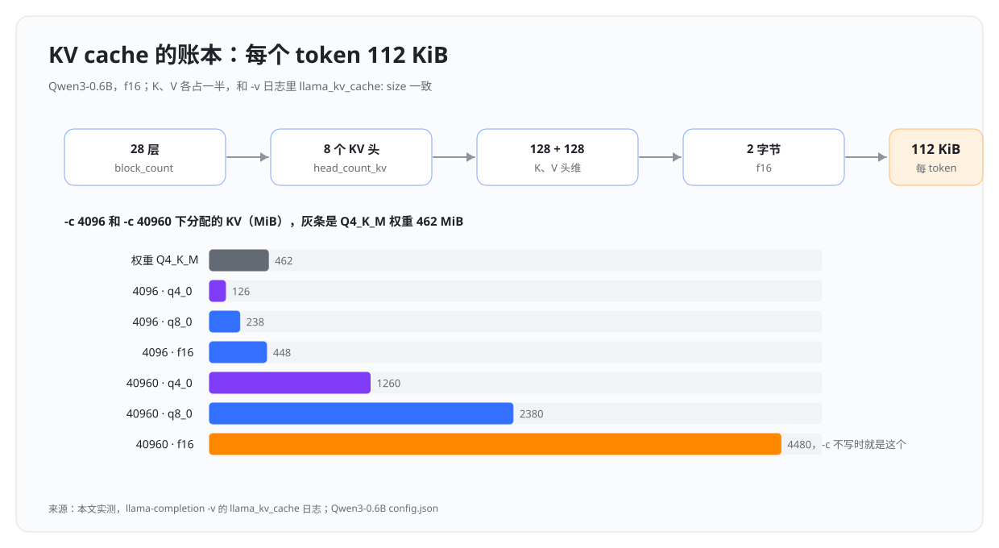

llama.cpp 给每一层分配两个张量：K 是 n_embd_k_gqa × kv_size × n_stream，V 同理，n_embd_k_gqa 等于 KV 头数乘 K 的头维[[2]](https://github.com/ggml-org/llama.cpp/blob/0ec4027/src/llama-kv-cache.cpp)[[15]](https://github.com/ggml-org/llama.cpp/blob/0ec4027/src/llama-hparams.cpp)。Qwen3-0.6B 是 28 层、8 个 KV 头、头维 128[[1]](https://huggingface.co/Qwen/Qwen3-0.6B/blob/main/config.json)，每个位置每层 K、V 各 1024 个元素，f16 下一个 token 占 28 × 2048 × 2 = 114688 字节，正好 112 KiB。

我用 -v 启动 llama-completion，读 llama_kv_cache: size 那一行：-c 4096 时 448 MiB，-c 40960 时 4480 MiB，K、V 各一半，和公式完全一致。q8_0 每 32 个元素占 34 字节，q4_0 占 18 字节，所以 4096 个位置分别是 238 和 126 MiB。compute buffer 从 312.77 MiB 只涨到 346.77 MiB，几乎不随上下文变。

## 1.3 用 kv_ledger.py 算

kv_ledger.py 把这些规则写成了几十行 Python：直接读 GGUF 的 block_count、head_count_kv、key_length 等字段，或者用内置预设。预设的数取自各家公开的 config.json[[16]](https://huggingface.co/unsloth/Llama-3.1-8B-Instruct/blob/main/config.json)[[17]](https://huggingface.co/unsloth/gemma-3-27b-it/blob/main/config.json)[[18]](https://huggingface.co/openai/gpt-oss-20b/blob/main/config.json)[[19]](https://huggingface.co/deepseek-ai/DeepSeek-V3/blob/main/config.json)，test_kv.py 拿上面 6 个实测值做回归。

```bash
python3 kv_ledger.py --list
# 预设            层 KV头 head 训练长度 KiB/token 满长 f16 MiB
# qwen3-0.6b      28    8  128    40960     112.0        4480
# llama3.1-8b     32    8  128   131072     128.0       16384
# gemma3-27b      62   16  128   131072     496.0       10864
# gpt-oss-20b     24    8   64   131072      48.0        3090
# deepseek-v3     61    1  576   163840      68.6       10980
python3 kv_ledger.py --gguf q-Q4_K_M.gguf -c 4096 40960 -t f16 q8_0 q8_0/q4_0
```

最后一列的差别很大。Llama 3.1 8B 拉满 128K 要 16 GiB，比 8B 的 Q4 权重大三倍。Gemma 3 27B 的每 token 开销最大，满长却只要 10.6 GiB，因为六分之五的层是滑动窗口。DeepSeek-V3 是 671B 的模型，每 token 的 KV 比 0.6B 的 Qwen3 还小。后面第 6、7 章会解释这两种结构。

> 🔑 **本章要点**：KV cache 的大小只取决于层数、KV 头数、头维、上下文长度和元素类型，启动前就能算出来。Qwen3-0.6B 每 token 112 KiB，日志和公式一字节不差；kv_ledger.py 可以直接读 GGUF 算。

# 第 2 章 · n_ctx 的缺省值和取整

## 2.1 -c 不写就是训练长度

common.h 里 n_ctx 的缺省值是 0，帮助文本写的是 0 = loaded from model，加载时用 GGUF 里的 context_length 顶上[[3]](https://github.com/ggml-org/llama.cpp/blob/0ec4027/common/arg.cpp)。Qwen3-0.6B 的 config.json 写 max_position_embeddings 40960，模型卡上写的上下文长度是 32768[[1]](https://huggingface.co/Qwen/Qwen3-0.6B/blob/main/config.json)[[20]](https://arxiv.org/abs/2505.09388)，转换脚本取前者，所以不写 -c 就分配 40960 个位置，4480 MiB。

缺省打开的 --fit 会在启动前估一遍内存：没有 GPU 时拿主机内存比，预计用量超过可用内存减 1 GiB 余量，就把上下文往小缩，最低缩到 4096。缩小只对用户没写 -c 的情况生效。显式写 -c 0 会把最小上下文设成 UINT32_MAX，意思是我就要训练长度，fit 不再缩[[3]](https://github.com/ggml-org/llama.cpp/blob/0ec4027/common/arg.cpp)[[4]](https://github.com/ggml-org/llama.cpp/blob/0ec4027/src/llama-context.cpp)。

这在小内存机器上很要命。我这台机器内存够，fit 不缩，-c 不写时照样分配了 4480 MiB 的 KV；换成 Llama 3.1 8B，不写 -c 按训练长度要 16 GiB 的 KV，在 16 GiB 的机器上全靠 fit 往下缩，再写个 -c 0 就连这层保护也没了。我的习惯是永远显式写 -c，按实际最长的提示词加输出长度留一点余量。

## 2.2 取整到 256

n_ctx 会向上取整到 256 的倍数。2025 年 10 月的一个 PR 先把 KV 大小的填充整个去掉了[[21]](https://github.com/ggml-org/llama.cpp/pull/16812)，几天后又加回来，理由是 256 对齐的 cache 在若干后端上性能更好[[22]](https://github.com/ggml-org/llama.cpp/pull/17046)。现在的代码是 GGML_PAD(n_ctx, 256)，-c 1000 实际分配 1024 个位置，test_kv.py 里有这个用例。

另一个 256 出现在每次计算时。get_n_kv 返回本批要参与注意力的位置数：已用到的最大位置向上取整到 256，再和 cache 大小取小[[2]](https://github.com/ggml-org/llama.cpp/blob/0ec4027/src/llama-kv-cache.cpp)。注释说这样做是为了让计算图在相邻批次之间保持不变，可以复用；内存一次按 n_ctx 分满，注意力的计算量却只随实际用量增长。

## 2.3 内存是预先占满的

KV 张量在创建 context 时一次分配好，不会随对话增长。CPU 上分配的是匿名内存，页面第一次写入时才真正占物理内存，所以刚启动时 RSS 不一定反映 KV 大小；GPU 上则是实打实一次占满显存。估容量时按分配大小算，不要看启动瞬间的 RSS。

> 🔑 **本章要点**：n_ctx 缺省是 GGUF 里的训练长度，显式写 -c 0 还会关掉 --fit 的自动缩小。分配大小向上取整到 256，计算时参与注意力的位置数也按 256 取整，内存一次分配满，计算量随实际用量增长。

# 第 3 章 · 上下文越深越慢

## 3.1 怎么测深度

llama-bench 的 -d 参数先往 KV 里预填充指定数量的 token，再测 pp 和 tg，测的是在这个深度上继续推理的速度[[5]](https://github.com/ggml-org/llama.cpp/pull/13096)。后来的 PR 把预填充后的 context 状态缓存下来，同一深度的多项测试只填一次[[23]](https://github.com/ggml-org/llama.cpp/pull/16944)。我测了单线程、深度 0、2048、8192，每项 3 轮，pp512 加 tg32。

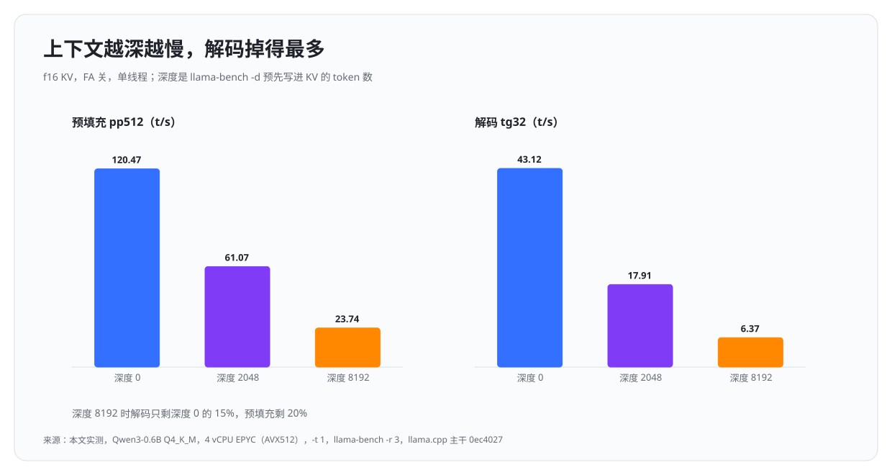

## 3.2 解码掉得比预填充快

f16 KV、FA 关时，解码从深度 0 的 43.12 t/s 降到 2048 的 17.91，再降到 8192 的 6.37；预填充从 120.47 降到 61.07 和 23.74。8192 时解码只剩深度 0 的 15%，预填充剩 20%。

按 [LCPP-02｜上手｜推理账本：带宽、算力和启动前算出速度上限](./02-ledger.md) 的带宽模型估一下：深度 0 时每个 token 读一遍约 0.46 GiB 的权重；深度 8192 时还要读 8192 × 112 KiB = 0.88 GiB 的 KV，总读量是原来的 2.9 倍，纯带宽估算应该剩 35% 左右。实测只剩 15%，说明单线程下注意力的计算本身也成了瓶颈：每个位置的点积、softmax 和加权求和都要算。

## 3.3 对服务意味着什么

长对话、RAG、代码补全这类场景，用户感受到的速度主要由深度决定。一个号称 50 t/s 的部署，到第 8000 个 token 时可能只有个位数。我报速度一律写明深度，评估部署时按真实请求的上下文分布挑三个深度测，比如中位数、p90 和上限。

深度对预填充的影响也不能忽略。一个 8000 token 的 RAG 请求，前面的块越填越慢，后半段的 512 个 token 每个要和前面七八千个位置做注意力，首 token 延迟比按深度 0 速度估的长得多。llama-bench 的 -d 加 -p 能直接测出这条曲线。

> 🔑 **本章要点**：深度越大，解码和预填充都越慢。单线程 f16 KV 在深度 8192 时解码只剩深度 0 的 15%，比纯带宽估算还低一半。报速度要写深度，评估部署要按真实上下文分布测。

# 第 4 章 · Flash Attention

## 4.1 它省的是什么

标准注意力先算出完整的 QK 分数矩阵，做 softmax，再乘 V，中间矩阵的大小是查询数乘上下文长度。FlashAttention 把 Q、K、V 切块放进片上存储，用 online softmax 边算边修正归一化系数，中间矩阵不写回显存[[6]](https://arxiv.org/abs/2205.14135)[[24]](https://arxiv.org/abs/1805.02867)。FlashAttention-2 改了循环顺序和并行划分，GPU 利用率更高[[25]](https://arxiv.org/abs/2307.08691)。在这之前，Rabe 和 Staats 已经证明注意力可以只用常数额外内存逐块算完[[7]](https://arxiv.org/abs/2112.05682)。

## 4.2 llama.cpp 怎么决定开不开

ggml 在 2024 年加入 ggml_flash_attn_ext 算子[[26]](https://github.com/ggml-org/llama.cpp/pull/5021)，-fa 现在接受 on、off、auto，缺省 auto[[27]](https://github.com/ggml-org/llama.cpp/pull/15746)。auto 的判定在创建 context 时：先建一张探测图，检查每层 FA 算子被分到的设备和该层 KV 所在设备是否一致，不一致就打印 Flash Attention not supported 并关掉，一致就打开[[4]](https://github.com/ggml-org/llama.cpp/blob/0ec4027/src/llama-context.cpp)。CPU 后端支持这个算子，所以本机 auto 的结果总是开。

开不开 FA 还决定 V 的存放方式。不开 FA 时 V 转置存储，方便 KQ 乘 V 那一步按行读；开 FA 时 V 和 K 一样按位置存。图里也是两条路：开 FA 走一个 flash_attn_ext 节点，不开时拆成矩阵乘、soft_max 和第二次矩阵乘[[28]](https://github.com/ggml-org/llama.cpp/blob/0ec4027/src/llama-graph.cpp)。量化的 V 只能走 FA，后面第 5 章会讲。

## 4.3 CPU 上的实测

同样是 f16 KV，单线程，FA 开对比关。深度 0 时预填充 136.65 对 120.47，解码 53.63 对 43.12，开着快。深度 2048 时预填充 59.41 对 61.07 打平，解码 9.99 对 17.91。深度 8192 时预填充 15.92 对 23.74，解码 2.35 对 6.37。

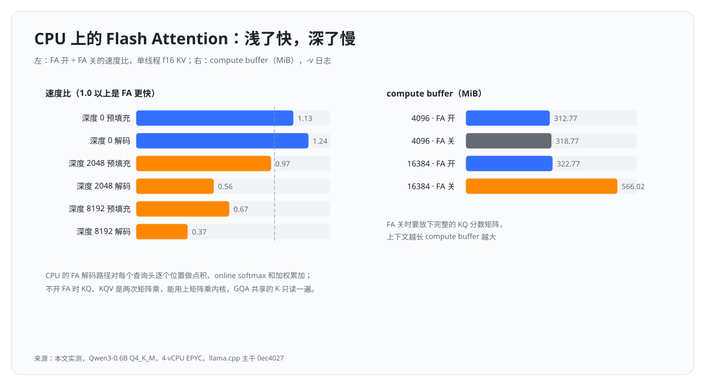

compute buffer 也跟着 FA 走。-c 4096 时开关 FA 只差 6 MiB；-c 16384 时 FA 关要 566 MiB，开着是 323 MiB，因为不开 FA 就得放下完整的 KQ 分数矩阵。[LCPP-02｜上手｜推理账本：带宽、算力和启动前算出速度上限](./02-ledger.md) 里 4 线程的测量也是同样的形状：浅上下文 FA 占优，深上下文 FA 拖后腿。这和 GPU 上的经验相反，GPU 后端有专门的分块内核，本机没有 GPU，没法验证那一侧。

## 4.4 为什么深了反而慢

ggml-cpu 的 FA 实现有三条路径[[7]](https://arxiv.org/abs/2112.05682)。解码时查询只有一行、K 和 V 都是 f16、上下文不少于 512 时，走按 KV 切块的路径，每个线程分一段位置，最后合并；单线程时只有一段。查询不少于一个分块、KV 是 f16 时走分块路径。其余情况走最朴素的一条：对每个查询头，逐个位置算一次点积、更新一次 online softmax、做一次向量加权累加。

切块路径里每个线程内部用的也是这个逐位置循环。Qwen3-0.6B 的 16 个查询头共享 8 个 KV 头，每个 KV 头被读两遍，每个位置还要算一次 expf。不开 FA 时，KQ 和 KQV 是两次普通矩阵乘，能用上 [LCPP-06｜内部｜后端与编译：CPU 变体、BLAS、repack 和 GPU 架构](./06-backends-build.md) 讲的矩阵乘内核，GQA 共享的 K 只读一遍。上下文浅时 FA 省掉的中间张量占优，深了以后逐位置循环的开销占优。

**📎 展开阅读：**这段逐位置循环的源码注释直接引了 Rabe 和 Staats 的论文。它的好处是不需要任何临时矩阵，量化 K、V 也能逐行反量化接进来，代价是没有把多个查询头或多个位置合起来算。CPU 上长上下文、f16 KV 的部署，我会用 llama-bench -fa 0,1 -d 在目标深度上对照一次再定。

> 🔑 **本章要点**：-fa 缺省 auto，CPU 上总是打开。单线程实测浅上下文 FA 快两成，深度 8192 时解码只有关掉时的 37%，原因是 CPU 的 FA 路径按位置逐个做标量 online softmax。长上下文的 CPU 部署要在目标深度上对照 -fa 0 和 1。

# 第 5 章 · KV 量化和 Hadamard 旋转

## 5.1 -ctk 和 -ctv

K 和 V 的元素类型分别由 -ctk、-ctv 指定，缺省 f16，可选 f32、bf16、q8_0、q4_0、q4_1、iq4_nl、q5_0、q5_1[[3]](https://github.com/ggml-org/llama.cpp/blob/0ec4027/common/arg.cpp)。量化 K 最早在 2023 年底加入[[29]](https://github.com/ggml-org/llama.cpp/pull/4312)，量化 V 后来才跟上，而且有个硬条件：V 量化以后只能走 Flash Attention。创建 context 时如果 V 是量化类型、-fa 是 auto，就打印 enabling flash_attn since it is required for quantized V cache 并强制打开；-fa off 则直接报错退出[[4]](https://github.com/ggml-org/llama.cpp/blob/0ec4027/src/llama-context.cpp)。

另一个容易漏的检查是块大小。q8_0 和 q4_0 每 32 个元素一块，头维必须是块大小的整数倍，否则创建 context 失败。Qwen3 的头维 128，没有问题；头维 64 的 gpt-oss 也能整除。省下的内存在第 1 章算过：4096 个位置，f16 是 448 MiB，q8_0 是 238 MiB，q4_0 是 126 MiB。

## 5.2 误差怎么量

我沿用 [LCPP-03｜上手｜测量方法：llama-bench、PPL、KLD 和噪声](./03-bench-ppl.md) 的 KLD 测法：权重固定用 bf16，先存一份 f16 KV 的 logits 当基准，再只换 KV 类型，和基准比每个位置的分布差。这样量出来的只是 KV 量化本身的损失，不混进权重量化的误差。wiki.test 前 20 块，每块 512 个 token。

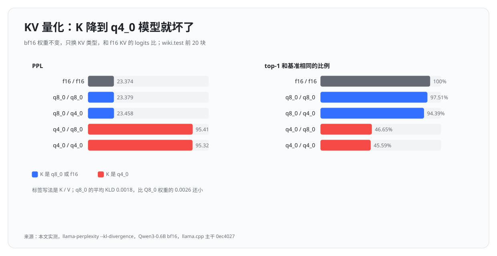

| K / V | PPL | 平均 KLD | 99% KLD | top-1 相同 |
|-|-|-|-|-|
| f16 / f16（基准） | 23.374 | 0 | 0 | 100% |
| q8_0 / q8_0 | 23.379 | 0.0018 | 0.015 | 97.5% |
| q8_0 / q4_0 | 23.458 | 0.0104 | 0.086 | 94.4% |
| q4_0 / q8_0 | 95.41 | 1.668 | 8.58 | 46.6% |
| q4_0 / q4_0 | 95.32 | 1.654 | 7.89 | 45.6% |

q8_0 的平均 KLD 0.0018，比 [LCPP-07｜内部｜量化：块结构、配方、imatrix 和用 KLD 选类型](./07-quantization.md) 里 Q8_0 权重的 0.0026 还小，PPL 只差 0.005，可以放心开。K 留 q8_0、V 降到 q4_0，KLD 涨到 0.010，PPL 多 0.08，介于 Q8_0 和 Q6_K 权重之间，后者是 0.020。反过来 K 降到 q4_0，不管 V 用什么，PPL 都从 23 涨到 95，top-1 只有一半对得上，模型基本坏了。

## 5.3 为什么 K 比 V 敏感

KIVI 观察到 K 在少数通道上有很大的离群值，同一通道跨 token 的分布稳定，V 没有这种结构，所以它把 K 按通道量化、V 按 token 量化[[8]](https://arxiv.org/abs/2402.02750)。KVQuant 在此基础上发现 RoPE 会把离群通道搅散，建议在施加 RoPE 之前按通道量化 K[[9]](https://arxiv.org/abs/2401.18079)。llama.cpp 的 q4_0 是沿头维每 32 个元素一块，正是按 token 量化，同一块里只要有一个离群通道，其余 31 个元素的精度都被拖下来。

V 的误差影响也小一些：V 是被 softmax 权重加权平均的，单个位置的误差会被摊薄；K 的误差直接进了点积，再经过 softmax 的指数放大，排序一变，注意力就看错了位置。

## 5.4 Hadamard 旋转

2026 年的 PR 给量化的 K、V 加了一步旋转：写入 cache 前把 K、V 乘一个 Hadamard 矩阵，Q 也乘同一个矩阵，点积不变；注意力输出再乘一次转回来[[10]](https://github.com/ggml-org/llama.cpp/pull/21038)[[28]](https://github.com/ggml-org/llama.cpp/blob/0ec4027/src/llama-graph.cpp)。Hadamard 矩阵是正交的，乘上以后离群值被均摊到所有通道，块内最大值变小，量化步长跟着变小。这和 QuaRot 对权重和激活做的事情是一个思路[[11]](https://arxiv.org/abs/2404.00456)。

规则写在 llama-kv-cache.cpp 里：只有 K 或 V 是量化类型时才转，K 的头维要能被 64 整除，旋转维度从 64 起翻倍到不超过头维，V 固定 64 维[[2]](https://github.com/ggml-org/llama.cpp/blob/0ec4027/src/llama-kv-cache.cpp)。Qwen3 的日志里是 n_rot_k 128、n_rot_v 64。乘法后来换成了快速 Walsh-Hadamard 变换，计算量从头维的平方降到头维乘对数[[30]](https://github.com/ggml-org/llama.cpp/pull/22631)。设环境变量 LLAMA_ATTN_ROT_DISABLE 可以关掉。

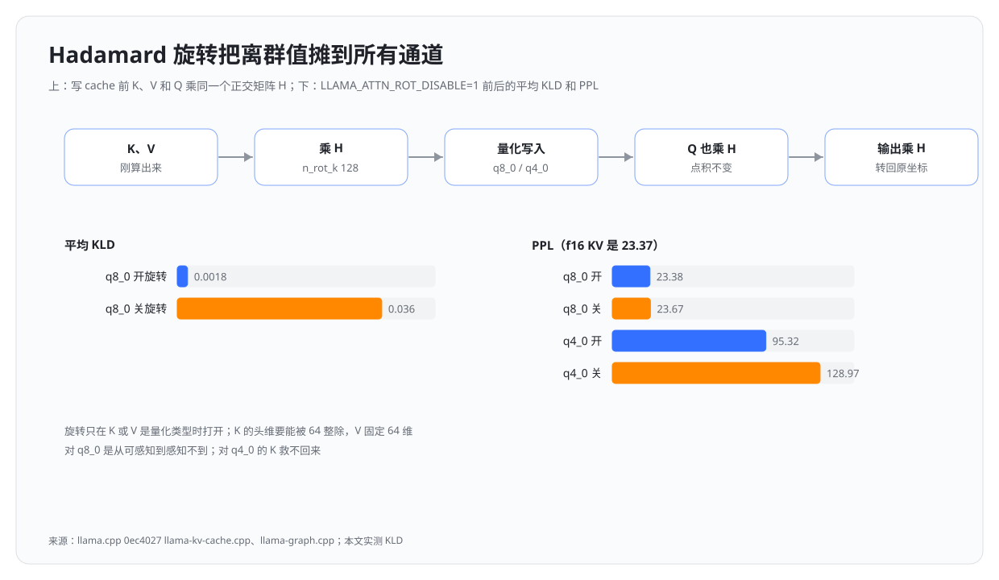

我用这个环境变量做了对照。q8_0 关掉旋转，平均 KLD 从 0.0018 涨到 0.036，二十倍，99% KLD 从 0.015 涨到 0.40，PPL 多了 0.3；q4_0 关掉旋转，PPL 从 95 涨到 129。旋转对 q8_0 是从可感知到感知不到的差别，对 q4_0 的 K 救不回来。

## 5.5 CPU 上的代价

量化 KV 在 CPU 上不是免费的。单线程、FA 开，深度 2048 时 q8_0 的预填充是 14.47 t/s，f16 是 59.41；深度 8192 时 3.88 对 15.92，只剩四分之一。解码差得不多：深度 2048 时 8.8 对 9.99，8192 时 2.33 对 2.35。q4_0 更慢，深度 2048 的预填充只有 9.45。

原因接着第 4 章：CPU 的分块路径和切块路径都要求 K、V 是 f16，量化 KV 只能走逐位置的那条路，每个位置还要先反量化。我的结论是 CPU 上 KV 量化只在内存不够时用，用就用 q8_0，或者 K q8_0、V q4_0；内存够就留 f16。GPU 上的权衡不一样，放在 LCPP-11。

> 🔑 **本章要点**：q8_0 KV 的误差比 Q8_0 权重还小，可以放心开；K 降到 q4_0 模型就坏了，要省就只降 V。Hadamard 旋转缺省打开，让 q8_0 的 KLD 小了二十倍。CPU 上量化 KV 只能走逐位置的 FA 路径，深上下文预填充只剩 f16 的四分之一。

# 第 6 章 · MQA、GQA 和 MLA

## 6.1 少存几个 KV 头

原始的多头注意力每个查询头配一组自己的 K、V[[14]](https://arxiv.org/abs/1706.03762)。MQA 让所有查询头共享一组 K、V，KV cache 直接除以头数，解码时要读的数据也同比变少，代价是质量有损失[[31]](https://arxiv.org/abs/1911.02150)。GQA 取中间：查询头分组，每组共享一组 K、V，还给出了从 MHA 检查点只用少量预训练把它改成 GQA 的办法[[32]](https://arxiv.org/abs/2305.13245)。

现在的开源模型基本都是 GQA。Qwen3-0.6B 16 个查询头、8 个 KV 头，省一半；Llama 3.1 8B 32 个查询头、8 个 KV 头，省四分之三。在 llama.cpp 里 GQA 不需要特殊处理，n_embd_k_gqa 就是 KV 头数乘头维，算 KV 大小时代入 KV 头数即可，第 1 章的公式已经包含这一点。

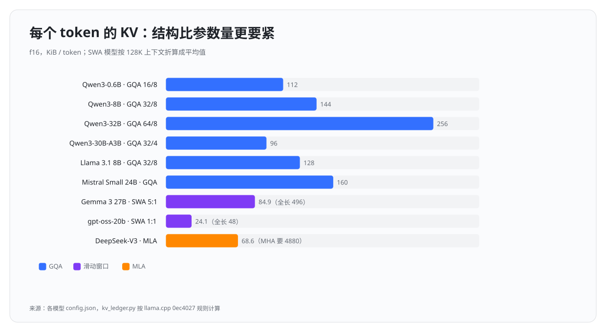

## 6.2 MLA 只存一份潜向量

DeepSeek-V2 提出的 MLA 换了个思路：不存每个头的 K、V，只存一个低秩的潜向量，用的时候再通过投影矩阵还原；RoPE 那一部分单独留一小段不压缩[[12]](https://arxiv.org/abs/2405.04434)。DeepSeek-V3 的 config 里 kv_lora_rank 是 512，qk_rope_head_dim 是 64[[19]](https://huggingface.co/deepseek-ai/DeepSeek-V3/blob/main/config.json)，所以每层每个 token 只存 576 个数。

llama.cpp 的转换脚本把 MLA 写成了一个只有 1 个 KV 头的 MQA：key_length 是 512 加 64 等于 576，value_length 是 512[[33]](https://github.com/ggml-org/llama.cpp/blob/0ec4027/conversion/deepseek.py)。分配 KV 时，is_mla 的模型不建 V 张量，V 直接从 K 的前 512 维取[[2]](https://github.com/ggml-org/llama.cpp/blob/0ec4027/src/llama-kv-cache.cpp)[[15]](https://github.com/ggml-org/llama.cpp/blob/0ec4027/src/llama-hparams.cpp)，kv_ledger.py 里 V 那一栏是 0。61 层乘 576 乘 2 字节，每 token 68.6 KiB。

如果按 MHA 存，128 个头，每个头 K 是 192 维、V 是 128 维，每 token 要 61 × 128 × 320 × 2 字节，约 4880 KiB，是 MLA 的 71 倍。DeepSeek-V3 跑满 163840 个位置，f16 KV 是 10980 MiB，比 Llama 3.1 8B 拉满 128K 的 16 GiB 还少。

## 6.3 MLA 的类型约束

MLA 的 V 是 K 的一个视图，K、V 必须同一类型，创建 context 时 is_mla 的模型 -ctk 和 -ctv 不一致会直接报 model does not support different K and V cache types[[4]](https://github.com/ggml-org/llama.cpp/blob/0ec4027/src/llama-context.cpp)。DeepSeek V4 用的是另一套注意力结构，2026 年的 PR 给它加了同样的检查，并在 V 量化时自动打开 FA[[34]](https://github.com/ggml-org/llama.cpp/pull/25871)。所以第 5 章那个 K q8_0、V q4_0 的组合，在 DeepSeek 系模型上用不了。

> 🔑 **本章要点**：GQA 按 KV 头数省 KV，公式里代入 KV 头数即可。MLA 只存 576 维的潜向量，DeepSeek-V3 每 token 68.6 KiB，是按 MHA 存的七十分之一；llama.cpp 把它当成单头 MQA 处理，不建 V 张量，K、V 必须同一类型。

# 第 7 章 · 滑动窗口注意力

## 7.1 只看最近的 W 个位置

滑动窗口注意力让每个 token 只看前面固定 W 个位置。Longformer 把它和少量全局注意力组合起来处理长文档[[35]](https://arxiv.org/abs/2004.05150)，Mistral 7B 每层都用 4096 的窗口，靠层数堆叠扩大感受野[[36]](https://arxiv.org/abs/2310.06825)。窗口层的 KV 只需要留最近 W 个位置，长度再长也不涨。

现在的模型多是窗口层和全局层交替。Gemma 3 每 6 层里 5 层是 1024 的窗口，1 层看全文[[13]](https://arxiv.org/abs/2503.19786)[[17]](https://huggingface.co/unsloth/gemma-3-27b-it/blob/main/config.json)；gpt-oss 窗口只有 128，一层窗口一层全局交替[[18]](https://huggingface.co/openai/gpt-oss-20b/blob/main/config.json)。llama.cpp 用 set_swa_pattern 按这个周期标出哪些层是窗口层[[15]](https://github.com/ggml-org/llama.cpp/blob/0ec4027/src/llama-hparams.cpp)，2025 年加入的 SWA 支持把这两类层分成两套 cache[[37]](https://github.com/ggml-org/llama.cpp/pull/13194)。

## 7.2 两套 cache 各多大

全局层的 cache 照常按 n_ctx 分配。窗口层的大小是 W 乘序列数加 n_ubatch，再向上取整到 256，不超过 n_ctx[[38]](https://github.com/ggml-org/llama.cpp/blob/0ec4027/src/llama-kv-cache-iswa.cpp)。多出来的 n_ubatch 是给一个批次的新 token 留的位置，一批 token 写进去以前，窗口外的旧位置还不能扔[[39]](https://github.com/ggml-org/llama.cpp/pull/13833)。

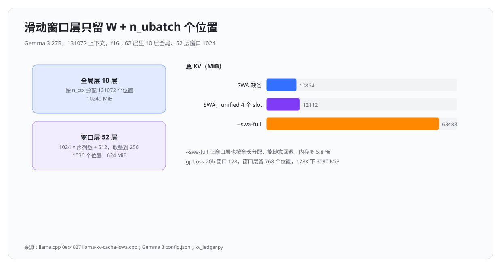

Gemma 3 27B 在 131072 上下文下：62 层里 10 层是全局层，每层每 token 8 KiB，占 10240 MiB；52 层是窗口层，每层只留 1024 + 512 = 1536 个位置，合计 624 MiB。总共 10864 MiB。要是窗口层也按全长存，就是 62 层全长，63488 MiB，差 5.8 倍。gpt-oss-20b 窗口 128，窗口层只留 768 个位置，128K 上下文的 KV 只有 3090 MiB。

## 7.3 --swa-full 和检查点

窗口层只留最近的位置，代价是没法回退：旧位置已经被覆盖，想从中间某个位置重新生成，窗口层的 K、V 找不回来。server 复用前缀缓存、投机解码回滚草稿都依赖回退。--swa-full 让窗口层也按全长分配，回退随便做，内存回到全长的量[[3]](https://github.com/ggml-org/llama.cpp/blob/0ec4027/common/arg.cpp)。

不想付这份内存，server 提供了检查点：处理提示词时隔一段把窗口层的状态存一份，回退时从最近的检查点恢复再补算[[40]](https://github.com/ggml-org/llama.cpp/pull/15293)。-ctxcp 控制每个 slot 最多存几份，缺省 32，-cms 控制检查点之间至少隔多少 token，缺省 8192[[41]](https://github.com/ggml-org/llama.cpp/blob/0ec4027/tools/server/README.md)。多轮对话里只改了最后一句，有检查点就不用从头重算。

> 🔑 **本章要点**：窗口层的 cache 是 W 乘序列数加 n_ubatch，取整到 256，和上下文长度无关。Gemma 3 27B 在 128K 下 10.6 GiB，加 --swa-full 是 62 GiB。窗口层没法回退，server 靠检查点补救，回退频繁又内存宽裕时才开 --swa-full。

# 第 8 章 · 多个序列共用一份 cache

## 8.1 -np 和 unified

一个 context 可以同时跑多个序列，-np 指定序列数，server 里就是 slot 数。KV 有两种分法。非 unified 时每个序列一条独立的流，n_ctx 平分，每份向上取整到 256，除不尽时打印 rounding down 把 n_ctx 往下调[[4]](https://github.com/ggml-org/llama.cpp/blob/0ec4027/src/llama-context.cpp)。unified 时所有序列共用一个池子，每个 cell 记着它属于哪些序列，单个序列最长能用到整个 n_ctx[[2]](https://github.com/ggml-org/llama.cpp/blob/0ec4027/src/llama-kv-cache.cpp)。

unified 这个词在代码里改过几次名，2025 年的重构把 KV cache 从 context 里拆成独立的 memory 模块[[42]](https://github.com/ggml-org/llama.cpp/pull/12181)，后来去掉了类名里的 unified 前缀，现在是否共用由一个参数决定[[43]](https://github.com/ggml-org/llama.cpp/pull/15467)。server 的 -np 缺省是 auto，等价于 4 个 slot 加 unified[[41]](https://github.com/ggml-org/llama.cpp/blob/0ec4027/tools/server/README.md)。

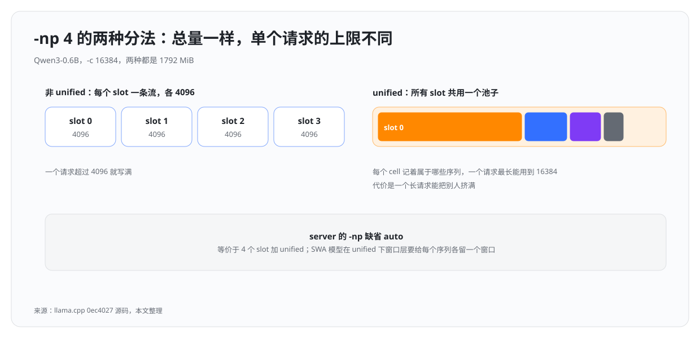

## 8.2 内存一样，能装的不一样

两种分法的总内存相同：Qwen3-0.6B 在 -c 16384、-np 4 下都是 1792 MiB。差别在单个请求的上限。非 unified 时每个 slot 固定 4096，一个长请求超过 4096 就写满了；unified 时只要池子里总量没满，一个请求可以用到 16384，代价是一个长请求能把别人挤满。--kv-unified-per-slot N 在没写 -c 时把池子设成 np 乘 N，算是两者之间的折中。

SWA 模型要多算一笔。unified 时窗口层要给每个序列各留一个窗口，Gemma 3 27B 开 4 个 slot，窗口层从 1536 个位置涨到 4 × 1024 + 512 = 4608 个，128K 下总量从 10864 MiB 涨到 12112 MiB。kv_ledger.py 的 --np 和 --kvu 能算这个。

## 8.3 碎片和分页

vLLM 的 PagedAttention 把 KV 切成固定大小的页，用页表映射，消除了预留和碎片造成的浪费[[44]](https://arxiv.org/abs/2309.06180)。llama.cpp 没有页表，按 cell 管理：每个 cell 记一个位置和一组序列号，新 token 找空 cell 放。早年序列结束后 cell 会零散空出来，server 在 2024 年缺省打开了碎片整理[[45]](https://github.com/ggml-org/llama.cpp/pull/10233)；现在 -dt 已经标为弃用，参数写了也只打印一条提示。

## 8.4 显存之外的缓存

server 还能把闲置 slot 的 KV 存到主机内存里，下次同样前缀的请求直接拷回来，-cram 是上限，缺省 8192 MiB[[46]](https://github.com/ggml-org/llama.cpp/pull/16391)。--cache-reuse N 允许在前缀不完全一致时，把长度不少于 N 的相同片段通过 K shift 挪到新位置复用，缺省 0 即关闭，后来也能按请求设置[[47]](https://github.com/ggml-org/llama.cpp/pull/17858)。这些是 server 的话题，细节放在 LCPP-14。

> 🔑 **本章要点**：-np 下 KV 总量不变，unified 让单个请求能用到整个池子，非 unified 每个 slot 固定一份。server 缺省 4 个 slot 加 unified。SWA 模型在 unified 下要给每个序列留一个窗口，要按 np 重新算。

# 第 9 章 · 上下文写满以后

## 9.1 缺省是停下

KV 一次按 n_ctx 分满，写满以后只有两条路：停止生成，或者腾出位置。llama-completion 的 --context-shift 缺省关闭，写满时打印 context full and context shift is disabled => stopping 并退出生成循环[[48]](https://github.com/ggml-org/llama.cpp/blob/0ec4027/tools/completion/completion.cpp)[[3]](https://github.com/ggml-org/llama.cpp/blob/0ec4027/common/arg.cpp)。我用 -c 256 -n 600 --temp 0 跑了一次，提示词 4 个 token，生成到第 251 个 token 停下，速度 67.46 t/s。

server 也一样缺省不 shift。生成过程中写满，slot 标记 truncated 并按长度上限停止；提示词本身就超过 slot 容量时直接返回 exceeds the available context size 的错误[[49]](https://github.com/ggml-org/llama.cpp/blob/0ec4027/tools/server/server-context.cpp)。客户端看到 truncated 为真，就该知道回答是被截断的，而模型没有说完。

## 9.2 context shift 丢掉哪一段

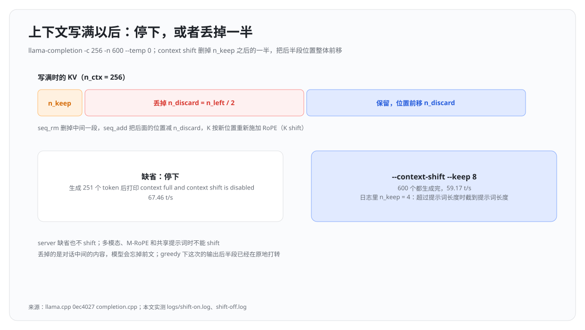

打开 shift 以后，写满时先留下开头 n_keep 个 token，把剩下的位置数记作 n_left，丢掉其中前一半：seq_rm 删掉 n_keep 到 n_keep + n_discard 这一段，seq_add 把后面所有位置减去 n_discard[[48]](https://github.com/ggml-org/llama.cpp/blob/0ec4027/tools/completion/completion.cpp)。位置变了，K 里已经施加过的 RoPE 也要改，llama.cpp 在下一次计算前对整个 cache 做一次 K shift，按位移量重新旋转。量化的 K 要先反量化成 f32，撤掉 Hadamard 旋转，施加 RoPE，再转回去写回[[2]](https://github.com/ggml-org/llama.cpp/blob/0ec4027/src/llama-kv-cache.cpp)。

server 的规则多几条：n_keep 为 -1 时保留整个提示词，有 BOS 时再加 1，最多到 n_ctx 减 4；每次丢多少可以由请求里的 n_discard 指定，不填就是一半[[49]](https://github.com/ggml-org/llama.cpp/blob/0ec4027/tools/server/server-context.cpp)[[50]](https://github.com/ggml-org/llama.cpp/pull/6300)。多模态模型、用 M-RoPE 的模型和共享提示词的 slot 都不能 shift：M-RoPE 的位置是多维的，存在 cell 里，没法简单整体平移[[51]](https://github.com/ggml-org/llama.cpp/pull/16825)。

## 9.3 实测和它的代价

同一条命令加上 --context-shift --keep 8，600 个 token 全部生成完，速度 59.17 t/s，慢了 12%，多出来的是每次 shift 后的 K 重排。日志里 n_keep 是 4：completion 发现 --keep 超过提示词长度时把它截到提示词长度，所以真正留下的只有那 4 个 token。

按源码算一下这次 shift 了几回：触发条件是 n_past 加 1 达到 n_ctx，这时 n_past 是 255，n_left 是 255 减 4 等于 251，丢掉 125 个。第一次写满正好在生成第 251 个 token 时，和缺省停下的位置一样；之后每生成 125 个 token 再写满一次，600 个 token 一共 shift 了 3 次。每次 shift 要把 cache 里剩下的 K 全部重新旋转一遍，上下文越大，单次 shift 越贵，-c 32768 时一次就要重排一万多个位置的 K。

代价在内容上。被丢掉的是对话中间那一半，模型从此看不到它们，输出不会报错，只会悄悄忘掉前文。这次 greedy 解码的 0.6B 模型在 150 个 token 左右就开始原地打转，shift 之后继续打转，它不会让输出变好。聊天应用里我会在应用层截断历史或做摘要，让每次请求都放得下；shift 只留给不在乎前文的流式续写。

**📎 展开阅读：**StreamingLLM 发现，窗口滑走开头几个 token 以后困惑度会突然崩掉，因为模型把大量注意力分数放在最开头的几个位置上，作者叫它注意力汇点；保留开头 4 个 token 再加最近的窗口，就能稳定地一直生成下去[[52]](https://arxiv.org/abs/2309.17453)。n_keep 做的是同一件事，所以 shift 时 n_keep 至少要保住 BOS 和系统提示词。

> 🔑 **本章要点**：写满时缺省停下，server 返回 truncated。打开 --context-shift 后丢掉 n_keep 之后的一半，K 按新位置重新旋转，本机慢了 12%。多模态、M-RoPE 和共享提示词不能 shift。shift 会悄悄丢掉中间的对话，聊天场景应该在应用层截断。

# 第 10 章 · RoPE 和超出训练长度

## 10.1 训练长度是一条硬线

RoPE 把位置编码成 Q、K 各维度上的旋转角，点积只和两个位置的差有关[[53]](https://arxiv.org/abs/2104.09864)。模型只在训练长度以内见过这些角度组合，超出以后低频维度转到了没见过的角度，注意力分布很快失控。llama.cpp 在 n_ctx_seq 大于 n_ctx_train 时打印 possible training context overflow 警告，照常分配[[4]](https://github.com/ggml-org/llama.cpp/blob/0ec4027/src/llama-context.cpp)；server 更保守，slot 的上下文直接截到训练长度[[49]](https://github.com/ggml-org/llama.cpp/blob/0ec4027/tools/server/server-context.cpp)。

第 2 章说过，Qwen3-0.6B 的 GGUF 里 context_length 是 40960，模型卡写的原生长度是 32768，40960 是给 32768 的输出加 8192 的提示词留的空间[[54]](https://huggingface.co/Qwen/Qwen3-8B)。真要用到 32768 以上，就得改位置编码。

## 10.2 线性插值和 YaRN

位置插值把所有位置按比例压缩回训练范围：想把 4K 扩到 32K，每个位置除以 8，代价是相邻位置的角度差也缩小了 8 倍，需要少量微调才能恢复[[55]](https://arxiv.org/abs/2306.15595)。YaRN 按频率分段处理，高频维度不插值，低频维度插值，中间平滑过渡，再给注意力加一个温度修正，微调量更少，不微调也能外推一部分[[56]](https://arxiv.org/abs/2309.00071)。

llama.cpp 在 2023 年加入 YaRN[[57]](https://github.com/ggml-org/llama.cpp/pull/2268)。参数有四个：--rope-scaling 选 none、linear、yarn，--rope-scale N 把频率缩放设成 1/N，--yarn-orig-ctx 给原始训练长度，yarn 的几个细调参数缺省从模型里读。completion 的 README 举的例子是从 4K 微调到 32K 的模型配 --rope-scale 8[[58]](https://github.com/ggml-org/llama.cpp/blob/0ec4027/tools/completion/README.md)。Qwen3 模型卡给的写法是 --rope-scaling yarn --rope-scale 4 --yarn-orig-ctx 32768，可到 131072[[54]](https://huggingface.co/Qwen/Qwen3-8B)。

YaRN 的分段由两个阈值决定：波长对应的旋转圈数多于 beta_fast 的维度当高频处理，不插值，少于 beta_slow 的当低频处理，完全插值，llama.cpp 的缺省值是 32 和 1，和论文给 Llama 的取值一致[[56]](https://arxiv.org/abs/2309.00071)[[15]](https://github.com/ggml-org/llama.cpp/blob/0ec4027/src/llama-hparams.cpp)。选了 yarn 而没写 --yarn-ext-factor 时，外推混合系数自动取 1。

注意力温度按 0.1 × ln(s) + 1 算，s 是缩放因子，因子 4 时约 1.139，因子 32 时约 1.347[[4]](https://github.com/ggml-org/llama.cpp/blob/0ec4027/src/llama-context.cpp)。这些都能用 --yarn-beta-fast、--yarn-beta-slow、--yarn-attn-factor 覆盖，我没有找到需要改它们的模型，照模型卡写就够了。

有些模型把缩放直接写进了 config，转换时进 GGUF，不用加任何参数：Llama 3.1 用 llama3 类型的 rope_scaling，factor 8，原始长度 8192[[16]](https://huggingface.co/unsloth/Llama-3.1-8B-Instruct/blob/main/config.json)；gpt-oss 是 yarn，factor 32[[18]](https://huggingface.co/openai/gpt-oss-20b/blob/main/config.json)。命令行加的 YaRN 生效时，llama.cpp 会把 n_ctx_train 改成原始长度除以频率缩放，Qwen3 加上面那组参数后是 131072，server 的截断也跟着放宽[[4]](https://github.com/ggml-org/llama.cpp/blob/0ec4027/src/llama-context.cpp)。

## 10.3 静态缩放的短文本代价

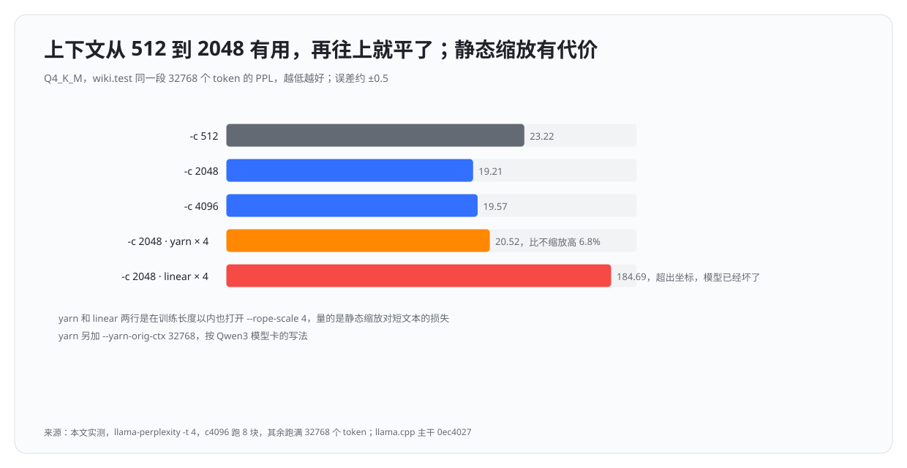

我在 wiki.test 同一段 32768 个 token 上量 PPL：-c 512 是 23.22，2048 是 19.21，4096 是 19.57。从 512 到 2048 看得到的前文变多，PPL 降了 17%；2048 到 4096 落在误差范围以内，这类百科文本 2K 以外的前文帮不上忙。

再在 -c 2048 下打开缩放，文本长度根本没超过训练长度：YaRN 因子 4 是 20.52，比不缩放高 6.8%；线性因子 4 是 184.69，模型基本坏了。Qwen3 模型卡说静态 YaRN 可能影响短文本表现，建议只在需要长上下文时才加[[54]](https://huggingface.co/Qwen/Qwen3-8B)，实测正是这样。没有为线性插值微调过的模型，不能直接拿 linear 用。

## 10.4 Self-Extend 和有效长度

Self-Extend 不改模型，把远处的位置按组合并，组内共用一个位置，近处保留精确位置[[59]](https://arxiv.org/abs/2401.01325)。llama.cpp 在 2024 年加了 -gan 和 -gaw 两个参数[[60]](https://github.com/ggml-org/llama.cpp/pull/4815)，同年又从 server 里删掉[[61]](https://github.com/ggml-org/llama.cpp/pull/9860)，现在只剩 llama-completion 和 passkey 示例能用，开了以后 context shift 不再生效。

能放进上下文，不代表模型用得上。Lost in the Middle 发现，相关信息放在长上下文中间时，模型的准确率明显低于放在开头或结尾[[62]](https://arxiv.org/abs/2307.03172)。RULER 用多类合成任务测下来，多数宣称支持 32K 以上的模型，有效长度远小于宣称值[[63]](https://arxiv.org/abs/2404.06654)。我的做法是先用 RULER 这类任务在目标长度上测一次，再决定要不要开 YaRN。

> 🔑 **本章要点**：超出训练长度要改位置编码。YaRN 按频率分段插值，Qwen3 用 --rope-scaling yarn --rope-scale 4 --yarn-orig-ctx 32768 到 128K，但在 2K 上下文时 PPL 也高了 6.8%，只在需要时开；线性缩放没微调过就不能用。能放进去不等于用得上，要在目标长度上测。

# 第 11 章 · 怎么选与上线清单

## 11.1 按场景选

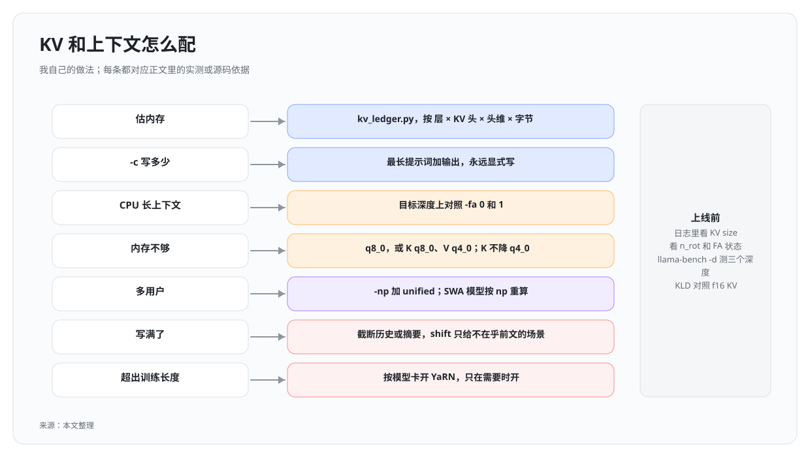

| 场景 | 怎么配 | 依据 |
|-|-|-|
| 估内存 | kv_ledger.py，或 层数 × KV 头数 × 头维和 × 字节 | 第 1 章：日志和公式一字节不差 |
| -c 写多少 | 最长提示词加输出长度，显式写 | 第 2 章：不写就是训练长度，0.6B 要 4.4 GiB |
| CPU 长上下文 | 在目标深度上对照 -fa 0 和 1 | 第 4 章：深度 8192 时 FA 解码只有关掉时的 37% |
| 内存不够 | q8_0，或 K q8_0、V q4_0 | 第 5 章：K q4_0 时 PPL 从 23 到 95 |
| 多用户 | -np 加 unified，SWA 模型按 np 重算 | 第 8 章 |
| 写满了 | 应用层截断或摘要 | 第 9 章：shift 丢掉中间对话 |
| 超出训练长度 | 按模型卡开 YaRN，只在需要时开 | 第 10 章：2K 时 PPL 高 6.8% |

GPU 上的选择会变：FA 在 GPU 上有专门的分块内核，KV 量化的速度代价也不一样，这些放在 LCPP-11 用源码和公开数据讨论。

## 11.2 上线清单

> 📌 **上线前核对清单**：每换一个模型或改一次 -c，我按这个顺序过一遍。
> - 用 -v 启动，llama_kv_cache: size 那一行和 kv_ledger.py 算的一致
> - -c 是显式写的，没有写 -c 0；日志里没有 possible training context overflow
> - KV 量化时看到 n_rot_k、n_rot_v 和 enabling flash_attn，没有设 LLAMA_ATTN_ROT_DISABLE
> - K 没有降到 q4_0，用 llama-perplexity 的 KLD 和 f16 KV 对照过
> - llama-bench -d 在中位数、p90 和上限三个深度测过，-fa 0 和 1 各测一次
> - SWA 模型确认过 --swa-full 和检查点的取舍，unified 时按 np 重算过窗口层
> - context shift 的开关和 n_keep 是有意设的，客户端会处理 truncated
> - 开 YaRN 前在目标长度上测过有效长度，短文本的 PPL 也测过

## 11.3 下一步

KV 装下以后，输出的每个 token 怎么从 logits 里挑出来，由采样器、语法约束和聊天模板决定，放在 LCPP-09。KV 放到 GPU 上和 MoE 专家放置在 LCPP-11，server 的 slot、prompt cache 和 --cache-reuse 在 LCPP-14。测速和 KLD 的方法回到 [LCPP-03｜上手｜测量方法：llama-bench、PPL、KLD 和噪声](./03-bench-ppl.md)。

# 参考文献

按正文首次引用顺序编号，资料截至 2026 年 10 月初。

[1] Qwen. Qwen3-0.6B config.json：28 层，8 个 KV 头，head_dim 128，max_position_embeddings 40960。 [Qwen3-0.6B config.json](https://huggingface.co/Qwen/Qwen3-0.6B/blob/main/config.json)

[2] llama.cpp 0ec4027. src/llama-kv-cache.cpp：K、V 张量分配、Hadamard 旋转、get_n_kv 和 K shift。 [llama-kv-cache.cpp](https://github.com/ggml-org/llama.cpp/blob/0ec4027/src/llama-kv-cache.cpp)

[3] llama.cpp 0ec4027. common/arg.cpp：-c、-ctk、-ctv、-fa、--swa-full、--context-shift、--keep 等参数和缺省值。 [common/arg.cpp](https://github.com/ggml-org/llama.cpp/blob/0ec4027/common/arg.cpp)

[4] llama.cpp 0ec4027. src/llama-context.cpp：n_ctx 取整到 256、n_ctx_seq、FA 自动判定和 KV 类型校验。 [llama-context.cpp](https://github.com/ggml-org/llama.cpp/blob/0ec4027/src/llama-context.cpp)

[5] thevishalagarwal. llama-bench: add -d depth arg. llama.cpp PR #13096, 2025. [PR #13096](https://github.com/ggml-org/llama.cpp/pull/13096)

[6] Dao T, et al. FlashAttention: Fast and Memory-Efficient Exact Attention with IO-Awareness. NeurIPS 2022. [arXiv:2205.14135](https://arxiv.org/abs/2205.14135)

[7] Rabe M N, Staats C. Self-attention Does Not Need O(n^2) Memory. 2021. [arXiv:2112.05682](https://arxiv.org/abs/2112.05682)

[8] Liu Z, et al. KIVI: A Tuning-Free Asymmetric 2bit Quantization for KV Cache. ICML 2024. [arXiv:2402.02750](https://arxiv.org/abs/2402.02750)

[9] Hooper C, et al. KVQuant: Towards 10 Million Context Length LLM Inference with KV Cache Quantization. NeurIPS 2024. [arXiv:2401.18079](https://arxiv.org/abs/2401.18079)

[10] ggerganov. llama : rotate activations for better quantization. llama.cpp PR #21038, 2026. [PR #21038](https://github.com/ggml-org/llama.cpp/pull/21038)

[11] Ashkboos S, et al. QuaRot: Outlier-Free 4-Bit Inference in Rotated LLMs. NeurIPS 2024. [arXiv:2404.00456](https://arxiv.org/abs/2404.00456)

[12] DeepSeek-AI. DeepSeek-V2: A Strong, Economical, and Efficient Mixture-of-Experts Language Model. 2024. [arXiv:2405.04434](https://arxiv.org/abs/2405.04434)

[13] Gemma Team. Gemma 3 Technical Report. 2025. [arXiv:2503.19786](https://arxiv.org/abs/2503.19786)

[14] Vaswani A, et al. Attention Is All You Need. NeurIPS 2017. [arXiv:1706.03762](https://arxiv.org/abs/1706.03762)

[15] llama.cpp 0ec4027. src/llama-hparams.cpp：n_embd_k_gqa、set_swa_pattern、is_mla。 [llama-hparams.cpp](https://github.com/ggml-org/llama.cpp/blob/0ec4027/src/llama-hparams.cpp)

[16] unsloth. Llama-3.1-8B-Instruct config.json（Meta 原版镜像）：rope_scaling llama3，factor 8。 [Llama-3.1-8B config.json](https://huggingface.co/unsloth/Llama-3.1-8B-Instruct/blob/main/config.json)

[17] unsloth. gemma-3-27b-it config.json（Google 原版镜像）：sliding_window 1024，sliding_window_pattern 6。 [gemma-3-27b config.json](https://huggingface.co/unsloth/gemma-3-27b-it/blob/main/config.json)

[18] OpenAI. gpt-oss-20b config.json：sliding_window 128，层间交替，yarn factor 32。 [gpt-oss-20b config.json](https://huggingface.co/openai/gpt-oss-20b/blob/main/config.json)

[19] DeepSeek. DeepSeek-V3 config.json：kv_lora_rank 512，qk_rope_head_dim 64。 [DeepSeek-V3 config.json](https://huggingface.co/deepseek-ai/DeepSeek-V3/blob/main/config.json)

[20] Qwen Team. Qwen3 Technical Report. 2025. [arXiv:2505.09388](https://arxiv.org/abs/2505.09388)

[21] ggerganov. memory : remove KV cache size padding. llama.cpp PR #16812, 2025. [PR #16812](https://github.com/ggml-org/llama.cpp/pull/16812)

[22] ggerganov. kv-cache : pad the cache size to 256 for performance. llama.cpp PR #17046, 2025. [PR #17046](https://github.com/ggml-org/llama.cpp/pull/17046)

[23] ggerganov. bench : cache the llama_context state at computed depth. llama.cpp PR #16944, 2025. [PR #16944](https://github.com/ggml-org/llama.cpp/pull/16944)

[24] Milakov M, Gimelshein N. Online normalizer calculation for softmax. 2018. [arXiv:1805.02867](https://arxiv.org/abs/1805.02867)

[25] Dao T. FlashAttention-2: Faster Attention with Better Parallelism and Work Partitioning. 2023. [arXiv:2307.08691](https://arxiv.org/abs/2307.08691)

[26] ggerganov. ggml : add Flash Attention. llama.cpp PR #5021, 2024. [PR #5021](https://github.com/ggml-org/llama.cpp/pull/5021)

[27] JohannesGaessler. llama: -fa 1/0/-1 aliases for -fa on/off/auto. llama.cpp PR #15746, 2025. [PR #15746](https://github.com/ggml-org/llama.cpp/pull/15746)

[28] llama.cpp 0ec4027. src/llama-graph.cpp：build_attn 里 Q、K、V 的 Hadamard 乘法和 FA 分支。 [llama-graph.cpp](https://github.com/ggml-org/llama.cpp/blob/0ec4027/src/llama-graph.cpp)

[29] ggerganov. llama : support quantum K cache. llama.cpp PR #4312, 2023. [PR #4312](https://github.com/ggml-org/llama.cpp/pull/4312)

[30] AlrIsmail. ggml : implement fast walsh-hadamard transform for kv rotation. llama.cpp PR #22631, 2026. [PR #22631](https://github.com/ggml-org/llama.cpp/pull/22631)

[31] Shazeer N. Fast Transformer Decoding: One Write-Head is All You Need. 2019. [arXiv:1911.02150](https://arxiv.org/abs/1911.02150)

[32] Ainslie J, et al. GQA: Training Generalized Multi-Query Transformer Models from Multi-Head Checkpoints. EMNLP 2023. [arXiv:2305.13245](https://arxiv.org/abs/2305.13245)

[33] llama.cpp 0ec4027. conversion/deepseek.py：MLA 写成 key_length = kv_lora_rank + qk_rope_head_dim、value_length = kv_lora_rank 的单头 MQA。 [conversion/deepseek.py](https://github.com/ggml-org/llama.cpp/blob/0ec4027/conversion/deepseek.py)

[34] fairydreaming. llama : enforce the same K and V cache types for DeepSeek V4; enable FA if V cache is quantized. llama.cpp PR #25871, 2026. [PR #25871](https://github.com/ggml-org/llama.cpp/pull/25871)

[35] Beltagy I, et al. Longformer: The Long-Document Transformer. 2020. [arXiv:2004.05150](https://arxiv.org/abs/2004.05150)

[36] Jiang A Q, et al. Mistral 7B. 2023. [arXiv:2310.06825](https://arxiv.org/abs/2310.06825)

[37] ggerganov. kv-cache : add SWA support. llama.cpp PR #13194, 2025. [PR #13194](https://github.com/ggml-org/llama.cpp/pull/13194)

[38] llama.cpp 0ec4027. src/llama-kv-cache-iswa.cpp：SWA 层和全局层两套 cache 的大小。 [llama-kv-cache-iswa.cpp](https://github.com/ggml-org/llama.cpp/blob/0ec4027/src/llama-kv-cache-iswa.cpp)

[39] ggerganov. llama : use n_swa + n_ubatch cells for SWA cache. llama.cpp PR #13833, 2025. [PR #13833](https://github.com/ggml-org/llama.cpp/pull/13833)

[40] ggerganov. server : add SWA checkpoints. llama.cpp PR #15293, 2025. [PR #15293](https://github.com/ggml-org/llama.cpp/pull/15293)

[41] llama.cpp 0ec4027. tools/server/README.md：-kvu、--cache-ram、--ctx-checkpoints、--cache-reuse 的说明。 [server/README.md](https://github.com/ggml-org/llama.cpp/blob/0ec4027/tools/server/README.md)

[42] ggerganov. llama : refactor llama_context, llama_kv_cache, llm_build_context (v2). llama.cpp PR #12181, 2025. [PR #12181](https://github.com/ggml-org/llama.cpp/pull/12181)

[43] ggerganov. kv-cache : drop the "unified" prefix. llama.cpp PR #15467, 2025. [PR #15467](https://github.com/ggml-org/llama.cpp/pull/15467)

[44] Kwon W, et al. Efficient Memory Management for Large Language Model Serving with PagedAttention. SOSP 2023. [arXiv:2309.06180](https://arxiv.org/abs/2309.06180)

[45] ggerganov. server : enable KV cache defrag by default. llama.cpp PR #10233, 2024. [PR #10233](https://github.com/ggml-org/llama.cpp/pull/10233)

[46] ggerganov. server : host-memory prompt caching. llama.cpp PR #16391, 2025. [PR #16391](https://github.com/ggml-org/llama.cpp/pull/16391)

[47] ggerganov. server : make n_cache_reuse configurable per request. llama.cpp PR #17858, 2025. [PR #17858](https://github.com/ggml-org/llama.cpp/pull/17858)

[48] llama.cpp 0ec4027. tools/completion/completion.cpp：上下文写满后的 context shift。 [completion.cpp](https://github.com/ggml-org/llama.cpp/blob/0ec4027/tools/completion/completion.cpp)

[49] llama.cpp 0ec4027. tools/server/server-context.cpp：slot 的 context shift、n_discard 和多模态时禁用 shift。 [server-context.cpp](https://github.com/ggml-org/llama.cpp/blob/0ec4027/tools/server/server-context.cpp)

[50] kaetemi. server : add n_discard parameter. llama.cpp PR #6300, 2024. [PR #6300](https://github.com/ggml-org/llama.cpp/pull/6300)

[51] ngxson. llama: store mrope data in KV cell. llama.cpp PR #16825, 2025. [PR #16825](https://github.com/ggml-org/llama.cpp/pull/16825)

[52] Xiao G, et al. Efficient Streaming Language Models with Attention Sinks. ICLR 2024. [arXiv:2309.17453](https://arxiv.org/abs/2309.17453)

[53] Su J, et al. RoFormer: Enhanced Transformer with Rotary Position Embedding. 2021. [arXiv:2104.09864](https://arxiv.org/abs/2104.09864)

[54] Qwen. Qwen3-8B 模型卡：原生 32768，YaRN factor 4 可到 131072，静态 YaRN 可能影响短文本，llama.cpp 用法。 [Qwen3-8B 模型卡](https://huggingface.co/Qwen/Qwen3-8B)

[55] Chen S, et al. Extending Context Window of Large Language Models via Positional Interpolation. 2023. [arXiv:2306.15595](https://arxiv.org/abs/2306.15595)

[56] Peng B, et al. YaRN: Efficient Context Window Extension of Large Language Models. ICLR 2024. [arXiv:2309.00071](https://arxiv.org/abs/2309.00071)

[57] cebtenzzre. llama: implement YaRN RoPE scaling. llama.cpp PR #2268, 2023. [PR #2268](https://github.com/ggml-org/llama.cpp/pull/2268)

[58] llama.cpp 0ec4027. tools/completion/README.md：RoPE 缩放和 YaRN 参数。 [completion/README.md](https://github.com/ggml-org/llama.cpp/blob/0ec4027/tools/completion/README.md)

[59] Jin H, et al. LLM Maybe LongLM: Self-Extend LLM Context Window Without Tuning. ICML 2024. [arXiv:2401.01325](https://arxiv.org/abs/2401.01325)

[60] ggerganov. main : add Self-Extend support. llama.cpp PR #4815, 2024. [PR #4815](https://github.com/ggml-org/llama.cpp/pull/4815)

[61] ggerganov. server : remove self-extend features. llama.cpp PR #9860, 2024. [PR #9860](https://github.com/ggml-org/llama.cpp/pull/9860)

[62] Liu N F, et al. Lost in the Middle: How Language Models Use Long Contexts. TACL 2024. [arXiv:2307.03172](https://arxiv.org/abs/2307.03172)

[63] Hsieh C, et al. RULER: What's the Real Context Size of Your Long-Context Language Models? COLM 2024. [arXiv:2404.06654](https://arxiv.org/abs/2404.06654)

---

上一章：[LCPP-07｜内部｜量化：块结构、配方、imatrix 和用 KLD 选类型](./07-quantization.md) · [目录](./README.md) · 下一章：[LCPP-09｜内部｜采样、语法与聊天模板：截断链、温度、惩罚、GBNF 和模板](./09-sampling-grammar.md)
