# LCPP-09｜内部｜采样、语法与聊天模板：截断链、温度、惩罚、GBNF 和模板

> 🎯 **这篇文档解决什么问题**：前向算完以后，模型交出来的是 151936 个 logits，真正写进输出的只有一个 token。中间这一步由采样链决定：先截掉多少候选，温度放在哪，重复了怎么罚，要不要用语法把输出锁成 JSON，提示词又被聊天模板拼成了什么样子。这篇把这几件事逐个量出来：缺省链每一步留下几个候选、花多少微秒，GGUF 里的采样参数什么时候生效，三种惩罚各压住多少重复，GBNF 两种用法差多少，后端采样省下什么，以及 enable_thinking 为什么在 llama-completion 里不起作用。主线一句话：缺省采样链里真正起作用的只有四步，不写参数时用的是 GGUF 里带的值。
>
> 使用方式：只想知道参数怎么配，看导读和第 11 章；输出发散或者太死板，看第 2、3、4 章；输出打转，看第 5 章；要稳定的 JSON，看第 7、8 章；采样耗时显眼，看第 2、9 章；思考开关和工具调用，看第 10 章。文中版本和数字核对于 2026 年 10 月 31 日。
>
> **代码**：[zero-to-llama/09-sampling-grammar](../09-sampling-grammar)。samp_bench.c 直接调 libllama，在最后一个位置的 logits 上测 14 种采样器配置的耗时和候选数，也能带 GBNF 生成；samp_sim.py 按源码规则用 numpy 重算截断结果；render_tmpl.py 用 jinja2 渲染 GGUF 里的聊天模板；collect_rep.py 统计重复；exp09.sh 跑六组实验；test_samp.py 是 11 个不需要模型的回归用例。基线是主干 0ec4027，模型是 Qwen3-0.6B，机器是 4 核 EPYC 云主机无 GPU。

# 导读 · 先给结论

- **缺省链真正起作用的只有四步。**top_k 40、top_p 0.95、min_p 0.05、temp 0.8，penalties、dry、typical、xtc、top-nσ 在缺省参数下都是空操作。The capital of France is 的分布上，候选从 151936 降到 40、27、5[[1]](https://github.com/ggml-org/llama.cpp/blob/0ec4027/common/common.h)[[2]](https://github.com/ggml-org/llama.cpp/blob/0ec4027/common/sampling.cpp)。
- **top_k 是缺省链便宜的原因。**整条链 87 微秒，去掉 top_k 变成 9006 微秒，因为 top_p 要对 15 万个 token 排序；单独的 typical 要 10557 微秒[[3]](https://github.com/ggml-org/llama.cpp/blob/0ec4027/src/llama-sampler.cpp)。
- **温度放在截断后面，结果数和温度无关。**挪到前面以后，T 2.0 时 top_p 单独会留下 69341 个候选，占词表的 46%；min_p 只留 81 个，top-nσ 在任何温度下都是 6 个[[4]](https://arxiv.org/abs/2407.01082)[[5]](https://arxiv.org/abs/2411.07641)。
- **不写参数就用 GGUF 里的。**Qwen3-0.6B 的 GGUF 带 top_k 20、temp 0.6，用户写的参数优先；--temp 0 时链尾自动换成 greedy[[6]](https://github.com/ggml-org/llama.cpp/pull/17120)[[7]](https://huggingface.co/Qwen/Qwen3-0.6B)。
- **三种惩罚都能压住 greedy 的打转。**不惩罚时重复 4-gram 占 78.6%，repeat 1.1、presence 1.5、DRY 0.8 分别压到 5.1%、12.7%、6.1%[[8]](https://arxiv.org/abs/1909.05858)[[9]](https://github.com/oobabooga/textgen/pull/5677)。
- **JSON 语法缺省先采样后检查。**5 个种子的拒绝率 4.8% 到 10.5%，每 token 平均约 1.9 毫秒；先套语法每步扫全词表，约 19.6 毫秒[[10]](https://github.com/ggml-org/llama.cpp/pull/1773)[[11]](https://github.com/ggml-org/llama.cpp/blob/0ec4027/src/llama-grammar.cpp)。
- **--reasoning off 在 llama-completion 里不生效。**completion 缺省不走 jinja 模板，组装模板输入时也不传 enable_thinking，加不加都是 15 个 token[[12]](https://github.com/ggml-org/llama.cpp/blob/0ec4027/tools/completion/completion.cpp)[[13]](https://github.com/ggml-org/llama.cpp/blob/0ec4027/common/arg.cpp)。

**📎 与系列其他文档的分工**：本篇只讲 logits 之后的事。解码的带宽模型见 [LCPP-02｜上手｜推理账本：带宽、算力和启动前算出速度上限](./02-ledger.md)；微秒级计时和 KLD 的测法见 [LCPP-03｜上手｜测量方法：llama-bench、PPL、KLD 和噪声](./03-bench-ppl.md)；chat_template 和 general.sampling.\* 在 GGUF 里的位置见 [LCPP-04｜内部｜GGUF：文件结构、元数据、加载方式和分卷](./04-gguf.md)；计算图和调度见 [LCPP-05｜内部｜ggml 与计算图：建图、内存规划、调度和复用](./05-ggml-graph.md)；后端怎么选见 [LCPP-06｜内部｜后端与编译：CPU 变体、BLAS、repack 和 GPU 架构](./06-backends-build.md)；量化类型见 [LCPP-07｜内部｜量化：块结构、配方、imatrix 和用 KLD 选类型](./07-quantization.md)；KV 和上下文见 [LCPP-08｜内部｜KV cache 与长上下文：账本、深度、量化、SWA 和上下文写满](./08-kv-context.md)。线程数和 CPU 调优放在 LCPP-10，投机解码的草稿采样放在 LCPP-13，server 的请求参数和工具调用接口放在 LCPP-14。

# 第 1 章 · 从 logits 到 token：采样链

## 1.1 采样器是一条链

我先看 llama.cpp 怎么组织采样器，后面每一步的候选数和耗时都是在这个结构上量的。2024 年的采样重构把每种采样方法都做成了 llama_sampler 对象，统一接口是 apply：输入一个候选数组，每项是 token id、logit 和概率，采样器可以改 logit、删候选、排序，最后一个采样器负责挑出一个 token[[14]](https://github.com/ggml-org/llama.cpp/pull/9294)[[3]](https://github.com/ggml-org/llama.cpp/blob/0ec4027/src/llama-sampler.cpp)。llama_sampler_chain 把多个采样器串起来，按顺序调用 apply。这样每个采样器只管一件事，组合由调用方决定。

common 这一层负责按参数建链。缺省顺序写在 common.h：penalties、dry、top_n_sigma、top_k、typical、top_p、min_p、xtc、temperature，链尾再接 dist 或 greedy[[1]](https://github.com/ggml-org/llama.cpp/blob/0ec4027/common/common.h)[[2]](https://github.com/ggml-org/llama.cpp/blob/0ec4027/common/sampling.cpp)。--samplers 可以用分号分隔的名字改顺序和取舍，--sampler-seq 用单字母缩写，比如 kpmt 表示 top_k、top_p、min_p、temp[[13]](https://github.com/ggml-org/llama.cpp/blob/0ec4027/common/arg.cpp)。

## 1.2 缺省参数下每一步留下多少

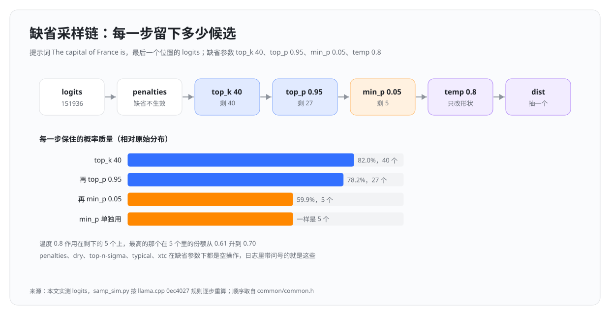

我用 samp_bench 把 The capital of France is 最后一个位置的 logits 存下来，再用 samp_sim.py 按源码规则逐步重算。原始分布的最高概率是 0.36，熵 3.62 nats，是一个比较平的分布。top_k 40 留下 40 个，它们占原始概率质量的 82.0%。接着 top_p 0.95 在这 40 个里重新归一化，累加到 95% 截断，剩 27 个。min_p 0.05 再把概率低于最高者 5% 的删掉，剩 5 个，占原始质量的 59.9%。

把 min_p 单独拿出来用，结果一样是这 5 个。在这个分布上，前面的 top_k 和 top_p 都没有起决定作用，真正划线的是 min_p。story 和 code 两个提示词上，整条链分别留下 3 个和 2 个，min_p 单独用也是这个数。

## 1.3 日志里的问号

用 -v 启动 llama-completion，日志里有一行 sampler chain，形如 logits、?penalties、?dry、?top-n-sigma、top-k、?typical、top-p、min-p、?xtc、temp-ext、dist。带问号的采样器参数取了空操作值，apply 时直接返回：repeat 1.0、dry 乘数 0、top-nσ 负数、typical 1.0、xtc 概率 0。加了 --ignore-eos 以后链头还会多出 logit-bias，它把 EOS 的 logit 设成负无穷。

所以排查采样问题时，我先看这一行和上面的 sampler params。哪些采样器真的在干活、链尾是 dist 还是 greedy，从这两行就能看出来，比读参数默认值靠谱。

> 🔑 **本章要点**：采样器是一条链，common 按 common.h 的顺序建链。缺省参数下只有 top_k、top_p、min_p 和 temp 在干活，fact 提示词上候选从 151936 降到 40、27、5，划线的主要是 min_p。日志里带问号的采样器是空操作。

# 第 2 章 · 截断采样器

## 2.1 四种截断规则

top_k 只留概率最高的 k 个，来自 Fan 等人的故事生成工作[[15]](https://arxiv.org/abs/1805.04833)。它的问题是 k 固定：分布尖的时候 40 个里大部分是噪声，分布平的时候 40 个又截掉了合理的候选。

top_p 也叫 nucleus 采样，按概率从高到低累加，到 p 为止[[16]](https://arxiv.org/abs/1904.09751)。Holtzman 等人指出纯采样会抽到长尾里的低质量 token，按累积概率截断能自适应分布形状。typical 采样换了一个角度，留下信息量接近分布熵的 token，累积到 p 为止[[17]](https://arxiv.org/abs/2202.00666)。

min_p 只看和最高概率的比值：概率低于 p 乘以最高概率的候选全部删掉[[4]](https://arxiv.org/abs/2407.01082)。它最早以 PR 的形式进入 llama.cpp，作者在 PR 里说它是 top_p 和 top_k 的替代[[18]](https://github.com/ggml-org/llama.cpp/pull/3841)，后来写成了论文。top-nσ 在 logit 空间里做同样的事，留下 logit 不低于最大值减 n 倍标准差的候选[[5]](https://arxiv.org/abs/2411.07641)[[19]](https://github.com/ggml-org/llama.cpp/pull/11223)。

## 2.2 每个采样器耗多少微秒

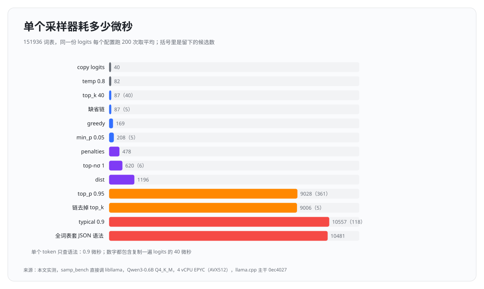

samp_bench 对同一份 logits 每个配置跑 200 次取平均，数字包含复制一遍 logits 的 40 微秒。top_k 40 只要 87 微秒，它用部分排序只找前 k 个。min_p 不排序，扫一遍算比值，208 微秒。top_p 和 typical 要排序和累加，分别是 9028 和 10557 微秒，差了两个数量级[[3]](https://github.com/ggml-org/llama.cpp/blob/0ec4027/src/llama-sampler.cpp)。

缺省链只要 87 微秒，因为 top_k 排在 top_p 前面，后面的采样器只处理 40 个候选。用 --top-k 0 关掉它，链的耗时变成 9006 微秒，和单独的 top_p 一样。Qwen3 模型卡建议 top_k 20，正好也保住了这个速度。dist 自己要 1196 微秒，因为它对全部候选做 softmax 和累加，链里排在 top_k 之后时只算 40 个。

**📎 展开阅读：**源码里 top_p 有一个优化：候选超过 1024 个时先部分排序前 256 个，累加够了就停，不够再扩大。所以 top_p 在尖的分布上会快一些，在平的分布上要排更多。拿 9 毫秒和 15 毫秒的前向比，关掉 top_k 以后采样能占到一步的一半以上。

## 2.3 分布形状决定留下多少

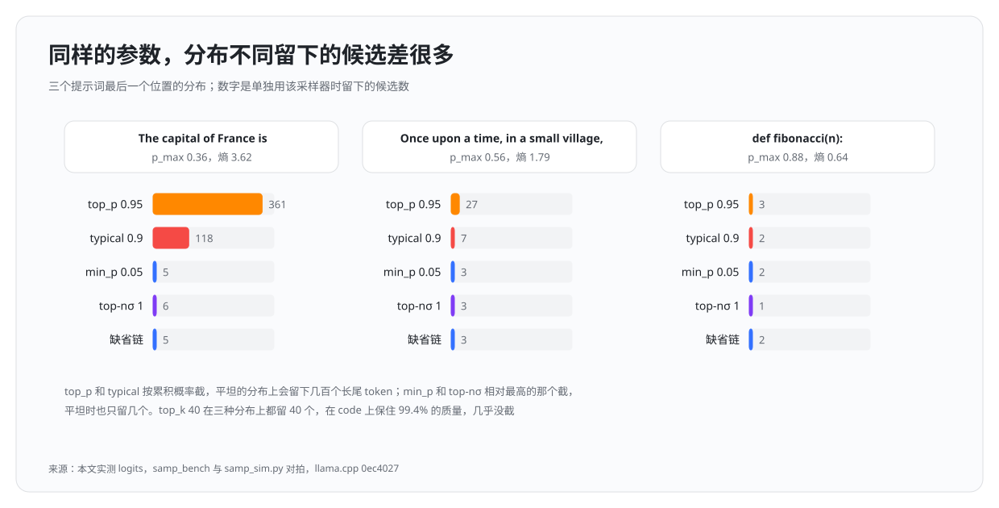

三个提示词的分布差别很大：fact 最高概率 0.36，story 0.56，code 0.88。top_p 0.95 单独用时，fact 留下 361 个，story 27 个，code 3 个；typical 0.9 在 fact 上留 118 个。min_p 0.05 分别是 5、3、2 个，top-nσ 是 6、3、1 个。

按累积概率截断的方法，在平的分布上会放进几百个长尾 token，每个概率都很低，合起来却有 5%，抽中一个的机会不小。相对最高者截断的方法，在平的分布上也只留几个。这也是 min_p 论文的主要论点：高温时它比 top_p 更能守住连贯性。

> 🔑 **本章要点**：top_k 便宜，top_p 和 typical 要排序，贵两个数量级；缺省链靠 top_k 把后面的计算量压到 40 个。按累积概率截断在平的分布上会放进几百个长尾 token，min_p 和 top-nσ 相对最高者截断，只留几个。

# 第 3 章 · 温度放在哪

## 3.1 温度做了什么

温度把每个 logit 除以 T 再做 softmax。T 小于 1 让分布变尖，大于 1 变平；T 为 0 时源码只保留最大的那个，相当于 greedy[[3]](https://github.com/ggml-org/llama.cpp/blob/0ec4027/src/llama-sampler.cpp)。CTRL 的论文里把温度和重复惩罚放在一起讨论，指出低温加惩罚能在接近 greedy 的同时避免重复[[8]](https://arxiv.org/abs/1909.05858)。

## 3.2 放在截断后面

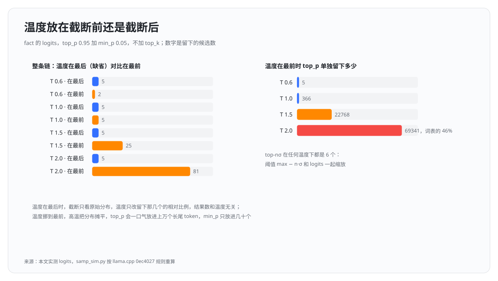

缺省链把温度放在所有截断之后。截断只看原始分布，留下几个就是几个，温度只改这几个之间的比例。我在 fact 的 logits 上用 top_p 0.95 加 min_p 0.05，T 从 0.6 到 2.0，温度在最后时都留下 5 个；T 0.8 让最高那个在 5 个里的份额从 0.61 升到 0.70。test_samp.py 在三个提示词上验证了这一点：T 取 0.3、0.8、1.5、3.0，候选数完全一样。

温度挪到最前，情况就变了。T 0.6 时分布变尖，min_p 只留 2 个；T 2.0 时分布摊平，同一条链留下 81 个。拆开看，T 2.0 时 top_p 单独会留下 69341 个候选，占词表的 46%，min_p 单独是 81 个。top-nσ 在任何温度下都是 6 个，因为阈值 max 减 n 倍 σ 和 logits 一起按 T 缩放，比较结果不变。

## 3.3 我怎么用

想让输出更发散，我升温，同时保持温度在最后，再配 min_p 控制下限。温度放在截断前面，只有和 min_p 搭配才有意义，min_p 论文主要比较的也是高温下的表现；配 top_p 会一口气放进几万个长尾 token。--samplers 改顺序时，我会顺手看一眼日志里的 sampler chain，确认 temp-ext 的位置。

温度为 0 和 greedy 也有一个细节。温度采样器在 T 小于等于 0 时只保留最大的那个候选，所以即使链尾还是 dist，结果也是确定的；common 把链尾换成 greedy，只是省掉了 dist 的那一次 softmax 和随机数。反过来，想要可复现的随机输出，不必把温度降到 0，固定 -s 种子、固定参数和线程数就够了，同一台机器上同一份 logits 抽到的 token 是一样的。

> 🔑 **本章要点**：缺省链里温度在最后，截断结果和温度无关，温度只改留下几个的比例。温度挪到前面，高温下 top_p 会放进几万个候选，min_p 只放几十个，top-nσ 不受温度影响。

# 第 4 章 · 缺省参数从哪来

## 4.1 三层优先级

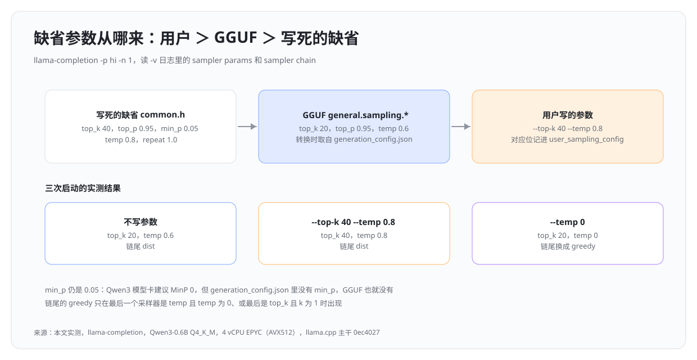

不写采样参数时用的值从哪来，我顺着源码找到了 GGUF。2025 年底的一个 PR 让 GGUF 可以带采样参数：转换脚本读 generation_config.json，写进 general.sampling.top_k、top_p、temp 等键[[6]](https://github.com/ggml-org/llama.cpp/pull/17120)[[20]](https://github.com/ggml-org/llama.cpp/blob/0ec4027/src/llama-arch.cpp)。加载时 common_init_sampler_from_model 读这些键，只覆盖用户没写过的参数；用户在命令行写了哪一项，对应位就记进 user_sampling_config，GGUF 不再覆盖[[21]](https://github.com/ggml-org/llama.cpp/blob/0ec4027/common/common.cpp)。所以优先级是用户、GGUF、common.h 里写死的缺省。

## 4.2 三次启动的实测

我用 llama-completion -p hi -n 1 -v 启动三次，读日志里的 sampler params。不写参数：top_k 20、top_p 0.95、min_p 0.05、temp 0.6，链尾 dist。top_k 20 和 temp 0.6 正是 Qwen3 模型卡给思考模式的建议值[[7]](https://huggingface.co/Qwen/Qwen3-0.6B)，来自 GGUF。写 --top-k 40 --temp 0.8：用的是用户的值。写 --temp 0：top_k 还是 GGUF 的 20，链尾换成了 greedy。

min_p 仍是 0.05。模型卡建议 MinP 0，但 generation_config.json 里只有 temperature、top_k、top_p，没有 min_p，GGUF 里也就没有，落回 common.h 的缺省。Qwen3 技术报告里评测用的采样参数也是在模型卡这一组上[[22]](https://arxiv.org/abs/2505.09388)。照模型卡完整复现，要自己加 --min-p 0。

## 4.3 什么时候链尾是 greedy

common 只在两种情况下把链尾换成 greedy：最后一个采样器是 temp 且温度为 0、动态温度范围为 0；或者最后一个是 top_k 且 k 为 1。另外要求 n_probs 为 0，要输出概率时仍走 dist[[2]](https://github.com/ggml-org/llama.cpp/blob/0ec4027/common/sampling.cpp)。改了 --samplers 顺序以后，温度为 0 不一定得到 greedy 链尾，这时 temp 本身只保留最大的那个，结果一样，但多算了前面的截断。

换 GGUF 以后采样行为变了，第一件事是看 sampler params。同一个模型，不同人转换的 GGUF 带不带 general.sampling.\* 不一样，不写参数时的行为也就不一样；要可复现，就把参数全部显式写在命令行上。

> 🔑 **本章要点**：采样参数的优先级是用户、GGUF、common.h。Qwen3 的 GGUF 带 top_k 20、temp 0.6，不写参数就用它们；min_p 不在 generation_config.json 里，仍是 0.05。--temp 0 时链尾自动换成 greedy。

# 第 5 章 · 重复惩罚

## 5.1 三种 penalties

penalties 采样器在最近 last_n 个 token（缺省 64）里数每个 token 出现了几次，然后改它的 logit。repeat 是 CTRL 提出的乘法惩罚：logit 为正就除以系数，为负就乘以系数，两边都是往下压[[8]](https://arxiv.org/abs/1909.05858)。frequency 按出现次数线性减，presence 只要出现过就减一个常数[[3]](https://github.com/ggml-org/llama.cpp/blob/0ec4027/src/llama-sampler.cpp)。三个系数的缺省值分别是 1.0、0、0，所以缺省链里 penalties 是空操作。

这三种惩罚都只看 token 出现过没有，不管上下文。常用词、标点、代码里的括号和缩进，出现得最多，被压得最狠。这是我不爱用大 repeat 的原因：写代码时它会让模型回避本该重复的变量名。

## 5.2 greedy 下的实测

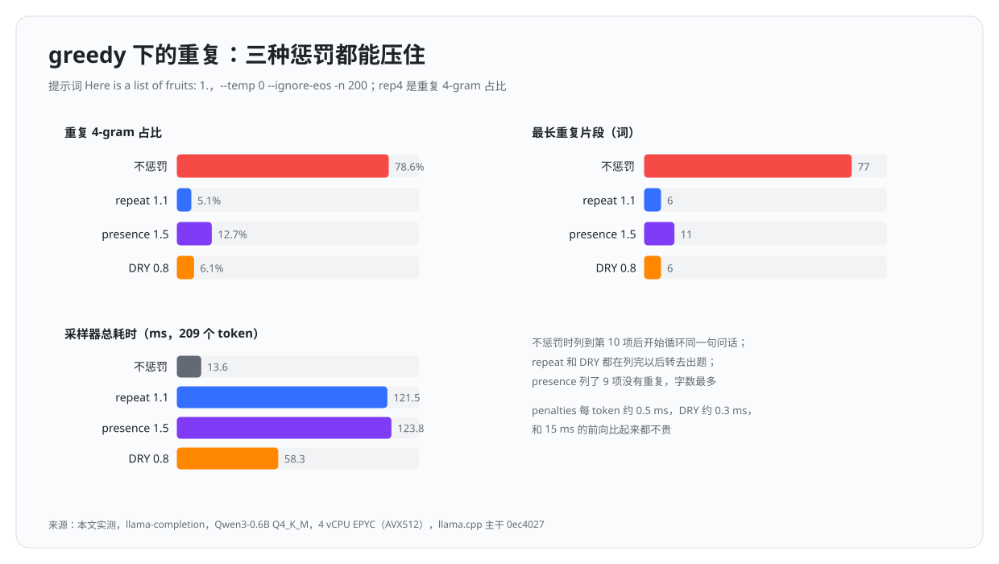

我用 Here is a list of fruits: 1. 作提示词，--temp 0 --ignore-eos -n 200，greedy 下最容易看出打转。不惩罚时，模型列到第 10 项以后开始反复输出同一句问话，重复 4-gram 占 78.6%，最长的重复片段 77 个词。repeat 1.1 压到 5.1%，presence 1.5 压到 12.7%，DRY 0.8 压到 6.1%，最长片段都在 11 个词以内。

输出的样子也不同。repeat 列了 6 项就转去出选择题。presence 列了 9 项没有一项重复，总字数最多，129 个词。DRY 列满 10 项再转去出题。presence 1.5 是 Qwen3 模型卡给的数，卡上建议出现重复时把它设在 0 到 2 之间[[7]](https://huggingface.co/Qwen/Qwen3-0.6B)。

耗时上，209 个 token 里不惩罚时采样器共 13.6 毫秒，开 penalties 以后约 120 毫秒，每 token 约 0.5 毫秒；DRY 是 58.3 毫秒，每 token 约 0.3 毫秒。和每 token 15 毫秒左右的前向比，都不算贵。

## 5.3 DRY

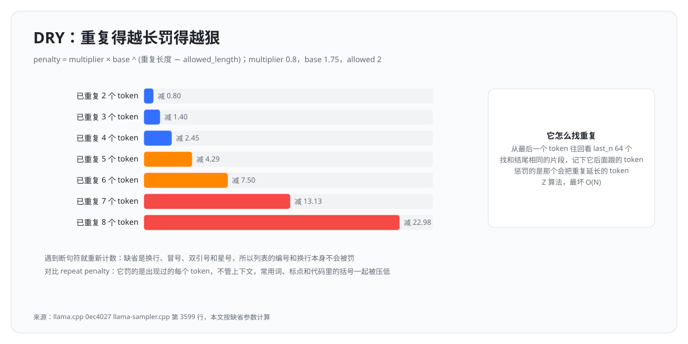

DRY 的思路是只罚会把重复延长的那个 token[[9]](https://github.com/oobabooga/textgen/pull/5677)。它从最后一个 token 往回看，找前文里和结尾相同的片段，记下那个片段后面跟的 token；如果已经重复了 n 个 token，就把这个 token 的 logit 减去 multiplier × base 的 (n − allowed_length) 次方。缺省 base 1.75、allowed_length 2、last_n 64，multiplier 缺省 0，即关闭[[1]](https://github.com/ggml-org/llama.cpp/blob/0ec4027/common/common.h)。

惩罚随重复长度指数增长：multiplier 0.8 时，重复 2 个 token 减 0.8，5 个减 4.3，8 个减 23，基本等于禁掉。断句符会让计数归零，缺省是换行、冒号、双引号和星号，所以列表的编号和换行本身不会被罚。llama.cpp 的实现从 koboldcpp 移植，用 Z 算法找重复，源码注释里写明了出处[[23]](https://github.com/LostRuins/koboldcpp/pull/982)[[24]](https://github.com/ggml-org/llama.cpp/pull/9702)。

## 5.4 XTC

XTC 反着来：以 probability 的概率触发，触发时把概率高于 threshold 的候选都删掉，只留其中最低的一个[[25]](https://github.com/oobabooga/textgen/pull/6335)[[26]](https://github.com/ggml-org/llama.cpp/pull/9742)。它的目标是打破套话，让模型偶尔不选最顺的那个词。缺省 probability 0、threshold 0.1；threshold 大于 0.5 时源码直接不生效，因为高于 0.5 的候选最多一个，删不出东西。我只在写小说一类的场景见人用过它，技术类输出不开。

> 🔑 **本章要点**：三种 penalties 和 DRY 都能压住 greedy 的打转，重复 4-gram 从 78.6% 压到 5% 到 13%。penalties 不看上下文，常用词和标点一起被压；DRY 只罚会延长重复的 token，惩罚随长度指数增长，断句符处归零。XTC 用来打破套话，技术类输出不开。

# 第 6 章 · mirostat、动态温度和 adaptive-p

## 6.1 mirostat

mirostat 的截断阈值是动态的，它把输出的平均惊奇度控制在目标值 τ 附近[[27]](https://arxiv.org/abs/2007.14966)。每抽一个 token，算它的惊奇度 −log2 p，和 τ 比，差值乘学习率 η 去更新内部变量 μ。v1 用 Zipf 分布估计参数，再按 μ 算出 top_k 的 k；v2 直接删掉惊奇度大于 μ 的候选[[3]](https://github.com/ggml-org/llama.cpp/blob/0ec4027/src/llama-sampler.cpp)。

--mirostat 1 或 2 打开以后，链变成 temp 加 mirostat，其他截断采样器全部不建，帮助文本也写着 top_k、nucleus 和 typical 会被忽略[[13]](https://github.com/ggml-org/llama.cpp/blob/0ec4027/common/arg.cpp)[[2]](https://github.com/ggml-org/llama.cpp/blob/0ec4027/common/sampling.cpp)。缺省 τ 5、η 0.1，μ 的初值是 2τ。它适合写长文时控制整体发散程度，但和 min_p、DRY 这些不能一起用，我很少开。

## 6.2 动态温度

--dynatemp-range 不为 0 时，温度采样器换成 temp_ext 的动态模式：先算当前候选的熵，除以最大熵得到归一化熵，再在 T − δ 到 T + δ 之间按归一化熵的 exp 次方插值。分布平、模型拿不准时温度高一些，分布尖时温度低一些。缺省 range 0，即关闭；日志里的链写的是 temp-ext，关闭时就是普通温度。

## 6.3 adaptive-p

adaptive-p 是 2026 年加入的采样器，目标是让选中 token 的概率维持在 target 附近[[28]](https://github.com/ggml-org/llama.cpp/pull/17927)。它用指数移动平均跟踪最近选中 token 的概率，按 2 × target 减平均值算出本步的目标，再把每个候选的 logit 改成以目标概率为峰的形状，离目标越远越低，最后自己抽样。它和 dist、mirostat 一样负责选出 token，所以只有用户在 --samplers 里明确列出时才接到链尾，否则仍是 dist。

## 6.4 这几种我怎么看

这三种采样器都想解决同一个问题：固定阈值在不同分布上表现不一致。min_p 和 top-nσ 用相对阈值解决了大半，代价只是扫一遍候选；mirostat 和 adaptive-p 则引入了跨步的状态，输出的行为取决于前面抽到了什么，排查问题时更难复现。我在上线配置里只用截断加温度这一类无状态的采样器，需要更有变化的输出时先调温度和 min_p，实在不够才试动态温度。

> 🔑 **本章要点**：mirostat 把平均惊奇度控制在 τ 附近，打开后其他截断采样器都不建。动态温度按熵在一个区间里调温度。adaptive-p 让选中 token 的概率跟踪一个目标值，只有在 --samplers 里列出才生效。这三种缺省都关着。

# 第 7 章 · GBNF 语法约束

## 7.1 语法怎么约束采样

2023 年 llama.cpp 加入了基于语法的采样：用户写一份 GBNF，形式类似 BNF，采样时把不符合语法的 token 的 logit 设成负无穷[[10]](https://github.com/ggml-org/llama.cpp/pull/1773)。实现上，语法被编译成规则表，解析状态是若干个栈，每个栈表示一种可能的推导位置[[11]](https://github.com/ggml-org/llama.cpp/blob/0ec4027/src/llama-grammar.cpp)。每一步对每个候选 token 解码出 UTF-8 字符，逐个字符推进这些栈，推进不下去的 token 被拒绝；任何一个栈走空之前，EOS 也被禁掉。

仓库里自带一份 json.gbnf，二十几行，覆盖对象、数组、字符串、数字和三个字面量，空白最多允许一个换行加 20 个缩进字符[[29]](https://github.com/ggml-org/llama.cpp/blob/0ec4027/grammars/json.gbnf)。解析器会检测左递归并报错，单个规则重复次数上限 2000。

## 7.2 先采样后检查

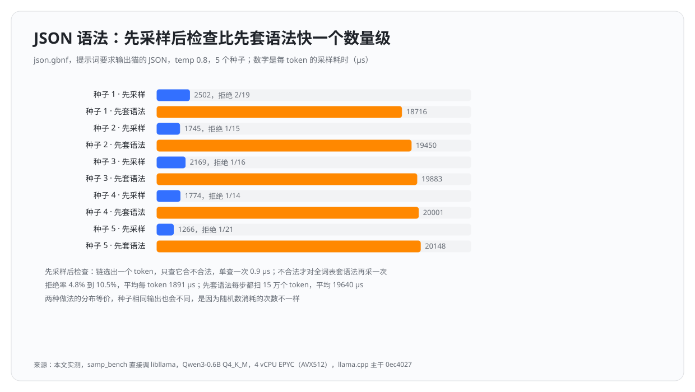

common_sampler_sample 有两种用法[[2]](https://github.com/ggml-org/llama.cpp/blob/0ec4027/common/sampling.cpp)。缺省是先跑采样链选出一个 token，只检查这一个合不合法，单查一次约 0.9 微秒；不合法才把 logits 恢复原样，对全词表套语法，再跑一遍链。另一种是 grammar_first，每步先对全词表套语法再采样，源码注释直接写着更慢。

我用 samp_bench 带 json.gbnf 生成，提示词要求输出一只猫的 JSON，temp 0.8，5 个种子。先采样后检查的拒绝率在 4.8% 到 10.5% 之间，每 token 平均 1891 微秒；先套语法每步都要扫 15 万个 token，平均 19640 微秒，慢了一个数量级。对全词表套一次语法本身就要 10481 微秒。

两种做法的分布是等价的：不合法的 token 在两边都抽不到，合法 token 之间的相对概率不变。但同一个种子输出会不同，因为先采样后检查在被拒绝时多消耗一次随机数。种子 1 先采样得到的是 momo、2 岁、blue，先套语法得到的是带缩进的 Puffa、8 岁、black and white。

**📎 展开阅读：**greedy 时先采样后检查只被拒绝了 1 次，输出 Luna、12 岁、black and white。story 提示词更有意思：先套语法时模型第一步就输出了空对象，1 步结束；先采样后检查走了 36 步才写完。语法只保证格式，挑哪个合法 token 仍然由模型的分布决定，提示词没把字段讲清楚，语法也救不了内容。

## 7.3 写语法的坑

grammars/README.md 专门列了性能问题[[30]](https://github.com/ggml-org/llama.cpp/blob/0ec4027/grammars/README.md)。x? x? x? 这样连写 N 个可选项，语义没错，采样却可能极慢，因为解析栈的数量随可选项组合增长，要写成 x{0,N}。字符串规则如果允许任意字符，模型可能一直不闭合引号，最好加长度上限。语法太宽松时拒绝率会高，每次拒绝都要付一次全词表的代价。

语法只能禁掉不合法的 token，不能保证在 -n 用完之前把括号闭合。输出被长度截断时，拿到的仍是半个 JSON。我会把 -n 留足，并在解析失败时按截断处理，而不是当成模型出错重试。

> 🔑 **本章要点**：GBNF 在采样时把不合法 token 的 logit 设为负无穷。缺省先采样后检查，只在被拒绝时才对全词表套语法，JSON 实测每 token 约 1.9 毫秒，先套语法约 19.6 毫秒。两种做法分布等价，同种子输出不同。

# 第 8 章 · JSON schema 与 llguidance

## 8.1 -j 把 schema 转成 GBNF

手写 GBNF 很少有人愿意做。-j 接受一份 JSON schema，由 json-schema-to-grammar 转成 GBNF 再交给语法采样器[[31]](https://github.com/ggml-org/llama.cpp/blob/0ec4027/common/json-schema-to-grammar.cpp)[[13]](https://github.com/ggml-org/llama.cpp/blob/0ec4027/common/arg.cpp)。这个转换最早是 examples 里的一个 Python 脚本[[32]](https://github.com/ggml-org/llama.cpp/pull/1887)，2024 年改写成 C++ 并接进 server，支持了 \$ref、模式匹配和更多关键字[[33]](https://github.com/ggml-org/llama.cpp/pull/5978)。

我给 -j 一个三字段的 schema：name 字符串，age 非负整数，color 是四选一的枚举，additionalProperties 为 false。llama-completion 输出了 name Bella、age 2、color black，38 个 token 的采样器总耗时 1.60 毫秒。README 里列了它的边界。additionalProperties 缺省按 false 处理，语法更快，编造的键也更少。minimum、maximum 只对 integer 生效，嵌套的 \$ref 有问题，不支持的关键字会静默跳过[[30]](https://github.com/ggml-org/llama.cpp/blob/0ec4027/grammars/README.md)。

schema 写得越紧，语法越窄，拒绝率越低，输出也越稳。我的经验是能用 enum 的字段就用 enum，整数给上下界，字符串给 maxLength，对象一律写 required 和 additionalProperties false。转换器生成的规则名沿用 schema 里的属性名，tests/test-json-schema-to-grammar.cpp 里有 83 组 schema 和对应 GBNF 的对照用例，拿不准某个关键字怎么转时，我先去那里找。

## 8.2 llguidance

另一条路是 llguidance。编译时加 -DLLAMA_LLGUIDANCE=ON，需要 Rust 工具链；打开以后以 %llguidance 开头的语法和 -j 的 schema 都交给它处理[[34]](https://github.com/ggml-org/llama.cpp/pull/10224)[[35]](https://github.com/ggml-org/llama.cpp/blob/0ec4027/docs/llguidance.md)。它把词法和语法分开，文档给的数字是在 128k 词表上算一次 token mask 平均 50 微秒，p99 0.5 毫秒，最坏 20 毫秒。

它对 schema 的处理更贴近规范：additionalProperties 缺省为 true，允许任意空白，保留属性顺序，不支持的 schema 直接报错，不静默跳过。从 GBNF 换到 llguidance 时，同一份 schema 的行为会变，这一点要特别留意。我没有在本机编 Rust 版本，上面的耗时是文档口径。

## 8.3 业界其他做法

Outlines 把正则和 JSON schema 编译成有限状态机，预先算好每个状态下允许的 token 集合，采样时查表[[36]](https://arxiv.org/abs/2307.09702)。XGrammar 把 token 分成上下文无关和上下文相关两类，前者预先算好 mask，只有后者在运行时检查，再和 GPU 推理重叠[[37]](https://arxiv.org/abs/2411.15100)。llama.cpp 的 GBNF 每步现算，靠先采样后检查把平均代价压下来。

格式约束也有代价。Let Me Speak Freely 的实验表明，强制 JSON 等格式输出在推理任务上会降低准确率，分类任务上影响小一些[[38]](https://arxiv.org/abs/2408.02442)。我的原则是格式约束只管格式，推理放在约束之外做。

> 🔑 **本章要点**：-j 把 JSON schema 转成 GBNF，additionalProperties 缺省按 false，不支持的关键字静默跳过。llguidance 要编 Rust，mask 平均 50 微秒，schema 行为更贴近规范。格式约束会伤推理，推理放在约束外。

# 第 9 章 · 后端采样

## 9.1 把采样放进计算图

通常每步前向结束后，整行 logits 要从后端拷回主机，再由 CPU 上的采样链处理。在 GPU 上，15 万个 float 的拷贝和 CPU 上的排序都在关键路径上。2026 年合入的后端采样把 top_k、top_p、min_p、temp 和 dist 写成 ggml 算子，直接接在计算图末尾，只把选中的 token 拷回来[[39]](https://github.com/ggml-org/llama.cpp/pull/17004)。开关是 -bs 或 --backend-sampling，帮助文本标着实验性。

common 在两种情况下会自动关掉它并打印警告：带语法约束，或者设了思考预算[[2]](https://github.com/ggml-org/llama.cpp/blob/0ec4027/common/sampling.cpp)。这两样都要在主机上逐 token 检查状态，没法放进图里。采样时如果后端已经选出了 token，common_sampler_sample 直接返回，不再走主机上的链。

## 9.2 CPU 上的实测

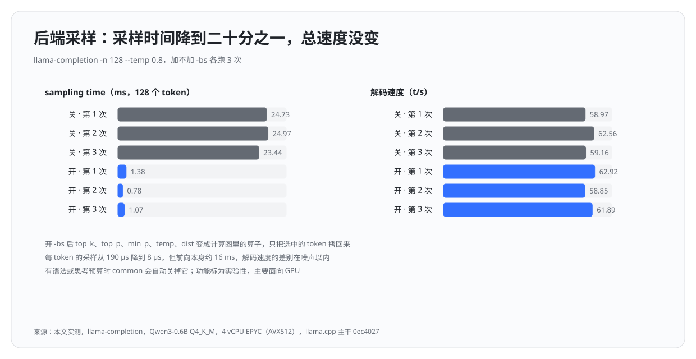

我在本机用 llama-completion -n 128 --temp 0.8，加不加 -bs 各跑 3 次。sampling time 从 24.4 毫秒降到 1.1 毫秒，每 token 从约 190 微秒降到约 8 微秒。解码速度关着是 60.2 t/s，开着是 61.2 t/s，三次之间的波动比两者的差还大。

原因很直接：采样那部分只是挪进了图里，由同一组 CPU 线程算，前向本身约 16 毫秒，190 微秒的采样只占 1% 左右。日志里的 sampling time 只统计主机上的那部分，所以降得很多，总时间几乎不变。

后端采样的收益要在 GPU 上才看得出：省掉一次整行 logits 的设备到主机拷贝和 CPU 排序，批量大、词表大、前向快的时候占比才明显。本机没有 GPU，这部分没有实测，GPU 上的取舍放到 LCPP-11。

> 🔑 **本章要点**：-bs 把截断和抽样写成计算图里的算子，只拷回选中的 token。CPU 上采样时间从每 token 约 190 微秒降到 8 微秒，但前向约 16 毫秒，解码速度没变。带语法或思考预算时 common 会自动关掉它。

# 第 10 章 · 聊天模板、思考开关和工具调用

## 10.1 模板是 GGUF 里的一段 jinja

聊天模型认的是带特殊 token 的格式，比如 Qwen3 用 ChatML：每条消息以 im_start 加角色开头，以 im_end 结尾。这段格式写在 GGUF 的 tokenizer.chat_template 里，是一段 jinja 模板，Qwen3-0.6B 的有 4168 个字符[LCPP-04｜内部｜GGUF：文件结构、元数据、加载方式和分卷](./04-gguf.md)。2025 年 llama.cpp 加入了 minja 引擎，可以直接执行这些模板[[40]](https://github.com/ggml-org/llama.cpp/pull/11016)，common.h 里 use_jinja 缺省为 true。

但 llama-completion 是例外：arg.cpp 给它单独把 use_jinja 设成 false，缺省走内置的模板识别，认出是 ChatML 就按写死的格式拼[[13]](https://github.com/ggml-org/llama.cpp/blob/0ec4027/common/arg.cpp)。要让 completion 执行 GGUF 里的 jinja，得显式加 --jinja。

## 10.2 同一句问话拼出多少字符

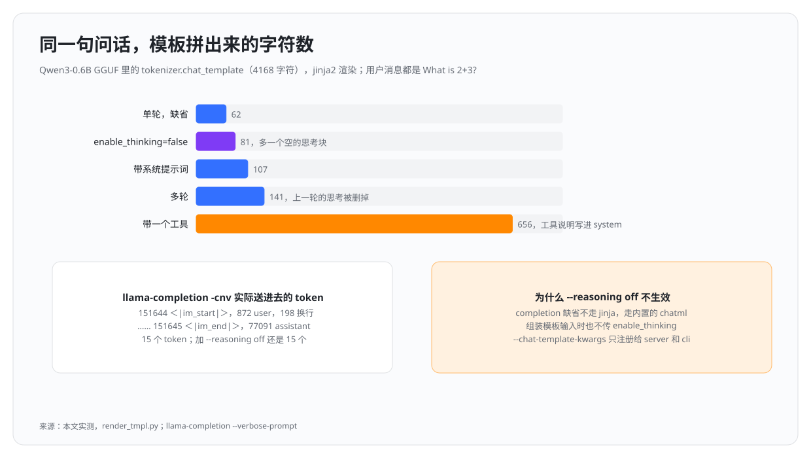

--chat-template-kwargs 只注册给 server 和 cli，completion 不认，所以我用 render_tmpl.py 从 GGUF 取出模板，用 jinja2 直接渲染五种消息[[41]](https://github.com/ggml-org/llama.cpp/blob/0ec4027/common/chat.cpp)。单轮缺省 62 个字符；enable_thinking 设成 false，模板在 assistant 后面先放一个空的 think 块，81 个字符，模型看到思考已经结束，就直接回答。带系统提示词 107 个字符。

多轮时，上一轮 assistant 回复里的 think 段被模板删掉，只留最终答案，141 个字符。这和 Qwen3 模型卡的要求一致：历史里不保留思考内容[[7]](https://huggingface.co/Qwen/Qwen3-0.6B)。带一个工具时变成 656 个字符，模板把工具的 JSON 签名写进 system，用 tools 和 tool_call 两组 XML 标签告诉模型怎么调用。

## 10.3 为什么 --reasoning off 不生效

我用 llama-completion -cnv -p "What is 2+3?" --verbose-prompt 看实际送进去的 token：151644 im_start、872 user、198 换行，接着是问题，151645 im_end，再是 im_start、77091 assistant 和换行，一共 15 个 token。加上 --reasoning off，还是 15 个，没有那个空的 think 块。

读源码有两层原因。第一层是上面说的，completion 缺省不走 jinja。第二层，completion.cpp 在对话模式下组装 common_chat_templates_inputs 时，只填了 use_jinja、messages、add_generation_prompt 几项，根本不传 enable_thinking[[12]](https://github.com/ggml-org/llama.cpp/blob/0ec4027/tools/completion/completion.cpp)。enable_thinking 这个模板参数是 2025 年为 Qwen3 加的，最初的入口就是 server 请求和 --chat-template-kwargs[[42]](https://github.com/ggml-org/llama.cpp/pull/13196)。

Qwen3 还支持软开关：在用户消息里写 /no_think，模型自己学会了跳过思考，这不依赖模板参数，completion 里也能用[[7]](https://huggingface.co/Qwen/Qwen3-0.6B)。--reasoning-budget 限制思考段的 token 数，实现在 reasoning-budget.cpp，靠匹配思考的起止标记计数[[43]](https://github.com/ggml-org/llama.cpp/blob/0ec4027/common/reasoning-budget.cpp)，起止标记由 jinja 模板解析得到，所以同样主要在 server 里起作用。

模板的差别也会影响采样。思考模式下模型先输出一段 think，再给答案，前一段对分布更宽容，后一段要求更准，Qwen3 模型卡给两种模式配了不同的温度和 top_p，就是这个原因。同一个进程里两种模式混用时，我宁可按模式分开启动两组参数，也不在一组折中的参数上同时服务两类请求。

> 💡 **常见误区**：在 llama-completion 里关思考，--reasoning off 不起作用，日志也不报错。要么在提示词里写 /no_think，要么自己按模板拼好带空 think 块的提示词，用 -p 直接送进去；真要用模板参数，就换 server。

## 10.4 工具调用

工具调用建在模板之上[[44]](https://github.com/ggml-org/llama.cpp/pull/9639)[[45]](https://github.com/ggml-org/llama.cpp/blob/0ec4027/docs/function-calling.md)。server 加 --jinja 时，common/chat.cpp 识别模板属于哪一家的格式：Llama 3.x、Functionary、Hermes 和 Qwen 2.5、Qwen 2.5 Coder、Mistral Nemo、Firefunction、Command R7B、DeepSeek R1、GPT-OSS 等有原生解析，其他走通用格式。parallel_tool_calls 缺省关闭。

工具调用的输出要合法，靠的还是语法约束，只是改成了惰性语法[[46]](https://github.com/ggml-org/llama.cpp/pull/12034)。模型先自由写，采样器盯着触发词，比如 tool_call 标签或者某个特殊 token，触发以后才启用语法，把后面的参数锁成 JSON；触发词之前的正文不受约束[[41]](https://github.com/ggml-org/llama.cpp/blob/0ec4027/common/chat.cpp)。preserved_tokens 保证这些标记 token 不会被拆开。

**📎 展开阅读：**惰性语法也解释了第 9 章的限制：语法要逐 token 检查状态，所以开了工具调用的请求用不了后端采样。server 的请求格式、工具调用的端到端示例放在 LCPP-14，这里只讲它和模板、语法的关系。

> 🔑 **本章要点**：聊天模板是 GGUF 里的 jinja，completion 缺省不执行它，也不传 enable_thinking，所以 --reasoning off 不生效，关思考用 /no_think。enable_thinking=false 就是在 assistant 后放一个空 think 块。工具调用靠模板识别格式，再用触发词启用的惰性语法锁住参数。

# 第 11 章 · 怎么选与上线清单

## 11.1 按场景选

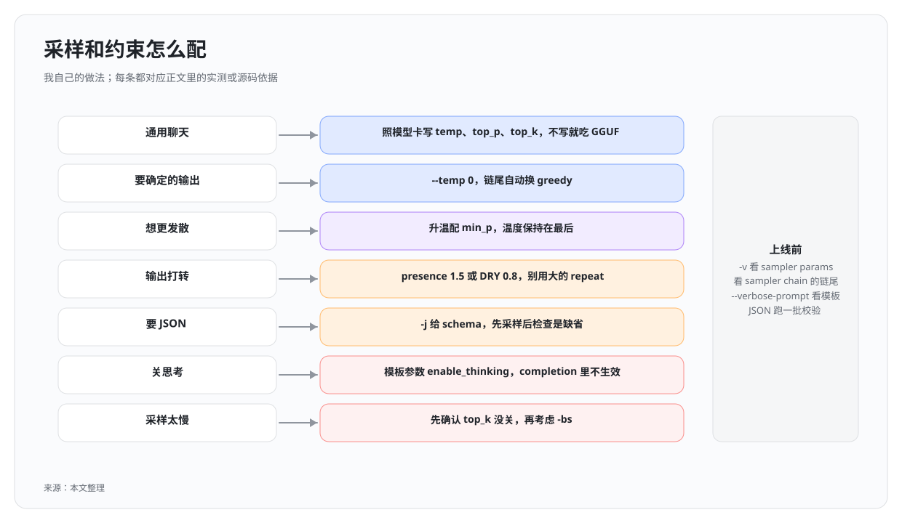

| 场景 | 怎么配 | 依据 |
|-|-|-|
| 通用聊天 | 照模型卡写 temp、top_p、top_k，min_p 也显式写 | 第 4 章：GGUF 不带 min_p |
| 要确定的输出 | --temp 0，链尾自动换 greedy | 第 4 章：日志里 temp-ext 后接 greedy |
| 想更发散 | 升温配 min_p，温度保持在最后 | 第 3 章：T 2.0 时 top_p 放进 69341 个 |
| 输出打转 | presence 1.5 或 DRY 0.8 | 第 5 章：rep4 从 78.6% 压到 13% 以内 |
| 要 JSON | -j 给 schema，保持先采样后检查 | 第 7 章：每 token 1.9 对 19.6 毫秒 |
| 关思考 | completion 里写 /no_think，server 用模板参数 | 第 10 章：--reasoning off 不生效 |
| 采样太慢 | 先确认 top_k 没关，再考虑 -bs | 第 2 章：去掉 top_k 后 87 变 9007 微秒 |

表里的数都来自 Qwen3-0.6B 和 4 核 CPU。分布形状随模型和提示词变，换模型以后我会用 samp_bench 存一份 logits，跑一遍 samp_sim.py，看截断链实际留下几个候选，再定参数。

## 11.2 上线清单

> 📌 **上线前核对清单**：每换一个模型或改一次采样参数，我按这个顺序过一遍。
> - 用 -v 启动，sampler params 里每个值都是有意设的，min_p 照模型卡显式写了
> - sampler chain 的链尾是预期的 dist 或 greedy，temp-ext 在截断之后
> - 改过 --samplers 的，top_k 仍在 top_p 前面，或者确认过采样耗时
> - 惩罚只开一种，repeat 不超过 1.1，代码类输出不开 repeat
> - JSON 输出用 -j，没有打开 grammar_first，-n 留足了闭合括号的余量
> - 要推理的任务没有直接套格式约束，先自由写再转格式
> - --verbose-prompt 看过实际送进去的 token，思考开关在当前程序里真的生效
> - 用一批真实提示词跑过，统计 JSON 解析失败率和重复率

## 11.3 下一步

采样只占一步的 1% 左右，大头还是前向。线程数、NUMA、大页和批大小这些 CPU 上的调优放在 LCPP-10；用小模型打草稿、大模型验证的投机解码，和它对采样的要求放在 LCPP-13；server 的请求参数、工具调用接口和并发放在 LCPP-14。前向的带宽模型回到 [LCPP-02｜上手｜推理账本：带宽、算力和启动前算出速度上限](./02-ledger.md)。

# 参考文献

按正文首次引用顺序编号，资料截至 2026 年 10 月初。

[1] llama.cpp 0ec4027. common/common.h：采样参数缺省值和缺省采样顺序。 [common/common.h](https://github.com/ggml-org/llama.cpp/blob/0ec4027/common/common.h)

[2] llama.cpp 0ec4027. common/sampling.cpp：按 samplers 建链、何时用 greedy、语法的先采样后检查、何时关掉后端采样。 [common/sampling.cpp](https://github.com/ggml-org/llama.cpp/blob/0ec4027/common/sampling.cpp)

[3] llama.cpp 0ec4027. src/llama-sampler.cpp：greedy、dist、top_k、top_p、min_p、typical、temp_ext、xtc、grammar、penalties、top_n_sigma、dry 的实现。 [llama-sampler.cpp](https://github.com/ggml-org/llama.cpp/blob/0ec4027/src/llama-sampler.cpp)

[4] Nguyen M N, et al. Turning Up the Heat: Min-p Sampling for Creative and Coherent LLM Outputs. ICLR 2025. [arXiv:2407.01082](https://arxiv.org/abs/2407.01082)

[5] Tang C, et al. Top-nσ: Not All Logits Are You Need. 2024. [arXiv:2411.07641](https://arxiv.org/abs/2411.07641)

[6] taronaeo. llama: introduce support for model-embedded sampling parameters. llama.cpp PR #17120, 2025. [PR #17120](https://github.com/ggml-org/llama.cpp/pull/17120)

[7] Qwen. Qwen3-0.6B 模型卡：思考模式建议 Temperature 0.6、TopP 0.95、TopK 20、MinP 0，不要用 greedy；presence_penalty 0 到 2；历史里不保留思考内容。 [Qwen3-0.6B 模型卡](https://huggingface.co/Qwen/Qwen3-0.6B)

[8] Keskar N S, et al. CTRL: A Conditional Transformer Language Model for Controllable Generation. 2019. [arXiv:1909.05858](https://arxiv.org/abs/1909.05858)

[9] p-e-w. DRY: A modern repetition penalty that reliably prevents looping. text-generation-webui PR #5677, 2024. [textgen PR #5677](https://github.com/oobabooga/textgen/pull/5677)

[10] ejones. llama : add grammar-based sampling. llama.cpp PR #1773, 2023. [PR #1773](https://github.com/ggml-org/llama.cpp/pull/1773)

[11] llama.cpp 0ec4027. src/llama-grammar.cpp：GBNF 解析、左递归检测、重复上限和逐 token 的栈匹配。 [llama-grammar.cpp](https://github.com/ggml-org/llama.cpp/blob/0ec4027/src/llama-grammar.cpp)

[12] llama.cpp 0ec4027. tools/completion/completion.cpp：对话模式套模板时不传 enable_thinking。 [completion.cpp](https://github.com/ggml-org/llama.cpp/blob/0ec4027/tools/completion/completion.cpp)

[13] llama.cpp 0ec4027. common/arg.cpp：--samplers、-j、-bs、--jinja、--reasoning、--chat-template-kwargs 的注册和适用程序。 [common/arg.cpp](https://github.com/ggml-org/llama.cpp/blob/0ec4027/common/arg.cpp)

[14] ggerganov. llama : refactor sampling v2. llama.cpp PR #9294, 2024. [PR #9294](https://github.com/ggml-org/llama.cpp/pull/9294)

[15] Fan A, et al. Hierarchical Neural Story Generation. ACL 2018. [arXiv:1805.04833](https://arxiv.org/abs/1805.04833)

[16] Holtzman A, et al. The Curious Case of Neural Text Degeneration. ICLR 2020. [arXiv:1904.09751](https://arxiv.org/abs/1904.09751)

[17] Meister C, et al. Locally Typical Sampling. TACL 2023. [arXiv:2202.00666](https://arxiv.org/abs/2202.00666)

[18] kalomaze. Min P sampler implementation [alternative to Top P/Top K]. llama.cpp PR #3841, 2023. [PR #3841](https://github.com/ggml-org/llama.cpp/pull/3841)

[19] VJHack. sampling: add Top-nσ sampler. llama.cpp PR #11223, 2025. [PR #11223](https://github.com/ggml-org/llama.cpp/pull/11223)

[20] llama.cpp 0ec4027. src/llama-arch.cpp：general.sampling.\* 键名。 [llama-arch.cpp](https://github.com/ggml-org/llama.cpp/blob/0ec4027/src/llama-arch.cpp)

[21] llama.cpp 0ec4027. common/common.cpp：common_init_sampler_from_model 读 GGUF 里的采样参数。 [common/common.cpp](https://github.com/ggml-org/llama.cpp/blob/0ec4027/common/common.cpp)

[22] Qwen Team. Qwen3 Technical Report. 2025. [arXiv:2505.09388](https://arxiv.org/abs/2505.09388)

[23] pi6am. Add the DRY dynamic N-gram anti-repetition sampler. koboldcpp PR #982, 2024. [koboldcpp PR #982](https://github.com/LostRuins/koboldcpp/pull/982)

[24] wwoodsTM. added implementation of DRY sampler (post-refactor). llama.cpp PR #9702, 2024. [PR #9702](https://github.com/ggml-org/llama.cpp/pull/9702)

[25] p-e-w. Exclude Top Choices (XTC): A sampler that boosts creativity, breaks writing clichés, and inhibits non-verbatim repetition. text-generation-webui PR #6335, 2024. [textgen PR #6335](https://github.com/oobabooga/textgen/pull/6335)

[26] MaggotHATE. sampling : add XTC sampler. llama.cpp PR #9742, 2024. [PR #9742](https://github.com/ggml-org/llama.cpp/pull/9742)

[27] Basu S, et al. Mirostat: A Neural Text Decoding Algorithm that Directly Controls Perplexity. ICLR 2021. [arXiv:2007.14966](https://arxiv.org/abs/2007.14966)

[28] ddh0. implement adaptive-p sampler. llama.cpp PR #17927, 2026. [PR #17927](https://github.com/ggml-org/llama.cpp/pull/17927)

[29] llama.cpp 0ec4027. grammars/json.gbnf：通用 JSON 语法。 [grammars/json.gbnf](https://github.com/ggml-org/llama.cpp/blob/0ec4027/grammars/json.gbnf)

[30] llama.cpp 0ec4027. grammars/README.md：GBNF 语法、JSON schema 支持范围和性能注意事项。 [grammars/README.md](https://github.com/ggml-org/llama.cpp/blob/0ec4027/grammars/README.md)

[31] llama.cpp 0ec4027. common/json-schema-to-grammar.cpp：JSON schema 转 GBNF。 [json-schema-to-grammar.cpp](https://github.com/ggml-org/llama.cpp/blob/0ec4027/common/json-schema-to-grammar.cpp)

[32] ejones. examples : generate JSON according to schema. llama.cpp PR #1887, 2023. [PR #1887](https://github.com/ggml-org/llama.cpp/pull/1887)

[33] ochafik. json-schema-to-grammar improvements (+ added to server). llama.cpp PR #5978, 2024. [PR #5978](https://github.com/ggml-org/llama.cpp/pull/5978)

[34] mmoskal. support for llguidance grammars. llama.cpp PR #10224, 2025. [PR #10224](https://github.com/ggml-org/llama.cpp/pull/10224)

[35] llama.cpp 0ec4027. docs/llguidance.md：llguidance 后端的编译方式、mask 耗时和与 GBNF 的差别。 [docs/llguidance.md](https://github.com/ggml-org/llama.cpp/blob/0ec4027/docs/llguidance.md)

[36] Willard B T, Louf R. Efficient Guided Generation for Large Language Models. 2023. [arXiv:2307.09702](https://arxiv.org/abs/2307.09702)

[37] Dong Y, et al. XGrammar: Flexible and Efficient Structured Generation Engine for Large Language Models. MLSys 2025. [arXiv:2411.15100](https://arxiv.org/abs/2411.15100)

[38] Tam Z R, et al. Let Me Speak Freely? A Study on the Impact of Format Restrictions on Performance of Large Language Models. EMNLP 2024 Industry. [arXiv:2408.02442](https://arxiv.org/abs/2408.02442)

[39] danbev. sampling : add support for backend sampling. llama.cpp PR #17004, 2026. [PR #17004](https://github.com/ggml-org/llama.cpp/pull/17004)

[40] ochafik. Add Jinja template support. llama.cpp PR #11016, 2025. [PR #11016](https://github.com/ggml-org/llama.cpp/pull/11016)

[41] llama.cpp 0ec4027. common/chat.cpp：模板输入、enable_thinking 和各家工具调用格式。 [common/chat.cpp](https://github.com/ggml-org/llama.cpp/blob/0ec4027/common/chat.cpp)

[42] matteoserva. Support jinja extra template kwargs (Qwen3 enable_thinking feature), from command line and from client. llama.cpp PR #13196, 2025. [PR #13196](https://github.com/ggml-org/llama.cpp/pull/13196)

[43] llama.cpp 0ec4027. common/reasoning-budget.cpp：按 token 数限制思考段长度。 [reasoning-budget.cpp](https://github.com/ggml-org/llama.cpp/blob/0ec4027/common/reasoning-budget.cpp)

[44] ochafik. Tool call support (generic + native for Llama, Functionary, Hermes, Mistral, Firefunction, DeepSeek) w/ lazy grammars. llama.cpp PR #9639, 2025. [PR #9639](https://github.com/ggml-org/llama.cpp/pull/9639)

[45] llama.cpp 0ec4027. docs/function-calling.md：工具调用支持的模板格式。 [docs/function-calling.md](https://github.com/ggml-org/llama.cpp/blob/0ec4027/docs/function-calling.md)

[46] ochafik. tool-call: fix Qwen 2.5 Coder support, add micro benchmarks, support trigger patterns for lazy grammars. llama.cpp PR #12034, 2025. [PR #12034](https://github.com/ggml-org/llama.cpp/pull/12034)

---

[在 Colab 里跑本章 CPU 练习](https://colab.research.google.com/github/chenziyaos/zero-to-llama/blob/main/colab/09-sampling-grammar.ipynb) · 上一章：[LCPP-08｜内部｜KV cache 与长上下文：账本、深度、量化、SWA 和上下文写满](./08-kv-context.md) · [目录](./README.md) · 下一章：[LCPP-10｜内部｜CPU 调优：线程、绑核、repack、加载方式和带宽上限](./10-cpu-tuning.md)
