# LCPP-10｜内部｜CPU 调优：线程、绑核、repack、加载方式和带宽上限

> 🎯 **这篇文档解决什么问题**：同一个模型、同一台机器，-t 设错一个数，decode 能从 78 t/s 掉到 5 t/s。绑核掩码写错，prefill 慢两个数量级。repack 开着，K 系列的 prefill 反而慢四分之一。CPU 上能调的参数不少：线程数、-tb、绑核和 strict、等待策略、ubatch、repack、加载方式、大页和 NUMA。这篇在一台 4 vCPU 的 EPYC 上把它们逐个量出来，每个结论都对到 llama.cpp 的源码，最后落到 decode 的天花板：内存带宽除以每 token 要读的字节。主线一句话：-t 管 decode，-tb 管 prefill，decode 的上限是带宽除以字节，调参就是往这条线上靠。
>
> 使用方式：只想知道怎么配，看导读和第 11 章；线程数和绑核，看第 1 到 3 章；decode 不稳或者突然变慢，看第 4、8 章；prefill 慢，看第 5 到 7 章；判断还有没有余地，看第 9 章；启动慢或者内存占用高，看第 10 章。文中版本和数字核对于 2026 年 10 月 31 日。
>
> **代码**：[zero-to-llama/10-cpu-tuning](../10-cpu-tuning)。cpu_probe.py 读 /proc 和 /sys，报物理核分组、NUMA、THP、mlock 上限、指令集，以及按源码规则哪些量化类型在这台机器上走 repack、哪些走 tiled，并给出 -t 和绑核掩码的起点；exp10.sh 跑十三组实验，只用 llama-bench、llama-completion 和 STREAM；test_cpu.py 是 11 个回归用例，解析逻辑用假的 /sys 目录树测，实测结论用 logs 核对。基线是主干 0ec4027，模型是 Qwen3-0.6B，机器是 4 核 EPYC 云主机无 GPU。

# 导读 · 先给结论

- **-t 缺省是物理核数。**x86 Linux 上 common 数的是 thread_siblings 分组，这台机器是 2；prefill 加到 4 个逻辑核还在涨，decode 到 3 个线程就平了[[1]](https://github.com/ggml-org/llama.cpp/blob/0ec4027/common/common.cpp)[[2]](https://github.com/ggml-org/llama.cpp/blob/0ec4027/docs/development/token_generation_performance_tips.md)。
- **绑核时线程数不能多于掩码。**--cpu-strict 1 把线程轮转分到掩码里的 CPU，3 个线程绑 2 个 CPU，pp32 只剩 5.5 t/s；同一个 llama-bench 进程里，绑核的亲和性还会残留到后面的测试[[3]](https://github.com/ggml-org/llama.cpp/blob/0ec4027/ggml/src/ggml-cpu/ggml-cpu.c)[[4]](https://man7.org/linux/man-pages/man2/sched_setaffinity.2.html)。
- **别让线程去睡。**OMP_WAIT_POLICY=passive 或 GOMP_SPINCOUNT=0 让 tg 从 70.6 掉到 47 左右；--poll 和 --prio 在空闲机器上差别都在噪声内[[5]](https://gcc.gnu.org/onlinedocs/libgomp/OMP_005fWAIT_005fPOLICY.html)[[6]](https://gcc.gnu.org/onlinedocs/libgomp/GOMP_005fSPINCOUNT.html)。
- **-t 管 decode，-tb 管 prefill。**-t 2 -tb 4 的 prompt eval 是 316 t/s，-t 4 -tb 2 只有 234；ubatch 低于 64 时 prefill 吃亏[[7]](https://github.com/ggml-org/llama.cpp/pull/27138)[[8]](https://github.com/ggml-org/llama.cpp/blob/0ec4027/common/arg.cpp)。
- **repack 帮 Q4_0，拖慢 K 系列的 prefill。**Q4_0 的 pp128 从 354 涨到 510，Q4_K_M 从 690 掉到 531，因为 repack 过的权重进不了 tiled 矩阵乘[[9]](https://github.com/ggml-org/llama.cpp/pull/10446)[[10]](https://github.com/ggml-org/llama.cpp/pull/27851)。
- **邻居抢一个超线程就能让 -t 4 塌掉。**CPU 3 上跑一个死循环，-t 4 的 decode 从 78.6 掉到 5.4，-t 3 是 69.2；另一个物理核跑 STREAM，decode 掉三成[[11]](https://arxiv.org/abs/2505.06461)。
- **decode 的上限是带宽除以字节。**STREAM 测得 33 GB/s，Q4_K_M 每 token 读 391 MB，上限约 85 t/s，实测 71 到 75；mmap 是最快的加载方式[[12]](https://dl.acm.org/doi/10.1145/1498765.1498785)[[13]](https://www.cs.virginia.edu/stream/ref.html)。

**📎 与系列其他文档的分工**：本篇只讲 CPU 后端。解码为什么受带宽限制、STREAM 怎么测见 [LCPP-02｜上手｜推理账本：带宽、算力和启动前算出速度上限](./02-ledger.md)；llama-bench 的用法和噪声见 [LCPP-03｜上手｜测量方法：llama-bench、PPL、KLD 和噪声](./03-bench-ppl.md)；GGUF 里张量怎么排、mmap 映射的是什么见 [LCPP-04｜内部｜GGUF：文件结构、元数据、加载方式和分卷](./04-gguf.md)；计算图和节点数见 [LCPP-05｜内部｜ggml 与计算图：建图、内存规划、调度和复用](./05-ggml-graph.md)；后端怎么选见 [LCPP-06｜内部｜后端与编译：CPU 变体、BLAS、repack 和 GPU 架构](./06-backends-build.md)；量化格式本身见 [LCPP-07｜内部｜量化：块结构、配方、imatrix 和用 KLD 选类型](./07-quantization.md)；KV cache 见 [LCPP-08｜内部｜KV cache 与长上下文：账本、深度、量化、SWA 和上下文写满](./08-kv-context.md)；采样耗时见 [LCPP-09｜内部｜采样、语法与聊天模板：截断链、温度、惩罚、GBNF 和模板](./09-sampling-grammar.md)。GPU 卸载放在 LCPP-11，多机放在 LCPP-12。

# 第 1 章 · 拓扑和缺省线程数

## 1.1 先看机器

调参之前我先跑一遍 cpu_probe.py。这台机器有 4 个逻辑 CPU，thread_siblings_list 分成 [0,1] 和 [2,3] 两组，也就是 2 个物理核各带 2 个超线程。NUMA 节点只有一个。THP 是 madvise，numa_balancing 是 0，RLIMIT_MEMLOCK 是 8192 KiB。指令集有 AVX2、AVX512F、AVX512_VNNI 和 AVX512VL。超线程共享一个核的执行单元和 L1、L2，矩阵乘这种吃满 SIMD 的负载，两个超线程加起来通常只比一个多一点[[14]](https://people.freebsd.org/~lstewart/articles/cpumemory.pdf)。

云上的 vCPU 编号不一定连续。有的机器把 0 和 4 编成一对，有的把 0 和 1 编成一对，绑核掩码要按 thread_siblings_list 算，不能想当然写 0x3。cpu_probe 只取每组的第一个 CPU 拼掩码，这台是 0x5，测试里也覆盖了 0 和 4 成对的情况。

## 1.2 llama.cpp 怎么定缺省的 -t

cpuparams.n_threads 的缺省值来自 common_cpu_get_num_math。x86 Linux 上它遍历每个 CPU 的 thread_siblings，数有多少个不同的集合，就是物理核数；遇到大小核混合的 Intel 处理器还有一个分支，只数性能核[[1]](https://github.com/ggml-org/llama.cpp/blob/0ec4027/common/common.cpp)。所以这台机器上不写 -t 时是 2，不是 4。

仓库里的性能提示文档也这么建议：-t 设成物理核数，从 1 开始翻倍试[[2]](https://github.com/ggml-org/llama.cpp/blob/0ec4027/docs/development/token_generation_performance_tips.md)。这条建议背后的道理在第 8 章：线程数等于逻辑核数时，任何一个别的进程都会和推理线程抢 CPU，而推理线程每一步要过几百次 barrier。

## 1.3 CPU 推理的工作在哪

学界对 CPU 推理的优化大致分三块。Shen 等人用 INT4 权重量化加专门的 CPU 运行时，核心是让 decode 少读字节[[15]](https://arxiv.org/abs/2311.00502)。He 等人在 Xeon 上压 KV cache，并用 oneCCL 做多路分布式推理[[16]](https://arxiv.org/abs/2407.07304)。T-MAC 用查表代替低比特矩阵乘里的反量化，单核跑 BitNet-3B 到 30 t/s[[17]](https://arxiv.org/abs/2407.00088)。llama.cpp 在 CPU 上的路径也是这几件事：量化少读字节，repack 和 tiled 让 prefill 吃满 SIMD，线程池让多核一起干活。

> 🔑 **本章要点**：先用 cpu_probe 看物理核分组、NUMA 和指令集。llama.cpp 缺省 -t 是物理核数，这台 4 vCPU 的机器上是 2；绑核掩码按 thread_siblings_list 取每个核的第一个超线程。

# 第 2 章 · 线程数

## 2.1 一步前向里的线程

CPU 后端按计算图逐个节点执行，每个节点的工作按行切给所有线程，节点之间用 ggml_barrier 同步[[3]](https://github.com/ggml-org/llama.cpp/blob/0ec4027/ggml/src/ggml-cpu/ggml-cpu.c)。[LCPP-05｜内部｜ggml 与计算图：建图、内存规划、调度和复用](./05-ggml-graph.md) 里数过，Qwen3-0.6B 一次前向有 653 个计算节点，所以每个 token 要过 653 次 barrier。prefill 一次算几百行，每个节点的活多，barrier 的开销被摊薄；decode 只算一行，每个节点几十微秒就做完，barrier 占比高得多。

线程从哪来有两种构建。缺省用 OpenMP，ggml_barrier 就是 omp barrier[[18]](https://github.com/ggml-org/llama.cpp/pull/7606)；用 GGML_OPENMP=OFF 编出来的是 ggml 自带的线程池，barrier 是一个原子计数器，最后到的线程把 n_barrier_passed 加一，其他线程在 cpu_relax 里转圈等它[[19]](https://github.com/ggml-org/llama.cpp/pull/8672)[[20]](https://github.com/ggml-org/llama.cpp/pull/9598)。两种我都编了一份，对照着测。

## 2.2 扫一遍 -t

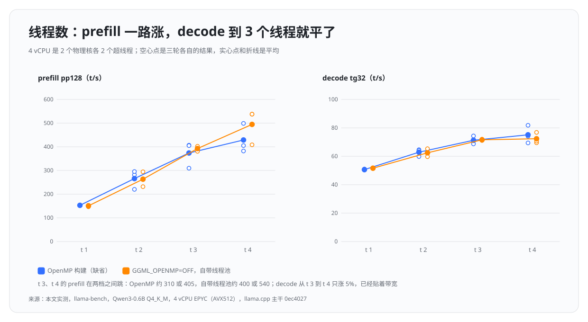

每个组合单独起一个 llama-bench 进程，三轮交错跑[[21]](https://github.com/ggml-org/llama.cpp/blob/0ec4027/tools/llama-bench/llama-bench.cpp)。prefill 从 t 1 的 153 t/s 一路涨到 t 4，OpenMP 构建平均 429，自带线程池 495，两个超线程确实还能多挤出一些。decode 不一样：t 1 是 50.6，t 2 是 62.9，t 3 是 71.3，t 4 是 75.1，从 3 到 4 只涨 5%。

t 1 的三轮几乎一样，都在 152 到 153 之间；t 3 和 t 4 的 prefill 在两档之间跳，OpenMP 的 t 4 三轮是 499、382、405，自带线程池是 538、538、408。我的判断是线程落在哪几个超线程上每次不一样，两个线程挤一个物理核的那轮就慢。所以测 t 3、t 4 时只跑一轮很容易得出相反的结论。

## 2.3 两种构建怎么选

两种构建在 decode 上几乎一样，t 4 时 OpenMP 75.1，自带线程池 72.3；prefill 在 t 4 时自带线程池快一些，495 对 429，但三轮里有一轮掉回 408，和 OpenMP 的好轮次差不多。自带线程池的 barrier 在 2024 年专门为线程多的机器改过一次[[20]](https://github.com/ggml-org/llama.cpp/pull/9598)，现在源码里 n_barrier 和 n_barrier_passed 各占一个缓存行，减少核多时的争用；4 个线程时这点差别看不出来。

我的取舍是：发行版和 Docker 镜像里的缺省构建是 OpenMP，没有特别的理由就不换。要用 --poll 控制自旋、或者想让 -t 和 -tb 的两个池各自绑核时，才编一份 GGML_OPENMP=OFF，因为这些参数只对自带线程池完全生效。两种构建的数字不要混在一张表里比，结论会被构建差异带偏。

> 🔑 **本章要点**：prefill 随线程数涨到 4 个逻辑核，decode 到 3 个线程就平了，t 4 只比 t 3 快 5%。t 3、t 4 的结果在两档之间跳，至少测三轮，每个组合单独起进程。

# 第 3 章 · 绑核

## 3.1 -C 和 --cpu-strict

-C 接一个十六进制掩码，--cpu-strict 决定怎么用它[[8]](https://github.com/ggml-org/llama.cpp/blob/0ec4027/common/arg.cpp)。源码里 ggml_thread_cpumask_next 的逻辑很短：非 strict 时每个线程都拿到整个掩码，由内核在里面调度；strict 时第 i 个线程从上一个线程用过的位置往后找下一个置位的 CPU，到头再绕回来，每个线程只绑一个 CPU[[3]](https://github.com/ggml-org/llama.cpp/blob/0ec4027/ggml/src/ggml-cpu/ggml-cpu.c)[[4]](https://man7.org/linux/man-pages/man2/sched_setaffinity.2.html)。线程数多于掩码里的 CPU 时，两个线程就会绑在同一个 CPU 上。

## 3.2 实测

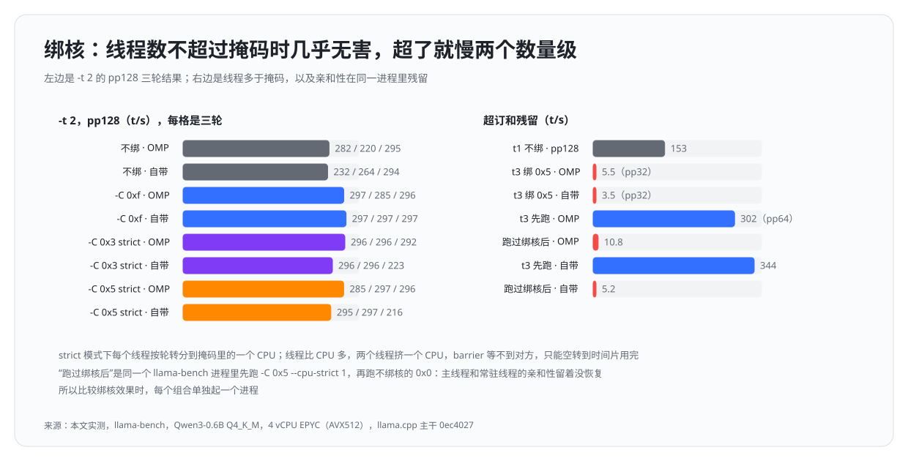

-t 2 时我比了四种：不绑、-C 0xf、-C 0x3 strict（同一个物理核的两个超线程）、-C 0x5 strict（两个物理核各一个）。不绑时三轮在 220 到 295 之间跳，-C 0xf 和两种 strict 大多稳在 285 到 297，偶尔一轮掉到 216 到 223。0x3 和 0x5 平均差不多，这个模型的 prefill 在两个超线程上并没有比两个物理核慢多少。

线程比掩码多就是另一回事了。-t 3 -C 0x5 --cpu-strict 1，pp32 OpenMP 构建 5.5 t/s，自带线程池 3.5 t/s，不到单线程 pp128 的二十分之一。两个线程绑在同一个 CPU 上，一个在 barrier 里自旋等另一个，另一个却拿不到 CPU，要等时间片用完才轮到它。

## 3.3 亲和性会残留

第一次做这组实验时，我把所有掩码写在一条 llama-bench 命令里，结果排在绑核测试后面的不绑核测试也慢得离谱。llama-bench 每个测试会按 n_threads、cpu_mask、cpu_strict 重建线程池[[21]](https://github.com/ggml-org/llama.cpp/blob/0ec4027/tools/llama-bench/llama-bench.cpp)，但设在主线程和 OpenMP 常驻线程上的亲和性没人恢复。

sticky 组专门复现这个坑：同一进程里先跑 -C 0x5 strict，再跑掩码 0x0，pp64 OpenMP 构建从单独起进程时的 302 掉到 10.8，自带线程池从 344 掉到 5.2。所以凡是比较绑核效果的实验，exp10.sh 都让每个组合单独起一个进程。超订本身也不报错，日志里看不出任何异常，只有速度不对，所以我在启动脚本里加了一行检查：-t 大于掩码里置位的个数就直接退出。

> 🔑 **本章要点**：strict 模式下每个线程轮转绑到掩码里的一个 CPU。线程数不超过掩码时，绑核只让结果更稳；超了就慢两个数量级。同一个 llama-bench 进程里的亲和性会残留到后面的测试。

# 第 4 章 · 等待策略

## 4.1 三层等待

线程做完一个节点、等别人的时候，可以自旋，也可以睡下等唤醒。自旋快但占 CPU，睡眠省 CPU，但唤醒要走一趟内核调度。decode 每 token 653 次 barrier，每次多一点延迟，累起来就是几毫秒。

OpenMP 构建里，等待由 OpenMP 运行时管。GCC 的 libgomp 认 OMP_WAIT_POLICY 和 GOMP_SPINCOUNT：不设时先自旋一段再转被动等待，缺省自旋 30 万次，passive 时是 0[[5]](https://gcc.gnu.org/onlinedocs/libgomp/OMP_005fWAIT_005fPOLICY.html)[[6]](https://gcc.gnu.org/onlinedocs/libgomp/GOMP_005fSPINCOUNT.html)。llama.cpp 在 OpenMP 构建下会把 KMP_BLOCKTIME 设成 200，但那是 LLVM 和 Intel OpenMP 的变量，表示做完并行区后等多久再睡[[22]](https://openmp.llvm.org/design/Runtimes.html)[[3]](https://github.com/ggml-org/llama.cpp/blob/0ec4027/ggml/src/ggml-cpu/ggml-cpu.c)。这台机器用的是 GCC，这个变量不起作用。

自带线程池里，等待由 --poll 管。源码在转去 cond_wait 之前自旋 1024 × 128 × poll 轮，缺省 poll 是 50[[3]](https://github.com/ggml-org/llama.cpp/blob/0ec4027/ggml/src/ggml-cpu/ggml-cpu.c)[[8]](https://github.com/ggml-org/llama.cpp/blob/0ec4027/common/arg.cpp)。--prio 改调度策略：Linux 上 1 是 SCHED_FIFO 40，2 是 FIFO 80，3 是 FIFO 90，-1 是 SCHED_BATCH。实时调度受 sched_rt_runtime_us 限制，缺省每秒最多占 0.95 秒[[23]](https://docs.kernel.org/scheduler/sched-rt-group.html)。

## 4.2 实测

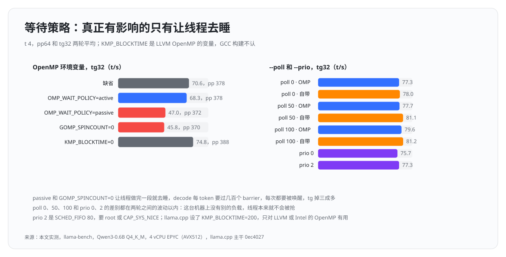

t 4 下，OpenMP 缺省的 tg32 是 70.6 t/s。OMP_WAIT_POLICY=passive 掉到 47.0，GOMP_SPINCOUNT=0 掉到 45.8，都掉了三成多；prefill 只从 378 降到 370 左右，因为 prefill 每个节点的活多，唤醒的开销摊薄了。OMP_WAIT_POLICY=active 是 68.3，和缺省差不多。KMP_BLOCKTIME=0 是 74.8，两轮是 71.5 和 78.0，波动比差值还大。

--poll 0、50、100 的 tg32 在 77 到 81 之间，两轮之间最大差 9 t/s，看不出趋势；--prio 0 和 2 是 75.7 和 77.3。这台机器上除了推理没有别的负载，线程本来就不会被抢，提高优先级没有可抢的对象。

**📎 展开阅读：**有人会在容器启动脚本里写 OMP_WAIT_POLICY=passive，为的是空闲时不占 CPU。对 llama.cpp 这类每 token 几百次同步的负载，这个设置直接让 decode 掉三成。空闲时不占 CPU 是缺省行为就能做到的：libgomp 自旋 30 万次以后自己会睡。

## 4.3 什么时候该动它们

空闲的专用机器上，这几个参数都用缺省。要动它们通常是两种情况。一种是和别的服务共用机器，推理空闲时不想让线程空转占 CPU：自带线程池可以把 --poll 调小，OpenMP 构建靠 libgomp 自旋够次数以后自己去睡，都不需要设 passive。

另一种是机器上有邻居，想让推理线程优先拿到 CPU，这时才考虑 --prio。--prio 2 以上是实时调度，要 root 或 CAP_SYS_NICE，普通用户设了只会打印警告。实时线程自旋时会一直占着 CPU，内核靠 sched_rt_runtime_us 给普通任务留 5% 的时间[[23]](https://docs.kernel.org/scheduler/sched-rt-group.html)，所以 FIFO 下线程数要比 CPU 少，给系统进程留出空位。

> 🔑 **本章要点**：真正影响速度的是让线程去睡：passive 和 GOMP_SPINCOUNT=0 让 tg 掉三成多。KMP_BLOCKTIME 对 GCC 构建无效，--poll 和 --prio 在空闲机器上差别在噪声内。

# 第 5 章 · -t、-tb 和 ubatch

## 5.1 两个线程池

-t 和 -tb 分别设 decode 和 prefill 的线程数，-tb 不写时等于 -t；绑核和优先级也各有一套，-Cb、--cpu-strict-batch、--prio-batch、--poll-batch[[8]](https://github.com/ggml-org/llama.cpp/blob/0ec4027/common/arg.cpp)。llama_context 计算一个 ubatch 时看 token 数，多于 1 个就用 batch 线程池，只有 1 个才用普通线程池。

common 初始化时比较两组参数，一样就只建一个池；不一样就建两个，普通池先以暂停状态启动，用到时再唤醒。2026 年有个 PR 讨论过线程数不同时能不能共用一个池，源码注释引的是讨论里的结论：每个池的线程数必须和各自的参数完全一致[[7]](https://github.com/ggml-org/llama.cpp/pull/27138)。llama-bench 只有一个 -t，两段用同一个线程数，要分开看只能用 llama-completion 或 server。

## 5.2 实测

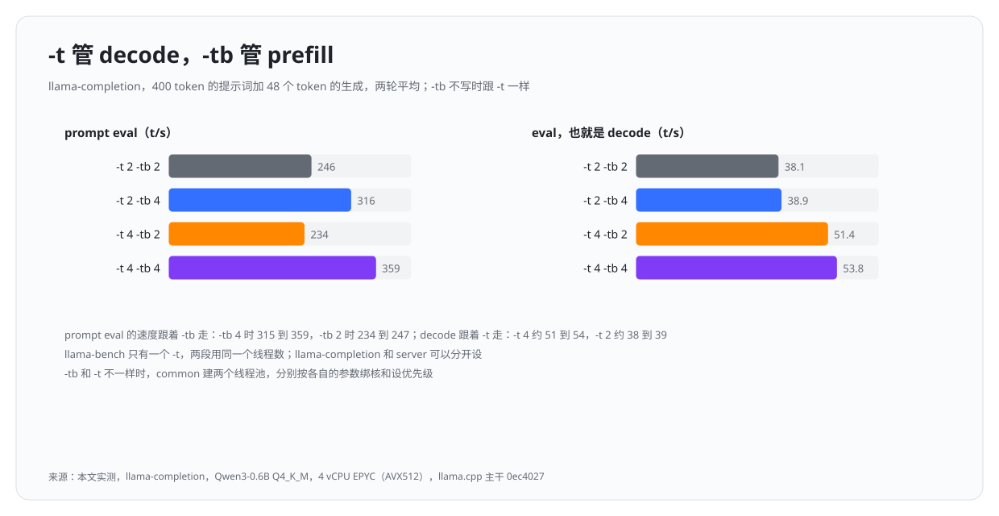

我用 llama-completion 跑一段约 400 token 的提示词，再生成 48 个 token，四种组合各两轮。prompt eval 跟着 -tb 走：-tb 4 时 316 和 359 t/s，-tb 2 时 234 和 247。eval 跟着 -t 走：-t 4 时 51 到 54，-t 2 时 38 到 39。两个数各自只看自己那个参数。

这给了一种配法：长提示词、短回答的场景，比如 RAG 和分类，-tb 设成全部逻辑核，-t 设成物理核数，prefill 吃满超线程，decode 留余地给别的进程。反过来短提示词、长生成的聊天，-tb 的影响就小了。

## 5.3 ubatch

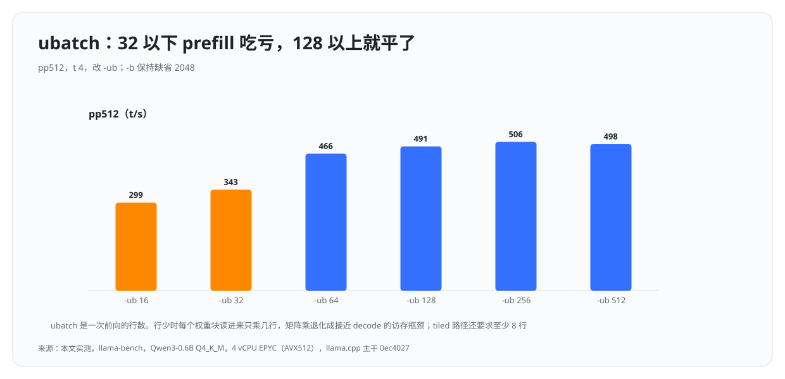

-ub 是一次前向最多算多少行，-b 是一次 decode 调用最多收多少 token，-b 会按 -ub 切成多个 ubatch[[8]](https://github.com/ggml-org/llama.cpp/blob/0ec4027/common/arg.cpp)。pp512 扫 -ub：16 时 299 t/s，32 时 343，64 时 466，128 时 491，256 和 512 是 506 和 498。

行少时每读一次权重只乘几行，矩阵乘又回到了访存受限的那一侧，越往 decode 靠，roofline 上的算术强度越低[[12]](https://dl.acm.org/doi/10.1145/1498765.1498785)。到 128 行以后，计算本身成了瓶颈，再加行数不再变快。缺省 -ub 是 512，不用改；为了省激活内存把 -ub 压到 32，prefill 要比缺省慢三成。

> 🔑 **本章要点**：-tb 管 prefill，-t 管 decode，两段各看各的参数；长提示词场景可以把 -tb 设大。-ub 低于 64 时 prefill 明显变慢，128 以上就平了，缺省 512 不用改。

# 第 6 章 · repack

## 6.1 把权重换个排法

GGUF 里的量化块是按行存的，一行一行做点积。repack 在加载时把几行的块交错重排，比如 Q4_0 在 AVX2 上排成 8x8：8 行的同一列块挨在一起，一条 SIMD 指令能同时乘 8 行，激活读一次用 8 次[[9]](https://github.com/ggml-org/llama.cpp/pull/10446)。2024 年的重构把它做成在线重排，加载时自动做，不用另存一份 GGUF。

哪些类型能重排，看 repack.cpp 里按类型和指令集写的一串判断[[24]](https://github.com/ggml-org/llama.cpp/blob/0ec4027/ggml/src/ggml-cpu/repack.cpp)。x86 上 Q4_0、Q4_K、IQ4_NL、MXFP4 要 AVX2，Q2_K 要 AVX512；Q8_0 只在 ARM NEON 和 RISC-V 上重排，Q6_K 在 x86 上没有重排格式。重排还要求行数是 8 的倍数。--repack 0 可以关掉，缺省开。

## 6.2 矩阵乘按顺序找路

CPU 后端算 MUL_MAT 时按固定顺序找第一条能走的路[[3]](https://github.com/ggml-org/llama.cpp/blob/0ec4027/ggml/src/ggml-cpu/ggml-cpu.c)。最先问 extra buffer，权重被 repack 过就走 repack 的 gemm 和 gemv；否则进 ggml_compute_forward_mul_mat，先试 tiled，再试 llamafile_sgemm，最后是按块切的 vec_dot。

llamafile_sgemm 是 2024 年从 llamafile 合进来的分块矩阵乘，支持 F32、BF16、F16、Q8_0、Q4_0、Q5_0 和 IQ4_NL，PR 的目标就是提升 CPU 上的 prompt eval[[25]](https://github.com/ggml-org/llama.cpp/pull/6414)。tiled 是 2026 年加的，专给 K 系列和多数 IQ 类型做分块，第 7 章细讲[[10]](https://github.com/ggml-org/llama.cpp/pull/27851)。repack 过的权重，tiled 不收。

## 6.3 实测

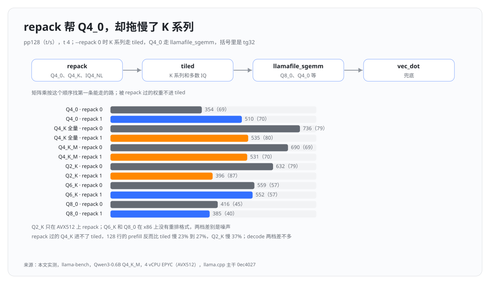

t 4，pp128 和 tg32。Q4_0 打开 repack 以后 prefill 从 354 涨到 510 t/s，因为关掉时它走的是 sgemm。K 系列反过来：Q4_K 全量从 736 掉到 535，Q4_K_M 从 690 掉到 531，Q2_K 从 632 掉到 396，关掉 repack 时它们走 tiled，tiled 在 128 行上更快。

decode 两档几乎一样，Q2_K 打开 repack 反而从 79 涨到 87。Q6_K 和 Q8_0 在 x86 上本来就不重排，两档的差别是噪声。所以 repack 对 K 系列的影响只在 prefill 上，decode 重的场景不用管它；用 K 系列量化、prefill 又占大头时，我会用 llama-bench --repack 0,1 实测一次再定。

**📎 展开阅读：**--repack 是全局开关，一个模型里不同张量类型混着用时会互相牵连。Q4_K_M 里大部分张量是 Q4_K，output 和部分 attn_v、ffn_down 是 Q6_K；关掉 repack，Q4_K 张量转去 tiled，Q6_K 张量本来就在 tiled 上，整体 prefill 快 30%。

> 🔑 **本章要点**：repack 加载时把几行的块交错重排，Q4_0 的 prefill 快 44%。但 repack 过的 Q4_K、Q2_K 进不了 tiled，pp128 慢 23% 到 37%；decode 两档差不多。

# 第 7 章 · tiled 和三条路径

## 7.1 tiled 管什么

tiled.cpp 的 ggml_tiled_supported 列了它收的类型：Q6_K、Q5_K、Q4_K、Q3_K、Q2_K、IQ4_XS，以及 IQ2_XXS、IQ2_XS、IQ2_S、IQ3_XXS、IQ3_S、IQ1_S、IQ1_M[[26]](https://github.com/ggml-org/llama.cpp/blob/0ec4027/ggml/src/ggml-cpu/tiled/tiled.cpp)。权重的 extra 不为空，也就是被 repack 过，直接返回 false。行数少于 8 时它判断不划算，也不接；GGML_CPU_TILED_MM=0 整个关掉，GGML_CPU_TILED_MM_FORCE 强制启用。

tiled 的头文件写明了它的做法：激活先量化成 q8_K，权重按宏块解包成统一的瓦片格式，再交给 16x16 的微内核，一块权重解包一次，乘满 16 行激活[[10]](https://github.com/ggml-org/llama.cpp/pull/27851)。头文件也注明目前只为 x86 优化过。T-MAC 走得更远，用查表代替低比特权重的反量化和乘法，在 M2 Ultra 上比 llama.cpp 快到 4 倍[[17]](https://arxiv.org/abs/2407.00088)；两者的目标一样，让 prefill 摆脱逐行点积。

## 7.2 三条路径对比

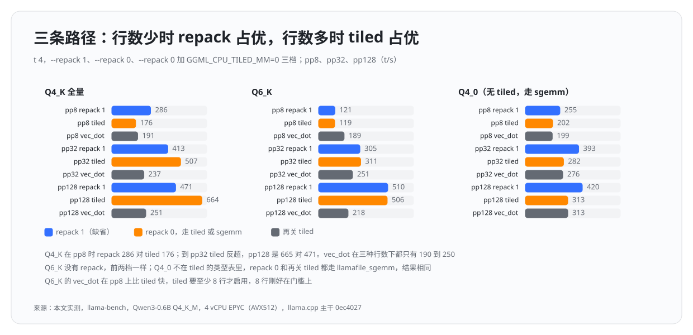

我挑了三种类型，各跑 --repack 1、--repack 0、--repack 0 加 GGML_CPU_TILED_MM=0 三档，行数 8、32、128。Q4_K 全量在 pp8 时 repack 286 t/s，tiled 176。到 pp32 tiled 反超，507 对 413，pp128 是 665 对 471。vec_dot 在三种行数下都只有 190 到 250，行数增加也几乎不涨。

Q6_K 没有 repack，前两档走的都是 tiled，结果一样；关掉 tiled 后 pp128 从 506 掉到 218。Q4_0 不在 tiled 的类型表里，repack 0 和再关 tiled 都走 sgemm，结果相同，都比 repack 慢。

## 7.3 门槛附近和 decode

一个反常的数：Q6_K 在 pp8 上 vec_dot 189，比 tiled 的 119 还快。8 行刚好在 tiled 的门槛上，分块的准备开销摊不开。投机解码验证草稿时一批只有几行到十几行，正好落在这一段，LCPP-13 会再碰到这个问题。

decode 只有一行，不够 tiled 的门槛，Q4_K 和 Q6_K 三档走的都是 vec_dot。Q6_K 的 tg16 三档是 50.5、56.6、62.8，路径完全一样却差了两成，这就是这组实验的噪声量级，看 tg 的差别时要拿它打折扣。Q4_0 不一样，repack 的 tg16 是 83.5，另外两档 66 和 67，因为 repack 有专门的单行 gemv，decode 也受益。

> 🔑 **本章要点**：tiled 收 K 系列和多数 IQ 类型，至少 8 行才启用，被 repack 过的权重不进。Q4_K 在 8 行时 repack 快，32 行以上 tiled 快；vec_dot 不随行数涨，是最慢的兜底。

# 第 8 章 · 邻居

## 8.1 一个超线程被占

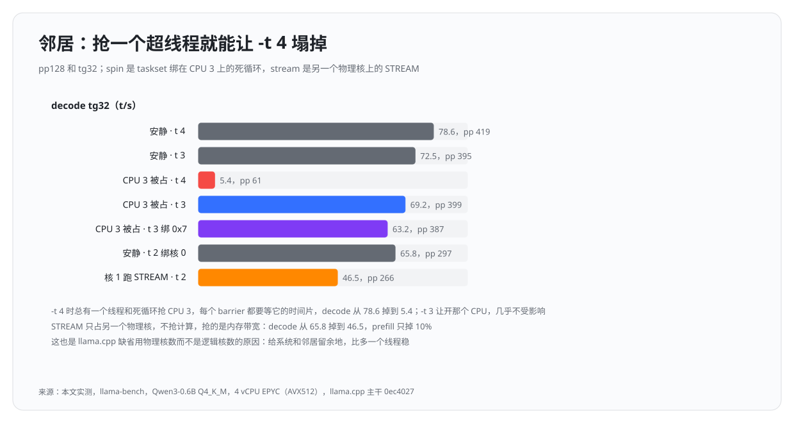

生产机器上很少只跑推理。我用 taskset 把一个 bash 死循环绑在 CPU 3 上，模拟一个吃满一个超线程的邻居。安静时 -t 4 的 decode 是 78.6 t/s，有了邻居掉到 5.4，prefill 从 419 掉到 61。-t 3 几乎不受影响，decode 69.2，prefill 399。

原因和第 3 章的超订一样。-t 4 时总有一个推理线程和死循环分 CPU 3，每过一次 barrier，其他三个线程都要等它拿到时间片。decode 每 token 653 次 barrier，每次都可能等上一个调度周期，速度就塌了。-t 3 让出一个 CPU，内核多半会把三个线程放到另外三个 CPU 上。

-t 3 再加 -C 0x7 --cpu-strict 1 显式避开 CPU 3，decode 是 63.2，比不绑还慢一点。CPU 2 和 CPU 3 是同一个物理核，绑死以后 CPU 2 上的线程始终和死循环共享执行单元；不绑时内核还能调剂。Zhang 和 Huang 在 iPhone 15 Pro 上测过同样的事：1B 模型用 2 个 CPU 线程跑 F16 有 17 t/s，比 GPU 的 12.8 还快，再加线程反而变慢，论文把原因归到线程超订[[11]](https://arxiv.org/abs/2505.06461)。

## 8.2 带宽被抢

另一种邻居不抢 CPU，抢内存带宽。我让 llama 用 -t 2 -C 0x3 待在核 0，STREAM 用 taskset 在核 1 上循环跑。decode 从安静时的 65.8 掉到 46.5，prefill 从 297 掉到 266，只掉 10%。decode 受带宽限制，prefill 受计算限制，邻居抢什么，就掉哪一段[[13]](https://www.cs.virginia.edu/stream/ref.html)。

这种干扰调线程数也躲不开，只能换机器或者把推理和吃带宽的任务分到不同的 NUMA 节点上。我在容器里部署时会先看同一台宿主机上有没有数据处理一类的任务，再决定 decode 的预期。

## 8.3 怎么发现邻居

邻居的影响不会出现在 llama.cpp 的日志里，只表现为速度不稳。我的办法是在服务旁边定时跑一个很短的 llama-bench，-p 0 -n 16，记下 tg，和上线前在同一台机器上测的基线比。掉到基线的一半以下，多半是有进程在抢推理线程的 CPU；掉两三成而 prefill 不怎么动，多半是带宽被抢。

前一种可以靠减少线程数躲开，后一种只能挪机器。云上的虚拟机还要多看一项：宿主机超卖时，同一个物理核的另一个超线程可能分给了别的租户，表现和本章的死循环一样，这时 -t 设成物理核数的好处更明显。

**📎 展开阅读：**这也是我不把 -t 设成全部逻辑核的原因。没有邻居时，-t 4 比 -t 3 的 decode 只快 5%；有一个邻居时，-t 4 只有 -t 3 的十三分之一。缺省用物理核数，看似浪费了超线程，换来的是对邻居不敏感。

> 🔑 **本章要点**：一个超线程被占，-t 4 的 decode 从 78.6 掉到 5.4，-t 3 几乎不受影响。另一个物理核跑 STREAM，decode 掉三成，prefill 只掉 10%。线程数留出余地比多一个线程稳。

# 第 9 章 · 解码上限

## 9.1 带宽除以字节

decode 每生成一个 token，几乎所有权重都要从内存读一遍，每个权重只参与一次乘加，算术强度远低于 CPU 的计算和带宽之比。按 roofline 模型，这时速度由带宽决定：上限等于内存带宽除以每 token 读的字节[[12]](https://dl.acm.org/doi/10.1145/1498765.1498785)。[LCPP-02｜上手｜推理账本：带宽、算力和启动前算出速度上限](./02-ledger.md) 推过这个公式，这里在同一台机器上把两边都量出来。

带宽用 STREAM 测，它是衡量可持续内存带宽的标准做法[[13]](https://www.cs.virginia.edu/stream/ref.html)。字节数从 GGUF 的张量表算：Qwen3-0.6B 的 output.weight 是单独一份，不和 token_embd 共享，token_embd 每个 token 只查一行，可以不算。Q4_K_M 每 token 读 390.8 MB，Q8_0 读 633.5 MB。上下文很短时 KV cache 的读取量相对权重很小，也不算。

## 9.2 实测

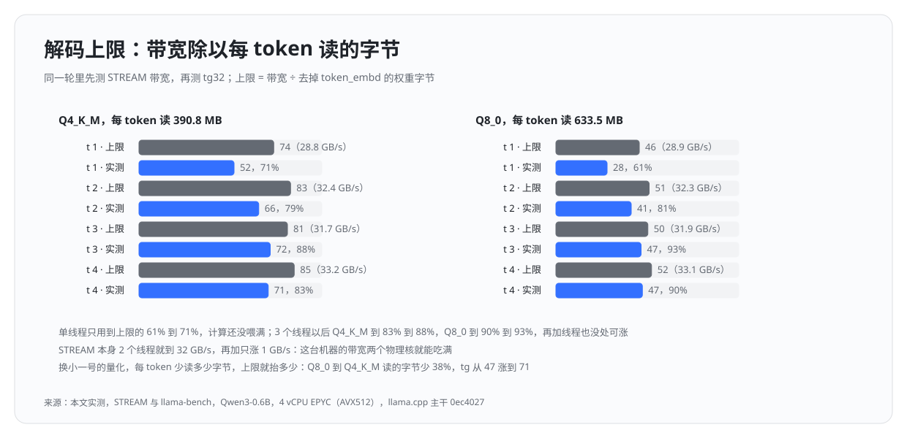

每个线程数下我先跑一次 STREAM，紧接着跑 tg32，两种量化交替，做两轮。STREAM 单线程 28.8 GB/s，2 个线程 32.4，再往上只到 33.2：两个物理核已经吃满这台机器的带宽。对应的上限，Q4_K_M 从 74 到 85 t/s，Q8_0 从 46 到 52 t/s。

单线程时实测只到上限的 61% 到 71%，一个核的计算还喂不满带宽。3 个线程以后，Q4_K_M 到 83% 到 88%，Q8_0 到 90% 到 93%。剩下的一成多花在 barrier、激活的量化和反量化、注意力和小算子上，再加线程也拿不回来。

Drepper 的内存文章解释过为什么单线程到不了峰值：一个核能同时挂起的缓存未命中有限，要靠多个核一起发请求才能把内存控制器排满[[14]](https://people.freebsd.org/~lstewart/articles/cpumemory.pdf)。所以这里加线程对 decode 有用，到 2 个物理核以后就没用了。

## 9.3 到顶以后

带宽测好以后，判断 decode 还有没有余地就很简单：实测除以上限，到了 85% 以上，再调线程、绑核、等待策略都只能拿回几个百分点。剩下的办法是少读字节。Q8_0 换成 Q4_K_M，每 token 读的字节少 38%，tg 从 47 涨到 71，几乎按比例。

cpu_probe 接受 --model-gib 和 --bw-gbps 两个参数，直接算出上限，这台机器给 33 GB/s 和 0.364 GiB 时是 84 t/s，和上面的实测上限一致。更多少读字节的办法，比如更低比特的量化，在 [LCPP-07｜内部｜量化：块结构、配方、imatrix 和用 KLD 选类型](./07-quantization.md) 里；投机解码一次验证多个 token，摊薄每 token 的权重读取，放在 LCPP-13。

> 🔑 **本章要点**：decode 上限 = 带宽 ÷ 每 token 读的字节，这台机器 33 GB/s，Q4_K_M 上限约 85 t/s。3 个线程以后实测到上限的 83% 到 93%，再调线程没处可涨，只能换更小的量化。

# 第 10 章 · 加载方式、mlock、大页和 NUMA

## 10.1 四种加载方式

2023 年 llama.cpp 改用 mmap 加载权重，PR 标题写的是加载快 10 到 100 倍：权重直接映射文件页，不用先读进堆内存再拷一遍，多个进程还能共享同一份页缓存[[27]](https://github.com/ggml-org/llama.cpp/pull/613)。2026 年加了 --direct-io，用 O_DIRECT 绕过页缓存读进匿名内存[[28]](https://github.com/ggml-org/llama.cpp/pull/18166)[[29]](https://man7.org/linux/man-pages/man2/open.2.html)；随后几个开关合并成 -lm，取值 auto、none、mmap、mlock、mmap+mlock、dio，缺省 auto 就是 mmap[[30]](https://github.com/ggml-org/llama.cpp/pull/20834)[[31]](https://github.com/ggml-org/llama.cpp/blob/0ec4027/src/llama-model-loader.cpp)。

mmap 路径在 llama-mmap.cpp 里还做了几件事：先 posix_fadvise 声明顺序读，需要预取时加 MAP_POPULATE 或对范围发 MADV_WILLNEED[[32]](https://github.com/ggml-org/llama.cpp/blob/0ec4027/src/llama-mmap.cpp)[[33]](https://man7.org/linux/man-pages/man2/madvise.2.html)。开了 NUMA 时不预取，并对整个文件发 MADV_RANDOM 关掉预读，页在哪个节点上第一次被访问，就分配在哪个节点。

## 10.2 实测

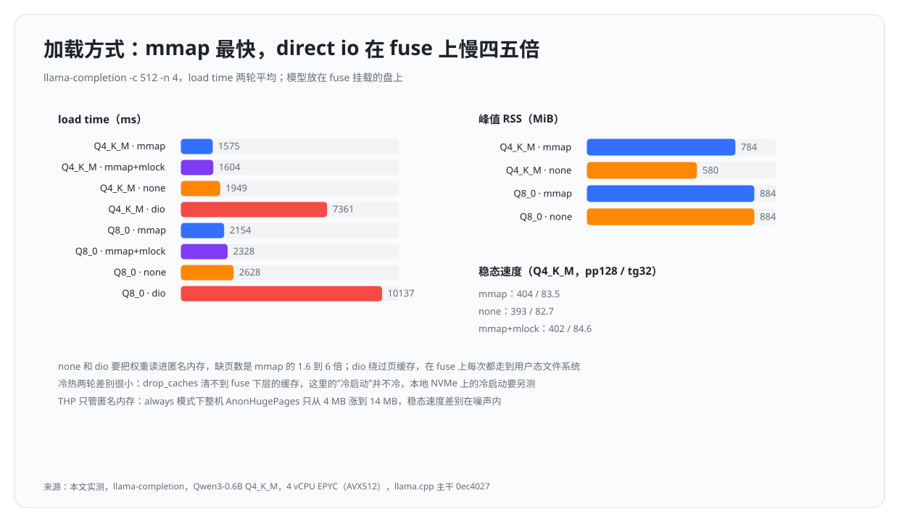

模型放在一块 fuse 挂载的盘上，llama-completion -c 512 -n 4，每种方式先清页缓存跑一次，再热跑一次，做两轮。Q4_K_M 的 load time：mmap 1575 毫秒，mmap+mlock 1604，none 1949，dio 7361；Q8_0 是 2154、2328、2628 和 10137。dio 在 fuse 上每次读都要走到用户态文件系统，慢了四五倍。

峰值 RSS 看起来反直觉：Q4_K_M 用 mmap 是 784 MiB，none 只有 580。Q8_0 两种方式都是 885 MiB，差别只出在 Q4_K_M 上。用 -v 跑一遍能看到原因：两种方式都有一块 204.75 MiB 的 CPU_REPACK 匿名缓冲，token_embd 等 143 个张量留在普通缓冲里，共 251 MiB。

mmap 时重排要先读文件页，读过的这 204 MiB 文件页也算进 RSS，784 减 580 正好是 204；none 时源数据是读进来重排的，没有这份文件页。Q8_0 在 x86 上不重排，两种方式占的一样多。缺页数则是 none 和 dio 多，Q4_K_M 上 mmap 9.3 万次，none 15 万次，dio 18 万次。

冷热两轮差别很小，因为 drop_caches 只清本机内核的页缓存，fuse 下层的缓存清不到[[34]](https://docs.kernel.org/admin-guide/sysctl/vm.html)，这里的冷启动并不冷。本地 NVMe 上真正的冷启动要另测。稳态速度三种方式差不多，Q4_K_M 的 pp128 都在 393 到 404，tg32 在 83 到 85。

## 10.3 mlock 和大页

mlock 锁住的页不会被换出，受 RLIMIT_MEMLOCK 限制[[35]](https://man7.org/linux/man-pages/man2/mlock.2.html)。这台机器的上限是 8192 KiB，但实验是 root 跑的，锁住整个模型没有报错。普通用户超了上限时，llama.cpp 只打一行警告，建议调高 RLIMIT_MEMLOCK，接着跑，不会退出。所以加了 mlock 以后要看日志确认真的锁上了。

透明大页目前只作用于匿名内存和 tmpfs[[36]](https://docs.kernel.org/admin-guide/mm/transhuge.html)，mmap 的权重是文件页，THP 管不到。-lm none 时权重在匿名内存里，THP 设成 always 才可能用上。实测 always 下整机 AnonHugePages 只从 4 MB 涨到 14 MB，pp512 和 tg64 的差别都在噪声内。0.6B 模型的权重不到 500 MB，TLB 压力本来就小，大模型上值得再测。

## 10.4 NUMA 和放不下的模型

多路服务器上，--numa distribute 让第 n 个线程跑在第 n % 节点数个节点上，isolate 让所有线程留在启动时的节点，numactl 用 numactl 给的 cpuset[[37]](https://github.com/ggml-org/llama.cpp/pull/5377)[[3]](https://github.com/ggml-org/llama.cpp/blob/0ec4027/ggml/src/ggml-cpu/ggml-cpu.c)。内核的 numa_balancing 不为 0 时，ggml 会打印警告，说观察到它会拖慢性能。这台机器只有一个节点，--numa 是空操作，所以这一节没有实测。

模型比内存大时，mmap 让它也能跑，代价是每个 token 都要从盘上缺页读回权重，decode 变成受磁盘带宽限制。Apple 的 LLM in a flash 专门研究这种情形：只从闪存加载稀疏激活的那部分神经元，用滑动窗口复用最近加载的权重，能跑两倍于 DRAM 的模型[[38]](https://arxiv.org/abs/2312.11514)。llama.cpp 没有做这类稀疏加载，内存放不下时我会先换更小的量化。

**📎 展开阅读：**mmap 的 RSS 偏大不等于真的占了那么多内存。文件页是共享的、可回收的，同一台机器起多个进程读同一个 GGUF，页缓存只有一份；none 和 dio 每个进程各一份匿名内存。部署多个副本时，mmap 省下的内存比单进程的 RSS 数字显示的多。

> 🔑 **本章要点**：缺省 mmap 最快，多进程共享页缓存；dio 在 fuse 上慢四五倍。mlock 失败只警告，要看日志。THP 管不到 mmap 的文件页，小模型上大页没有可测的收益。单节点机器上 --numa 是空操作。

# 第 11 章 · 怎么选与上线清单

## 11.1 按参数选

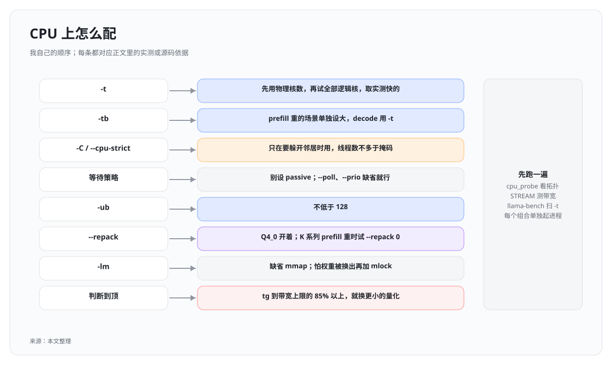

| 参数 | 怎么配 | 依据 |
|-|-|-|
| -t | 先用物理核数，再试全部逻辑核，取实测快的 | 第 2 章：decode t 3 到 t 4 只涨 5% |
| -tb | prefill 重的场景设成全部逻辑核 | 第 5 章：-tb 4 的 prompt eval 316 对 234 |
| -C 和 --cpu-strict | 只在要躲开邻居时用，线程数不多于掩码 | 第 3 章：超订时 pp32 只剩 5.5 |
| 等待策略 | 别设 passive，--poll 和 --prio 用缺省 | 第 4 章：passive 让 tg 掉三成 |
| -ub | 不低于 128，缺省 512 | 第 5 章：-ub 16 的 pp512 只有 299 |
| --repack | Q4_0 开着，K 系列 prefill 重时试 --repack 0 | 第 6 章：Q4_K_M pp128 531 对 690 |
| -lm | 缺省 mmap，怕权重被换出再加 mlock | 第 10 章：dio 在 fuse 上慢四五倍 |

表里的数都来自 Qwen3-0.6B 和一台 4 vCPU 的 EPYC。核多的机器上，barrier 和带宽的平衡点会挪，结论的方向不变，具体数字要重测。我换机器时先跑 cpu_probe 看拓扑和指令集，再用 STREAM 测带宽算出上限，然后按 exp10.sh 的 threads、repack 两组扫一遍。

## 11.2 上线清单

> 📌 **上线前核对清单**：每换一台机器或一个模型，我按这个顺序过一遍。
> - cpu_probe 看过物理核分组，-t 的起点是物理核数，绑核掩码按 thread_siblings_list 算
> - llama-bench 扫过 -t，每个线程数至少三轮，每个组合单独起进程
> - 用了 --cpu-strict 1 的，-t 不多于掩码里的 CPU 数
> - 环境里没有 OMP_WAIT_POLICY=passive 和 GOMP_SPINCOUNT=0
> - K 系列量化用 --repack 0,1 测过 prefill，按场景定了开关
> - STREAM 测过带宽，tg 到了上限的多少心里有数
> - 同一台宿主机上有没有占 CPU 或吃带宽的邻居，-t 留了余地
> - 加了 mlock 的，日志里没有 failed to mlock 的警告

## 11.3 下一步

CPU 上 decode 的天花板是内存带宽，这台机器只有 33 GB/s，显卡的显存带宽高出一个数量级以上。把部分层或者 MoE 的专家放到 GPU 上，放在 LCPP-11；多卡和 RPC 放在 LCPP-12；投机解码怎么摊薄每 token 的权重读取放在 LCPP-13；把这篇和后面几篇的参数汇成一份调参手册，放在 LCPP-17。带宽模型的推导回到 [LCPP-02｜上手｜推理账本：带宽、算力和启动前算出速度上限](./02-ledger.md)。

# 参考文献

按正文首次引用顺序编号，资料截至 2026 年 10 月初。

[1] llama.cpp 0ec4027. common/common.cpp：common_cpu_get_num_math 在 x86 Linux 上返回物理核数，作为 -t 的缺省。 [common/common.cpp](https://github.com/ggml-org/llama.cpp/blob/0ec4027/common/common.cpp)

[2] llama.cpp 0ec4027. docs/development/token_generation_performance_tips.md：-t 设成物理核数，从 1 开始翻倍试。 [token_generation_performance_tips.md](https://github.com/ggml-org/llama.cpp/blob/0ec4027/docs/development/token_generation_performance_tips.md)

[3] llama.cpp 0ec4027. ggml/src/ggml-cpu/ggml-cpu.c：线程池、ggml_barrier、轮询、优先级、绑核、NUMA 初始化和 KMP_BLOCKTIME。 [ggml-cpu.c](https://github.com/ggml-org/llama.cpp/blob/0ec4027/ggml/src/ggml-cpu/ggml-cpu.c)

[4] Linux man-pages. sched_setaffinity(2)。 [sched_setaffinity(2)](https://man7.org/linux/man-pages/man2/sched_setaffinity.2.html)

[5] GCC. libgomp 手册：OMP_WAIT_POLICY，未设置时先忙等一小段再转被动等待。 [libgomp OMP_WAIT_POLICY](https://gcc.gnu.org/onlinedocs/libgomp/OMP_005fWAIT_005fPOLICY.html)

[6] GCC. libgomp 手册：GOMP_SPINCOUNT，缺省 30 万次，ACTIVE 时 300 亿次，PASSIVE 时 0；线程数超过 CPU 数时降到 1000 或 100。 [libgomp GOMP_SPINCOUNT](https://gcc.gnu.org/onlinedocs/libgomp/GOMP_005fSPINCOUNT.html)

[7] nikwen. common: share thread pools when n_threads differ. llama.cpp PR #27138, 2026. [PR #27138](https://github.com/ggml-org/llama.cpp/pull/27138)

[8] llama.cpp 0ec4027. common/arg.cpp：-t、-tb、-C、--cpu-strict、--prio、--poll、--repack、-lm、--numa 的注册。 [common/arg.cpp](https://github.com/ggml-org/llama.cpp/blob/0ec4027/common/arg.cpp)

[9] Djip007. Refactor/online repacking. llama.cpp PR #10446, 2024. [PR #10446](https://github.com/ggml-org/llama.cpp/pull/10446)

[10] jbooth. ggml-cpu: tiled mul_mat for k-quants. llama.cpp PR #27851, 2026. [PR #27851](https://github.com/ggml-org/llama.cpp/pull/27851)

[11] Zhang H, Huang J. Challenging GPU Dominance: When CPUs Outperform for On-Device LLM Inference. 2025. [arXiv:2505.06461](https://arxiv.org/abs/2505.06461)

[12] Williams S, Waterman A, Patterson D. Roofline: An Insightful Visual Performance Model for Multicore Architectures. CACM 52(4), 2009. [doi:10.1145/1498765.1498785](https://dl.acm.org/doi/10.1145/1498765.1498785)

[13] McCalpin J D. Memory Bandwidth and Machine Balance in Current High Performance Computers. IEEE TCCA Newsletter, 1995. [cs.virginia.edu/stream](https://www.cs.virginia.edu/stream/ref.html)

[14] Drepper U. What Every Programmer Should Know About Memory. 2007. [cpumemory.pdf](https://people.freebsd.org/~lstewart/articles/cpumemory.pdf)

[15] Shen H, et al. Efficient LLM Inference on CPUs. NeurIPS 2023 ENLSP Workshop. [arXiv:2311.00502](https://arxiv.org/abs/2311.00502)

[16] He P, et al. Inference Performance Optimization for Large Language Models on CPUs. ICML 2024 Workshop. [arXiv:2407.07304](https://arxiv.org/abs/2407.07304)

[17] Wei J, et al. T-MAC: CPU Renaissance via Table Lookup for Low-Bit LLM Deployment on Edge. EuroSys 2025. [arXiv:2407.00088](https://arxiv.org/abs/2407.00088)

[18] msy-kato. ggml: Support OpenMP for multi-thread processing. llama.cpp PR #7606, 2024. [PR #7606](https://github.com/ggml-org/llama.cpp/pull/7606)

[19] fmz. Threadpool: take 2. llama.cpp PR #8672, 2024. [PR #8672](https://github.com/ggml-org/llama.cpp/pull/8672)

[20] max-krasnyansky. threads: improve ggml_barrier scaling with large number of threads. llama.cpp PR #9598, 2024. [PR #9598](https://github.com/ggml-org/llama.cpp/pull/9598)

[21] llama.cpp 0ec4027. tools/llama-bench/llama-bench.cpp：每个测试按 n_threads、cpu_mask、cpu_strict、poll 建线程池。 [llama-bench.cpp](https://github.com/ggml-org/llama.cpp/blob/0ec4027/tools/llama-bench/llama-bench.cpp)

[22] LLVM. OpenMP Runtimes：KMP_BLOCKTIME，线程做完并行区后等多久再睡，缺省 200 毫秒。 [openmp.llvm.org Runtimes](https://openmp.llvm.org/design/Runtimes.html)

[23] Linux kernel. Real-Time group scheduling：sched_rt_runtime_us 缺省 950000，实时任务每秒最多占 0.95 秒。 [kernel sched-rt-group](https://docs.kernel.org/scheduler/sched-rt-group.html)

[24] llama.cpp 0ec4027. ggml/src/ggml-cpu/repack.cpp：按类型和指令集选重排格式。 [repack.cpp](https://github.com/ggml-org/llama.cpp/blob/0ec4027/ggml/src/ggml-cpu/repack.cpp)

[25] jart. Improve cpu prompt eval speed. llama.cpp PR #6414, 2024. [PR #6414](https://github.com/ggml-org/llama.cpp/pull/6414)

[26] llama.cpp 0ec4027. ggml/src/ggml-cpu/tiled/tiled.cpp：tiled 矩阵乘支持的类型、GGML_CPU_TILED_MM 开关和 8 行门槛。 [tiled.cpp](https://github.com/ggml-org/llama.cpp/blob/0ec4027/ggml/src/ggml-cpu/tiled/tiled.cpp)

[27] jart. Make loading weights 10-100x faster. llama.cpp PR #613, 2023. [PR #613](https://github.com/ggml-org/llama.cpp/pull/613)

[28] JTischbein. Adding --direct-io flag for model loading. llama.cpp PR #18166, 2026. [PR #18166](https://github.com/ggml-org/llama.cpp/pull/18166)

[29] Linux man-pages. open(2)：O_DIRECT 绕过页缓存。 [open(2)](https://man7.org/linux/man-pages/man2/open.2.html)

[30] taronaeo. args: refactor mlock/mmap/directio into load-mode. llama.cpp PR #20834, 2026. [PR #20834](https://github.com/ggml-org/llama.cpp/pull/20834)

[31] llama.cpp 0ec4027. src/llama-model-loader.cpp：load_mode 到 mmap、mlock、direct io 的映射。 [llama-model-loader.cpp](https://github.com/ggml-org/llama.cpp/blob/0ec4027/src/llama-model-loader.cpp)

[32] llama.cpp 0ec4027. src/llama-mmap.cpp：posix_fadvise、MAP_POPULATE、madvise、mlock 和 O_DIRECT 读取。 [llama-mmap.cpp](https://github.com/ggml-org/llama.cpp/blob/0ec4027/src/llama-mmap.cpp)

[33] Linux man-pages. madvise(2)：MADV_WILLNEED、MADV_RANDOM、MADV_HUGEPAGE。 [madvise(2)](https://man7.org/linux/man-pages/man2/madvise.2.html)

[34] Linux kernel. Documentation for /proc/sys/vm：drop_caches 清页缓存。 [kernel sysctl/vm](https://docs.kernel.org/admin-guide/sysctl/vm.html)

[35] Linux man-pages. mlock(2)：锁定的页不会被换出，受 RLIMIT_MEMLOCK 限制。 [mlock(2)](https://man7.org/linux/man-pages/man2/mlock.2.html)

[36] Linux kernel. Transparent Hugepage Support：THP 目前只作用于匿名内存映射和 tmpfs/shmem。 [kernel transhuge](https://docs.kernel.org/admin-guide/mm/transhuge.html)

[37] bmtwl. Added numa options to allow finer grained control as well as plumbing for a new mirror mode that will require numa.h. llama.cpp PR #5377, 2024. [PR #5377](https://github.com/ggml-org/llama.cpp/pull/5377)

[38] Alizadeh K, et al. LLM in a flash: Efficient Large Language Model Inference with Limited Memory. ACL 2024. [arXiv:2312.11514](https://arxiv.org/abs/2312.11514)

---

[在 Colab 里跑本章 CPU 练习](https://colab.research.google.com/github/zyaochen/zero-to-llama/blob/main/colab/10-cpu-tuning.ipynb) · 上一章：[LCPP-09｜内部｜采样、语法与聊天模板：截断链、温度、惩罚、GBNF 和模板](./09-sampling-grammar.md) · [目录](./README.md) · 下一章：[LCPP-11｜内部｜GPU 卸载与 MoE：-ngl、专家放置、fit 和专家缓存](./11-gpu-offload-moe.md)
