# LCPP-11｜内部｜GPU 卸载与 MoE：-ngl、专家放置、fit 和专家缓存

> 🎯 **这篇文档解决什么问题**：显卡放不下整个模型时，llama.cpp 给了一串参数：-ngl 定多少层上卡，-ot、-cmoe、-ncmoe 把指定张量留在主存，--fit 替你算，--moe-cache-mib 在显卡上给主存里的专家开一块缓存。MoE 模型的专家占权重的八成五到九成五，每个 token 只用其中一小部分，怎么放专家决定了显存够不够、decode 有多快。这篇把每个参数对到源码，用两个 granite MoE 抓下真实路由回放五种放法，再按张量表给 Qwen3-30B-A3B 算显存账本。主线一句话：先用张量表算清显存账，再决定哪些专家留在主存，批次满 32 个 token 时主存里的专家会被搬到卡上算。
>
> 使用方式：只想知道怎么配，看导读和第 11 章；-ngl 的数字和旧资料对不上，看第 1 章；-ot、-cmoe、-ncmoe 的区别看第 2 章；给定一块卡算 -ncmoe，看第 3 章；prefill 和 decode 走哪条路，看第 4 章；专家缓存给多大，看第 5 到 8 章；--fit 估的内存不对，看第 9 章。文中版本和数字核对于 2026 年 10 月 31 日。
>
> **代码**：[zero-to-llama/11-gpu-offload-moe](../11-gpu-offload-moe)。本机没有 GPU。moe_trace.c 用 cb_eval 抓每个 token 在每层选中的专家；moe_cache_sim.py 回放这些路由，比较五种放法的命中率；vram_ledger.py 按 GGUF 张量表算显卡和主存各放多少，倒推最小的 -ncmoe，按源码规则估专家缓存的分组和槽位；这三件事和设备无关。exp11.sh 跑五组实验，test_offload.py 是 15 个回归用例。路由实验用 granite-3.1 的 1b-a400m 和 3b-a800m，显存账本另用 Qwen3-30B-A3B 的张量头，有卡时的速度引 PR 作者的数据，未在本机实测。基线是主干 0ec4027，模型是 Qwen3-0.6B，机器是 4 核 EPYC 云主机无 GPU。

# 导读 · 先给结论

- **-ngl N 从后往前数，输出层算一层。**-ngl 1 只放输出层，-ngl 25 才把 24 层的 granite-1b 全部放上卡；旧资料按旧计数写的数字要加一，最省事是写 all[[1]](https://github.com/ggml-org/llama.cpp/blob/0ec4027/src/llama-model.cpp)[[2]](https://github.com/ggml-org/llama.cpp/blob/0ec4027/common/arg.cpp)。
- **-cmoe 和 -ncmoe 只是预制的 -ot 规则。**-ncmoe N 留的是前 N 层的专家，和 -ngl 方向相反；留在主存的专家有卡时进 CUDA_Host 锁页缓冲，不 repack[[3]](https://github.com/ggml-org/llama.cpp/blob/0ec4027/common/common.h)[[4]](https://github.com/ggml-org/llama.cpp/pull/15077)。
- **先算账再调。**Qwen3-30B-A3B Q4_K_M 的专家占权重 94.6%，-ncmoe 每加一层省 349 MiB；16 GiB 卡留 1 GiB 余量，-ncmoe 至少 7，8 GiB 卡至少 32[[5]](https://github.com/ggml-org/llama.cpp/pull/14992)。
- **32 个 token 是分界线。**批次不少于 32 个 token 时，主存里的专家被搬到卡上算；连续 32 个 token 已经用掉一层 87% 到 93% 的专家，搬整层不亏[[6]](https://github.com/ggml-org/llama.cpp/blob/0ec4027/ggml/src/ggml-cuda/ggml-cuda.cu)[[7]](https://github.com/ggml-org/llama.cpp/pull/15346)。
- **专家缓存每组至少给两倍单 token 用量。**回放里槽位正好一个 token 时，现行的 SLRU 命中率只有 LRU 的两到三成；两倍以上 SLRU 反超[[8]](https://github.com/ggml-org/llama.cpp/pull/30637)[[9]](https://doi.org/10.1109/2.268884)。
- **缓存按张量布局分组。**Qwen3-30B-A3B 的 Q4_K_M 分成两组，各 24 层；PR 建议的 10% 缓存折成每组只有 1.61 倍，要到 2 倍得给 2100 MiB 左右[[10]](https://github.com/ggml-org/llama.cpp/blob/0ec4027/src/llama-moe-cache.cpp)[[11]](https://github.com/ggml-org/llama.cpp/pull/29887)。
- **--fit 看不见 CPU_REPACK。**纯 CPU 构建里 fit 的主存合计漏掉了 repack 后的权重，granite-1b 少算 53%；用户设了 -ngl 或 -ot 时 fit 直接放弃[[12]](https://github.com/ggml-org/llama.cpp/blob/0ec4027/common/fit.cpp)[[13]](https://github.com/ggml-org/llama.cpp/blob/0ec4027/ggml/src/ggml-cpu/repack.cpp)。

**📎 与系列其他文档的分工**：本篇只讲单卡上的放置。decode 为什么受带宽限制见 [LCPP-02｜上手｜推理账本：带宽、算力和启动前算出速度上限](./02-ledger.md)；llama-bench 的用法和噪声见 [LCPP-03｜上手｜测量方法：llama-bench、PPL、KLD 和噪声](./03-bench-ppl.md)；GGUF 的张量表见 [LCPP-04｜内部｜GGUF：文件结构、元数据、加载方式和分卷](./04-gguf.md)；后端和调度器怎么选设备见 [LCPP-06｜内部｜后端与编译：CPU 变体、BLAS、repack 和 GPU 架构](./06-backends-build.md)；量化格式见 [LCPP-07｜内部｜量化：块结构、配方、imatrix 和用 KLD 选类型](./07-quantization.md)；KV cache 的大小见 [LCPP-08｜内部｜KV cache 与长上下文：账本、深度、量化、SWA 和上下文写满](./08-kv-context.md)；CPU 上的线程和 repack 见 [LCPP-10｜内部｜CPU 调优：线程、绑核、repack、加载方式和带宽上限](./10-cpu-tuning.md)。多卡和 RPC 放在 LCPP-12。

# 第 1 章 · -ngl 到底放了哪几层

## 1.1 从后往前数

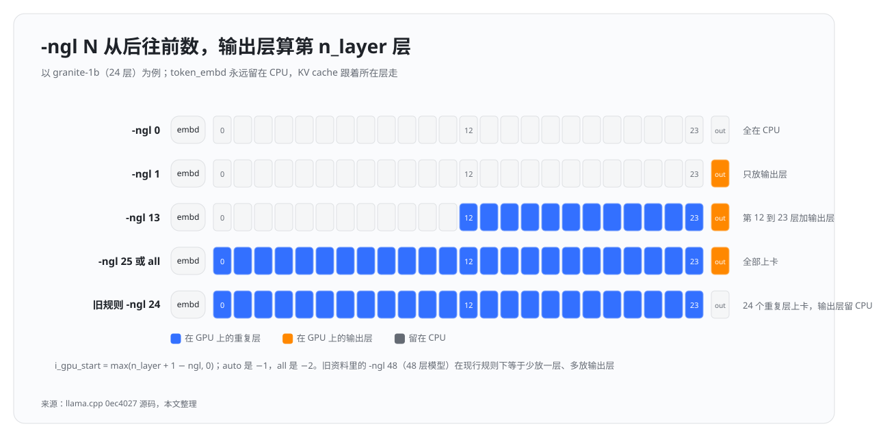

-ngl 的数字和旧资料对不上，我就去源码里找它到底从哪一层数起。llama-model.cpp 里决定层放在哪的只有一行：i_gpu_start = max(n_layer + 1 − ngl, 0)，下标不小于 i_gpu_start 的层上卡[[1]](https://github.com/ggml-org/llama.cpp/blob/0ec4027/src/llama-model.cpp)。下标从 0 到 n_layer − 1 是重复层，n_layer 是输出层，所以 -ngl 从最后一层往前数，第一个被放上卡的是输出层。输入层 token_embd 不在这套编号里，永远留在 CPU，查表本来也用不着显卡。

以 24 层的 granite-1b 为例：-ngl 1 只放输出层，-ngl 13 放第 12 到 23 层加输出层，-ngl 25 才是全部。加载日志会打 offloading output layer to GPU、offloading N repeating layers to GPU 和 offloaded N/25 layers to GPU 三行，分母是 n_layer + 1，对一下就知道放了几层。KV cache 跟着层走，留在 CPU 上的层，K 和 V 也在主存。

## 1.2 auto、all 和旧计数

-ngl 接受数字、auto 和 all，分别存成 N、−1 和 −2，缺省是 auto[[2]](https://github.com/ggml-org/llama.cpp/blob/0ec4027/common/arg.cpp)。n_gpu_layers() 遇到负数一律返回 n_layer + 1，也就是全放；auto 和 all 的差别在 --fit：fit 只调用户没设的参数，auto 算没设，all 算设了。fit 先试缩上下文，缩不下来要动层数时，看到 -ngl 不是 auto 就放弃。

2023 年最早把权重直接加载进显存的 PR 定下了按层卸载的规则[[14]](https://github.com/ggml-org/llama.cpp/pull/1483)，旧计数里输出层要等 -ngl 大于 n_layer 才上卡。现行计数把输出层当成第 n_layer 层，旧资料里给 48 层模型写的 -ngl 48，现在等于第 0 层留在 CPU、输出层上卡。fit-params 的 README 示例就是按旧计数写的：RTX 4090 跑 Qwen3-30B-A3B F16，-ngl 48 加 34 层专家留主存，CUDA0 的模型权重 17904 MiB[[15]](https://github.com/ggml-org/llama.cpp/blob/0ec4027/tools/fit-params/README.md)。我用 vram_ledger.py --legacy 按同样的参数算，对上了，差 1 MiB。

## 1.3 用日志核对

我每次改 -ngl 都先看加载日志，不看显存总量。显存里除了权重还有 KV、计算缓冲和驱动自己占的部分，总量对不上很难看出是哪一项多了。offloaded N/M 这一行最直接：N 是放上卡的层数，M 是 n_layer + 1，N 等于 M 才算全放。用了 -ot 时再把日志开到 debug，被覆盖的张量各有一行，能看到每个专家张量落在哪个缓冲。

有一个容易混的地方：-ngl 只决定层的归属，层里的张量还可以被 -ot 改走。-ngl all 加 -cmoe 时，48 层都算“上卡”，日志照样写 offloaded 49/49，但每层的专家张量已经被覆盖到主存。所以 offloaded 那一行说明的是注意力、路由和 KV 在哪，专家在哪要看覆盖日志。这也是 Switch Transformer 以来 MoE 层的结构决定的：路由和专家是两组独立的权重[[16]](https://arxiv.org/abs/2101.03961)[[17]](https://arxiv.org/abs/1701.06538)，放置时可以拆开。

> 🔑 **本章要点**：-ngl N 从输出层往前数，-ngl 1 只放输出层，全放要 n_layer + 1；写 all 最省事，但 --fit 就不会再替你调层数。照旧资料抄 -ngl 时要加一，加载日志的 offloaded N/M 可以核对。

# 第 2 章 · 专家留在哪：-ot、-cmoe 和 -ncmoe

## 2.1 三个参数是一回事

MoE 层把一个大 FFN 换成几十上百个小 FFN，每个 token 由路由选其中几个[[16]](https://arxiv.org/abs/2101.03961)[[18]](https://arxiv.org/abs/2401.04088)。granite-3.1-1b-a400m 每层 32 个专家选 8 个，24 层[[19]](https://huggingface.co/ibm-granite/granite-3.1-1b-a400m-instruct)；Qwen3-30B-A3B 每层 128 个选 8 个，48 层[[20]](https://arxiv.org/abs/2505.09388)。GShard 把专家分到多块设备上训练时就是按这个结构切的[[21]](https://arxiv.org/abs/2006.16668)，推理时的放置沿用了同样的边界。专家张量在 GGUF 里叫 blk.N.ffn_gate_exps、ffn_up_exps、ffn_down_exps，融合门控的模型是 ffn_gate_up_exps。

-ot 是 2025 年加的通用开关，值是逗号分隔的“正则=缓冲类型”[[22]](https://github.com/ggml-org/llama.cpp/pull/11397)。缓冲类型的名字取自各设备的缺省缓冲，比如 CPU、CUDA0，写错了会打印可用的列表然后退出。-cmoe 和 -ncmoe 是后来加的快捷写法[[5]](https://github.com/ggml-org/llama.cpp/pull/14992)[[4]](https://github.com/ggml-org/llama.cpp/pull/15077)，在 common.h 里展开成 -ot 规则：

```cpp
LLM_FFN_EXPS_REGEX = "\\.ffn_(up|down|gate|gate_up)_(ch|)exps"
-cmoe        → { LLM_FFN_EXPS_REGEX, CPU }
-ncmoe N     → { "blk\\.0" + 正则, CPU } … { "blk\\.(N-1)" + 正则, CPU }
-ncffn N     → 同上，换成稠密 FFN 的 "\\.ffn_(up|down|gate)\\."
```

正则里的 gate_up 是 2026 年补的，之前融合门控的模型用 -cmoe 不生效[[23]](https://github.com/ggml-org/llama.cpp/pull/20416)。-ncmoe N 留的是第 0 到 N − 1 层，从前往后数，和 -ngl 方向相反；N 大于层数没有副作用，llama-bench 没有 -cmoe，就用 -ncmoe 99 代替。

## 2.2 匹配规则

加载器对每个张量名按顺序试每条规则，用 std::regex_search，命中第一条就停[[24]](https://github.com/ggml-org/llama.cpp/blob/0ec4027/src/llama-model-loader.cpp)。所以几条规则的先后有意义：想让某几层的专家上 CUDA1，规则要写在 -cmoe 前面，否则先被 -cmoe 截走。regex_search 是子串匹配，blk\\.1 会同时命中 blk.1、blk.10 到 blk.19，-ncmoe 生成的规则后面紧跟 \\.ffn\_，所以不会误伤，手写时要自己加点号。

## 2.3 留在主存的专家落在哪个缓冲

规则的目标是 CPU 时，加载器会在 CPU 那一串候选里挑，普通 CPU 缓冲排在最后：先是加速器缓冲，再是显卡驱动提供的锁页主存（CUDA_Host），然后是 repack 用的 CPU_REPACK，最后是普通 CPU。有卡时专家落在 CUDA_Host，拷到显卡时能走 DMA；开着 mmap 时锁页缓冲换成普通 CPU 缓冲，加载器打一次警告，建议 --load-mode none。只有加 --no-host 或者纯 CPU 构建，才会落进 CPU_REPACK。

**📎 展开阅读：**加载日志开到 debug 级别，每个被覆盖的张量打一行 buffer type overridden to …，带大小和量化类型。我用这行核对规则有没有命中、落在哪个缓冲，比看显存总量直接。

> 🔑 **本章要点**：-cmoe 和 -ncmoe 展开成 -ot 规则，规则按顺序匹配，第一条命中就停。-ncmoe 从第 0 层往后数。留在主存的专家有卡时进锁页缓冲，开着 mmap 退回普通缓冲，都不 repack。

# 第 3 章 · 显存账本

## 3.1 一个 MoE 模型的显存去哪了

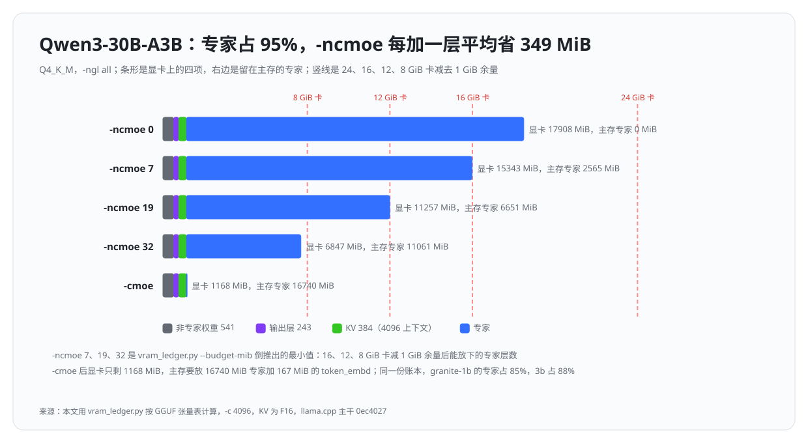

我写了 vram_ledger.py 来算这笔账，它读 GGUF 的张量表，按 -ngl 和覆盖规则把每个张量分到显卡或主存，再按 n_ctx 和层数算 F16 的 KV。Qwen3-30B-A3B Q4_K_M 全放上卡时：非专家权重 541 MiB，输出层 243，KV 384，专家 16740，合计 17908 MiB；token_embd 的 167 MiB 留在主存。专家占权重 94.6%，每层 348.8 MiB，非专家每层只有 11.3 MiB。granite-1b 的专家占 84.9%，3b 占 88.0%。

这个比例说明了 -cmoe 为什么好用：把专家全留在主存，显卡上只剩 1168 MiB，一张 4 GiB 的卡也能装下注意力、路由和 KV；每个 token 只读 8/128 的专家，主存那边要读的字节少。DeepSpeed-MoE 做多卡推理时也把两部分分开处理，稠密部分用张量并行，专家用专家并行[[25]](https://arxiv.org/abs/2201.05596)。

## 3.2 倒推 -ncmoe

--budget-mib 给定显存，减去余量，从 -ncmoe 0 往上加，找到第一个装得下的值。账本不含计算缓冲，fit-params README 里那张 4090 的计算缓冲是 898 MiB，所以我留 1024 MiB 余量。结果是这样的。24 GiB 卡取 -ncmoe 0，显卡占 17908 MiB。16 GiB 卡取 7，占 15343 MiB。12 GiB 卡取 19，占 11257 MiB。8 GiB 卡取 32，占 6847 MiB。

## 3.3 心算和误差

也可以心算：先算 -cmoe 后显卡剩多少，从显存里减掉它和余量，再除以每层专家的大小，得到能放回卡上的层数。16 GiB 卡上是 (16384 − 1024 − 1168) ÷ 349 ≈ 40.7，放回 40 层，-ncmoe 48 − 40 = 8；账本给出 7，因为 -ncmoe 先拿走的是前几层，前几层的 ffn_down 是 Q6_K，比平均大。要准就跑账本。

账本还有两处没算。计算缓冲随 ubatch 和上下文变，fit-params 的 README 里给出过一份 4090 上的数，我按它留余量；驱动和 CUDA 上下文本身占的几百 MiB，nvidia-smi 里看得到，账本里没有。这两项都和专家放法无关，所以我只用一个固定余量覆盖，余量不够时先减 -c，再加 -ncmoe。KV 在 -c 4096 时只有 384 MiB，上下文开到 32768 就是 3 GiB，这时 -ncmoe 要重新倒推。

> 🔑 **本章要点**：MoE 的显存大头是专家，Qwen3-30B-A3B 占 94.6%，-cmoe 后显卡只剩 1.1 GiB。给定一块卡，用 --budget-mib 倒推最小 -ncmoe，余量留 1 GiB 给计算缓冲。

# 第 4 章 · 专家在主存时怎么算

## 4.1 批次满 32 个 token 才搬上卡

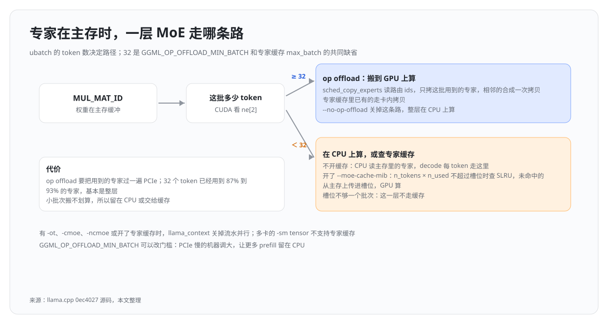

专家留在主存，MoE 层的矩阵乘 MUL_MAT_ID 有两种算法：在 CPU 上直接读主存里的权重算，或者把权重拷上卡在 GPU 上算。调度器遇到权重在主存缓冲的算子，会问优先级更高的后端要不要接手，CUDA 后端的回答取决于批次大小[[26]](https://github.com/ggml-org/llama.cpp/blob/0ec4027/ggml/src/ggml-backend.cpp)。

get_op_batch_size 对 MUL_MAT_ID 返回 ne[2]，也就是这批的 token 数；不少于 GGML_OP_OFFLOAD_MIN_BATCH 就接手，缺省 32[[6]](https://github.com/ggml-org/llama.cpp/blob/0ec4027/ggml/src/ggml-cuda/ggml-cuda.cu)。prefill 的 ubatch 通常几百个 token，走 GPU；decode 一次一个 token，留在 CPU。这和 Fiddler 的结论一致：批次小时把激活送到 CPU 上算，比把权重搬上卡划算[[27]](https://arxiv.org/abs/2402.07033)。

## 4.2 只拷用到的专家

早期的 op offload 每次拷整层专家。2025 年的 PR 让调度器先读路由结果，只拷这批用到的专家，相邻的合成一次拷贝[[7]](https://github.com/ggml-org/llama.cpp/pull/15346)；现在这个回调叫 sched_copy_experts，开了专家缓存时先查缓存，命中的走卡内拷贝[[28]](https://github.com/ggml-org/llama.cpp/blob/0ec4027/src/llama-context.cpp)。第 5 章的统计说明，32 个 token 已经用到一层 87% 到 93% 的专家，prefill 的大批次省不了多少；省的主要是批次刚过门槛时。

PCIe 慢的机器上，搬权重可能比 CPU 算还慢。--no-op-offload 关掉整条路，所有主存里的算子留在 CPU[[29]](https://github.com/ggml-org/llama.cpp/pull/13386)；GGML_OP_OFFLOAD_MIN_BATCH 可以把门槛调高，让小一些的 prefill 留在 CPU[[30]](https://github.com/ggml-org/llama.cpp/pull/18535)。两个都要按机器实测。

## 4.3 被关掉的功能

有张量覆盖时，llama_context 关掉流水并行：条件里写着 !model.has_tensor_overrides() 和 moe_cache_size == 0[[28]](https://github.com/ggml-org/llama.cpp/blob/0ec4027/src/llama-context.cpp)。流水并行只在多卡、全部层上卡时才开，单卡用户不受影响，多卡的情形放在 LCPP-12。CUDA graph 在 -ncmoe 下原本被关掉，2026 年的 PR 把它打开了[[31]](https://github.com/ggml-org/llama.cpp/pull/18934)。

> 🔑 **本章要点**：权重在主存的 MoE 层，批次不少于 32 个 token 时搬上卡算，只拷用到的专家；更小的批次留在 CPU。PCIe 慢时调大 GGML_OP_OFFLOAD_MIN_BATCH 或加 --no-op-offload。有张量覆盖时流水并行关闭。

# 第 5 章 · 路由有多偏

## 5.1 抓路由

缓存值不值得开，取决于路由。MoE 训练时有负载均衡损失，目标是让每个专家拿到差不多的 token[[16]](https://arxiv.org/abs/2101.03961)，如果真的均匀又没有局部性，任何缓存的命中率都只等于它占专家的比例。Eliseev 和 Mazur 在 Mixtral 上观察到相邻 token 常选同一批专家，用 LRU 缓存把专家留在卡上[[32]](https://arxiv.org/abs/2312.17238)；MoE-Infinity 也是从路由的稀疏和偏斜出发设计缓存的[[33]](https://arxiv.org/abs/2401.14361)。我想在 granite 上把这两件事量出来。

moe_trace.c 给 llama_context 挂一个 cb_eval 回调，名字是 ffn_moe_topk-N 的张量就是第 N 层的 top-k 结果，拷出来存成每 token 每层 n_used 个字节。text 模式把 wiki.test.raw 分块 prefill，取前 8192 个 token；gen 模式用贪心生成，一段写代码，一段写散文，各 256 个 token。因果模型里一个 token 的路由只取决于它和前文，分块 prefill 抓到的路由和逐个 decode 时一样。

## 5.2 偏斜和局部性

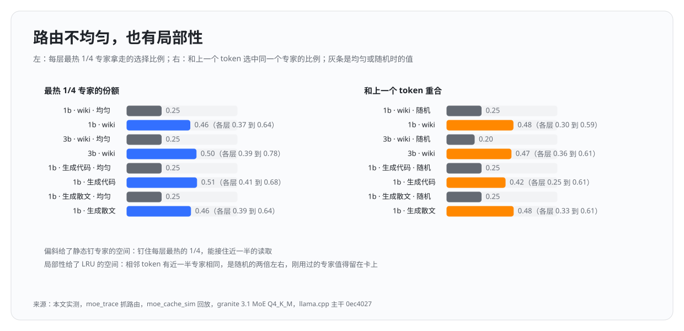

偏斜：每层把专家按被选次数排序，最热的 1/4 拿走多少选择。均匀时是 0.25，granite-1b 在 wiki 上平均 0.458，各层 0.370 到 0.636；3b 平均 0.503，最偏的一层 0.778。生成代码时 1b 是 0.507，散文 0.463。负载均衡损失压住了极端情况，但没压平。

局部性：一个 token 在某层选的 8 个专家里，有几个和上一个 token 在同一层选的相同。随机时 1b 是 8/32 = 0.25，3b 是 8/40 = 0.20；实测 1b 0.481，3b 0.467，散文 0.483，代码 0.424。相邻 token 有近一半专家相同，是随机的两倍左右。

## 5.3 连续 n 个 token 用到多少专家

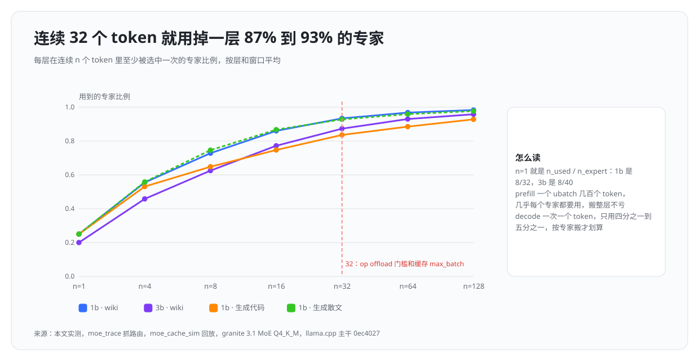

再看一个窗口里的并集：连续 n 个 token 里至少被选中一次的专家占一层多少。1b 在 wiki 上 n=1 时 0.25，n=8 时 0.728，n=32 时 0.934；3b 在 n=32 时 0.873，生成代码时 0.836。这组数解释了第 4 章的门槛：32 个 token 的批次几乎要用到一层的全部专家，按专家拷和拷整层差不多；decode 一次只用四分之一，按专家搬才划算。

> 🔑 **本章要点**：granite 的路由明显偏，最热 1/4 专家拿走近一半选择；相邻 token 有近一半专家相同。连续 32 个 token 用掉一层 84% 到 93% 的专家，prefill 搬整层，decode 适合缓存。

# 第 6 章 · 五种放法的命中率

## 6.1 回放什么

moe_cache_sim.py 拿抓到的路由按 decode 回放，一次一个 token，从第 0 层到最后一层，每层请求 8 个专家。槽位用“单 token 用量”做单位：1b 一个 token 过完 24 层要 192 个（层，专家），3b 要 256 个，1× 就是刚好装下一个 token。前 512 个 token 只暖缓存不计数。比较五种放法：

- layers：按层放，等于 -ncmoe，前若干层专家全在主存，后面整层上卡，命中率就是上卡专家的比例。
- hot：按暖缓存那段的频次，把最热的（层，专家）钉在卡上。PowerInfer 把热神经元放显卡、冷神经元放 CPU 是同一个思路[[34]](https://arxiv.org/abs/2312.12456)。llama.cpp 的 -ot 只能按整个张量放，一个张量含一层的全部专家，做不到逐专家钉，这里当参照。
- oracle：同样逐专家钉，但频次用整段路由统计，偷看了未来，是静态放法的上限。
- LRU：一条链表，命中移到尾部，从头部挑牺牲者。
- SLRU：0ec4027 的现行实现，下一章细讲。

## 6.2 结果

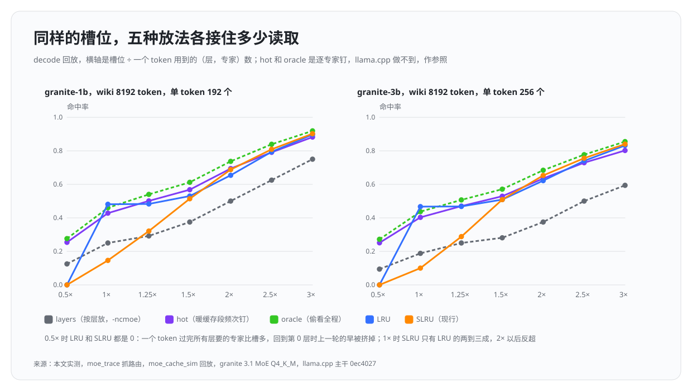

granite-1b 在 wiki 上：2× 时 layers 0.500，hot 0.694，oracle 0.737，LRU 0.654，SLRU 0.688；3× 时 LRU 0.897，SLRU 0.902，超过 hot 的 0.882，离 oracle 的 0.919 不远。3b 的形状一样，2× 时 LRU 0.622，SLRU 0.653。按层放永远最差，因为它不看路由，命中率只等于上卡比例；同样的显存换成逐专家的放法，2× 时多接住近两成的读取。

## 6.3 槽位不够一个 token 时

0.5× 时 LRU 和 SLRU 都是 0。一个 token 过完所有层要 192 个专家，只有 96 个槽，回到第 0 层时上一轮的专家早被后面的层挤掉了，局部性一点用不上；静态的 hot 还能拿到 0.254。1× 时 LRU 0.481，刚好等于相邻 token 的重合率，SLRU 却只有 0.146。

> 🔑 **本章要点**：同样的槽位，逐专家的放法比按层放多接住近两成读取。槽位少于一个 token 的用量时动态缓存完全失效；1× 时 LRU 接住的正好是相邻 token 的重合部分，SLRU 落后很多。

# 第 7 章 · SLRU 为什么在 1× 时吃亏

## 7.1 试用段和保护段

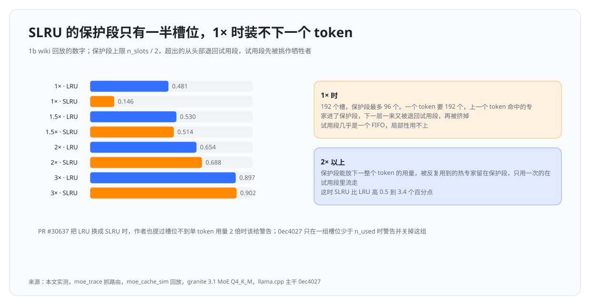

SLRU 是 1994 年为磁盘缓存提出的：缓存分成试用段和保护段，新进来的放试用段，再次命中才升进保护段，牺牲者先从试用段挑，只用一次的数据不会把热数据挤掉[[9]](https://doi.org/10.1109/2.268884)。2026 年专家缓存从 LRU 换成了 50/50 的 SLRU，保护段最多占一半槽位，超出的从保护段头部退回试用段[[8]](https://github.com/ggml-org/llama.cpp/pull/30637)。

1× 时 192 个槽，保护段最多 96 个。上一个 token 命中的专家升进保护段，这一层要 8 个，后面的层还要 184 个；保护段装不下一个 token 的命中量，头部不断退回试用段，在试用段里又被当成牺牲者。试用段几乎成了一个 FIFO，局部性用不上。1.5× 时两者接近，0.530 对 0.514；2× 时保护段能放下一整个 token 的用量，反复用到的热专家留在保护段，只用一次的在试用段里流走，SLRU 比 LRU 高 0.5 到 3.4 个百分点。

## 7.2 两倍规则

PR 讨论里作者也提到，槽位不到单 token 用量两倍时应该给警告[[8]](https://github.com/ggml-org/llama.cpp/pull/30637)。0ec4027 只在一组槽位少于 n_used 时打 MoE cache budget is too small for N layers, they are not cached，并把这组的槽位设成 0[[10]](https://github.com/ggml-org/llama.cpp/blob/0ec4027/src/llama-moe-cache.cpp)。介于 n_used 和两倍单 token 之间的配置不会有任何提示，命中率却可能比 LRU 低一大截。我的规则是：每组槽位至少是这组层数乘 n_used 的两倍。

## 7.3 看哪一行命中率

专家缓存在退出时打印统计，按 ubatch 大小分成 ubatch ≤ 8、ubatch ＞ 8 和 large batches 几行。ubatch ≤ 8 的那一行才代表 decode；大批次只读缓存不换入，命中率高低和 decode 速度关系不大，混进总数会把 decode 的命中率拉低或抬高。我调槽位时只盯 ubatch ≤ 8 那一行，配合 llama-bench 的 tg 一起看：命中率上去了而 t/s 没动，多半是瓶颈已经不在 PCIe。

> 🔑 **本章要点**：SLRU 的保护段只有一半槽位，1× 时装不下一个 token 的命中量，命中率只有 LRU 的两到三成；2× 以上反超 LRU。源码只在槽位少于 n_used 时警告，每组槽位要自己按两倍单 token 用量配。

# 第 8 章 · 换领域和缓存分组

## 8.1 用 wiki 的频次去钉代码

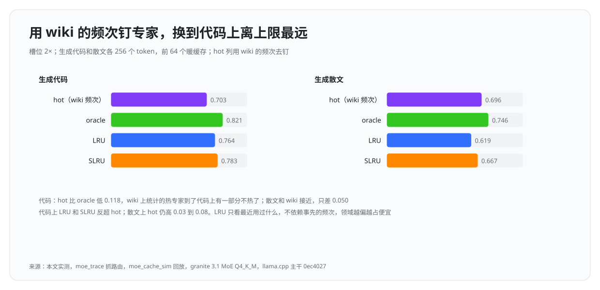

静态钉专家要先统计频次，统计用的数据和线上请求不一定同分布。我用 wiki 的频次去钉生成代码和散文时的专家，--profile 指定频次来源，2× 槽位。代码上 hot 0.703，oracle 0.821，差 0.118，wiki 上统计的热专家到了代码上有一部分不热了；LRU 0.764、SLRU 0.783，反超 hot。散文和 wiki 接近，hot 0.696，oracle 0.746，只差 0.050，hot 仍比 LRU 和 SLRU 高 0.03 到 0.08。

LRU 和 SLRU 只看最近用过什么，不依赖事先的频次，领域越偏越占便宜。llama.cpp 选的是动态缓存，加上 -ot 做不到逐专家钉，这个选择在流量多变的服务上是对的。代码只有 256 个 token，这组数的噪声比 wiki 的 8192 个大，方向可信，具体差值不要外推。

## 8.2 --moe-cache-mib 怎么分槽

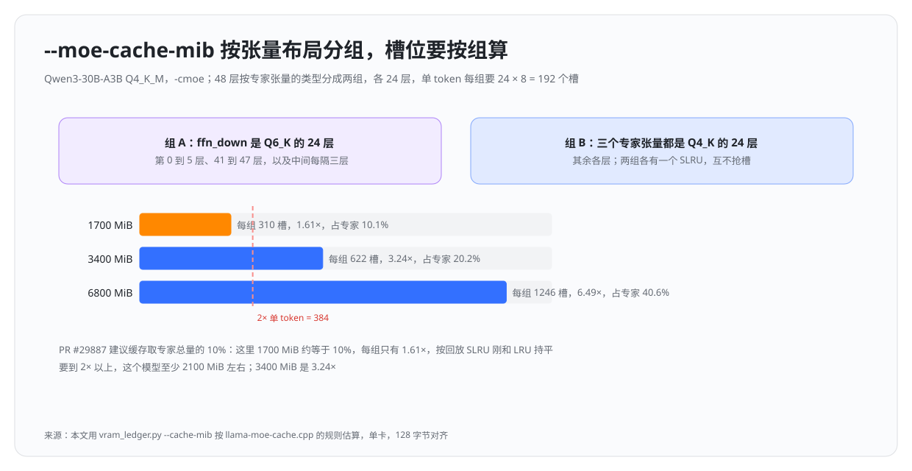

专家缓存是 2026 年加的，只给“全部专家都在主存”的层开，没有这样的层时打 MoE cache is disabled 后关掉[[11]](https://github.com/ggml-org/llama.cpp/pull/29887)。多卡时总预算按 --tensor-split 分到各卡[[35]](https://github.com/ggml-org/llama.cpp/pull/30112)，每张卡上再把层按专家张量的类型和形状分组，同组共用一组槽位和一个 SLRU；卡上的预算按各组专家在主存的字节数分给各组，一组一直加槽位，直到下一个槽放不下[[10]](https://github.com/ggml-org/llama.cpp/blob/0ec4027/src/llama-moe-cache.cpp)。

分组是容易漏算的一步。Qwen3-30B-A3B 的 Q4_K_M 里，有 24 层的 ffn_down 是 Q6_K，另 24 层三个专家张量都是 Q4_K，于是分成两组，各 24 层，单 token 每组要 24 × 8 = 192 个槽。vram_ledger.py --cache-mib 按这个规则估：1700 MiB 是每组 310 槽，合 1.61×。2100 MiB 刚到 2×，3400 MiB 是 622 槽、3.24×，6800 MiB 是 1246 槽、6.49×。PR 建议缓存取专家总量的 10%，这个模型上就是 1700 MiB，按回放 SLRU 刚和 LRU 持平。

## 8.3 有卡时的收益

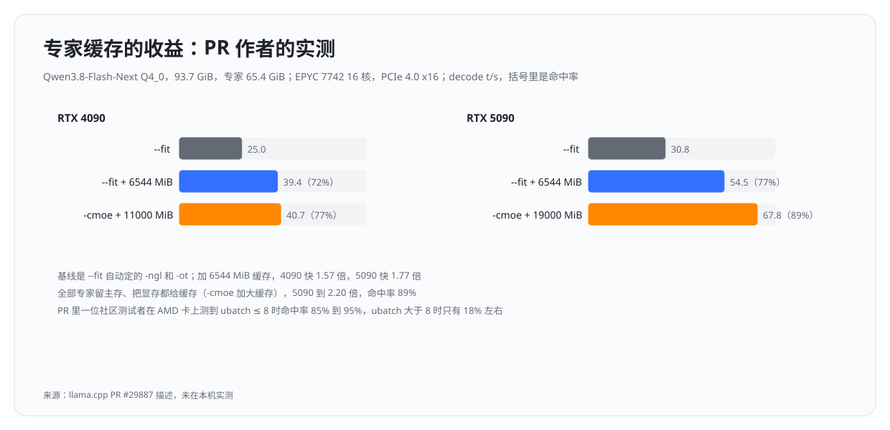

本机没有卡，速度引 PR 作者的数据：Qwen3.8-Flash-Next Q4_0 共 93.7 GiB，专家 65.4 GiB，EPYC 7742 16 核，PCIe 4.0 x16[[11]](https://github.com/ggml-org/llama.cpp/pull/29887)。基线是 --fit 自动定的参数，RTX 4090 上 decode 25.0 t/s，加 6544 MiB 缓存到 39.4，命中率 72%；RTX 5090 从 30.8 到 54.5。把显存都给缓存、专家全留主存，5090 到 67.8 t/s，命中率 89%，是基线的 2.20 倍。

同一个 PR 里，一位社区测试者在 AMD 卡上测到 ubatch ≤ 8 时命中率 85% 到 95%，大于 8 时只有 18% 左右[[11]](https://github.com/ggml-org/llama.cpp/pull/29887)，和第 5 章的并集统计对得上：批次一大，要的专家几乎是整层，缓存装不下。这些数字我没有复现，换模型和机器要重测。

**📎 展开阅读：**这组数说明，在 PCIe 4.0 x16 的机器上，同样的显存给缓存比给固定的层划算：5090 上 --fit 把显存全给整层专家是 30.8 t/s，-cmoe 后把 19000 MiB 全给缓存是 67.8 t/s。原因在第 6 章那张图：按层放的命中率只等于上卡比例，缓存按路由换入，同样的字节接住的读取多。

> 🔑 **本章要点**：缓存按张量布局分组，每组单独算槽位；Qwen3-30B-A3B Q4_K_M 分两组，PR 建议的 10% 只有 1.61×，2× 要 2100 MiB 左右。PR 作者的实测里缓存让 decode 快 1.57 到 2.20 倍，未在本机复现。

# 第 9 章 · --fit 和它看不见的内存

## 9.1 fit 怎么定参数

--fit 是 2025 年加的，缺省开着，作用是在加载前把用户没设的参数调到正好装进显存[[36]](https://github.com/ggml-org/llama.cpp/pull/16653)。它先按当前参数试算每块设备的显存，给每块卡留出余量，缺省 1024 MiB，--fit-target 可以按卡改[[37]](https://github.com/ggml-org/llama.cpp/pull/18679)。装不下时先缩上下文，最小到 --fit-ctx，缺省 4096；还装不下就动层：先试把全部专家留在主存，看稠密部分能不能放下，再从后往前填稠密层，最后把专家一层层放回卡上，放不下的部分溢出到下一块卡或主存[[12]](https://github.com/ggml-org/llama.cpp/blob/0ec4027/common/fit.cpp)。

## 9.2 什么时候放弃

fit 只调用户没设的参数。-ngl 不是 auto、设了 -ts、写了任何 -ot、-cmoe 或 -ncmoe，到了要动层的那一步都会抛出 already set by user, abort，打一行警告后按用户的参数照常加载；-sm tensor 也不支持。设备不报告显存时 fit 跳过那块卡[[38]](https://github.com/ggml-org/llama.cpp/pull/22614)。所以 fit 和手写的放置是二选一：要么全交给它，要么全自己写。llama-fit-params 可以只跑 fit 不加载，打印它选的参数和每块设备的内存明细[[15]](https://github.com/ggml-org/llama.cpp/blob/0ec4027/tools/fit-params/README.md)。

## 9.3 漏掉的 CPU_REPACK

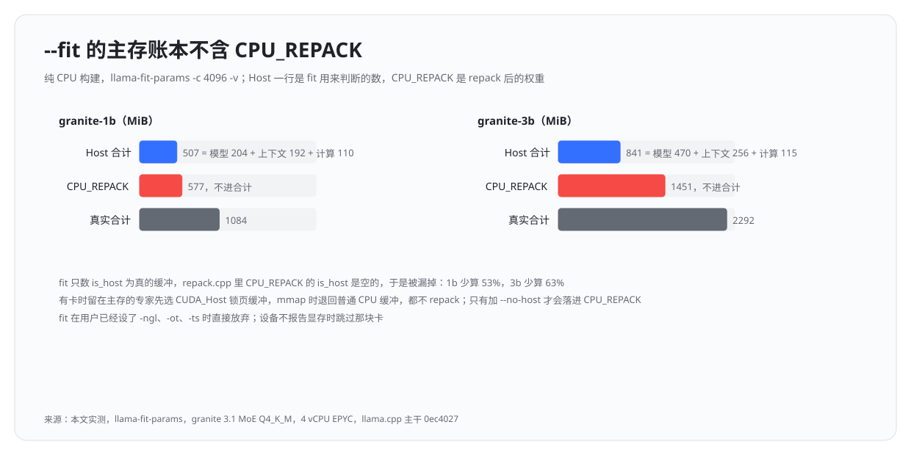

纯 CPU 构建里我用 llama-fit-params -c 4096 -v 看 fit 的主存明细。granite-1b：Host 一行是 507 MiB，等于模型 204 加上下文 192 加计算 110。下面还有一行 CPU_REPACK 577 MiB，不进合计。日志写着 projected to use 507 MiB of host memory。真实占用是 1084 MiB，fit 少算 53%。3b 是 841 对 2292，少算 63%。

原因在缓冲类型上：fit 只统计 is_host 为真的缓冲，repack.cpp 里 CPU_REPACK 缓冲类型的 is_host 是空指针，于是整块被漏掉[[13]](https://github.com/ggml-org/llama.cpp/blob/0ec4027/ggml/src/ggml-cpu/repack.cpp)。repack 只对能重排的类型生效，granite 的专家大多是 Q4_K，被重排后全落进 CPU_REPACK。机器内存紧时这会出事：fit 以为留够了 1 GiB，实际已经用超。

有卡时这个问题小得多。第 2 章说过，留在主存的专家先选 CUDA_Host 锁页缓冲，开着 mmap 退回普通 CPU 缓冲，都不 repack；只有加 --no-host 才会落进 CPU_REPACK。纯 CPU 部署或者用了 --no-host 时，我按 fit 的数加上 repack 的权重算主存。

> 🔑 **本章要点**：--fit 先缩上下文再动层，用户设过 -ngl、-ts 或任何覆盖规则时它直接放弃。它的主存账本不含 CPU_REPACK，纯 CPU 构建里 granite 少算一半以上；有卡时专家不 repack，影响小。

# 第 10 章 · 纯 CPU 构建里这几个参数

## 10.1 只是换了缓冲类型

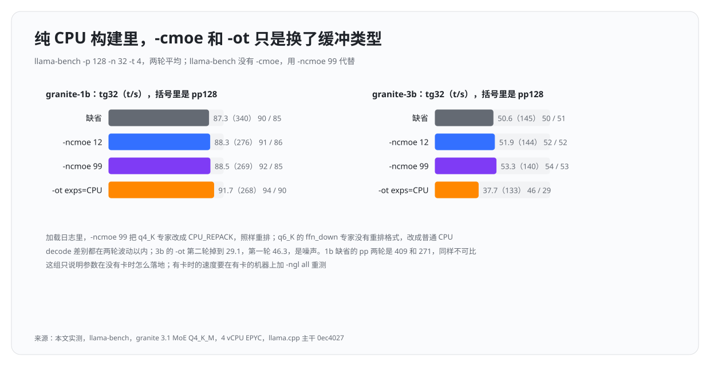

本机没有卡，这组实验只说明 -cmoe、-ncmoe 和 -ot 在纯 CPU 构建里怎么落地。llama-bench -p 128 -n 32 -t 4，每个配置三次重复，整组跑两轮。加载日志里，被 -ncmoe 99 覆盖的 q4_K 专家改成 CPU_REPACK，照样重排；q6_K 的 ffn_down 专家没有重排格式，改成普通 CPU。没有覆盖时这些张量本来也在 CPU_REPACK 和 CPU 里，所以覆盖规则在这里几乎是空操作。

decode 两轮平均：granite-1b 缺省 87.3 t/s，-ncmoe 12 是 88.3，-ncmoe 99 是 88.5，-ot exps=CPU 是 91.7；3b 是 50.6、51.9、53.3 和 37.7。差别都在两轮波动以内。3b 的 -ot 第一轮 46.3、第二轮 29.1，是噪声；1b 缺省的 pp128 两轮是 409 和 271，同样不可比。test_offload.py 用一条宽松的断言核对：-ncmoe 99 和缺省的 decode 差别在一成以内。

## 10.2 有卡时要重测什么

有卡时这几个参数的代价在 PCIe 和主存带宽上，CPU 构建测不出来。我会在有卡的机器上把 cpu 组的命令加上 -ngl all 重跑，再扫 -ncmoe 和 --moe-cache-mib，看 decode 的 t/s 和缓存日志里 ubatch ≤ 8 那一行的命中率。Fiddler 的测量也说明，CPU 算专家和搬专家的取舍高度依赖机器的 CPU 算力和 PCIe 带宽[[27]](https://arxiv.org/abs/2402.07033)，别人的结论不能直接搬。

## 10.3 这组实验能说明什么

能说明的只有两件事：覆盖规则在没有卡时不会出错，q4_K 专家被覆盖到 CPU 后仍然走 repack 的快速内核，速度不掉。前一件让我可以在 CI 里用纯 CPU 构建跑 test_offload.py，检查 -ncmoe 生成的规则有没有命中；后一件说明在纯 CPU 机器上写 -cmoe 是无害的，同一份启动脚本可以在有卡和没卡的机器上共用。

不能说明的是有卡时的任何速度。缓冲类型换成 CUDA_Host 之后，decode 的专家矩阵乘仍在 CPU 上算，但 prefill 会走第 4 章的 op offload，速度取决于 PCIe；开了缓存还要加上命中率。这些都要在目标机器上测。

> 🔑 **本章要点**：纯 CPU 构建里 -cmoe、-ncmoe、-ot 只改缓冲类型，q4_K 专家照样 repack，decode 差别在噪声内。有卡时的速度要在有卡的机器上加 -ngl all 重测。

# 第 11 章 · 怎么选与上线清单

## 11.1 按参数选

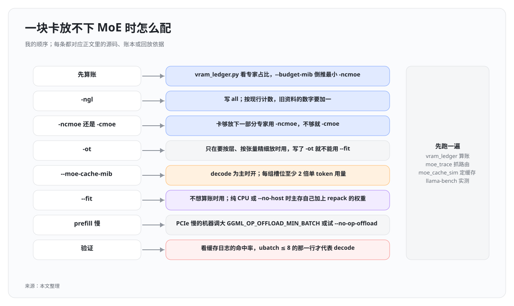

| 参数 | 怎么配 | 依据 |
|-|-|-|
| -ngl | 写 all；照旧资料抄数字时加一 | 第 1 章：输出层算第 n_layer 层 |
| -ncmoe 还是 -cmoe | 卡能放下一部分专家用 -ncmoe，最小值用账本倒推；放不下用 -cmoe | 第 3 章：16 GiB 卡 -ncmoe 7 |
| -ot | 只在按层、按张量精细放时用，规则按顺序匹配 | 第 2 章：第一条命中就停 |
| --moe-cache-mib | decode 为主时开，每组槽位至少两倍单 token 用量 | 第 7、8 章：1× 时 SLRU 只有 LRU 的两到三成 |
| --fit | 不想算账时用；纯 CPU 或 --no-host 时主存自己加上 repack 的权重 | 第 9 章：granite-1b 少算 53% |
| --no-op-offload | PCIe 慢、prefill 反而变慢时试，或调大 GGML_OP_OFFLOAD_MIN_BATCH | 第 4 章：缺省门槛 32 |
| --load-mode | 专家留主存时考虑 none，换锁页缓冲 | 第 2 章：mmap 下退回普通缓冲 |

表里的路由数字来自 granite 的两个小 MoE，显存账本来自 Qwen3-30B-A3B 的张量头，速度来自 PR 作者的机器。换模型时我先跑 vram_ledger 看专家占比和分组，再用 moe_trace 抓一段和线上相近的路由，用 moe_cache_sim 定缓存大小，最后在目标机器上用 llama-bench 实测。

## 11.2 上线清单

> 📌 **上线前核对清单**：每换一个 MoE 模型或一块卡，我按这个顺序过一遍。
> - vram_ledger.py 算过专家占比，--budget-mib 倒推过最小 -ncmoe
> - -ngl 写的是 all，或者按现行计数核对过加载日志的 offloaded N/M
> - 手写的 -ot 规则在 debug 日志里逐条命中，blk\\.N 后面带了点号
> - 开了 --moe-cache-mib 的，按分组算过每组槽位，不低于两倍单 token 用量
> - 缓存日志里看的是 ubatch ≤ 8 那一行的命中率
> - 用 --fit 的，没有同时写 -ngl、-ts 或 -ot；纯 CPU 时主存加上了 repack 的权重
> - prefill 用 llama-bench 对比过 --no-op-offload，PCIe 慢的机器调过门槛
> - 在目标机器上实测过 decode，不直接套 PR 里的倍数

## 11.3 下一步

一块卡不够时还可以加卡或加机器：多卡的 -sm layer、-sm row、-sm tensor 和 -ts，以及 RPC 后端，放在 LCPP-12；投机解码怎么用一个小模型摊薄大模型每 token 的权重读取，放在 LCPP-13；把这篇和前后几篇的参数汇成调参手册，放在 LCPP-17。CPU 侧的线程和 repack 回到 [LCPP-10｜内部｜CPU 调优：线程、绑核、repack、加载方式和带宽上限](./10-cpu-tuning.md)，带宽上限的推导回到 [LCPP-02｜上手｜推理账本：带宽、算力和启动前算出速度上限](./02-ledger.md)。两个完整的放置算例：24 GB 单卡上 fit 先压上下文、压不够再挪层，以及卸几层到内存速度掉多少，见 [LCPP-20｜实战｜24 GB 单卡：Qwen3-32B 和 Qwen3.8-27B](./20-qwen-24g.md)；一张卡加一堆内存跑 552B 的 MoE、按字节决定专家放几层，见 [LCPP-21｜实战｜一台机器跑 DeepSeek-V4.1-Flash](./21-deepseek-v41.md)。

# 参考文献

按正文首次引用顺序编号，资料截至 2026 年 10 月初。

[1] llama.cpp 0ec4027. src/llama-model.cpp：按 n_gpu_layers 算 i_gpu_start，输出层算第 n_layer 层。 [llama-model.cpp](https://github.com/ggml-org/llama.cpp/blob/0ec4027/src/llama-model.cpp)

[2] llama.cpp 0ec4027. common/arg.cpp：-ngl、-ot、-cmoe、-ncmoe、--moe-cache-mib、-sm、-ts、--fit 和 --op-offload 的注册。 [common/arg.cpp](https://github.com/ggml-org/llama.cpp/blob/0ec4027/common/arg.cpp)

[3] llama.cpp 0ec4027. common/common.h：LLM_FFN_EXPS_REGEX 和按层生成 -ot 规则的辅助函数。 [common/common.h](https://github.com/ggml-org/llama.cpp/blob/0ec4027/common/common.h)

[4] slaren. llama : add --n-cpu-moe option. llama.cpp PR #15077, 2025. [PR #15077](https://github.com/ggml-org/llama.cpp/pull/15077)

[5] slaren. llama : add simple option to enable CPU for MoE weights (--cpu-moe). llama.cpp PR #14992, 2025. [PR #14992](https://github.com/ggml-org/llama.cpp/pull/14992)

[6] llama.cpp 0ec4027. ggml/src/ggml-cuda/ggml-cuda.cu：get_op_batch_size 和 GGML_OP_OFFLOAD_MIN_BATCH，缺省 32。 [ggml-cuda.cu](https://github.com/ggml-org/llama.cpp/blob/0ec4027/ggml/src/ggml-cuda/ggml-cuda.cu)

[7] slaren. sched : copy only the used experts when offloading prompt processing. llama.cpp PR #15346, 2025. [PR #15346](https://github.com/ggml-org/llama.cpp/pull/15346)

[8] eapache. Replace MoE LRU cache with a 50/50 SLRU cache. llama.cpp PR #30637, 2026. [PR #30637](https://github.com/ggml-org/llama.cpp/pull/30637)

[9] Karedla R, Love J S, Wherry B G. Caching Strategies to Improve Disk System Performance. IEEE Computer 27(3), 1994. [doi:10.1109/2.268884](https://doi.org/10.1109/2.268884)

[10] llama.cpp 0ec4027. src/llama-moe-cache.cpp：专家缓存的分组、槽位预算、SLRU 和大批次旁路。 [llama-moe-cache.cpp](https://github.com/ggml-org/llama.cpp/blob/0ec4027/src/llama-moe-cache.cpp)

[11] am17an. llama : add a GPU cache for MoE experts kept in host memory. llama.cpp PR #29887, 2026. [PR #29887](https://github.com/ggml-org/llama.cpp/pull/29887)

[12] llama.cpp 0ec4027. common/fit.cpp：--fit 的搜索过程、放弃条件和主存统计。 [common/fit.cpp](https://github.com/ggml-org/llama.cpp/blob/0ec4027/common/fit.cpp)

[13] llama.cpp 0ec4027. ggml/src/ggml-cpu/repack.cpp：CPU_REPACK 缓冲类型的 is_host 为空。 [repack.cpp](https://github.com/ggml-org/llama.cpp/blob/0ec4027/ggml/src/ggml-cpu/repack.cpp)

[14] JohannesGaessler. Loading models directly into VRAM, norm calculation on GPUs, broadcasting for ggml_mul. llama.cpp PR #1483, 2023. [PR #1483](https://github.com/ggml-org/llama.cpp/pull/1483)

[15] llama.cpp 0ec4027. tools/fit-params/README.md：llama-fit-params 在 RTX 4090 上给 Qwen3-30B-A3B F16 定参数的示例输出。 [fit-params/README.md](https://github.com/ggml-org/llama.cpp/blob/0ec4027/tools/fit-params/README.md)

[16] Fedus W, Zoph B, Shazeer N. Switch Transformers: Scaling to Trillion Parameter Models with Simple and Efficient Sparsity. JMLR 23, 2022. [arXiv:2101.03961](https://arxiv.org/abs/2101.03961)

[17] Shazeer N, et al. Outrageously Large Neural Networks: The Sparsely-Gated Mixture-of-Experts Layer. ICLR 2017. [arXiv:1701.06538](https://arxiv.org/abs/1701.06538)

[18] Jiang A Q, et al. Mixtral of Experts. 2024. [arXiv:2401.04088](https://arxiv.org/abs/2401.04088)

[19] IBM. Granite 3.1 1B A400M Instruct 模型卡：24 层、32 个专家选 8 个。 [granite-3.1-1b-a400m-instruct](https://huggingface.co/ibm-granite/granite-3.1-1b-a400m-instruct)

[20] Qwen Team. Qwen3 Technical Report. 2025. [arXiv:2505.09388](https://arxiv.org/abs/2505.09388)

[21] Lepikhin D, et al. GShard: Scaling Giant Models with Conditional Computation and Automatic Sharding. ICLR 2021. [arXiv:2006.16668](https://arxiv.org/abs/2006.16668)

[22] slaren. llama : add option to override model tensor buffers. llama.cpp PR #11397, 2025. [PR #11397](https://github.com/ggml-org/llama.cpp/pull/11397)

[23] ddh0. common : fix --n-cpu-moe, --cpu-moe for models with fused gate + up. llama.cpp PR #20416, 2026. [PR #20416](https://github.com/ggml-org/llama.cpp/pull/20416)

[24] llama.cpp 0ec4027. src/llama-model-loader.cpp：按顺序用 regex_search 匹配张量覆盖规则，目标是 CPU 时在 CPU 候选缓冲里挑。 [llama-model-loader.cpp](https://github.com/ggml-org/llama.cpp/blob/0ec4027/src/llama-model-loader.cpp)

[25] Rajbhandari S, et al. DeepSpeed-MoE: Advancing Mixture-of-Experts Inference and Training to Power Next-Generation AI Scale. ICML 2022. [arXiv:2201.05596](https://arxiv.org/abs/2201.05596)

[26] llama.cpp 0ec4027. ggml/src/ggml-backend.cpp：调度器把权重在主存的算子交给 offload_op 判断是否搬上卡。 [ggml-backend.cpp](https://github.com/ggml-org/llama.cpp/blob/0ec4027/ggml/src/ggml-backend.cpp)

[27] Kamahori K, et al. Fiddler: CPU-GPU Orchestration for Fast Inference of Mixture-of-Experts Models. 2024. [arXiv:2402.07033](https://arxiv.org/abs/2402.07033)

[28] llama.cpp 0ec4027. src/llama-context.cpp：sched_copy_experts 只拷用到的专家，以及有张量覆盖时关掉流水并行。 [llama-context.cpp](https://github.com/ggml-org/llama.cpp/blob/0ec4027/src/llama-context.cpp)

[29] hjc4869. Add --no-op-offload to improve -ot pp perf in MoE models like llama4 400B. llama.cpp PR #13386, 2025. [PR #13386](https://github.com/ggml-org/llama.cpp/pull/13386)

[30] DocShotgun. ggml: add env var GGML_OP_OFFLOAD_MIN_BATCH. llama.cpp PR #18535, 2026. [PR #18535](https://github.com/ggml-org/llama.cpp/pull/18535)

[31] am17an. ggml-cuda: enable cuda-graphs for n-cpu-moe. llama.cpp PR #18934, 2026. [PR #18934](https://github.com/ggml-org/llama.cpp/pull/18934)

[32] Eliseev A, Mazur D. Fast Inference of Mixture-of-Experts Language Models with Offloading. 2023. [arXiv:2312.17238](https://arxiv.org/abs/2312.17238)

[33] Xue L, et al. MoE-Infinity: Efficient MoE Inference on Personal Machines with Sparsity-Aware Expert Cache. 2024. [arXiv:2401.14361](https://arxiv.org/abs/2401.14361)

[34] Song Y, et al. PowerInfer: Fast Large Language Model Serving with a Consumer-grade GPU. SOSP 2024. [arXiv:2312.12456](https://arxiv.org/abs/2312.12456)

[35] am17an. llama: support MoE cache over multiple GPUs. llama.cpp PR #30112, 2026. [PR #30112](https://github.com/ggml-org/llama.cpp/pull/30112)

[36] JohannesGaessler. llama: automatically set parameters not set by the user in such a way that maximizes GPU utilization. llama.cpp PR #16653, 2025. [PR #16653](https://github.com/ggml-org/llama.cpp/pull/16653)

[37] JohannesGaessler. llama-fit-params: free memory target per device. llama.cpp PR #18679, 2026. [PR #18679](https://github.com/ggml-org/llama.cpp/pull/18679)

[38] fl0rianr. common: do not fit to unknown device memory. llama.cpp PR #22614, 2026. [PR #22614](https://github.com/ggml-org/llama.cpp/pull/22614)

---

上一章：[LCPP-10｜内部｜CPU 调优：线程、绑核、repack、加载方式和带宽上限](./10-cpu-tuning.md) · [目录](./README.md) · 下一章：[LCPP-12｜内部｜多卡与 RPC：-sm layer、流水线、张量并行和 RPC](./12-multi-gpu-rpc.md)
