# LCPP-12｜内部｜多卡与 RPC：-sm layer、流水线、张量并行和 RPC

> 🎯 **这篇文档解决什么问题**：一张卡放不下模型，或者放得下但想更快，llama.cpp 给了三条路：-sm layer 按层切到几张卡，-sm tensor 把每层的矩阵切到每张卡，--rpc 把别的机器上的卡接进来当本机设备用。三条路切的东西不同，通信量差几十倍，显存账本也不一样。这篇把设备排序、切层规则、流水线并行的开关、张量并行的 AllReduce 和 RPC 的消息格式逐个对到源码，用假多卡让 llama.cpp 自己报出层分配和显存账本，再按实现算出每种切法每个 ubatch 搬多少字节。主线一句话：-sm layer 只在层边界传残差流，-sm tensor 每层要做两次 AllReduce，RPC 把远端的卡当成本地设备，三种切法的通信量差几十倍。
>
> 使用方式：只想知道怎么配，看导读和第 11 章；-ts 写多少、哪段层放在哪张卡，看第 2、3 章；某张卡总是先爆显存，看第 4、6 章；日志里没有 pipeline parallelism enabled，看第 5 章；想试 -sm tensor，看第 8、9 章；跨机器接 RPC，看第 10 章。文中版本和数字核对于 2026 年 10 月 31 日。
>
> **代码**：[zero-to-llama/12-multi-gpu-rpc](../12-multi-gpu-rpc)。本机没有 GPU，也不起任何监听端口的进程。fake_devs 在进程里注册几张假 GPU，权重不分配，让 llama.cpp 自己走一遍选设备、切层、流水线开关和调度器切图，层分配和显存账本是 llama.cpp 原样的输出；split_plan.py 照源码规则复算切层；comm_volume.py 按实现算通信量；rpc_msg.c 照抄 RPC 的消息结构算上线字节。exp12.sh 跑四组实验，test_split.py 是 17 个回归用例。速度全部引 PR 作者的实测，本篇的多卡和 RPC 结论都未在本机实测。基线是主干 0ec4027，模型是 Qwen3-0.6B，机器是 4 核 EPYC 云主机无 GPU。

# 导读 · 先给结论

- **缺省的 -sm layer 只在层边界传残差流。**相邻两张卡之间每个 token 传一行 n_embd 个 F32，Qwen3-0.6B 是 4 KiB；一个 ubatch 依次流过各卡，条件全满足时开流水线并行[[1]](https://github.com/ggml-org/llama.cpp/blob/0ec4027/docs/multi-gpu.md)[[2]](https://github.com/ggml-org/llama.cpp/pull/6017)。
- **RPC 设备排在设备表最前。**前几段层放远端，输出层和 logits 留在本机，一个 ubatch 只在 RPC 段出口跨一次网线；最早的 PR 里 RPC 排最后，按旧资料写的 -ts 对应的卡已经换了位置[[3]](https://github.com/ggml-org/llama.cpp/blob/0ec4027/src/llama.cpp)[[4]](https://github.com/ggml-org/llama.cpp/pull/7640)。
- **-ts 和空闲显存是同一套比例。**-ts 3,1 和空闲 12000、4000 MiB 切出逐层相同的结果；-ngl 从后往前数，留在 CPU 的是最前面的层[[5]](https://github.com/ggml-org/llama.cpp/blob/0ec4027/src/llama-model.cpp)[[6]](https://github.com/ggml-org/llama.cpp/blob/0ec4027/common/arg.cpp)。
- **最后一张卡最满。**输出层的 logits 落在最后一张卡上，Qwen3 的词表在 ubatch 512 时就是 296.75 MiB；两卡平分层数时最后一张的计算缓冲比第一张多 269 MiB[[7]](https://arxiv.org/abs/2505.09388)。
- **流水线并行要 6 个条件全满足。**任何一张卡不报 event，或者用了 -ot，都会静默关掉；开了之后图输入备 4 份，假多卡上计算缓冲多 100 MiB，分配失败自动退回[[8]](https://github.com/ggml-org/llama.cpp/blob/0ec4027/src/llama-context.cpp)[[9]](https://github.com/ggml-org/llama.cpp/pull/16748)。
- **-sm tensor 每层两次 AllReduce。**通信量跟 token 数成正比，8B 模型 2 卡 prefill 512 个 token 每卡要发 256 MiB，是流水线的 32 倍；PR 实测 decode 快 1.6 到 2.4 倍，prefill 慢一半[[10]](https://github.com/ggml-org/llama.cpp/pull/19378)[[11]](https://arxiv.org/abs/1909.08053)。
- **RPC 省流量靠图 uid 和权重哈希。**1000 个节点的图首次发 441 KiB，重放只发 21 B；10 MiB 以上的权重命中缓存只发 321 B。rpc-server 没有鉴权，只能在可信内网用[[12]](https://github.com/ggml-org/llama.cpp/blob/0ec4027/ggml/src/ggml-rpc/ggml-rpc.cpp)[[13]](https://github.com/ggml-org/llama.cpp/blob/0ec4027/tools/rpc/README.md)。

**📎 与系列其他文档的分工**：本篇只讲多卡和多机怎么切。decode 为什么受带宽限制见 [LCPP-02｜上手｜推理账本：带宽、算力和启动前算出速度上限](./02-ledger.md)；llama-bench 的用法见 [LCPP-03｜上手｜测量方法：llama-bench、PPL、KLD 和噪声](./03-bench-ppl.md)；GGUF 的张量表见 [LCPP-04｜内部｜GGUF：文件结构、元数据、加载方式和分卷](./04-gguf.md)；后端注册和调度器见 [LCPP-06｜内部｜后端与编译：CPU 变体、BLAS、repack 和 GPU 架构](./06-backends-build.md)；KV cache 的大小见 [LCPP-08｜内部｜KV cache 与长上下文：账本、深度、量化、SWA 和上下文写满](./08-kv-context.md)；单卡上 -ngl、-ot 和 MoE 专家怎么放见 [LCPP-11｜内部｜GPU 卸载与 MoE：-ngl、专家放置、fit 和专家缓存](./11-gpu-offload-moe.md)。投机解码放在 LCPP-13，llama-server 的并发放在 LCPP-14。

# 第 1 章 · 三种切法

## 1.1 切的东西不一样

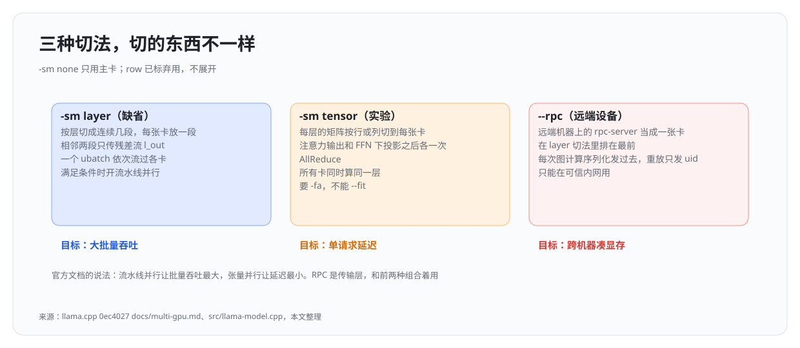

后面算通信量和显存都要用到切法，我先把 -sm 的取值和 RPC 的位置理清楚。-sm 有四个取值：none 只用主卡，layer 是缺省，row 已经标成弃用，tensor 标成实验[[6]](https://github.com/ggml-org/llama.cpp/blob/0ec4027/common/arg.cpp)[[14]](https://github.com/ggml-org/llama.cpp/pull/21684)。layer 把模型按层切成连续几段，每张卡放一段，相邻两段之间只传上一层的输出；tensor 把每一层的权重矩阵按行或按列切开，所有卡同时算同一层，每层要把各卡的部分和加起来。RPC 是另一个维度：它把远端机器上的 rpc-server 当成一张本地卡，切法仍然是 layer 或 tensor，只是多了一段网线。

官方多卡文档的说法是：流水线并行让批量吞吐最大，张量并行让延迟最小[[1]](https://github.com/ggml-org/llama.cpp/blob/0ec4027/docs/multi-gpu.md)。这和训练侧的经验一致。GPipe 把模型按层切成几段，把一个批次拆成若干微批，让各段同时处理不同的微批[[15]](https://arxiv.org/abs/1811.06965)；PipeDream 在此基础上调度前向和反向交替执行，降低流水线的空泡[[16]](https://arxiv.org/abs/1806.03377)。Megatron-LM 的张量并行把注意力和 MLP 的矩阵按列、按行切开，每个 Transformer 层前向只要两次 AllReduce[[11]](https://arxiv.org/abs/1909.08053)。推理没有反向，结构简单很多，但切法的基本取舍没变。

## 1.2 推理里两种并行各省什么

decode 一个 token 时，每张卡要把自己那部分权重从显存读一遍，时间主要花在读权重上，这一点在 [LCPP-02｜上手｜推理账本：带宽、算力和启动前算出速度上限](./02-ledger.md) 推过。layer 切法下一个 token 依次经过各卡，同一时刻只有一张卡在读权重，单请求的 decode 速度最多和单卡一样，多出来的是显存。tensor 切法下所有卡同时读自己那一份，读权重的时间按卡数缩短，代价是每层两次跨卡同步。

Pope 等人分析过大模型推理的切分：decode 阶段批量小，延迟主要由读权重和通信决定，张量并行能把读权重的时间摊到多张卡上；prefill 和大批量时算力占主导，通信量随 token 数线性增长，张量并行的开销会变得明显[[17]](https://arxiv.org/abs/2211.05102)。Narayanan 等人训练时的经验是张量并行只放在同一台机器内部，跨机器用流水线并行，因为张量并行的通信量大，对链路带宽敏感[[18]](https://arxiv.org/abs/2104.04473)。llama.cpp 的选择和这些结论对得上：layer 是缺省，tensor 要显式打开，RPC 跨机器时排在 layer 切法的最前面。

## 1.3 row 为什么弃用

row 是 CUDA 后端早期的张量并行，只切矩阵乘，每个算子之后都要把结果汇总到主卡，同步次数远多于每层两次。PR #19378 的作者在描述里拿它做对照，说 row 在每个算子之后同步，tensor 只在 attn_output 和 ffn_down 之后同步，而且不绑定 CUDA[[10]](https://github.com/ggml-org/llama.cpp/pull/19378)。现行文档把 row 标成弃用，本篇不展开；手里还有写 -sm row 的启动脚本，我会换成 layer 或 tensor 各测一遍。

> 🔑 **本章要点**：layer 按层切，相邻卡只传残差流，换的是显存和批量吞吐；tensor 按矩阵切，每层两次 AllReduce，换的是单请求延迟；RPC 是传输层，把远端卡接进 layer 或 tensor。row 已弃用。

# 第 2 章 · 设备表的顺序

## 2.1 RPC 在前，集显看情况

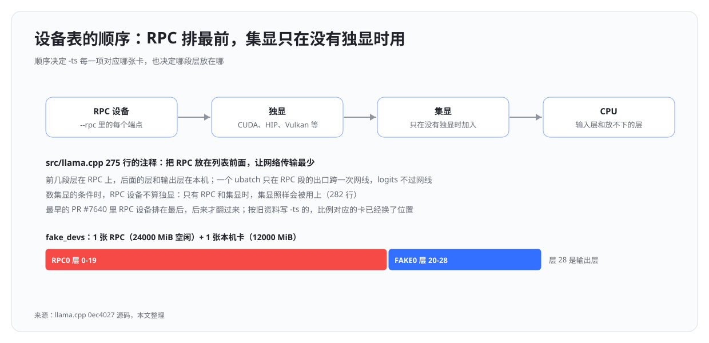

llama.cpp 加载模型时先组一张设备表，-ts 的每一项、-mg 的下标和切出来的每一段层都按这张表的顺序对应。src/llama.cpp 第 275 行的注释写得很直白：把 RPC 服务器加在列表前面，让网络传输最少[[3]](https://github.com/ggml-org/llama.cpp/blob/0ec4027/src/llama.cpp)。之后依次加独显和集显，CPU 不进这张表，它负责输入层和放不下的层。

集显的规则在第 282 行：只有一张独显都没有时才把集显加进来。数独显时 RPC 设备不算，所以本机只有集显、另外接了 RPC 时，集显照样会被用上[[3]](https://github.com/ggml-org/llama.cpp/blob/0ec4027/src/llama.cpp)。用户用 --device 显式列出设备时这套规则不生效，按用户给的顺序来。

## 2.2 为什么 RPC 要放前面

layer 切法下 logits 在最后一张卡上算，再拷回主存给采样用。RPC 设备放在最后时，每个 token 的 logits 要从远端拉回来，Qwen3 的词表是 151936，一个 token 就是 593 KiB，ubatch 512 是 296.75 MiB[[7]](https://arxiv.org/abs/2505.09388)。放在最前面时，跨网线的只有 RPC 段出口的残差流，一个 token 4 KiB。

这个顺序是后来翻过来的。最早让 RPC 和本机后端混用的 PR #7640 里，RPC 设备排在本机卡后面[[4]](https://github.com/ggml-org/llama.cpp/pull/7640)。按那时的资料写 -ts 的，第一项对应的是本机卡；现在第一项是 RPC。我在 fake_devs 里注册了 1 张名叫 RPC0 的假卡和 1 张本机假卡，日志里 using device RPC0 在 using device FAKE0 前面，层 0 到 19 落在 RPC0，层 20 到输出层落在 FAKE0，和源码一致。

## 2.3 用 split_plan 复算

fake_devs 要完整的 GGUF，大模型我只有张量头。split_plan.py 照同样的规则复算：--rpc 1 把第一张当远端。Qwen3-14B Q4_K_M，RPC 空闲 24000 MiB、本机卡 12000 MiB，切分点是 0.6667 和 1.0，RPC 放层 0 到 27，权重加 KV 是 5688.8 MiB；本机卡放层 28 到 39 和输出层，3112.9 MiB。本机卡空闲少，分到的层也少，但输出层固定在它身上，这一点第 4 章再算。

> 🔑 **本章要点**：设备表的顺序是 RPC、独显、集显，集显只在没有独显时加入，RPC 不算独显。RPC 在前让网线上只走残差流，logits 留在本机。按旧资料写 -ts 时先核对第一项是哪张卡。

# 第 3 章 · 层怎么切

## 3.1 切分点

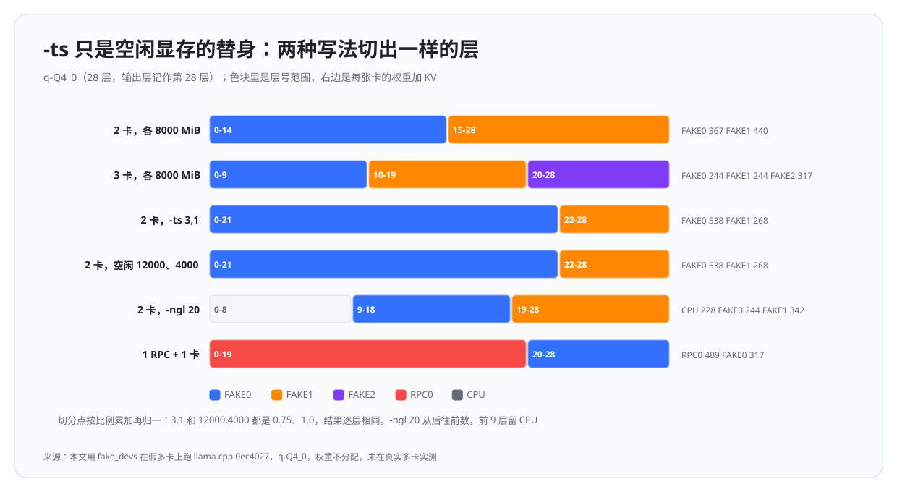

llama-model.cpp 先给每张卡一个权重：用户给了 -ts 就用 -ts，没给就用每张卡报告的空闲显存[[5]](https://github.com/ggml-org/llama.cpp/blob/0ec4027/src/llama-model.cpp)。权重按设备顺序累加，再除以总和，得到一组切分点；2 卡平分是 0.5、1.0，-ts 3,1 是 0.75、1.0。之后对每一层算它在全部层里的位置，落在哪个区间就放在哪张卡。层数是 n_layer + 1，输出层算第 n_layer 层，和 [LCPP-11｜内部｜GPU 卸载与 MoE：-ngl、专家放置、fit 和专家缓存](./11-gpu-offload-moe.md) 讲的 -ngl 计数一致。

因为只看比例，-ts 写成 3,1、75,25 或 12000,4000 没有区别。fake_devs 里一组用 -ts 3,1，一组不写 -ts、让两张假卡报空闲 12000 和 4000 MiB，切出来逐层相同：FAKE0 放层 0 到 21，FAKE1 放层 22 到输出层。test_split.py 里 test_ts_equals_free 就是核对这两份日志。

设备报 0 空闲、0 总量时，llama.cpp 按主存估算，issue #18577 里有人在这种情况下拿到了意料之外的切分[[19]](https://github.com/ggml-org/llama.cpp/issues/18577)。假卡我都给了明确的空闲显存；真实环境里某个后端报不出显存时，我会直接写 -ts，不靠自动探测。

## 3.2 -ngl 从后往前数

-ngl 小于层数时，i_gpu_start = max(n_layer + 1 − ngl, 0)，下标小于它的层留在 CPU，剩下的层再按切分点分给各卡[[5]](https://github.com/ggml-org/llama.cpp/blob/0ec4027/src/llama-model.cpp)。Qwen3-0.6B 有 28 层，-ngl 20 时前 9 层留 CPU，FAKE0 放层 9 到 18，FAKE1 放层 19 到输出层。留在 CPU 的 q4_0 权重有一部分进了 CPU_REPACK，账本里单独一行 75.9 MiB。

-ngl 不满时流水线并行不会打开，第 5 章会讲。多卡场景下我很少用 -ngl 控制显存：它从最前面的层往 CPU 挪，挪出去的层每个 token 都要在 CPU 上算一遍，decode 速度掉得比降 -c 或 -ub 厉害。

## 3.3 -mg 和 none

-mg 指定主卡的下标，只在 -sm none 时决定模型放在哪张卡，layer 切法下它不影响层的分配[[6]](https://github.com/ggml-org/llama.cpp/blob/0ec4027/common/arg.cpp)。-sm none 适合一张卡放得下的情况：多卡机器上不写 -sm none，llama.cpp 会把模型摊到所有可见的卡上，单请求 decode 不会更快，还多了跨卡拷贝。我更习惯用 CUDA_VISIBLE_DEVICES 直接限定可见的卡，日志里一目了然。

> 🔑 **本章要点**：切分点是 -ts 或空闲显存按设备顺序累加再归一，只看比例；-ts 3,1 和空闲 12000、4000 切出相同的层。-ngl 从后往前数，留在 CPU 的是最前面的层。

# 第 4 章 · 每张卡的显存账本

## 4.1 llama.cpp 自己报的账

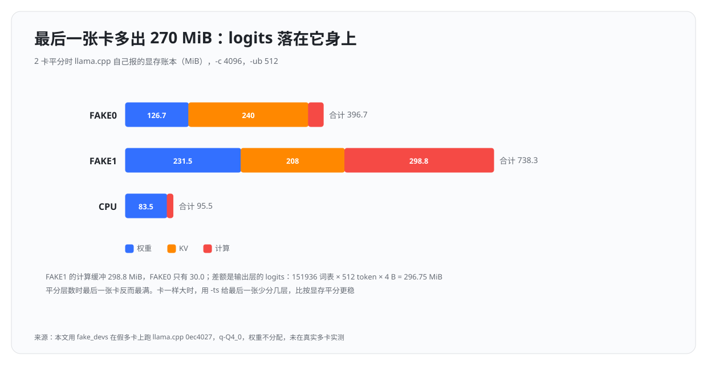

llama_get_memory_breakdown 按缓冲报出每个设备的权重、KV 和计算缓冲，fake_devs 退出前打印这张表。2 张假卡平分，-c 4096，-ub 512：FAKE0 放 15 层，权重 126.7 MiB，KV 240 MiB，计算缓冲 30 MiB，合计 396.7；FAKE1 放 13 层和输出层，权重 231.5，KV 208，计算缓冲 298.8，合计 738.3。CPU 上是输入层 83.5 MiB 加 12 MiB 计算缓冲。

权重加 KV 两项和 split_plan.py 的复算对得上：FAKE0 366.7、FAKE1 439.5 MiB。FAKE1 层数少但权重多，因为输出层也在它身上：按每层 8.4 MiB 扣掉 13 层，输出层约 122 MiB，比 CPU 上的输入层还大。

## 4.2 差额是 logits

计算缓冲的差额最大：FAKE1 298.8 MiB，FAKE0 只有 30 MiB。差的部分是输出层的 logits，151936 个词 × 512 个 token × 4 B，正好 296.75 MiB[[7]](https://arxiv.org/abs/2505.09388)。调度器给每张卡分配的计算缓冲按这段子图里同时存活的中间张量的峰值算，中间层的激活只有 n_embd 宽，logits 却是词表宽，所以输出层所在的卡要多留出这一块。

这件事反直觉：按显存平分层数时，最后一张卡反而最先满。卡一样大时，我会用 -ts 给最后一张少分一两层；卡大小不一时，把最大的卡排到最后。3 卡平分时更明显：FAKE0、FAKE1 合计 274.5 和 270.5，FAKE2 是 616.0。

**📎 展开阅读：**RPC 那组也一样：RPC0 放层 0 到 19，计算缓冲 30 MiB；本机的 FAKE0 放层 20 到输出层，计算缓冲 298.8 MiB。所以接 RPC 时，本机卡要按输出层加 logits 留余量，远端卡可以多分几层。

## 4.3 账本以外

这张表只有 llama.cpp 自己分配的缓冲。真实的卡上还有 CUDA 上下文、cuBLAS 工作区和驱动保留的部分，每张卡几百 MiB，不同驱动版本不一样，fake_devs 测不出来。我在真实机器上会拿 nvidia-smi 的占用减去这张表的合计，得出每张卡的固定开销，之后改参数时只算表里会变的几项。

> 🔑 **本章要点**：两卡平分时最后一张卡的计算缓冲多出 269 MiB，来源是 logits：n_vocab × n_ubatch × 4 B，Qwen3 在 ubatch 512 时 296.75 MiB。卡一样大时给最后一张少分几层，或者把最大的卡排到最后。

# 第 5 章 · 流水线并行什么时候打开

## 5.1 -ot 和 -ngl 最容易让它关掉

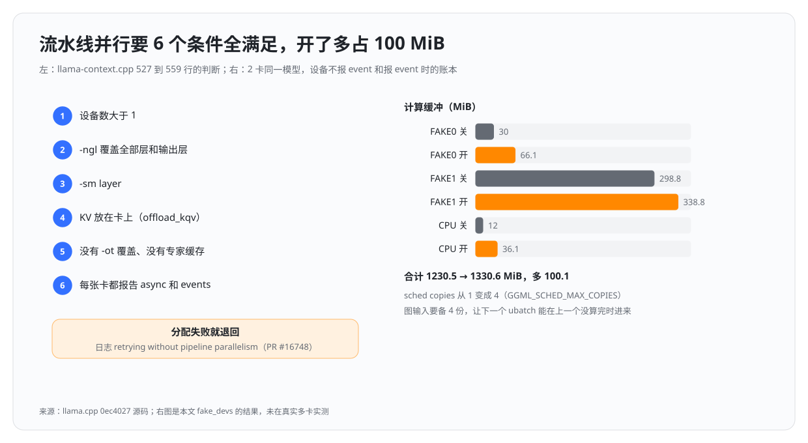

layer 切法本身只是把层分到几张卡，一个 ubatch 仍然是算完第一张卡再算第二张，前一张卡算完就闲着。流水线并行是在这之上让调度器把下一个 ubatch 提前送进来，第一张卡算第二个 ubatch 时第二张卡在算第一个，2024 年的 PR #6017 加进来的[[2]](https://github.com/ggml-org/llama.cpp/pull/6017)。同一个 PR 把 -ub 的缺省值定成 512，让一个 batch 能拆成几个 ubatch 在卡间流动。

llama-context.cpp 第 527 到 559 行决定开不开，六个条件同时满足才开：设备数大于 1，-ngl 覆盖全部层和输出层，-sm 用 layer，KV 放在卡上，没有 -ot 这类张量覆盖也没开专家缓存，除 CPU 外每张卡都报告支持异步计算和 event[[8]](https://github.com/ggml-org/llama.cpp/blob/0ec4027/src/llama-context.cpp)。任何一条不满足，变量直接置成 false，不打任何警告。打开时日志有一行 pipeline parallelism enabled，我每次都先找这一行。

这几条里最容易踩的是 -ot 和 -ngl。按 [LCPP-11｜内部｜GPU 卸载与 MoE：-ngl、专家放置、fit 和专家缓存](./11-gpu-offload-moe.md) 的办法用 -ot 或 -ncmoe 把专家留在主存，流水线并行就关了；-ngl 少写一层也一样。另一条是 event：CUDA 后端报告支持，有些后端不报，混用不同厂商的卡时流水线可能静默关掉。

## 5.2 多出来的显存

fake_devs 的假卡缺省不报 event，2 卡平分时日志里没有 pipeline parallelism enabled，sched copies = 1；加 --events 1 让假卡报告支持，日志出现那一行，sched copies 变成 4。4 来自 ggml/CMakeLists.txt 的 GGML_SCHED_MAX_COPIES 缺省值[[20]](https://github.com/ggml-org/llama.cpp/blob/0ec4027/ggml/CMakeLists.txt)。调度器给每个 split 的输入张量备 4 份，当前 ubatch 用一份，下一个 ubatch 写另一份，互不覆盖[[21]](https://github.com/ggml-org/llama.cpp/blob/0ec4027/ggml/src/ggml-backend.cpp)。

账本上权重和 KV 不变，变的是计算缓冲：FAKE0 从 30.0 到 66.1 MiB，FAKE1 从 298.8 到 338.8，CPU 从 12.0 到 36.1，合计从 1230.5 到 1330.6 MiB，多出 100.1 MiB。这个数跟着 split 输入的大小走，-ub 越大、段数越多，多出来的越多。test_split.py 的 test_pipeline_needs_events 核对的就是这两份日志。

## 5.3 分配失败就退回

显存紧的时候，多出来的这部分可能正好放不下。PR #16748 之后，reserve 计算缓冲失败且开着流水线并行时，llama.cpp 打一行 compute buffer allocation failed, retrying without pipeline parallelism，关掉再试一次[[9]](https://github.com/ggml-org/llama.cpp/pull/16748)。程序能跑起来，但批量吞吐掉回不开流水线的水平。我在上线前会搜这行警告；看到它，先降 -ub 或 -c 把那 100 MiB 量级的余量腾出来，比少放一层划算。

> 🔑 **本章要点**：流水线并行要设备数大于 1、-ngl 全满、-sm layer、KV 上卡、没有 -ot 和专家缓存、每张卡都报 event，六条全满足才开，否则静默关掉。开了之后图输入备 4 份，假多卡上计算缓冲多 100 MiB；分配失败会自动退回。

# 第 6 章 · -ub 和 -c 撑大的是哪张卡

## 6.1 改一个参数看账本

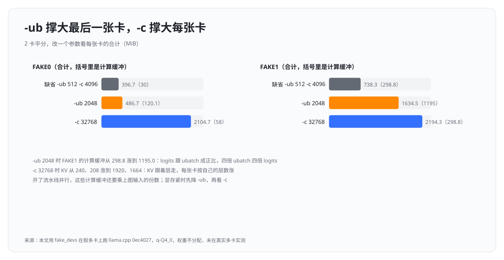

同样 2 卡平分，我只改一个参数。-ub 2048 时 FAKE0 合计从 396.7 到 486.7 MiB，FAKE1 从 738.3 到 1634.5 MiB；-c 32768 时 FAKE0 到 2104.7，FAKE1 到 2194.3。两个参数撑大的卡不一样：-ub 主要撑大最后一张，-c 让每张卡按自己的层数涨。

## 6.2 -ub 跟着 logits 走

FAKE1 的计算缓冲从 298.8 涨到 1195.0 MiB，差不多正好四倍。logits 的大小是 n_vocab × n_ubatch × 4 B，ubatch 从 512 到 2048，logits 从 296.75 到 1187 MiB[[7]](https://arxiv.org/abs/2505.09388)。中间层的激活也跟 ubatch 成正比，但只有 n_embd 宽，FAKE0 的计算缓冲从 30.0 到 120.1，绝对值小得多。开了流水线并行时，split 输入要再乘 4 份。

llama.cpp 计算 logits 时只给需要输出的 token 算。生成时每个序列只要最后一个 token 的 logits，但 reserve 计算缓冲时按最坏情况，也就是 ubatch 里每个 token 都要输出来算，所以 -ub 直接决定最后一张卡要留多少。-b 和 -ub 的关系在 [LCPP-03｜上手｜测量方法：llama-bench、PPL、KLD 和噪声](./03-bench-ppl.md) 讲过，这里只提醒一句：多卡时 -ub 不是越大越好，最后一张卡先满。

## 6.3 -c 跟着层走

-c 32768 时 KV 从 240、208 涨到 1920、1664 MiB，正好八倍，两张卡的比例和层数比例一样，15 比 13。KV 跟着层放，第 l 层的 K 和 V 就在放第 l 层的卡上，所以每张卡各涨各的[[1]](https://github.com/ggml-org/llama.cpp/blob/0ec4027/docs/multi-gpu.md)。KV 的大小怎么算见 [LCPP-08｜内部｜KV cache 与长上下文：账本、深度、量化、SWA 和上下文写满](./08-kv-context.md)。计算缓冲也会因为注意力掩码变大而涨一点，FAKE0 从 30 到 58 MiB。

显存紧时我的顺序是先降 -ub，再降 -c，最后才动 -ngl。-ub 从 512 降到 256，最后一张卡立刻省下一半 logits，prefill 慢一些，decode 不受影响。-c 降下来，每张卡都省。-ngl 少一层，就意味着流水线并行关掉、那一层挪到 CPU。

> 🔑 **本章要点**：-ub 撑大最后一张卡，计算缓冲跟 logits 成正比；-c 撑大每张卡，KV 跟层数成正比。显存紧时先降 -ub，再降 -c，最后动 -ngl。

# 第 7 章 · 调度器切出的每一段

## 7.1 段与段之间搬什么

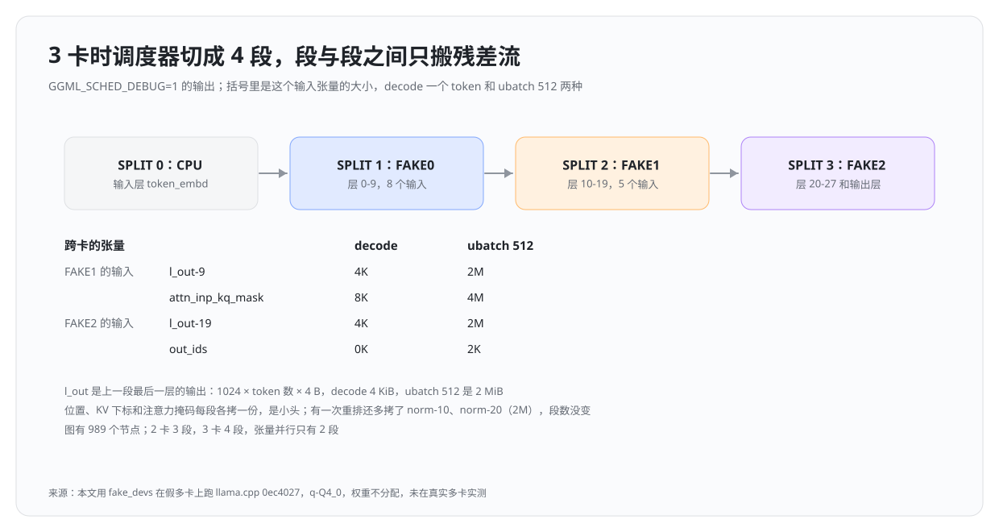

模型的计算图交给 ggml_backend_sched 之后，调度器按每个节点的权重放在哪张卡给节点分配后端，再把连续落在同一后端的节点合成一个 split[[21]](https://github.com/ggml-org/llama.cpp/blob/0ec4027/ggml/src/ggml-backend.cpp)。split 的输入里不在本卡上的张量要先拷过来，这就是跨卡的流量。GGML_SCHED_DEBUG=1 会把每个 split 和它的输入打出来，后端和调度器的整体结构在 [LCPP-06｜内部｜后端与编译：CPU 变体、BLAS、repack 和 GPU 架构](./06-backends-build.md) 讲过。

3 张假卡时 Qwen3-0.6B 的图有 989 个节点，切成 4 段。SPLIT 0 在 CPU 上查 token_embd。SPLIT 1 在 FAKE0 上算层 0 到 9，8 个输入。SPLIT 2 在 FAKE1 上算层 10 到 19，5 个输入。SPLIT 3 在 FAKE2 上算层 20 到 27 和输出层，6 个输入。2 卡时是 3 段，张量并行只有 2 段，第 8 章再说。

## 7.2 残差流是大头

FAKE1 的输入里真正有分量的是 l_out-9，上一段最后一层的输出，1024 × token 数 × 4 B：decode 一个 token 是 4 KiB，ubatch 512 是 2 MiB。FAKE2 的输入是 l_out-19，大小一样。其余是位置、KV 写入下标和注意力掩码，每段各拷一份：decode 时掩码 8 KiB，ubatch 512 时 4 MiB，比残差流还大，但它们来自主存，是从 CPU 拷到每张卡，不在卡与卡之间传。

ubatch 512 的几次 reserve 里有一次多拷了 norm-10 和 norm-20，各 2 MiB，段数没变。原因我没有深究，fake_devs 只做 reserve，正式计算时搬什么要在真卡上用同样的环境变量再看。test_split.py 的 test_sched_boundary 同时核对 4K 和 2M 两种 l_out-9。

## 7.3 和通信量公式对上

把这些数字换成公式：layer 切法每条边界每个 ubatch 传 n_embd × n_tokens × 4 B，n 张卡有 n − 1 条边界。comm_volume.py 就按这个算，Qwen3-0.6B 2 卡 decode 每跳 4 KiB，ubatch 512 每跳 2 MiB，和调度器日志一致。这个量和层数无关，层再多，边界还是那几条；第 9 章拿它和张量并行比。

# 第 8 章 · -sm tensor 的 Meta 设备

## 8.1 一张卡的样子

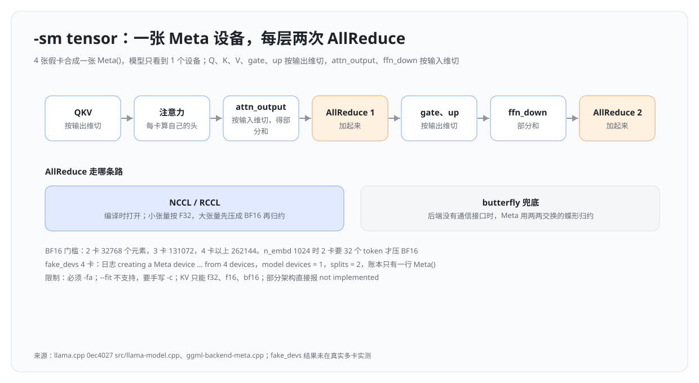

-sm tensor 由 PR #19378 加进来，后来 PR #21684 在参数说明里标成实验[[10]](https://github.com/ggml-org/llama.cpp/pull/19378)[[14]](https://github.com/ggml-org/llama.cpp/pull/21684)。它的做法是把参与的几张卡合成一张 Meta 设备，模型只看到这一个设备，层的分配、KV 的放置都按单卡走；权重张量在 Meta 设备内部按切分轴拆到每张卡[[22]](https://github.com/ggml-org/llama.cpp/blob/0ec4027/ggml/src/ggml-backend-meta.cpp)。fake_devs 4 卡时日志是 creating a Meta device for tensor parallelism from 4 devices，接着 model devices = 1，调度器只切成 2 段：CPU 上的输入层和 Meta 上的其余部分。

切分轴写在 llama-model.cpp 里：Q、K、V、ffn_gate、ffn_up 按输出维切，每张卡算一部分头、一部分中间维；attn_output 和 ffn_down 按输入维切，每张卡得到一份完整形状的部分和[[5]](https://github.com/ggml-org/llama.cpp/blob/0ec4027/src/llama-model.cpp)。部分和要加起来才能进残差流，所以每层在注意力输出之后和 FFN 下投影之后各做一次 AllReduce。这正是 Megatron-LM 的切法，前向每层两次同步[[11]](https://arxiv.org/abs/1909.08053)。Meta 设备最多容纳 16 张卡。

## 8.2 AllReduce 走哪条路

CUDA 后端编译时打开 NCCL，AllReduce 就交给 NCCL[[23]](https://github.com/ggml-org/llama.cpp/pull/21891)[[24]](https://docs.nvidia.com/deeplearning/nccl/user-guide/docs/usage/collectives.html)。ggml-cuda.cu 第 1156 行按张量元素数决定精度：2 卡少于 32768 个元素、3 卡少于 131072、4 卡以上少于 262144 时用 F32，超过就先转成 BF16 再归约，归约完转回 F32[[25]](https://github.com/ggml-org/llama.cpp/blob/0ec4027/ggml/src/ggml-cuda/ggml-cuda.cu)。n_embd 1024 的模型，一个 token 的残差流是 1024 个元素，2 卡要 32 个 token 才够门槛；decode 永远走 F32。

后端没有通信接口时，Meta 设备用自己的 butterfly 归约兜底：两两交换部分和，log2(n) 步做完；卡数不是 2 的幂时先把多出来的卡折进前面的卡[[22]](https://github.com/ggml-org/llama.cpp/blob/0ec4027/ggml/src/ggml-backend-meta.cpp)。没装 NCCL 的 CUDA 多卡构建会打一次 NCCL is unavailable 的警告，性能会差[[1]](https://github.com/ggml-org/llama.cpp/blob/0ec4027/docs/multi-gpu.md)。ROCm 对应的是 RCCL，要 -DGGML_HIP_RCCL=ON 显式打开。AllReduce 的算法本身，ring 和递归倍增的带宽、轮数取舍，Thakur 等人和 Patarasuk 等人的论文讲得很清楚[[26]](https://doi.org/10.1177/1094342005051521)[[27]](https://doi.org/10.1016/j.jpdc.2008.09.002)，第 9 章按它们的公式算通信量。

## 8.3 限制

-sm tensor 必须开 Flash Attention，-fa auto 时自动打开，显式关掉直接报错[[8]](https://github.com/ggml-org/llama.cpp/blob/0ec4027/src/llama-context.cpp)。--fit 不支持这个模式，fit.cpp 第 264 行直接抛异常，所以 -c 要自己写[[28]](https://github.com/ggml-org/llama.cpp/blob/0ec4027/common/fit.cpp)。KV 只能是 f32、f16 或 bf16，量化 KV 会报错；采样不能放到后端，退回 CPU。不在支持列表里的架构加载时报 not implemented，MoE 里有一类带 amax 重缩放的架构被 PR #31081 显式拒绝[[29]](https://github.com/ggml-org/llama.cpp/pull/31081)。

-sm tensor 下显存账本只有一行 Meta()，是所有卡的合计：2 卡和 4 卡都是权重 358.2、KV 448、计算缓冲 308.8 MiB，看不出每张卡各多少。官方文档给的显存不够时的顺序是先降 -c，再降 -np，最后才降 -ngl[[1]](https://github.com/ggml-org/llama.cpp/blob/0ec4027/docs/multi-gpu.md)。fake_devs 也拆不开这一行，真实机器上我按卡数平分做初估，再用 nvidia-smi 看每张卡的实际占用。

**📎 展开阅读：**GGML_CUDA_P2P=1 打开 CUDA 卡间直连，跨卡拷贝不经过主存，通常更快；文档也写明它是可选项，某些主板或开了 IOMMU 时会崩溃或输出错乱，出问题就去掉这个变量。

> 🔑 **本章要点**：-sm tensor 把几张卡合成一张 Meta 设备，QKV、gate、up 按输出维切，attn_output、ffn_down 按输入维切，每层两次 AllReduce；NCCL 小张量 F32、大张量 BF16，没有通信接口时 butterfly 兜底。必须 -fa，不支持 --fit，KV 只能非量化。

# 第 9 章 · 通信量和 PR 实测

## 9.1 按实现算字节

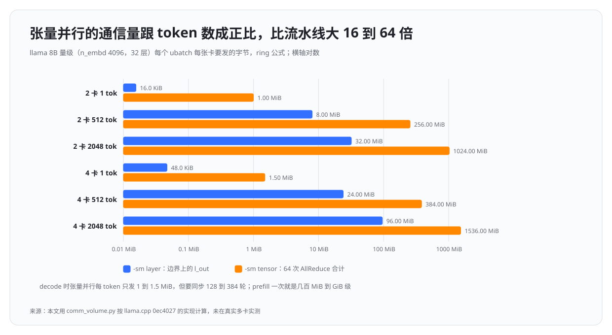

layer 切法的通信量在第 7 章算过：每条边界 n_embd × n_tokens × 4 B。tensor 切法每层两次 AllReduce，每次归约的张量也是 n_embd × n_tokens 个元素，按 ring 算法每张卡要发 2(n − 1)/n 倍的数据，分 2(n − 1) 轮[[26]](https://doi.org/10.1177/1094342005051521)[[27]](https://doi.org/10.1016/j.jpdc.2008.09.002)。comm_volume.py 把 NCCL 的门槛也算进去：超过门槛的按 BF16 计字节。

拿 llama 8B 量级的形状算，n_embd 4096，32 层，每个 ubatch 64 次 AllReduce。2 卡 decode 一个 token：layer 每卡 16 KiB，tensor 每卡 1 MiB，64 倍；ubatch 512：8 MiB 对 256 MiB，32 倍，这时已经按 BF16 算。4 卡 decode 是 48 KiB 对 1.5 MiB，ubatch 512 是 24 MiB 对 384 MiB。两种切法都跟 token 数成正比，差距在 16 到 64 倍之间，卡越多、token 越多，倍数越小，但绝对量越大。

字节之外还要算轮数。4 卡 ring 每次 AllReduce 6 轮，decode 一个 token 要同步 384 轮；70B 量级 80 层、4 卡是 960 轮。按 32 GB/s 的单向带宽折算，70B 4 卡 decode 每 token 的 7.5 MiB 只要 245.8 μs，但 960 轮每轮都有启动延迟。decode 时 tensor 切法卡在延迟上，prefill 时卡在带宽上。butterfly 兜底时轮数少，4 卡每次 2 步，但每卡发的字节更多，4 卡 decode 是 2 MiB。

## 9.2 PR 作者的实测

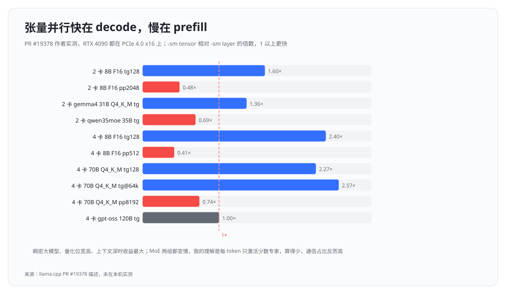

PR #19378 的作者在 RTX 4090 上测了 -sm tensor 相对 -sm layer 的倍数，卡都插在 PCIe 4.0 x16 上[[10]](https://github.com/ggml-org/llama.cpp/pull/19378)。2 卡 8B F16：tg128 从 60.28 到 96.63 t/s，1.60 倍；pp2048 只有 0.48 倍，pp512 是 0.76 倍。

64k 深度的 tg 是 1.72 倍。4 卡 8B F16 的 tg128 是 2.40 倍，pp512 是 0.41 倍。4 卡 70B Q4_K_M：tg128 从 21.25 到 48.31 t/s，2.27 倍，64k 深度 2.57 倍，pp512 是 0.91 倍，pp8192 是 0.74 倍。

MoE 的结果分化。2 卡 qwen35moe 35B 的 tg 是 0.69 倍，gemma4 26B A4B 的 tg 0.70 倍、pp2048 0.25 倍。4 卡 gpt-oss 120B 的 tg 1.00 倍，pp512 反而 1.42 倍。glm4moe 106B 的 tg 1.17 倍，64k 深度的 pp512 是 2.14 倍。我的理解是 MoE 每个 token 只激活少数专家，每张卡要读的权重本来就少，AllReduce 的次数却和稠密模型一样，通信的占比高了；深上下文时注意力算得多，切开反而划算。这是我对数据的解读，PR 里没有逐项归因。

## 9.3 作者的结论和已知问题

作者的结论是：tensor 切法适合慢卡加快互联跑大的稠密模型；layer 切法开了流水线并行时 prefill 更快。已知问题有三条：CUDA graph 会导致显存泄漏，Vulkan 和 ROCm 上效果很差，不支持后端采样[[10]](https://github.com/ggml-org/llama.cpp/pull/19378)。官方文档也写明只对 CUDA 多卡有把握，其他后端不保证[[1]](https://github.com/ggml-org/llama.cpp/blob/0ec4027/docs/multi-gpu.md)。这些都和第 9.1 节的账对得上：prefill 时通信量是 decode 的几百倍，PCIe 扛不住。

> 🔑 **本章要点**：tensor 切法每层两次 AllReduce，通信量是 layer 的 16 到 64 倍，decode 卡在同步轮数上，prefill 卡在带宽上。PR 实测 4090 上稠密模型 decode 快 1.6 到 2.4 倍，prefill 慢到 0.4 到 0.9 倍，MoE 多数没有收益；未在本机实测。

# 第 10 章 · RPC：把别的机器当一张卡

## 10.1 消息格式和图 uid

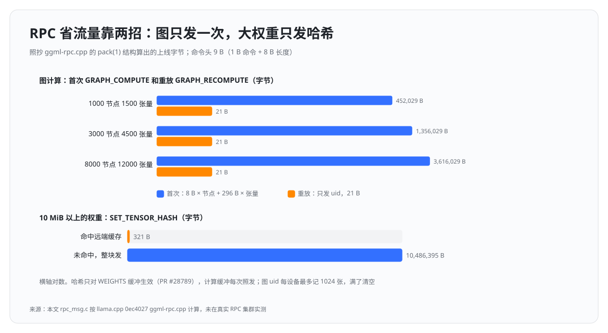

RPC 后端由 PR #6829 加进来，当时的演示是把 7B F16 切到两台机器上，各占 7 GB 和 6.5 GB 左右，那时还没有流水线并行[[30]](https://github.com/ggml-org/llama.cpp/pull/6829)。现行的协议主版本是 8，写在 ggml-rpc.h 里，客户端和服务端版本不一致时握手直接失败[[31]](https://github.com/ggml-org/llama.cpp/blob/0ec4027/ggml/include/ggml-rpc.h)。每条命令是 1 B 命令号加 8 B 长度，再跟一个打包的结构体；张量描述 rpc_tensor 是 296 B。rpc_msg.c 照抄这些 pack(1) 结构，打印每条命令上线的字节数。

最大的消息是 GRAPH_COMPUTE：每个节点 8 B 的张量 id，每个张量一份 296 B 的描述。1000 个节点、1500 个张量的图是 452029 B，441 KiB；8000 个节点是 3.4 MiB。PR #22701 之后，调度器给每个 split 的图一个 uid，客户端按设备记住发过的 uid，同一张图再算时只发 GRAPH_RECOMPUTE，21 B[[32]](https://github.com/ggml-org/llama.cpp/pull/22701)[[21]](https://github.com/ggml-org/llama.cpp/blob/0ec4027/ggml/src/ggml-backend.cpp)。llama.cpp 在相邻 ubatch 形状相同时复用上一张图，decode 的每个 token 基本都走重放。每个设备最多记 1024 个 uid，满了整个清空重来[[12]](https://github.com/ggml-org/llama.cpp/blob/0ec4027/ggml/src/ggml-rpc/ggml-rpc.cpp)。

## 10.2 权重哈希和本地缓存

加载模型时权重要经 SET_TENSOR 发给远端，7B F16 就是十几 GB。rpc-server 加 -c 时，客户端对超过 10 MiB 的张量先发 SET_TENSOR_HASH，只带 64 位哈希，321 B；远端缓存里有就直接从本地盘读，没有才回复让客户端整块发，10 MiB 的张量要发 10486395 B[[12]](https://github.com/ggml-org/llama.cpp/blob/0ec4027/ggml/src/ggml-rpc/ggml-rpc.cpp)[[13]](https://github.com/ggml-org/llama.cpp/blob/0ec4027/tools/rpc/README.md)。缓存目录缺省是 \$HOME/.cache/llama.cpp/rpc，可以用 LLAMA_CACHE 改。

哈希原来对所有大张量生效，PR #28789 改成只对 WEIGHTS 缓冲生效。改之前调度器在卡间搬的激活也走哈希，ubatch 稍大一点就超过 10 MiB，每次都写进缓存目录；PR 作者的缓存涨到 14802 个文件、1.4 TB。只哈希权重之后，16 MiB 的计算张量从 19 ms 降到 2.9 ms。作者在回环上测 16 MiB 权重，未命中 34 ms，命中 19 ms，大头是客户端算 FNV 哈希[[33]](https://github.com/ggml-org/llama.cpp/pull/28789)。所以哈希省的是网线上的字节，不省客户端的 CPU，千兆网以上的局域网里收益要实测。

**📎 展开阅读：**0ec4027 的 RPC 还有一条服务端之间直连的路：-sm tensor 正好用两台 rpc-server 时，AllReduce 由两个服务端直接交换部分和，客户端只发一条 309 B 的 COMM_ALLREDUCE 命令，数据不经过客户端；设 GGML_RPC_NO_COMM 可以关掉。只支持恰好两个端点。

## 10.3 RDMA 和安全

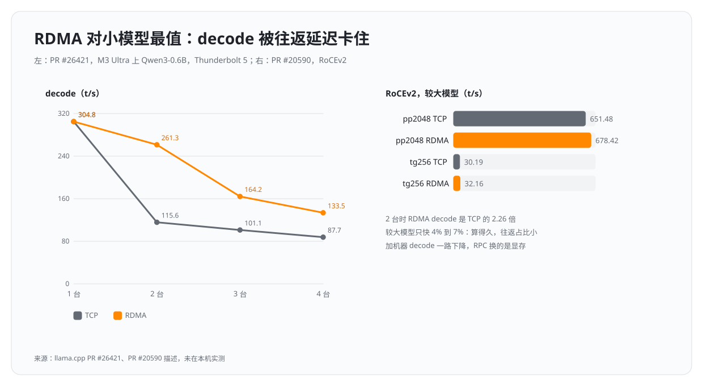

RDMA 传输在握手时协商，两端都支持才用，否则退回 TCP，命令行不用改[[13]](https://github.com/ggml-org/llama.cpp/blob/0ec4027/tools/rpc/README.md)。Linux 上走 libibverbs 的 RoCEv2，由 PR #20590 加入[[34]](https://github.com/ggml-org/llama.cpp/pull/20590)[[35]](https://www.infinibandta.org/ibta-specification/)；macOS 上走 Thunderbolt 5 的 RDMA，要 macOS 26.2 以上，在恢复模式里执行一次 rdma_ctl enable，由 PR #26421 加入[[36]](https://github.com/ggml-org/llama.cpp/pull/26421)[[37]](https://developer.apple.com/documentation/technotes/tn3205-low-latency-communication-with-rdma-over-thunderbolt)。RDMA 是点对点的，--rpc 里要写对端在 RDMA 链路上的地址；设 GGML_RPC_NO_RDMA=1 强制走 TCP。

两个 PR 的实测说明 RDMA 省的是往返延迟。M3 Ultra 跑 Qwen3-0.6B，单机 decode 304.8 t/s。2 台时 TCP 掉到 115.6，RDMA 是 261.3，2.26 倍。3 台 101.1 对 164.2，4 台 87.7 对 133.5。

prefill 也快：2 台 5296 对 7227 t/s。RoCEv2 那组跑的是大一些的模型，pp2048 从 651.48 到 678.42，tg256 从 30.19 到 32.16，只快 4% 到 7%。小模型每层算得快，延迟占大头；大模型算得久，往返占比小。两组都说明加机器 decode 一路下降，RPC 换来的是显存。

rpc-server 没有鉴权也没有加密。README 开头就写着它是概念验证，脆弱且不安全，不要在开放网络或敏感环境里跑[[13]](https://github.com/ggml-org/llama.cpp/blob/0ec4027/tools/rpc/README.md)。rpc-server.cpp 缺省只监听 127.0.0.1:50052，-H 改成别的地址会打一条警告[[38]](https://github.com/ggml-org/llama.cpp/blob/0ec4027/tools/rpc/rpc-server.cpp)。我只在隔离的内网里起 rpc-server，用 CUDA_VISIBLE_DEVICES 或 --device 限定它暴露哪几张卡；本篇的实验没有起任何监听端口的进程，命令只列给有集群的读者。

```bash
# 远端机器，在可信内网里
CUDA_VISIBLE_DEVICES=0 rpc-server -H 10.0.0.2 -p 50052 -c
# 本机
llama-bench -m model.gguf --rpc 10.0.0.2:50052 -ngl 99 -p 512 -n 128
GGML_RPC_DEBUG=1 llama-completion -m model.gguf --rpc 10.0.0.2:50052 -ngl 99 -lv 5 -p hello -n 16
```

> 🔑 **本章要点**：RPC 的图首次发 8 B × 节点 + 296 B × 张量，重放只发 21 B 的 uid；10 MiB 以上的权重命中缓存只发 321 B，哈希只对权重生效。RDMA 对小模型 decode 收益最大，PR 实测 2 台 2.26 倍。rpc-server 无鉴权，只能在可信内网用。

# 第 11 章 · 怎么选与上线清单

## 11.1 按场景选

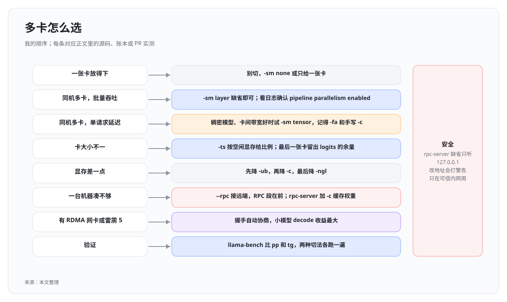

| 场景 | 怎么配 | 依据 |
|-|-|-|
| 一张卡放得下 | -sm none，或用 CUDA_VISIBLE_DEVICES 只给一张卡 | 第 1 章：layer 切法单请求不会更快 |
| 同机多卡，批量吞吐 | -sm layer 缺省，确认日志有 pipeline parallelism enabled | 第 5 章：六个条件静默判断 |
| 同机多卡，单请求延迟 | 稠密模型、NCCL 可用时试 -sm tensor，加 -fa，手写 -c | 第 8、9 章：decode 快 1.6 到 2.4 倍 |
| 卡大小不一 | -ts 按空闲显存给比例，最大的卡排最后 | 第 3、4 章：logits 落在最后一张 |
| 显存差一点 | 先降 -ub，再降 -c，最后降 -ngl | 第 6 章：-ub 撑最后一张，-c 撑每张 |
| 一台机器不够 | --rpc 接远端，-ts 第一项对应 RPC，rpc-server 加 -c | 第 2、10 章：RPC 排在最前 |
| 有 RDMA 网卡或雷雳 5 | 不用改命令，看握手日志确认走了 RDMA | 第 10 章：2 台 decode 2.26 倍 |

表里的层分配和账本来自 fake_devs 在假多卡上让 llama.cpp 自己报的结果，通信量来自 comm_volume.py 按实现算的字节，速度全部来自 PR 作者的机器，都未在真实多卡上实测。换到自己的集群上，我先用 fake_devs 或 split_plan.py 按目标卡的显存预演切层和账本，再用 llama-bench 在真卡上对 -sm layer 和 -sm tensor 各跑一遍 pp 和 tg。Pope 等人的结论也是同一个意思：最优切法随批量、序列长度和硬件变，要按目标负载测[[17]](https://arxiv.org/abs/2211.05102)。

## 11.2 上线清单

> 📌 **上线前核对清单**：每换一组卡或加一台 RPC 机器，我按这个顺序过一遍。
> - 日志里 using device 的顺序和 -ts 的每一项对得上，RPC 在最前
> - offloaded N/M 里 N 等于 M，-ngl 写的是 all
> - 用 layer 切法时找到 pipeline parallelism enabled，没有 retrying without pipeline parallelism
> - 最后一张卡按 n_vocab × n_ubatch × 4 B 留出 logits 的余量
> - 用 tensor 切法时开了 -fa，KV 是 f16 或 bf16，手写了 -c，没有 NCCL is unavailable 警告
> - rpc-server 只在可信内网监听，加了 -c，用 --device 限定暴露的卡
> - GGML_RPC_DEBUG=1 下确认 decode 走 GRAPH_RECOMPUTE，有 RDMA 时握手协商成功
> - llama-bench 对两种切法各测过 pp 和 tg，不直接套 PR 里的倍数

## 11.3 下一步

多卡解决的是放不下和延迟，单卡的 decode 还可以靠投机解码用一个小模型摊薄大模型每 token 的权重读取，放在 LCPP-13；llama-server 的并发槽位和 -np 怎么和多卡的 KV 一起算，放在 LCPP-14；把这篇和前后几篇的参数汇成调参手册，放在 LCPP-17。单卡上的 -ngl、-ot 和 MoE 专家放置回到 [LCPP-11｜内部｜GPU 卸载与 MoE：-ngl、专家放置、fit 和专家缓存](./11-gpu-offload-moe.md)，调度器的结构回到 [LCPP-06｜内部｜后端与编译：CPU 变体、BLAS、repack 和 GPU 架构](./06-backends-build.md)。

# 参考文献

按正文首次引用顺序编号，资料截至 2026 年 10 月初。

[1] llama.cpp 0ec4027. docs/multi-gpu.md：三种切分方式、参数表、张量并行的限制和排障表。 [docs/multi-gpu.md](https://github.com/ggml-org/llama.cpp/blob/0ec4027/docs/multi-gpu.md)

[2] slaren. llama : add pipeline parallelism support. llama.cpp PR #6017, 2024. [PR #6017](https://github.com/ggml-org/llama.cpp/pull/6017)

[3] llama.cpp 0ec4027. src/llama.cpp：设备表的组装，RPC 设备排在最前，有独显时不用集显。 [llama.cpp](https://github.com/ggml-org/llama.cpp/blob/0ec4027/src/llama.cpp)

[4] rgerganov. llama : offload to RPC in addition to other backends. llama.cpp PR #7640, 2024. [PR #7640](https://github.com/ggml-org/llama.cpp/pull/7640)

[5] llama.cpp 0ec4027. src/llama-model.cpp：按空闲显存或 -ts 算切分点，逐层分配设备，张量并行的切分轴。 [llama-model.cpp](https://github.com/ggml-org/llama.cpp/blob/0ec4027/src/llama-model.cpp)

[6] llama.cpp 0ec4027. common/arg.cpp：-sm、-ts、-mg、--rpc 的定义。 [arg.cpp](https://github.com/ggml-org/llama.cpp/blob/0ec4027/common/arg.cpp)

[7] Qwen Team. Qwen3 Technical Report. 2025. [arXiv:2505.09388](https://arxiv.org/abs/2505.09388)

[8] llama.cpp 0ec4027. src/llama-context.cpp：流水线并行的开启条件、分配失败后的回退、张量并行对 FA 的要求。 [llama-context.cpp](https://github.com/ggml-org/llama.cpp/blob/0ec4027/src/llama-context.cpp)

[9] slaren. llama : disable pipeline parallelism if compute buffer allocation fails. llama.cpp PR #16748, 2025. [PR #16748](https://github.com/ggml-org/llama.cpp/pull/16748)

[10] JohannesGaessler. ggml: backend-agnostic tensor parallelism (experimental). llama.cpp PR #19378, 2026. [PR #19378](https://github.com/ggml-org/llama.cpp/pull/19378)

[11] Shoeybi M, et al. Megatron-LM: Training Multi-Billion Parameter Language Models Using Model Parallelism. 2019. [arXiv:1909.08053](https://arxiv.org/abs/1909.08053)

[12] llama.cpp 0ec4027. ggml/src/ggml-rpc/ggml-rpc.cpp：消息格式、10 MiB 哈希门槛、图 uid。 [ggml-rpc.cpp](https://github.com/ggml-org/llama.cpp/blob/0ec4027/ggml/src/ggml-rpc/ggml-rpc.cpp)

[13] llama.cpp 0ec4027. tools/rpc/README.md：rpc-server 的用法、本地缓存、RDMA 传输和安全警告。 [tools/rpc/README.md](https://github.com/ggml-org/llama.cpp/blob/0ec4027/tools/rpc/README.md)

[14] JohannesGaessler. common: mark --split-mode tensor as experimental. llama.cpp PR #21684, 2026. [PR #21684](https://github.com/ggml-org/llama.cpp/pull/21684)

[15] Huang Y, et al. GPipe: Efficient Training of Giant Neural Networks using Pipeline Parallelism. NeurIPS 2019. [arXiv:1811.06965](https://arxiv.org/abs/1811.06965)

[16] Harlap A, et al. PipeDream: Fast and Efficient Pipeline Parallel DNN Training. 2018. [arXiv:1806.03377](https://arxiv.org/abs/1806.03377)

[17] Pope R, et al. Efficiently Scaling Transformer Inference. MLSys 2023. [arXiv:2211.05102](https://arxiv.org/abs/2211.05102)

[18] Narayanan D, et al. Efficient Large-Scale Language Model Training on GPU Clusters Using Megatron-LM. SC 2021. [arXiv:2104.04473](https://arxiv.org/abs/2104.04473)

[19] llama.cpp issue #18577：设备报 0 空闲 0 总量时按主存估算切分。 [issue #18577](https://github.com/ggml-org/llama.cpp/issues/18577)

[20] llama.cpp 0ec4027. ggml/CMakeLists.txt：GGML_SCHED_MAX_COPIES 缺省为 4。 [ggml/CMakeLists.txt](https://github.com/ggml-org/llama.cpp/blob/0ec4027/ggml/CMakeLists.txt)

[21] llama.cpp 0ec4027. ggml/src/ggml-backend.cpp：调度器切图、split 输入的拷贝和 n_copies。 [ggml-backend.cpp](https://github.com/ggml-org/llama.cpp/blob/0ec4027/ggml/src/ggml-backend.cpp)

[22] llama.cpp 0ec4027. ggml/src/ggml-backend-meta.cpp：Meta 设备、按 PARTIAL 切子图、butterfly 兜底归约。 [ggml-backend-meta.cpp](https://github.com/ggml-org/llama.cpp/blob/0ec4027/ggml/src/ggml-backend-meta.cpp)

[23] JohannesGaessler. CUDA: manage NCCL communicators in context. llama.cpp PR #21891, 2026. [PR #21891](https://github.com/ggml-org/llama.cpp/pull/21891)

[24] NVIDIA. NCCL 用户文档：Collective Operations，AllReduce 的语义和数据类型。 [NCCL Collectives](https://docs.nvidia.com/deeplearning/nccl/user-guide/docs/usage/collectives.html)

[25] llama.cpp 0ec4027. ggml/src/ggml-cuda/ggml-cuda.cu：NCCL AllReduce 的 F32 和 BF16 门槛。 [ggml-cuda.cu](https://github.com/ggml-org/llama.cpp/blob/0ec4027/ggml/src/ggml-cuda/ggml-cuda.cu)

[26] Thakur R, Rabenseifner R, Gropp W. Optimization of Collective Communication Operations in MPICH. IJHPCA 19(1), 2005. [doi:10.1177/1094342005051521](https://doi.org/10.1177/1094342005051521)

[27] Patarasuk P, Yuan X. Bandwidth Optimal All-reduce Algorithms for Clusters of Workstations. JPDC 69(2), 2009. [doi:10.1016/j.jpdc.2008.09.002](https://doi.org/10.1016/j.jpdc.2008.09.002)

[28] llama.cpp 0ec4027. common/fit.cpp：fit 不支持 SPLIT_MODE_TENSOR。 [fit.cpp](https://github.com/ggml-org/llama.cpp/blob/0ec4027/common/fit.cpp)

[29] ggerganov. llama : deny -sm tensor for arches with moe amax rescaling. llama.cpp PR #31081, 2026. [PR #31081](https://github.com/ggml-org/llama.cpp/pull/31081)

[30] rgerganov. ggml : add RPC backend. llama.cpp PR #6829, 2024. [PR #6829](https://github.com/ggml-org/llama.cpp/pull/6829)

[31] llama.cpp 0ec4027. ggml/include/ggml-rpc.h：RPC 协议主版本号 8。 [ggml-rpc.h](https://github.com/ggml-org/llama.cpp/blob/0ec4027/ggml/include/ggml-rpc.h)

[32] rgerganov. rpc : use graph uid instead of graph cache. llama.cpp PR #22701, 2026. [PR #22701](https://github.com/ggml-org/llama.cpp/pull/22701)

[33] Patt92. rpc : hash-cache only weights. llama.cpp PR #28789, 2026. [PR #28789](https://github.com/ggml-org/llama.cpp/pull/28789)

[34] dvv101111. ggml-rpc: add native RDMA transport for RPC backend (RoCEv2). llama.cpp PR #20590, 2026. [PR #20590](https://github.com/ggml-org/llama.cpp/pull/20590)

[35] InfiniBand Trade Association. Supplement to InfiniBand Architecture Specification Annex A17: RoCEv2. 2014. [IBTA RoCEv2](https://www.infinibandta.org/ibta-specification/)

[36] ryan5rdx. rpc: support apple RDMA as an RPC transport. llama.cpp PR #26421, 2026. [PR #26421](https://github.com/ggml-org/llama.cpp/pull/26421)

[37] Apple. TN3205: Low-latency communication with RDMA over Thunderbolt. [TN3205](https://developer.apple.com/documentation/technotes/tn3205-low-latency-communication-with-rdma-over-thunderbolt)

[38] llama.cpp 0ec4027. tools/rpc/rpc-server.cpp：缺省监听 127.0.0.1:50052，改成别的地址会打警告。 [rpc-server.cpp](https://github.com/ggml-org/llama.cpp/blob/0ec4027/tools/rpc/rpc-server.cpp)

---

[在 Colab 里跑本章 CPU 练习](https://colab.research.google.com/github/zyaochen/zero-to-llama/blob/main/colab/12-multi-gpu-rpc.ipynb) · 上一章：[LCPP-11｜内部｜GPU 卸载与 MoE：-ngl、专家放置、fit 和专家缓存](./11-gpu-offload-moe.md) · [目录](./README.md) · 下一章：[LCPP-13｜内部｜投机解码：草稿模型、n-gram 和拒绝采样](./13-speculative.md)
