# LCPP-13｜内部｜投机解码：草稿模型、n-gram 和拒绝采样

> 🎯 **这篇文档解决什么问题**：decode 每出一个 token 都要把整份权重读一遍，投机解码的想法是让一个便宜的草稿先猜几个 token，目标模型一次前向把它们全验掉，猜中几个就省几次读权重。论文里这招能快 2 到 3 倍，我在 4 核 CPU 上照着配，Q8_0 目标配 Q4_0 草稿反而慢到 0.6 倍。这篇把一轮投机的账拆开：草稿花多少、目标一次验 k+1 个位置花多少、每轮能落地几个，再把 llama.cpp 里的草稿模型、p_min 早停、拒绝采样、n-gram 和 lookahead 逐个对到源码和实测，说清楚什么时候该开、怎么配。主线一句话：投机解码能不能回本，先看草稿和目标的单 token 耗时比 c，再看接受率 α。
>
> 使用方式：只想知道怎么配，看导读和第 11 章；想先判断自己的组合能不能回本，看第 3、4 章；k 设多大、要不要加 p_min，看第 5、6 章；温度大于 0 时接受率掉得厉害，看第 7 章；改写、重构这类提示里带原文的任务，看第 8 章；MoE 和循环结构的模型，看第 9 章。文中版本和数字核对于 2026 年 10 月 31 日。
>
> **代码**：[zero-to-llama/13-speculative](../13-speculative)。实验用 llama-bench、llama-completion、llama-speculative-simple、老的 llama-speculative、llama-lookup、llama-lookahead 和拒绝采样的单元测试，全都不监听端口。spec_model.py 实现 Leviathan 等人的期望收益模型，用实测的代价曲线预测加速比；exp13.sh 跑十三组实验，test_spec.py 是 17 个回归用例。机器速度会漂，同一配置前后两次能差 10% 以上，关键对比交替跑 3 轮、按同一轮的两个数算比值。llama-server 的投机、SPEED-Bench、EAGLE-3、MTP、DFlash 和 DSpark 未在本机实测，数字引论文和 PR 作者的报告。基线是主干 0ec4027，模型是 Qwen3-0.6B，机器是 4 核 EPYC 云主机无 GPU。

# 导读 · 先给结论

- **一轮投机的账是草稿 k 次小前向加目标 1 次 k+1 宽的前向。**换回 1 到 k+1 个 token；温度 0 时逐位比对，输出和不开投机逐字相同[[1]](https://arxiv.org/abs/2211.17192)[[2]](https://github.com/ggml-org/llama.cpp/blob/0ec4027/examples/speculative-simple/speculative-simple.cpp)。
- **CPU 上多喂几个 token 并不白送。**Q8_0 目标一次喂 5 个是喂 1 个的 1.99 倍，喂 17 个是 4.03 倍；论文按 1 倍算，前提是加速器上有闲置算力[[1]](https://arxiv.org/abs/2211.17192)。
- **先算 c 再谈 α。**草稿和目标单 token 耗时比 c 是 0.86 时，α 0.88 也救不回来；同一个 Q4_0 草稿配 bf16 目标，c 降到 0.29，交替跑的加速比是 1.23 和 1.26 倍。
- **越往后越猜不中。**k = 16 时 prose 第 4 位的接受率只剩 0.23；p_min 让草稿没把握就停，prose 从 11.2 涨到 24.1 t/s[[3]](https://github.com/ggml-org/llama.cpp/blob/0ec4027/common/speculative.cpp)。
- **温度大于 0 时 speculative-simple 只做逐位比对。**同样 temp 0.8、k = 4，拒绝采样把 code 的接受率从 59% 拉到 75%；server 要配 --spec-draft-sampling probabilistic 才走拒绝采样[[4]](https://github.com/ggml-org/llama.cpp/pull/27694)[[5]](https://github.com/ggml-org/llama.cpp/blob/0ec4027/common/sampling.cpp)。
- **不要草稿模型的方法只在提示里有原文时赚。**改写任务上 ngram-cache 对零草稿基线同一轮快 1.60 到 1.91 倍；写新代码、新散文时 ngram-simple、map、mod 一次草稿都不出[[6]](https://github.com/ggml-org/llama.cpp/pull/5479)[[7]](https://github.com/ggml-org/llama.cpp/pull/19164)。
- **MoE 配不够小的草稿照样变慢。**granite 3B-A800M 配 1B-A400M，k = 2 接受率 82%，仍然只有基线的 0.66 倍，账输在验证上[[8]](https://github.com/ggml-org/llama.cpp/blob/0ec4027/docs/speculative.md)。

**📎 与系列其他文档的分工**：本篇只讲单请求的投机解码。decode 为什么受带宽限制见 [LCPP-02｜上手｜推理账本：带宽、算力和启动前算出速度上限](./02-ledger.md)；llama-bench 的用法和噪声见 [LCPP-03｜上手｜测量方法：llama-bench、PPL、KLD 和噪声](./03-bench-ppl.md)；量化格式见 [LCPP-07｜内部｜量化：块结构、配方、imatrix 和用 KLD 选类型](./07-quantization.md)；KV cache 的 seq_rm 见 [LCPP-08｜内部｜KV cache 与长上下文：账本、深度、量化、SWA 和上下文写满](./08-kv-context.md)；采样器链和温度见 [LCPP-09｜内部｜采样、语法与聊天模板：截断链、温度、惩罚、GBNF 和模板](./09-sampling-grammar.md)；MoE 专家怎么放见 [LCPP-11｜内部｜GPU 卸载与 MoE：-ngl、专家放置、fit 和专家缓存](./11-gpu-offload-moe.md)；多卡见 [LCPP-12｜内部｜多卡与 RPC：-sm layer、流水线、张量并行和 RPC](./12-multi-gpu-rpc.md)。llama-server 里的投机和并发槽位放在 LCPP-14，各篇参数汇总放在 LCPP-17。

# 第 1 章 · 一轮投机做了什么

## 1.1 猜 k 个，验 k+1 个

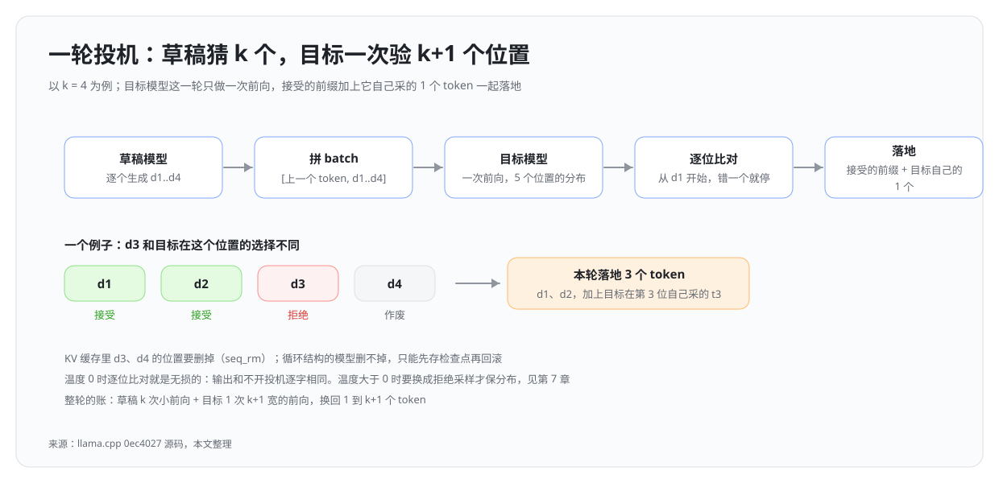

论文里投机解码能快 2 到 3 倍，我在 CPU 上配出来却变慢了，所以先回到论文，看一轮投机到底做了什么。投机解码最早的形态是 Stern 等人的分块并行解码：模型额外长几个头，一次预测后面几个位置，再用主模型验，最长的一致前缀落地[[9]](https://arxiv.org/abs/1811.03115)。Leviathan 等人和 Chen 等人在 2023 年几乎同时把它推广成通用做法：拿一个小模型当草稿，逐个生成 γ 个 token，大模型把它们拼进一个批次一次前向，得到每个位置自己的分布，从第一个草稿 token 开始比，错一个就停[[1]](https://arxiv.org/abs/2211.17192)[[10]](https://arxiv.org/abs/2302.01318)。被接受的前缀加上大模型在出错位置自己采的那 1 个一起落地，所以一轮至少前进 1 个 token，最多前进 γ+1 个。

llama.cpp 在 2023 年 9 月用一个示例程序做了第一版[[11]](https://github.com/ggml-org/llama.cpp/pull/2926)，2024 年 11 月加了更简单的 speculative-simple[[12]](https://github.com/ggml-org/llama.cpp/pull/10362)，随后把同一套逻辑接进 llama-server[[13]](https://github.com/ggml-org/llama.cpp/pull/10455)。

speculative-simple 的主循环很短：草稿生成 k 个，拼成 [上一个 token, d1..dk] 交给目标，common_sampler_sample_and_accept_n 从左往右逐位采样比对，返回接受的 token 列表[[2]](https://github.com/ggml-org/llama.cpp/blob/0ec4027/examples/speculative-simple/speculative-simple.cpp)[[5]](https://github.com/ggml-org/llama.cpp/blob/0ec4027/common/sampling.cpp)。目标的 KV cache 里已经写进了 k+1 个位置，没被接受的那几个要用 llama_memory_seq_rm 删掉，下一轮从落地的最后一个 token 接着来。

## 1.2 删不掉 KV 的模型要存检查点

seq_rm 能按位置删 KV 的前提是缓存按 token 存。Mamba、RWKV 这类循环结构的状态是整段压出来的一个向量，没法只删后面几个位置。speculative-simple 启动时检查目标的 seq_rm 能力，只支持整段删除时打开 use_ckpt_tgt：每轮验证前把目标的状态存一份，部分接受时恢复检查点，把接受的那几个 token 当成下一轮的草稿重新喂一遍[[2]](https://github.com/ggml-org/llama.cpp/blob/0ec4027/examples/speculative-simple/speculative-simple.cpp)。

server 侧同样的做法在 2026 年合入[[14]](https://github.com/ggml-org/llama.cpp/pull/19493)。代价是每轮多一次状态拷贝，部分接受时还多一次前向，接受率不高时检查点会把收益吃光。本篇的 Qwen3 和 granite 都是纯注意力，日志里没有出现 use checkpoints。

## 1.3 温度 0 时逐字相同

温度 0 时目标在每个位置的分布是一个点，逐位比对等价于问草稿猜的是不是目标的 argmax，接受下来的序列和目标自己一步一步贪心解码得到的完全一样，Leviathan 等人称之为输出不变[[1]](https://arxiv.org/abs/2211.17192)。我把三对输出去掉 chat 模板标记和空白后逐字比对。Q8_0 目标配 Q4_0 草稿写代码，较短一方的 317 个字符全部一致，bf16 目标配 Q4_0 草稿是 300 个字符。改写任务上，ngram-cache 对不开投机是 1227 个字符。批量宽度不同时矩阵乘的累加顺序可能不同，理论上会有极少数位置因为浮点误差翻转，这三对里没遇到。test_spec.py 把这三对写成了回归用例。

> 🔑 **本章要点**：一轮投机是草稿 k 次前向加目标 1 次 k+1 宽的前向，落地 1 到 k+1 个 token。没接受的位置靠 seq_rm 删，循环结构的模型改用检查点回滚。温度 0 时输出和不开投机逐字相同，本机三对输出都核对过。

# 第 2 章 · CPU 上验证不白送

## 2.1 一次喂 n 个 token 要多久

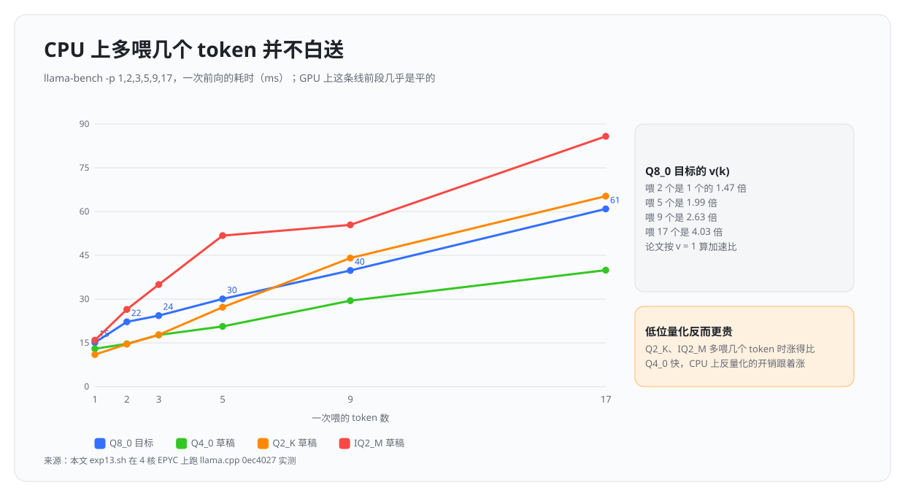

论文的加速比公式里有一个隐含假设：大模型一次前向喂 γ+1 个 token 和喂 1 个花的时间一样。Leviathan 等人的理由是 decode 受内存带宽限制，加速器上有大量闲置算力，多算几个位置几乎不加时间[[1]](https://arxiv.org/abs/2211.17192)。[LCPP-02｜上手｜推理账本：带宽、算力和启动前算出速度上限](./02-ledger.md) 推过同样的结论：单 token decode 时每个权重只做一次乘加，算术强度很低。可这台 4 核 CPU 的算力也不富裕，我用 llama-bench -p 1,2,3,5,9,17 测一次前向喂 n 个 token 的耗时，测法见 [LCPP-03｜上手｜测量方法：llama-bench、PPL、KLD 和噪声](./03-bench-ppl.md)。

Q8_0 目标喂 1 个 token 15.1 ms，喂 2 个 22.2 ms，喂 5 个 30.1 ms，喂 9 个 39.8 ms，喂 17 个 60.9 ms。我把喂 k+1 个和喂 1 个的耗时比记作 v(k)：k = 1 时 1.47，k = 4 时 1.99，k = 8 时 2.64，k = 16 时 4.03。前段涨得最快，从 1 到 2 就多了 47%，之后每多一个 token 大约多 2.6 ms。CPU 上 matmul 的工作量随 token 数线性涨，带宽省下的那部分只在 n 很小时占主导。

## 2.2 低位量化多喂几个反而更贵

三个草稿都是同一个 Qwen3-0.6B 量化出来的[[15]](https://arxiv.org/abs/2505.09388)。Q4_0 喂 1 个 13.0 ms、喂 17 个 39.9 ms，曲线比 Q8_0 平。Q2_K 喂 1 个 11.0 ms 最快，喂 17 个涨到 65.3 ms，比 Q8_0 还贵。IQ2_M 喂 1 个就要 15.9 ms，喂 17 个 85.8 ms。[LCPP-07｜内部｜量化：块结构、配方、imatrix 和用 KLD 选类型](./07-quantization.md) 讲过，K 量化和 I 量化的反量化要查表、拼位，CPU 上这部分开销跟着 token 数涨，带宽省下的字节抵不过多出来的指令。草稿只在单 token 前向上用得到这条曲线的第一个点，但目标模型如果也是低位量化，v(k) 就会更陡。

## 2.3 bf16 目标接近 v = 1

bf16 目标这条线噪声大：喂 1 个 44.7 ms，喂 5 个 38.8 ms，喂 17 个 52.9 ms，前后不单调。我的读法是这台机器上 bf16 的 matmul 一次前向里固定开销占大头，多喂几个 token 几乎不加时间，正好接近论文的 v = 1 假设。第 4 章会看到，这是同一个草稿配 bf16 目标能变快的原因之一。

> 🔑 **本章要点**：CPU 上 Q8_0 目标一次喂 5 个 token 是喂 1 个的 1.99 倍，喂 17 个是 4.03 倍，论文的 v = 1 假设不成立。低位量化的 v(k) 更陡。先用 llama-bench -p 1,2,3,5,9,17 把目标的这条线测出来。

# 第 3 章 · 期望产出和回本条件

## 3.1 每轮落地几个

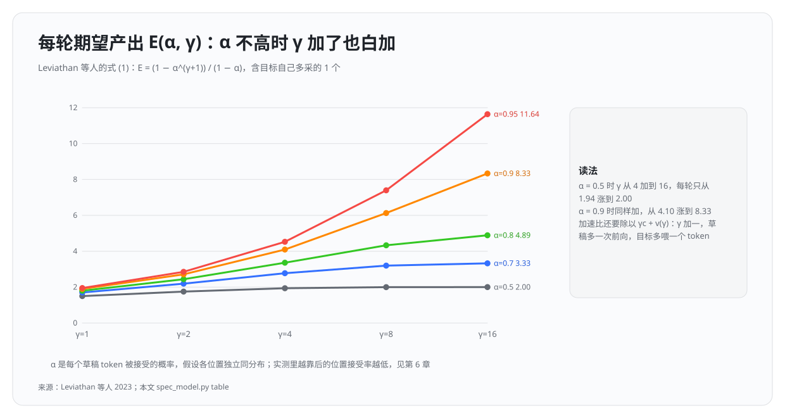

设每个草稿 token 被接受的概率是 α，各位置独立同分布，草稿长度是 γ。Leviathan 等人的式 (1) 给出每轮期望落地的 token 数 E = (1 − α^(γ+1)) / (1 − α)，含目标在出错位置自己采的那 1 个[[1]](https://arxiv.org/abs/2211.17192)。α = 0.9、γ = 4 时 E = 4.10；γ 加到 16，E 涨到 8.33。α = 0.5 时 γ 从 4 加到 16，E 只从 1.94 涨到 2.00：前面猜错的概率太大，后面的位置几乎轮不到。

α 在 llama.cpp 里不直接打印。speculative-simple 加 -v 后结尾有一行统计，里面的 #mean acc len 是每轮平均接受的草稿 token 数加 1，也就是 E 的实测值[[8]](https://github.com/ggml-org/llama.cpp/blob/0ec4027/docs/speculative.md)[[3]](https://github.com/ggml-org/llama.cpp/blob/0ec4027/common/speculative.cpp)。spec_model.py 用二分法从 E 和 γ 反解 α，test_spec.py 核对了 α 从 0.3 到 0.95、γ 取 1、4、16 时往返误差在 1e-6 以内。综述里把这个量叫平均接受长度，是比较不同草稿方法时最常用的指标[[16]](https://arxiv.org/abs/2401.07851)。

## 3.2 加速比要除以每轮的代价

每轮的时间是草稿 γ 次单 token 前向加目标 1 次 γ+1 宽的前向。以目标单 token 前向为 1，草稿单 token 前向为 c，加速比就是 E / (γc + v(γ))。分母里的 γc 是草稿的账，v(γ) 是目标验证的账。论文里 v 取 1，只剩 c 一个变量；CPU 上 v 随 γ 涨，两项一起压过来。

把第 5 章实测的数代进去：α = 0.88、γ = 4、v = 2 时 E = 3.94，要回本得 4c + 2 ＜ 3.94，也就是 c ＜ 0.484。test_spec.py 里 c 取 0.48 时加速比大于 1，取 0.49 时小于 1。就算草稿每个位置都有 88% 的把握，草稿的单 token 耗时也得低于目标的一半，CPU 上才不亏。Q8_0 配 Q4_0 的 c 是 0.86，离这条线很远。

## 3.3 c 靠体量差拉开

**📎 展开阅读：**Chen 等人的实验里目标是 70B 的 Chinchilla，草稿是专门训练的 4B 小模型，参数量差十几倍，c 天然就低，2 到 2.5 倍的加速主要来自 E[[10]](https://arxiv.org/abs/2302.01318)。草稿和目标同一个体量级、只差量化位数时，c 掉不到这么低。

# 第 4 章 · 预测和实测

## 4.1 同一个草稿，两个目标

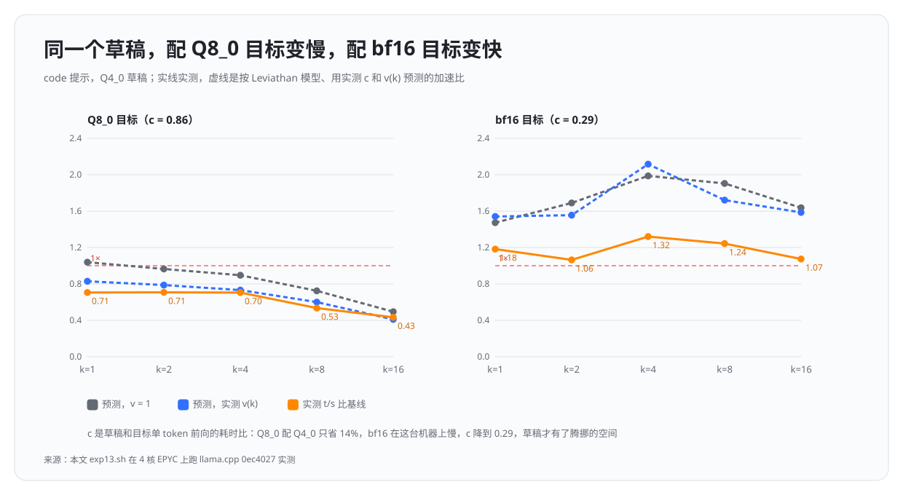

我拿公式和实测对了一遍。code 提示上 Q8_0 目标配 Q4_0 草稿，c = 0.86，k 从 1 到 16 的平均接受长度是 1.93、2.62、3.97、5.70、7.28，反解的 α 稳在 0.87 到 0.93。按 v = 1 预测，k = 1 时 1.04 倍，k = 4 时 0.90 倍；换成实测的 v(k)，k = 4 的预测降到 0.73 倍。实测是 0.71 倍，和第二种预测只差 4%。k = 16 时实测 0.43 倍，预测 0.41 倍。模型对这条线的走势预测得准，失之毫厘的部分是采样和循环本身的开销，第 5 章会拆开。

同一个 Q4_0 草稿配 bf16 目标，c 降到 0.29，k = 4 时 α 0.92、平均接受长度 4.29，预测 2.12 倍，实测 1.32 倍。差距比 Q8_0 大，原因是 bf16 目标单 token 39.6 ms，一轮 128.6 ms 里草稿占 60.8 ms，剩下的 67.8 ms 是验证、采样和其余，是单 token 前向的 1.7 倍，比 bench 测出来的 v(4) 高。prose 上 bf16 配 Q4_0 只有 0.64 到 0.73 倍，k = 16 时掉到 0.32 倍。

## 4.2 交替跑才能算比值

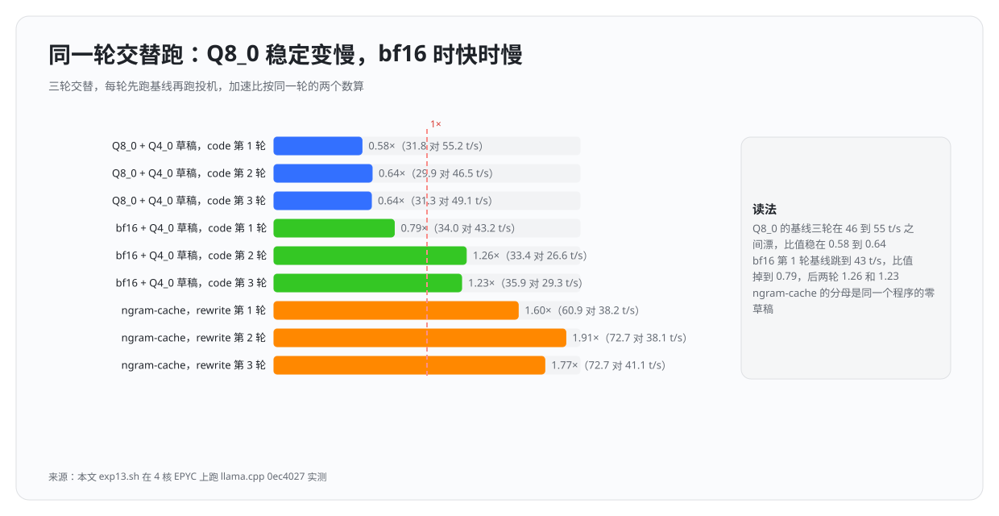

上面的实测比值是先跑完全部基线、再跑全部投机算出来的，两批之间隔了一个多小时。[LCPP-03｜上手｜测量方法：llama-bench、PPL、KLD 和噪声](./03-bench-ppl.md) 说过云主机的速度会漂，这台机器上同一个 llama-completion 配置前后三次能从 41.8 跳到 50.5 t/s。所以我把三组关键对比按轮交替跑：每轮先跑基线，紧接着跑投机，比值只拿同一轮里的两个数相除。

Q8_0 配 Q4_0、k = 4 的三轮是 0.58、0.64、0.64 倍，基线在 46.5 到 55.2 t/s 之间漂，比值很稳。bf16 配 Q4_0 第 1 轮基线跳到 43.2 t/s，比值掉到 0.79；后两轮基线回到 26.6 和 29.3 t/s，比值 1.26 和 1.23。bf16 这条路在这台机器上能快两成多，但它快是因为 bf16 目标本身慢，换成 Q8_0 目标一样的草稿只能拖后腿。

## 4.3 零草稿基线

还有一个问题：基线是 llama-completion，投机是 speculative-simple，两个程序的解码循环不同。我用 ngram-simple 把查找长度设成 1024，上下文里不可能命中，一次草稿都不出，得到 speculative-simple 自己的零草稿速度。和 llama-completion 交替跑三轮，code 上零草稿是基线的 0.95 到 0.97 倍，rewrite 上 0.94 到 1.06 倍。两个程序差得不多，拿 llama-completion 当基线没有冤枉投机。

> 🔑 **本章要点**：Q8_0 目标配 Q4_0 草稿，同一轮交替跑稳定在 0.58 到 0.64 倍；同一个草稿配 bf16 目标，后两轮 1.26 和 1.23 倍。用实测 v(k) 的预测和实测只差几个百分点。比较快慢要和基线交替跑，按同一轮算比值。

# 第 5 章 · 每轮的时间和草稿怎么选

## 5.1 草稿随 k 线性涨，验证比 bench 还贵

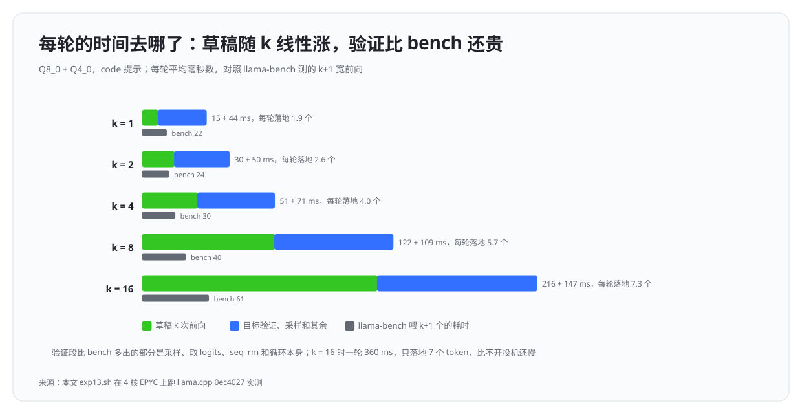

统计行里有 #calls(b,g,a) 和 dur(b,g,a)，g 是草稿生成的调用次数和总耗时[[3]](https://github.com/ggml-org/llama.cpp/blob/0ec4027/common/speculative.cpp)。用总耗时除以草稿调用次数，得到每轮的平均账。Q8_0 目标配 Q4_0 草稿写代码，k = 1 时一轮 58.8 ms，草稿 14.5 ms。k = 4 时一轮 121.5 ms，草稿 50.8 ms。k = 16 时一轮 362.3 ms，草稿 215.8 ms，落地 7.28 个 token，摊下来每个 token 49.8 ms，比不开投机的 21.6 ms 慢一倍多。

草稿这段和 k 成正比，每个 token 13 到 15 ms，和 Q4_0 单 token 前向的 13.0 ms 相当。扣掉草稿剩下的部分是目标验证、采样、取 logits、seq_rm 和循环本身：k = 4 时 70.7 ms，llama-bench 测的喂 5 个 token 只要 30.1 ms；k = 16 时 146.5 ms，bench 喂 17 个是 60.9 ms。多出来的四十到八十多毫秒不在矩阵乘里，逐位采样要对每个位置跑一遍采样器链，词表 15 万，这部分 bench 测不到。

## 5.2 草稿量化压太狠，α 直接塌

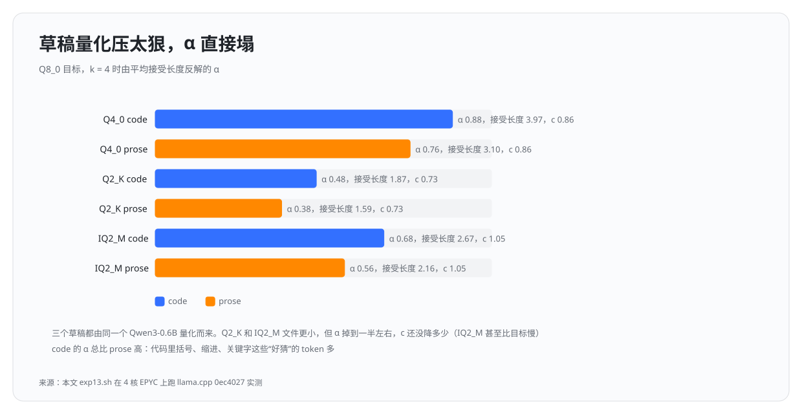

草稿越小 c 越低，直觉上该往低位量化压。三个草稿都由同一个 Qwen3-0.6B 量化而来，配 Q8_0 目标、k = 4：Q4_0 的 α 在 code 上 0.88、prose 上 0.76，c = 0.86；Q2_K 的 c 降到 0.73，α 却掉到 0.48 和 0.38。

IQ2_M 的 α 是 0.68 和 0.56，c 反而是 1.05，比目标还慢。实测加速比 Q2_K 是 0.29 和 0.22 倍，IQ2_M 是 0.30 和 0.20 倍，都比 Q4_0 的 0.71 和 0.40 差一截。[LCPP-07｜内部｜量化：块结构、配方、imatrix 和用 KLD 选类型](./07-quantization.md) 测过低位量化的困惑度涨得很快，草稿的 α 就是它和目标分布的重合度，困惑度涨了 α 必然掉。

## 5.3 草稿量化停在 Q4_0

换成 bf16 目标，Q2_K 的 c 是 0.24，IQ2_M 是 0.35，单看 c 都比 Q4_0 的 0.29 差不多或更差，α 的损失却一样大。我的结论是草稿量化停在 Q4_0 一档，c 要靠目标和草稿的体量差来拉开。code 的 α 总比 prose 高，代码里括号、缩进、关键字这些好猜的 token 多。综述里统计的各类草稿也是同样的规律：任务越模板化，α 越高[[16]](https://arxiv.org/abs/2401.07851)。

> 🔑 **本章要点**：k = 4 时一轮 121.5 ms，草稿 50.8 ms，验证和其余 70.7 ms，比 bench 测的 k+1 宽前向贵一倍多，多出的是逐位采样和循环。草稿量化压到 Q2_K、IQ2_M，α 掉到一半左右，c 却没降多少，停在 Q4_0。

# 第 6 章 · 越往后越猜不中，p_min 早停

## 6.1 每个位置的接受率

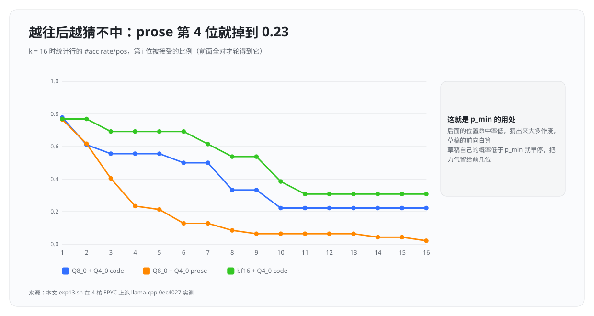

统计行最后的 #acc rate/pos 是第 i 个草稿位置被接受的次数除以验证轮数，只有前面全对时才轮得到它，所以一定单调不增[[3]](https://github.com/ggml-org/llama.cpp/blob/0ec4027/common/speculative.cpp)。k = 16 时 Q8_0 配 Q4_0 写代码，前 9 位是 0.78、0.61、0.56、0.56、0.56、0.50、0.50、0.33、0.33，之后都是 0.22。prose 掉得快，第 4 位 0.23，第 8 位 0.09，最后几位 0.02。bf16 目标写代码最稳，第 10 位还有 0.39。test_spec.py 核对了所有草稿日志里这一串都不增。

Leviathan 模型假设每个位置的条件接受率都是 α，无条件接受率就是 α、α²、α³ 这样几何衰减。实测曲线一段平、一段陡：代码里一段确定的语法结构能连着猜中好几个，进入自由文本后一下掉下来。不管哪种形状，结论一样：k 很大时后面的位置大多作废，草稿在那里算的每次前向都是白花的，第 5 章 k = 16 那 215.8 ms 草稿大部分就浪费在这里。

## 6.2 草稿没把握就停

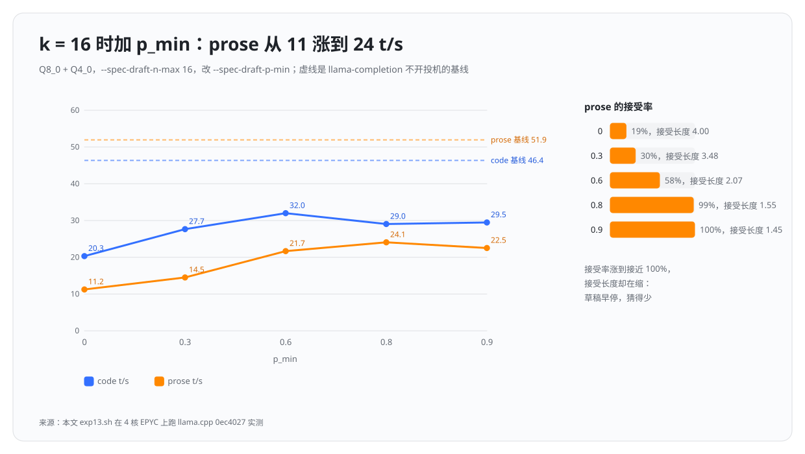

draft-simple 每生成一个 token 都看一眼草稿自己的 top-1 概率，低于 --spec-draft-p-min 就停止这一轮的起草[[3]](https://github.com/ggml-org/llama.cpp/blob/0ec4027/common/speculative.cpp)。缺省 p_min 是 0，n_max 是 3，n_min 是 0[[17]](https://github.com/ggml-org/llama.cpp/blob/0ec4027/common/common.h)。参数在 2026 年统一改成 --spec-draft-\* 前缀，旧的 --draft-p-min 等写法保留成别名，--draft、--draft-max 已经删掉[[18]](https://github.com/ggml-org/llama.cpp/pull/22397)[[19]](https://github.com/ggml-org/llama.cpp/blob/0ec4027/common/arg.cpp)。

k = 16 时改 p_min：prose 从 0 时的 11.2 t/s，到 0.3 时 14.5、0.6 时 21.7、0.8 时 24.1 t/s；code 从 20.3 涨到 0.6 时的 32.0 t/s。接受率一路往上，prose 在 p_min 0.8 时 98.5%，0.9 时 100%。

平均接受长度一路往下，prose 从 4.0 缩到 1.55。草稿早停，猜得少，但几乎每个都中，目标验证的批次也窄了。p_min 等于让草稿按自己的把握动态选 k：code 在 0.6 时的 32.0 t/s 和固定 k = 4 的 32.7 t/s 基本持平，prose 在 0.8 时的 24.1 t/s 接近固定 k = 1 的 26.9 t/s。

## 6.3 p_min 太高也亏

p_min 再高就开始亏：code 在 0.9 时接受率 100%，平均接受长度只剩 2.95，速度回落到 29.5 t/s。注意这些都还比 llama-completion 不开投机的 46.4 和 51.9 t/s 慢，p_min 救的是 k 设大了的损失，救不了 c 太高这件事。

> 🔑 **本章要点**：无条件接受率随位置单调掉，k = 16 时 prose 第 4 位只剩 0.23。p_min 0.6 到 0.8 让草稿按把握早停，prose 从 11.2 涨到 24.1 t/s，相当于自动选 k。它补不了 c 太高的账。

# 第 7 章 · 温度大于 0：逐位比对和拒绝采样

## 7.1 逐位比对和拒绝采样

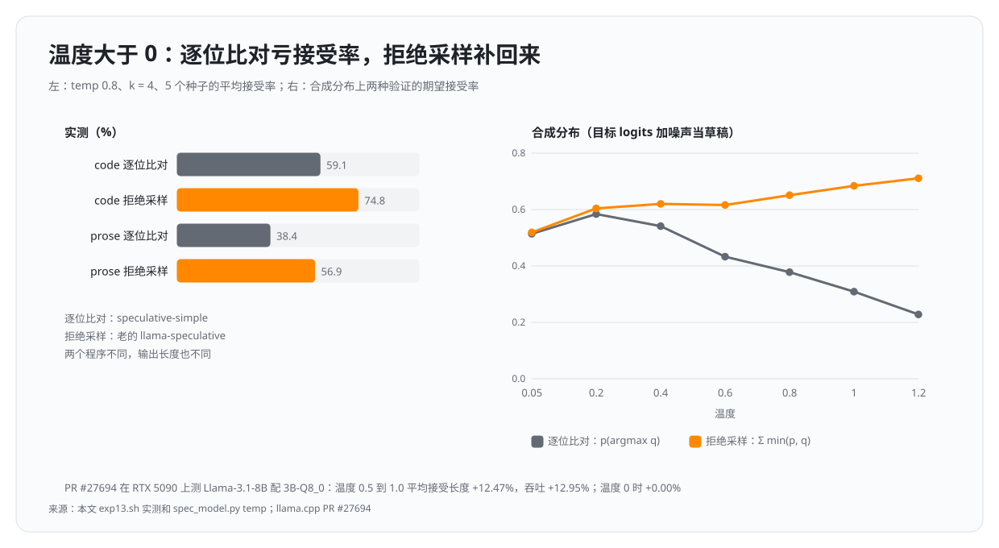

温度大于 0 时目标的分布不再是一个点。逐位比对的做法是草稿取自己的 argmax，目标在这个位置按温度采样一个 token，相同才接受，接受率是目标在草稿 argmax 上的概率。Leviathan 等人和 Chen 等人给的是另一种验证：草稿按自己的分布 q 采样出 x，目标的分布是 p，以 min(1, p(x)/q(x)) 的概率接受；拒绝时从 max(0, p − q) 归一化后的残差里重采一个[[1]](https://arxiv.org/abs/2211.17192)[[10]](https://arxiv.org/abs/2302.01318)。这样落地的 token 严格服从 p，期望接受率是 Σ min(p, q)，也就是两个分布重合的面积。

llama.cpp 的实现在 common_sampler_sample_and_accept_n_rejection。x 在 q 里的概率大于 0，且 p(x) ≥ q(x) 或均匀随机数小于 p(x)/q(x) 时接受。残差取 max(0, p − q)，不在 q 里的 token 保留完整的 p。有语法约束时，先用语法屏蔽 p，再重新归一化[[5]](https://github.com/ggml-org/llama.cpp/blob/0ec4027/common/sampling.cpp)。源码注释写的是它严格保持目标分布，而且草稿采样而非取 argmax 时比逐位比对接受得多。这套路径在 2026 年随 PR #27694 合入，同时让 draft-simple 和 MTP 的草稿改成按分布采样[[4]](https://github.com/ggml-org/llama.cpp/pull/27694)。

## 7.2 合成分布上差多少

spec_model.py temp 用一个 200 词的合成分布比较两种验证：目标 logits 随机生成，草稿 logits 是目标加高斯噪声，每个温度试 400 次。温度 0.05 时逐位比对 0.51、拒绝采样 0.52，两者几乎一样。温度 0.4 时是 0.54 对 0.62，0.8 时是 0.38 对 0.65，1.2 时是 0.23 对 0.71。温度越高，逐位比对越亏：目标采样越分散，越难恰好采到草稿的 argmax，而拒绝采样看的是两个分布的整体重合，反而因为两边都被摊平而更高。

## 7.3 speculative-simple 只做逐位比对

server 里 use_spec_rejection 只在温度大于 0 时返回真，注释说温度 0 时 p 和 q 都是点分布，拒绝采样和逐位比对等价；真正走拒绝采样还要草稿填了 q[[20]](https://github.com/ggml-org/llama.cpp/blob/0ec4027/tools/server/server-context.cpp)。draft-simple 起草时如果 --spec-draft-sampling 不是 probabilistic，就把 result_q 置空，验证端退回逐位比对[[3]](https://github.com/ggml-org/llama.cpp/blob/0ec4027/common/speculative.cpp)。这个参数缺省 greedy，适用于 speculative、server 和 cli[[19]](https://github.com/ggml-org/llama.cpp/blob/0ec4027/common/arg.cpp)。

speculative-simple 构造草稿参数时根本没给 result_q，所以不管 --spec-draft-sampling 写什么，温度大于 0 时都只做逐位比对[[2]](https://github.com/ggml-org/llama.cpp/blob/0ec4027/examples/speculative-simple/speculative-simple.cpp)。

我在 temp 0.8、k = 4、5 个种子下把 greedy 和 probabilistic 各跑一遍，每个种子的接受率逐位相同，code 5 个种子是 62.5%、60.2%、57.9%、51.5%、63.3%，test_spec.py 把这一点写成了用例。想在本机不起 server 看拒绝采样，只能用老的 llama-speculative：温度大于 0 且只有一条草稿序列时，它按 p_tgt 和 p_dft 做随机验证[[21]](https://github.com/ggml-org/llama.cpp/blob/0ec4027/examples/speculative/speculative.cpp)。

同样 temp 0.8、k = 4、5 个种子，逐位比对的平均接受率 code 59.1%、prose 38.4%；拒绝采样 code 74.8%、prose 56.9%，各高 16 到 19 个点，方向和合成分布一致。速度上老程序 code 32 到 39 t/s，speculative-simple 22 到 27 t/s，但两个程序的循环不同，采样出来的输出长度也不同，code 在 131 到 220 个 token 之间，这组速度我不拿来算加速比。

PR #27694 作者在 RTX 5090 上测 Llama-3.1-8B 配 3B-Q8_0 草稿：温度 0.5 到 1.0 平均接受长度涨 12.47%，吞吐涨 12.95%；温度 0 时都是 +0.00%，和理论一致[[4]](https://github.com/ggml-org/llama.cpp/pull/27694)。

## 7.4 分布检验跑一次要几个小时

PR #30213 加了一个分布检验：在整个词表上随机生成 q 当草稿，拒绝采样后统计经验分布，和目标分布逐 token 比，容差 6 倍标准误，缺省 5000 次试验[[22]](https://github.com/ggml-org/llama.cpp/pull/30213)[[23]](https://github.com/ggml-org/llama.cpp/blob/0ec4027/tests/test-speculative-rejection-sampling.cpp)。我在本机跑，一次试验约 2.7 秒，原因是目标只挂了温度采样器，候选是全部 151936 个 token，拒绝时算残差要对每个候选在 q 里线性查找，一次是 V² 量级。缺省次数要跑 3.8 小时，我只跑 5 次确认程序能走通：41 秒，3 个目标概率不到 0.04% 的 token 各被抽中一次，经验频率 0.2，超出容差，退出码 1。样本这么少时这是必然的，不说明实现有错。

> 💡 **常见误区**：温度大于 0 时用 speculative-simple 测出来的接受率是逐位比对的，加 --spec-draft-sampling probabilistic 也不会变。要测拒绝采样，用 server 加这个参数，或者本机用老的 llama-speculative。

# 第 8 章 · 不要草稿模型的几条路

## 8.1 从上下文里抄

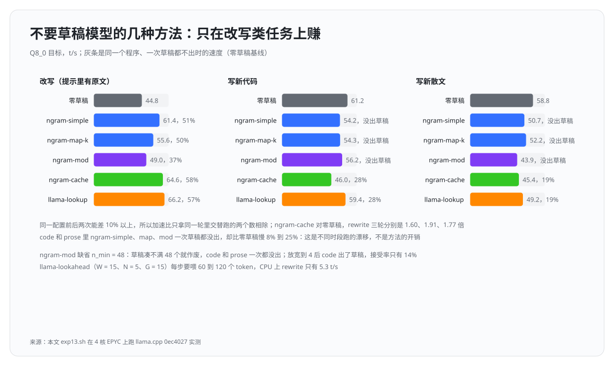

改写、重构、带上下文补全这类任务，输出里有大段是提示原文。Yang 等人的 LLMA 直接从参考文本里找和当前输出末尾匹配的片段，把后面的内容当草稿，报告 2 倍以上的加速[[24]](https://arxiv.org/abs/2304.04487)；Prompt Lookup Decoding 把同样的想法做成了独立实现，只在提示里找匹配[[25]](https://github.com/apoorvumang/prompt-lookup-decoding)，llama.cpp 随后有了 llama-lookup[[26]](https://github.com/ggml-org/llama.cpp/pull/4484)[[27]](https://github.com/ggml-org/llama.cpp/blob/0ec4027/examples/lookup/lookup.cpp)。PR #5479 加了 n-gram 缓存，把上下文、本次生成过程中积累的动态缓存和预先从语料统计的静态缓存叠在一起[[6]](https://github.com/ggml-org/llama.cpp/pull/5479)[[28]](https://github.com/ggml-org/llama.cpp/blob/0ec4027/common/ngram-cache.cpp)；PR #6828 讨论过把它接进 server[[29]](https://github.com/ggml-org/llama.cpp/pull/6828)。

ngram-cache 统计 1 到 4 元组，静态缓存用 2 元组，草稿每一步按两档阈值取下一个 token：宽档要求样本数 2、2、1、1，占比 66%、50%、50%、50%；严档是 4、3、2、2 和 75%、66%、66%、66%[[28]](https://github.com/ggml-org/llama.cpp/blob/0ec4027/common/ngram-cache.cpp)。ngram-simple 拿最后 12 个 token 在历史里找上一次出现的位置，把后面最多 48 个 token 当草稿。

ngram-map-k 用哈希表记住上下文里的 n-gram，同一个键后面跟的 m-gram 出现够次数才出草稿，k4v 是它的实验版[[30]](https://github.com/ggml-org/llama.cpp/blob/0ec4027/common/ngram-map.h)[[31]](https://github.com/ggml-org/llama.cpp/pull/18471)。ngram-mod 的哈希池约 16 MB，所有 server 槽位共享，存的是 n-gram 哈希到下一个 token 的映射[[7]](https://github.com/ggml-org/llama.cpp/pull/19164)[[8]](https://github.com/ggml-org/llama.cpp/blob/0ec4027/docs/speculative.md)。

## 8.2 只在改写上赚

rewrite 提示是一段 merge sort 代码，要求把变量名 arr 改成 nums、其余一字不改，311 个 token。零草稿基线两次是 44.1 和 45.5 t/s；llama-completion 不开投机的那一次只测到 28.9 t/s，交替跑时是 41.8 到 50.5 t/s，这台机器的漂移在 rewrite 上最明显。

ngram-simple 61.4 t/s、接受率 51%，ngram-cache 64.6 t/s、58%，llama-lookup 66.2 t/s、57%。ngram-cache 平均接受长度 3.97，出了 45 次草稿、328 个草稿 token，接受 190 个。和零草稿同一轮交替跑三轮，ngram-cache 是 1.60、1.91、1.77 倍。

code 和 prose 是写新内容，提示只有 31 和 46 个 token。ngram-simple、map-k、k4v、mod 一次草稿都没出，速度在 44 到 56 t/s 之间，比两轮零草稿的平均值（58 到 64 t/s）慢 8% 到 25%；这几组没有交替跑，一次草稿都没出就不存在方法的开销，差的部分是时段漂移。ngram-cache 和 llama-lookup 在 code 上出了草稿，接受率 28%，prose 上 19%，接受率太低，不值得开。

ngram-mod 在 code 和 prose 上不出草稿还有一层原因：缺省 n_min = 48，凑不满 48 个的草稿整个作废，n_match 24、n_max 64[[17]](https://github.com/ggml-org/llama.cpp/blob/0ec4027/common/common.h)。docs 的示例注释写着 n 太小不推荐，MoE 要长草稿，稠密模型可以调低 n_min 和 n_max，适用场景是 llama.vim 这类补全、推理模型和摘要[[8]](https://github.com/ggml-org/llama.cpp/blob/0ec4027/docs/speculative.md)。我把 n_min 放到 4、n_match 放到 8 再测，code 出了草稿，接受率只有 14%，速度 47.8 t/s；rewrite 接受率反而从 37% 掉到 30%。

几种方法可以混用：--spec-type 接受逗号分隔的列表，docs 的建议是草稿模型和无模型的方法一起开时无模型的优先[[19]](https://github.com/ggml-org/llama.cpp/blob/0ec4027/common/arg.cpp)[[8]](https://github.com/ggml-org/llama.cpp/blob/0ec4027/docs/speculative.md)。

## 8.3 lookahead 在 CPU 上不划算

Fu 等人的 lookahead decoding 不要草稿，也不要语料：目标自己在一个宽 W 的窗口里做 Jacobi 迭代，同时猜后面 N−1 层的 token，把迭代中出现的 n-gram 收进池子，下一步拿最多 G 条去验[[32]](https://arxiv.org/abs/2402.02057)。论文在 MT-bench 上报 1.8 倍，代码任务在多卡强扩展下能到 4 倍。llama.cpp 的示例把 W、N、G 写死成 15、5、15，开 W + G + 1 = 31 条序列共用一个 KV[[33]](https://github.com/ggml-org/llama.cpp/pull/4207)[[34]](https://github.com/ggml-org/llama.cpp/blob/0ec4027/examples/lookahead/lookahead.cpp)。

这样每一步要喂的 token 数是 1 + (W − 1) + W × (N − 2) = 60 个窗口位置，再加最多 G × (N − 1) = 60 个待验 n-gram，一步 60 到 120 个 token。第 2 章测过 CPU 上喂 17 个就是喂 1 个的 4 倍，喂 60 到 120 个更是数倍于此。rewrite 上 llama-lookahead 只有 5.26 t/s，257 个 token 接受了 116 个，跑了 48.9 秒；code 5.92 t/s，prose 4.93 t/s。论文的前提是 GPU 上多出来的算力是闲的，CPU 上不成立。

> 🔑 **本章要点**：提示里有原文时，ngram-cache 对零草稿同一轮快 1.60 到 1.91 倍，llama-lookup 接受率 57%。写新内容时 ngram-simple、map、mod 一次草稿都不出，ngram-mod 缺省 n_min = 48 更是如此。lookahead 每步喂 60 到 120 个 token，CPU 上只有 5 t/s 左右。

# 第 9 章 · MoE、词表和检查点

## 9.1 换一对 MoE：接受率 82%，照样变慢

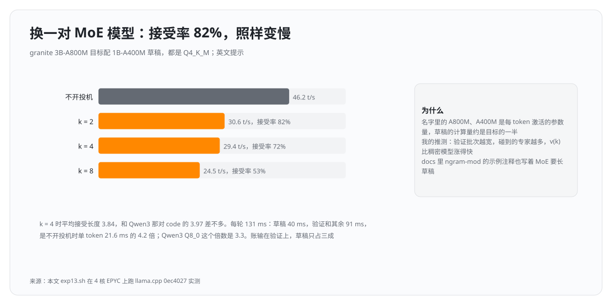

Qwen3 那对的问题是草稿和目标体量太近。我换了一对体量差得开的：granite 3.1 的 3B-A800M 当目标，1B-A400M 当草稿，都是 Q4_K_M，文件 2.0 GB 和 0.82 GB。名字里的 A800M、A400M 是每个 token 激活的参数量，目标 40 个专家每次选 8 个。英文提示，不开投机 46.2 t/s，每 token 21.6 ms。

k = 2 时接受率 82.1%，平均接受长度 2.63，速度 30.6 t/s，是基线的 0.66 倍。k = 4 时是 71.7%、3.84、29.4 t/s，k = 8 时是 52.6%、5.21、24.5 t/s。k = 4 的平均接受长度和 Qwen3 那对 code 的 3.97 差不多，α 不差。拆开每轮的账：k = 4 一轮 130.6 ms，草稿 40.1 ms，只占三成；验证和其余 90.6 ms，是不开投机时单 token 的 4.2 倍。Qwen3 Q8_0 配 Q4_0 这个倍数是 3.3。

我的推测是验证批次越宽，k+1 个位置各自选的专家并集越大，要读的专家权重越多，MoE 的 v(k) 比稠密模型涨得快。单 token 只选 8 个专家，5 个位置各选 8 个，并集最多 40 个，等于把整层专家读了一遍；这一点我没有单独测，专家权重怎么读见 [LCPP-11｜内部｜GPU 卸载与 MoE：-ngl、专家放置、fit 和专家缓存](./11-gpu-offload-moe.md)。docs 里 ngram-mod 的示例注释也写着 MoE 要长草稿，思路一致：既然验证贵，就让每次验证多带些 token，前提是接受率撑得住[[8]](https://github.com/ggml-org/llama.cpp/blob/0ec4027/docs/speculative.md)。

## 9.2 词表要对得上

草稿和目标的 token id 必须是同一套，草稿猜的 id 才能直接拿给目标验。2023 年 PR #3812 加了检查[[35]](https://github.com/ggml-org/llama.cpp/pull/3812)，现在的规则在 common/speculative.cpp：两边的词表类型相同，bos 和 eos 相同，词表大小差不超过 128，从第 5 个 id 起逐个比 token 文本[[3]](https://github.com/ggml-org/llama.cpp/blob/0ec4027/common/speculative.cpp)。同一家族不同尺寸的模型通常能过，Qwen3 各尺寸用的是同一套分词器[[15]](https://arxiv.org/abs/2505.09388)。跨家族配对过不了这道检查，启动时就报错。

## 9.3 循环结构的目标

第 1 章说过，Mamba、RWKV 和混合结构的目标删不了 KV 的尾巴，要靠检查点回滚[[14]](https://github.com/ggml-org/llama.cpp/pull/19493)。部分接受时，speculative-simple 先恢复检查点，再把接受的 token 当成下一轮的草稿重新喂，等于一轮里目标多一次前向。接受率高时这次多出来的前向很少发生，接受率低时几乎每轮都要。我手边没有循环结构的小模型，这一节只读了源码，未在本机实测，上线前用 -v 看日志里有没有 use checkpoints，再对比开关投机各跑一遍。

> 🔑 **本章要点**：granite MoE 那对接受率 82%，k = 2 仍是基线的 0.66 倍，验证和其余是单 token 的 4.2 倍，账输在验证上，我推测是宽批次碰到的专家更多。草稿和目标的词表类型、bos、eos 要相同，大小差不超过 128。循环结构的目标靠检查点回滚，接受率低时代价大。

# 第 10 章 · 草稿从哪来

## 10.1 独立草稿模型

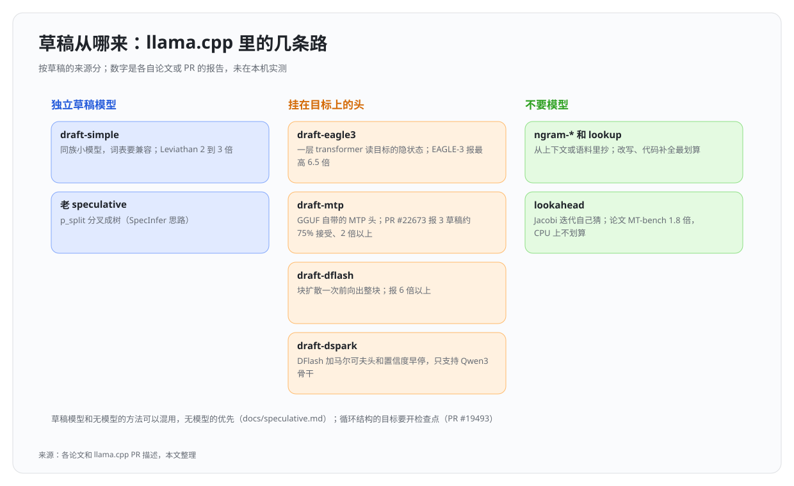

草稿有三类来源，独立草稿模型是最直接的一类。老的 llama-speculative 还支持树状草稿：草稿在某个位置的次优候选概率超过 p_split 就分出一条新序列，一次验证多条[[36]](https://github.com/ggml-org/llama.cpp/pull/3624)[[21]](https://github.com/ggml-org/llama.cpp/blob/0ec4027/examples/speculative/speculative.cpp)。这是 SpecInfer 的思路，Miao 等人把多个小模型的猜测合成一棵 token 树，一次前向用树形注意力掩码验掉，分布式场景报 1.5 到 2.8 倍，卸载场景 2.6 到 3.5 倍[[37]](https://arxiv.org/abs/2305.09781)。

## 10.2 挂在目标上的头

第二类是挂在目标上的头，省掉一个独立模型。Medusa 在目标最后一层上加几个解码头，各自预测后面第 i 个位置，Medusa-1 冻结主干报 2.2 倍以上，Medusa-2 联合训练报 2.3 到 3.6 倍[[38]](https://arxiv.org/abs/2401.10774)。EAGLE 把草稿挪到特征层，用一层 transformer 读目标的倒数第二层隐状态往后推，LLaMA2-Chat 70B 上报 2.7 到 3.5 倍[[39]](https://arxiv.org/abs/2401.15077)。

EAGLE-3 改成融合多层特征、训练时模拟多步推理，报最高 6.5 倍，比 EAGLE-2 高约 1.4 倍，SGLang 里批量 64 时仍有 1.38 倍[[40]](https://arxiv.org/abs/2503.01840)。llama.cpp 在 2025 年加了 draft-eagle3[[41]](https://github.com/ggml-org/llama.cpp/pull/18039)。

## 10.3 多 token 预测和块扩散

多 token 预测是训练阶段就加的头。Gloeckle 等人让模型同时预测后面 4 个 token，推理时拿这些头当草稿，报最高 3 倍[[42]](https://arxiv.org/abs/2404.19737)；DeepSeek-V3 训练时带一个 MTP 模块，技术报告里第二个 token 的接受率 85% 到 90%，解码吞吐提到 1.8 倍[[43]](https://arxiv.org/abs/2412.19437)。llama.cpp 的 draft-mtp 直接读 GGUF 里自带的 MTP 头，PR 作者报 3 个草稿约 75% 接受、2 倍以上[[44]](https://github.com/ggml-org/llama.cpp/pull/22673)。

DFlash 用块扩散的小模型一次前向出整块草稿，不再逐个生成，报 6 倍以上、比 EAGLE-3 高 2.5 倍[[45]](https://arxiv.org/abs/2602.06036)[[46]](https://github.com/ggml-org/llama.cpp/pull/22105)。DSpark 在 DFlash 上加了马尔可夫头和置信度早停，报比 MTP-1 快 60% 到 85%；llama.cpp 的 draft-dspark 只支持 Qwen3 骨干，p_min 大于 0 时改用模型输出的置信度判断早停[[47]](https://arxiv.org/abs/2607.05147)[[48]](https://github.com/ggml-org/llama.cpp/pull/25173)。第三类是第 8 章的 n-gram 和 lookahead，不要任何额外权重。

## 10.4 这些数字怎么读

上面的倍数都来自 GPU，批量多为 1，草稿和目标的体量差十倍以上，没有一个在本机实测。SPEED-Bench 的作者统一测过各类方法，发现合成输入会高估吞吐，最优草稿长度随批量变[[49]](https://arxiv.org/abs/2604.09557)；llama.cpp 把它接进了 server-bench[[50]](https://github.com/ggml-org/llama.cpp/pull/23869)。它要起 llama-server，本篇没有跑。我的读法是先按第 3 章的公式用自己机器上的 c 和 v(k) 算一遍，论文的 α 可以参考，倍数不能照搬。

> 🔑 **本章要点**：草稿有三类来源：独立小模型、挂在目标上的头（EAGLE-3、MTP、DFlash、DSpark）、不要模型的 n-gram 和 lookahead。论文报 2 到 6 倍，都在 GPU、批量 1、体量差十倍以上的条件下，本机未测。

# 第 11 章 · 怎么配与上线清单

## 11.1 按场景配

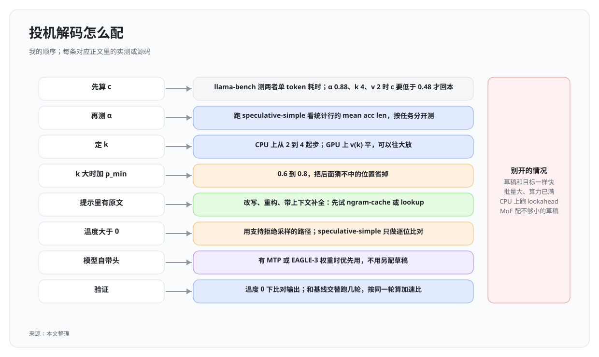

| 场景 | 怎么配 | 依据 |
|-|-|-|
| 草稿和目标只差量化位数 | 不开投机 | 第 4 章：Q8_0 配 Q4_0 同一轮 0.58 到 0.64 倍 |
| 目标比草稿慢 3 倍以上 | draft-simple，k 从 2 到 4 起步 | 第 3、4 章：c 低于 0.48 才回本，bf16 目标 1.23 到 1.26 倍 |
| k 想设大 | 加 --spec-draft-p-min 0.6 到 0.8 | 第 6 章：prose 从 11.2 到 24.1 t/s |
| 提示里有原文 | --spec-type ngram-cache，或 llama-lookup | 第 8 章：改写同一轮 1.60 到 1.91 倍 |
| 温度大于 0 | server 配 --spec-draft-sampling probabilistic | 第 7 章：接受率 code 59% 到 75% |
| MoE 目标 | 先测验证的 v(k)，草稿要小得多 | 第 9 章：granite 那对接受率 82% 仍变慢 |
| 模型自带 MTP 或 EAGLE-3 权重 | draft-mtp 或 draft-eagle3 | 第 10 章：PR 和论文报 2 倍以上，本机未测 |
| CPU 上想试 lookahead | 不试 | 第 8 章：每步喂 60 到 120 个 token，5 t/s 左右 |

表里的结论来自一台 4 核 CPU，目标最大 3B，GPU 上 v(k) 平得多，c 也会不同。Leviathan 等人的公式在两种硬件上都成立，换机器时变的是代入的 c、v(k) 和 α[[1]](https://arxiv.org/abs/2211.17192)。批量变大以后算力不再闲置，投机的收益会缩小，SPEED-Bench 的结论也是最优草稿长度随批量变[[49]](https://arxiv.org/abs/2604.09557)，server 里的并发和投机怎么一起配放在 LCPP-14。

## 11.2 上线清单

> 📌 **上线前核对清单**：每换一对模型或一类任务，我按这个顺序过一遍。
> - llama-bench 测目标和草稿的单 token 耗时，算出 c
> - llama-bench -p 1,2,3,5,9,17 测目标的 v(k)
> - speculative-simple 加 -v 跑代表性提示，从 #mean acc len 反解 α
> - 用 E / (kc + v(k)) 算预期加速比，低于 1 就不开
> - k 大于 4 时加 p_min，看 #acc rate/pos 后面几位是不是接近 0
> - 温度大于 0 时确认走的是拒绝采样，不是 speculative-simple 的逐位比对
> - 温度 0 下比对开关投机的输出，确认逐字相同
> - 和基线交替跑 3 轮，按同一轮的两个数算加速比

## 11.3 下一步

投机解码省的是单请求每 token 读权重的次数。llama-server 里多个槽位共享一份目标和草稿，并发上来后算力不再闲置，投机、连续批处理和 -np 怎么一起配，放在 LCPP-14；把这篇和前后几篇的参数汇成调参手册，放在 LCPP-17。decode 的带宽账回到 [LCPP-02｜上手｜推理账本：带宽、算力和启动前算出速度上限](./02-ledger.md)，采样器链回到 [LCPP-09｜内部｜采样、语法与聊天模板：截断链、温度、惩罚、GBNF 和模板](./09-sampling-grammar.md)，MoE 专家的放置回到 [LCPP-11｜内部｜GPU 卸载与 MoE：-ngl、专家放置、fit 和专家缓存](./11-gpu-offload-moe.md)。放到具体机器上，[LCPP-20｜实战｜24 GB 单卡：Qwen3-32B 和 Qwen3.8-27B](./20-qwen-24g.md) 算了 24 GB 卡上草稿模型和 MTP 头各要让出多少上下文；[LCPP-21｜实战｜一台机器跑 DeepSeek-V4.1-Flash](./21-deepseek-v41.md) 说明专家留在内存时，草稿模型为什么在散文上反而拖慢，ngram-mod 为什么更稳。

# 参考文献

按正文首次引用顺序编号，资料截至 2026 年 10 月初。

[1] Leviathan Y, Kalman M, Matias Y. Fast Inference from Transformers via Speculative Decoding. ICML 2023. [arXiv:2211.17192](https://arxiv.org/abs/2211.17192)

[2] llama.cpp 0ec4027. examples/speculative-simple/speculative-simple.cpp：主循环、检查点、结尾的统计。 [speculative-simple.cpp](https://github.com/ggml-org/llama.cpp/blob/0ec4027/examples/speculative-simple/speculative-simple.cpp)

[3] llama.cpp 0ec4027. common/speculative.cpp：词表兼容检查、draft-simple 的起草和早停、ngram-mod 的哈希池、统计输出。 [common/speculative.cpp](https://github.com/ggml-org/llama.cpp/blob/0ec4027/common/speculative.cpp)

[4] praneshgo. Make the drafter probabilistic and the target verify by rejection sampling for simple draft and MTP. llama.cpp PR #27694, 2026. [PR #27694](https://github.com/ggml-org/llama.cpp/pull/27694)

[5] llama.cpp 0ec4027. common/sampling.cpp：逐个比对的 sample_and_accept_n 和拒绝采样的 sample_and_accept_n_rejection。 [common/sampling.cpp](https://github.com/ggml-org/llama.cpp/blob/0ec4027/common/sampling.cpp)

[6] JohannesGaessler. lookup: complement data from context with general text statistics. llama.cpp PR #5479, 2024. [PR #5479](https://github.com/ggml-org/llama.cpp/pull/5479)

[7] ggerganov. spec : add ngram-mod. llama.cpp PR #19164, 2026. [PR #19164](https://github.com/ggml-org/llama.cpp/pull/19164)

[8] llama.cpp 0ec4027. docs/speculative.md：各类草稿来源、参数表、统计行的格式、合成接受率。 [docs/speculative.md](https://github.com/ggml-org/llama.cpp/blob/0ec4027/docs/speculative.md)

[9] Stern M, Shazeer N, Uszkoreit J. Blockwise Parallel Decoding for Deep Autoregressive Models. NeurIPS 2018. [arXiv:1811.03115](https://arxiv.org/abs/1811.03115)

[10] Chen C, et al. Accelerating Large Language Model Decoding with Speculative Sampling. 2023. [arXiv:2302.01318](https://arxiv.org/abs/2302.01318)

[11] ggerganov. speculative : PoC for speeding-up inference via speculative sampling. llama.cpp PR #2926, 2023. [PR #2926](https://github.com/ggml-org/llama.cpp/pull/2926)

[12] ggerganov. speculative : refactor and add a simpler example. llama.cpp PR #10362, 2024. [PR #10362](https://github.com/ggml-org/llama.cpp/pull/10362)

[13] ggerganov. server : add speculative decoding support. llama.cpp PR #10455, 2024. [PR #10455](https://github.com/ggml-org/llama.cpp/pull/10455)

[14] srogmann. server : speculative checkpointing. llama.cpp PR #19493, 2026. [PR #19493](https://github.com/ggml-org/llama.cpp/pull/19493)

[15] Qwen Team. Qwen3 Technical Report. 2025. [arXiv:2505.09388](https://arxiv.org/abs/2505.09388)

[16] Xia H, et al. Unlocking Efficiency in Large Language Model Inference: A Comprehensive Survey of Speculative Decoding. ACL Findings 2024. [arXiv:2401.07851](https://arxiv.org/abs/2401.07851)

[17] llama.cpp 0ec4027. common/common.h：投机类型枚举和各类参数的缺省值。 [common/common.h](https://github.com/ggml-org/llama.cpp/blob/0ec4027/common/common.h)

[18] ggerganov. spec : refactor params. llama.cpp PR #22397, 2026. [PR #22397](https://github.com/ggml-org/llama.cpp/pull/22397)

[19] llama.cpp 0ec4027. common/arg.cpp：--spec-\* 参数的定义和适用的程序。 [common/arg.cpp](https://github.com/ggml-org/llama.cpp/blob/0ec4027/common/arg.cpp)

[20] llama.cpp 0ec4027. tools/server/server-context.cpp：use_spec_rejection 的温度条件和草稿没填 q 时的退回。 [server-context.cpp](https://github.com/ggml-org/llama.cpp/blob/0ec4027/tools/server/server-context.cpp)

[21] llama.cpp 0ec4027. examples/speculative/speculative.cpp：老的多序列投机，温度大于 0 且单序列时按 p_tgt/p_dft 做拒绝采样，p_split 控制分叉。 [speculative.cpp](https://github.com/ggml-org/llama.cpp/blob/0ec4027/examples/speculative/speculative.cpp)

[22] danbev. tests : add speculative rejection draft sampling test. llama.cpp PR #30213, 2026. [PR #30213](https://github.com/ggml-org/llama.cpp/pull/30213)

[23] llama.cpp 0ec4027. tests/test-speculative-rejection-sampling.cpp：随机草稿分布下的拒绝采样分布检验。 [test-speculative-rejection-sampling.cpp](https://github.com/ggml-org/llama.cpp/blob/0ec4027/tests/test-speculative-rejection-sampling.cpp)

[24] Yang N, et al. Inference with Reference: Lossless Acceleration of Large Language Models. 2023. [arXiv:2304.04487](https://arxiv.org/abs/2304.04487)

[25] Saxena A. Prompt Lookup Decoding. GitHub, 2023. [prompt-lookup-decoding](https://github.com/apoorvumang/prompt-lookup-decoding)

[26] LeonEricsson. Prompt lookup decoding. llama.cpp PR #4484, 2023. [PR #4484](https://github.com/ggml-org/llama.cpp/pull/4484)

[27] llama.cpp 0ec4027. examples/lookup/lookup.cpp：上下文、动态、静态三层 n-gram 缓存。 [lookup.cpp](https://github.com/ggml-org/llama.cpp/blob/0ec4027/examples/lookup/lookup.cpp)

[28] llama.cpp 0ec4027. common/ngram-cache.cpp：1 到 4 元组的统计和宽严两档阈值。 [common/ngram-cache.cpp](https://github.com/ggml-org/llama.cpp/blob/0ec4027/common/ngram-cache.cpp)

[29] JohannesGaessler. Server: enable lookup decoding. llama.cpp PR #6828, 2024. [PR #6828](https://github.com/ggml-org/llama.cpp/pull/6828)

[30] llama.cpp 0ec4027. common/ngram-map.h：ngram-simple 和 ngram-map 的结构。 [common/ngram-map.h](https://github.com/ggml-org/llama.cpp/blob/0ec4027/common/ngram-map.h)

[31] srogmann. Add self-speculative decoding (no draft model required). llama.cpp PR #18471, 2025. [PR #18471](https://github.com/ggml-org/llama.cpp/pull/18471)

[32] Fu Y, et al. Break the Sequential Dependency of LLM Inference Using Lookahead Decoding. ICML 2024. [arXiv:2402.02057](https://arxiv.org/abs/2402.02057)

[33] ggerganov. lookahead : add example for lookahead decoding. llama.cpp PR #4207, 2023. [PR #4207](https://github.com/ggml-org/llama.cpp/pull/4207)

[34] llama.cpp 0ec4027. examples/lookahead/lookahead.cpp：W、N、G 三个常量和 Jacobi 窗口。 [lookahead.cpp](https://github.com/ggml-org/llama.cpp/blob/0ec4027/examples/lookahead/lookahead.cpp)

[35] KerfuffleV2. speculative: Ensure draft and target model vocab matches. llama.cpp PR #3812, 2023. [PR #3812](https://github.com/ggml-org/llama.cpp/pull/3812)

[36] ggerganov. speculative : add tree-based sampling example. llama.cpp PR #3624, 2023. [PR #3624](https://github.com/ggml-org/llama.cpp/pull/3624)

[37] Miao X, et al. SpecInfer: Accelerating Generative Large Language Model Serving with Tree-based Speculative Inference and Verification. ASPLOS 2024. [arXiv:2305.09781](https://arxiv.org/abs/2305.09781)

[38] Cai T, et al. Medusa: Simple LLM Inference Acceleration Framework with Multiple Decoding Heads. ICML 2024. [arXiv:2401.10774](https://arxiv.org/abs/2401.10774)

[39] Li Y, et al. EAGLE: Speculative Sampling Requires Rethinking Feature Uncertainty. ICML 2024. [arXiv:2401.15077](https://arxiv.org/abs/2401.15077)

[40] Li Y, et al. EAGLE-3: Scaling up Inference Acceleration of Large Language Models via Training-Time Test. 2025. [arXiv:2503.01840](https://arxiv.org/abs/2503.01840)

[41] ruixiang63. [Speculative decoding] feat: add EAGLE3 speculative decoding support. llama.cpp PR #18039, 2025. [PR #18039](https://github.com/ggml-org/llama.cpp/pull/18039)

[42] Gloeckle F, et al. Better & Faster Large Language Models via Multi-token Prediction. ICML 2024. [arXiv:2404.19737](https://arxiv.org/abs/2404.19737)

[43] DeepSeek-AI. DeepSeek-V3 Technical Report. 2024. [arXiv:2412.19437](https://arxiv.org/abs/2412.19437)

[44] am17an. llama + spec: MTP Support. llama.cpp PR #22673, 2026. [PR #22673](https://github.com/ggml-org/llama.cpp/pull/22673)

[45] Chen J, et al. DFlash: Block Diffusion for Flash Speculative Decoding. 2026. [arXiv:2602.06036](https://arxiv.org/abs/2602.06036)

[46] ruixiang63. [Speculative decoding] feat: add DFlash support. llama.cpp PR #22105, 2026. [PR #22105](https://github.com/ggml-org/llama.cpp/pull/22105)

[47] Cheng X, et al. DSpark: Confidence-Scheduled Speculative Decoding with Semi-Autoregressive Generation. 2026. [arXiv:2607.05147](https://arxiv.org/abs/2607.05147)

[48] wjinxu. spec: add DSpark speculative decoding. llama.cpp PR #25173, 2026. [PR #25173](https://github.com/ggml-org/llama.cpp/pull/25173)

[49] Abramovich T, et al. SPEED-Bench: A Unified and Diverse Benchmark for Speculative Decoding. 2026. [arXiv:2604.09557](https://arxiv.org/abs/2604.09557)

[50] ruixiang63. server-bench: add speed-bench for speculative decoding benchmarking. llama.cpp PR #23869, 2026. [PR #23869](https://github.com/ggml-org/llama.cpp/pull/23869)

---

上一章：[LCPP-12｜内部｜多卡与 RPC：-sm layer、流水线、张量并行和 RPC](./12-multi-gpu-rpc.md) · [目录](./README.md) · 下一章：[LCPP-14｜内部｜服务端：槽位、连续批处理和提示缓存](./14-server.md)
