# LCPP-14｜内部｜服务端：槽位、连续批处理和提示缓存

> 🎯 **这篇文档解决什么问题**：单机跑通一个模型之后，下一步通常是让它同时接几路请求。llama-server 的参数表里，-np、-c、-kvu、--cache-ram、-sps、--cache-reuse、--context-shift 互相牵连：-np 从 4 改成 8，每个槽位的上下文就少一半。不写 -np，server 自动开 4 个槽位并打开统一 KV，而统一 KV 在 16 路并发时解码反而慢三成。这篇把一条请求从进门到出 token 的路径对到源码，把并发、KV 布局、共享前缀、槽位选择和提示缓存逐个用实测或模拟说清楚，最后给一份配置顺序。主线一句话：llama-server 按迭代调度，并发换来的是总吞吐，-c 是所有槽位共用的一本总账。
>
> 使用方式：只想知道怎么配，看导读和第 11 章；想知道并发能换回多少吞吐，看第 3、4 章；-c 和 -np 算不清，看第 5 章；系统提示很长、用户比槽位多，看第 6、7 章；遇到上下文超限报错，看第 8 章；上线前要盯哪些指标，看第 9 章。文中版本和数字核对于 2026 年 10 月 31 日。
>
> **代码**：[zero-to-llama/14-server](../14-server)。本篇没有在本机启动 llama-server，也不启动任何监听端口的程序。服务端的调度逻辑用三样东西逼近：llama-batched-bench 测同一个上下文里 B 条序列一起解码的吞吐，llama-parallel 模拟多个客户端连续投递请求，test-server-component 是服务端组件的单元测试，不加载模型、不开端口，本机 49 个用例 191 条断言全过。槽位选择和提示缓存的淘汰规则由 slot_sim.py 按源码复刻，test_server.py 是 16 个回归用例。server-bench.py 的压测、router 多模型和 server 侧投机解码未在本机实测，数字引 PR 和论文。基线是主干 0ec4027，模型是 Qwen3-0.6B，机器是 4 核 EPYC 云主机无 GPU。

# 导读 · 先给结论

- **server 的并发是迭代级调度。**所有槽位在一个主循环线程里拼成一个 batch 调 llama_decode，每轮先放生成中槽位的 1 个 token，再用提示块填满 n_batch，这就是 Orca 的连续批处理加 SARATHI 的分块预填充[[1]](https://www.usenix.org/conference/osdi22/presentation/yu)[[2]](https://arxiv.org/abs/2308.16369)[[3]](https://github.com/ggml-org/llama.cpp/blob/0ec4027/tools/server/server-context.cpp)。
- **并发换吞吐，代价是每条变慢。**Q8_0、提示 128，B 从 1 到 16，总解码吞吐 49.9 到 172.1 t/s，涨 3.45 倍；每条序列只分到 10.8 t/s，是单条的 1/4.6[[4]](https://github.com/ggml-org/llama.cpp/blob/0ec4027/tools/batched-bench/batched-bench.cpp)。
- **统一 KV 在高并发下慢。**分开和统一交替跑 3 轮，B = 16 时统一 KV 每轮都慢 25% 到 38%；不写 -np 时 server 自动开统一 KV，写了 -np 才缺省分开[[5]](https://github.com/ggml-org/llama.cpp/pull/14363)[[6]](https://github.com/ggml-org/llama.cpp/pull/16736)[[7]](https://github.com/ggml-org/llama.cpp/blob/0ec4027/tools/server/server.cpp)。
- **-c 是总账。**不统一时按槽位数平分再补齐到 256，-c 4096 -np 3 实际分到 4608 格，每条只有 1536[[8]](https://github.com/ggml-org/llama.cpp/blob/0ec4027/src/llama-context.cpp)。
- **共享前缀只算一次。**提示 384、B = 16，预填充从 21.3 秒降到 1.1 秒；llama-parallel 4 个槽位共享 273 token 的系统提示，跑完 16 条从 26.4 秒降到 16.2 秒[[9]](https://github.com/ggml-org/llama.cpp/blob/0ec4027/examples/parallel/parallel.cpp)。
- **用户比槽位多时要靠 RAM 缓存。**4 个槽位、16 个用户的多轮对话，缺省 8192 MiB 的缓存把提示复用率从 0.46 拉到 0.88；用户不超过槽位数时缓存用不上[[10]](https://github.com/ggml-org/llama.cpp/pull/16391)[[11]](https://github.com/ggml-org/llama.cpp/blob/0ec4027/tools/server/server-task.cpp)。
- **上下文撑满时缺省截停。**--context-shift 和 --cache-reuse 要显式打开，多模态和不能平移的模型上自动关闭；SWA 和循环结构靠缺省 32 个检查点回退[[12]](https://github.com/ggml-org/llama.cpp/blob/0ec4027/common/arg.cpp)[[13]](https://github.com/ggml-org/llama.cpp/pull/15293)。

**📎 与系列其他文档的分工**：KV cache 的账本、量化和 seq_rm 见 [LCPP-08｜内部｜KV cache 与长上下文：账本、深度、量化、SWA 和上下文写满](./08-kv-context.md)；llama-bench 的噪声和交替跑的做法见 [LCPP-03｜上手｜测量方法：llama-bench、PPL、KLD 和噪声](./03-bench-ppl.md)；CPU 线程和带宽见 [LCPP-10｜内部｜CPU 调优：线程、绑核、repack、加载方式和带宽上限](./10-cpu-tuning.md)；单请求的投机解码见 [LCPP-13｜内部｜投机解码：草稿模型、n-gram 和拒绝采样](./13-speculative.md)。router 多模型、部署和运维放在 LCPP-16，各篇参数汇总放在 LCPP-17。

# 第 1 章 · 一个模型怎么同时接多条请求

## 1.1 从按请求凑批到按迭代调度

我想让一个模型同时接几路请求，第一个问题是这些请求怎么拼进同一次前向。最早的服务框架按请求凑批：攒够一批一起算，等最长的那条生成完才放下一批，先结束的请求只能空等。Yu 等人在 Orca 里把调度粒度从请求改成迭代，每次前向结束都可以让结束的请求离开、新请求加入，再配合选择性批处理，把注意力以外的算子拼起来算。在 GPT-3 175B 上，同等延迟下吞吐是 FasterTransformer 的 36.9 倍[[1]](https://www.usenix.org/conference/osdi22/presentation/yu)。后来的 vLLM、SGLang 和 llama-server 都沿用这个思路，业界叫它连续批处理。

llama.cpp 走到这一步分了两段。2023 年 9 月的 PR #3228 给 llama_decode 加了自定义注意力掩码和多序列，一个上下文里可以同时放几条互不相干的序列，同时引入了 llama-parallel 和 llama-batched-bench 两个示例[[14]](https://github.com/ggml-org/llama.cpp/pull/3228)。同年 10 月 PR #3677 把多槽位并行解码接进 server[[15]](https://github.com/ggml-org/llama.cpp/pull/3677)，从此 -np 决定一个 server 同时服务几路请求。

## 1.2 一条请求走过的路

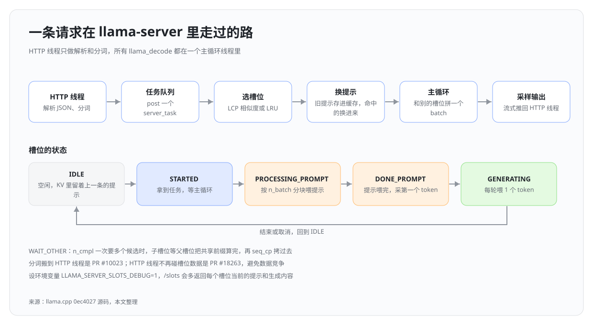

现在的 llama-server 分两类线程。HTTP 线程解析 JSON、分词，把请求包成 server_task 投进任务队列；主循环线程从队列里取任务、选槽位、拼 batch、调 llama_decode、采样，再把 token 流式推回 HTTP 线程。分词搬到 HTTP 线程是 PR #10023 的改动，免得长提示的分词卡住主循环[[16]](https://github.com/ggml-org/llama.cpp/pull/10023)；PR #18263 进一步让 HTTP 线程不再直接读槽位数据，避免数据竞争[[17]](https://github.com/ggml-org/llama.cpp/pull/18263)。

槽位有五个常用状态：IDLE、STARTED、PROCESSING_PROMPT、DONE_PROMPT、GENERATING。PR #9283 把早期更乱的状态组合收成这条直线[[18]](https://github.com/ggml-org/llama.cpp/pull/9283)。另有一个 WAIT_OTHER，用在一次要 n_cmpl 个候选的请求上：父槽位先把共享的提示算完，再用 seq_cp 把 KV 拷给子槽位，子槽位直接从 DONE_PROMPT 开始采样[[3]](https://github.com/ggml-org/llama.cpp/blob/0ec4027/tools/server/server-context.cpp)。

## 1.3 我怎么在不起 server 的前提下测它

server 的行为分成两部分。批处理和 KV 布局对速度的影响，本质是同一个上下文里多条序列一起解码，llama-batched-bench 可以直接测：B 条序列各自预填充 npp 个 token，再一起生成 ntg 个，输出预填充和解码各自的吞吐[[4]](https://github.com/ggml-org/llama.cpp/blob/0ec4027/tools/batched-bench/batched-bench.cpp)。多客户端连续投递请求的效果用 llama-parallel：它在一个循环里模拟 N 个客户端，客户端结束一条就立刻取下一条，和 server 的主循环是同一套连续批处理[[9]](https://github.com/ggml-org/llama.cpp/blob/0ec4027/examples/parallel/parallel.cpp)。

调度规则本身，比如新请求落到哪个槽位、RAM 缓存存什么删什么，和模型无关。我把 get_available_slot 和 server_prompt_cache 的逻辑按源码抄成 slot_sim.py，用整数 token 跑多轮对话的请求流，数每条请求要重算多少提示。KV 账本那部分，用 batched-bench -v 的日志逐条核对模拟器算出的 n_ctx 和 n_ctx_seq。

# 第 2 章 · 槽位和一次 llama_decode

## 2.1 一批里装了什么

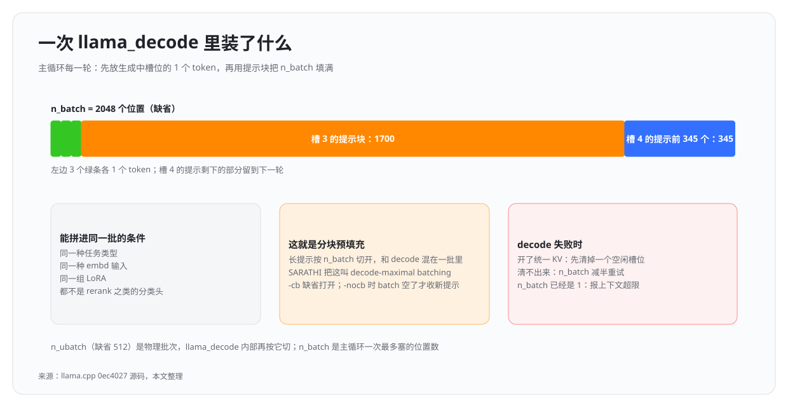

主循环每轮先遍历处于 GENERATING 的槽位，每个放 1 个 token；再遍历正在喂提示的槽位，按 n_batch（缺省 2048）剩下的空位切一块提示放进来，一个槽位的提示没喂完就留到下一轮[[3]](https://github.com/ggml-org/llama.cpp/blob/0ec4027/tools/server/server-context.cpp)。llama_decode 内部再按 n_ubatch（缺省 512）切成物理批次。所以长提示不会独占一轮，生成中的槽位每轮都能前进 1 个 token。

这个做法论文里叫分块预填充。Agrawal 等人的 SARATHI 把长提示切成等长的块，每块和若干 decode 拼在一起，让 decode 搭预填充的便车，报 decode 吞吐最多 10 倍、端到端 1.33 倍[[2]](https://arxiv.org/abs/2308.16369)。后续的 Sarathi-Serve 把块大小按延迟预算定，避免长预填充把正在生成的请求卡住，Mistral-7B 上服务容量 2.6 倍，Yi-34B 最多 3.7 倍[[19]](https://arxiv.org/abs/2403.02310)。llama-server 的块大小就是 n_batch 减去当轮的 decode 数，没有按延迟预算动态调。

## 2.2 拼不进同一批的情况

不是所有槽位都能拼在一起。源码里要求同一批的任务类型一致，embedding 输入和 token 输入不混，LoRA 组合相同，rerank 这类分类头单独成批[[3]](https://github.com/ggml-org/llama.cpp/blob/0ec4027/tools/server/server-context.cpp)。一个请求带了别的 LoRA，它就要等下一轮。-cb 缺省打开，-nocb 时只有 batch 空了才收新提示，退回按请求凑批[[12]](https://github.com/ggml-org/llama.cpp/blob/0ec4027/common/arg.cpp)。

## 2.3 decode 失败时

llama_decode 找不到连续的 KV 空位时返回 1。server 的处理分三步。开了统一 KV，就先清掉一个空闲槽位里留着的提示，一次只清一个。清不出来，就把 n_batch 减半重试。n_batch 已经减到 1 还失败，就报上下文超限，并释放这批里的槽位[[3]](https://github.com/ggml-org/llama.cpp/blob/0ec4027/tools/server/server-context.cpp)。分开 KV 时每个槽位有自己的一段，不存在挤占别人的问题，第一步直接跳过。

> 🔑 **本章要点**：一轮 llama_decode 里先放所有生成中槽位的 1 个 token，再用提示块填满 n_batch，这是连续批处理加分块预填充。任务类型、LoRA 不同的请求拼不进同一批。decode 找不到空位时，统一 KV 先清空闲槽位，再减半 n_batch，到 1 还不行就报错。

# 第 3 章 · 并发能换回多少吞吐

## 3.1 B 翻倍，总吞吐只涨三到五成

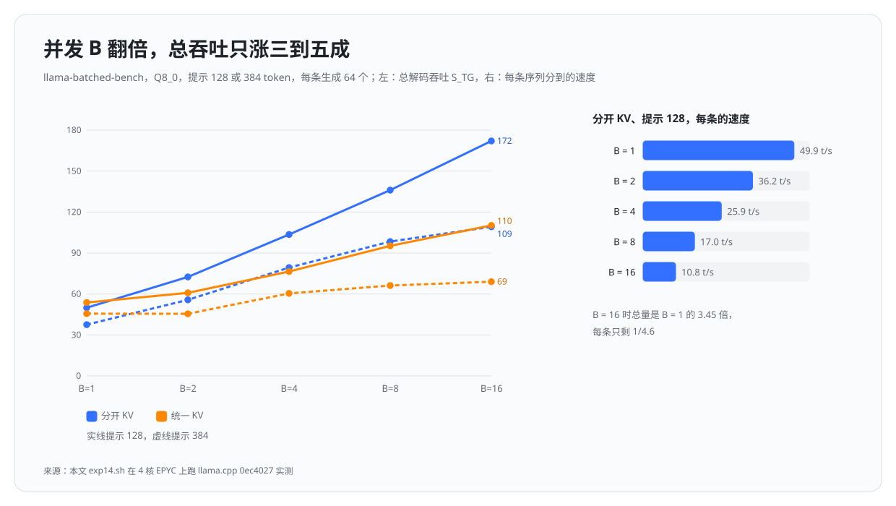

我用 llama-batched-bench 跑 Q8_0，4 线程，n_batch 2048，提示 128 或 384，每条生成 64 个，B 取 1、2、4、8、16。分开 KV、提示 128 时，总解码吞吐 S_TG 依次是 49.9、72.5、103.6、136.0、172.1 t/s，每翻一倍涨 45%、43%、31%、27%，B = 16 是单条的 3.45 倍。提示 384 时从 37.6 涨到 109.2，2.9 倍，起点更低，因为每个 token 要扫的 KV 更长。

涨的原因在 [LCPP-02｜上手｜推理账本：带宽、算力和启动前算出速度上限](./02-ledger.md) 推过：单条 decode 每读一遍权重只算 1 个 token，算术强度很低；B 条一起算，权重读一遍喂 B 个 token。涨不满 B 倍的原因是 4 核 CPU 的算力很快吃满，B 越大，矩阵乘越接近算力上限，带宽省下来的那部分不再是瓶颈。GPU 上算力富裕得多，同样的曲线会陡得多。

## 3.2 每条序列分到的速度

总量涨了，单条在掉。提示 128 时每条的速度从 49.9 掉到 36.2、25.9、17.0、10.8 t/s，B = 16 时只有单条的 1/4.6。对用户来说，这就是并发开大以后每个人看到的出字速度。预填充更直接：batched-bench 里 B 条序列的提示一起算，预填充吞吐在 290 到 430 t/s 之间基本不随 B 变，总耗时随 B 线性涨，提示 128 时从 0.36 秒涨到 5.7 秒。

所以 -np 是在吞吐和单条延迟之间选点。离线批量处理只看总量，B 开到吞吐不再涨为止；交互场景要先定每个用户能接受的出字速度，再倒推 B。第 6 章用 llama-parallel 测的端到端延迟也是同一个结论。

## 3.3 权重越重，并发摊得越多

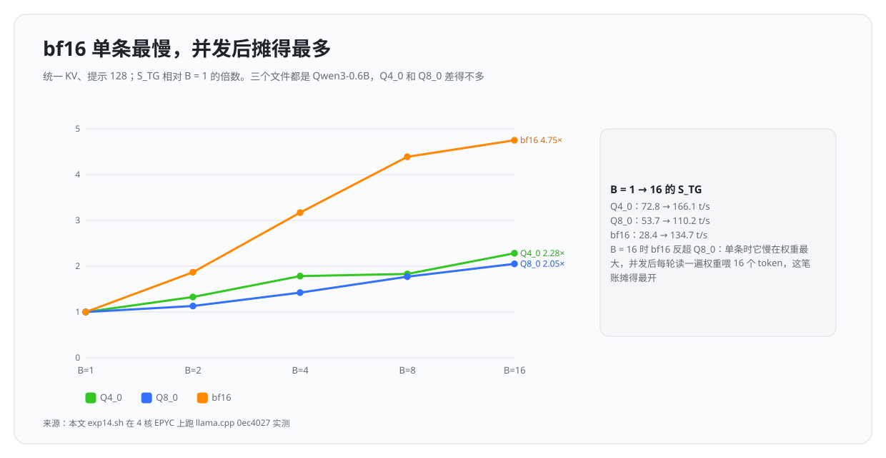

换权重格式再跑一遍，统一 KV、提示 128。Q4_0 从 72.8 涨到 166.1 t/s，2.28 倍。Q8_0 从 53.7 涨到 110.2，2.05 倍。bf16 从 28.4 涨到 134.7，4.75 倍。拿文件大小乘单条速度粗算每秒读的字节，Q4_0 约 34 GB/s，Q8_0 和 bf16 都在 43 GB/s 左右，后两者单条时更贴着带宽上限。

bf16 文件 1.5 GB，是 Q8_0 的 1.9 倍，单条最慢，B = 16 时反超 Q8_0。我的解释是 bf16 单条时读权重的时间占比最大，并发摊薄的正是这一块；量化格式要反量化，这笔计算开销跟着 B 一起涨。这个解释没有单独拆开测。

> 🔑 **本章要点**：分开 KV、Q8_0、提示 128，B 从 1 到 16 总解码吞吐涨 3.45 倍，每条只剩 1/4.6，预填充总耗时随 B 线性涨。bf16 单条最慢，并发后涨 4.75 倍，B = 16 时反超 Q8_0。-np 是在吞吐和单条延迟之间选点。

# 第 4 章 · 统一 KV 还是分开

## 4.1 交替跑 3 轮

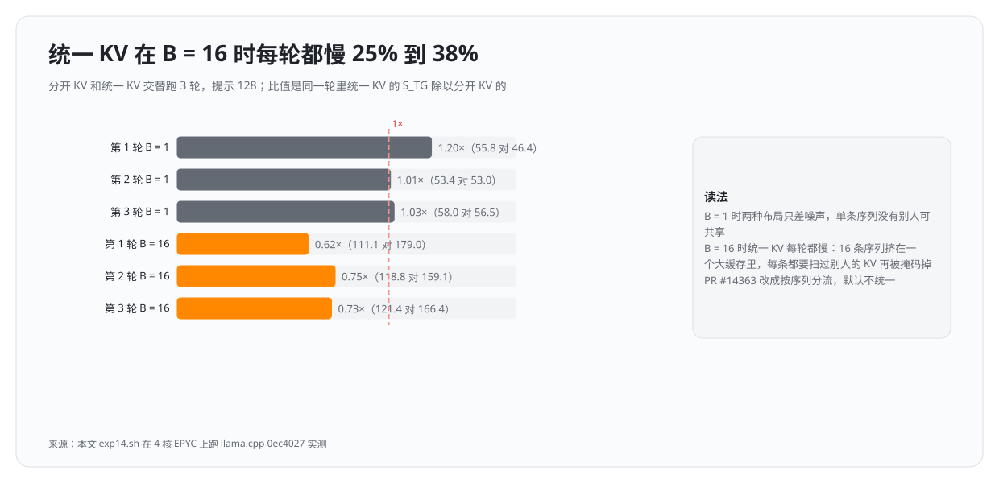

第 3 章的曲线里，统一 KV 在 B = 16 时只有 110.2 t/s，分开 KV 是 172.1。[LCPP-03｜上手｜测量方法：llama-bench、PPL、KLD 和噪声](./03-bench-ppl.md) 说过这台云主机的速度会漂，我把分开和统一交替跑 3 轮，比值只拿同一轮里的两个数相除。B = 1 时三轮的比值是 1.20、1.01、1.03，第一轮那个 1.20 是分开 KV 那次恰好跑慢了，后两轮只差噪声；B = 16 时是 0.62、0.75、0.73，每轮都慢 25% 到 38%。

## 4.2 为什么统一 KV 慢

统一 KV 时所有序列共用一个流，注意力算子看到的是整块 KV，靠掩码把别的序列的格子屏蔽掉。提示 128、B = 16 时缓存里有 3072 格，每条序列真正要看的只有自己那 192 格，却要和其余 2880 格一起算完再被掩码丢掉。PR #14363 把 KV 改成按序列分流，每条序列只扫自己那段；作者在 M2 Ultra 上用 Qwen2.5-Coder 3B 跑 32 条序列、提示 4096，S_TG 从 153.66 涨到 486.09 t/s，之后分开成了缺省，--kv-unified 退回旧行为[[5]](https://github.com/ggml-org/llama.cpp/pull/14363)。

统一 KV 的好处是灵活。分开时每个槽位只有 -c 除以 -np 那一段，一条长请求用不了别的槽位空着的格子；统一时谁需要谁用，长短差别大的请求混在一起时不容易超限。PagedAttention 用分页解决的是同一个问题：Kwon 等人把 KV 切成固定大小的块按需分配，碎片几乎为零，报吞吐是同期系统的 2 到 4 倍[[20]](https://arxiv.org/abs/2309.06180)。llama.cpp 没有分页，只能在分开和统一之间二选一。

## 4.3 server 的缺省

PR #16736 让 server 支持跨槽位的统一缓存，同时改了缺省：不写 -np 时取 4 个槽位并打开统一 KV；空间不够时先逐个清空闲槽位，还不够才终止活跃槽位[[6]](https://github.com/ggml-org/llama.cpp/pull/16736)。0ec4027 里 -kvu 的说明是 enabled if number of slots is auto[[12]](https://github.com/ggml-org/llama.cpp/blob/0ec4027/common/arg.cpp)，server.cpp 在 n_parallel 小于 0 时设成 4 并打开 kv_unified[[7]](https://github.com/ggml-org/llama.cpp/blob/0ec4027/tools/server/server.cpp)。

> 💡 **常见误区**：不写 -np 和写 -np 4 不等价：前者统一 KV，后者分开。同样 4 个槽位，前者每个槽位能用满整份 -c，后者每个只有四分之一；高并发解码前者慢。迁移配置时把 -np 和 -kvu 都显式写上。

# 第 5 章 · -c 和 -np 怎么分账

## 5.1 不统一时平分，再补齐到 256

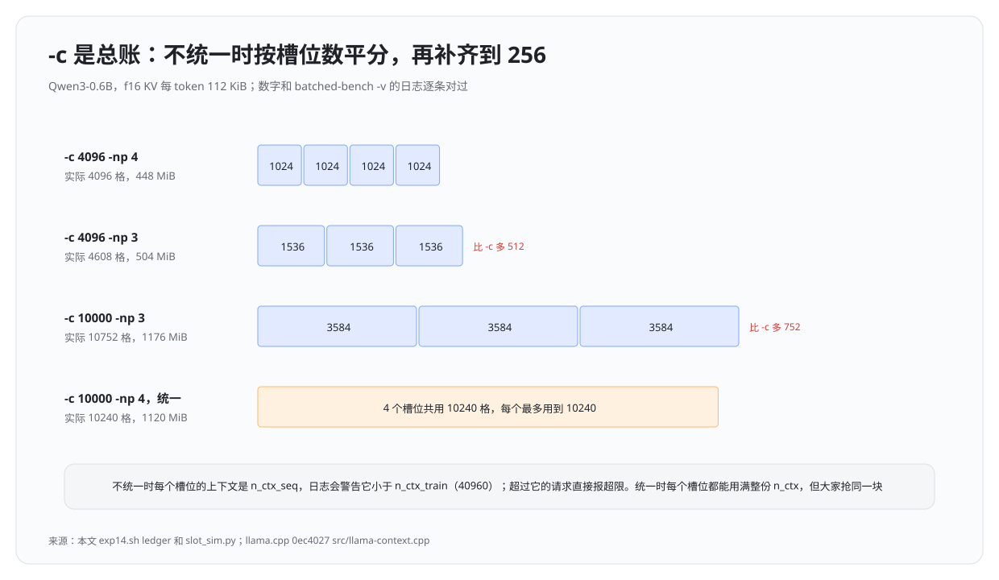

-c 给的是整个上下文的格数，所有槽位共用这份账。llama-context.cpp 先把 n_ctx 补到 256 的倍数。统一 KV 时，每条序列都能用满 n_ctx。不统一时，n_ctx 除以序列数得到 n_ctx_seq，再补到 256 的倍数，最后把总量改写成 n_ctx_seq 乘序列数[[8]](https://github.com/ggml-org/llama.cpp/blob/0ec4027/src/llama-context.cpp)。所以 -c 不一定是你最后拿到的格数。

我用 batched-bench -v 跑了 -c 4096 和 10000、序列数 3 和 4、统一与否八种组合，把日志里的 n_ctx、n_ctx_seq 和 KV 大小和 slot_sim.py 的 ctx_layout 逐条对过，全部一致。

-c 4096 -np 3 不统一时，4096 除以 3 得 1365，补到 1536，总量改写成 4608，KV 504 MiB，比 -c 4096 多出 512 格；-c 10000 -np 3 先补到 10240，除以 3 得 3413，补到 3584，总量 10752，KV 1176 MiB。槽位数是 2 的幂、-c 是 256 乘槽位数的倍数时，不会多出格子。

## 5.2 每个槽位的上限

不统一时，n_ctx_seq 就是单个槽位能装的提示加生成。-c 4096 -np 4 每个槽位只有 1024 格，一条 1500 token 的请求会直接报超限，哪怕另外三个槽位全空。日志里 n_ctx_seq 小于模型训练长度时会打一行提示，Qwen3-0.6B 的训练长度是 40960，几乎每个配置都会看到这行，它只是提醒，不是错误[[8]](https://github.com/ggml-org/llama.cpp/blob/0ec4027/src/llama-context.cpp)。统一时每个槽位都能用到整份 n_ctx，但所有槽位抢同一块，空间不够时按第 2 章的顺序先清空闲槽位。

## 5.3 按槽位定总量

KV 的字节数在 [LCPP-08｜内部｜KV cache 与长上下文：账本、深度、量化、SWA 和上下文写满](./08-kv-context.md) 算过：Qwen3-0.6B 28 层、8 个 KV 头、头维 128，f16 下每个 token 112 KiB，4096 格是 448 MiB。0ec4027 给 server 加了 --kv-unified-per-slot N：不写 -c 时，统一缓存的总量取 -np 乘 N[[7]](https://github.com/ggml-org/llama.cpp/blob/0ec4027/tools/server/server.cpp)。我的做法反过来：先定单条请求最长要多少格，乘槽位数得到 -c，再用 112 KiB 每格核对内存放不放得下。

> 🔑 **本章要点**：-c 是所有槽位的总账。不统一时按槽位数平分，每份再补齐到 256，总量可能比 -c 多，-c 4096 -np 3 实际是 4608 格。每个槽位的上限是 n_ctx_seq，超过就报错，别的槽位空着也借不来。先定单条上限，再乘槽位数得 -c。

# 第 6 章 · 共享前缀只算一次

## 6.1 batched-bench 的 -pps

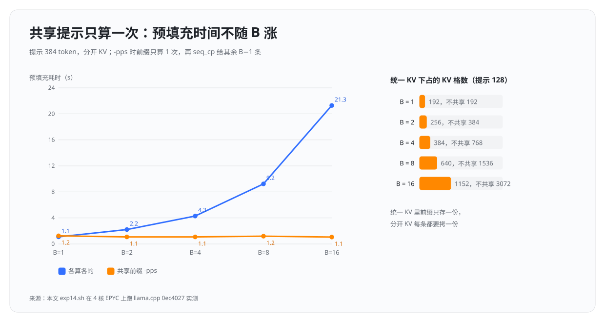

很多服务的请求开头是同一段系统提示。batched-bench 加 -pps 后，前缀只用序列 0 算一次，再用 llama_memory_seq_cp 拷给其余 B−1 条[[4]](https://github.com/ggml-org/llama.cpp/blob/0ec4027/tools/batched-bench/batched-bench.cpp)。提示 384、分开 KV，不共享时预填充耗时随 B 线性涨：1.09、2.21、4.29、9.23、21.29 秒；共享后稳定在 1.06 到 1.25 秒，B = 16 时差 20 倍。

KV 占用要分两种布局看。统一 KV 时，seq_cp 只是给同一批格子多打几个序列标记，前缀真的只存一份：提示 128 时 B = 16 只占 1152 格，不共享要 3072 格。分开 KV 时每条序列有自己的流，seq_cp 要把前缀实打实拷进每条流，算力省下了，内存没省。这是统一 KV 少有的优势场景：前缀很长、并发很高、请求又短。

## 6.2 llama-parallel：系统提示共享与否

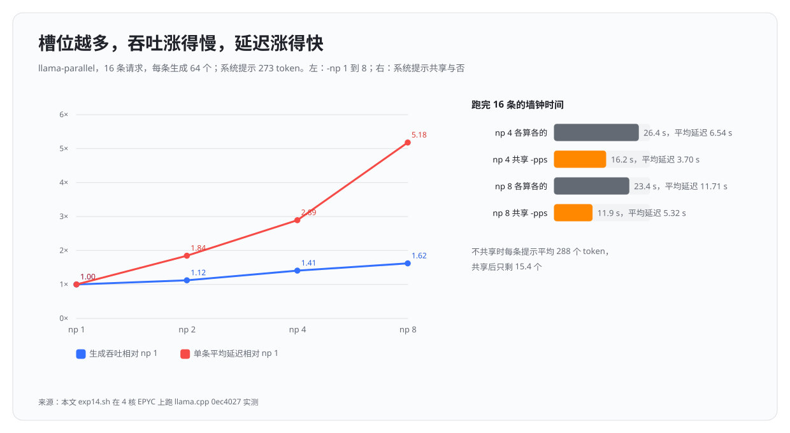

llama-parallel 更像真实服务：16 条请求，每条生成 64 个，客户端结束一条立刻取下一条。每条提示由 273 token 的系统提示加一句用户问题组成，平均 288.4 个 token[[9]](https://github.com/ggml-org/llama.cpp/blob/0ec4027/examples/parallel/parallel.cpp)。不共享系统提示时，-np 从 1 到 8，生成吞吐 26.96、30.21、37.91、43.68 t/s，np 8 只是 np 1 的 1.62 倍；单条平均延迟从 2.26 秒涨到 4.17、6.54、11.71 秒，np 8 是 5.18 倍。这里的延迟从开始喂提示算到生成结束。

加 -pps 后，系统提示在启动时算一次放进序列 0，每个客户端开始新请求前从序列 0 拷一份，只需喂用户问题，平均 15.4 个 token。np 4 跑完 16 条从 26.4 秒降到 16.2 秒，平均延迟 6.54 降到 3.70 秒；np 8 从 23.4 降到 11.9 秒，延迟 11.71 降到 5.32 秒。共享前缀带来的收益比把 -np 从 4 加到 8 大得多。

提示里夹带随机的历史对话时，前缀就不完全相同了。--junk 6 让每条提示随机插入 0 到 5 段问答，平均提示涨到 323.4 个 token，np 4 跑完要 27.1 秒，比不夹带的 26.4 秒还慢。llama-parallel 的共享只认系统提示，系统提示后面只要有一个 token 不同，其余部分就得重算。

## 6.3 server 里的共享前缀

server 没有 -pps 这样的开关，共享前缀靠两件事。先是 cache_prompt，缺省打开：新请求和槽位里留着的上一条提示比最长公共前缀，只算后面不一样的部分[[21]](https://github.com/ggml-org/llama.cpp/blob/0ec4027/tools/server/README.md)。再是第 7 章的槽位选择，让新请求尽量落到前缀最像的那个槽位。分开 KV 时每个槽位要各存一份系统提示，统一 KV 也一样，server 不会在槽位之间共享 KV 格子，只有 n_cmpl 的父子槽位之间用 seq_cp 拷贝。

Gim 等人的 Prompt Cache 把系统提示、模板、文档这类常见片段预先算好存起来，用户提示里出现就直接拼上，首 token 延迟 GPU 上降 8 倍、CPU 上降 60 倍[[22]](https://arxiv.org/abs/2311.04934)；它能拼任意位置的模块，cache_prompt 只认开头。

SGLang 把这件事做到了极致：Zheng 等人用基数树管理所有请求的 KV，任意两条请求的公共前缀自动共享，配合缓存感知的调度，报吞吐最多 6.4 倍[[23]](https://arxiv.org/abs/2312.07104)。llama-server 的复用粒度是槽位和 RAM 缓存条目，只比开头的公共前缀，系统提示保持逐字一致是拿到收益的前提。

> 🔑 **本章要点**：共享前缀只算一次，提示 384、B = 16 时预填充差 20 倍；llama-parallel np 4 共享 273 token 的系统提示，跑完 16 条从 26.4 秒降到 16.2 秒，比 -np 从 4 加到 8 还管用。server 靠 cache_prompt 和槽位选择复用前缀，系统提示要逐字一致。

# 第 7 章 · 新请求落到哪个槽位

## 7.1 先比相似度，再按 LRU

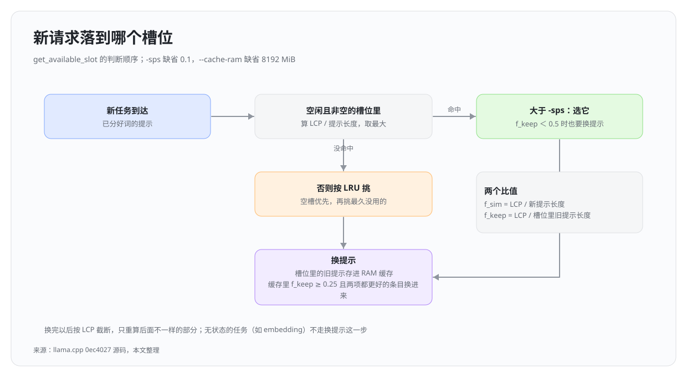

get_available_slot 先在空闲且非空的槽位里算 f_sim：新提示和槽位里旧提示的最长公共前缀，除以新提示长度。取最大的那个，超过 -sps（缺省 0.1）就选它[[3]](https://github.com/ggml-org/llama.cpp/blob/0ec4027/tools/server/server-context.cpp)[[24]](https://github.com/ggml-org/llama.cpp/blob/0ec4027/common/common.h)。都不够就按 LRU 挑：空槽优先，再挑最久没用的。选中以后，如果 f_keep，也就是公共前缀除以旧提示长度，小于 0.5，说明旧提示里大半要扔掉，这时先把旧提示存进 RAM 缓存再换。按 LRU 选中的槽位一律走换提示这一步。

-sps 0 表示关掉相似度判断，只按 LRU。PR #9283 之前的 server 用的就是这套规则的早期版本[[18]](https://github.com/ggml-org/llama.cpp/pull/9283)。客户端也可以用 id_slot 指定槽位，被占着时请求进延迟队列等[[21]](https://github.com/ggml-org/llama.cpp/blob/0ec4027/tools/server/README.md)。

## 7.2 RAM 里的提示缓存

PR #16391 给 server 加了主机内存里的提示缓存：槽位里换下来的提示连同 KV 状态存进一个列表，新请求进来时在列表里找更合适的条目换回槽位[[10]](https://github.com/ggml-org/llama.cpp/pull/16391)。规则在 server-task.cpp：存的时候，已经整段被某个缓存条目包含的不存，被新条目包含的旧条目删掉，超过 --cache-ram（缺省 8192 MiB）时从最旧的删起；取的时候只看 f_keep 不低于 0.25 的条目，f_keep 和 f_sim 都比槽位里现有的好才换[[11]](https://github.com/ggml-org/llama.cpp/blob/0ec4027/tools/server/server-task.cpp)。

这套机制之前，槽位状态只能用 /slots 接口手动存到文件再恢复，靠的是 PR #6341 加的按序列存取 KV[[25]](https://github.com/ggml-org/llama.cpp/pull/6341)[[21]](https://github.com/ggml-org/llama.cpp/blob/0ec4027/tools/server/README.md)。--cache-idle-slots 缺省打开：新任务到达时把所有空闲槽位存进缓存，统一 KV 时顺手清掉，把格子让给新请求[[12]](https://github.com/ggml-org/llama.cpp/blob/0ec4027/common/arg.cpp)。把 KV 挪到主机内存再取回，大规模服务里也是常规做法：Kimi 的 Mooncake 用 GPU 集群里闲着的 CPU、内存和 SSD 存 KV，真实负载下多接 75% 的请求[[26]](https://arxiv.org/abs/2407.00079)。llama-server 的 RAM 缓存是同一个思路的单机版，只存整段提示，不跨机器。

## 7.3 模拟：缓存多大、用户多少时有用

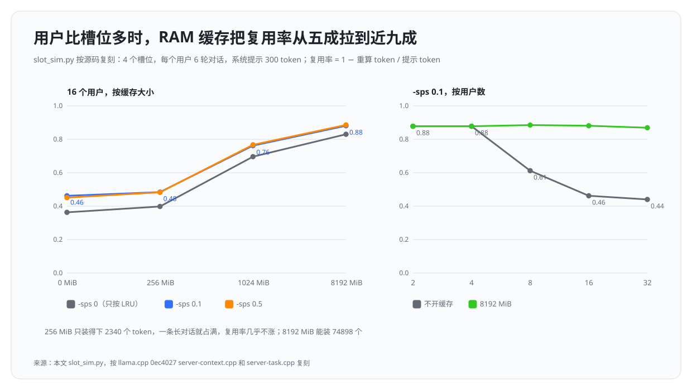

我用 slot_sim.py 模拟 4 个槽位，16 个用户各聊 6 轮，共享 300 token 的系统提示，每轮用户消息 40 到 80 token，回复 100 到 200 token。请求按波次到达，每波最多 4 个不同用户。复用率定义为 1 减重算 token 除以提示 token。不开缓存时 -sps 0.1 的复用率是 0.46，-sps 0 只按 LRU 是 0.36；开到缺省 8192 MiB，分别是 0.88 和 0.83。

缓存大小有门槛。Qwen3-0.6B 每 token 112 KiB，256 MiB 只装得下 2340 个 token。一条聊到第五六轮的对话就超过一千 token，复用率只从 0.46 涨到 0.48。1024 MiB 装 9362 个，涨到 0.76。8192 MiB 装 74898 个，这个场景里一次都没淘汰。大模型每 token 的 KV 更大，同样 8192 MiB 装的 token 按比例变少。

用户数是另一个门槛。用户不超过槽位数时，每个用户一直落在自己的槽位，cache_prompt 已经够用，开不开缓存复用率都是 0.878。8 个用户时不开缓存掉到 0.612，开了是 0.885；32 个用户时分别是 0.440 和 0.869。-sps 设成 0.5 时，选法里 LRU 从 4 次涨到 56 次，复用率和 0.1 差不多，因为换提示那一步会从缓存里把对的条目找回来。

**📎 展开阅读：**模拟器只复刻了选槽和缓存规则，没有模拟生成耗时，也没有模拟缓存存取 KV 状态本身的时间。存一个 2000 token 的状态要拷 220 MiB 左右，在内存带宽充足的机器上是几十毫秒的量级，我没有实测。test_server.py 的 16 个用例逐条对着源码写，例如 f_keep 0.1 不换、两项都更好才换、空槽优先。

> 🔑 **本章要点**：新请求先找前缀最像的空闲槽位，f_sim 超过 0.1 就选，否则按 LRU。用户比槽位多时，缺省 8192 MiB 的 RAM 缓存把模拟的复用率从 0.46 拉到 0.88；用户不超过槽位数时缓存没用。256 MiB 太小，存不下一条长对话。

# 第 8 章 · 上下文不够时

## 8.1 提示太长、KV 不够和生成撑满

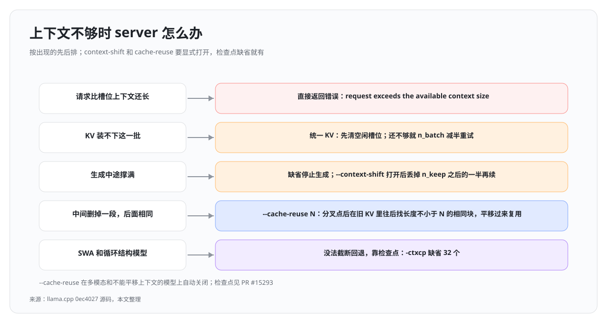

请求的提示比槽位上下文还长，server 直接返回 request exceeds the available context size[[3]](https://github.com/ggml-org/llama.cpp/blob/0ec4027/tools/server/server-context.cpp)。KV 装不下当前这一批，按第 2 章的顺序清空闲槽位、减半 n_batch。生成到一半撑满时，缺省把这条请求标成 truncated 并停止生成；--context-shift 缺省关闭，打开后保留开头 n_keep 个 token，丢掉后面剩余部分的一半，把后半段的位置往前平移，接着生成[[12]](https://github.com/ggml-org/llama.cpp/blob/0ec4027/common/arg.cpp)。

n_keep 一般要盖住系统提示。Xiao 等人发现开头几个 token 会吸走大量注意力，只保留最近窗口、丢掉开头时困惑度会崩，留住开头的几个 token 就能稳住，他们叫这些 token 注意力汇[[27]](https://arxiv.org/abs/2309.17453)；context-shift 保留 n_keep 的做法和它同一个道理。平移靠 RoPE 的位置可加性，[LCPP-08｜内部｜KV cache 与长上下文：账本、深度、量化、SWA 和上下文写满](./08-kv-context.md) 讲过 seq_add 怎么改位置。

## 8.2 --cache-reuse：中间删掉一段

cache_prompt 只复用最长公共前缀，前缀之后只要变了一个 token，后面全部重算。PR #9866 加了 --cache-reuse N[[28]](https://github.com/ggml-org/llama.cpp/pull/9866)：在分叉点之后，拿新提示的下一段去旧提示的 KV 里往后找，找到长度不小于 N 的相同块，就用 seq_rm 删掉中间多出来的部分，再用 seq_add 把这块平移到新位置；找不到就把旧提示的指针后移一格继续找[[3]](https://github.com/ggml-org/llama.cpp/blob/0ec4027/tools/server/server-context.cpp)。典型场景是对话历史中间删掉了一段，或者代码补全时光标前面插了几行。

它缺省是 0，即关闭，要配合 cache_prompt 用；请求里也可以用 n_cache_reuse 单独指定[[21]](https://github.com/ggml-org/llama.cpp/blob/0ec4027/tools/server/README.md)。平移改变了 token 的位置，平移后的 KV 和从头算的结果不完全一样，输出可能有细微差别。CacheBlend 处理的是同一类非前缀复用，它的办法是挑出一小部分 token 重算，修补被挪动的块和前文之间的注意力，报首 token 延迟降 2.2 到 3.3 倍且不掉质量[[29]](https://arxiv.org/abs/2405.16444)；--cache-reuse 只平移、不重算。多模态请求和不能平移上下文的模型上，--cache-reuse 和 --context-shift 都会在启动时被关掉。

## 8.3 SWA 和循环结构靠检查点

滑动窗口注意力的模型只保留最近一个窗口的 KV，[LCPP-08｜内部｜KV cache 与长上下文：账本、深度、量化、SWA 和上下文写满](./08-kv-context.md) 讲过 PR #13194 的做法[[30]](https://github.com/ggml-org/llama.cpp/pull/13194)；Mamba 这类循环结构的状态是整段压出来的。这两类都没法把 KV 截断到任意位置，新请求和旧提示只有前半段相同时，前缀复用就失效了。PR #15293 加了检查点：喂提示的过程中按间隔存下不可回退部分的状态，新请求来时退回最近的一个检查点再往后算，-ctxcp 缺省 32 个[[13]](https://github.com/ggml-org/llama.cpp/pull/15293)[[24]](https://github.com/ggml-org/llama.cpp/blob/0ec4027/common/common.h)。只有补全类任务会存检查点，embedding 之类不存。

> 🔑 **本章要点**：提示超长直接报错；生成撑满缺省截停，--context-shift 打开后丢掉 n_keep 之后的一半续写。--cache-reuse N 能在中间删掉一段后平移复用后面的 KV，缺省关闭，多模态上自动关。SWA 和循环结构模型靠缺省 32 个检查点回退。

# 第 9 章 · 上线前看什么

## 9.1 /metrics 里的几项

/metrics 缺省关闭，要加 --metrics 才有，格式是 Prometheus 文本[[12]](https://github.com/ggml-org/llama.cpp/blob/0ec4027/common/arg.cpp)[[21]](https://github.com/ggml-org/llama.cpp/blob/0ec4027/tools/server/README.md)。我上线前盯四项。requests_deferred 是因为没有空槽位、指定槽位被占或者 n_cmpl 凑不齐子槽位而进了延迟队列的请求数，它持续不为 0，说明 -np 不够或者请求太长[[3]](https://github.com/ggml-org/llama.cpp/blob/0ec4027/tools/server/server-context.cpp)。

n_busy_slots_per_decode 是每次 llama_decode 平均有几个槽位在忙，长期远小于 -np，多开的槽位只是在分 -c；贴着 -np，说明并发已经吃满。prompt_tokens_seconds 和 predicted_tokens_seconds 分别是预填充和生成的吞吐，配合 n_decode_total 能算出平均每次 decode 带了多少 token。

投机解码打开时还有 spec_decode_num_draft_tokens_total 和 spec_decode_num_accepted_tokens_total，两者相除就是接受率，和 [LCPP-13｜内部｜投机解码：草稿模型、n-gram 和拒绝采样](./13-speculative.md) 里 speculative-simple 打印的 draft acceptance 是同一个口径。prompt_tokens_total 和 tokens_predicted_total 是累计量，适合按分钟取差值画曲线。

## 9.2 /slots 和调试开关

/slots 缺省打开，返回每个槽位的状态、n_ctx、当前请求的采样参数和已处理的 token 数[[21]](https://github.com/ggml-org/llama.cpp/blob/0ec4027/tools/server/README.md)。设环境变量 LLAMA_SERVER_SLOTS_DEBUG=1 后，它还会带上每个槽位当前的提示和生成内容，排查某条请求为什么没复用前缀时很好用，但会把用户输入原样吐出来，线上不要开[[3]](https://github.com/ggml-org/llama.cpp/blob/0ec4027/tools/server/server-context.cpp)。--slot-save-path 配好以后，/slots/{id}?action=save 和 restore 可以把槽位存到文件再恢复，第 7 章的 RAM 缓存出现之前，多会话切换都靠它。

## 9.3 先跑单元测试

test-server-component 测的是服务端的组件，不加载模型，也不开端口：server_tokens 的位置、公共前缀和序列化，UTF-8 被截断的半个字符，SSE 分帧，JSON 和 LoRA 参数解析，rerank 模板，DRY 采样的断句符等[[31]](https://github.com/ggml-org/llama.cpp/blob/0ec4027/tests/test-server-component.cpp)。本机跑 49 个用例、191 条断言，失败 0。改了 server 代码或者升级版本，我先跑它，再跑 llama-parallel 看吞吐有没有掉。

## 9.4 压测我没有跑

真正的端到端压测要起 llama-server。scripts/server-bench.py 由 PR #14668 加入，它自己启动 server，用多线程从 MMLU 之类的数据集取提示发请求，统计请求吞吐、首 token 延迟和每个槽位的生成速度，还会出两张图[[32]](https://github.com/ggml-org/llama.cpp/pull/14668)[[33]](https://github.com/ggml-org/llama.cpp/blob/0ec4027/scripts/server-bench.py)。它要监听端口，本篇没有跑，第 3、6 章的数字都来自不开端口的 batched-bench 和 llama-parallel。上线前用它在目标机器上跑一遍，比我这里的任何曲线都可靠。

压测的时候把首 token 延迟和后续每 token 延迟分开看。预填充和生成挤在同一批里，长提示会拖慢正在生成的请求，第 2 章的分块预填充只能缓解。DistServe 走得更远，把预填充和生成放到不同的 GPU 上，各自按延迟目标调并行度，报同样的延迟约束下多服务 7.4 倍请求，或者把延迟目标收紧 12.6 倍[[34]](https://arxiv.org/abs/2401.09670)；Splitwise 同样拆成两段放到不同机器，报吞吐高 1.4 倍的同时成本低 20%，或者同样的成本和功耗下吞吐 2.35 倍[[35]](https://arxiv.org/abs/2311.18677)。llama-server 没有这种拆分，单机 CPU 上也谈不上，但它说明了两类延迟为什么要分开定目标。

> 🔑 **本章要点**：上线前加 --metrics，盯 requests_deferred 和 n_busy_slots_per_decode：前者不为 0 说明槽位不够，后者远小于 -np 说明槽位开多了。/slots 缺省打开，调试开关会吐出用户输入。改代码先跑 test-server-component，端到端压测用 server-bench.py，本篇没有跑。

# 第 10 章 · 多模型和投机

## 10.1 一个进程挂多个模型

PR #17470 让 llama-server 能当路由：不指定 -m 启动时，它按请求里的 model 字段把请求转给对应的模型实例，没加载的按需加载；--models-dir 指定本地目录，--models-max 限制同时加载几个，缺省 4，0 表示不限，超了按最近最少使用卸载[[36]](https://github.com/ggml-org/llama.cpp/pull/17470)[[12]](https://github.com/ggml-org/llama.cpp/blob/0ec4027/common/arg.cpp)。PR 里写明这是实验性的第一版。每个模型实例有自己的槽位和 KV，本篇讲的 -np、-c 和缓存规则在每个实例里各自成立。部署和运维的细节放在 LCPP-16。

## 10.2 server 里的投机解码

server 给每个槽位配一个草稿，-md 指定草稿模型，验证时草稿 token 和别的槽位的 token 拼在同一批里。PR #17808 改进了 server 里投机解码的速度，它修的问题是 server 每轮起草的 token 比 speculative-simple 少，同样的参数跑得更慢[[37]](https://github.com/ggml-org/llama.cpp/pull/17808)。并发高了以后算力不再闲置，验证多出来的 token 不再免费，[LCPP-13｜内部｜投机解码：草稿模型、n-gram 和拒绝采样](./13-speculative.md) 第 3 章的公式里 v(k) 会变陡，投机的收益随 -np 增大而缩小。我没有在 server 里实测投机，这一节只读了源码和 PR。

# 第 11 章 · 怎么配与上线清单

## 11.1 按场景配

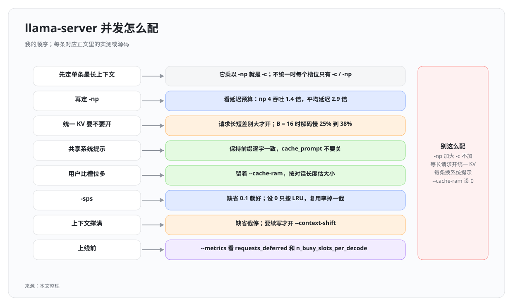

| 场景 | 怎么配 | 依据 |
|-|-|-|
| 离线批量处理 | -np 开到 S_TG 不再涨，-c 跟着乘 | 第 3 章：B = 16 总吞吐 3.45 倍 |
| 交互对话，看重出字速度 | -np 2 到 4，先定每人能接受的 t/s | 第 6 章：np 4 吞吐 1.41 倍，平均延迟 2.9 倍 |
| 请求长度差别大 | 显式写 -kvu | 第 4 章：统一 KV 谁需要谁用，高并发解码慢 25% 到 38% |
| 请求长度相近、并发高 | 写 -np，不写 -kvu | 第 4 章：分开 KV 每条只扫自己那段 |
| 所有请求共用长系统提示 | 前缀逐字一致，cache_prompt 保持打开 | 第 6 章：np 4 跑完 16 条 26.4 秒降到 16.2 秒 |
| 用户比槽位多的多轮对话 | --cache-ram 留着，按最长对话乘每 token KV 估大小 | 第 7 章：复用率 0.46 到 0.88 |
| 代码补全、对话中间删历史 | --cache-reuse 256 起步 | 第 8 章：分叉点后平移复用 |
| 长对话要一直续写 | --context-shift，n_keep 盖住系统提示 | 第 8 章：缺省撑满即截停 |

表里的数字来自一台 4 核 CPU 和 0.6B 的模型。GPU 上算力富裕，并发的吞吐曲线更陡，统一 KV 的代价和投机的收益也会变，规则不变，倍数要在自己的机器上重测。用户数和槽位数的关系、RAM 缓存够不够装一条长对话，这两件事和硬件无关，第 7 章的模拟结论可以直接用。

## 11.2 上线清单

> 📌 **上线前核对清单**：每次改 -np、换模型或者升级版本，我按这个顺序过一遍。
> - 写明 -np 和 -kvu，不依赖自动值
> - 按单条最长上下文乘 -np 定 -c，用 batched-bench -v 的日志核对 n_ctx_seq
> - 用 112 KiB 每 token 这类换算核对 KV 加 --cache-ram 放得下
> - llama-parallel 在目标 -np 下跑一遍，看平均延迟能不能接受
> - 系统提示逐字固定，模板里没有日期、随机 ID 这类每次都变的字段
> - 跑 test-server-component，失败为 0
> - 打开 --metrics，压测时看 requests_deferred 和 n_busy_slots_per_decode
> - 线上不设 LLAMA_SERVER_SLOTS_DEBUG

## 11.3 下一步

这篇只处理文本请求。图片和音频进来以后，提示里多了一段编码器输出的嵌入，--cache-reuse 和 --context-shift 都会被关掉，放在 LCPP-15；router 多模型、部署和运维放在 LCPP-16；各篇的参数汇成调参手册放在 LCPP-17。KV 的账本和 seq_rm 回到 [LCPP-08｜内部｜KV cache 与长上下文：账本、深度、量化、SWA 和上下文写满](./08-kv-context.md)，单请求的投机解码回到 [LCPP-13｜内部｜投机解码：草稿模型、n-gram 和拒绝采样](./13-speculative.md)，CPU 线程和带宽回到 [LCPP-10｜内部｜CPU 调优：线程、绑核、repack、加载方式和带宽上限](./10-cpu-tuning.md)。

# 参考文献

按正文首次引用顺序编号，资料截至 2026 年 10 月初。

[1] Yu G, et al. Orca: A Distributed Serving System for Transformer-Based Generative Models. OSDI 2022. [OSDI 2022](https://www.usenix.org/conference/osdi22/presentation/yu)

[2] Agrawal A, et al. SARATHI: Efficient LLM Inference by Piggybacking Decodes with Chunked Prefills. 2023. [arXiv:2308.16369](https://arxiv.org/abs/2308.16369)

[3] llama.cpp 0ec4027. tools/server/server-context.cpp：槽位状态机、get_available_slot、批处理主循环、try_clear_idle_slots 和解码失败时的 n_batch 减半。 [server-context.cpp](https://github.com/ggml-org/llama.cpp/blob/0ec4027/tools/server/server-context.cpp)

[4] llama.cpp 0ec4027. tools/batched-bench/batched-bench.cpp：B 条序列同时 prefill 和 decode，-pps 时前缀只算一次再 seq_cp。 [batched-bench.cpp](https://github.com/ggml-org/llama.cpp/blob/0ec4027/tools/batched-bench/batched-bench.cpp)

[5] ggerganov. llama : add high-throughput mode. llama.cpp PR #14363, 2025. [PR #14363](https://github.com/ggml-org/llama.cpp/pull/14363)

[6] ggerganov. server : support unified cache across slots. llama.cpp PR #16736, 2025. [PR #16736](https://github.com/ggml-org/llama.cpp/pull/16736)

[7] llama.cpp 0ec4027. tools/server/server.cpp：-np 自动时取 4 个槽位并打开统一 KV，--kv-unified-per-slot 推算 n_ctx。 [server.cpp](https://github.com/ggml-org/llama.cpp/blob/0ec4027/tools/server/server.cpp)

[8] llama.cpp 0ec4027. src/llama-context.cpp：n_ctx 补到 256 的倍数，不统一时按序列数切分 n_ctx_seq。 [llama-context.cpp](https://github.com/ggml-org/llama.cpp/blob/0ec4027/src/llama-context.cpp)

[9] llama.cpp 0ec4027. examples/parallel/parallel.cpp：多客户端连续批处理，序列 0 存系统提示。 [parallel.cpp](https://github.com/ggml-org/llama.cpp/blob/0ec4027/examples/parallel/parallel.cpp)

[10] ggerganov. server : host-memory prompt caching. llama.cpp PR #16391, 2025. [PR #16391](https://github.com/ggml-org/llama.cpp/pull/16391)

[11] llama.cpp 0ec4027. tools/server/server-task.cpp：server_prompt_cache 的 alloc、load、update。 [server-task.cpp](https://github.com/ggml-org/llama.cpp/blob/0ec4027/tools/server/server-task.cpp)

[12] llama.cpp 0ec4027. common/arg.cpp：-np、-kvu、-cram、-sps、--cache-reuse、-ctxcp、--cache-idle-slots 的说明和默认值。 [arg.cpp](https://github.com/ggml-org/llama.cpp/blob/0ec4027/common/arg.cpp)

[13] ggerganov. server : add SWA checkpoints. llama.cpp PR #15293, 2025. [PR #15293](https://github.com/ggml-org/llama.cpp/pull/15293)

[14] ggerganov. llama : custom attention mask + parallel decoding + no context swaps. llama.cpp PR #3228, 2023. [PR #3228](https://github.com/ggml-org/llama.cpp/pull/3228)

[15] ggerganov. server : parallel decoding and multimodal (cont). llama.cpp PR #3677, 2023. [PR #3677](https://github.com/ggml-org/llama.cpp/pull/3677)

[16] ngxson. server : refactor slot input data, move tokenizer to HTTP thread. llama.cpp PR #10023, 2024. [PR #10023](https://github.com/ggml-org/llama.cpp/pull/10023)

[17] ngxson. server: prevent data race from HTTP threads. llama.cpp PR #18263, 2025. [PR #18263](https://github.com/ggml-org/llama.cpp/pull/18263)

[18] ngxson. server : simplify state machine for slot. llama.cpp PR #9283, 2024. [PR #9283](https://github.com/ggml-org/llama.cpp/pull/9283)

[19] Agrawal A, et al. Taming Throughput-Latency Tradeoff in LLM Inference with Sarathi-Serve. OSDI 2024. [arXiv:2403.02310](https://arxiv.org/abs/2403.02310)

[20] Kwon W, et al. Efficient Memory Management for Large Language Model Serving with PagedAttention. SOSP 2023. [arXiv:2309.06180](https://arxiv.org/abs/2309.06180)

[21] llama.cpp 0ec4027. tools/server/README.md：cache_prompt、id_slot、n_cache_reuse 请求字段和 /metrics 指标。 [server README](https://github.com/ggml-org/llama.cpp/blob/0ec4027/tools/server/README.md)

[22] Gim I, et al. Prompt Cache: Modular Attention Reuse for Low-Latency Inference. MLSys 2024. [arXiv:2311.04934](https://arxiv.org/abs/2311.04934)

[23] Zheng L, et al. SGLang: Efficient Execution of Structured Language Model Programs. NeurIPS 2024. [arXiv:2312.07104](https://arxiv.org/abs/2312.07104)

[24] llama.cpp 0ec4027. common/common.h：cache_ram_mib 8192、slot_prompt_similarity 0.1、n_ctx_checkpoints 32 等默认值。 [common.h](https://github.com/ggml-org/llama.cpp/blob/0ec4027/common/common.h)

[25] kaetemi. llama : save and restore kv cache for single seq id. llama.cpp PR #6341, 2024. [PR #6341](https://github.com/ggml-org/llama.cpp/pull/6341)

[26] Qin R, et al. Mooncake: A KVCache-centric Disaggregated Architecture for LLM Serving. FAST 2025. [arXiv:2407.00079](https://arxiv.org/abs/2407.00079)

[27] Xiao G, et al. Efficient Streaming Language Models with Attention Sinks. ICLR 2024. [arXiv:2309.17453](https://arxiv.org/abs/2309.17453)

[28] ggerganov. server : reuse context chunks. llama.cpp PR #9866, 2024. [PR #9866](https://github.com/ggml-org/llama.cpp/pull/9866)

[29] Yao J, et al. CacheBlend: Fast Large Language Model Serving for RAG with Cached Knowledge Fusion. EuroSys 2025. [arXiv:2405.16444](https://arxiv.org/abs/2405.16444)

[30] ggerganov. kv-cache : add SWA support. llama.cpp PR #13194, 2025. [PR #13194](https://github.com/ggml-org/llama.cpp/pull/13194)

[31] llama.cpp 0ec4027. tests/test-server-component.cpp：服务端组件单元测试，不加载模型、不开端口。 [test-server-component.cpp](https://github.com/ggml-org/llama.cpp/blob/0ec4027/tests/test-server-component.cpp)

[32] JohannesGaessler. scripts: benchmark for HTTP server throughput. llama.cpp PR #14668, 2025. [PR #14668](https://github.com/ggml-org/llama.cpp/pull/14668)

[33] llama.cpp 0ec4027. scripts/server-bench.py：起 llama-server 后用多线程发请求，测吞吐和首 token 延迟。 [server-bench.py](https://github.com/ggml-org/llama.cpp/blob/0ec4027/scripts/server-bench.py)

[34] Zhong Y, et al. DistServe: Disaggregating Prefill and Decoding for Goodput-optimized Large Language Model Serving. OSDI 2024. [arXiv:2401.09670](https://arxiv.org/abs/2401.09670)

[35] Patel P, et al. Splitwise: Efficient Generative LLM Inference Using Phase Splitting. ISCA 2024. [arXiv:2311.18677](https://arxiv.org/abs/2311.18677)

[36] ngxson. server: introduce API for serving / loading / unloading multiple models. llama.cpp PR #17470, 2025. [PR #17470](https://github.com/ggml-org/llama.cpp/pull/17470)

[37] ngxson. server: improve speed of speculative decoding. llama.cpp PR #17808, 2025. [PR #17808](https://github.com/ggml-org/llama.cpp/pull/17808)

---

[在 Colab 里跑本章 CPU 练习](https://colab.research.google.com/github/zyaochen/zero-to-llama/blob/main/colab/14-server.ipynb) · 上一章：[LCPP-13｜内部｜投机解码：草稿模型、n-gram 和拒绝采样](./13-speculative.md) · [目录](./README.md) · 下一章：[LCPP-15｜内部｜多模态：mmproj、图片切块和音频](./15-multimodal.md)
