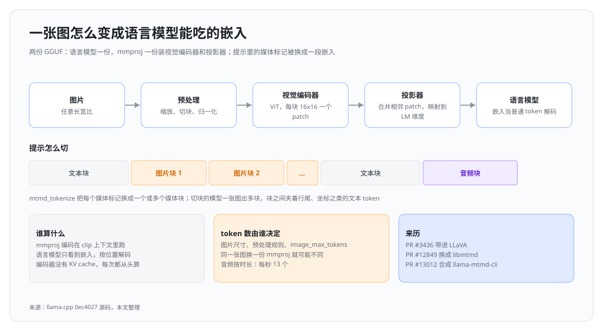
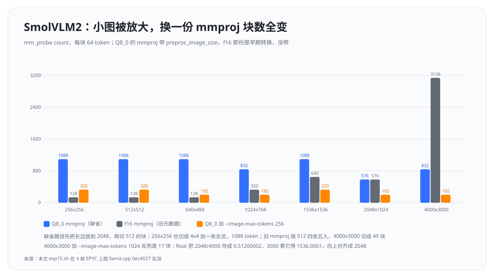
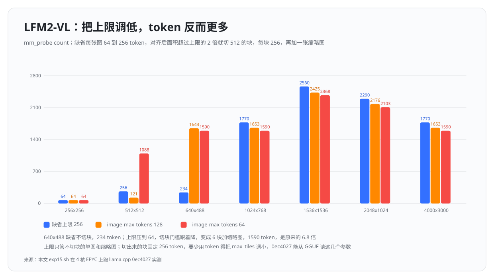
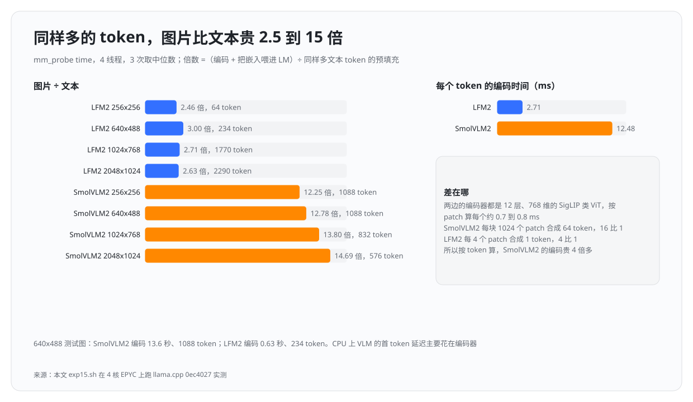
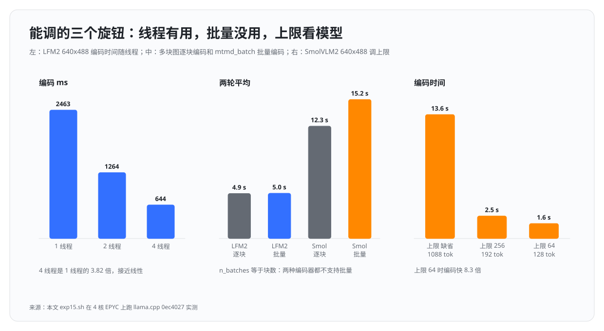
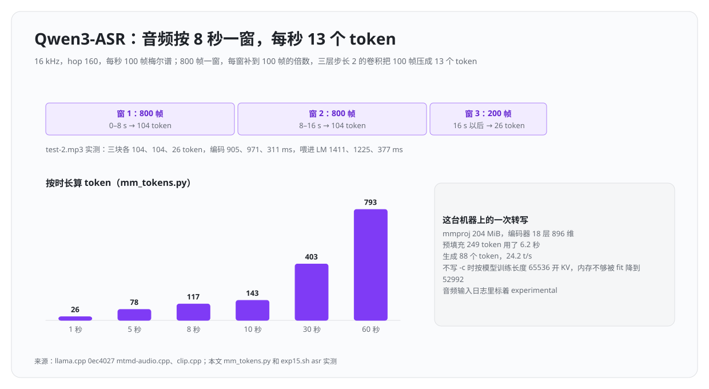
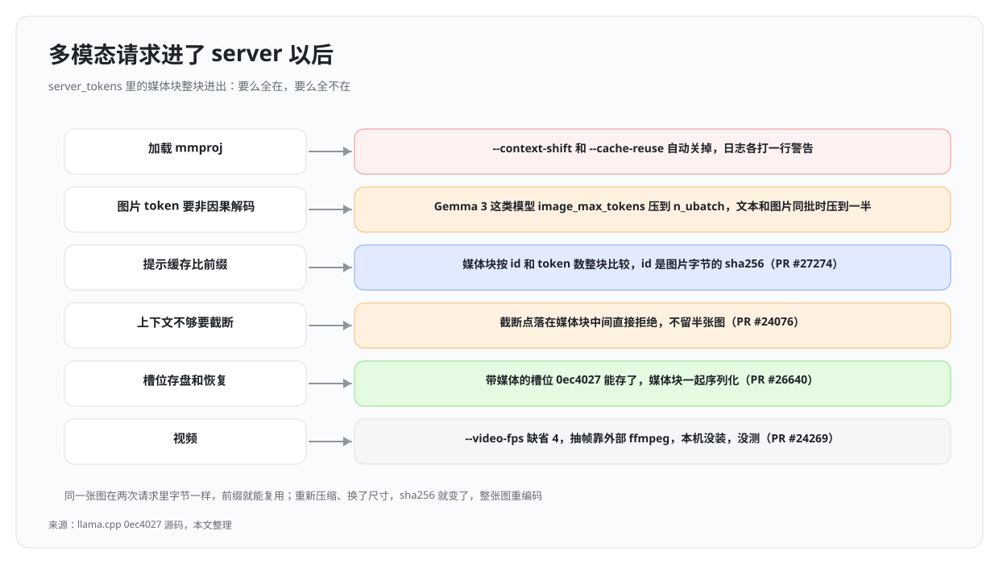
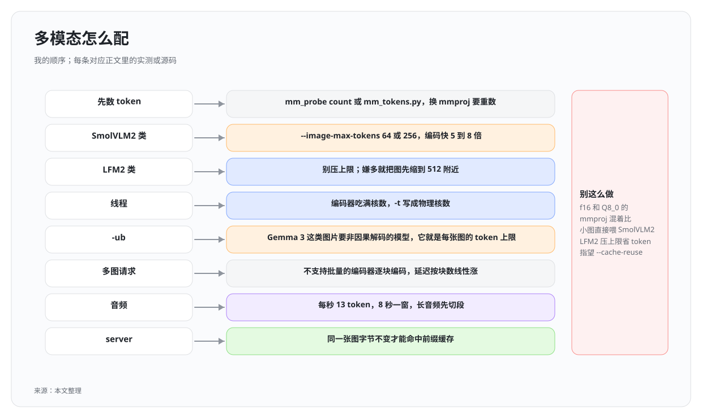

# LCPP-15｜内部｜多模态：mmproj、图片切块和音频

> 🎯 **这篇文档解决什么问题**：给 llama.cpp 加一张图，要多带一个 mmproj 文件，命令换成 llama-mtmd-cli，提示里多一个媒体标记。接下来的问题都和 token 有关。一张图切成几块，变成多少 token？--image-max-tokens 调低一点，有的模型快了 8 倍，有的模型反而多出 6 倍 token。同样 1000 个 token，图片比文本贵多少，钱花在编码器还是语言模型上？换一份 mmproj，token 数为什么变了好几倍？音频按什么规则计费？server 里带图的请求，提示缓存和上下文平移还能不能用？我把这些对到 libmtmd 的源码，在一台没有 GPU 的机器上逐个测出来。主线一句话：一张图贵多少，看它变成多少 token，token 数又取决于 mmproj 里几个 patch 合成一个 token。
>
> 使用方式：只想知道怎么配，看导读和第 11 章；想先算清一张图多少 token，看第 3、4 章；图片请求首 token 太慢，看第 5、6 章；要接语音，看第 7 章；在 server 里上多模态，看第 9 章。文中版本和数字核对于 2026 年 10 月 31 日。
>
> **代码**：[zero-to-llama/15-multimodal](../15-multimodal)。本篇不启动 llama-server，也不启动任何监听端口的程序。mm_probe.cpp 直接调 libmtmd：count 只走预处理和切块，time 真跑编码和解码，再用同样多的文本 token 做预填充对照；mm_tokens.py 按源码复刻三种模型的 token 计数，test_mm.py 的 11 个用例和 count 日志逐条对账。llama-mtmd-cli 用仓库自带的测试图和测试音频跑了看图说话和转写。视频要外部 ffmpeg，本机没装，未实测；server 的多模态行为只读了源码和 PR。基线是主干 0ec4027，模型是 SmolVLM2-256M、LFM2-VL-450M 和 Qwen3-ASR-0.6B，机器是 4 核 EPYC 云主机无 GPU。

# 导读 · 先给结论

- **多模态是两份 GGUF。**语言模型一份，mmproj 一份装编码器和投影器；libmtmd 把提示里的媒体标记换成一段嵌入，语言模型只当它是一串普通位置[[1]](https://github.com/ggml-org/llama.cpp/pull/12849)[[2]](https://github.com/ggml-org/llama.cpp/blob/0ec4027/tools/mtmd/mtmd.cpp)。
- **CPU 上首 token 的时间主要花在编码器。**640x488 的测试图，SmolVLM2 编码 13.6 秒，把嵌入喂进语言模型只要 1.9 秒；同样多的 token，图片比文本贵 12 到 15 倍，LFM2 贵 2.5 到 3 倍[[3]](https://github.com/ggml-org/llama.cpp/blob/0ec4027/tools/mtmd/mtmd-helper.cpp)。
- **贵多少取决于几个 patch 合成一个 token。**两个编码器每个 patch 都花 0.7 到 0.8 ms，SmolVLM2 把 16 个 patch 合成 1 个 token，LFM2 只合 4 个，所以按 token 算 SmolVLM2 的编码贵 4 倍多[[4]](https://arxiv.org/abs/1609.05158)[[5]](https://github.com/ggml-org/llama.cpp/blob/0ec4027/tools/mtmd/clip.cpp)。
- **SmolVLM2 会把小图放大。**缺省先把长边放到 2048 再切 512 的块，256x256 也变成 17 块、1088 token；--image-max-tokens 64 时编码快 8.3 倍，测试图上还少说错一个年份[[6]](https://github.com/ggml-org/llama.cpp/blob/0ec4027/tools/mtmd/mtmd-image.cpp)[[7]](https://github.com/ggml-org/llama.cpp/pull/13050)。
- **LFM2 把上限调低反而更贵。**切块门槛跟着上限降，640x488 从 234 token 变成 1590 token；要省 token 就把图先缩小[[8]](https://github.com/ggml-org/llama.cpp/pull/19454)[[9]](https://github.com/ggml-org/llama.cpp/pull/30840)。
- **换 mmproj 要重数 token。**SmolVLM2 的 f16 mmproj 是早期转换，没带 preproc_image_size，同一张 640x488 只算 128 token，Q8_0 那份算 1088[[5]](https://github.com/ggml-org/llama.cpp/blob/0ec4027/tools/mtmd/clip.cpp)。
- **音频每秒 13 个 token。**Qwen3-ASR 按 8 秒一窗切梅尔谱，每 100 帧出 13 个 token；server 里加载 mmproj 会关掉 --cache-reuse 和 --context-shift[[10]](https://github.com/ggml-org/llama.cpp/blob/0ec4027/tools/mtmd/mtmd-audio.cpp)[[11]](https://github.com/ggml-org/llama.cpp/blob/0ec4027/tools/server/server-context.cpp)。

**📎 与系列其他文档的分工**：GGUF 的元数据怎么读见 [LCPP-04｜内部｜GGUF：文件结构、元数据、加载方式和分卷](./04-gguf.md)，量化类型怎么选见 [LCPP-07｜内部｜量化：块结构、配方、imatrix 和用 KLD 选类型](./07-quantization.md)，KV cache 的账本见 [LCPP-08｜内部｜KV cache 与长上下文：账本、深度、量化、SWA 和上下文写满](./08-kv-context.md)，CPU 线程见 [LCPP-10｜内部｜CPU 调优：线程、绑核、repack、加载方式和带宽上限](./10-cpu-tuning.md)，server 的槽位和提示缓存见 [LCPP-14｜内部｜服务端：槽位、连续批处理和提示缓存](./14-server.md)。这篇只讲图片和音频进来以后多出的部分。

# 第 1 章 · 两份 GGUF 和 libmtmd

## 1.1 一张图怎么变成嵌入

动手加图之前，我先理了一遍这套代码的来历，它解释了现在为什么是两份 GGUF 加一个 libmtmd。llama.cpp 的多模态从 2023 年 10 月的 PR #3436 开始，当时只支持 LLaVA，示例叫 llava-cli，图片编码的代码叫 clip.cpp，一直沿用到现在[[12]](https://github.com/ggml-org/llama.cpp/pull/3436)。之后每加一种视觉模型就多一个命令行，gemma3-cli、minicpmv-cli 各有一套预处理。2025 年 4 月 PR #12849 把这些收进一个库 libmtmd，对外只有分词、编码、取嵌入几个 C 接口[[1]](https://github.com/ggml-org/llama.cpp/pull/12849)；同月 PR #13012 把几个命令行合成 llama-mtmd-cli[[13]](https://github.com/ggml-org/llama.cpp/pull/13012)，PR #12898 让 llama-server 也走 libmtmd[[14]](https://github.com/ggml-org/llama.cpp/pull/12898)。

现在的用法是两份 GGUF：-m 给语言模型，--mmproj 给编码器加投影器。用 -hf 从 Hugging Face 拉模型时，如果仓库里有 mmproj 会一起下载；--no-mmproj-offload 让编码器留在 CPU 上[[15]](https://github.com/ggml-org/llama.cpp/blob/0ec4027/docs/multimodal.md)[[16]](https://github.com/ggml-org/llama.cpp/blob/0ec4027/common/arg.cpp)。我用的三个模型都来自 ggml-org 的预量化仓库，大小如下。

| 文件 | 大小 | 说明 |
|-|-|-|
| SmolVLM2-256M 语言模型 Q8_0 | 166.9 MiB | SmolLM2 架构 |
| SmolVLM2 mmproj Q8_0 | 99.0 MiB | idefics3 投影器，带 preproc_image_size |
| SmolVLM2 mmproj f16 | 181.2 MiB | 早期转换，缺 preproc_image_size |
| LFM2-VL-450M 语言模型 Q8_0 | 361.6 MiB | LFM2 混合架构 |
| LFM2-VL mmproj Q8_0 | 99.1 MiB | lfm2 投影器 |
| Qwen3-ASR-0.6B 语言模型 Q8_0 | 767.5 MiB | 28 层、1024 维 |
| Qwen3-ASR mmproj Q8_0 | 204.5 MiB | 音频编码器 18 层、896 维 |

两个视觉模型的 mmproj 都在 100 MiB 左右，和 166.9 MiB 的 SmolVLM2 语言模型是一个量级。小模型配多模态，编码器的分量不能当零头算。

## 1.2 提示怎么切成块

mtmd_tokenize 拿到一段带媒体标记的提示，缺省标记是 \_\_media\_\_，按标记切开：文本部分照常分词，每个标记换成一个或多个媒体块[[17]](https://github.com/ggml-org/llama.cpp/blob/0ec4027/tools/mtmd/mtmd.h)[[2]](https://github.com/ggml-org/llama.cpp/blob/0ec4027/tools/mtmd/mtmd.cpp)。媒体块记着自己的 n_tokens 和 n_pos，大多数模型两者相等；Qwen2-VL 这类用 M-RoPE 的模型，一张图占的位置数比 token 数少。切块的模型一张图会出多个媒体块，块之间夹着模型训练时用的分隔 token：SmolVLM2 在每块前面写行号和列号，最后一块是总览图；LFM2 用起止标记包住整张图，缩略图前面另有一个标记。

评测一张图花多少 token，要数的是这些媒体块的 n_tokens 之和。分隔 token 是普通文本，数量和块数成正比，我在 count 里单独记了 text_tok，这篇的 token 数只算媒体块。

> 🔑 **本章要点**：mmproj 是第二份 GGUF，装编码器和投影器，小模型上它和语言模型差不多大。libmtmd 把提示切成文本块和媒体块，一张图可能是多个媒体块；数图片 token 就是数媒体块的 n_tokens。

# 第 2 章 · 编码器和投影器

## 2.1 从 ViT 到 SigLIP

视觉编码器的骨架是 ViT：把图片切成 16x16 的 patch，每个 patch 线性映射成一个向量，再过一串标准 Transformer 层；Dosovitskiy 等人在大规模数据上预训练后，它在图像分类上追平了卷积网络[[18]](https://arxiv.org/abs/2010.11929)。CLIP 用 4 亿对图文做对比学习，让图片向量和文字向量落在同一个空间，可以零样本分类[[19]](https://arxiv.org/abs/2103.00020)。

SigLIP 把 CLIP 的 softmax 对比损失换成逐对的 sigmoid 损失，不再需要全局归一化，4 块 TPUv4 训练 2 天就在 ImageNet 零样本上做到 84.5%，作者还发现 batch 到 32k 就够了[[20]](https://arxiv.org/abs/2303.15343)。SmolVLM2 和 LFM2-VL 的编码器都是这一路的 ViT，本机日志里两者都是 12 层、768 维、patch 16[[5]](https://github.com/ggml-org/llama.cpp/blob/0ec4027/tools/mtmd/clip.cpp)。

## 2.2 编码器怎么接到语言模型上

Flamingo 冻结视觉编码器和语言模型，在中间插交叉注意力层，让模型能读图文交错的输入[[21]](https://arxiv.org/abs/2204.14198)。BLIP-2 用一个 Q-Former 把图片压成固定数量的查询向量再喂给冻结的语言模型，零样本 VQAv2 比 Flamingo80B 高 8.7%，可训练参数少 54 倍[[22]](https://arxiv.org/abs/2301.12597)。

LLaVA 把这件事做得更直接：图片向量过一个投影层，变成和词嵌入同维的向量，直接拼进提示，训练数据用 GPT-4 生成的指令对话[[23]](https://arxiv.org/abs/2304.08485)。LLaVA-1.5 把投影层换成两层 MLP，用 336 像素的 CLIP-ViT-L，120 万条数据在 8 块 A100 上约一天训完[[24]](https://arxiv.org/abs/2310.03744)。llama.cpp 支持的模型基本都是 LLaVA 这种拼接式：编码器输出经投影器变成嵌入，按位置插进提示，语言模型不改结构。

## 2.3 几个 patch 合成一个 token

直接把每个 patch 当一个 token，512x512 的图就是 1024 个 token，语言模型吃不消。现在常见的做法是像素重排：把相邻的 n x n 个 patch 向量在通道维拼起来，token 数降到 1/n²，通道数涨 n² 倍，再由投影器压回语言模型的维度。

这个操作来自 Shi 等人做超分辨率的 ESPCN，原文叫 sub-pixel convolution，方向相反，是把通道展开成空间[[4]](https://arxiv.org/abs/1609.05158)。Idefics3 用它把每块图的 token 数压下来[[25]](https://arxiv.org/abs/2408.12637)，SmolVLM 论文把这个比例在小模型上推得更激进，256M 的模型推理只要不到 1 GB 显存，作者报它超过了大 300 倍的 Idefics-80B[[26]](https://arxiv.org/abs/2504.05299)。

在 GGUF 里这个比例叫 n_merge。SmolVLM2 是 4，每 16 个 patch 出 1 个 token，一块 512 的图 1024 个 patch 变成 64 个 token；LFM2 是 2，每 4 个 patch 出 1 个 token。两者编码器的计算量按 patch 数算，语言模型的计算量按 token 数算，第 5 章的成本差就从这里来。

> 🔑 **本章要点**：两个视觉编码器都是 12 层、768 维的 SigLIP 类 ViT，投影器把相邻 patch 拼起来再映射到语言模型维度。n_merge 决定几个 patch 合成一个 token：SmolVLM2 是 16 比 1，LFM2 是 4 比 1。

# 第 3 章 · SmolVLM2：一张图切几块

## 3.1 缺省路径把小图放大

SmolVLM 在 PR #13050 里接进 libmtmd，预处理走 idefics3 这一支[[7]](https://github.com/ggml-org/llama.cpp/pull/13050)。0ec4027 的缺省路径是这样的：mmproj 里有 preproc_image_size 时，先把图片按长宽比缩放到长边 2048，短边取偶数，再按 512 向上取整切成网格，每块 64 token，最后加一张缩到 512 的总览图，也是 64 token[[6]](https://github.com/ggml-org/llama.cpp/blob/0ec4027/tools/mtmd/mtmd-image.cpp)。

256x256、512x512、640x488 和 1536x1536 都被放大到 2048 见方，切成 4x4 加总览，17 块、1088 token。256x256 的图放大 8 倍再切，信息量没有变，token 是 1088。

长宽比越扁，网格越小。2048x1024 切成 4x2，9 块 576 token；1024x768 和 4000x3000 都是 4x3，13 块 832 token。所以缺省下 SmolVLM2 的 token 数只看长宽比，不看分辨率，小图反而吃亏。

## 3.2 旧 mmproj 走另一条路

同一个语言模型配 f16 的 mmproj，640x488 只有 2 块 128 token，4000x3000 却变成 49 块 3136 token。原因在元数据：f16 那份是早期转换的，没写 clip.vision.preproc_image_size，clip.cpp 读不到长边上限，就退回老路径，边长按 512 四舍五入后切块，不先放大[[5]](https://github.com/ggml-org/llama.cpp/blob/0ec4027/tools/mtmd/clip.cpp)。我用 gguf-py 把两份文件的键值列一遍：张量都是 198 个、名字一样，影响预处理的键只差这一个，f16 那份另外多两条 general 描述字段。

这件事的后果比看上去大。SmolVLM2 的 token 计数在 PR #13381 里修过一次，修之前 n_patches 算错，模型直接不出字[[27]](https://github.com/ggml-org/llama.cpp/pull/13381)；Q8_0 那份转换得晚，带上了 preproc_image_size，早期转换的文件则一直留在旧行为上。两个人拿同一个模型、同一张图比速度，一个用 Q8_0 mmproj，一个用 f16 mmproj，token 数差 8.5 倍，比出来的不是同一件事。

## 3.3 加上限以后

写了 --image-max-tokens，SmolVLM2 换一条路径：上限乘每 token 的像素面积（64x64）得到像素预算，按长边 2048 缩放后若超预算就等比缩小，再切 512 的块[[6]](https://github.com/ggml-org/llama.cpp/blob/0ec4027/tools/mtmd/mtmd-image.cpp)[[16]](https://github.com/ggml-org/llama.cpp/blob/0ec4027/common/arg.cpp)。上限 64 时预算正好是一块 512x512，所有尺寸都只剩 1 块加总览，128 token；上限 256 时预算是 1024 见方，切 2 到 4 块，192 到 320 token。

上限 1024 本该和缺省一样，4000x3000 却从 13 块变成 17 块。缩放比在 C++ 里是 float：2048/4000 存成 0.51200002，3000 乘它得 1536.0001，向上对齐到 512 的倍数变成 2048，网格从 4x3 变成 4x4。mm_tokens.py 里用 struct 把每一步截成 float 才复刻出这个结果，test_mm.py 里有一条专门的用例。按像素预算算，1024 token 能装下 2048 见方，4000x3000 缩到 2048x1536 本不该多切，多出来的 4 块完全是舍入误差。

> 💡 **常见误区**：拿 SmolVLM2 评测时先看 mmproj 的元数据有没有 preproc_image_size。有它，小图会被放大到 2048 再切，一张图稳定在 576 到 1088 token；没有它，同一张图可能只有 128 token。两种 mmproj 混着比，速度和效果都不可比。

# 第 4 章 · LFM2-VL：上限调低反而更多

## 4.1 动态分辨率的几条路

固定分辨率的编码器，比如 LLaVA-1.5 的 336 像素，看不清文档里的小字[[24]](https://arxiv.org/abs/2310.03744)。后来的做法分两类。一类是切块：LLaVA-UHD 按图片长宽比切成大小可变的片，各自编码再压缩，用空间标记告诉模型片的位置[[28]](https://arxiv.org/abs/2403.11703)；InternVL 1.5 把图切成 1 到 40 块 448x448，最高到 4K[[29]](https://arxiv.org/abs/2404.16821)。另一类是原生分辨率：NaViT 用序列打包让 ViT 直接吃任意长宽比的图[[30]](https://arxiv.org/abs/2307.06304)，Qwen2-VL 的 Naive Dynamic Resolution 按图片大小决定 token 数，再用 M-RoPE 编码二维位置[[31]](https://arxiv.org/abs/2409.12191)。

LFM2-VL 两样都用。Amini 等人的技术报告里，LFM2 系列 3.5 亿到 83 亿参数，CPU 上预填充和解码最多快 2 倍；VL 版本的卖点是视觉 token 用得省，精度和延迟可以调[[32]](https://arxiv.org/abs/2511.23404)。llama.cpp 里它的单图路径按像素上下限缩放，函数和 Qwen2-VL 处理器一样叫 smart_resize；图大到一定程度就切 512 的块，再加一张缩略图，这条切块路径是 PR #19454 加的[[8]](https://github.com/ggml-org/llama.cpp/pull/19454)。

## 4.2 切块门槛跟着上限走

LFM2 的缺省上下限是 64 和 256 token，每个 token 对应 32x32 像素[[5]](https://github.com/ggml-org/llama.cpp/blob/0ec4027/tools/mtmd/clip.cpp)。不切块时，图片边长按 32 对齐，面积在上下限之间就照原样，超了等比缩小，不够等比放大。640x488 对齐后 640x480，超过 256 token 的面积，缩成 576x416，234 token。256x256 正好 64 token，不放大也不缩小。

是否切块看对齐后的面积是否超过上限面积的 2 倍[[6]](https://github.com/ggml-org/llama.cpp/blob/0ec4027/tools/mtmd/mtmd-image.cpp)。缺省上限 256 时门槛是 512 token 的面积，640x488 不到，1024x768 超了，切成 6 块 512 再加缩略图，1770 token。问题出在这个 2 倍是乘在上限上的：上限压到 64，门槛跟着降到 128 token 的面积，640x488 也开始切块，变成 6 块加一张 54 token 的缩略图，1590 token，是缺省的 6.8 倍。512x512 在上限 64 时 1088 token，缺省只有 256。

上限只管不切块的单图和缩略图，切出来的块固定 256 token。对 1024x768 这种本来就切块的图，上限从 256 降到 64，只是缩略图从 234 变成 54，总数 1770 降到 1590。上限 128 介于两者之间，640x488 已经切块，512x512 刚好不切，121 token。

## 4.3 真要少用 token

不切块时的缩略图本来也会多出一份。PR #27246 去掉了这份重复，理由是和 Hugging Face 的处理器对齐[[33]](https://github.com/ggml-org/llama.cpp/pull/27246)，所以 0ec4027 里 640x488 只有 1 个媒体块。PR #30840 让 min_tiles、max_tiles、tile_size 和面积容差都从 GGUF 读，do_image_splitting 为 false 的模型固定 1 块[[9]](https://github.com/ggml-org/llama.cpp/pull/30840)。命令行没有暴露这几个参数，要改得重写 GGUF 元数据。

在命令行能做的只有一件事：送进去之前把图缩小。640x488 缩到长边 512 以内，LFM2 稳定在 256 token 以下，不会触发切块。上限这个旋钮对 LFM2 来说只适合调高，用来让中等尺寸的图不切块、直接拿到更多 token。

> 🔑 **本章要点**：LFM2 单图 64 到 256 token，超过上限面积 2 倍就切 512 的块，每块 256 token 加一张缩略图。门槛乘在上限上，所以上限压到 64，640x488 从 234 token 变成 1590。要省 token 先缩图，切块参数只能改 GGUF。

# 第 5 章 · 图片 token 有多贵

## 5.1 首 token 的时间花在编码器上

我想知道一张图到底比文本贵多少。一张图从文件到语言模型能接着生成，要过三段：预处理和编码，把嵌入喂进语言模型，然后才是采样。mm_probe time 把前两段分开计时，再拿同样多的文本 token 做一次预填充当对照，每项跑 3 次取中位数[[3]](https://github.com/ggml-org/llama.cpp/blob/0ec4027/tools/mtmd/mtmd-helper.cpp)。图片 ÷ 文本的倍数是（编码 + 喂进语言模型）÷ 文本预填充。

| 模型和尺寸 | 媒体 token | 编码 ms | 喂进 LM ms | 同长文本 ms | 图片 ÷ 文本 |
|-|-|-|-|-|-|
| SmolVLM2 256x256 | 1088 | 12448 | 1728 | 1157 | 12.25 |
| SmolVLM2 640x488 | 1088 | 13582 | 1923 | 1213 | 12.78 |
| SmolVLM2 1024x768 | 832 | 10339 | 1252 | 840 | 13.80 |
| SmolVLM2 2048x1024 | 576 | 7119 | 772 | 537 | 14.69 |
| LFM2 256x256 | 64 | 133 | 125 | 104 | 2.46 |
| LFM2 512x512 | 256 | 716 | 378 | 380 | 2.87 |
| LFM2 640x488 | 234 | 634 | 366 | 334 | 3.00 |
| LFM2 1024x768 | 1770 | 5336 | 3014 | 3083 | 2.71 |
| LFM2 2048x1024 | 2290 | 7273 | 4224 | 4371 | 2.63 |

SmolVLM2 的图片比文本贵 12.2 到 14.7 倍，LFM2 贵 2.5 到 3.0 倍。640x488 上 SmolVLM2 编码 13.6 秒，占三段的 87%；LFM2 编码 634 ms，占 63%。在 CPU 上，多模态请求的首 token 延迟主要由编码器决定，语言模型那一段和同样长的文本差不多。

## 5.2 差在压缩比

两个编码器结构相近，按 patch 算每个的编码时间也相近。SmolVLM2 640x488 是 17 块，每块 1024 个 patch，共 17408 个，13582 ms 折合每个 patch 0.78 ms；LFM2 把图缩到 576x416，36x26 共 936 个 patch，每个 0.68 ms。差别出在输出：SmolVLM2 16 个 patch 出 1 个 token，LFM2 4 个出 1 个。按 token 算，SmolVLM2 每个 token 的编码要 12.5 ms，LFM2 只要 2.7 ms。

压缩比高，语言模型那一段省了，编码器那一段没省。SmolVLM 论文选激进的像素重排，看的是 GPU 显存和语言模型的序列长度[[26]](https://arxiv.org/abs/2504.05299)；在 4 核 CPU 上，编码器的 patch 数才是大头，256x256 被放大成 17 块的代价在这里全部显现：12.4 秒，是 LFM2 同尺寸的 94 倍。

## 5.3 嵌入喂进去也比文本慢

SmolVLM2 640x488 把嵌入喂进语言模型用了 1923 ms，同样 1088 个文本 token 的预填充是 1213 ms，慢 1.58 倍；LFM2 是 1.10 倍。我的解释是批大小：mtmd_helper 按媒体块逐块调 llama_decode，SmolVLM2 每块只有 64 个 token，17 次小批次比一次 1088 的大批次吃亏；LFM2 不切块时只有一块 234 token，差别就小[[3]](https://github.com/ggml-org/llama.cpp/blob/0ec4027/tools/mtmd/mtmd-helper.cpp)。这是从代码路径推出来的，我没有改代码去单独验证。

> 🔑 **本章要点**：同样多的 token，CPU 上 SmolVLM2 的图片比文本贵 12 到 15 倍，LFM2 贵 2.5 到 3 倍。两个编码器每个 patch 都是 0.7 到 0.8 ms，差别在几个 patch 合成一个 token。多模态请求的首 token 延迟主要看编码器。

# 第 6 章 · 线程、批量和上限

## 6.1 线程

编码器跑在 clip 自己的 ggml 图上，线程数跟 -t 走。LFM2 640x488 的编码 1、2、4 线程分别是 2463、1264、644 ms，4 线程是 1 线程的 3.82 倍，接近线性。编码器是一次前向里的大矩阵乘，算力受限，不像语言模型的解码那样卡在带宽上，所以多给核就快。-t 写成物理核数，线程和绑核的规则见 [LCPP-10｜内部｜CPU 调优：线程、绑核、repack、加载方式和带宽上限](./10-cpu-tuning.md)，对编码器同样适用。

## 6.2 批量

libmtmd 有一套批量编码接口：mtmd_batch_add_chunk 往一批里加媒体块，mtmd_batch_encode 一次编完[[2]](https://github.com/ggml-org/llama.cpp/blob/0ec4027/tools/mtmd/mtmd.cpp)。它在 PR #24778 里加进 mtmd-cli，PR 说明主要是为了测试[[34]](https://github.com/ggml-org/llama.cpp/pull/24778)。批能不能放多块，看编码器图有没有声明 support_batch。0ec4027 里只有 gemma4v、internvl、deepseekocr 和 deepseekocr2 四种图声明了，其余缺省为否[[35]](https://github.com/ggml-org/llama.cpp/blob/0ec4027/tools/mtmd/models/models.h)[[5]](https://github.com/ggml-org/llama.cpp/blob/0ec4027/tools/mtmd/clip.cpp)；不支持的编码器，第二块加进来就返回“批太大”，一批只放一块。

mm_probe batch 把同一张图的全部块逐块编码一遍，再交给 mtmd_batch 编码一遍。LFM2 1024x768 是 7 块，两轮逐块 4799 和 5068 ms，批量 4676 和 5242 ms，n_batches 都是 7；SmolVLM2 640x488 是 17 块，n_batches 17，批量那边两轮反而慢了 34% 和 14%。批量路径每批多一次分配和拷贝，在一批只有一块时是纯开销；SmolVLM2 慢得多出来的那部分我没有拆开测。结论是这两个模型上批量编码没有收益，多块图的编码时间随块数线性涨。

## 6.3 上限

SmolVLM2 640x488 缺省 1088 token、编码 13.6 秒。--image-max-tokens 256 时 192 token、2.5 秒。上限 64 时 128 token、1.6 秒，快 8.3 倍。这是三个旋钮里效果最大的一个，代价是图被缩到 512 见方，细节少了，第 8 章看它对回答的影响。LFM2 正好相反，上限 64 时 640x488 的编码从 634 ms 涨到 4142 ms，原因见第 4 章。

上限还有一个隐藏的上界。Gemma 3 这类模型的语言模型要对图片 token 做非因果注意力，一张图必须塞进一个 ubatch，llama-mtmd-cli 会把 image_max_tokens 压到 n_ubatch 并打一行警告[[36]](https://github.com/ggml-org/llama.cpp/blob/0ec4027/tools/mtmd/mtmd-cli.cpp)；server 里语言模型本身不是因果注意力或者没有 KV 时，还要给文本留一半，压到 n_ubatch 的一半[[11]](https://github.com/ggml-org/llama.cpp/blob/0ec4027/tools/server/server-context.cpp)。SmolVLM2 和 LFM2 不在这个范围，但换到 Gemma 3 时，-ub 就是每张图的 token 上限。

> 🔑 **本章要点**：编码器吃线程，4 线程快 3.8 倍；两个模型都不支持批量编码，批量接口一批只放一块，没有收益。SmolVLM2 的 --image-max-tokens 64 让编码快 8.3 倍，LFM2 不要压上限。

# 第 7 章 · 音频：每秒 13 个 token

## 7.1 从 Ultravox 到 Qwen3-ASR

音频编码器的主流来自 Whisper：Radford 等人用 68 万小时的弱标注音频训练编码器加解码器，输入是 16 kHz 的 log-Mel 谱[[37]](https://arxiv.org/abs/2212.04356)。多模态语言模型把 Whisper 式的编码器接到语言模型前面，做法和视觉一样。llama.cpp 的音频输入从 PR #13623 的 Ultravox 开始[[38]](https://github.com/ggml-org/llama.cpp/pull/13623)，现在 libmtmd 里有十几种音频投影器。

我选 Qwen3-ASR-0.6B，技术报告说它覆盖 52 种语言，0.6B 版本在 128 并发下平均首 token 92 ms、每秒处理 2000 秒音频，这是厂商口径的 GPU 数字[[39]](https://arxiv.org/abs/2601.21337)。它的转换脚本在 PR #23081 修过一次，音频塔的张量名改了[[40]](https://github.com/ggml-org/llama.cpp/pull/23081)，早期转出的 GGUF 不一定能用。

## 7.2 窗口和 token 数

预处理按 16 kHz、hop 160 算梅尔谱，每秒 100 帧，有效帧数是采样数除以 160 再加 1[[10]](https://github.com/ggml-org/llama.cpp/blob/0ec4027/tools/mtmd/mtmd-audio.cpp)。Qwen3-ASR 把梅尔谱按 800 帧切窗，每窗补到 100 帧的倍数，三层步长 2 的卷积把 100 帧压成 13 个 token[[5]](https://github.com/ggml-org/llama.cpp/blob/0ec4027/tools/mtmd/clip.cpp)。所以每 8 秒是 104 个 token，平均每秒 13 个。

多出来的那 1 帧会让整秒的音频多算一格：1 秒是 101 帧，补到 200，26 个 token；8 秒是 801 帧，第二窗只有 1 帧也补到 100，117 个 token。10、30、60 秒分别是 143、403、793 个 token，8 个窗。mm_tokens.py 按这个规则算，和下面 llama-mtmd-cli 的日志一致。

## 7.3 一次转写

仓库自带的 test-2.mp3 是一段英文旁白，切成 3 个音频块，各 104、104、26 token，按窗口算总长在 16 到 18 秒之间。编码分别用了 905、971、311 ms，喂进语言模型 1411、1225、377 ms；整段提示 249 token 的预填充 6.2 秒，生成 88 个 token，24.2 t/s。转写内容全对，开头多一段语言标签，日志里音频输入标着 experimental。

加载用了 11.5 秒，比两个视觉模型慢得多，原因在上下文。我没写 -c，llama-mtmd-cli 按模型训练长度 65536 开 KV，fit 算出要 8300 MiB，本机总内存 7965 MiB，于是把上下文降到 52992。转写一段音频用不了这么长，写 -c 4096 就能省下大部分 KV，KV 的账本见 [LCPP-08｜内部｜KV cache 与长上下文：账本、深度、量化、SWA 和上下文写满](./08-kv-context.md)。

> 🔑 **本章要点**：Qwen3-ASR 每 8 秒一窗、104 token，平均每秒 13 个，整秒处会多算一格。test-2.mp3 转写全对，预填充 6.2 秒。不写 -c 会按 65536 开 KV，内存紧时被 fit 自动降，日志里有提示。

# 第 8 章 · 用 llama-mtmd-cli 实测

## 8.1 两个模型看同一张图

test-1.jpeg 是仓库自带的测试图，640x488，1969 年 7 月 21 日《纽约时报》的头版，大标题是 MEN WALK ON MOON。提示词让模型用一句话描述，贪心解码，最多 64 个 token。缺省设置下两个模型都认出了报纸和登月，都把日期说错了。

| 设置 | 块数（含文本块） | 预填充 | 回答 |
|-|-|-|-|
| SmolVLM2 缺省 | 35 块，1088 token | 13.7 秒 / 1143 token | A newspaper article is dated July 21, 1956, and it is about men walking on the moon. |
| SmolVLM2 上限 256 | 7 块 | 2.2 秒 / 216 token | The image shows a newspaper with a headline that says "MEN WALK ON MOON" and a picture of a person. |
| SmolVLM2 上限 64 | 5 块 | 1.6 秒 / 150 token | The image shows a newspaper with a headline that reads "MEN WALK ON MOON," and it is dated "The New York Times." |
| LFM2 缺省 | 3 块，234 token | 1.0 秒 / 253 token | A copy of the New York Times newspaper dated Monday, July 2, 1969. |
| LFM2 上限 64 | 15 块 | 6.6 秒 / 1616 token | The front page of the New York Times newspaper dated Monday, July 21, 1896. |

表里的块数是 llama-mtmd-cli 日志里的 total，图块之间夹着文本块，所以比第 3 章的媒体块多。SmolVLM2 缺省时 17 个图块逐块编码，每块 686 到 752 ms，共 11.9 秒，占了预填充的大半。日期说成 1956 年，标题没有提。LFM2 只编码一块，606 ms，整段预填充不到 1 秒，日期说成 7 月 2 日，年份对了。

## 8.2 调上限以后

SmolVLM2 加 --image-max-tokens 64，预填充从 13.7 秒降到 1.6 秒，回答反而念出了标题，日期那半句是把报名当成了日期，没有编出错的年份。上限 256 也念出了标题。这和直觉相反：图被缩到 512 见方，细节更少，回答却更准。一种可能是 256M 的语言模型读 1088 个图片 token 时注意力被摊薄，少一些反而抓得住大标题；但这只是一张图、一次贪心解码，不能当结论用，只能说明缩小上限没有让这张图的回答变差。

LFM2 加上限 64，640x488 切成 6 块加缩略图，日志里 total 是 15，预填充从 1.0 秒涨到 6.6 秒，涨了 6.8 倍。回答把日子说对了，年份错成 1896。多花的 token 换来了一处对、一处错，和第 4 章的结论一致：LFM2 压上限省不了 token。

## 8.3 单元测试

改 libmtmd 的预处理之前，先跑 test-mtmd-impl。它测长边缩放、动态尺寸、LFM2 的切块和缩放、视频帧的时间合并，不加载模型[[41]](https://github.com/ggml-org/llama.cpp/blob/0ec4027/tests/test-mtmd-impl.cpp)。本机 6 个用例、66 条断言，失败 0；test-mtmd-c-api 的媒体块存取往返也通过。我自己的 test_mm.py 有 11 个用例，把 mm_tokens.py 的计数和 mm_probe count 的日志逐条对账，改了源码里的切块规则，这里会先报错。

> 🔑 **本章要点**：测试图上缺省设置的两个模型都说错了日期。SmolVLM2 压到上限 64 后预填充快 8.7 倍，回答还念出了标题；LFM2 压上限后预填充慢 6.8 倍。单张图的结论只能当线索，评测要换自己的数据集。

# 第 9 章 · server 里的多模态

## 9.1 两个开关被关掉

llama-server 加载 mmproj 以后，会检查 --context-shift 和 --cache-reuse，开着就关掉，各打一行“不支持多模态”的警告[[11]](https://github.com/ggml-org/llama.cpp/blob/0ec4027/tools/server/server-context.cpp)。原因在媒体块：上下文平移要从中间丢一段 token 再把后面的位置往前挪，cache-reuse 要把分叉点之后的片段按位置平移复用，两件事都假设每个位置是一个可以单独移动的文本 token。一张图是一整块嵌入，挪掉半张图没有意义，M-RoPE 这类模型的位置数和 token 数还不相等。所以 [LCPP-14｜内部｜服务端：槽位、连续批处理和提示缓存](./14-server.md) 讲的两种复用，到了多模态请求里只剩前缀缓存一种。

## 9.2 前缀缓存按整块比

server 把提示存成 server_tokens：文本是普通 token，媒体块占一段位置。求两次请求的公共前缀时，文本逐个比，碰到媒体块就整块比：两边的块 id 相同、n_tokens 相同才算匹配，匹配后一次跳过整块[[42]](https://github.com/ggml-org/llama.cpp/blob/0ec4027/tools/server/server-common.cpp)。块 id 是图片字节的哈希，PR #27274 把它换成 sha256，理由是弱哈希可能撞出两张不同的图却命中同一份缓存[[43]](https://github.com/ggml-org/llama.cpp/pull/27274)[[3]](https://github.com/ggml-org/llama.cpp/blob/0ec4027/tools/mtmd/mtmd-helper.cpp)。

后果很直接：同一张图在两次请求里字节一样，前缀就能复用，编码器也不用再跑；客户端每次重新压缩 JPEG、换了尺寸，哪怕肉眼一样，sha256 就变了，整张图重新编码。以第 5 章的数字，SmolVLM2 每次多付 13.6 秒，LFM2 多付 634 ms。

## 9.3 截断、存盘和视频

提示超过上下文要截断时，如果截断点落在媒体块中间，PR #24076 之后 server 直接拒绝这个请求，不留半张图[[44]](https://github.com/ggml-org/llama.cpp/pull/24076)。带媒体的槽位以前不能存盘，接口返回未实现；PR #26640 让媒体块跟着槽位一起序列化，0ec4027 里用 mtmd_input_chunk_save 写出[[45]](https://github.com/ggml-org/llama.cpp/pull/26640)[[42]](https://github.com/ggml-org/llama.cpp/blob/0ec4027/tools/server/server-common.cpp)。视频在 PR #24269 加进来，按 --video-fps 抽帧，缺省每秒 4 帧，抽帧靠外部 ffmpeg[[46]](https://github.com/ggml-org/llama.cpp/pull/24269)[[16]](https://github.com/ggml-org/llama.cpp/blob/0ec4027/common/arg.cpp)。本机没装 ffmpeg，视频没测；这一章的 server 行为我也只读了源码和 PR，没有起 server。

把这几条放在一起看，server 里的多模态请求最怕两件事：上下文开小了，一张大图把文本挤出去被拒；图片字节每次都变，前缀缓存形同虚设。前者按第 3、4 章的规则先算 token 再定 -c，后者在客户端固定图片的编码参数。

# 第 10 章 · 少用图片 token 的研究

## 10.1 在语言模型里丢 token

第 5 章的结论是 CPU 上贵在编码器，GPU 上贵的多半是语言模型那一段，研究也主要盯着后者。FastV 发现 LLaVA-1.5 这类模型在深层对图片 token 的注意力很低，第 2 层以后按注意力分数剪掉一半图片 token，作者报 LLaVA-1.5-13B 的 FLOPs 降 45%，性能不受影响[[47]](https://arxiv.org/abs/2403.06764)。

SparseVLM 用和问题相关的文本 token 给图片 token 打分，逐层自适应定剪枝比例，剪掉的再压成少量 token 回收，作者报 LLaVA 的 FLOPs 降 54%、CUDA 延迟降 37%，精度保留 97%[[48]](https://arxiv.org/abs/2410.04417)。PyramidDrop 认为浅层需要全部图片 token，冗余随层数加深，于是分几段、每段末尾按比例丢一部分，LLaVA-NeXT 推理 FLOPs 降 55%[[49]](https://arxiv.org/abs/2410.17247)。三篇都不用重新训练。

## 10.2 在编码器里合 token

ToMe 在 ViT 的每层把相似的 token 两两合并，不用训练就让 ViT-L 在 512 分辨率上吞吐翻倍，精度只掉 0.2% 到 0.3%[[50]](https://arxiv.org/abs/2210.09461)。它省的正是 CPU 上最贵的那一段。像素重排是固定的 n x n 合并，ToMe 是按内容合并，两者可以叠加。

这四种方法 0ec4027 里都没有实现，clip.cpp 只在一处注释里提到 token merging[[5]](https://github.com/ggml-org/llama.cpp/blob/0ec4027/tools/mtmd/clip.cpp)。我的推测是：剪枝要在语言模型中间改序列长度，和 llama.cpp 的 KV 布局、批处理、M-RoPE 位置都冲突；ToMe 要在每层插匹配和合并，ggml 图里没有现成的算子。眼下能用的省 token 手段，仍然只有第 3、4 章讲的上限和先缩图。

# 第 11 章 · 怎么配与上线清单

## 11.1 按场景配

| 场景 | 怎么配 | 依据 |
|-|-|-|
| 先估 token | mm_tokens.py 或 mm_probe count，换 mmproj 重数 | 第 3 章：f16 和 Q8_0 两份 mmproj 差 8.5 倍 |
| SmolVLM2 类、CPU 上要快 | --image-max-tokens 64 或 256 | 第 6 章：上限 64 编码快 8.3 倍 |
| LFM2 类、要少用 token | 不压上限，送进去之前缩到 512 以内 | 第 4 章：上限 64 时 640x488 从 234 涨到 1590 token |
| 编码慢 | -t 写成物理核数 | 第 6 章：4 线程快 3.8 倍 |
| 一次请求多张图 | 按块数估延迟，别指望批量 | 第 6 章：两个编码器都不支持批量 |
| Gemma 3 这类非因果模型 | -ub 不小于每张图的 token 数 | 第 6 章：上限被压到 n_ubatch |
| 语音转写 | 写 -c，长音频先切段 | 第 7 章：每秒 13 token，不写 -c 按 65536 开 KV |
| server 上多模态 | 固定图片编码参数，-c 按图片 token 留够 | 第 9 章：sha256 不同就整张重编码 |

表里的数字来自一台 4 核 CPU 和两个不到 0.5B 的视觉模型。GPU 上编码器快得多，图片和文本的倍数会缩小，线程那一行也不再适用；token 怎么数、上限往哪个方向调、缓存怎么命中，这几条和硬件无关，可以直接用。

## 11.2 上线清单

> 📌 **上线前核对清单**：换模型、换 mmproj 或者升级版本，我按这个顺序过一遍。
> - 确认 mmproj 的元数据，SmolVLM2 类看有没有 preproc_image_size
> - 用目标尺寸的图跑 mm_probe count，记下每张图的媒体 token
> - 按图片 token 加文本长度定 -c，留出截断余量
> - 在目标机器上跑 mm_probe time，看编码占首 token 的比例
> - 调 --image-max-tokens 前后各问一遍同样的图，回答不变差再上线
> - 跑 test-mtmd-impl 和 test-mtmd-c-api，失败为 0
> - server 前面的客户端固定图片编码参数，同一张图字节不变
> - 日志里确认 cache-reuse 和 context-shift 被关的警告，监控里别再算它们的命中

## 11.3 下一步

多模态在单进程里的规则到这里讲完了。router 挂多个模型、部署和运维放在 LCPP-16；各篇的参数汇成一份调参手册放在 LCPP-17；想给 libmtmd 加一种新的投影器，LCPP-18 讲加模型的流程。槽位和提示缓存回到 [LCPP-14｜内部｜服务端：槽位、连续批处理和提示缓存](./14-server.md)，KV 的账本回到 [LCPP-08｜内部｜KV cache 与长上下文：账本、深度、量化、SWA 和上下文写满](./08-kv-context.md)，CPU 线程回到 [LCPP-10｜内部｜CPU 调优：线程、绑核、repack、加载方式和带宽上限](./10-cpu-tuning.md)。

# 参考文献

按正文首次引用顺序编号，资料截至 2026 年 10 月初。

[1] ngxson. llava : introduce libmtmd. llama.cpp PR #12849, 2025. [PR #12849](https://github.com/ggml-org/llama.cpp/pull/12849)

[2] llama.cpp 0ec4027. tools/mtmd/mtmd.cpp：mtmd_tokenize 把媒体标记换成媒体块，mtmd_batch 在不支持批量的编码器上一批只放一块。 [mtmd.cpp](https://github.com/ggml-org/llama.cpp/blob/0ec4027/tools/mtmd/mtmd.cpp)

[3] llama.cpp 0ec4027. tools/mtmd/mtmd-helper.cpp：从文件和内存建位图时用 sha256 当 id，eval_chunks 逐块编码再解码。 [mtmd-helper.cpp](https://github.com/ggml-org/llama.cpp/blob/0ec4027/tools/mtmd/mtmd-helper.cpp)

[4] Shi W, et al. Real-Time Single Image and Video Super-Resolution Using an Efficient Sub-Pixel Convolutional Neural Network. CVPR 2016. [arXiv:1609.05158](https://arxiv.org/abs/1609.05158)

[5] llama.cpp 0ec4027. tools/mtmd/clip.cpp：load_hparams 里各投影器的参数和缺省值，clip_n_output_tokens，support_batch。 [clip.cpp](https://github.com/ggml-org/llama.cpp/blob/0ec4027/tools/mtmd/clip.cpp)

[6] llama.cpp 0ec4027. tools/mtmd/mtmd-image.cpp：calc_size_preserved_ratio、IDEFICS3 和 LFM2 的缩放与切块。 [mtmd-image.cpp](https://github.com/ggml-org/llama.cpp/blob/0ec4027/tools/mtmd/mtmd-image.cpp)

[7] ngxson. mtmd : support SmolVLM (version 1 and 2). llama.cpp PR #13050, 2025. [PR #13050](https://github.com/ggml-org/llama.cpp/pull/13050)

[8] tdakhran. mtmd : Implement tiling for LFM2.5-VL models. llama.cpp PR #19454, 2026. [PR #19454](https://github.com/ggml-org/llama.cpp/pull/19454)

[9] tdakhran. mtmd : read LFM2 tiling params from GGUF metadata. llama.cpp PR #30840, 2026. [PR #30840](https://github.com/ggml-org/llama.cpp/pull/30840)

[10] llama.cpp 0ec4027. tools/mtmd/mtmd-audio.cpp：Qwen3-ASR 的梅尔谱按 800 帧一窗，每窗补到 100 帧的倍数。 [mtmd-audio.cpp](https://github.com/ggml-org/llama.cpp/blob/0ec4027/tools/mtmd/mtmd-audio.cpp)

[11] llama.cpp 0ec4027. tools/server/server-context.cpp：加载 mmproj 后关闭 ctx_shift 和 cache_reuse。 [server-context.cpp](https://github.com/ggml-org/llama.cpp/blob/0ec4027/tools/server/server-context.cpp)

[12] monatis. Implement multimodal models (LLaVA). llama.cpp PR #3436, 2023. [PR #3436](https://github.com/ggml-org/llama.cpp/pull/3436)

[13] ngxson. mtmd : merge llava, gemma3 and minicpmv CLI into single llama-mtmd-cli. llama.cpp PR #13012, 2025. [PR #13012](https://github.com/ggml-org/llama.cpp/pull/13012)

[14] ngxson. server : vision support via libmtmd. llama.cpp PR #12898, 2025. [PR #12898](https://github.com/ggml-org/llama.cpp/pull/12898)

[15] llama.cpp 0ec4027. docs/multimodal.md：两份 GGUF 的用法、-hf 自动下载 mmproj、预量化模型列表。 [multimodal.md](https://github.com/ggml-org/llama.cpp/blob/0ec4027/docs/multimodal.md)

[16] llama.cpp 0ec4027. common/arg.cpp：--mmproj、--no-mmproj-offload、--image-min-tokens、--image-max-tokens、--video-fps 的说明和默认值。 [arg.cpp](https://github.com/ggml-org/llama.cpp/blob/0ec4027/common/arg.cpp)

[17] llama.cpp 0ec4027. tools/mtmd/mtmd.h：媒体占位标记 \_\_media\_\_、chunk 的 n_tokens 和 n_pos、image_min_tokens 和 image_max_tokens。 [mtmd.h](https://github.com/ggml-org/llama.cpp/blob/0ec4027/tools/mtmd/mtmd.h)

[18] Dosovitskiy A, et al. An Image is Worth 16x16 Words: Transformers for Image Recognition at Scale. ICLR 2021. [arXiv:2010.11929](https://arxiv.org/abs/2010.11929)

[19] Radford A, et al. Learning Transferable Visual Models From Natural Language Supervision. ICML 2021. [arXiv:2103.00020](https://arxiv.org/abs/2103.00020)

[20] Zhai X, et al. Sigmoid Loss for Language Image Pre-Training. ICCV 2023. [arXiv:2303.15343](https://arxiv.org/abs/2303.15343)

[21] Alayrac J-B, et al. Flamingo: a Visual Language Model for Few-Shot Learning. NeurIPS 2022. [arXiv:2204.14198](https://arxiv.org/abs/2204.14198)

[22] Li J, et al. BLIP-2: Bootstrapping Language-Image Pre-training with Frozen Image Encoders and Large Language Models. ICML 2023. [arXiv:2301.12597](https://arxiv.org/abs/2301.12597)

[23] Liu H, et al. Visual Instruction Tuning. NeurIPS 2023. [arXiv:2304.08485](https://arxiv.org/abs/2304.08485)

[24] Liu H, et al. Improved Baselines with Visual Instruction Tuning. CVPR 2024. [arXiv:2310.03744](https://arxiv.org/abs/2310.03744)

[25] Laurençon H, et al. Building and better understanding vision-language models: insights and future directions. 2024. [arXiv:2408.12637](https://arxiv.org/abs/2408.12637)

[26] Marafioti A, et al. SmolVLM: Redefining small and efficient multimodal models. 2025. [arXiv:2504.05299](https://arxiv.org/abs/2504.05299)

[27] awkrail. mtmd: Fix the calculation of n_tokens for smolvlm. llama.cpp PR #13381, 2025. [PR #13381](https://github.com/ggml-org/llama.cpp/pull/13381)

[28] Xu R, et al. LLaVA-UHD: an LMM Perceiving Any Aspect Ratio and High-Resolution Images. ECCV 2024. [arXiv:2403.11703](https://arxiv.org/abs/2403.11703)

[29] Chen Z, et al. How Far Are We to GPT-4V? Closing the Gap to Commercial Multimodal Models with Open-Source Suites. 2024. [arXiv:2404.16821](https://arxiv.org/abs/2404.16821)

[30] Dehghani M, et al. Patch n' Pack: NaViT, a Vision Transformer for any Aspect Ratio and Resolution. NeurIPS 2023. [arXiv:2307.06304](https://arxiv.org/abs/2307.06304)

[31] Wang P, et al. Qwen2-VL: Enhancing Vision-Language Model's Perception of the World at Any Resolution. 2024. [arXiv:2409.12191](https://arxiv.org/abs/2409.12191)

[32] Amini A, et al. LFM2 Technical Report. 2025. [arXiv:2511.23404](https://arxiv.org/abs/2511.23404)

[33] tdakhran. mtmd : skip thumbnail for non-tiled LFM2 images. llama.cpp PR #27246, 2026. [PR #27246](https://github.com/ggml-org/llama.cpp/pull/27246)

[34] ngxson. mtmd: add batching for mtmd-cli, add video tests. llama.cpp PR #24778, 2026. [PR #24778](https://github.com/ggml-org/llama.cpp/pull/24778)

[35] llama.cpp 0ec4027. tools/mtmd/models/models.h：只有 gemma4v、internvl、deepseekocr、deepseekocr2 的图声明 support_batch。 [models.h](https://github.com/ggml-org/llama.cpp/blob/0ec4027/tools/mtmd/models/models.h)

[36] llama.cpp 0ec4027. tools/mtmd/mtmd-cli.cpp：非因果注意力的模型把 image_max_tokens 压到 n_ubatch。 [mtmd-cli.cpp](https://github.com/ggml-org/llama.cpp/blob/0ec4027/tools/mtmd/mtmd-cli.cpp)

[37] Radford A, et al. Robust Speech Recognition via Large-Scale Weak Supervision. ICML 2023. [arXiv:2212.04356](https://arxiv.org/abs/2212.04356)

[38] ngxson. mtmd : add ultravox audio input. llama.cpp PR #13623, 2025. [PR #13623](https://github.com/ggml-org/llama.cpp/pull/13623)

[39] Shi X, et al. Qwen3-ASR Technical Report. 2026. [arXiv:2601.21337](https://arxiv.org/abs/2601.21337)

[40] CISC. convert : fix Qwen3 ASR conversion. llama.cpp PR #23081, 2026. [PR #23081](https://github.com/ggml-org/llama.cpp/pull/23081)

[41] llama.cpp 0ec4027. tests/test-mtmd-impl.cpp：libmtmd 内部实现的单元测试。 [test-mtmd-impl.cpp](https://github.com/ggml-org/llama.cpp/blob/0ec4027/tests/test-mtmd-impl.cpp)

[42] llama.cpp 0ec4027. tools/server/server-common.cpp：server_tokens 求公共前缀时，媒体块按 id 和 token 数整块比较。 [server-common.cpp](https://github.com/ggml-org/llama.cpp/blob/0ec4027/tools/server/server-common.cpp)

[43] ngxson. mtmd: use sha256 for input hashing. llama.cpp PR #27274, 2026. [PR #27274](https://github.com/ggml-org/llama.cpp/pull/27274)

[44] he-yufeng. server: reject partial media truncation. llama.cpp PR #24076, 2026. [PR #24076](https://github.com/ggml-org/llama.cpp/pull/24076)

[45] CHIPMUNK-T0T. server : support slot save/restore with media inputs. llama.cpp PR #26640, 2026. [PR #26640](https://github.com/ggml-org/llama.cpp/pull/26640)

[46] ngxson. mtmd : add video input support. llama.cpp PR #24269, 2026. [PR #24269](https://github.com/ggml-org/llama.cpp/pull/24269)

[47] Chen L, et al. An Image is Worth 1/2 Tokens After Layer 2: Plug-and-Play Inference Acceleration for Large Vision-Language Models. ECCV 2024. [arXiv:2403.06764](https://arxiv.org/abs/2403.06764)

[48] Zhang Y, et al. SparseVLM: Visual Token Sparsification for Efficient Vision-Language Model Inference. ICML 2025. [arXiv:2410.04417](https://arxiv.org/abs/2410.04417)

[49] Xing L, et al. PyramidDrop: Accelerating Your Large Vision-Language Models via Pyramid Visual Redundancy Reduction. CVPR 2025. [arXiv:2410.17247](https://arxiv.org/abs/2410.17247)

[50] Bolya D, et al. Token Merging: Your ViT But Faster. ICLR 2023. [arXiv:2210.09461](https://arxiv.org/abs/2210.09461)

---

[在 Colab 里跑本章 CPU 练习](https://colab.research.google.com/github/zyaochen/zero-to-llama/blob/main/colab/15-multimodal.ipynb) · 上一章：[LCPP-14｜内部｜服务端：槽位、连续批处理和提示缓存](./14-server.md) · [目录](./README.md) · 下一章：[LCPP-16｜内部｜路由与运维：多模型、预设、内存余量和监控](./16-router-ops.md)
