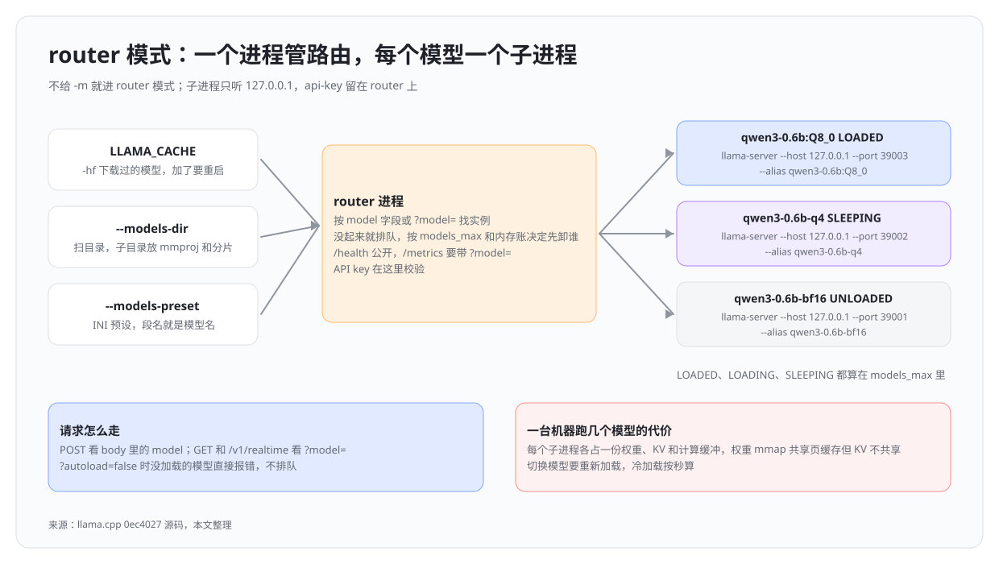
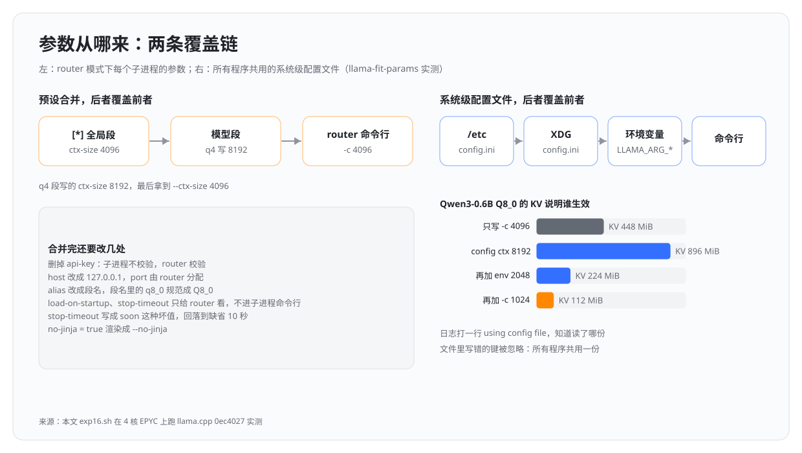
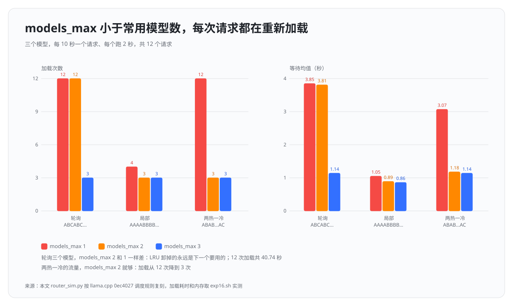
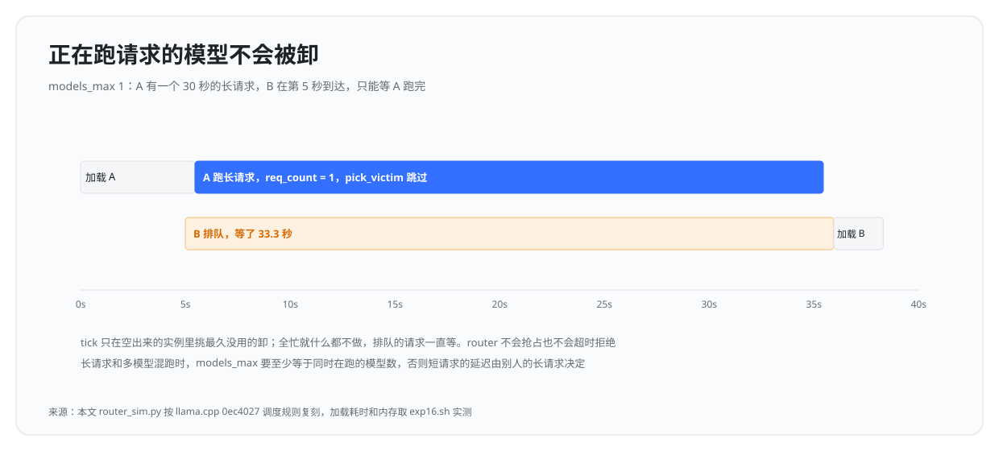
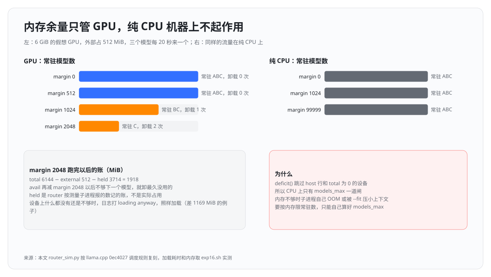
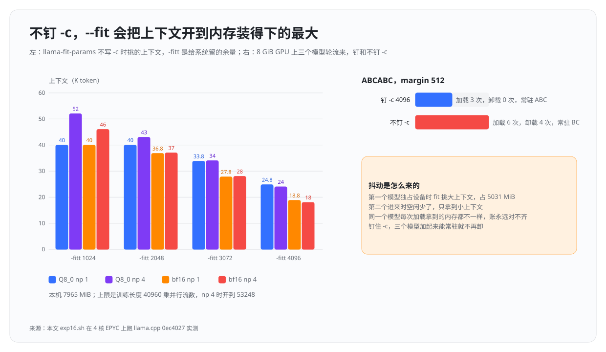
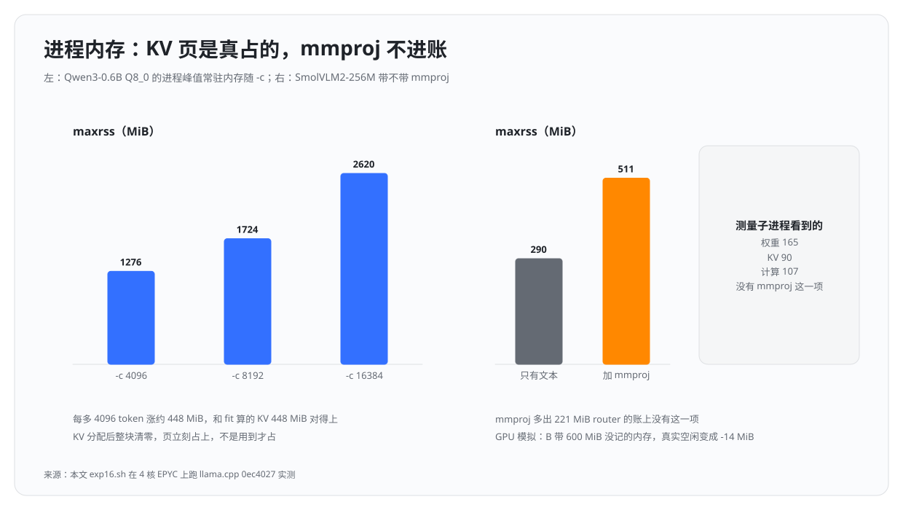
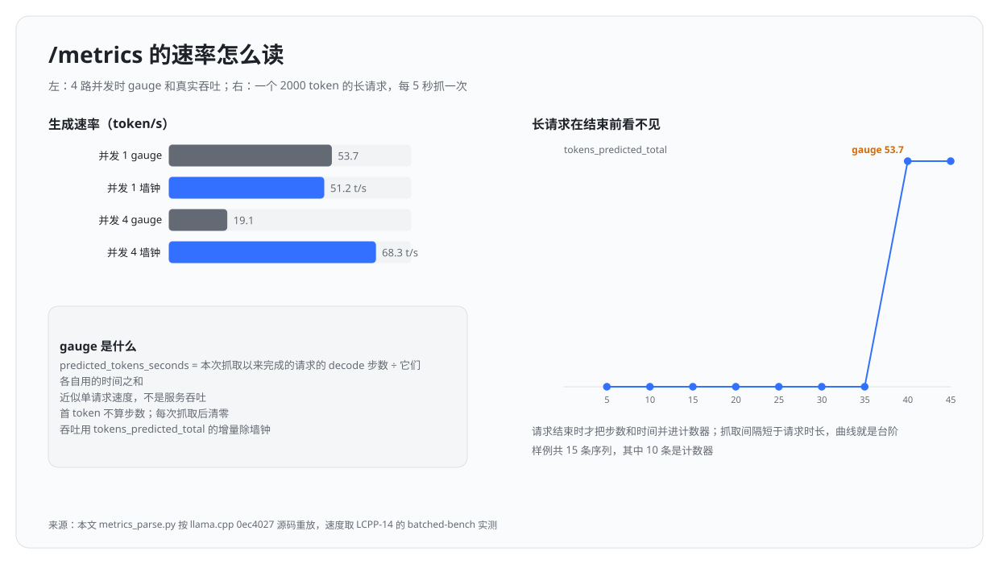
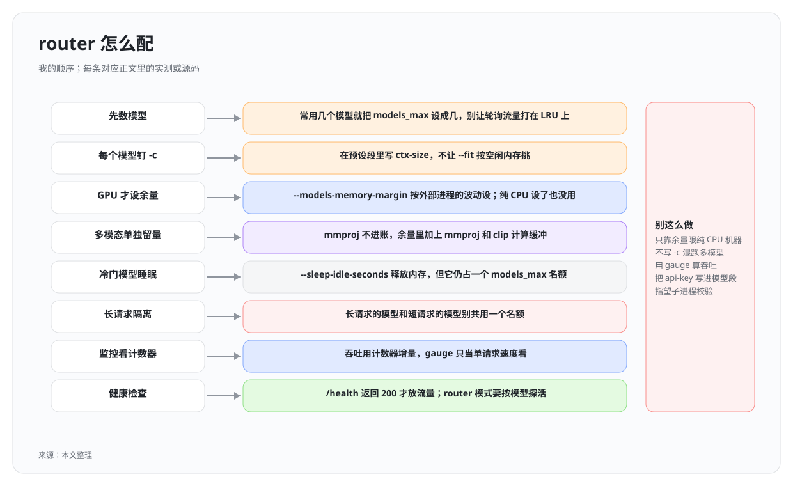

# LCPP-16｜内部｜路由与运维：多模型、预设、内存余量和监控

> 🎯 **这篇文档解决什么问题**：一台机器要同时挂几个模型，llama-server 不给 -m 就进 router 模式，每个模型一个子进程。接下来的问题都和“谁占着内存”有关。--models-max 设成几？轮询三个模型时，为什么每个请求都在重新加载？正在跑长请求的模型会不会被卸，排在后面的请求要等多久？--models-memory-margin 在纯 CPU 机器上管不管用？预设 INI、[\*] 全局段、router 命令行、系统级 config.ini 和环境变量，谁盖谁？不钉 -c 时，--fit 会把上下文开到多大？mmproj 为什么不进内存账？/metrics 上的速率为什么并发一高就掉一半？我把这些对到 router 的调度源码，用实测的加载耗时和内存喂给一个复刻的调度器逐个算出来。主线一句话：router 按 models_max 的名额卸载模型，睡眠的模型也占名额，内存余量只在 GPU 上生效，所以先定名额，再给每个模型钉 -c。
>
> 使用方式：只想知道怎么配，看导读和第 10 章；常用模型比 models_max 多，看第 3 章；GPU 上想按显存自动卸载，看第 4、5 章；多模态和睡眠，看第 6、7 章；接监控，看第 8 章；上容器，看第 9 章。文中版本和数字核对于 2026 年 10 月 31 日。
>
> **代码**：[zero-to-llama/16-router-ops](../16-router-ops)。本篇不启动 llama-server（包括 router 模式），也不启动任何监听端口的程序。内存三项用 llama-fit-params 算，它和 router 的测量子进程走同一套 --fit 代码；加载耗时和进程峰值内存用 llama-completion、llama-mtmd-cli 加载一次就退出来量；预设合并、LRU 卸载和 /metrics 口径按 0ec4027 源码复刻成三个 Python 程序，test_router.py 的用例逐条对过源码分支。本机 4 核 CPU、没有 GPU，GPU 场景里的设备是假设的，只用来走通余量逻辑。基线是主干 0ec4027，模型是 Qwen3-0.6B 的 Q4_0、Q8_0、bf16 和 SmolVLM2-256M，机器是 4 核 EPYC 云主机无 GPU。

# 导读 · 先给结论

- **models_max 要不小于常用模型数。**三个模型轮询，models_max 2 和 1 一样，12 个请求加载 12 次，共 40.74 秒；设成 3 只加载 3 次[[1]](https://github.com/ggml-org/llama.cpp/blob/0ec4027/tools/server/server-models-sched.cpp)。
- **忙的模型不会被卸。**pick_victim 跳过还有请求在跑的实例，models_max 1 时 B 排在 A 的 30 秒长请求后面，等了 33.3 秒；router 不抢占，也不超时拒绝[[1]](https://github.com/ggml-org/llama.cpp/blob/0ec4027/tools/server/server-models-sched.cpp)[[2]](https://github.com/ggml-org/llama.cpp/blob/0ec4027/tools/server/server-models.h)。
- **睡眠的模型也占名额。**LOADED、LOADING、SLEEPING 都算在 models_max 里，--sleep-idle-seconds 只释放内存，不腾名额[[2]](https://github.com/ggml-org/llama.cpp/blob/0ec4027/tools/server/server-models.h)[[3]](https://github.com/ggml-org/llama.cpp/pull/18228)。
- **内存余量只管 GPU。**设备内存账跳过主机内存和总量为 0 的设备，纯 CPU 机器上 margin 设成多少都没用，只剩 models_max 一道闸[[4]](https://github.com/ggml-org/llama.cpp/pull/21231)[[5]](https://github.com/ggml-org/llama.cpp/blob/0ec4027/tools/server/README.md)。
- **每个模型都钉 -c。**不钉时 --fit 按当时的空闲内存挑上下文，本机不写 -c 直接开到 40960；8 GiB 卡上三个模型轮流来，加载从 3 次变 6 次、卸载 4 次[[6]](https://github.com/ggml-org/llama.cpp/blob/0ec4027/common/fit.cpp)[[7]](https://github.com/ggml-org/llama.cpp/blob/0ec4027/common/common.h)。
- **mmproj 不进账。**测量子进程不加载 mmproj，SmolVLM2 带上 mmproj 进程内存多 221 MiB，router 看不见，余量里要自己留[[5]](https://github.com/ggml-org/llama.cpp/blob/0ec4027/tools/server/README.md)[[8]](https://github.com/ggml-org/llama.cpp/pull/28233)。
- **这个 gauge 的读数不能当吞吐看。**predicted_tokens_seconds 是本次抓取以来完成请求的单请求速度，4 路并发时读 19.1，真实吞吐 68.3 token/s；吞吐用 tokens_predicted_total 的增量除墙钟[[9]](https://github.com/ggml-org/llama.cpp/blob/0ec4027/tools/server/server-common.h)[[10]](https://github.com/ggml-org/llama.cpp/blob/0ec4027/tools/server/server-task.cpp)。

**📎 与系列其他文档的分工**：单个 server 的槽位、批处理和提示缓存见 [LCPP-14｜内部｜服务端：槽位、连续批处理和提示缓存](./14-server.md)，KV cache 的账本见 [LCPP-08｜内部｜KV cache 与长上下文：账本、深度、量化、SWA 和上下文写满](./08-kv-context.md)，CPU 线程见 [LCPP-10｜内部｜CPU 调优：线程、绑核、repack、加载方式和带宽上限](./10-cpu-tuning.md)，量化类型和文件大小见 [LCPP-07｜内部｜量化：块结构、配方、imatrix 和用 KLD 选类型](./07-quantization.md)，mmproj 和图片 token 见 [LCPP-15｜内部｜多模态：mmproj、图片切块和音频](./15-multimodal.md)。这篇只讲一台机器上挂多个模型以后多出的调度和运维。

# 第 1 章 · 为什么要 router

## 1.1 一个进程管路由，每个模型一个子进程



我在一台机器上挂了几个模型，最先要弄清的是 router 替我做了什么、没做什么。2025 年 11 月的 PR #17470 给 llama-server 加了加载、卸载、列出多个模型的接口，这就是 router 模式[[11]](https://github.com/ggml-org/llama.cpp/pull/17470)。不给 -m 启动时，主进程不加载任何模型，只做三件事：按请求里的 model 字段找实例，没起来的实例排队等加载，校验 API key。每个模型是一个独立的 llama-server 子进程，router 给它分配端口，只听 127.0.0.1，请求原样转发过去[[12]](https://github.com/ggml-org/llama.cpp/blob/0ec4027/tools/server/server-models.cpp)[[13]](https://github.com/ggml-org/llama.cpp/blob/0ec4027/tools/server/server.cpp)。

模型从三个地方来：-hf 下载过的 LLAMA_CACHE、--models-dir 扫出来的目录、--models-preset 指定的 INI。POST 请求看 body 里的 model，GET 请求和 /v1/realtime 看查询参数 ?model=；带 ?autoload=false 时，没加载的模型直接报 model is not loaded，不排队[[12]](https://github.com/ggml-org/llama.cpp/blob/0ec4027/tools/server/server-models.cpp)[[5]](https://github.com/ggml-org/llama.cpp/blob/0ec4027/tools/server/README.md)。/health 在 router 上是公开的，不校验 key；/metrics、/slots 这类接口都要带 ?model= 转发给对应的子进程[[5]](https://github.com/ggml-org/llama.cpp/blob/0ec4027/tools/server/README.md)。

## 1.2 多模型复用的研究在解决什么

一台机器挂多个模型，本质是把显存和算力在模型之间分时或分空间复用。AlpaServe 发现用模型并行把几个模型拆到同一组 GPU 上做统计复用，能扛住 10 倍的请求率或 6 倍的突发度[[14]](https://arxiv.org/abs/2302.11665)。MuxServe 把多个 LLM 按流行度在空间和时间上混放，作者报吞吐最高 1.8 倍，或在 99% 的 SLO 下多处理 2.9 倍请求[[15]](https://arxiv.org/abs/2404.02015)。这两篇都假设模型常驻，靠调度器在请求之间切换算力。

模型放不下就只能换进换出，代价是加载时间。ServerlessLLM 把检查点做成适合多级存储快速加载的格式，再按本地性调度，作者报延迟比现有系统低 10 到 200 倍[[16]](https://arxiv.org/abs/2401.14351)。同一个底座挂很多 LoRA 的场景，S-LoRA 把几千个适配器放在统一分页的显存池里，吞吐比 vLLM 和 PEFT 高到 4 倍[[17]](https://arxiv.org/abs/2311.03285)；Punica 用一个批处理算子同时跑不同 LoRA，吞吐 12 倍，每 token 只多 2 ms[[18]](https://arxiv.org/abs/2310.18547)。Mooncake 走得更远，把 KV cache 从计算节点里拆出来单独存，模拟场景吞吐最高提升 525%[[19]](https://arxiv.org/abs/2407.00079)。

llama.cpp 的 router 选了最朴素的一种：每个模型独占一个进程，权重通过 mmap 共享页缓存，KV 和计算缓冲各算各的，放不下就按 LRU 卸载。没有跨模型的批处理，也没有共享的 KV 池。好处是隔离干净、一个模型崩了不影响别的；代价是第 3 章要讲的重新加载，和第 4 到 7 章要讲的内存账。

## 1.3 router 不管的事

集群级的调度它都不做。Llumnix 在多个实例之间实时迁移请求和它的 KV，用来做负载均衡和优先级，作者报尾延迟降一个数量级[[20]](https://arxiv.org/abs/2406.03243)。DistServe 和 Splitwise 把预填充和解码拆到不同的卡上，前者报同样的延迟约束下多扛 7.4 倍请求[[21]](https://arxiv.org/abs/2401.09670)，后者报同成本吞吐 2.35 倍[[22]](https://arxiv.org/abs/2311.18677)。SpotServe 在可抢占实例上做迁移，P99 尾延迟降 2.4 到 9.1 倍[[23]](https://arxiv.org/abs/2311.15566)。router 只在一台机器内、按模型粒度做进程的起停，请求一旦交给子进程就不会再挪。

模型比内存大的情况它也不管。FlexGen 把权重和 KV 在显存、内存、磁盘之间分层卸载，在一块 16 GB 的卡上跑 OPT-175B，有效批 144 时生成速度到 1 token/s[[24]](https://arxiv.org/abs/2303.06865)。llama.cpp 对应的是 -ngl 和 --fit 的部分卸载，那是单个子进程内部的事，router 只看子进程报上来的内存。需要跨机迁移、拆阶段或者分层卸载时，要换系统，或者在 router 外面再加一层。

> 🔑 **本章要点**：router 是“多进程加 LRU”，每个模型一个独立进程，不共享推理引擎。常驻的模型越少，切换越频繁，每次切换按秒付加载费；常驻的越多，内存按模型数线性涨。后面每一章都在这两头之间找位置。

# 第 2 章 · 预设和配置优先级

## 2.1 预设 INI 怎么合并



PR #17859 给 router 加了预设：一份 INI，段名就是模型名，键就是命令行参数去掉前缀的长名[[25]](https://github.com/ggml-org/llama.cpp/pull/17859)。0ec4027 的 preset.cpp 支持 [\*] 全局段，它的键盖到每个模型上。段名里的量化标签会规范成大写，qwen3-0.6b:q8_0 变成 qwen3-0.6b:Q8_0。no-jinja = true 这种取反键等于 jinja = false[[26]](https://github.com/ggml-org/llama.cpp/blob/0ec4027/common/preset.cpp)。

合并顺序是 [\*] 全局段、模型自己的段、router 命令行，后者覆盖前者[[12]](https://github.com/ggml-org/llama.cpp/blob/0ec4027/tools/server/server-models.cpp)。我在示例预设里给 q4 写了 ctx-size = 8192，router 命令行带 -c 4096，preset_tool.py 按源码合并后，q4 的子进程最后拿到 --ctx-size 4096。也就是说 router 命令行上的参数会盖掉每个模型段里的同名键，想给某个模型单独开大上下文，router 命令行上就别写 -c。

```ini
version = 1

; 全局段：盖到每个模型上，模型自己的段再覆盖它
[*]
ctx-size = 4096
parallel = 2
jinja = true

; 段名里的量化标签会被规范化成大写：q8_0 -> Q8_0
[qwen3-0.6b:q8_0]
model = /models/q-Q8_0.gguf
load-on-startup = true
stop-timeout = 5

; 取反键：no-jinja = true 等于 jinja = false，渲染成 --no-jinja
[qwen3-0.6b-q4]
model = /models/q-Q4_0.gguf
no-jinja = true
ctx-size = 8192

; 值写坏了的 stop-timeout 回落到缺省 10 s
[qwen3-0.6b-bf16]
model = /models/qwen3-0.6b-bf16.gguf
stop-timeout = soon
kv-unified = false
```

## 2.2 合并完还要改几处

渲染子进程命令行之前，router 会删掉和改掉一些键[[12]](https://github.com/ggml-org/llama.cpp/blob/0ec4027/tools/server/server-models.cpp)。api-key 被删掉，子进程不校验，校验只在 router 上做。host 改成 127.0.0.1，port 由 router 分配，alias 改成段名。load-on-startup 和 stop-timeout 只给 router 看，不进子进程命令行；stop-timeout 是卸载请求发出后等多少秒再强杀，缺省 10，示例里写成 soon 的坏值，回落到 10[[5]](https://github.com/ggml-org/llama.cpp/blob/0ec4027/tools/server/README.md)。下面是三个模型最后拿到的命令行。

| 模型 | load-on-startup | stop-timeout | 子进程命令行（节选） |
|-|-|-|-|
| qwen3-0.6b-bf16 | - | 10 | --host 127.0.0.1 --jinja --log-colors off --port 39001 --temperature 0 --alias qwen3-0.6b-bf16 --ctx-size 4096 --no-kv-unified |
| qwen3-0.6b-q4 | - | 10 | --host 127.0.0.1 --no-jinja --log-colors off --port 39002 --temperature 0 --alias qwen3-0.6b-q4 --ctx-size 4096 |
| qwen3-0.6b:Q8_0 | true | 5 | --host 127.0.0.1 --jinja --log-colors off --port 39003 --temperature 0 --alias qwen3-0.6b:Q8_0 --ctx-size 4096 |

有两处我踩过。把 api-key 写进模型段，以为子进程会多一道校验，实际被删掉了，子进程只听回环地址，靠的是网络隔离。load-on-startup 只在 router 启动时看一次，改了预设重新加载以后，新模型只会出现在列表里，不会自动加载。

## 2.3 系统级配置文件

PR #26118 给所有程序加了系统级配置文件，先读 /etc 下的 llama.cpp/config.ini，再读 XDG 配置目录下的同名文件，后读的覆盖先读的；文件里写错的键被忽略[[27]](https://github.com/ggml-org/llama.cpp/pull/26118)[[28]](https://github.com/ggml-org/llama.cpp/blob/0ec4027/common/arg.cpp)。它和环境变量 LLAMA_ARG\_\*、命令行三者的优先级，我用 llama-fit-params 打印的 KV 大小判断谁生效：只写 -c 4096 时 KV 448 MiB。

config.ini 写 ctx-size 8192、命令行不写 -c，KV 896 MiB。再加 LLAMA_ARG_CTX_SIZE=2048，KV 224 MiB。再加 -c 1024，KV 112 MiB。顺序是命令行、环境变量、配置文件。

读到配置文件时日志会打一行 using config file 加路径，排查“参数为什么不对”先看这一行。这份文件所有程序共用，llama-bench、llama-completion 也会读到，在共享机器上写进 /etc 之前要想清楚。

## 2.4 改了预设怎么生效

改完 INI 不用重启 router。GET /models 带 ?reload=1 会重新读来源：正在运行的模型，来源里改了或删了就卸掉；没在运行的，按来源加进来或更新[[5]](https://github.com/ggml-org/llama.cpp/blob/0ec4027/tools/server/README.md)。test_router.py 里有一条用例专门测这个，删掉 a、保留 b、加上 c，重载后列表里没有 a、有 b 和 c[[29]](https://github.com/ggml-org/llama.cpp/blob/0ec4027/tools/server/tests/unit/test_router.py)。

所以改一个正在服务的模型的预设，等于在下一次 reload 时把它卸掉，下一个请求进来再按新参数加载，中间要付一次加载时间。我一般在低峰时改，改完立刻打一个短请求把它拉起来，顺便确认新的 ctx-size 生效了。

> 🔑 **本章要点**：子进程参数看三层：[\*]、模型段、router 命令行，后者赢；系统级再看三层：config.ini、环境变量、命令行，后者赢。示例里 q4 写的 8192 被 router 命令行的 -c 4096 盖掉，拿到 4096。

# 第 3 章 · models_max 和 LRU

## 3.1 调度规则

复刻调度器之前，我先读了源码。调度在 server-models-sched.cpp 里[[1]](https://github.com/ggml-org/llama.cpp/blob/0ec4027/tools/server/server-models-sched.cpp)。has_capacity 看正在运行的实例数是否小于 models_max，models_max 小于等于 0 表示不限，缺省是 4[[7]](https://github.com/ggml-org/llama.cpp/blob/0ec4027/common/common.h)。“正在运行”按 server-models.h 的 is_running 算，包括 LOADED、LOADING 和 SLEEPING[[2]](https://github.com/ggml-org/llama.cpp/blob/0ec4027/tools/server/server-models.h)。请求要的模型没起来，就进队列；try_claim 要求它排在队首、有空位。没空位时 tick 计算还差几个名额，从空闲实例里挑 last_used 最小的卸载。

pick_victim 挑受害者时跳过四种实例：还有请求在跑的、既不是就绪也不是睡眠的、正在停止的、自己也在队列里的[[1]](https://github.com/ggml-org/llama.cpp/blob/0ec4027/tools/server/server-models-sched.cpp)。所以 LRU 只在空闲实例之间做，忙的实例永远不会被选中。

## 3.2 访问模式决定加载次数



router_sim.py 按上面的规则复刻调度，不跑模型，加载耗时和内存是输入。三个模型取实测：A 是 Q4_0，冷加载 5.46 秒、热加载 1.63 秒。B 是 Q8_0，2.36 秒。C 是 bf16，冷 5.88 秒、热 5.01 秒。每 10 秒一个请求，每个跑 2 秒，共 12 个请求，看三种访问模式。

| 访问模式 | models_max 1 | models_max 2 | models_max 3 |
|-|-|-|-|
| 轮询 ABCABC | 加载 12 次，等 3.85 秒 | 加载 12 次，等 3.81 秒 | 加载 3 次，等 1.14 秒 |
| 局部 AAAABBBB | 加载 4 次，等 1.05 秒 | 加载 3 次，等 0.89 秒 | 加载 3 次，等 0.86 秒 |
| 两热一冷 ABAB…AC | 加载 12 次，等 3.07 秒 | 加载 3 次，等 1.18 秒 | 加载 3 次，等 1.14 秒 |

轮询三个模型时，models_max 2 和 1 一样差：每次要加载的那个，正好是 LRU 刚卸掉的那个，12 个请求加载 12 次，加载时间合计 40.74 秒。这是经典的 LRU 抖动，常驻集小于工作集一个就全军覆没。两热一冷的流量，models_max 2 就够，加载从 12 次降到 3 次；局部性好的流量，models_max 1 也只加载 4 次。

## 3.3 忙的模型不会被卸



models_max 1，A 有一个 30 秒的长请求，B 的请求在第 5 秒到达。tick 想腾名额，但 A 的 req_count 是 1，pick_victim 跳过它，没有别的空闲实例，tick 什么都不做。B 一直等到 A 跑完、A 被卸、B 加载好，共等了 33.3 秒[[1]](https://github.com/ggml-org/llama.cpp/blob/0ec4027/tools/server/server-models-sched.cpp)。router 不抢占，也没有排队超时，客户端那边的超时设得比这短就会看到失败。

长请求和短请求混跑多个模型时，models_max 至少要等于同时在跑的模型数，否则短请求的延迟由别人的长请求决定。我的做法是把跑长任务的模型单独放一个 router 实例，或者干脆单独一个 llama-server。

## 3.4 先进先出，GET 不刷新 LRU

队列是先进先出的，test_router.py 用 models_max 1 验证：B 先到、C 后到，B 先拿到结果[[29]](https://github.com/ggml-org/llama.cpp/blob/0ec4027/tools/server/tests/unit/test_router.py)。同一个缺席模型的多个请求合并成一个队列项，三个请求要 C，只卸一个模型；不合并的话剩下的队列项还会继续要名额，A 一空闲就会被多卸掉[[29]](https://github.com/ggml-org/llama.cpp/blob/0ec4027/tools/server/tests/unit/test_router.py)。排队的客户端中途断开，队列项跟着撤掉，正在用的模型不会因为它丢掉名额[[29]](https://github.com/ggml-org/llama.cpp/blob/0ec4027/tools/server/tests/unit/test_router.py)。

last_used 只在 POST 请求转发时刷新，GET 请求转发不刷新[[12]](https://github.com/ggml-org/llama.cpp/blob/0ec4027/tools/server/server-models.cpp)。所以监控系统每隔几秒 GET 一次 /metrics?model= 或 /slots?model=，不会让一个冷门模型在 LRU 里显得很热；但第 9 章的 POST 探活请求会。

> 🔑 **本章要点**：先数常用模型，models_max 设成这个数。少一个，轮询流量下每个请求都要重新加载；A 在跑长请求时，B 只能排队，本例等了 33.3 秒。加载耗时按秒计，Q4_0 冷加载 5.5 秒，热加载 1.6 秒。

# 第 4 章 · 内存余量

## 4.1 测量子进程和设备内存账



PR #21231 给 router 加了 --models-memory-margin，按设备内存自动卸载[[4]](https://github.com/ggml-org/llama.cpp/pull/21231)。做法是给每个模型起一个短命的测量子进程，参数和真实实例一样，再加 --offline，只解析本地路径、不下载，同一时间只跑一个，超时 300 秒[[1]](https://github.com/ggml-org/llama.cpp/blob/0ec4027/tools/server/server-models-sched.cpp)[[13]](https://github.com/ggml-org/llama.cpp/blob/0ec4027/tools/server/server.cpp)。它报两个数：min 是 --fit-ctx（缺省 4096）乘并行流数，或钉住的 -c 时需要的内存；max 是按此刻设备空闲内存 --fit 能挑到的最大上下文对应的内存，只是一张快照[[5]](https://github.com/ggml-org/llama.cpp/blob/0ec4027/tools/server/README.md)。实例加载好以后会报一个 effective，router 记账时优先用它[[1]](https://github.com/ggml-org/llama.cpp/blob/0ec4027/tools/server/server-models-sched.cpp)。

加载前，router 算每块设备的 available = total − external − held，减去 margin 还放不下这个模型的 min，就按 LRU 卸空闲的实例，直到放得下[[1]](https://github.com/ggml-org/llama.cpp/blob/0ec4027/tools/server/server-models-sched.cpp)。held 是 router 按测量值给已加载实例记的账，不是实际占用。正在服务的模型不卸；把能卸的都卸了还放不下，日志打 loading anyway 照样加载，交给 --fit 自己压[[5]](https://github.com/ggml-org/llama.cpp/blob/0ec4027/tools/server/README.md)。复刻里 2 GiB 的设备、什么都没加载，C 预计差 1169 MiB，照样起了。

## 4.2 余量在 GPU 上怎么起作用

假想一块 6 GiB 的 GPU，外部程序占 512 MiB，三个模型每 20 秒来一个请求，min 取 fit 算的 -c 4096 三项之和：A 965、B 1521、C 2193 MiB。

| margin（MiB） | 最后常驻 | 加载次数 | 卸载次数 |
|-|-|-|-|
| 0 | ABC | 3 | 0 |
| 512 | ABC | 3 | 0 |
| 1024 | BC | 3 | 1 |
| 2048 | C | 3 | 2 |

margin 0 和 512 时三个模型都放得下，不卸。1024 时 C 进来要卸 A。2048 时 B、C 进来各卸一次，最后只剩 C。margin 2048 跑完以后的账是 6144 − 512 − 3714 = 1918 MiB，再减 2048 就不够任何一个模型。margin 应该按外部进程的波动设：同一块卡上还有训练、渲染或别的服务时，留出它们的峰值；独占的卡设 0 到 512 就够。

## 4.3 纯 CPU 机器上不起作用

同样的流量放到纯 CPU 上，margin 设 0、1024、99999，三个模型都常驻，加载各 3 次，一次都不卸。原因在 deficit：它跳过主机内存那一行和总量为 0 的设备[[1]](https://github.com/ggml-org/llama.cpp/blob/0ec4027/tools/server/server-models-sched.cpp)。README 写得很直白：router 假设主机内存无限，没有 GPU 时这个限制不起作用[[5]](https://github.com/ggml-org/llama.cpp/blob/0ec4027/tools/server/README.md)。

所以纯 CPU 机器上只有 models_max 一道闸。内存不够时，要么子进程自己 OOM 被内核杀掉，要么 --fit 把上下文压小，router 不会替你卸。要按内存限制常驻数，只能自己把每个模型的权重、KV、计算缓冲加起来，算好 models_max。

我见过的误配是在纯 CPU 机器上把 --models-memory-margin 设得很大，以为 router 会按内存卸载。它不会，常驻数只受 models_max 限制，models_max 缺省是 4。

## 4.4 GET /models 里的 memory 字段

测量结果挂在 GET /models 每个模型的 memory 字段里，单位是字节；测完时 /models/sse 还会推一条 model_memory 事件[[5]](https://github.com/ggml-org/llama.cpp/blob/0ec4027/tools/server/README.md)。status 有 unmeasured、measuring、measured、failed 四种。测量失败的模型，比如 GGUF 坏了、-hf 的模型还没下载，加载时不做内存检查，加载成功后再补测[[5]](https://github.com/ggml-org/llama.cpp/blob/0ec4027/tools/server/README.md)。

min、max、effective 三份各带 n_ctx 和每块设备的 model、context、compute 三项。test_router.py 的测试预设钉了 -c，断言 effective 的 n_ctx 等于 min 的 n_ctx，卸载后 effective 回到 null[[29]](https://github.com/ggml-org/llama.cpp/blob/0ec4027/tools/server/tests/unit/test_router.py)。上线后我看三件事。status 应该都是 measured。effective 的 n_ctx 是不是我钉的值，不是就说明预设没生效。有 mmproj 的模型，心里给它加上第 6 章的那一截。

> 🔑 **本章要点**：余量只对 GPU 这类有 total 的设备生效，按外部进程的峰值设。纯 CPU 上 margin 是摆设，常驻数靠 models_max 和自己算账。

# 第 5 章 · --fit 和钉 -c

## 5.1 不写 -c 时 --fit 挑多大



--fit 缺省是开的，不写 -c 时它按设备空闲内存减 --fit-target（-fitt，缺省 1024 MiB）挑上下文，上限是训练长度乘并行流数；纯 CPU 时拿主机总内存比[[6]](https://github.com/ggml-org/llama.cpp/blob/0ec4027/common/fit.cpp)[[7]](https://github.com/ggml-org/llama.cpp/blob/0ec4027/common/common.h)。本机 7965 MiB，我用 llama-fit-params 不写 -c，把 -fitt 从 1024 加到 4096。

| 模型 | np | -fitt 1024 | -fitt 2048 | -fitt 3072 | -fitt 4096 |
|-|-|-|-|-|-|
| Qwen3-0.6B Q8_0 | 1 | 40960 | 40960 | 34560 | 25344 |
| Qwen3-0.6B Q8_0 | 4 | 53248 | 44032 | 34816 | 24576 |
| Qwen3-0.6B bf16 | 1 | 40960 | 37632 | 28416 | 19200 |
| Qwen3-0.6B bf16 | 4 | 47104 | 37888 | 28672 | 18432 |

-fitt 1024 时 Q8_0 单流直接开到训练长度 40960，KV 就要 4480 MiB；np 4 时开到 53248。0.6B 的模型在 8 GiB 的机器上，--fit 也会把内存吃掉一大半。这对单模型是好事，对多模型是坏事。

## 5.2 多个模型时为什么抖

第一个模型独占设备时空闲多，--fit 挑大上下文；第二个进来时空闲少了，只拿到小上下文。复刻里 8 GiB 的假想 GPU、margin 512，三个模型 ABCABC 轮流来。不钉 -c 时第一个模型占 5031 MiB，后来的只拿到 2137 左右，同一个模型每次加载拿到的内存都不一样，结果加载 6 次、卸载 4 次，最后常驻 BC。每个模型钉 -c 4096，加载 3 次、卸载 0 次，三个都常驻。

README 里也是这么建议的：加载好的实例开着 --fit 时 effective 会接近 max，要给别的模型留地方就钉 -c[[5]](https://github.com/ggml-org/llama.cpp/blob/0ec4027/tools/server/README.md)。-c 和 --fit-ctx 的缺省值在 arg.cpp 和 common.h 里，--fit-ctx 缺省 4096[[28]](https://github.com/ggml-org/llama.cpp/blob/0ec4027/common/arg.cpp)[[7]](https://github.com/ggml-org/llama.cpp/blob/0ec4027/common/common.h)。

## 5.3 -c 钉多大

先按业务定：最长的提示加最长的输出，再乘 -np。KV 和 -c 成正比，Qwen3-0.6B 每 4096 token 是 448 MiB，16384 是 1792 MiB；计算缓冲变化很小，4096 到 40960 之间在 312 到 346 MiB。权重和计算缓冲基本是定值，-c 是唯一一个能大幅调的旋钮。

定下来以后用 llama-fit-params 带上这个 -c 和 -np 跑一遍，三项加起来就是这个模型的 min，也就是 router 记账的那个数。多个模型的 min 加起来，加上 margin 和外部进程，不超过显存，models_max 就可以按常用模型数设，不会抖。

**📎 展开阅读：**KV 每 token 多大、GQA 和量化 KV 怎么省，见 [LCPP-08｜内部｜KV cache 与长上下文：账本、深度、量化、SWA 和上下文写满](./08-kv-context.md)。

> 🔑 **本章要点**：多模型时每个预设段都写 ctx-size，不让 --fit 按空闲内存挑。本例不钉 -c 加载 6 次、卸载 4 次，钉住后加载 3 次、卸载 0 次。

# 第 6 章 · mmproj 和睡眠

## 6.1 mmproj 不进账



测量子进程只算语言模型的权重、KV 和计算缓冲，不加载 mmproj[[5]](https://github.com/ggml-org/llama.cpp/blob/0ec4027/tools/server/README.md)。llama-fit-params 加 -mm 也会直接失败，所以 mmproj 的分量我从进程峰值内存里量：SmolVLM2-256M 只加载文本模型 290 MiB，加上 mmproj 跑一张图 511 MiB，多出 221 MiB；fit 报的三项是权重 165、KV 90、计算 107 MiB，没有 mmproj 这一项，clip 自己的计算缓冲日志里报 21 MiB。

把这个缺口放进 GPU 复刻：3 GiB 的假想卡、margin 512，A 已在，B 按 min 判断放得下，不卸 A。B 额外多占 0、220、600 MiB 时，真实空闲分别是 586、366、-14 MiB，router 一次都没卸。多出 600 MiB 时真实空闲已经是负数，真卡上就是 OOM。

子进程自己是知道 mmproj 的：冷加载时它把 mmproj 的估计量加进 --fit 的 target，给编码器留地方[[30]](https://github.com/ggml-org/llama.cpp/blob/0ec4027/tools/server/server-context.cpp)。PR #28233 修了一个相关的坑，睡眠唤醒时这份估计量被重复加，每醒一次上下文就小一截，修完以后只在冷加载时加[[8]](https://github.com/ggml-org/llama.cpp/pull/28233)。但这份估计量只在子进程内部用，不会报回给 router 的账。

## 6.2 睡眠

PR #18228 加了 --sleep-idle-seconds：空闲超过这么多秒，模型和 KV 从内存里卸掉，下一个任务进来自动重新加载；单模型和 router 都能用，缺省 −1 不开[[3]](https://github.com/ggml-org/llama.cpp/pull/18228)[[5]](https://github.com/ggml-org/llama.cpp/blob/0ec4027/tools/server/README.md)。/health、/props、/models、/metrics 不算任务，不会唤醒，也不重置计时[[5]](https://github.com/ggml-org/llama.cpp/blob/0ec4027/tools/server/README.md)。router 侧，实例进入睡眠时释放内存账上的预留，醒来时重新预留[[1]](https://github.com/ggml-org/llama.cpp/blob/0ec4027/tools/server/server-models-sched.cpp)。

要注意的是名额：SLEEPING 算在 is_running 里，睡着的实例照样占一个 models_max[[2]](https://github.com/ggml-org/llama.cpp/blob/0ec4027/tools/server/server-models.h)。睡眠只省内存，名额照占。冷门模型多的话，models_max 要把它们也算上，或者干脆让它们被 LRU 卸掉。睡眠唤醒的代价和一次加载差不多，按第 7 章的数字是秒级。

## 6.3 手动加载和卸载

POST /models/load 和 /models/unload 带 model 字段，返回 success[[5]](https://github.com/ggml-org/llama.cpp/blob/0ec4027/tools/server/README.md)。卸载发出后子进程有 stop-timeout 秒自己退出，缺省 10 秒，超时强杀。启动时加 --no-models-autoload，或者单个请求带 ?autoload=false，没加载的模型直接返回 400 和 model is not loaded，不排队[[12]](https://github.com/ggml-org/llama.cpp/blob/0ec4027/tools/server/server-models.cpp)[[29]](https://github.com/ggml-org/llama.cpp/blob/0ec4027/tools/server/tests/unit/test_router.py)。

显存很紧的卡上我会关掉自动加载，模型的起停交给外部的编排脚本按时间表做，免得一个误发的请求把别的模型挤掉。监控和探活的请求也要关，第 8 章会讲到 GET 带 ?model= 同样会触发加载。

**📎 展开阅读：**mmproj 怎么加载、图片 token 怎么算，见 [LCPP-15｜内部｜多模态：mmproj、图片切块和音频](./15-multimodal.md)。

> 🔑 **本章要点**：多模态模型的余量里要自己加上 mmproj 和 clip 计算缓冲，本例 SmolVLM2 多 221 MiB。睡眠释放内存但不释放名额，唤醒要付一次加载。

# 第 7 章 · 加载耗时和进程内存

## 7.1 冷加载和热加载

换模型的代价是加载时间。我用 llama-completion 每个模型连跑三次，第一次可能是冷的，后两次权重在页缓存里。

| 模型 | 第 1 次（ms） | 第 2 次（ms） | 第 3 次（ms） |
|-|-|-|-|
| Qwen3-0.6B Q4_0 | 5459 | 1769 | 1628 |
| Qwen3-0.6B Q8_0 | 2364 | 2379 | 2429 |
| Qwen3-0.6B bf16 | 5878 | 5008 | 5414 |

Q4_0 第一次 5459 ms，后两次 1.6 到 1.8 秒，冷热差 3 倍多。Q8_0 三次都在 2.4 秒左右，说明它在测之前已经在页缓存里。bf16 三次都在 5 秒以上，权重 1.4 GiB，热的也要 5 秒，时间主要花在读盘以外的地方。router 里每个子进程是独立进程，权重靠 mmap 共享页缓存，所以卸载后马上再加载，走的是热路径；机器内存紧、页缓存被挤掉，就退回冷路径。

## 7.2 KV 页是真占的

进程峰值常驻内存随 -c 线性涨：Q8_0 在 -c 4096、8192、16384 下分别是 1276、1724、2620 MiB，每多 4096 token 涨约 448 MiB，和 fit 算的 KV 448 MiB 对得上。原因是 KV 缓冲分配以后整块清零，防止填充区出 NaN，页一写就占上了，不是用到才占[[31]](https://github.com/ggml-org/llama.cpp/blob/0ec4027/src/llama-memory.cpp)。

vLLM 的 PagedAttention 走的是另一条路，把 KV 切成块按需分配，用多少占多少[[32]](https://arxiv.org/abs/2309.06180)。llama.cpp 是按 -c 一次分配到位，开多大占多大。这也是第 5 章要钉 -c 的另一个原因：-c 开到 40960，哪怕请求只有几百 token，KV 那 4480 MiB 也立刻占上。

## 7.3 拿这些数算 models_max

纯 CPU 机器上 router 不帮你算，我按 fit 的三项手算。-c 4096 单流时，Q4_0 是 205 + 448 + 312 = 965 MiB，Q8_0 是 1521 MiB，bf16 是 2193 MiB，三个加起来 4679 MiB。本机 7965 MiB，扣掉系统和别的进程，三个能同时常驻，models_max 设 3。

换成 -c 16384，每个模型多 1344 MiB 的 KV，三个加起来超过 8 GiB，就只能设 2，并接受第 3 章那种轮询抖动，或者把冷门的那个换成更小的量化。权重走 mmap，多个子进程加载同一个文件时页缓存是共享的，但 KV 和计算缓冲每个进程各算各的。

**📎 展开阅读：**各量化类型的文件大小和质量损失见 [LCPP-07｜内部｜量化：块结构、配方、imatrix 和用 KLD 选类型](./07-quantization.md)，线程数怎么设见 [LCPP-10｜内部｜CPU 调优：线程、绑核、repack、加载方式和带宽上限](./10-cpu-tuning.md)。

> 🔑 **本章要点**：加载按秒算，冷热能差 3 倍；KV 按 -c 一次占满，Q8_0 每 4096 token 约 448 MiB。算 models_max 时，每个模型按权重加 -c 对应的 KV 加计算缓冲记账。

# 第 8 章 · 监控 /metrics

## 8.1 有哪些指标



/metrics 要启动时加 --metrics 才开，输出 Prometheus 文本，名字都带 llamacpp: 前缀[[28]](https://github.com/ggml-org/llama.cpp/blob/0ec4027/common/arg.cpp)[[10]](https://github.com/ggml-org/llama.cpp/blob/0ec4027/tools/server/server-task.cpp)。router 模式下要带 ?model= 转发给对应子进程，每个模型一份[[5]](https://github.com/ggml-org/llama.cpp/blob/0ec4027/tools/server/README.md)。我按 to_metrics 的格式渲染了一份样例，共 15 条序列，其中 10 条是计数器[[10]](https://github.com/ggml-org/llama.cpp/blob/0ec4027/tools/server/server-task.cpp)。

| 类型 | 指标 | 怎么用 |
|-|-|-|
| 计数器 | prompt_tokens_total、prompt_seconds_total | 两者增量相除是预填充速度 |
| 计数器 | prompt_tokens_cached_total | 和 prompt_tokens_total 比，看提示缓存命中 |
| 计数器 | tokens_predicted_total、tokens_predicted_seconds_total | 前者增量除墙钟是生成吞吐 |
| 计数器 | n_decode_total、n_tokens_max | decode 调用次数和见过的最长序列 |
| 计数器 | spec_decode\_\* | 投机解码的草稿数、接受数，算接受率 |
| 仪表 | prompt_tokens_seconds、predicted_tokens_seconds | 本次抓取以来的单请求速度，抓完清零 |
| 仪表 | requests_processing、requests_deferred | 在跑和排队的请求数 |
| 仪表 | n_busy_slots_per_decode | 每次 decode 平均几个槽在忙 |

## 8.2 gauge 为什么并发一高就掉

server_metrics 里有一个 bucket，请求结束时把它的生成步数和用时并进去，/metrics 抓一次就清零[[30]](https://github.com/ggml-org/llama.cpp/blob/0ec4027/tools/server/server-context.cpp)。predicted_tokens_seconds 等于 bucket 里的步数除以各请求用时之和，步数不算首 token[[9]](https://github.com/ggml-org/llama.cpp/blob/0ec4027/tools/server/server-common.h)。它算的是“完成的请求平均每个多快”，服务每秒出多少 token 要另算。

metrics_parse.py 按这个规则重放请求，速度取 [LCPP-14｜内部｜服务端：槽位、连续批处理和提示缓存](./14-server.md) 里 batched-bench 的实测。1 路并发时 gauge 53.7，墙钟吞吐 51.2 token/s，两者差不多；4 路并发时 gauge 掉到 19.1，墙钟吞吐反而涨到 68.3 token/s。每个请求变慢了，服务总量变多了，gauge 只反映前者。拿 gauge 画吞吐曲线，并发越高越像“性能下降”。

## 8.3 长请求在结束前看不见

计数器也只在请求结束时才加。一个 2000 token 的长请求，每 5 秒抓一次，前 35 秒 tokens_predicted_total 一直是 0，第 40 秒一下跳到 2000，gauge 也只在这一次抓取里有值，下一次又是 0。抓取间隔短于请求时长，曲线就是台阶；看实时进度要看 requests_processing 和 /slots，不能看计数器。

Prometheus 的约定是计数器只增、重启归零，仪表可升可降[[33]](https://prometheus.io/docs/concepts/metric_types/)。llamacpp: 的计数器符合这个约定，rate() 算区间内每秒平均增量，进程重启造成的归零会自动修正[[34]](https://prometheus.io/docs/prometheus/latest/querying/functions/)。所以吞吐就用 rate(tokens_predicted_total[5m])，长请求多时把窗口拉长到请求时长以上。

## 8.4 router 下怎么抓、告什么警

router 上 /metrics 走的是 GET 转发，带 ?model= 交给子进程；转发前要是允许自动加载，会先把没加载的模型拉起来[[12]](https://github.com/ggml-org/llama.cpp/blob/0ec4027/tools/server/server-models.cpp)。也就是说按模型列表逐个抓 /metrics，会把所有被卸掉的模型重新加载一遍，LRU 白做了。抓取地址要带 ?autoload=false，没加载的模型返回 400，抓取失败当作“不在线”处理就行[[12]](https://github.com/ggml-org/llama.cpp/blob/0ec4027/tools/server/server-models.cpp)。

睡眠的模型不受影响：转发直接交给睡着的子进程，/metrics 返回入睡前那一刻的快照，不唤醒，也不重置计时[[35]](https://github.com/ggml-org/llama.cpp/blob/0ec4027/tools/server/tests/unit/test_sleep.py)[[5]](https://github.com/ggml-org/llama.cpp/blob/0ec4027/tools/server/README.md)。启动时没加 --metrics，/metrics 返回 501[[36]](https://github.com/ggml-org/llama.cpp/blob/0ec4027/tools/server/tests/unit/test_metrics.py)。我配的告警有三条。requests_deferred 连续几分钟大于 0，说明槽位不够。某个模型的 rate(tokens_predicted_total) 掉到 0 而 requests_processing 不为 0，说明卡住了。同一个模型一小时内被加载多次，说明 models_max 或内存在抖。最后一条要看 router 日志，/metrics 里没有加载次数。

**📎 展开阅读：**requests_deferred 和槽位、-np 的关系见 [LCPP-14｜内部｜服务端：槽位、连续批处理和提示缓存](./14-server.md)。

> 🔑 **本章要点**：吞吐看计数器增量除墙钟，gauge 只当单请求速度看。4 路并发时 gauge 19.1，真实吞吐 68.3 token/s。router 下每个模型要单独带 ?model= 抓。

# 第 9 章 · 部署

## 9.1 镜像和健康检查

官方镜像分 full、light、server 三类，server 只带 llama-server；每类再按后端出 -cuda、-cuda13、-rocm、-musa、-intel、-vulkan 等变体[[37]](https://github.com/ggml-org/llama.cpp/blob/0ec4027/docs/docker.md)。cpu.Dockerfile 的 server 阶段 ENTRYPOINT 是 /app/llama-server，HEALTHCHECK 用 curl 打 localhost:8080/health[[38]](https://github.com/ggml-org/llama.cpp/blob/0ec4027/.devops/cpu.Dockerfile)。

/health 是公开接口，不校验 API key，/v1/health 也行[[39]](https://github.com/ggml-org/llama.cpp/blob/0ec4027/tools/server/server-http.cpp)。模型还在加载时返回 503，加载好返回 200 和 status ok[[5]](https://github.com/ggml-org/llama.cpp/blob/0ec4027/tools/server/README.md)。睡眠状态下它照样返回 ok，不会唤醒模型[[30]](https://github.com/ggml-org/llama.cpp/blob/0ec4027/tools/server/server-context.cpp)[[5]](https://github.com/ggml-org/llama.cpp/blob/0ec4027/tools/server/README.md)。所以 /health 只能说明进程活着、模型能接请求，不能说明模型此刻在内存里。

## 9.2 router 模式下的探活

router 的 /health 只反映 router 进程本身。某个模型的子进程挂了，或者一直加载失败，router 的 /health 照样 200。我的做法是探活分两层：容器层用 /health 判断进程；业务层定期用一个很短的请求（max_tokens 1）带上 model 打一遍每个常用模型，失败就告警。注意这个探测本身算任务，会唤醒睡眠的模型、刷新 LRU 的 last_used，冷门模型不要探得太勤，不然它永远不会被卸。

另外两处容器里常见的坑。router 给子进程分配的端口只听 127.0.0.1，不用映射出来，只映射 router 的端口。模型目录挂只读卷没问题，但 -hf 下载要写 LLAMA_CACHE，要么挂可写卷，要么提前下好用 --models-dir。

## 9.3 探针参数

Docker 的 HEALTHCHECK 缺省间隔 30 秒、超时 30 秒、start-period 0、连续失败 3 次判不健康；start-period 内的失败不计数[[40]](https://docs.docker.com/reference/dockerfile/)。镜像里的 HEALTHCHECK 没改这些缺省值[[38]](https://github.com/ggml-org/llama.cpp/blob/0ec4027/.devops/cpu.Dockerfile)。单模型容器加载一个大模型要几十秒，/health 这段时间返回 503，start-period 要设得比加载时间长，不然容器还没起来就被判死。

Kubernetes 把探针分成三种：liveness 失败会重启容器，readiness 失败只是不给流量，startup 只在启动时跑，跑通之前另两种不生效[[41]](https://kubernetes.io/docs/concepts/workloads/pods/probes/)。单模型 llama-server 的 /health 适合当 readiness 和 startup，加载中的 503 正好把流量挡在外面；liveness 也用 /health 的话，阈值要放宽，别在加载期间重启。router 模式下 /health 只说明 router 活着，三种探针都只能管到 router，模型级别的健康还是要靠 9.2 的业务探测。

> 🔑 **本章要点**：容器层用 /health，它不校验 key、睡眠时也返回 ok；router 下要按模型探活，探测请求会唤醒模型、刷新 LRU，冷门模型探得稀一点。

# 第 10 章 · 怎么配与上线清单

## 10.1 按场景配



| 场景 | 怎么配 | 依据 |
|-|-|-|
| 常用 N 个模型 | --models-max N | 第 3 章：轮询时少一个就每次重新加载，12 次加载 40.74 秒 |
| 多模型混跑 | 每个预设段写 ctx-size，不让 --fit 挑 | 第 5 章：不钉 -c 加载 6 次、卸载 4 次 |
| GPU 上和别的程序共卡 | --models-memory-margin 设成外部进程峰值 | 第 4 章：按 total − external − held 算 |
| 纯 CPU 机器 | 自己算内存定 models_max，margin 不用设 | 第 4 章：deficit 跳过主机内存 |
| 多模态模型 | 余量里加上 mmproj 和 clip 计算缓冲 | 第 6 章：SmolVLM2 多 221 MiB，router 看不见 |
| 冷门模型 | --sleep-idle-seconds，或交给 LRU 卸 | 第 6 章：睡眠仍占名额 |
| 长请求和短请求 | 长请求的模型单独一个实例 | 第 3 章：B 排在长请求后面等 33.3 秒 |
| 接监控 | 吞吐用计数器增量，gauge 当单请求速度 | 第 8 章：gauge 抓一次清零 |

表里的 GPU 数字来自假想设备，调度规则来自源码复刻，加载耗时和内存来自一台 4 核 CPU 上的 0.6B 模型。大模型的加载按十秒计，抖动的代价只会更大；规则本身和硬件无关。

## 10.2 上线清单

> 📌 **上线前核对清单**：上 router 或者改预设，我按这个顺序过一遍。
> - 数清楚常用模型和同时在跑的模型，定 models_max
> - 每个预设段写 ctx-size；router 命令行上不写会盖掉段里的参数
> - 用 preset_tool.py 渲染一遍子进程命令行，确认 ctx-size、jinja、alias
> - api-key 只写在 router 上，子进程端口不映射
> - GPU 上设 margin，纯 CPU 上自己算 models_max；多模态加 mmproj 的量
> - 跑 test-arg-parser 和 test-server-component（本机 49 个用例、191 条断言），test_router.py 的 20 个用例全过
> - 监控吞吐用 tokens_predicted_total 增量，每个模型带 ?model= 单独抓
> - 探活分两层：容器 /health，业务按模型发短请求，冷门模型探得稀

## 10.3 下一步

多模型和运维到这里讲完了。前面各篇的参数汇成一份按症状查的调参手册，放在 LCPP-17；想让 llama.cpp 支持一个新架构，LCPP-18 讲转换和计算图；改完怎么测、怎么提 PR，放在 LCPP-19。单个 server 的槽位和缓存回到 [LCPP-14｜内部｜服务端：槽位、连续批处理和提示缓存](./14-server.md)，KV 账本回到 [LCPP-08｜内部｜KV cache 与长上下文：账本、深度、量化、SWA 和上下文写满](./08-kv-context.md)，多模态回到 [LCPP-15｜内部｜多模态：mmproj、图片切块和音频](./15-multimodal.md)。

# 参考文献

按正文首次引用顺序编号，资料截至 2026 年 10 月初。

[1] llama.cpp 0ec4027. tools/server/server-models-sched.cpp：has_capacity、pick_victim、try_claim、tick、limits_exceeded、make_room，测量子进程和设备内存账。 [server-models-sched.cpp](https://github.com/ggml-org/llama.cpp/blob/0ec4027/tools/server/server-models-sched.cpp)

[2] llama.cpp 0ec4027. tools/server/server-models.h：模型状态 is_running 和 is_ready_or_sleep 的定义。 [server-models.h](https://github.com/ggml-org/llama.cpp/blob/0ec4027/tools/server/server-models.h)

[3] ngxson. server: add auto-sleep after N seconds of idle. llama.cpp PR #18228, 2025. [PR #18228](https://github.com/ggml-org/llama.cpp/pull/18228)

[4] 0cc4m. server: add router device memory margin parameter for dynamic unloading. llama.cpp PR #21231, 2026. [PR #21231](https://github.com/ggml-org/llama.cpp/pull/21231)

[5] llama.cpp 0ec4027. tools/server/README.md：Using multiple models、Model presets、Memory-based unloading、Sleeping on Idle、/health 和 /metrics。 [server README](https://github.com/ggml-org/llama.cpp/blob/0ec4027/tools/server/README.md)

[6] llama.cpp 0ec4027. common/fit.cpp：--fit 按设备空闲内存减 -fitt 挑上下文，纯 CPU 时按主机总内存算。 [fit.cpp](https://github.com/ggml-org/llama.cpp/blob/0ec4027/common/fit.cpp)

[7] llama.cpp 0ec4027. common/common.h：models_max 缺省 4、models_memory_margin 缺省 0、fit_params_target 缺省 1024 MiB、fit_params_min_ctx 缺省 4096。 [common.h](https://github.com/ggml-org/llama.cpp/blob/0ec4027/common/common.h)

[8] TANGBUDU. server : avoid repeated mmproj memory margin addition on sleep/resume. llama.cpp PR #28233, 2026. [PR #28233](https://github.com/ggml-org/llama.cpp/pull/28233)

[9] llama.cpp 0ec4027. tools/server/server-common.h：server_metrics 的 bucket，速率按 decode 步数算，首 token 不计。 [server-common.h](https://github.com/ggml-org/llama.cpp/blob/0ec4027/tools/server/server-common.h)

[10] llama.cpp 0ec4027. tools/server/server-task.cpp：to_metrics 输出 Prometheus 文本的计数器和仪表。 [server-task.cpp](https://github.com/ggml-org/llama.cpp/blob/0ec4027/tools/server/server-task.cpp)

[11] ngxson. server: introduce API for serving / loading / unloading multiple models. llama.cpp PR #17470, 2025. [PR #17470](https://github.com/ggml-org/llama.cpp/pull/17470)

[12] llama.cpp 0ec4027. tools/server/server-models.cpp：预设合并、保留键删除、stop-timeout 回落、排队加载和请求转发。 [server-models.cpp](https://github.com/ggml-org/llama.cpp/blob/0ec4027/tools/server/server-models.cpp)

[13] llama.cpp 0ec4027. tools/server/server.cpp：不给模型即 router 角色，测量子进程带 --offline 只解析本地路径。 [server.cpp](https://github.com/ggml-org/llama.cpp/blob/0ec4027/tools/server/server.cpp)

[14] Li Z, et al. AlpaServe: Statistical Multiplexing with Model Parallelism for Deep Learning Serving. OSDI 2023. [arXiv:2302.11665](https://arxiv.org/abs/2302.11665)

[15] Duan J, et al. MuxServe: Flexible Spatial-Temporal Multiplexing for Multiple LLM Serving. ICML 2024. [arXiv:2404.02015](https://arxiv.org/abs/2404.02015)

[16] Fu Y, et al. ServerlessLLM: Low-Latency Serverless Inference for Large Language Models. OSDI 2024. [arXiv:2401.14351](https://arxiv.org/abs/2401.14351)

[17] Sheng Y, et al. S-LoRA: Serving Thousands of Concurrent LoRA Adapters. MLSys 2024. [arXiv:2311.03285](https://arxiv.org/abs/2311.03285)

[18] Chen L, et al. Punica: Multi-Tenant LoRA Serving. MLSys 2024. [arXiv:2310.18547](https://arxiv.org/abs/2310.18547)

[19] Qin R, et al. Mooncake: A KVCache-centric Disaggregated Architecture for LLM Serving. FAST 2025. [arXiv:2407.00079](https://arxiv.org/abs/2407.00079)

[20] Sun B, et al. Llumnix: Dynamic Scheduling for Large Language Model Serving. OSDI 2024. [arXiv:2406.03243](https://arxiv.org/abs/2406.03243)

[21] Zhong Y, et al. DistServe: Disaggregating Prefill and Decoding for Goodput-optimized Large Language Model Serving. OSDI 2024. [arXiv:2401.09670](https://arxiv.org/abs/2401.09670)

[22] Patel P, et al. Splitwise: Efficient generative LLM inference using phase splitting. ISCA 2024. [arXiv:2311.18677](https://arxiv.org/abs/2311.18677)

[23] Miao X, et al. SpotServe: Serving Generative Large Language Models on Preemptible Instances. ASPLOS 2024. [arXiv:2311.15566](https://arxiv.org/abs/2311.15566)

[24] Sheng Y, et al. FlexGen: High-Throughput Generative Inference of Large Language Models with a Single GPU. ICML 2023. [arXiv:2303.06865](https://arxiv.org/abs/2303.06865)

[25] ServeurpersoCom. server: add presets (config) when using multiple models. llama.cpp PR #17859, 2025. [PR #17859](https://github.com/ggml-org/llama.cpp/pull/17859)

[26] llama.cpp 0ec4027. common/preset.cpp：INI 解析、[\*] 全局段、量化标签规范化和取反布尔键。 [preset.cpp](https://github.com/ggml-org/llama.cpp/blob/0ec4027/common/preset.cpp)

[27] jcmdln. common: add system-level config file. llama.cpp PR #26118, 2026. [PR #26118](https://github.com/ggml-org/llama.cpp/pull/26118)

[28] llama.cpp 0ec4027. common/arg.cpp：--models-max、--models-memory-margin、--fit-target、--fit-ctx、--sleep-idle-seconds、--metrics 和系统级配置文件的查找顺序。 [arg.cpp](https://github.com/ggml-org/llama.cpp/blob/0ec4027/common/arg.cpp)

[29] llama.cpp 0ec4027. tools/server/tests/unit/test_router.py：LRU 卸载、忙模型不卸、FIFO 队列、内存测量、no-models-autoload、预设重载。 [test_router.py](https://github.com/ggml-org/llama.cpp/blob/0ec4027/tools/server/tests/unit/test_router.py)

[30] llama.cpp 0ec4027. tools/server/server-context.cpp：冷加载时把 mmproj 估计量加进 fit_params_target，/metrics 抓取后清零 bucket，请求结束时并入生成统计。 [server-context.cpp](https://github.com/ggml-org/llama.cpp/blob/0ec4027/tools/server/server-context.cpp)

[31] llama.cpp 0ec4027. src/llama-memory.cpp：KV 缓冲分配后整块清零，避免填充区出 NaN。 [llama-memory.cpp](https://github.com/ggml-org/llama.cpp/blob/0ec4027/src/llama-memory.cpp)

[32] Kwon W, et al. Efficient Memory Management for Large Language Model Serving with PagedAttention. SOSP 2023. [arXiv:2309.06180](https://arxiv.org/abs/2309.06180)

[33] Prometheus Authors. Metric types：counter 只增或重启归零，gauge 可升可降。 [Prometheus metric types](https://prometheus.io/docs/concepts/metric_types/)

[34] Prometheus Authors. Query functions：rate() 算区间内每秒平均增量，自动处理计数器重置。 [PromQL functions](https://prometheus.io/docs/prometheus/latest/querying/functions/)

[35] llama.cpp 0ec4027. tools/server/tests/unit/test_sleep.py：睡眠时 /metrics 返回入睡前的快照，抓取不唤醒。 [test_sleep.py](https://github.com/ggml-org/llama.cpp/blob/0ec4027/tools/server/tests/unit/test_sleep.py)

[36] llama.cpp 0ec4027. tools/server/tests/unit/test_metrics.py：指标类型、关掉 --metrics 时返回 501、生成速率不计首 token。 [test_metrics.py](https://github.com/ggml-org/llama.cpp/blob/0ec4027/tools/server/tests/unit/test_metrics.py)

[37] llama.cpp 0ec4027. docs/docker.md：server、server-cuda、server-vulkan 等镜像和运行示例。 [docker.md](https://github.com/ggml-org/llama.cpp/blob/0ec4027/docs/docker.md)

[38] llama.cpp 0ec4027. .devops/cpu.Dockerfile：server 阶段的 HEALTHCHECK 用 curl 打 /health，ENTRYPOINT 是 llama-server。 [cpu.Dockerfile](https://github.com/ggml-org/llama.cpp/blob/0ec4027/.devops/cpu.Dockerfile)

[39] llama.cpp 0ec4027. tools/server/server-http.cpp：/health、/v1/health 在公开接口集合里，跳过 API key 校验。 [server-http.cpp](https://github.com/ggml-org/llama.cpp/blob/0ec4027/tools/server/server-http.cpp)

[40] Docker Inc. Dockerfile reference：HEALTHCHECK 的 interval、timeout、start-period、retries 缺省值和状态转换。 [Dockerfile HEALTHCHECK](https://docs.docker.com/reference/dockerfile/)

[41] Kubernetes Authors. Liveness, Readiness, and Startup Probes：三种探针各管什么。 [Kubernetes probes](https://kubernetes.io/docs/concepts/workloads/pods/probes/)

---

[在 Colab 里跑本章 CPU 练习](https://colab.research.google.com/github/zyaochen/zero-to-llama/blob/main/colab/16-router-ops.ipynb) · 上一章：[LCPP-15｜内部｜多模态：mmproj、图片切块和音频](./15-multimodal.md) · [目录](./README.md) · 下一章：[LCPP-17｜内部｜调参手册：默认值、误配、按症状查参数和上线清单](./17-tuning-playbook.md)
