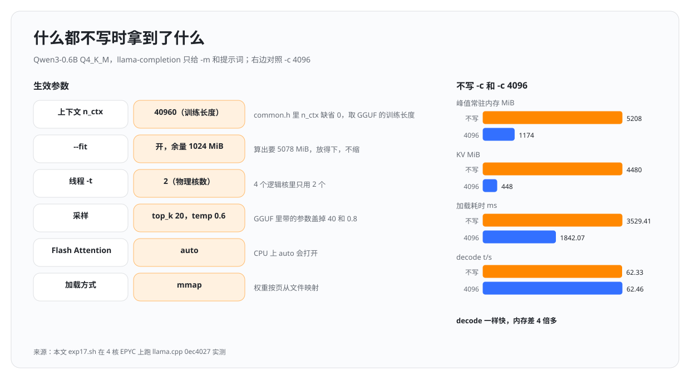
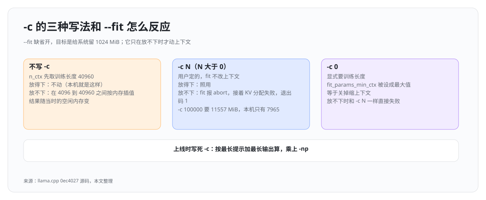
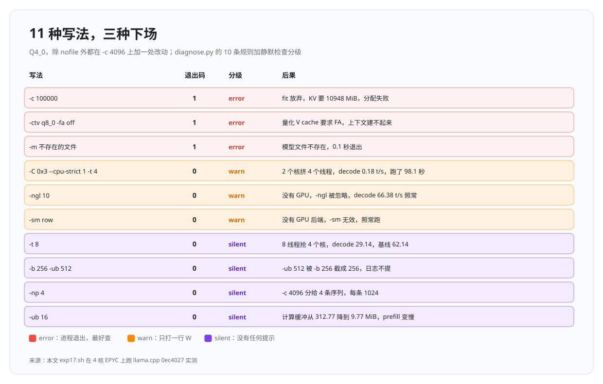
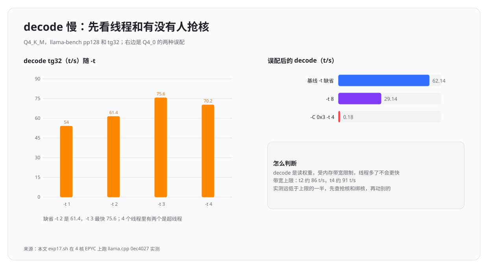
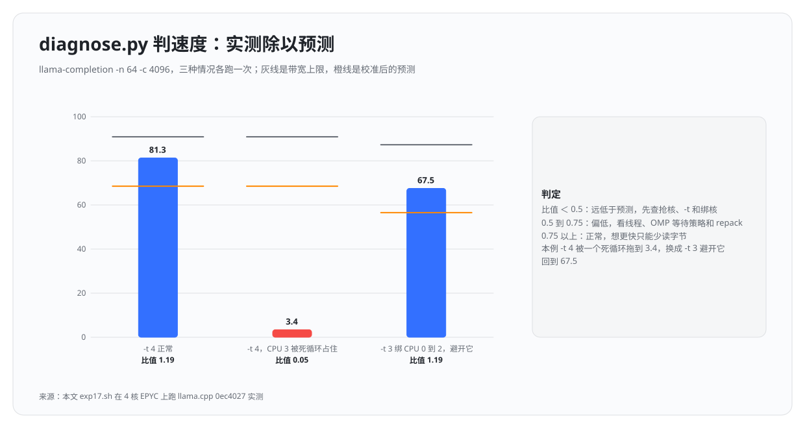
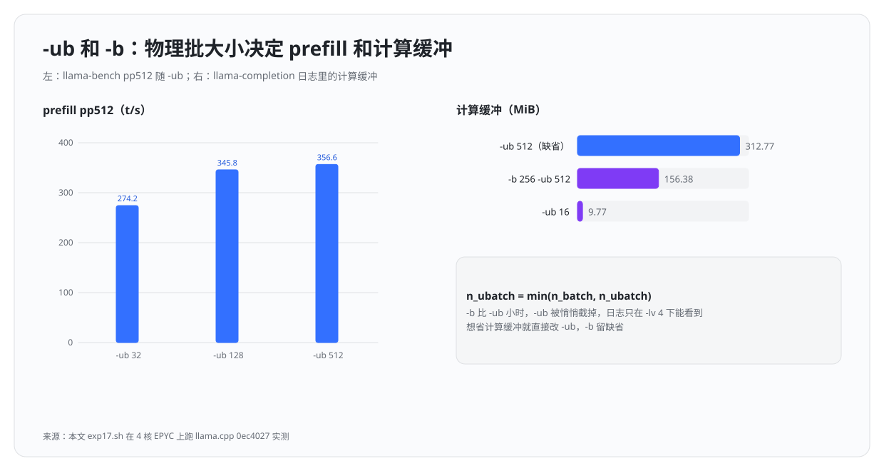
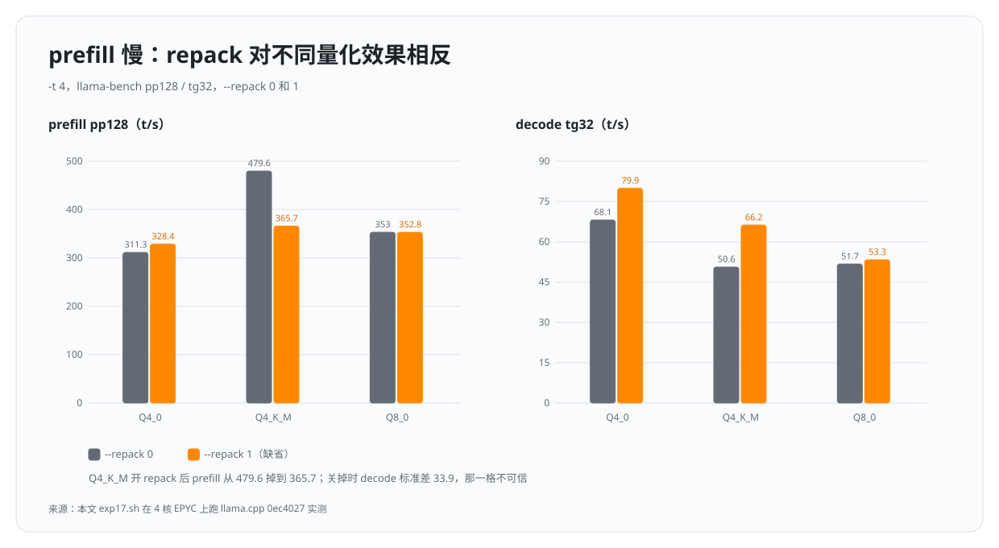
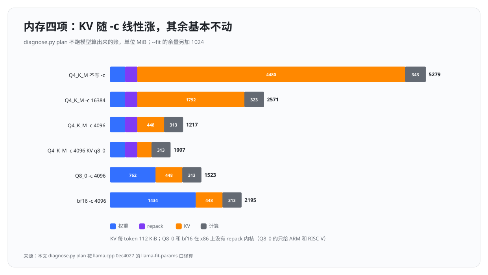
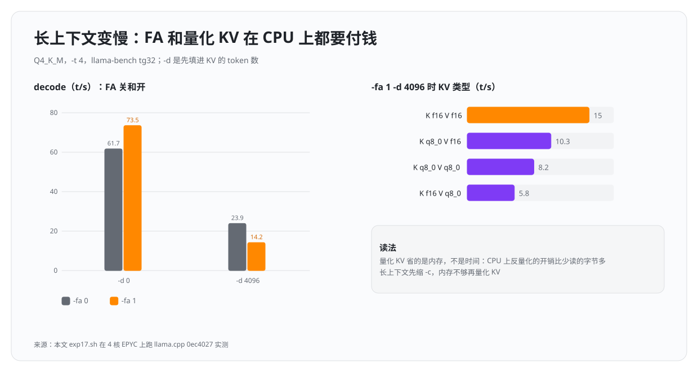
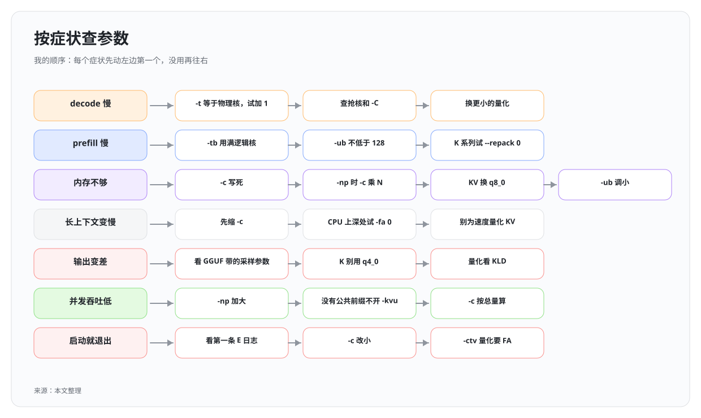

# LCPP-17｜内部｜调参手册：默认值、误配、按症状查参数和上线清单

> 🎯 **这篇文档解决什么问题**：前面十六篇把 llama.cpp 的参数一个个拆开讲过，真到上线时，我手里只有一个症状：decode 慢、prefill 慢、内存爆、长上下文变慢、启动就退出。这篇把参数按症状重新排一遍，回答五个问题。什么都不写时 llama.cpp 替你选了什么，上下文为什么开到了训练长度？哪些写错的参数会让进程退出，哪些只打一行警告，哪些连警告都没有？每个症状先动哪个参数？实测速度离带宽上限还差多少，差出来的部分是谁吃掉的？改完怎么证明真的变快了？主线一句话：上线前先把 -c 写死，再按症状去动对应的参数，每个性能结论都带上方差和机器状态。
>
> 使用方式：只想查参数，看导读和第 10 章的决策表；启动就退出或者结果不对，看第 2 章；按症状查，看第 3 到 8 章；要写性能对比报告，看第 9 章。文中版本和数字核对于 2026 年 10 月 31 日。
>
> **代码**：[zero-to-llama/17-tuning-playbook](../17-tuning-playbook)。本篇不启动 llama-server，也不启动任何监听端口的程序。所有实验只用 llama-completion 和 llama-bench；diagnose.py 解析一次运行的 stderr，按 10 条源码级规则和几条静默检查给误配分级，再拿实测速度和带宽上限比；它的 plan 子命令不跑模型，直接算内存四项和 decode 预测。基线是主干 0ec4027，模型是 Qwen3-0.6B 的 Q4_0、Q4_K_M、Q8_0 和 bf16，机器是 4 核 EPYC 云主机无 GPU。

# 导读 · 先给结论

- **上线前把 -c 写死。**不写 -c 时 n_ctx 取训练长度 40960，KV 4480 MiB 一次分配并清零，峰值常驻内存 5208 MiB；-c 4096 只要 1174 MiB，decode 一样快[[1]](https://github.com/ggml-org/llama.cpp/blob/0ec4027/common/common.h)[[2]](https://github.com/ggml-org/llama.cpp/blob/0ec4027/src/llama-memory.cpp)。
- **--fit 只在放不下时才缩上下文。**内存够就照单全收。用户写了 -c 它不改，-c 0 等于关掉缩小。-c 100000 时它直接放弃，进程退出[[3]](https://github.com/ggml-org/llama.cpp/blob/0ec4027/common/fit.cpp)[[4]](https://github.com/ggml-org/llama.cpp/pull/16653)。
- **最难查的误配不报错。**11 种写法里 3 种退出、3 种只打一行 W、4 种什么都不说：-t 8 让 decode 从 62.14 掉到 29.14，-b 256 悄悄把 -ub 截成 256[[5]](https://github.com/ggml-org/llama.cpp/blob/0ec4027/src/llama-context.cpp)。
- **decode 慢先查抢核。**CPU 3 上放一个死循环，-t 4 从 81.3 掉到 3.4 t/s；换成 -t 3 避开它，回到 67.5。实测除以预测低于 0.5，先看机器，别先动参数[[6]](https://dl.acm.org/doi/10.1145/1498765.1498785)[[7]](https://github.com/ggml-org/llama.cpp/blob/0ec4027/docs/development/token_generation_performance_tips.md)。
- **repack 对 Q4_K_M 的 prefill 是负优化。**-t 4 时 pp128 从关掉的 479.6 掉到 365.7，Q4_0 反过来涨；decode 两者都涨[[8]](https://github.com/ggml-org/llama.cpp/pull/10446)[[9]](https://github.com/ggml-org/llama.cpp/pull/6414)。
- **CPU 上量化 KV 只省内存，不省时间。**-d 4096 时 f16 的 KV 跑 15.0 t/s，K、V 都换 q8_0 掉到 8.2；长上下文先缩 -c，内存不够再量化[[10]](https://arxiv.org/abs/2402.02750)[[11]](https://github.com/ggml-org/llama.cpp/pull/4312)。
- **性能结论要带方差和机器状态。**同一组 llama-bench 里 Q4_K_M 关 repack 的 decode 标准差 33.9；两个 benchmark 重叠跑，两组数都作废[[12]](https://doi.org/10.1145/1297027.1297033)[[13]](https://doi.org/10.1145/2807591.2807644)。

**📎 与系列其他文档的分工**：各参数的原理分散在前面各篇：带宽上限和测速模型见 [LCPP-02｜上手｜推理账本：带宽、算力和启动前算出速度上限](./02-ledger.md)，测量方法见 [LCPP-03｜上手｜测量方法：llama-bench、PPL、KLD 和噪声](./03-bench-ppl.md)，内存规划见 [LCPP-05｜内部｜ggml 与计算图：建图、内存规划、调度和复用](./05-ggml-graph.md)，量化类型见 [LCPP-07｜内部｜量化：块结构、配方、imatrix 和用 KLD 选类型](./07-quantization.md)，KV cache 见 [LCPP-08｜内部｜KV cache 与长上下文：账本、深度、量化、SWA 和上下文写满](./08-kv-context.md)，采样见 [LCPP-09｜内部｜采样、语法与聊天模板：截断链、温度、惩罚、GBNF 和模板](./09-sampling-grammar.md)，线程和 repack 见 [LCPP-10｜内部｜CPU 调优：线程、绑核、repack、加载方式和带宽上限](./10-cpu-tuning.md)，GPU 卸载见 [LCPP-11｜内部｜GPU 卸载与 MoE：-ngl、专家放置、fit 和专家缓存](./11-gpu-offload-moe.md)，投机解码见 [LCPP-13｜内部｜投机解码：草稿模型、n-gram 和拒绝采样](./13-speculative.md)，并发和槽位见 [LCPP-14｜内部｜服务端：槽位、连续批处理和提示缓存](./14-server.md)。这篇只做一件事：从症状倒查到参数。

# 第 1 章 · 什么都不写时拿到了什么

## 1.1 一次只给 -m 的运行



我用 llama-completion 只给模型和提示词，加 -lv 4 把生效参数全打出来[[14]](https://github.com/ggml-org/llama.cpp/blob/0ec4027/common/arg.cpp)。common.h 里 n_ctx 的缺省值是 0，意思是从 GGUF 里读训练长度，Qwen3-0.6B 是 40960[[1]](https://github.com/ggml-org/llama.cpp/blob/0ec4027/common/common.h)。KV 每 token 112 KiB，40960 个位置就是 4480 MiB；计算缓冲 346.77 MiB，repack 缓冲 204.75 MiB。

KV 在建上下文时整块分配，分配完立刻清零，所以这 4480 MiB 的页从第一秒就占着，跟提示词多长没关系[[2]](https://github.com/ggml-org/llama.cpp/blob/0ec4027/src/llama-memory.cpp)。rss.py 量到的峰值常驻内存，不写 -c 是 5208 MiB，写 -c 4096 是 1174 MiB；加载耗时 3529 ms 对 1842 ms，多出来的时间主要花在清零上。decode 是 62.33 对 62.46 t/s，没有差别。

## 1.2 --fit 为什么没拦住



--fit 缺省开，余量缺省 1024 MiB[[1]](https://github.com/ggml-org/llama.cpp/blob/0ec4027/common/common.h)[[15]](https://github.com/ggml-org/llama.cpp/pull/18679)。它在加载前试算一遍内存，本机日志写的是 projected to use 5078 MiB，will leave 2887 >= 1024 MiB，no changes needed。放得下就不动，所以它不会替你把 40960 缩成更合理的值[[4]](https://github.com/ggml-org/llama.cpp/pull/16653)。

只有放不下时它才动上下文，而且看你怎么写 -c[[3]](https://github.com/ggml-org/llama.cpp/blob/0ec4027/common/fit.cpp)。不写 -c，它在 4096 和训练长度之间按可用内存线性插值，再按 256 乘流数对齐，结果随当时的空闲内存变。写了 -c N，它认为这是你定的，打一行 context size set by user，不改。写 -c 0，arg.cpp 会把 fit 的最小上下文设成最大整数，等于关掉缩小[[14]](https://github.com/ggml-org/llama.cpp/blob/0ec4027/common/arg.cpp)。所以 -c 0 和不写 -c 看起来一样，内存紧时行为不同。

## 1.3 其他几个缺省值

线程数取物理核数，这台 4 个逻辑核的机器是 2[[16]](https://github.com/ggml-org/llama.cpp/blob/0ec4027/common/common.cpp)。仓库的性能提示文档也建议 -t 设成物理核数，从 1 开始翻倍试[[7]](https://github.com/ggml-org/llama.cpp/blob/0ec4027/docs/development/token_generation_performance_tips.md)。第 3 章会看到，本机 decode 在 -t 3 时最快，缺省值偏保守。

采样参数是 top_k 20、temp 0.6，来自 GGUF 的 general.sampling 键，盖掉了 llama.cpp 自己的 40 和 0.8[[17]](https://github.com/ggml-org/llama.cpp/pull/17120)。top_p 0.95 和 min_p 0.05 还是缺省值，前者按累计概率截断，后者按相对最大概率的比例截断[[18]](https://arxiv.org/abs/1904.09751)[[19]](https://arxiv.org/abs/2407.01082)。命令行上写的值优先于 GGUF。

Flash Attention 缺省是 auto，后端支持就开，CPU 上日志会打 Flash Attention enabled[[20]](https://github.com/ggml-org/llama.cpp/pull/15434)[[21]](https://github.com/ggml-org/llama.cpp/pull/15746)。加载方式缺省 mmap，权重按页从文件映射，多个进程共享同一份页缓存[[22]](https://github.com/ggml-org/llama.cpp/pull/20834)[[23]](https://github.com/ggml-org/llama.cpp/pull/613)。这两项一般不用动，第 6 章会讲长上下文时 FA 的代价。

**📎 展开阅读：**KV 的逐项账见 [LCPP-08｜内部｜KV cache 与长上下文：账本、深度、量化、SWA 和上下文写满](./08-kv-context.md)，计算缓冲怎么来见 [LCPP-05｜内部｜ggml 与计算图：建图、内存规划、调度和复用](./05-ggml-graph.md)，GGUF 采样参数的来源见 [LCPP-09｜内部｜采样、语法与聊天模板：截断链、温度、惩罚、GBNF 和模板](./09-sampling-grammar.md)。

> 🔑 **本章要点**：不写 -c 就是要训练长度，--fit 只在放不下时才缩。本机不写 -c 占 5208 MiB，-c 4096 占 1174 MiB，decode 一样快。上线时按最长提示加最长输出写 -c，多槽位再乘 -np。

# 第 2 章 · 三类误配

## 2.1 11 种写法各跑一次



exp17.sh 的 misconfig 组用 Q4_0 在 -c 4096 上每次只改一处，各起一个进程，记退出码、墙钟和 stderr。按下场分三档。error 是进程退出，日志里有 E 行。warn 照常跑，日志里多一行 W。silent 也照常跑，日志里什么都没有。11 种写法里 error 3 种、warn 3 种、silent 4 种，基线 1 种。

| 写法 | 退出码 | 墙钟 | 日志里能看到的 |
|-|-|-|-|
| -c 100000 | 1 | 1.9 秒 | --fit 放弃了：按你给的 -c 怎么压都放不下、每条序列的上下文超过训练长度、分配内存失败、上下文没建起来 |
| -ctv q8_0 -fa off | 1 | 1.8 秒 | 量化 V cache 必须开 Flash Attention、上下文没建起来 |
| -m 不存在的文件 | 1 | 0.1 秒 | 模型没加载起来、上下文没建起来 |
| -C 0x3 --cpu-strict 1 -t 4 | 0 | 98.1 秒 | CPU 掩码里的核比线程少，多出来的线程会挤在同几个核上 |
| -ngl 10 | 0 | 2.4 秒 | 没有可用 GPU，-ngl 被忽略 |
| -sm row | 0 | 2.4 秒 | 没有 GPU 后端，-sm 不起作用 |
| -t 8 | 0 | 2.9 秒 | 无（diagnose.py 静默检查能抓到） |
| -b 256 -ub 512 | 0 | 2.5 秒 | 无（diagnose.py 静默检查能抓到） |
| -np 4 | 0 | 2.6 秒 | 无（diagnose.py 静默检查能抓到） |
| -ub 16 | 0 | 2.5 秒 | 无（diagnose.py 静默检查能抓到） |

## 2.2 error：退出的反而最好查

-c 100000 的日志很完整。fit 先算出要 11557 MiB，本机只有 7965，因为 -c 是用户写的，它打一行 abort 就放手[[3]](https://github.com/ggml-org/llama.cpp/blob/0ec4027/common/fit.cpp)。接着建上下文时告警每条序列的长度超过了训练长度[[5]](https://github.com/ggml-org/llama.cpp/blob/0ec4027/src/llama-context.cpp)，然后 KV 要 10948 MiB，分配失败[[24]](https://github.com/ggml-org/llama.cpp/blob/0ec4027/ggml/src/ggml-backend.cpp)，最后 llama-completion 报 unable to create context，退出码 1[[25]](https://github.com/ggml-org/llama.cpp/blob/0ec4027/tools/completion/completion.cpp)。整个过程 1.9 秒。

-ctv q8_0 -fa off 也是退出码 1：量化 V cache 只能走 Flash Attention，-fa auto 时会自动打开，-fa off 时直接报错[[5]](https://github.com/ggml-org/llama.cpp/blob/0ec4027/src/llama-context.cpp)。模型路径写错是最快的，0.1 秒退出。这三种只要看第一条 E 行就知道原因。

## 2.3 warn：一行 W 淹在几百行里

纯 CPU 构建上写 -ngl 10 和 -sm row，arg.cpp 各打一行 W 说没有 GPU，然后照常跑[[14]](https://github.com/ggml-org/llama.cpp/blob/0ec4027/common/arg.cpp)。这两条无害，decode 66.38 和 65.56 t/s，和基线 62.14 在一个范围里。它们的问题在于误导：你以为卸到了 GPU，其实全在 CPU 上。

-C 0x3 --cpu-strict 1 -t 4 就有害了。掩码里只有 2 个 CPU，4 个线程按 strict 规则轮转绑上去，两两挤在同一个核上[[16]](https://github.com/ggml-org/llama.cpp/blob/0ec4027/common/common.cpp)[[26]](https://man7.org/linux/man-pages/man2/sched_setaffinity.2.html)。日志开头有一行 Not enough set bits in CPU mask，之后一切正常，只是 decode 只剩 0.18 t/s，一次 16 token 的生成跑了 98.1 秒。线程之间每一步都要过屏障，一个线程被换下去，其余线程全部空等。

## 2.4 silent：没有任何提示

-t 8 在 4 个逻辑核上照常跑，日志一个字都不提，decode 从 62.14 掉到 29.14。-b 256 -ub 512 时，建上下文的代码先取 n_batch 等于 min(n_ctx, n_batch)，再取 n_ubatch 等于 min(n_batch, n_ubatch)，-ub 被截成 256，只有 -lv 4 下才看得到[[5]](https://github.com/ggml-org/llama.cpp/blob/0ec4027/src/llama-context.cpp)。-np 4 时 -c 4096 是 4 条序列的总量，每条只分到 1024；-ub 16 让计算缓冲从 312.77 降到 9.77 MiB，代价是 prefill 变慢，第 4 章有数字。

这四种我都写进了 diagnose.py 的静默检查，按 parse 出来的生效参数判断，不依赖日志里有没有警告。规则表对齐的是 0ec4027 的日志文本，换版本以后先跑 test_diagnose.py。

```bash
python3 diagnose.py log logs/mis-t8.log
# 生效参数：threads=8，threads_batch=8，hw_threads=4，n_ctx=4096，... tg_ts=29.14
# [silent] -t 8 超过机器的 4 个逻辑核，线程会互相抢核
#         改法：-t 不超过物理核数，decode 一般 2 到 3 个就饱和
python3 diagnose.py log my-run.log --model q-Q4_K_M.gguf --json
```

> 🔑 **本章要点**：启动就退出的，看第一条 E 行。照常跑但结果不对的，搜 W 行。什么提示都没有的最危险：-t 超过核数、-b 小于 -ub、-np 时 -c 是总量，这几种要靠自己核对生效参数，或者交给 diagnose.py。

# 第 3 章 · decode 慢

## 3.1 先算上限

decode 每生成一个 token 要把全部权重读一遍，单序列时算术强度很低，速度由内存带宽决定[[6]](https://dl.acm.org/doi/10.1145/1498765.1498785)[[27]](https://arxiv.org/abs/2211.05102)。上限就是带宽除以每 token 要读的字节数。我用 STREAM 测带宽，2 线程 33.7 GB/s，4 线程 35.5 GB/s[[28]](https://www.cs.virginia.edu/stream/ref.html)。Q4_K_M 每 token 读约 390 MB，上限约 91 t/s。

综述和硬件趋势都指向同一件事：算力涨得比带宽快，单序列 decode 长期受带宽限制[[29]](https://arxiv.org/abs/2402.16363)[[30]](https://arxiv.org/abs/2403.14123)。所以 decode 慢时要问的是：离上限多远。离得远，是有东西在拖后腿；已经贴着上限，参数再怎么调也快不了，只能少读字节，换更小的量化。

## 3.2 线程



llama-bench 上 Q4_K_M 的 tg32：-t 1 是 54.0，-t 2 是 61.4，-t 3 是 75.6，-t 4 是 70.2 t/s。两个物理核各带一个超线程，超线程共享执行单元和 L1、L2，第 4 个线程开始和自己的兄弟抢资源[[31]](https://people.freebsd.org/~lstewart/articles/cpumemory.pdf)。缺省的 -t 2 离最快还差 19%，本机我会写 -t 3。

线程等屏障的方式也有影响。缺省用 OpenMP，libgomp 不设 OMP_WAIT_POLICY 时先自旋一段再睡[[32]](https://gcc.gnu.org/onlinedocs/libgomp/OMP_005fWAIT_005fPOLICY.html)；设成 passive 让线程立刻睡，decode 每一步都要唤醒，[LCPP-10｜内部｜CPU 调优：线程、绑核、repack、加载方式和带宽上限](./10-cpu-tuning.md) 里量到 tg 从 70.6 掉到 47 左右。ggml 也有自带的线程池，用 GGML_OPENMP=OFF 编译时启用[[33]](https://github.com/ggml-org/llama.cpp/pull/8672)。环境里有人设了 passive，参数怎么调都找不回来。

绑核要和线程数一起看。-C 给的是可用 CPU 的掩码，--cpu-strict 1 时线程按掩码里的 CPU 轮流绑定，掩码里的 CPU 比线程少，就会有两个线程绑在同一个核上，第 2 章的 0.18 t/s 就是这么来的[[26]](https://man7.org/linux/man-pages/man2/sched_setaffinity.2.html)。不加 --cpu-strict 时线程只被限制在掩码范围内，由内核调度器自己挑核，抢核时还能挪开，所以我只在确实要和别的进程隔离时才用 strict，并且让掩码里的 CPU 数不少于 -t。

## 3.3 有人抢核



exp17.sh 的 diag 组在 CPU 3 上起一个 bash 死循环，模拟云主机上的邻居负载。-t 4 正常时 decode 81.3 t/s，有死循环时掉到 3.4，掉了 96%；换成 -t 3 -C 0x7 绑在 CPU 0 到 2 上避开它，回到 67.5。一个核被占，四个线程全慢，因为每一步都要等最慢的那个。

diagnose.py 拿实测除以校准后的预测。低于 0.5 判远低于预测，先查抢核和绑核。0.5 到 0.75 判偏低，看线程、等待策略和 repack。0.75 以上判正常[[6]](https://dl.acm.org/doi/10.1145/1498765.1498785)。三次运行的比值是 1.19、0.05、1.19。比值超过 1 说明预测偏保守，不是测错了；超过带宽上限才是测错了。

**📎 展开阅读：**带宽上限和校准预测的推导见 [LCPP-02｜上手｜推理账本：带宽、算力和启动前算出速度上限](./02-ledger.md)，线程、绑核和 OpenMP 等待策略的实验见 [LCPP-10｜内部｜CPU 调优：线程、绑核、repack、加载方式和带宽上限](./10-cpu-tuning.md)。

> 🔑 **本章要点**：decode 慢先算比值。低于 0.5 先看机器：top 里有没有别的进程，-t 是否超过逻辑核，掩码够不够。接近上限时只剩换更小的量化。本机 -t 3 最快，75.6 t/s。

# 第 4 章 · prefill 慢

## 4.1 -tb 和 -t 分开设

prefill 一次喂几百个 token，读一遍权重能算一百多个 token，算术强度比 decode 高两个数量级，瓶颈从带宽移到算力[[6]](https://dl.acm.org/doi/10.1145/1498765.1498785)[[27]](https://arxiv.org/abs/2211.05102)。同一组 llama-bench 里 pp128 随线程几乎线性涨：-t 1 是 155.3，-t 2 是 238.1，-t 3 是 310.0，-t 4 是 380.0 t/s[[34]](https://github.com/ggml-org/llama.cpp/blob/0ec4027/tools/llama-bench/README.md)。decode 在 -t 3 见顶，prefill 到 -t 4 还在涨，两者的最优线程数不一样。

llama.cpp 给了两个参数：-t 管 decode，-tb 管 prompt 处理，-tb 不写时跟 -t 一样[[16]](https://github.com/ggml-org/llama.cpp/blob/0ec4027/common/common.cpp)。本机缺省 -t 2、-tb 2，prefill 只用了一半核。我会写 -t 3 -tb 4：decode 取最快的 3，prefill 用满 4 个逻辑核。超线程对 prefill 有用，本机 -t 4 比 -t 3 快 23%。

## 4.2 -ub 是物理批



-b 是一次 llama_decode 能交进去的逻辑批，-ub 是真正送进计算图的物理批，缺省 2048 和 512。pp512 随 -ub：32 是 274.2，128 是 345.8，512 是 356.6 t/s。-ub 128 以上基本饱和，再往下掉得明显，因为每个物理批都要把全部权重读一遍，批越小摊到每个 token 的读权重越多[[35]](https://arxiv.org/abs/2308.16369)。

计算缓冲按 -ub 定大小：缺省 312.77 MiB，-ub 16 只要 9.77 MiB，-b 256 把 -ub 截到 256 后是 156.38 MiB。想省这块内存就直接改 -ub，-b 留缺省；只改 -b 会把 -ub 一起截掉，日志不提[[5]](https://github.com/ggml-org/llama.cpp/blob/0ec4027/src/llama-context.cpp)。在 0.6B 上这几百 MiB 是 KV 的零头，大模型的计算缓冲按词表和隐藏维长，-ub 才值得调。

## 4.3 repack 对 K 系列是负优化



repack 在加载时把权重重排成按 8 行交错的块，让 GEMM 内核一次处理多行[[8]](https://github.com/ggml-org/llama.cpp/pull/10446)。-t 4 实测：Q4_0 开 repack 时 pp128 从 311.3 涨到 328.4，tg32 从 68.1 涨到 79.9。Q4_K_M 的 pp128 反过来从 479.6 掉到 365.7，tg32 从 50.6 涨到 66.2。Q8_0 在 x86 上没有 repack 内核，两次差不多，353.0 对 352.8。

关掉 repack 后 Q4_0 走 llamafile 的 sgemm，Q4_K 不在 sgemm 支持的类型里，走 ggml 自己的点积路径[[9]](https://github.com/ggml-org/llama.cpp/pull/6414)。在这台支持 AVX512 的机器上，那条点积路径的 prefill 比 repack 的 8x8 GEMM 快。我没有拆到内核级别去解释原因，结论只针对本机：K 系列量化跑长提示时，拿 --repack 0 和 1 各测一次，选快的。代价是 --repack 0 时 decode 也跟着变慢，要两头一起看。

**📎 展开阅读：**repack 的数据布局和内核选择见 [LCPP-10｜内部｜CPU 调优：线程、绑核、repack、加载方式和带宽上限](./10-cpu-tuning.md)，量化类型的块结构见 [LCPP-07｜内部｜量化：块结构、配方、imatrix 和用 KLD 选类型](./07-quantization.md)。

> 🔑 **本章要点**：prefill 受算力限制，先把 -tb 设到逻辑核数，本机 -t 4 的 pp128 是 -t 2 的 1.60 倍。-ub 不低于 128。K 系列量化的 repack 两种都测，Q4_K_M 在本机关掉更快。

# 第 5 章 · 内存不够

## 5.1 只有 KV 随 -c 涨



常驻内存分四项：权重、repack 缓冲、KV、计算缓冲。diagnose.py plan 不跑模型，按 llama-fit-params 的口径把四项算出来[[3]](https://github.com/ggml-org/llama.cpp/blob/0ec4027/common/fit.cpp)。Q4_K_M -c 4096 是 251 + 205 + 448 + 313 = 1217 MiB。不写 -c 时 KV 变成 4480，合计 5279，-c 16384 是 2571。只有 KV 随 -c 线性涨，其余三项几乎不动。

KV 每 token 的字节数是 2 × 层数 × KV 头数 × 头维度 × 每元素字节。Qwen3-0.6B 有 28 层、8 个 KV 头、头维度 128，f16 下正好 112 KiB；GQA 让 16 个查询头共用 8 个 KV 头，KV 只有多头注意力的一半[[36]](https://arxiv.org/abs/2305.13245)。repack 那一项并不多占内存：能重排的权重不走 mmap，加载时拷进 repack 缓冲，所以 251 + 205 正好是 Q4_K_M 文件的 456 MiB。区别在于这部分是进程私有的匿名内存，多个进程跑同一个模型时不能共享页缓存。

## 5.2 -np 和 -c

-np 4 -c 4096 时，KV 还是 448 MiB，每条序列只分到 1024 个位置。-c 是总量，按槽位平分，日志不提醒[[5]](https://github.com/ggml-org/llama.cpp/blob/0ec4027/src/llama-context.cpp)。想让 4 个槽位各有 4096，要写 -c 16384，KV 跟着变成 4 倍。

llama.cpp 在建上下文时把 -c 个位置的 KV 一次分配好，用不用都占着。vLLM 的 PagedAttention 按块按需分配，并发请求之间不浪费空位[[37]](https://arxiv.org/abs/2309.06180)；llama.cpp 用固定的格子换实现简单，代价就是 -c 要事先估准。估法是最长提示加最长输出，再乘槽位数，-c 写死，比让它按训练长度开稳得多。

## 5.3 放不下时怎么退

-c 100000 时 fit 算出要 11557 MiB，本机 7965 MiB，KV 一项就要 10948 MiB，第 2 章看到它 1.9 秒退出。真需要这么长时，我按省得多、伤得少的顺序退。先确认真要这么长，-c 16384 已经省掉 2708 MiB。再把 KV 换成 q8_0，-c 4096 时 KV 从 448 降到 238，合计 1007 MiB。然后把 -ub 调小，最后才换更小的权重量化。

KV 换 q8_0 的质量代价很小，第 7 章有数字；速度代价在 CPU 上不小，第 6 章有数字。所以它排在缩 -c 之后。权重量化往下换伤得最多，Q4_K_M 降到 Q3_K_M 的 KLD 涨约 4 倍，见 [LCPP-07｜内部｜量化：块结构、配方、imatrix 和用 KLD 选类型](./07-quantization.md)。

plan 的账和实际运行对得上：第 1 章的日志里不写 -c 时 fit 打出的预计用量是 5078 MiB，plan 算的是 5279 MiB，差的那一点是 plan 把计算缓冲按图的最大节点估得偏保守；rss.py 量到的峰值常驻内存是 5208 MiB，落在两者之间：账本没算进程本身和分词器这些零碎，计算缓冲也不是每一页都被写到。上线前我用 plan 估量级，用 -lv 4 的日志核对细项，两者差得多时先查参数有没有生效。

**📎 展开阅读：**内存四项的逐项推导见 [LCPP-05｜内部｜ggml 与计算图：建图、内存规划、调度和复用](./05-ggml-graph.md)，KV 的格子、seq_rm 和统一 KV 见 [LCPP-08｜内部｜KV cache 与长上下文：账本、深度、量化、SWA 和上下文写满](./08-kv-context.md)。

> 🔑 **本章要点**：只有 KV 随 -c 涨。-c 写死，-np 时乘槽位数。放不下按缩 -c、KV 换 q8_0、调小 -ub、换权重量化的顺序退；本机 Q4_K_M -c 4096 合计 1217 MiB，KV q8_0 后 1007 MiB。

# 第 6 章 · 长上下文变慢

## 6.1 FA 在 CPU 上深处变慢



llama-bench 的 -d 先往 KV 里填一段 token，再测 decode，模拟长对话的后半段。Q4_K_M -t 4：-d 0 时 FA 关 61.7、开 73.5 t/s，开着快；-d 4096 时 FA 关 23.9、开 14.2，开着反而慢 41%。

FlashAttention 的出发点是 GPU 上分块算注意力、不把整张分数矩阵写回显存，省的是显存带宽[[38]](https://arxiv.org/abs/2205.14135)。llama.cpp 的 CPU FA decode 路径没有这种分块，逐个位置做标量的 online softmax，KV 越长越吃亏，[LCPP-08｜内部｜KV cache 与长上下文：账本、深度、量化、SWA 和上下文写满](./08-kv-context.md) 里量到深度 8192 时只有关掉时的 37%。所以 -fa auto 在 CPU 上会打开，长上下文的 decode 我会试一次 -fa 0。代价是关掉 FA 以后 V cache 不能量化。

## 6.2 量化 KV 更慢

同样 -fa 1 -d 4096，KV 类型换一遍：K、V 都是 f16 时 15.0 t/s，只把 K 换成 q8_0 是 10.3，只换 V 是 5.8（标准差 1.7），两个都换是 8.2。量化 KV 读的字节少了一半，速度反而掉。我的解释是每个位置都要先反量化再参与点积，CPU 上这笔计算比省下的带宽贵；-d 4096 时每生成一个 token 要读约 448 MiB 的 KV，和权重差不多大，f16 的 15.0 t/s 只到两者合计带宽上限的四成，瓶颈已经在注意力的计算上，少读字节帮不上忙[[11]](https://github.com/ggml-org/llama.cpp/pull/4312)。

KV 量化的论文大多在 GPU 上讨论，目标是让更长的上下文放进显存，配专门的融合内核把反量化藏在访存里[[10]](https://arxiv.org/abs/2402.02750)[[39]](https://arxiv.org/abs/2401.18079)。llama.cpp 的 CPU 路径没有这层优化。我的规则是：CPU 上 KV 量化只为放得下，不为跑得快。

## 6.3 旋转让 q8_0 几乎无损

K 里有少数通道幅值特别大，直接量化误差集中在这些通道上。QuaRot 用 Hadamard 旋转把离群值摊到所有通道，再量化就平滑得多[[40]](https://arxiv.org/abs/2404.00456)。llama.cpp 在 K、V 量化时缺省做这个旋转，[LCPP-08｜内部｜KV cache 与长上下文：账本、深度、量化、SWA 和上下文写满](./08-kv-context.md) 里量到关掉时 q8_0 的 KLD 是 0.036，开着是 0.0018[[41]](https://github.com/ggml-org/llama.cpp/pull/21038)。这一步是 KV 量化在质量上可用的前提，换旧版本时要确认它在。

> 🔑 **本章要点**：长上下文先缩 -c。CPU 上深处的 decode 试一次 -fa 0，本机 -d 4096 时关 FA 23.9、开 14.2 t/s。KV 量化在 CPU 上只为省内存，f16 是 15.0，q8_0 是 8.2。

# 第 7 章 · 输出变差

## 7.1 用 KLD 量，不用 PPL

调完参数，我还要确认输出没变差。PPL 是整体平均，两个模型 PPL 接近时，逐 token 的答案可能翻转了一大片。Dutta 等人的结论是压缩后要看翻转率和分布距离，只看准确率会漏掉问题[[42]](https://arxiv.org/abs/2407.09141)。llama-perplexity 的 --kl-divergence 拿基准模型的 logits 和待测模型逐位置算 KL 散度，同时给 top-1 一致率[[43]](https://github.com/ggml-org/llama.cpp/pull/5076)[[44]](https://github.com/ggml-org/llama.cpp/blob/0ec4027/tools/perplexity/README.md)。

[LCPP-07｜内部｜量化：块结构、配方、imatrix 和用 KLD 选类型](./07-quantization.md) 的权重量化表里，Q8_0 的平均 KLD 是 0.0026，Q4_K_M 是 0.114，top-1 一致率 82.9%。[LCPP-08｜内部｜KV cache 与长上下文：账本、深度、量化、SWA 和上下文写满](./08-kv-context.md) 的 KV 量化表里，K、V 都换 q8_0 时 KLD 0.0018，top-1 97.5%，比 Q8_0 权重带来的误差还小。我的门槛是：KV 改动的 KLD 不超过权重量化本身的十分之一，否则回退。

## 7.2 K 别用 q4_0

同一张表里，K q8_0、V q4_0 时 KLD 0.010，还能用；K 换成 q4_0 时 PPL 从 23.4 涨到 95，top-1 一致率掉到 46.6%。K 参与点积后过 softmax，误差会被指数放大；V 只是按注意力权重加权平均，误差被摊平。KVQuant 也观察到 K 比 V 难量化，要按通道处理离群值[[39]](https://arxiv.org/abs/2401.18079)。所以 KV 要省内存时，先动 V，K 最多到 q8_0。

## 7.3 imatrix 和采样

权重这边能做的是重新量化时带 imatrix。llama-imatrix 在校准文本上统计每个权重通道的激活平方和，量化时按这个重要性加权误差[[45]](https://github.com/ggml-org/llama.cpp/pull/4861)。思路和 GPTQ 用校准数据的二阶信息补偿误差相近，只是更轻[[46]](https://arxiv.org/abs/2210.17323)。[LCPP-07｜内部｜量化：块结构、配方、imatrix 和用 KLD 选类型](./07-quantization.md) 里 Q4_K_M 带 imatrix 后 KLD 从 0.114 降到 0.072，PPL 从 25.62 降到 24.19，文件大小不变。

输出风格不对，先看采样参数从哪来。第 1 章看到 Qwen3 的 GGUF 自带 top_k 20、temp 0.6，盖掉了 llama.cpp 的缺省值[[17]](https://github.com/ggml-org/llama.cpp/pull/17120)。换一个模型文件，采样参数可能悄悄跟着变；要可复现，就在命令行上把 temp、top_k、top_p、min_p 全写死，用 -lv 4 确认生效值。

**📎 展开阅读：**KLD 和 PPL 的测法见 [LCPP-03｜上手｜测量方法：llama-bench、PPL、KLD 和噪声](./03-bench-ppl.md)，imatrix 和各量化的质量表见 [LCPP-07｜内部｜量化：块结构、配方、imatrix 和用 KLD 选类型](./07-quantization.md)，采样器链见 [LCPP-09｜内部｜采样、语法与聊天模板：截断链、温度、惩罚、GBNF 和模板](./09-sampling-grammar.md)。

> 🔑 **本章要点**：质量用 KLD 和 top-1 一致率量，PPL 只看个大概。KV 先动 V，K 最多 q8_0。权重量化带 imatrix。采样参数在命令行上写死，别依赖 GGUF 带的值。

# 第 8 章 · 并发和投机解码

## 8.1 并发换的是总吞吐

多个请求同时来时，llama.cpp 每一轮把所有在生成的序列各放 1 个 token，拼成一个 batch 调一次 llama_decode，这是 Orca 提出的迭代级调度[[47]](https://www.usenix.org/conference/osdi22/presentation/yu)。权重读一遍，服务 B 条序列，总吞吐随 B 涨；每条序列分到的速度随 B 掉。[LCPP-14｜内部｜服务端：槽位、连续批处理和提示缓存](./14-server.md) 用 llama-batched-bench 在 Q8_0 上量过：B 从 1 到 16，总解码吞吐 49.9 到 172.1 t/s，涨 3.45 倍，每条只剩 10.8 t/s[[48]](https://github.com/ggml-org/llama.cpp/blob/0ec4027/tools/batched-bench/README.md)。

所以并发的调参先问目标。要每个用户都快，-np 小；要单位机器服务的 token 多，-np 大，同时把 -c 按槽位数乘上去，第 5 章说过 -c 是总量。新请求的长提示会挤占正在生成的序列，llama.cpp 按 -b 把提示切块，和生成中的 token 拼在同一个 batch 里，这是 SARATHI 的分块预填充[[35]](https://arxiv.org/abs/2308.16369)。-b 设小，生成中的序列卡顿短，长提示要多拆几轮。

## 8.2 统一 KV 和共享前缀

--kv-unified 让所有序列共用一块 KV，序列之间能共享前缀，不用按槽位平分 -c[[49]](https://github.com/ggml-org/llama.cpp/pull/16736)。代价是注意力要跨整块 KV 找属于自己的位置，[LCPP-14｜内部｜服务端：槽位、连续批处理和提示缓存](./14-server.md) 在 B = 16 时交替跑 3 轮，统一 KV 每轮都慢 25% 到 38%。我的规则是：请求之间有长的公共前缀（同一个系统提示、同一份文档）才开；没有公共前缀，分开的 KV 更快。

共享前缀的收益很大。[LCPP-14｜内部｜服务端：槽位、连续批处理和提示缓存](./14-server.md) 里提示 384、B = 16，前缀只算一次，预填充从 21.3 秒降到 1.1 秒。KV 的按需分配和前缀共享在 vLLM 里是 PagedAttention 的块表加引用计数[[37]](https://arxiv.org/abs/2309.06180)；llama.cpp 用序列号标记哪些格子属于哪些序列，同一个格子可以挂多个序列号，效果相近，-c 仍要事先定死。

## 8.3 投机解码什么时候开

投机解码让小模型先猜 k 个 token，大模型一次验证 k+1 个位置，温度 0 时输出和不开完全一样[[50]](https://arxiv.org/abs/2211.17192)。论文的收益模型假设验证 k+1 个位置和验证 1 个一样贵，这在加速器上大致成立，CPU 上不成立：[LCPP-13｜内部｜投机解码：草稿模型、n-gram 和拒绝采样](./13-speculative.md) 量到 Q8_0 目标一次喂 5 个是喂 1 个的 1.99 倍。所以 CPU 上先算草稿和目标的单 token 耗时比 c，c 不够小时接受率再高也不赚。

[LCPP-13｜内部｜投机解码：草稿模型、n-gram 和拒绝采样](./13-speculative.md) 的结论：同一个 Q4_0 草稿配 Q8_0 目标，c 是 0.86，赔钱；配 bf16 目标，c 降到 0.29，交替跑的加速比 1.23 和 1.26 倍。不要草稿模型的 ngram 类方法只在提示里有原文时赚，改写任务上快 1.60 到 1.91 倍，写新内容时一次草稿都不出[[51]](https://github.com/ggml-org/llama.cpp/blob/0ec4027/docs/speculative.md)。和并发一起用时要小心：并发已经把验证的算力用掉了，投机再多喂 token，赚头更少。

**📎 展开阅读：**槽位、统一 KV 和 RAM 缓存见 [LCPP-14｜内部｜服务端：槽位、连续批处理和提示缓存](./14-server.md)，投机解码的代价模型和各类草稿见 [LCPP-13｜内部｜投机解码：草稿模型、n-gram 和拒绝采样](./13-speculative.md)。

> 🔑 **本章要点**：并发换总吞吐，每条变慢，-c 按槽位乘。有公共前缀才开统一 KV。CPU 上投机解码先算 c：草稿至少比目标快三倍以上才考虑，改写类任务优先试 ngram。

# 第 9 章 · 怎么证明真的变快了

## 9.1 一次运行不算数

第 4 章 Q4_K_M 关 repack 的 tg32 是 50.6 ± 33.9 t/s。三次样本是 71、69.4、11.4，前两次正常，第三次掉到原来的六分之一，平均值和标准差都被这一次带偏。-t 2 的 pp128 三次是 220.4、220.5、273.3，一次快了 24%。只报平均值，读者看不出哪一格可信。

Georges 等人在 Java 上的结论放到这里一样成立：单次运行或最好一次的数字会得出相反的结论，要多次重复、报置信区间[[12]](https://doi.org/10.1145/1297027.1297033)。Kalibera 和 Jones 进一步指出变化来自多层，进程级的差异要靠多起几个进程才能看到，同一进程里多跑几轮不够[[52]](https://doi.org/10.1145/2491894.2464160)。llama-bench 的 -r 只在同一进程内重复[[34]](https://github.com/ggml-org/llama.cpp/blob/0ec4027/tools/llama-bench/README.md)，结论要紧时，我会把整条命令跑几遍。

## 9.2 先排除机器

云主机的性能本身会漂。Leitner 和 Cito 测过多家公有云，同一规格的实例之间、同一实例不同时段之间都有明显差异[[53]](https://doi.org/10.1145/2885497)。第 3 章那个死循环是极端例子，一个核被占，decode 从 81.3 掉到 3.4。真实的邻居没这么狠，掉 10% 到 20% 就足以盖过大部分参数的收益。我每组实验前看一眼 top，每组之间不重叠，两个 benchmark 同时跑，两组都作废。

工具之间也不能直接比。第 3 章 llama-completion -t 4 -n 64 的 decode 是 81.3，第 4 章 llama-bench -t 4 的 tg32 是 70.2，同一台机器、同一个模型差了 16%。生成长度、采样开销、是否预热都不同。Mytkowicz 等人还发现环境变量的长度、链接顺序这类看似无关的东西也能让结果偏几个百分点[[54]](https://doi.org/10.1145/1508244.1508275)。比较只在同一工具、同一参数、同一时段内做。

## 9.3 交替跑，按比值报

改动前后各跑一组再比，中间机器状态可能已经变了。我用交替跑：A、B、A、B 各跑 3 轮，每轮算 B 除以 A，报比值的中位数和范围。[LCPP-13｜内部｜投机解码：草稿模型、n-gram 和拒绝采样](./13-speculative.md) 和 [LCPP-14｜内部｜服务端：槽位、连续批处理和提示缓存](./14-server.md) 的关键对比都这样做，统一 KV 慢 25% 到 38% 就是 3 轮比值的范围。对比两个提交时，llama.cpp 自带 compare-llama-bench.py，从 llama-bench 的 SQLite 结果里取同一组配置并排出表[[55]](https://github.com/ggml-org/llama.cpp/blob/0ec4027/scripts/compare-llama-bench.py)。

Hoefler 和 Belli 给并行性能报告列了一串规则，其中三条我每次都照做：写清硬件、软件版本和全部参数，报中位数或均值时同时报离散程度，说清楚样本数和怎么剔除异常值[[13]](https://doi.org/10.1145/2807591.2807644)。diagnose.py 的比值是另一道保险：实测除以带宽模型的预测，低于 0.5 先查机器；超过带宽上限，先怀疑测量本身。

报告里我固定写这几项：机器型号和逻辑核数、llama.cpp 的提交号和编译选项、模型文件和量化类型、完整命令行、每格的样本数和标准差、实验时有没有别的负载。这些信息缺一项，别人就没法在自己的机器上复现，也没法判断差异是参数带来的还是环境带来的；本篇每一张图的来源行和配套仓库里的 exp17.sh，就是按这个清单留的底。

**📎 展开阅读：**llama-bench 的参数、噪声和 PPL 的测法见 [LCPP-03｜上手｜测量方法：llama-bench、PPL、KLD 和噪声](./03-bench-ppl.md)，带宽上限的推导见 [LCPP-02｜上手｜推理账本：带宽、算力和启动前算出速度上限](./02-ledger.md)。

> 🔑 **本章要点**：报速度带样本或标准差，异常的那一格单独说。每组前查机器，不重叠跑。同一工具内比较，改动前后交替跑 3 轮，按比值报。本机 Q4_K_M 关 repack 的三次 tg32 里有一次只有 11.4。

# 第 10 章 · 按症状查与上线清单

## 10.1 决策表



| 症状 | 先动什么 | 依据 |
|-|-|-|
| 什么都没写 | -c 按最长提示加最长输出写死 | 第 1 章：不写 -c 占 5279 MiB，-c 4096 占 1217 MiB |
| 启动就退出 | 看第一条 E 行；-c 改小；量化 V 要 FA | 第 2 章：3 种 error 都在第一条 E 行写明原因 |
| decode 慢 | 算实测除以预测；低于 0.5 先查抢核；-t 试物理核加 1 | 第 3 章：本机 -t 3 最快 75.6，有死循环时 -t 4 只剩 3.4 |
| prefill 慢 | -tb 用满逻辑核；-ub 不低于 128；K 系列测 --repack 0 | 第 4 章：Q4_K_M 关 repack 的 pp128 479.6，开着 365.7 |
| 内存不够 | 缩 -c；KV 换 q8_0；调小 -ub；换权重量化 | 第 5 章：KV q8_0 后 -c 4096 合计 1007 MiB |
| 长上下文变慢 | 先缩 -c；CPU 上试 -fa 0；别为速度量化 KV | 第 6 章：-d 4096 时关 FA 23.9，开 14.2 |
| 输出变差 | 采样参数写死；K 最多 q8_0；权重带 imatrix | 第 7 章：K 用 q4_0 时 PPL 23.4 涨到 95 |
| 并发吞吐低 | -np 加大，-c 乘槽位；没有公共前缀不开 -kvu | 第 8 章：B = 16 吞吐 3.45 倍，统一 KV 慢 25% 到 38% |

表里的数字来自一台 4 核 CPU 和 0.6B 模型，绝对值换机器就变，排查顺序不变：先确认参数真的生效，再看机器，最后才动参数本身。每一行的第一步都很便宜，-lv 4 跑一次、交给 diagnose.py，两分钟就能排除一半的可能。

## 10.2 上线清单

> 📌 **上线前核对清单**：上线或者换模型、换机器，我按这个顺序过一遍。
> - -c 按最长提示加最长输出写死，多槽位乘 -np；用 diagnose.py plan 先算一遍四项内存
> - -t 和 -tb 分开写：decode 从物理核数往上试 1，prefill 用满逻辑核
> - 加 -lv 4 跑一次，把 stderr 交给 diagnose.py log，error、warn、silent 三档清零
> - 确认 n_ubatch、n_ctx_seq、n_threads_batch 是自己想要的值，-b 不小于 -ub
> - K 系列量化测一次 --repack 0 和 1，prefill 和 decode 一起看
> - 长上下文在目标深度上用 llama-bench -d 测 -fa 0 和 1；KV 量化只在放不下时开，K 最多 q8_0
> - 采样参数在命令行上写死，换模型文件后用 -lv 4 核对生效值
> - 性能对比交替跑 3 轮报比值，实测除以预测低于 0.5 先查机器；diagnose.py 的 13 个回归用例全过再换 llama.cpp 版本

## 10.3 下一步

调参到这里讲完了，10 条规则只对齐 0ec4027 的日志文本，换版本先跑 test_diagnose.py。想让 llama.cpp 支持一个新架构，LCPP-18 讲 convert_hf_to_gguf、计算图和 logits 对比；改完怎么用 test-backend-ops 测、怎么提性能 PR，放在 LCPP-19。线程和 repack 回到 [LCPP-10｜内部｜CPU 调优：线程、绑核、repack、加载方式和带宽上限](./10-cpu-tuning.md)，KV 回到 [LCPP-08｜内部｜KV cache 与长上下文：账本、深度、量化、SWA 和上下文写满](./08-kv-context.md)，测量方法回到 [LCPP-03｜上手｜测量方法：llama-bench、PPL、KLD 和噪声](./03-bench-ppl.md)。这些规则在一台具体机器上怎么组合，见两篇实战 [LCPP-20｜实战｜24 GB 单卡：Qwen3-32B 和 Qwen3.8-27B](./20-qwen-24g.md) 和 [LCPP-21｜实战｜一台机器跑 DeepSeek-V4.1-Flash](./21-deepseek-v41.md)。

# 参考文献

按正文首次引用顺序编号，资料截至 2026 年 10 月初。

[1] llama.cpp 0ec4027. common/common.h：n_ctx 缺省 0、fit_params 缺省开、fit_params_target 1024 MiB、fit_params_min_ctx 4096。 [common.h](https://github.com/ggml-org/llama.cpp/blob/0ec4027/common/common.h)

[2] llama.cpp 0ec4027. src/llama-memory.cpp：KV 缓冲分配后整块清零，页一写就占上。 [llama-memory.cpp](https://github.com/ggml-org/llama.cpp/blob/0ec4027/src/llama-memory.cpp)

[3] llama.cpp 0ec4027. common/fit.cpp：按空闲内存减余量缩上下文，放不下时报 failed to fit params。 [fit.cpp](https://github.com/ggml-org/llama.cpp/blob/0ec4027/common/fit.cpp)

[4] JohannesGaessler. llama: automatically set parameters not set by the user in such a way that maximizes GPU utilization. llama.cpp PR #16653, 2025. [PR #16653](https://github.com/ggml-org/llama.cpp/pull/16653)

[5] llama.cpp 0ec4027. src/llama-context.cpp：n_batch、n_ubatch 按 n_ctx 截断，n_ctx_seq 超过训练长度时告警，量化 V cache 要求 Flash Attention。 [llama-context.cpp](https://github.com/ggml-org/llama.cpp/blob/0ec4027/src/llama-context.cpp)

[6] Williams S, Waterman A, Patterson D. Roofline: An Insightful Visual Performance Model for Multicore Architectures. CACM 52(4), 2009. [doi:10.1145/1498765.1498785](https://dl.acm.org/doi/10.1145/1498765.1498785)

[7] llama.cpp 0ec4027. docs/development/token_generation_performance_tips.md：-t 设成物理核数，从 1 开始翻倍试。 [token_generation_performance_tips.md](https://github.com/ggml-org/llama.cpp/blob/0ec4027/docs/development/token_generation_performance_tips.md)

[8] Djip007. Refactor/online repacking. llama.cpp PR #10446, 2024. [PR #10446](https://github.com/ggml-org/llama.cpp/pull/10446)

[9] jart. Improve cpu prompt eval speed. llama.cpp PR #6414, 2024. [PR #6414](https://github.com/ggml-org/llama.cpp/pull/6414)

[10] Liu Z, et al. KIVI: A Tuning-Free Asymmetric 2bit Quantization for KV Cache. ICML 2024. [arXiv:2402.02750](https://arxiv.org/abs/2402.02750)

[11] ggerganov. llama : support quantum K cache. llama.cpp PR #4312, 2023. [PR #4312](https://github.com/ggml-org/llama.cpp/pull/4312)

[12] Georges A, Buytaert D, Eeckhout L. Statistically Rigorous Java Performance Evaluation. OOPSLA 2007. [doi:10.1145/1297027.1297033](https://doi.org/10.1145/1297027.1297033)

[13] Hoefler T, Belli R. Scientific Benchmarking of Parallel Computing Systems. SC 2015. [doi:10.1145/2807591.2807644](https://doi.org/10.1145/2807591.2807644)

[14] llama.cpp 0ec4027. common/arg.cpp：-c 0 取模型训练长度，无 GPU 时 -ngl 和 -sm 只打警告，--repack 的开关。 [arg.cpp](https://github.com/ggml-org/llama.cpp/blob/0ec4027/common/arg.cpp)

[15] JohannesGaessler. llama-fit-params: free memory target per device. llama.cpp PR #18679, 2026. [PR #18679](https://github.com/ggml-org/llama.cpp/pull/18679)

[16] llama.cpp 0ec4027. common/common.cpp：-t 缺省取物理核数，CPU 掩码位数不够时告警。 [common.cpp](https://github.com/ggml-org/llama.cpp/blob/0ec4027/common/common.cpp)

[17] taronaeo. llama: introduce support for model-embedded sampling parameters. llama.cpp PR #17120, 2025. [PR #17120](https://github.com/ggml-org/llama.cpp/pull/17120)

[18] Holtzman A, et al. The Curious Case of Neural Text Degeneration. ICLR 2020. [arXiv:1904.09751](https://arxiv.org/abs/1904.09751)

[19] Nguyen M N, et al. Turning Up the Heat: Min-p Sampling for Creative and Coherent LLM Outputs. ICLR 2025. [arXiv:2407.01082](https://arxiv.org/abs/2407.01082)

[20] JohannesGaessler. llama: use FA + max. GPU layers by default. llama.cpp PR #15434, 2025. [PR #15434](https://github.com/ggml-org/llama.cpp/pull/15434)

[21] JohannesGaessler. llama: -fa 1/0/-1 aliases for -fa on/off/auto. llama.cpp PR #15746, 2025. [PR #15746](https://github.com/ggml-org/llama.cpp/pull/15746)

[22] taronaeo. args: refactor mlock/mmap/directio into load-mode. llama.cpp PR #20834, 2026. [PR #20834](https://github.com/ggml-org/llama.cpp/pull/20834)

[23] jart. Make loading weights 10-100x faster. llama.cpp PR #613, 2023. [PR #613](https://github.com/ggml-org/llama.cpp/pull/613)

[24] llama.cpp 0ec4027. ggml/src/ggml-backend.cpp：缓冲分配失败时打 failed to allocate buffer of size。 [ggml-backend.cpp](https://github.com/ggml-org/llama.cpp/blob/0ec4027/ggml/src/ggml-backend.cpp)

[25] llama.cpp 0ec4027. tools/completion/completion.cpp：上下文建不起来时报 unable to create context 并退出。 [completion.cpp](https://github.com/ggml-org/llama.cpp/blob/0ec4027/tools/completion/completion.cpp)

[26] Linux man-pages. sched_setaffinity(2)。 [sched_setaffinity(2)](https://man7.org/linux/man-pages/man2/sched_setaffinity.2.html)

[27] Pope R et al. Efficiently Scaling Transformer Inference. MLSys 2023. [arXiv:2211.05102](https://arxiv.org/abs/2211.05102)

[28] McCalpin J D. Memory Bandwidth and Machine Balance in Current High Performance Computers. IEEE TCCA Newsletter, 1995. [cs.virginia.edu/stream](https://www.cs.virginia.edu/stream/ref.html)

[29] Yuan Z et al. LLM Inference Unveiled: Survey and Roofline Model Insights. arXiv 2024. [arXiv:2402.16363](https://arxiv.org/abs/2402.16363)

[30] Gholami A et al. AI and Memory Wall. IEEE Micro, 2024. [arXiv:2403.14123](https://arxiv.org/abs/2403.14123)

[31] Drepper U. What Every Programmer Should Know About Memory. 2007. [cpumemory.pdf](https://people.freebsd.org/~lstewart/articles/cpumemory.pdf)

[32] GCC. libgomp 手册：OMP_WAIT_POLICY，未设置时先忙等一小段再转被动等待。 [libgomp OMP_WAIT_POLICY](https://gcc.gnu.org/onlinedocs/libgomp/OMP_005fWAIT_005fPOLICY.html)

[33] fmz. Threadpool: take 2. llama.cpp PR #8672, 2024. [PR #8672](https://github.com/ggml-org/llama.cpp/pull/8672)

[34] llama.cpp 0ec4027. tools/llama-bench/README.md。 [tools/llama-bench](https://github.com/ggml-org/llama.cpp/blob/0ec4027/tools/llama-bench/README.md)

[35] Agrawal A, et al. SARATHI: Efficient LLM Inference by Piggybacking Decodes with Chunked Prefills. 2023. [arXiv:2308.16369](https://arxiv.org/abs/2308.16369)

[36] Ainslie J, et al. GQA: Training Generalized Multi-Query Transformer Models from Multi-Head Checkpoints. EMNLP 2023. [arXiv:2305.13245](https://arxiv.org/abs/2305.13245)

[37] Kwon W, et al. Efficient Memory Management for Large Language Model Serving with PagedAttention. SOSP 2023. [arXiv:2309.06180](https://arxiv.org/abs/2309.06180)

[38] Dao T, et al. FlashAttention: Fast and Memory-Efficient Exact Attention with IO-Awareness. NeurIPS 2022. [arXiv:2205.14135](https://arxiv.org/abs/2205.14135)

[39] Hooper C, et al. KVQuant: Towards 10 Million Context Length LLM Inference with KV Cache Quantization. NeurIPS 2024. [arXiv:2401.18079](https://arxiv.org/abs/2401.18079)

[40] Ashkboos S, et al. QuaRot: Outlier-Free 4-Bit Inference in Rotated LLMs. NeurIPS 2024. [arXiv:2404.00456](https://arxiv.org/abs/2404.00456)

[41] ggerganov. llama : rotate activations for better quantization. llama.cpp PR #21038, 2026. [PR #21038](https://github.com/ggml-org/llama.cpp/pull/21038)

[42] Dutta A, et al. Accuracy is Not All You Need. NeurIPS 2024. [arXiv:2407.09141](https://arxiv.org/abs/2407.09141)

[43] Kawrakow I. KL-divergence. llama.cpp PR #5076, 2024. [PR #5076](https://github.com/ggml-org/llama.cpp/pull/5076)

[44] llama.cpp 0ec4027. tools/perplexity/README.md：PPL 和 KLD 的算法与输出字段。 [perplexity README](https://github.com/ggml-org/llama.cpp/blob/0ec4027/tools/perplexity/README.md)

[45] ikawrakow. Importance Matrix calculation. llama.cpp PR #4861, 2024. [PR #4861](https://github.com/ggml-org/llama.cpp/pull/4861)

[46] Frantar E et al. GPTQ: Accurate Post-Training Quantization for Generative Pre-trained Transformers. ICLR 2023. [arXiv:2210.17323](https://arxiv.org/abs/2210.17323)

[47] Yu G, et al. Orca: A Distributed Serving System for Transformer-Based Generative Models. OSDI 2022. [OSDI 2022](https://www.usenix.org/conference/osdi22/presentation/yu)

[48] llama.cpp 0ec4027. tools/batched-bench/README.md。 [tools/batched-bench](https://github.com/ggml-org/llama.cpp/blob/0ec4027/tools/batched-bench/README.md)

[49] ggerganov. server : support unified cache across slots. llama.cpp PR #16736, 2025. [PR #16736](https://github.com/ggml-org/llama.cpp/pull/16736)

[50] Leviathan Y, Kalman M, Matias Y. Fast Inference from Transformers via Speculative Decoding. ICML 2023. [arXiv:2211.17192](https://arxiv.org/abs/2211.17192)

[51] llama.cpp 0ec4027. docs/speculative.md：各类草稿来源、参数表、统计行的格式、合成接受率。 [docs/speculative.md](https://github.com/ggml-org/llama.cpp/blob/0ec4027/docs/speculative.md)

[52] Kalibera T, Jones R. Rigorous Benchmarking in Reasonable Time. ISMM 2013. [doi:10.1145/2491894.2464160](https://doi.org/10.1145/2491894.2464160)

[53] Leitner P, Cito J. Patterns in the Chaos: A Study of Performance Variation and Predictability in Public IaaS Clouds. ACM TOIT, 2016. [doi:10.1145/2885497](https://doi.org/10.1145/2885497)

[54] Mytkowicz T, Diwan A, Hauswirth M, Sweeney P F. Producing Wrong Data Without Doing Anything Obviously Wrong! ASPLOS 2009. [doi:10.1145/1508244.1508275](https://doi.org/10.1145/1508244.1508275)

[55] llama.cpp 0ec4027. scripts/compare-llama-bench.py：两次提交的 llama-bench 结果对比。 [compare-llama-bench.py](https://github.com/ggml-org/llama.cpp/blob/0ec4027/scripts/compare-llama-bench.py)

---

上一章：[LCPP-16｜内部｜路由与运维：多模型、预设、内存余量和监控](./16-router-ops.md) · [目录](./README.md) · 下一章：[LCPP-18｜内部｜新模型接入：转换、计算图和逐层对拍](./18-add-model.md)
