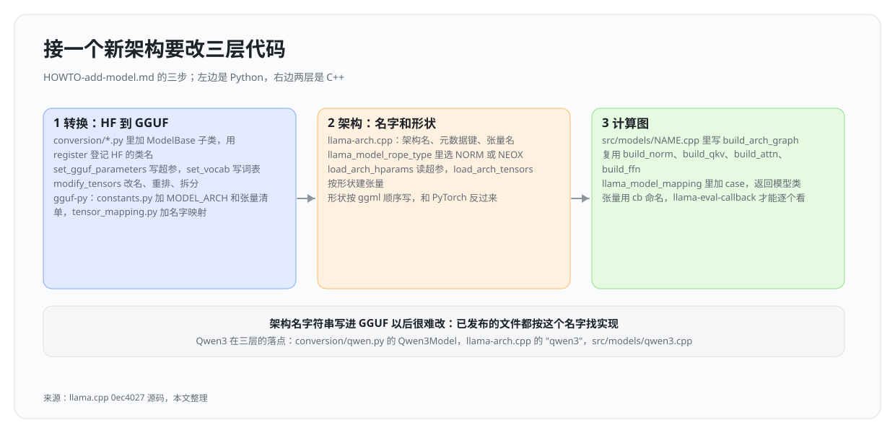
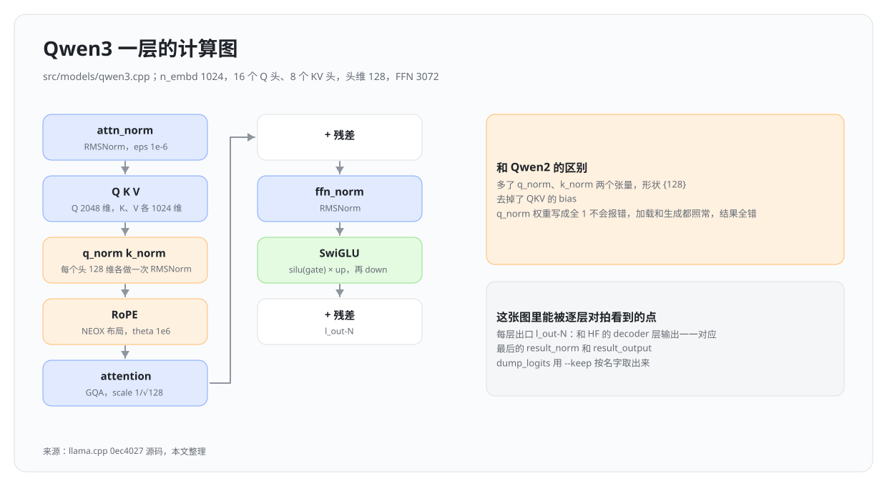
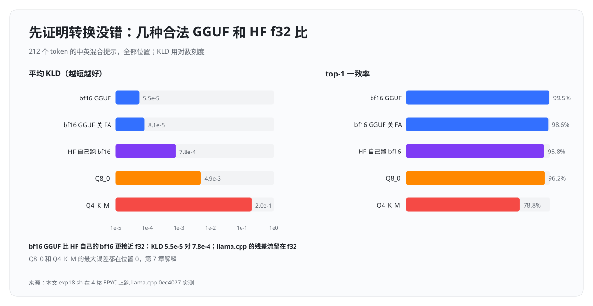
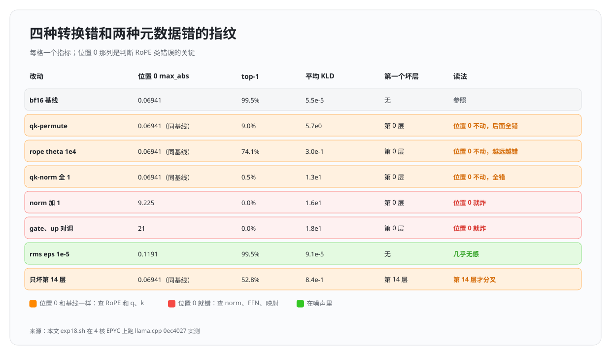
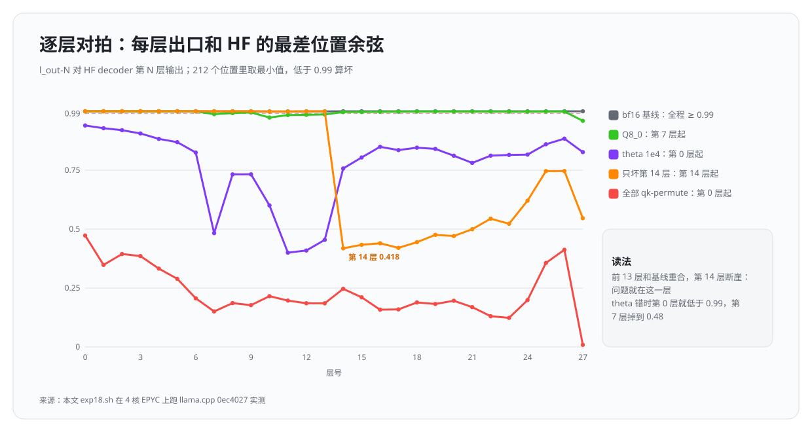
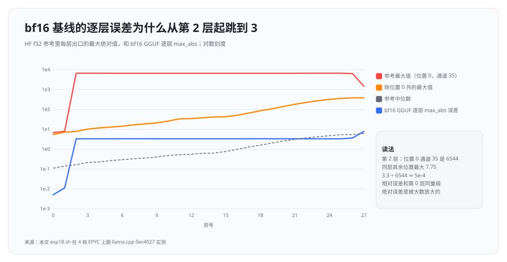
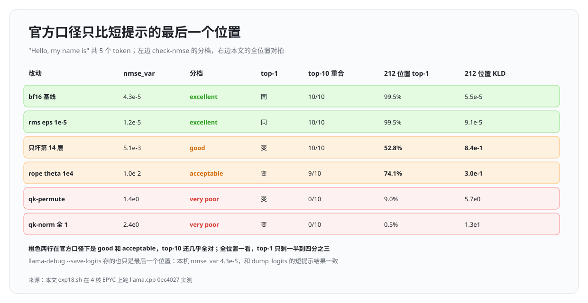
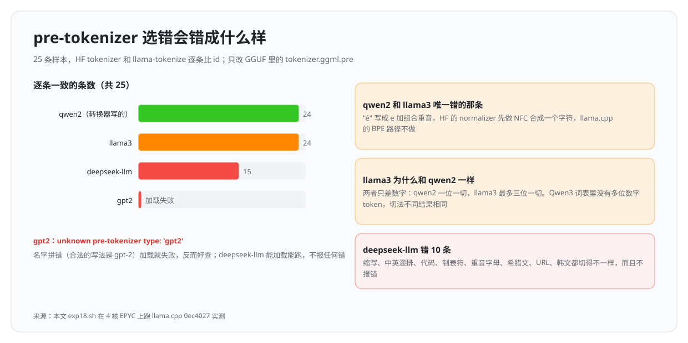
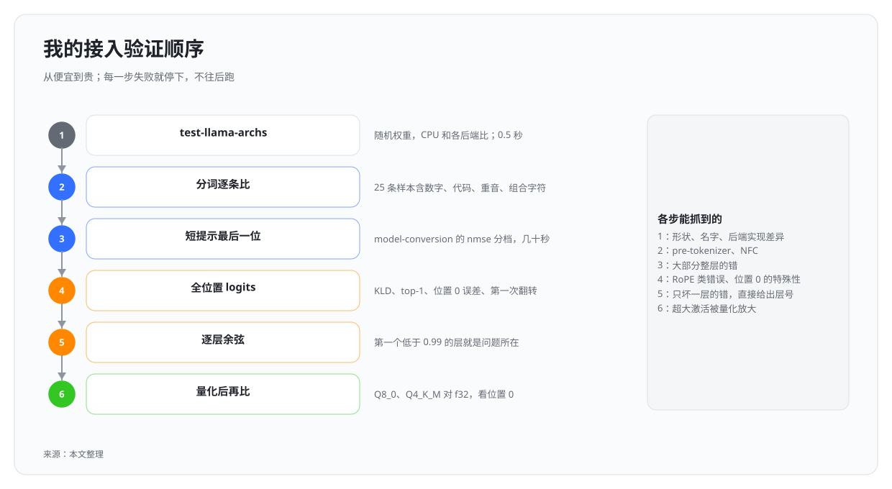

# LCPP-18｜内部｜新模型接入：转换、计算图和逐层对拍

> 🎯 **这篇文档解决什么问题**：我想让 llama.cpp 跑一个它还不认识的模型，要改哪几处代码，改完又怎么证明算得对。这篇拿已经支持的 Qwen3-0.6B 当标准答案，把接入的三层代码走一遍，再故意往 GGUF 里注入转换器常犯的四种错和两种元数据错，看每种错在 logits 和逐层输出上留下什么指纹，最后对照官方 model-conversion 流程，看它的短提示口径会放过哪些错。主线一句话：拿已支持的模型当标准答案，用位置 0 和逐层余弦给每种错定位，官方的短提示口径会放过整层的错。
>
> 使用方式：要接新架构，按第 1 到 3 章改代码，按第 10 章的顺序验证；转换出来结果不对，先看第 6 章的指纹表，再用第 7 章的逐层余弦找层号；只关心分词，看第 9 章。文中版本和数字核对于 2026 年 10 月 31 日。
>
> **代码**：[zero-to-llama/18-add-model](../18-add-model)。本篇不启动 llama-server，也不启动任何监听端口的程序。参考输出来自 HF transformers 的 f32 前向，待测输出来自自己写的 dump_logits，它通过 libllama 的 eval 回调取出每层出口；坏模型由 inject.py 原位改 GGUF 的字节生成，用完即删。基线是主干 0ec4027，模型是 Qwen3-0.6B（HF 权重和 bf16、Q8_0、Q4_K_M GGUF），机器是 4 核 EPYC 云主机无 GPU。

# 导读 · 先给结论

- **接一个架构要改三层代码。**Python 转换器登记 HF 类名并改张量名，llama-arch.cpp 登记架构名和张量表，src/models 下写计算图。Qwen3 在 Qwen2 的基础上只多了 q_norm、k_norm 两个张量，去掉了 QKV 的 bias，转换类对普通 Qwen3 只有四行[[1]](https://github.com/ggml-org/llama.cpp/blob/0ec4027/docs/development/HOWTO-add-model.md)[[2]](https://github.com/ggml-org/llama.cpp/blob/0ec4027/conversion/qwen.py)[[3]](https://arxiv.org/abs/2505.09388)。
- **bf16 GGUF 比 HF 自己的 bf16 更接近 f32 参考。**212 个位置的平均 KLD 是 5.5e-5 对 7.8e-4，top-1 一致率 99.5% 对 95.8%。llama.cpp 的权重是 bf16，残差流和累加留在 f32[[4]](https://arxiv.org/abs/1905.12322)[[5]](https://github.com/ggml-org/llama.cpp/blob/0ec4027/ggml/src/ggml-cpu/ggml-cpu.c)。
- **位置 0 是最便宜的指纹。**因果注意力在位置 0 只有一个 key，softmax 恒等于 1，q、k 和 RoPE 错成什么样都不影响输出。qk-permute、rope theta 写错、q_norm 全 1 三种错，位置 0 的 logits 和基线逐位相同；norm 和 FFN 的错在位置 0 就炸[[6]](https://arxiv.org/abs/2104.09864)[[7]](https://arxiv.org/abs/2203.16634)。
- **逐层余弦直接给出层号。**只坏第 14 层的 GGUF，第 13 层出口和 HF 的最差余弦还有 0.99938，第 14 层掉到 0.418。logits 只能告诉你错了，逐层对拍能告诉你错在哪[[8]](https://github.com/ggml-org/llama.cpp/tree/0ec4027/examples/eval-callback)。
- **官方短提示口径会放过整层的错。**“Hello, my name is”只比最后一个位置：只坏一层判 good，theta 写错判 acceptable，top-10 还几乎全对；放到 212 个位置上，top-1 只剩 52.8% 和 74.1%[[9]](https://github.com/ggml-org/llama.cpp/blob/0ec4027/examples/model-conversion/scripts/utils/check-nmse.py)[[10]](https://github.com/ggml-org/llama.cpp/blob/0ec4027/examples/model-conversion/scripts/causal/compare-logits.py)。
- **量化后最大误差在位置 0，根子是超大激活。**位置 0 通道 35 从第 2 层起是 6544，最后一层要被削到 1451；Q8_0 只削到 2317，位置 0 余弦从 0.99999 掉到 0.959。llama-perplexity 的 KLD 只统计窗口后一半，看不到这里[[11]](https://arxiv.org/abs/2402.17762)[[12]](https://github.com/ggml-org/llama.cpp/blob/0ec4027/tools/perplexity/perplexity.cpp)。
- **pre-tokenizer 选错不报错。**把 tokenizer.ggml.pre 改成 deepseek-llm，25 条样本错 10 条，模型照样加载照样生成；拼成 gpt2 反而加载就失败。转换器写的 qwen2 也错 1 条，因为 BPE 路径不做 NFC[[13]](https://github.com/ggml-org/llama.cpp/blob/0ec4027/src/llama-vocab.cpp)[[14]](https://unicode.org/reports/tr15/)。

**📎 与系列其他文档的分工**：GGUF 的文件结构见 [LCPP-04｜内部｜GGUF：文件结构、元数据、加载方式和分卷](./04-gguf.md)，ggml 计算图和 eval 回调见 [LCPP-05｜内部｜ggml 与计算图：建图、内存规划、调度和复用](./05-ggml-graph.md)，后端和 test-backend-ops 见 [LCPP-06｜内部｜后端与编译：CPU 变体、BLAS、repack 和 GPU 架构](./06-backends-build.md)，KLD 和噪声的测量方法见 [LCPP-03｜上手｜测量方法：llama-bench、PPL、KLD 和噪声](./03-bench-ppl.md)，量化类型见 [LCPP-07｜内部｜量化：块结构、配方、imatrix 和用 KLD 选类型](./07-quantization.md)。这篇只讲接入一个新架构时要改什么、怎么证明改对了；改完怎么写测试、怎么提 PR 放在 LCPP-19。

# 第 1 章 · 接一个架构要改哪三层

## 1.1 三层各管什么



我照着官方文档接一遍架构，先看它把活拆成了哪几步。官方的 HOWTO-add-model.md 把接入拆成三步[[1]](https://github.com/ggml-org/llama.cpp/blob/0ec4027/docs/development/HOWTO-add-model.md)。第一步在 Python 里：conversion 目录下加一个 ModelBase 子类，用 register 登记 HF config 里的 architectures 名字，set_gguf_parameters 写超参，set_vocab 写词表，modify_tensors 负责改名、重排和拆分。

gguf-py 里还要两处配合：constants.py 加 MODEL_ARCH 枚举和这个架构的张量清单，tensor_mapping.py 把 HF 的张量名映射到 GGUF 的名字[[15]](https://github.com/ggml-org/llama.cpp/blob/0ec4027/gguf-py/gguf/constants.py)[[16]](https://github.com/ggml-org/llama.cpp/blob/0ec4027/gguf-py/gguf/tensor_mapping.py)。2026 年 5 月的重构把原来一个文件里的几百个转换类拆进了 conversion 目录，入口仍是 convert_hf_to_gguf.py[[17]](https://github.com/ggml-org/llama.cpp/pull/17114)。

第二步在 C++ 的架构表里：llama-arch.h 加枚举，llama-arch.cpp 的 LLM_ARCH_NAMES 登记架构名字符串，张量名和元数据键也在这里[[18]](https://github.com/ggml-org/llama.cpp/blob/0ec4027/src/llama-arch.cpp)。llama-model.cpp 的 llama_model_rope_type 要给新架构选 RoPE 布局，llama_model_mapping 加一个 case 返回模型类[[19]](https://github.com/ggml-org/llama.cpp/blob/0ec4027/src/llama-model.cpp)。第三步写计算图：src/models 下一个文件，load_arch_hparams 读超参，load_arch_tensors 按形状建张量，build_arch_graph 把层串起来。

HOWTO 第二步最后一条提醒值得照做：grep 一遍 LLM_ARCH\_ 的所有用法，模型保存器和必填超参清单里漏掉新架构，是 test-llama-archs 在 CI 上失败的常见原因[[1]](https://github.com/ggml-org/llama.cpp/blob/0ec4027/docs/development/HOWTO-add-model.md)[[20]](https://github.com/ggml-org/llama.cpp/blob/0ec4027/tests/test-llama-archs.cpp)。架构名字符串一旦写进发布出去的 GGUF 就很难再改，社区已有的文件全按这个名字找实现，所以名字要在第一个 PR 里定好。

## 1.2 Qwen3 在三层的落点

Qwen3 的转换类在 conversion/qwen.py，继承 Qwen2Model，自己只声明了架构枚举，其余全部沿用父类[[2]](https://github.com/ggml-org/llama.cpp/blob/0ec4027/conversion/qwen.py)[[21]](https://github.com/ggml-org/llama.cpp/pull/12828)：

```python
@ModelBase.register("Qwen3ForCausalLM", "Qwen3Model")
@ModelBase.example("Qwen/Qwen3-8B")
class Qwen3Model(Qwen2Model):
    model_arch = gguf.MODEL_ARCH.QWEN3
```

类里后面那一大段是给 Qwen3-Reranker 用的：读 README 判断是不是重排模型，是的话从词表里找出 yes 和 no 两个 token，把 lm_head 的这两行取出来做分类头[[22]](https://github.com/ggml-org/llama.cpp/pull/15824)。普通的 Qwen3 走不到这些分支。架构表里对应 LLM_ARCH_QWEN3 和字符串 qwen3，llama-model.cpp 第 115 行的 case 返回 llama_model_qwen3，第 3637 行把它归进 NEOX 那一组 RoPE。计算图在 src/models/qwen3.cpp，一共 167 行[[23]](https://github.com/ggml-org/llama.cpp/blob/0ec4027/src/models/qwen3.cpp)。

## 1.3 先找最像的已有架构

新架构很少从零写。Qwen2、Qwen2.5 到 Qwen3 一脉相承，Qwen3 技术报告列出的结构改动只有两处：去掉 Qwen2 的 QKV bias，加上 QK-Norm[[24]](https://arxiv.org/abs/2407.10671)[[25]](https://arxiv.org/abs/2412.15115)[[3]](https://arxiv.org/abs/2505.09388)。所以接入时我先回答一个问题：和哪个已支持的架构最像，差在哪几个张量、哪几个算子。差得少就继承父类，转换器只覆盖差异；差得多再新写。社区讨论区里汇总过很多次接入经验，结论也是先找最近的亲戚[[26]](https://github.com/ggml-org/llama.cpp/discussions/2948)。

**📎 展开阅读：**HOWTO 的技巧一节有两条和转换相关。常量变换尽量在转换时折进权重，Gemma 3 把 norm 里的 1 加 w 在转换时加好，图里只做普通的 RMSNorm；张量重排也放进 modify_tensors[[1]](https://github.com/ggml-org/llama.cpp/blob/0ec4027/docs/development/HOWTO-add-model.md)[[27]](https://arxiv.org/abs/2403.08295)。例外是常数缩放 weight 乘 scale：缩放在概念上作用于激活，折进权重会改变权重的取值范围，量化更差，应该单独写一个元数据键在图里乘。RoPE 的变体尽量用 ggml_rope_ext 表达：Kimi-K2.5 的视觉 RoPE 靠转换时重排权重复用二维 RoPE[[28]](https://github.com/ggml-org/llama.cpp/pull/19170)，Gemma 4 的比例 RoPE 把最后几维的 rope_freqs 设成极大值让它们不转[[29]](https://github.com/ggml-org/llama.cpp/pull/21309)。

> 🔑 **本章要点**：三层代码各管一件事：转换器管名字和数据，架构表管名字和形状，计算图管算子。先找最像的已有架构，只写差异；架构名在第一个 PR 里定死。

# 第 2 章 · 把 Qwen3 转成 GGUF

## 2.1 一次转换的日志

```bash
python3 llama.cpp/convert_hf_to_gguf.py models/Qwen3-0.6B --outtype bf16 \
    --outfile models/conv/qwen3-bf16.gguf
python3 llama.cpp/convert_hf_to_gguf.py models/Qwen3-0.6B --outtype bf16 --dry-run
```

本机转换耗时 38.6 秒，峰值内存 1509 MiB，写出 311 个张量：198 个按 bf16 存，113 个一维的 norm 权重转成 f32。--dry-run 不写文件，只把张量清单和总大小 1.5G 打出来，21.7 秒、417 MiB；接新架构时我先跑它，名字映射漏了哪个张量，这一步就会报错退出，不用等十几 GB 写完。

超参从 config.json 读出来写进元数据：上下文 40960，n_embd 1024，FFN 3072，16 个 Q 头和 8 个 KV 头，rope theta 1000000，RMSNorm eps 1e-06。特殊 token 里 eos 是 151645，bos 和 pad 都是 151643。词表一共写了 151387 条 BPE 合并规则。键名的格式由 GGUF 规范统一，架构相关的键都以架构名开头，比如 qwen3.rope.freq_base[[30]](https://github.com/ggml-org/ggml/blob/master/docs/gguf.md)。

## 2.2 形状反着写

日志里 blk.0.attn_q.weight 的形状是 {1024, 2048}，PyTorch 里同一个张量是 [2048, 1024]。ggml 的 ne[0] 是最内层、变化最快的那一维，正好和 PyTorch 的形状反过来，HOWTO 专门写了一句提醒[[1]](https://github.com/ggml-org/llama.cpp/blob/0ec4027/docs/development/HOWTO-add-model.md)。qwen3.cpp 里建张量时写的也是 ggml 顺序：attn_q 是 n_embd 乘 n_embd_head_k 乘 n_head，q_norm 和 k_norm 是 {128}，每个头 128 维共用一份权重[[23]](https://github.com/ggml-org/llama.cpp/blob/0ec4027/src/models/qwen3.cpp)。形状写错时加载就会报张量形状不匹配，这类错反而好查。

输出层有个小细节。Qwen3-0.6B 的 config 写着 tie_word_embeddings 为真，safetensors 里却仍然存了一份 lm_head.weight，转换器照单全收，output.weight 和 token_embd.weight 都是 bf16 的 {1024, 151936}，各占 297 MiB。qwen3.cpp 把 output 标成可选，缺了才回退到 tok_embd；两份都在就各用各的，结果不受影响，只是文件多了 297 MiB[[23]](https://github.com/ggml-org/llama.cpp/blob/0ec4027/src/models/qwen3.cpp)。

## 2.3 词表指纹

set_vocab 最容易出问题的地方是 pre-tokenizer。转换器用一段固定的测试文本 chktxt 跑一遍 HF tokenizer，把得到的 id 序列取 sha256，再拿这个哈希去表里查名字；Qwen3 的哈希以 d4540891 开头，对应 qwen2[[31]](https://github.com/ggml-org/llama.cpp/blob/0ec4027/conversion/base.py)。

查不到就打一行警告并抛出 NotImplementedError，提示去更新 get_vocab_base_pre。新分词器的登记走 convert_hf_to_gguf_update.py，它下载各家 tokenizer 重算哈希、生成这张表[[32]](https://github.com/ggml-org/llama.cpp/blob/0ec4027/convert_hf_to_gguf_update.py)。这道门槛拦住了“查不到就随便选一个”，但拦不住人为改错，第 9 章会看到改错之后有多安静。

> 🔑 **本章要点**：转换先跑 --dry-run 看张量清单；形状按 ggml 顺序反着写；pre-tokenizer 靠哈希识别，查不到就停。本机一次 bf16 转换 38.6 秒、1509 MiB。

# 第 3 章 · Qwen3 的计算图

## 3.1 一层里有什么



Qwen3 的骨架和 LLaMA 一样是前置归一化的解码器：RMSNorm，注意力，残差，RMSNorm，SwiGLU，残差[[33]](https://arxiv.org/abs/1706.03762)[[34]](https://arxiv.org/abs/2302.13971)[[35]](https://arxiv.org/abs/1910.07467)[[36]](https://arxiv.org/abs/2002.05202)。注意力是分组查询，16 个 Q 头共用 8 组 K、V，每两个 Q 头读同一份 KV[[37]](https://arxiv.org/abs/2305.13245)。qwen3.cpp 的图里，build_qkv 算出 Q、K、V 三个张量，Q 和 K 各自先过一次按头的 RMSNorm，命名为 Qcur_normed 和 Kcur_normed，再交给 ggml_rope_ext；build_attn 的缩放因子写死成头维开方的倒数[[23]](https://github.com/ggml-org/llama.cpp/blob/0ec4027/src/models/qwen3.cpp)。

FFN 一行 build_ffn 搞定，参数 LLM_FFN_SILU 和 LLM_FFN_PAR 的意思是 gate 过 silu 后和 up 逐元素相乘，再乘 down。每层出口叫 l_out，最后的归一化叫 result_norm，lm_head 的输出叫 result_output。这些名字由 cb 函数挂到张量上，第 4 章的 dump_logits 和官方的 llama-eval-callback 都按名字取张量；新写的图里每个中间结果都应该 cb 一下，否则调试时看不到[[38]](https://github.com/ggml-org/llama.cpp/pull/4935)[[39]](https://github.com/ggml-org/llama.cpp/pull/6576)。

## 3.2 QK-Norm

q_norm 和 k_norm 是 Qwen3 相对 Qwen2 唯一新增的张量。QK-Norm 最早用来稳定注意力打分的尺度[[40]](https://arxiv.org/abs/2010.04245)。ViT-22B 在 220 亿参数规模上发现注意力 logit 会失控增长，给 Q、K 加 LayerNorm 后训练才稳下来[[41]](https://arxiv.org/abs/2302.05442)。小模型代理实验也复现了同样的不稳定，并验证 QK 归一化能缓解[[42]](https://arxiv.org/abs/2309.14322)。对推理来说它只是两次额外的 RMSNorm，位置在 RoPE 之前：先按头归一化，再旋转。

这两个张量在 qwen3.cpp 里是必填的，转换时漏掉会在加载阶段报缺张量。真正危险的是写错值：inject.py 把 28 层的 q_norm、k_norm 权重全改成 1，加载、生成都照常，第 6 章会看到它的 top-1 一致率只剩 0.5%。

## 3.3 NEOX 和 NORM 两种 RoPE 布局

RoPE 把 Q、K 的维度两两配对，按位置转一个角度[[6]](https://arxiv.org/abs/2104.09864)。配对方式有两种：原版 LLaMA 和 GPT-J 是相邻两维一对，llama.cpp 叫 NORM；HF 里常见的 rotate_half 是前一半和后一半配对，llama.cpp 叫 NEOX。LLaMA 的 HF 权重按 rotate_half 存，llama.cpp 却按 NORM 算，所以 conversion/llama.py 在转换时对 attn_q、attn_k 的行做一次 permute，把每个头的前后两半交错排开[[43]](https://github.com/ggml-org/llama.cpp/blob/0ec4027/conversion/llama.py)。Qwen 系列直接归进 NEOX，权重不用重排。

test_add_model.py 用 8 维小向量验证了这层关系：对 permute 过的向量做 NORM 旋转，等于先做 NEOX 旋转再 permute。反过来，把 LLaMA 式重排过的权重交给 NEOX 架构，位置 0 的打分不变，其余位置全错。从别的转换类复制代码时，最容易把这个 permute 一起带过来。

**📎 展开阅读：**图写完后最先跑 test-llama-archs。它用随机权重造一个小模型，在 CPU 和每个后端上各算一遍比 NMSE，再存盘、读回、重算一次，最后测混合批[[44]](https://github.com/ggml-org/llama.cpp/pull/19802)[[20]](https://github.com/ggml-org/llama.cpp/blob/0ec4027/tests/test-llama-archs.cpp)。本机只有 CPU，-a qwen3 一项 0.5 秒跑完，NMSE 0.00e+00，混合批 1.92e-08。它只证明各后端彼此一致、存取不丢东西，证明不了和 HF 一致；第 4 章往后的对拍补的就是这一块。2026 年 9 月起可以用 -b 只测指定后端[[45]](https://github.com/ggml-org/llama.cpp/pull/27372)。

> 🔑 **本章要点**：Qwen3 一层是 RMSNorm、GQA 注意力、SwiGLU 加两条残差，比 Qwen2 多了 RoPE 之前的 q_norm、k_norm。RoPE 布局选 NEOX，权重不重排；每个中间张量都用 cb 命名。test-llama-archs 只证明后端之间一致。

# 第 4 章 · 对拍工具：拿什么和什么比

## 4.1 两边各吐出什么

对拍要两份输出逐个位置比。参考侧是 hf_ref.py：HF transformers 用 f32 加载原始权重，把 212 个 token 的中英混合提示跑一遍，存下每个位置的 logits、每层 decoder 的输出和最后的 norm 输出[[46]](https://arxiv.org/abs/1910.03771)。层输出用 forward hook 取，没用 output_hidden_states，因为后者最后一项已经过了 norm，和 llama.cpp 的 l_out 对不上。本机 f32 加载 10.0 秒、前向 1.7 秒，峰值 4767 MiB。

待测侧是 dump_logits.cpp，一百多行，只链接 libllama。它把 hf_ref.py 写出的 token id 原样读进来，避免两边分词不同混进误差；n_ubatch 设成和上下文一样大，一个物理批算完，每个中间张量只有一份。--keep l_out,result_norm 通过 eval 回调按名字取张量，原样写成 float32[[8]](https://github.com/ggml-org/llama.cpp/tree/0ec4027/examples/eval-callback)[[38]](https://github.com/ggml-org/llama.cpp/pull/4935)。--kv 在加载时覆盖元数据，第 6 章改 rope theta 和 eps 就靠它，不用重写 GGUF。一次 bf16 对拍 6.1 秒、1769 MiB。

```bash
dump_logits -m qwen3-bf16.gguf -i ref18/f32/tokens.bin -o out18/bf16 -t 4 \
    --keep l_out,result_norm
python3 compare.py ref18/f32 out18/bf16 --layers --tag bf16 --json logs/compare.jsonl
```

## 4.2 主指标用全位置 KLD

| 指标 | 算法 | 看什么 |
|-|-|-|
| max_abs | 所有位置所有词表项的最大绝对差 | 最坏情况，容易被单个位置拉高 |
| nmse_var | mean((t−r)²) ÷ var(r) | 和官方 check-nmse.py 同一口径，便于对照分档 |
| pos0 | 位置 0 的 max_abs | 区分 RoPE 类错误和其余错误，第 6 章 |
| KLD | KL(softmax(r) ‖ softmax(t))，逐位置算再取均值和最大值 | 整个分布差多少，对 logit 平移不敏感 |
| top-1 | 两边 argmax 一致的位置比例 | 贪心解码会不会走岔 |
| first_flip | 第一个 argmax 不一致的位置 | 错误从多远开始显形 |
| 逐层余弦 | 每层出口和 HF 每层输出逐位置算余弦，取最小值 | 定位第一个坏层，第 7 章 |

KL 散度衡量的是用待测分布去近似参考分布时多花的信息量，参考在前[[47]](https://doi.org/10.1214/aoms/1177729694)。llama.cpp 的 llama-perplexity 也能算 KLD，加 --kl-divergence 就行，量化组一直用它评估新类型[[48]](https://github.com/ggml-org/llama.cpp/pull/5076)。但它只统计每个窗口的后一半位置，源码里写的是 first 等于 n_ctx 的一半，前一半只当上下文[[12]](https://github.com/ggml-org/llama.cpp/blob/0ec4027/tools/perplexity/perplexity.cpp)。评估量化时这样做合理，前面的位置上下文太短，噪声大；查转换错误时它会把位置 0 整个漏掉，所以我自己写了 compare.py，全部位置都算。

**📎 展开阅读：**为什么不直接比 logits 的 max_abs。logits 整体平移一个常数，softmax 不变，KLD 也不变，max_abs 却会很大；反过来 max_abs 小也可能在低概率的长尾上错得很多。我把 KLD 当主指标，max_abs 和 pos0 当辅助，top-1 和 first_flip 用来回答会不会影响生成。

> 🔑 **本章要点**：参考用 HF f32，待测用 libllama 的 eval 回调直接取张量，两边喂同一串 token id。主指标是全位置 KLD，pos0 和逐层余弦用来定位；llama-perplexity 的 KLD 只看窗口后一半，查转换错不够用。

# 第 5 章 · 基线：先证明转换没错

## 5.1 几种合法 GGUF 和 HF f32 比



第一组只对拍合法的文件，给后面的错误定一个噪声底。bf16 GGUF 和 HF f32 比，212 个位置平均 KLD 5.5e-5，最大 7.1e-4，top-1 一致率 99.5%，第一次翻转在位置 13，nmse_var 3.0e-5，落在 check-nmse.py 的 excellent 档。28 层的最差位置余弦全部高于 0.99999。

拿 HF 自己的 bf16 来比更有意思：平均 KLD 7.8e-4，是 bf16 GGUF 的 14 倍，top-1 95.8%，第一次翻转提前到位置 4。两者的权重完全一样，差在激活。HF 的 bf16 模式下整条残差流和每个中间结果都是 bf16，只有 8 位尾数，相对精度约 4e-3[[4]](https://arxiv.org/abs/1905.12322)；llama.cpp 的 CPU 后端做 bf16 矩阵乘时把激活转成 bf16 参与点积，但累加、残差相加和归一化都在 f32 里[[5]](https://github.com/ggml-org/llama.cpp/blob/0ec4027/ggml/src/ggml-cpu/ggml-cpu.c)。所以“GGUF 和 HF 的 bf16 对不上”不能直接当成转换有错，参考一定要用 f32。

## 5.2 关掉 Flash Attention

关掉 Flash Attention 后平均 KLD 8.1e-5，top-1 98.6%，和开着的 5.5e-5 同一量级，位置 0 的误差两者逐位相同。两条路径的 softmax 累加顺序不同，差出来的只是舍入，不影响结论。

## 5.3 量化以后

Q8_0 的平均 KLD 4.9e-3，top-1 96.2%；Q4_K_M 是 0.200 和 78.8%。这两个数本身没什么意外，异常的是位置：两者的 KLD 最大值都出在位置 0，Q8_0 是 0.428，Q4_K_M 是 7.37；logits 的 max_abs 也正好等于位置 0 的误差，5.33 和 20.36。bf16 的最大 KLD 在位置 195，和位置 0 没有关系。

逐层看，Q8_0 第一个低于 0.99 的层是第 7 层，Q4_K_M 从第 0 层就低于 0.99。0.99 这条线是给 bf16、f32 这种无损转换定的，量化模型本来就会越线，不能拿它判定量化文件有错。量化文件该和同一份 bf16 GGUF 比 KLD，用 llama-perplexity 的口径，再单独看一眼位置 0。位置 0 为什么特殊，第 7 章用超大激活解释。

> 🔑 **本章要点**：先用合法文件定噪声底：bf16 GGUF 对 HF f32 的 KLD 是 5.5e-5，比 HF 自己的 bf16 还小一个量级。参考必须是 f32。量化后的最大误差集中在位置 0，0.99 的逐层阈值只适用于无损转换。

# 第 6 章 · 六种错的指纹

## 6.1 注入了哪些错

inject.py 先整文件拷贝，再用 gguf-py 的 GGUFReader 以读写模式打开，原位改张量字节，元数据和张量顺序都不动。四种转换错都是我在别的转换类里见过的写法：

- qk-permute：对 attn_q、attn_k 套用 LLaMA 转换器的 permute，相当于把 NORM 布局的重排带进了 NEOX 架构
- norm-plus1：所有 RMSNorm 权重加 1，相当于把 Gemma 的 1 加 w 约定误用到 Qwen3
- qk-norm-one：q_norm、k_norm 权重全置 1，相当于转换时用缺省值顶替了这两个张量
- swap-gate-up：ffn_gate 和 ffn_up 对调，相当于映射表把两个名字写反

另外两种是元数据错，用 dump_logits 的 --kv 在加载时覆盖：rope theta 从 1e6 改成 LLaMA 2 时代常见的 1e4，RMSNorm eps 从 1e-6 改成 1e-5。第三个对照把 context_length 改成 512，结果和基线逐位相同，因为没有 RoPE 缩放时这个键只决定缺省上下文长度。每个坏 GGUF 生成要 25 秒左右，对拍完立刻删掉。

## 6.2 指纹表



看表的第一列。qk-permute、theta 1e4、qk-norm 全 1 三种错，位置 0 的 max_abs 都是 0.0694，和基线一个数字都不差。原因在因果注意力：位置 0 只能看见自己，softmax 只有一项，恒等于 1，注意力输出就是它自己的 V，和 Q、K 怎么算、怎么转都没有关系；RoPE 在位置 0 的转角又正好是 0[[6]](https://arxiv.org/abs/2104.09864)。所以凡是只动 Q、K 或位置编码的错，在位置 0 都看不见。去掉位置编码的模型也能从因果掩码里学到位置信息，说的是同一件事：位置 0 天然是特殊的[[7]](https://arxiv.org/abs/2203.16634)。

norm-plus1 和 swap-gate-up 动的是每个位置都要过的 RMSNorm 和 FFN，位置 0 的误差分别是 9.23 和 21.00，top-1 一致率是 0。于是有一条很便宜的分诊规则：位置 0 和基线一样，查 RoPE 布局、theta 和 q、k 相关的张量；位置 0 就错，查 norm、FFN 和名字映射。

## 6.3 越远越错和几乎无感

theta 写错的样子和 permute 不同。permute 从位置 1 就翻转，平均 KLD 5.70；theta 1e4 的平均 KLD 0.296，第一次翻转在位置 2，KLD 最大值出在位置 207，离开头越远错得越多。theta 决定每一维转多快，相邻位置的角度差很小，错的 theta 在短距离上近似对，距离一长就积累开。YaRN 一类的上下文扩展正是靠改这些频率实现的，rope 相关的元数据写错，症状都是越远越错[[49]](https://arxiv.org/abs/2309.00071)。

eps 改成 1e-5 的平均 KLD 是 9.1e-5，top-1 99.5%，和基线的 5.5e-5 处在同一噪声带。RMSNorm 里 eps 加在均方值上，隐状态的均方值远大于 1e-5 时，这个数改一个量级几乎没影响。这类错对拍查不出来，只能对着 config.json 核对元数据。

只看 logits 的 max_abs 会漏掉这条分诊信息。max_abs 往往出在后面的某个位置，和位置 0 的误差是两回事，pos0 要单独算、单独看，从 max_abs 里推不出来。

> 🔑 **本章要点**：位置 0 的注意力只看自己，Q、K 和 RoPE 的错在这里完全不显形。位置 0 和基线一样，查 RoPE 和 q、k。位置 0 就错，查 norm、FFN 和映射。越远越错，查 theta 和 rope 缩放元数据。eps 一类的小错要靠核对元数据。

# 第 7 章 · 逐层对拍和位置 0

## 7.1 第一个坏层



logits 只告诉你错了。逐层对拍把 l_out-0 到 l_out-27 和 HF 每层 decoder 的输出逐位置比余弦，每层取最差的那个位置，第一个低于 0.99 的层就是嫌疑最大的层。只在第 14 层套 permute 的那份 GGUF，第 13 层的最差余弦还有 0.99938，第 14 层一下掉到 0.418，最差位置是 21，和 logits 上 KLD 最大的位置是同一个。

坏层之后的余弦没有掉到 0，第 27 层还有 0.546。残差连接让每层只在主干上加一个增量，很多层的输入和输出余弦接近 1，ShortGPT 就是靠这个现象删层的[[50]](https://arxiv.org/abs/2403.03853)。所以单层的错既不会被后面的层抹掉，也不会被放大成全错，logits 上的表现是 top-1 52.8%，介于正常和全坏之间。theta 写错时第 0 层就低于 0.99，第 7 层掉到 0.483，第 11 层 0.400，每层都在错。

有了层号，再用 llama-eval-callback 或者 dump_logits 的 --keep 取这一层的 attn_norm、Qcur_normed、Kcur 等中间张量逐个比，就能落到具体算子[[8]](https://github.com/ggml-org/llama.cpp/tree/0ec4027/examples/eval-callback)。HF 那边对应地给子模块挂 hook。逐层对拍的前提是第 3 章说的：每个中间结果都用 cb 起了名字。

## 7.2 bf16 基线为什么从第 2 层起误差变大



bf16 基线的逐层 max_abs 在第 0、1 层是 0.005 和 0.011，第 2 层突然跳到 3.32，此后一直在这个量级，第 27 层 7.78。余弦却始终高于 0.99999。我用 massive.py 查了 HF 参考里每层出口的最大绝对值：从第 2 层起，位置 0 的第 35 号通道是 6544，同一层其余位置的最大值只有 7.75，中位数 0.164。

这就是超大激活：少数几个固定通道在开头的 token 上取到比中位数大四个数量级的值，作用相当于一个固定的偏置[[11]](https://arxiv.org/abs/2402.17762)。注意力汇聚也落在开头的 token 上，模型拿它当“什么都不看”时的去处[[51]](https://arxiv.org/abs/2309.17453)。bf16 的相对误差约 5e-4，作用在 6544 上就是 3 左右，max_abs 只是被这个大数放大了，相对误差和第 0 层同一量级。去掉位置 0 再看，第 2 层的最大误差只有 0.02。

## 7.3 量化误差为什么集中在位置 0

pos0.py 把位置 0 和其余位置分开算余弦。第 2 到 26 层，Q8_0 和 Q4_K_M 位置 0 的余弦都在 0.9999 以上，因为整条向量被通道 35 主导，别的通道错一些也看不出来。第 26 层通道 35 的参考值是 6320.2，Q8_0 是 6310.4，几乎一样。

变化发生在最后一层。参考里第 27 层要把通道 35 从 6320 削到 1451，Q8_0 只削到 2316.8，Q4_K_M 削到 2320.6，差了 860 多，正好是这两个模型第 27 层 max_abs 的来源。位置 0 的余弦随之掉到 0.959 和 0.455，去掉通道 35 再算是 0.925 和 0.117；同一层其余位置的余弦中位数还有 0.99974 和 0.987。这一层出口经过 result_norm 和 lm_head 变成 logits，位置 0 的 KLD 就成了全场最大。bf16 在第 27 层通道 35 是 1443.4，没有这个问题。

有一个细节指向原因。Q8_0 和 Q4_K_M 的权重精度差了将近一倍，通道 35 在第 27 层的值却只差 4，2316.8 对 2320.6。两者共同的地方是激活：CPU 上 Q8_0 权重做点积前把激活量化成 Q8_0，Q4_K 把激活量化成 Q8_K，都是 8 位，bf16 权重则把激活转成 bf16[[5]](https://github.com/ggml-org/llama.cpp/blob/0ec4027/ggml/src/ggml-cpu/ggml-cpu.c)。

我的推断是误差主要来自带着超大值的激活被 8 位分块量化那一步：一块里有一个特别大的数，缩放因子跟着它走，同块其余元素的有效位数就不够了。LLM.int8 记录过同样的现象，固定维度上的离群激活让按向量的 8 位量化失效[[52]](https://arxiv.org/abs/2208.07339)；后来的工作把这类离群值追到“什么都不做”的注意力头上，和注意力汇聚是同一来源[[53]](https://arxiv.org/abs/2306.12929)。

**📎 展开阅读：**这条推断还没有用实验单独验证，要验证可以只把最后一层的 ffn_down 留成 bf16 再量化，看位置 0 的误差是否消失。对接入新模型的实际意义有两点：量化后先单独看位置 0 的 KLD；llama-perplexity 的 KLD 不统计窗口前一半，看到的数字会比全位置的平均好看。

> 🔑 **本章要点**：逐层对拍给出第一个坏层，只坏第 14 层就在第 14 层断崖。bf16 基线的大 max_abs 来自位置 0 通道 35 的超大激活，相对误差没变。量化后最后一层削不掉这个超大值，位置 0 的余弦掉到 0.959 和 0.455，这就是最大 KLD 在位置 0 的原因。

# 第 8 章 · 官方口径只比最后一个位置

## 8.1 model-conversion 的流程

llama.cpp 自带一套转换验证脚本，放在 examples/model-conversion，用 make 目标串起来：先跑原模型，再转换，再跑转换后的模型，最后比 logits[[54]](https://github.com/ggml-org/llama.cpp/pull/15455)[[55]](https://github.com/ggml-org/llama.cpp/blob/0ec4027/examples/model-conversion/README.md)。README 开头有一条提醒我很认同：接同一家族的新版本之前，先确认上一版能通过 logits 验证，老模型里本来就可能有不影响生成的细小差异，事先找出来能省很多调试时间。

causal-verify-logits 这个目标做三件事。run-org-model.py 用 HF 跑原模型，缺省提示是“Hello, my name is”，只把最后一个位置的 logits 存下来[[56]](https://github.com/ggml-org/llama.cpp/blob/0ec4027/examples/model-conversion/scripts/causal/run-org-model.py)。run-converted-model.sh 调 llama-debug 加 --save-logits，同样只存最后一个位置[[57]](https://github.com/ggml-org/llama.cpp/pull/18464)[[58]](https://github.com/ggml-org/llama.cpp/tree/0ec4027/examples/debug)。compare-logits.py 打印两边的 top-10，check-nmse.py 算 NMSE 分档：低于 1e-2 判 PASS 返回 0，否则返回 1，要人看[[10]](https://github.com/ggml-org/llama.cpp/blob/0ec4027/examples/model-conversion/scripts/causal/compare-logits.py)[[9]](https://github.com/ggml-org/llama.cpp/blob/0ec4027/examples/model-conversion/scripts/utils/check-nmse.py)。

这一套本机都能跑，不需要监听端口。llama-debug 不加 -c 时按模型的 40960 上下文分配 KV，7.6 秒、峰值 5978 MiB；加 -c 512 降到 4.7 秒、1555 MiB，logits 逐位相同。它算出的 nmse_var 是 4.3e-5，和我用 dump_logits 只取最后一位的结果一样，说明两边的工具没有差异，差的只是看多少个位置。

```bash
# 官方口径：5 个 token，只看最后一位
llama-debug -m qwen3-bf16.gguf -p "Hello, my name is" --save-logits -c 512 -t 4
# 本文口径：同一份 GGUF 换成 212 个 token，看全部位置
dump_logits -m qwen3-bf16.gguf -i ref18/f32/tokens.bin -o out18/bf16 -t 4
```

## 8.2 哪些错会被放过



我把第 6 章的几种错放到短提示上重跑。“Hello, my name is”在 Qwen3 词表里是 5 个 token，id 是 [9707, 11, 847, 829, 374]。qk-permute 和 qk-norm 全 1 的 nmse_var 是 1.42 和 2.38，判 very poor，top-10 一个都不重合，官方口径一眼就能抓住。eps 改成 1e-5 判 excellent，和全位置对拍的结论一样，两种口径都看不出来。

麻烦在中间两行。只坏第 14 层的 GGUF，nmse_var 5.1e-3，判 good，check-nmse.py 返回 PASS；top-1 变了，top-10 却是 10/10。theta 写成 1e4 判 acceptable，nmse_var 1.0e-2，只超过 PASS 线一点，top-10 9/10。放到 212 个位置上，前者 top-1 一致率 52.8%，后者 74.1%。按参考的 token 往下喂，前者差不多每两个位置就有一个 argmax 和参考不同，后者每四个位置有一个。

原因有两层。短提示只有 5 个位置，theta 的错越远越大，在第 4 个位置还没积累起来；只坏一层的错被残差稀释，第 7 章看过它在 logits 上的影响介于正常和全坏之间。只看最后一个位置，等于只抽了一个样本，NMSE 的分档又是按“转换后多少会有点误差”定的，good 和 acceptable 本意是给量化留的余地，单层的结构性错误刚好落进这个区间。

## 8.3 当第一道筛子用

所以我把官方流程当第一道筛子：它便宜，几十秒，能抓住整体性的错。过了这道筛子，再用长提示全位置对拍，最后看逐层余弦。check-nmse.py 的提示语里也写了 acceptable 要“测一下生成质量”，可一段生成读起来通顺，并不能说明 top-1 只有 74% 的模型是对的。

> 🔑 **本章要点**：官方 model-conversion 流程用 5 个 token 的提示、只比最后一个位置。整体性的错能抓到；只坏一层判 good 并返回 PASS，theta 写错判 acceptable。过了官方口径，还要做全位置对拍和逐层余弦。

# 第 9 章 · 分词：选错了也不报错

## 9.1 pre-tokenizer 管什么



Qwen3 用字节级 BPE：先把文本按正则切成小段，每段再按合并规则拼成 token[[59]](https://arxiv.org/abs/1508.07909)[[60]](https://arxiv.org/abs/2005.14165)。第一步叫 pre-tokenizer，决定数字怎么切、空格跟前面还是后面、缩写的撇号算不算一段。llama.cpp 2024 年的一次重构把各家的切分正则都搬进了 llama-vocab.cpp，按 GGUF 里的 tokenizer.ggml.pre 选用[[61]](https://github.com/ggml-org/llama.cpp/pull/6920)[[13]](https://github.com/ggml-org/llama.cpp/blob/0ec4027/src/llama-vocab.cpp)。第 2 章说过，转换器靠哈希识别这个名字，查不到就停。

可转换器只管写，加载时不核对。我用 gguf_new_metadata.py 把 Qwen3 的 tokenizer.ggml.pre 分别改成 llama3、deepseek-llm 和 gpt2，其余字节不动，再拿 25 条样本让 HF tokenizer 和 llama-tokenize 逐条比 id。样本覆盖数字、缩写、代码、制表符、重音字母、组合字符、希腊文、俄文、韩文和 URL。

## 9.2 结果

deepseek-llm 只对 15 条，错 10 条。它的正则把英文字母、标点、中日韩字符各自成段，Qwen 的正则把撇号缩写单独成段：“I'm”在 HF 里切成 I 和 'm，在这里成了 I、撇号、m 三段；URL 的点和斜杠、代码里的括号也都拆开了。模型照样加载、照样生成，只是读到的 token 序列和训练时不一样，输出会变差，不会报错。

改成 gpt2 反而加载就失败，报 unknown pre-tokenizer type: 'gpt2'。合法的写法是 gpt-2，名字拼错进了 llama-vocab.cpp 的兜底分支直接抛异常。拼错名字好查，选错一个存在的名字最难查。

llama3 和转换器写的 qwen2 结果一样，都是 24/25。两者的正则只差数字：qwen2 一位数字一段，llama3 最多三位一段。Qwen3 的词表里没有多位数字的 token，三位一段的“123”在合并阶段还是会拆成 1、2、3，切法不同、结果相同。这说明 25 条样本也有盲区，换一个有多位数字 token 的词表，同样的改动就会暴露。

## 9.3 唯一的那条错：NFC

qwen2 和 llama3 共同错的那条是“é combining acute”，é 写成 e 加一个组合重音符。HF 的 Qwen2 tokenizer 先做 NFC 规范化，把两个码位合成一个 é[[14]](https://unicode.org/reports/tr15/)，再切分，得到 3 个 token；llama.cpp 得到 4 个，e 和重音分开。转换日志里有一行 Setting normalizer_nfc to True，GGUF 里也写进了 tokenizer.ggml.normalizer.nfc，可 0ec4027 的 llama-vocab.cpp 只在 UGM 分词器里读这个键做 NFC，BPE 路径不读。

这两处改动都是 2026 年 10 月合进去的：一个让 gguf-py 识别 tokenizer.json 里的 NFC 并写进元数据，一个给 Unigram 分词器加上可选的 NFC[[62]](https://github.com/ggml-org/llama.cpp/pull/30540)[[63]](https://github.com/ggml-org/llama.cpp/pull/30390)。BPE 这边还没有对应的实现。实际影响很小，从键盘输入的文本几乎都已经是 NFC，但如果你的数据来自 macOS 的文件名或者某些 PDF 抽取，组合字符会比想象中多。

官方的 test-tokenizer-0 拿仓库里的 ggml-vocab-qwen2.gguf 跑，0.4 秒通过[[64]](https://github.com/ggml-org/llama.cpp/blob/0ec4027/tests/test-tokenizer-0.cpp)。它只用词表文件，测的是 llama.cpp 的实现和登记时生成的期望输出一致，测不到你自己转换出来的 GGUF 里 pre 写的是什么。接新模型时我会另外准备一组覆盖上面这些类别的样本，直接用转换出的文件和 HF 逐条比。

> 🔑 **本章要点**：pre-tokenizer 选成另一个存在的名字，加载和生成都不报错，deepseek-llm 在 25 条里错 10 条；拼错名字反而加载失败。BPE 路径不做 NFC，组合字符会多切一个 token。分词要用转换出的 GGUF 和 HF 逐条比 id。

# 第 10 章 · 验证顺序和清单

## 10.1 从便宜到贵



六步按成本排：test-llama-archs 不到一秒，分词逐条比二十秒，官方短提示几十秒，全位置对拍每次十几秒，逐层余弦和全位置对拍是同一次运行多存几个张量，量化后再比要先量化。前一步不过就停，不往后跑，因为后面的步骤假设前面的都对：分词错了，logits 对拍的差异里会混进分词的差异，逐层余弦第 0 层就不对，层号就没有意义了。

## 10.2 按症状查

| 症状 | 先查什么 | 依据 |
|-|-|-|
| 加载时报张量缺失或形状不匹配 | 转换器的名字映射、load_arch_tensors 的形状，注意 ggml 顺序和 PyTorch 反过来 | 第 2 章：形状写错加载就报错 |
| 加载时报 unknown pre-tokenizer | tokenizer.ggml.pre 的拼写 | 第 9 章：gpt2 加载失败，合法的是 gpt-2 |
| 分词和 HF 逐条比有差 | pre 选的名字；组合字符的差异是 NFC，可以先放过 | 第 9 章：deepseek-llm 错 10 条，qwen2 只错 NFC 那条 |
| 位置 0 和基线相同、后面全错 | RoPE 布局 NORM 还是 NEOX，attn_q、attn_k 有没有多做 permute，q_norm、k_norm | 第 6 章：qk-permute 和 qk-norm 全 1 的位置 0 逐位相同 |
| 位置 0 就错 | norm 权重的约定（是否加 1）、FFN 的 gate、up 映射 | 第 6 章：norm 加 1、gate up 对调 top-1 为 0 |
| 越远越错 | rope theta、rope 缩放相关的元数据 | 第 6 章：theta 1e4 第一次翻转在位置 2 |
| top-1 一半左右，前面的层都对 | 逐层余弦找第一个低于 0.99 的层，再取该层的中间张量 | 第 7 章：只坏第 14 层时第 14 层断崖 |
| 量化后最大误差在位置 0 | 先单独看位置 0 的 KLD，和同一份 bf16 GGUF 比 | 第 7 章：最后一层削不掉超大激活 |

表里的数字来自一个 0.6B 的 Qwen3 和一份 212 个 token 的提示，换模型以后阈值要重新定：先用合法的 bf16 GGUF 跑出噪声底，再拿同一套指标看待测文件。分诊规则本身只依赖因果注意力和残差连接，对其他解码器架构同样适用。

## 10.3 清单和下一步

> 📌 **上线前核对清单**：接一个新架构，我按这个顺序过一遍。
> - 找最像的已有架构，转换类只覆盖差异；架构名在第一个 PR 里定死
> - 转换先跑 --dry-run，张量清单和形状对上再真正写文件
> - 新写的计算图里每个中间结果都用 cb 命名，RoPE 布局在 llama_model_rope_type 里选对
> - test-llama-archs 加上新架构，CPU 和各后端一致、存取一致
> - 用转换出的 GGUF 和 HF 逐条比分词，样本覆盖数字、缩写、代码、空白、重音、多语种和 URL
> - 跑一次官方 causal-verify-logits，再用长提示做全位置对拍：KLD、top-1、位置 0、第一次翻转
> - 参考一律用 HF f32；不合格时看位置 0 分诊，再用逐层余弦找层号
> - 量化后和 bf16 GGUF 比，单独看位置 0；rope theta、eps 一类元数据对着 config.json 逐项核对

改完的代码怎么写测试、test-backend-ops 怎么覆盖新算子、性能改动怎么用 compare-llama-bench 证明、PR 怎么写，放在 LCPP-19。GGUF 的文件结构回到 [LCPP-04｜内部｜GGUF：文件结构、元数据、加载方式和分卷](./04-gguf.md)，计算图和 eval 回调回到 [LCPP-05｜内部｜ggml 与计算图：建图、内存规划、调度和复用](./05-ggml-graph.md)，KLD 的测量方法回到 [LCPP-03｜上手｜测量方法：llama-bench、PPL、KLD 和噪声](./03-bench-ppl.md)。

# 参考文献

按正文首次引用顺序编号，资料截至 2026 年 10 月初。

[1] llama.cpp 0ec4027. docs/development/HOWTO-add-model.md：新架构接入的三步和提示。 [HOWTO-add-model.md](https://github.com/ggml-org/llama.cpp/blob/0ec4027/docs/development/HOWTO-add-model.md)

[2] llama.cpp 0ec4027. conversion/qwen.py：Qwen2 和 Qwen3 的转换类。 [conversion/qwen.py](https://github.com/ggml-org/llama.cpp/blob/0ec4027/conversion/qwen.py)

[3] Yang A et al. Qwen3 Technical Report. arXiv 2025. [arXiv:2505.09388](https://arxiv.org/abs/2505.09388)

[4] Kalamkar D et al. A Study of BFLOAT16 for Deep Learning Training. arXiv 2019. [arXiv:1905.12322](https://arxiv.org/abs/1905.12322)

[5] llama.cpp 0ec4027. ggml/src/ggml-cpu/ggml-cpu.c：各权重类型做点积前把激活转成的 vec_dot_type。 [ggml-cpu.c](https://github.com/ggml-org/llama.cpp/blob/0ec4027/ggml/src/ggml-cpu/ggml-cpu.c)

[6] Su J et al. RoFormer: Enhanced Transformer with Rotary Position Embedding. Neurocomputing, 2024. [arXiv:2104.09864](https://arxiv.org/abs/2104.09864)

[7] Haviv A et al. Transformer Language Models without Positional Encodings Still Learn Positional Information. Findings of EMNLP 2022. [arXiv:2203.16634](https://arxiv.org/abs/2203.16634)

[8] llama.cpp 0ec4027. examples/eval-callback：逐个张量打印计算结果。 [examples/eval-callback](https://github.com/ggml-org/llama.cpp/tree/0ec4027/examples/eval-callback)

[9] llama.cpp 0ec4027. examples/model-conversion/scripts/utils/check-nmse.py：NMSE 分档。 [check-nmse.py](https://github.com/ggml-org/llama.cpp/blob/0ec4027/examples/model-conversion/scripts/utils/check-nmse.py)

[10] llama.cpp 0ec4027. examples/model-conversion/scripts/causal/compare-logits.py：最后一个位置的快速比对。 [compare-logits.py](https://github.com/ggml-org/llama.cpp/blob/0ec4027/examples/model-conversion/scripts/causal/compare-logits.py)

[11] Sun M et al. Massive Activations in Large Language Models. COLM 2024. [arXiv:2402.17762](https://arxiv.org/abs/2402.17762)

[12] llama.cpp 0ec4027. tools/perplexity/perplexity.cpp：PPL 和 KLD 只统计每个窗口的后一半位置。 [perplexity.cpp](https://github.com/ggml-org/llama.cpp/blob/0ec4027/tools/perplexity/perplexity.cpp)

[13] llama.cpp 0ec4027. src/llama-vocab.cpp：pre-tokenizer 正则和加载检查。 [llama-vocab.cpp](https://github.com/ggml-org/llama.cpp/blob/0ec4027/src/llama-vocab.cpp)

[14] Unicode Consortium. Unicode Standard Annex #15: Unicode Normalization Forms. [UAX #15](https://unicode.org/reports/tr15/)

[15] llama.cpp 0ec4027. gguf-py/gguf/constants.py：MODEL_ARCH 和张量清单。 [constants.py](https://github.com/ggml-org/llama.cpp/blob/0ec4027/gguf-py/gguf/constants.py)

[16] llama.cpp 0ec4027. gguf-py/gguf/tensor_mapping.py：HF 张量名到 GGUF 张量名。 [tensor_mapping.py](https://github.com/ggml-org/llama.cpp/blob/0ec4027/gguf-py/gguf/tensor_mapping.py)

[17] pwilkin. Refactor: convert_hf_to_gguf.py. llama.cpp PR #17114, 2026. [PR #17114](https://github.com/ggml-org/llama.cpp/pull/17114)

[18] llama.cpp 0ec4027. src/llama-arch.cpp：架构名、元数据键和张量名。 [llama-arch.cpp](https://github.com/ggml-org/llama.cpp/blob/0ec4027/src/llama-arch.cpp)

[19] llama.cpp 0ec4027. src/llama-model.cpp：架构到模型类的映射和 rope 类型。 [llama-model.cpp](https://github.com/ggml-org/llama.cpp/blob/0ec4027/src/llama-model.cpp)

[20] llama.cpp 0ec4027. tests/test-llama-archs.cpp：随机权重下各架构的一致性测试。 [test-llama-archs.cpp](https://github.com/ggml-org/llama.cpp/blob/0ec4027/tests/test-llama-archs.cpp)

[21] bozheng-hit. Support Qwen3 and Qwen3MoE. llama.cpp PR #12828, 2025. [PR #12828](https://github.com/ggml-org/llama.cpp/pull/12828)

[22] iamlemec. Add support for Qwen3-Reranker. llama.cpp PR #15824, 2025. [PR #15824](https://github.com/ggml-org/llama.cpp/pull/15824)

[23] llama.cpp 0ec4027. src/models/qwen3.cpp：Qwen3 的超参、张量和计算图。 [qwen3.cpp](https://github.com/ggml-org/llama.cpp/blob/0ec4027/src/models/qwen3.cpp)

[24] Yang A et al. Qwen2 Technical Report. arXiv 2024. [arXiv:2407.10671](https://arxiv.org/abs/2407.10671)

[25] Qwen Team. Qwen2.5 Technical Report. arXiv 2024. [arXiv:2412.15115](https://arxiv.org/abs/2412.15115)

[26] llama.cpp Discussion #2948：如何接入新模型的讨论汇总。 [Discussion #2948](https://github.com/ggml-org/llama.cpp/discussions/2948)

[27] Gemma Team. Gemma: Open Models Based on Gemini Research and Technology. arXiv 2024. [arXiv:2403.08295](https://arxiv.org/abs/2403.08295)

[28] AesSedai. Add Kimi-K2.5 support. llama.cpp PR #19170, 2026. [PR #19170](https://github.com/ggml-org/llama.cpp/pull/19170)

[29] ngxson. model: support gemma 4 (vision + moe, no audio). llama.cpp PR #21309, 2026. [PR #21309](https://github.com/ggml-org/llama.cpp/pull/21309)

[30] ggml-org. GGUF 文件格式规范。ggml docs/gguf.md。 [gguf.md](https://github.com/ggml-org/ggml/blob/master/docs/gguf.md)

[31] llama.cpp 0ec4027. conversion/base.py：ModelBase 和 pre-tokenizer 指纹。 [conversion/base.py](https://github.com/ggml-org/llama.cpp/blob/0ec4027/conversion/base.py)

[32] llama.cpp 0ec4027. convert_hf_to_gguf_update.py：登记新分词器的指纹。 [convert_hf_to_gguf_update.py](https://github.com/ggml-org/llama.cpp/blob/0ec4027/convert_hf_to_gguf_update.py)

[33] Vaswani A et al. Attention Is All You Need. NeurIPS 2017. [arXiv:1706.03762](https://arxiv.org/abs/1706.03762)

[34] Touvron H et al. LLaMA: Open and Efficient Foundation Language Models. arXiv 2023. [arXiv:2302.13971](https://arxiv.org/abs/2302.13971)

[35] Zhang B, Sennrich R. Root Mean Square Layer Normalization. NeurIPS 2019. [arXiv:1910.07467](https://arxiv.org/abs/1910.07467)

[36] Shazeer N. GLU Variants Improve Transformer. arXiv 2020. [arXiv:2002.05202](https://arxiv.org/abs/2002.05202)

[37] Ainslie J et al. GQA: Training Generalized Multi-Query Transformer Models from Multi-Head Checkpoints. EMNLP 2023. [arXiv:2305.13245](https://arxiv.org/abs/2305.13245)

[38] ggerganov. backend : add eval callback. llama.cpp PR #4935, 2024. [PR #4935](https://github.com/ggml-org/llama.cpp/pull/4935)

[39] phymbert. eval-callback: Example how to use eval callback for debugging. llama.cpp PR #6576, 2024. [PR #6576](https://github.com/ggml-org/llama.cpp/pull/6576)

[40] Henry A et al. Query-Key Normalization for Transformers. Findings of EMNLP 2020. [arXiv:2010.04245](https://arxiv.org/abs/2010.04245)

[41] Dehghani M et al. Scaling Vision Transformers to 22 Billion Parameters. ICML 2023. [arXiv:2302.05442](https://arxiv.org/abs/2302.05442)

[42] Wortsman M et al. Small-scale Proxies for Large-scale Transformer Training Instabilities. ICLR 2024. [arXiv:2309.14322](https://arxiv.org/abs/2309.14322)

[43] llama.cpp 0ec4027. conversion/llama.py：LLaMA 转换器的 q、k 重排。 [conversion/llama.py](https://github.com/ggml-org/llama.cpp/blob/0ec4027/conversion/llama.py)

[44] JohannesGaessler. llama: end-to-end tests. llama.cpp PR #19802, 2026. [PR #19802](https://github.com/ggml-org/llama.cpp/pull/19802)

[45] yomaytk. tests: add -b/--backend option to test-llama-archs. llama.cpp PR #27372, 2026. [PR #27372](https://github.com/ggml-org/llama.cpp/pull/27372)

[46] Wolf T et al. Transformers: State-of-the-Art Natural Language Processing. EMNLP 2020 Demos. [arXiv:1910.03771](https://arxiv.org/abs/1910.03771)

[47] Kullback S, Leibler R A. On Information and Sufficiency. Ann. Math. Statist. 22(1), 1951. [doi:10.1214/aoms/1177729694](https://doi.org/10.1214/aoms/1177729694)

[48] ikawrakow. KL-divergence. llama.cpp PR #5076, 2024. [PR #5076](https://github.com/ggml-org/llama.cpp/pull/5076)

[49] Peng B et al. YaRN: Efficient Context Window Extension of Large Language Models. ICLR 2024. [arXiv:2309.00071](https://arxiv.org/abs/2309.00071)

[50] Men X et al. ShortGPT: Layers in Large Language Models are More Redundant Than You Expect. arXiv 2024. [arXiv:2403.03853](https://arxiv.org/abs/2403.03853)

[51] Xiao G et al. Efficient Streaming Language Models with Attention Sinks. ICLR 2024. [arXiv:2309.17453](https://arxiv.org/abs/2309.17453)

[52] Dettmers T et al. LLM.int8(): 8-bit Matrix Multiplication for Transformers at Scale. NeurIPS 2022. [arXiv:2208.07339](https://arxiv.org/abs/2208.07339)

[53] Bondarenko Y et al. Quantizable Transformers: Removing Outliers by Helping Attention Heads Do Nothing. NeurIPS 2023. [arXiv:2306.12929](https://arxiv.org/abs/2306.12929)

[54] danbev. examples : add model conversion tool/example. llama.cpp PR #15455, 2025. [PR #15455](https://github.com/ggml-org/llama.cpp/pull/15455)

[55] llama.cpp 0ec4027. examples/model-conversion/README.md：转换和验证流程。 [model-conversion README](https://github.com/ggml-org/llama.cpp/blob/0ec4027/examples/model-conversion/README.md)

[56] llama.cpp 0ec4027. examples/model-conversion/scripts/causal/run-org-model.py：HF 原模型的参考前向。 [run-org-model.py](https://github.com/ggml-org/llama.cpp/blob/0ec4027/examples/model-conversion/scripts/causal/run-org-model.py)

[57] danbev. examples : add debug utility/example. llama.cpp PR #18464, 2026. [PR #18464](https://github.com/ggml-org/llama.cpp/pull/18464)

[58] llama.cpp 0ec4027. examples/debug：llama-debug，保存 logits 和中间张量。 [examples/debug](https://github.com/ggml-org/llama.cpp/tree/0ec4027/examples/debug)

[59] Sennrich R, Haddow B, Birch A. Neural Machine Translation of Rare Words with Subword Units. ACL 2016. [arXiv:1508.07909](https://arxiv.org/abs/1508.07909)

[60] Brown T et al. Language Models are Few-Shot Learners. NeurIPS 2020. [arXiv:2005.14165](https://arxiv.org/abs/2005.14165)

[61] ggerganov. llama : improve BPE pre-processing + LLaMA 3 and Deepseek support. llama.cpp PR #6920, 2024. [PR #6920](https://github.com/ggml-org/llama.cpp/pull/6920)

[62] CISC. gguf-py : detect nfc normalization. llama.cpp PR #30540, 2026. [PR #30540](https://github.com/ggml-org/llama.cpp/pull/30540)

[63] sandrohanea. unicode : add opt-in NFC normalization for Unigram tokenizers. llama.cpp PR #30390, 2026. [PR #30390](https://github.com/ggml-org/llama.cpp/pull/30390)

[64] llama.cpp 0ec4027. tests/test-tokenizer-0.cpp：分词回归测试。 [test-tokenizer-0.cpp](https://github.com/ggml-org/llama.cpp/blob/0ec4027/tests/test-tokenizer-0.cpp)

---

上一章：[LCPP-17｜内部｜调参手册：默认值、误配、按症状查参数和上线清单](./17-tuning-playbook.md) · [目录](./README.md) · 下一章：[LCPP-19｜内部｜测试与贡献：ctest、test-backend-ops、性能对比和 PR](./19-test-contrib.md)
