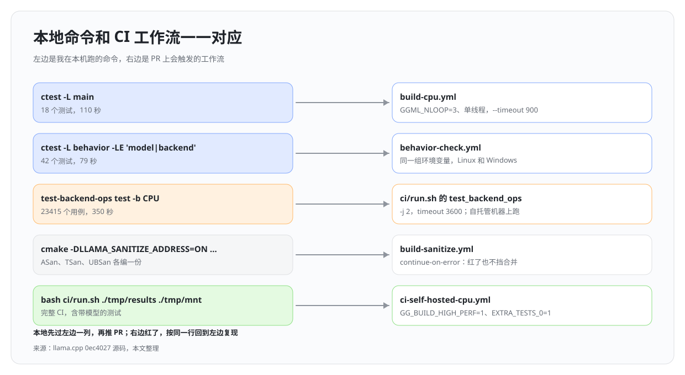
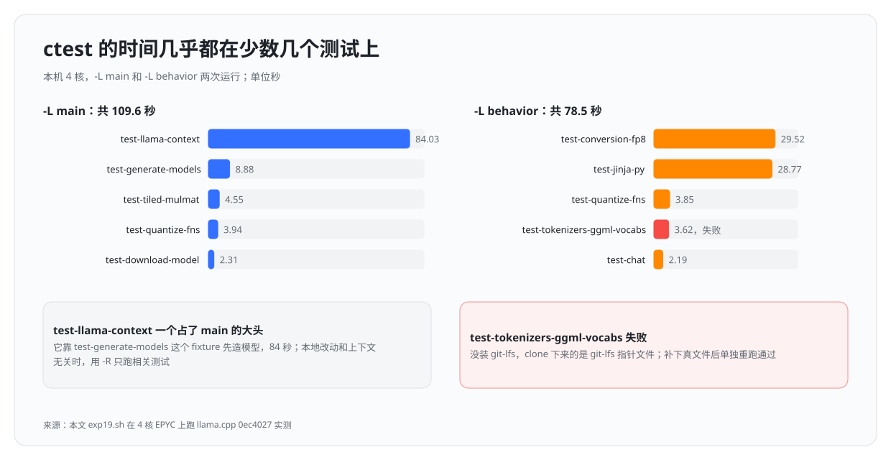
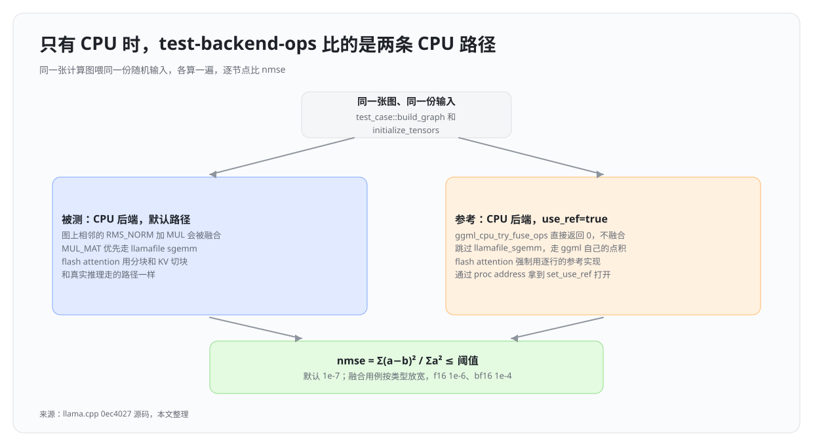
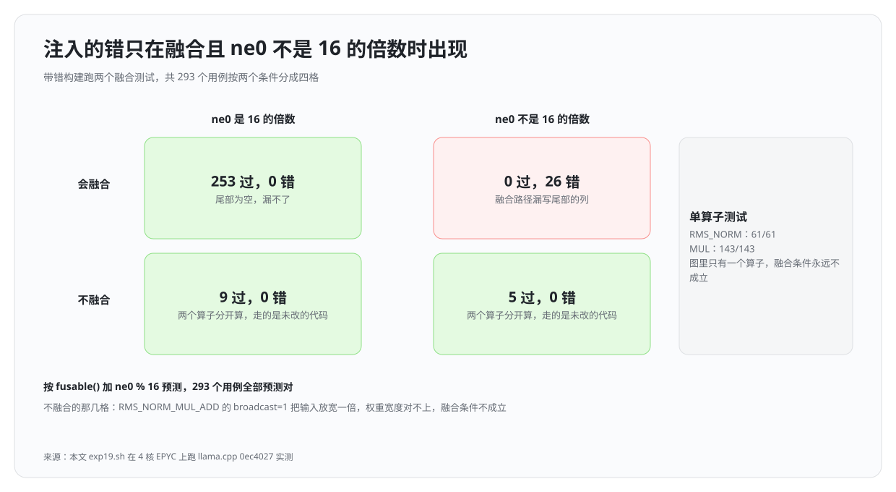
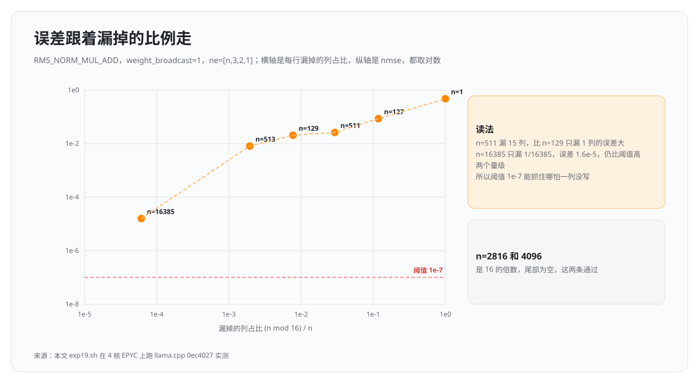
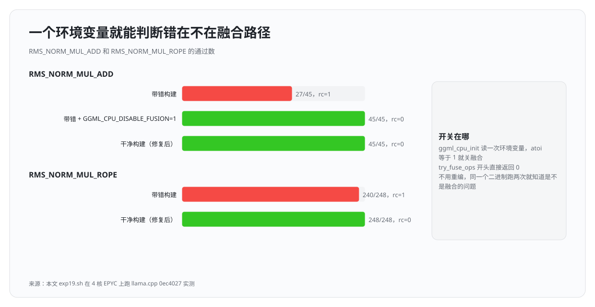
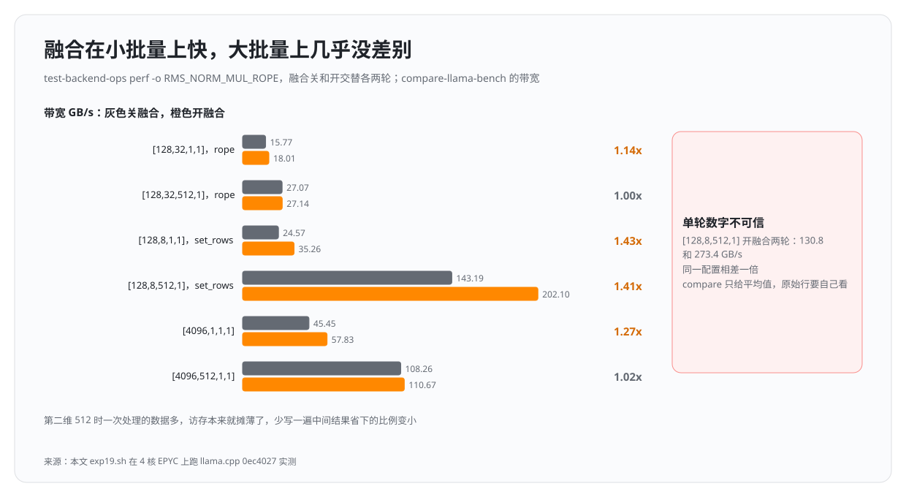
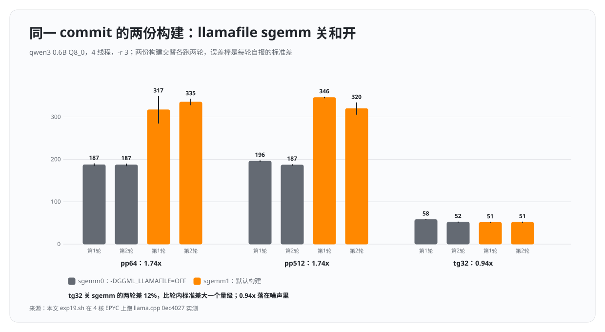
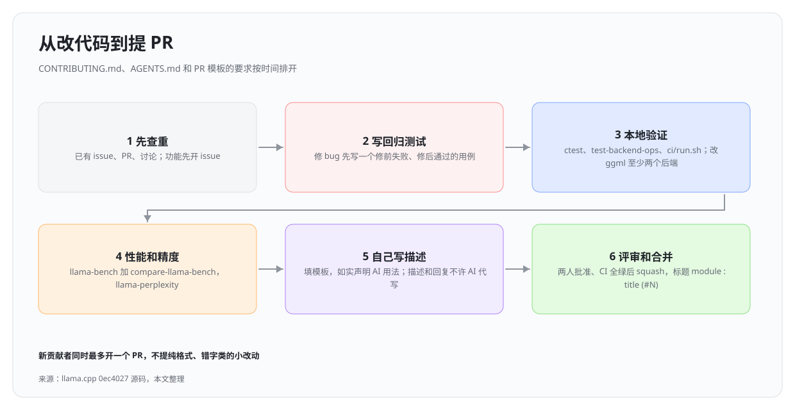

# LCPP-19｜内部｜测试与贡献：ctest、test-backend-ops、性能对比和 PR

> 🎯 **这篇文档解决什么问题**：改完 llama.cpp 的代码，本地要跑哪些测试才敢提 PR，CI 红了怎么回到本机复现，性能改动又拿什么证明。这篇把 ctest 的标签、test-backend-ops 的比对原理、compare-llama-bench 的 A/B 流程挨个跑一遍；为了看清测试到底能抓住什么，我往 CPU 的 RMS_NORM 加 MUL 融合内核里故意注入一个漏写尾部的错，看哪些测试抓得住、哪些抓不住，最后对照贡献指南把提 PR 的步骤排成一张清单。主线一句话：本地命令和 CI 一一对应，单算子测试看不见融合路径里的错，性能结论要靠多轮 A/B。
>
> 使用方式：只想知道本地跑什么，看第 1 章的对照图和第 10 章的清单；改了 ggml 算子，看第 4 到 7 章；要证明性能改动，看第 8、9 章。文中版本和数字核对于 2026 年 10 月 31 日。
>
> **代码**：[zero-to-llama/19-test-contrib](../19-test-contrib)。本篇不启动 llama-server，也不启动任何监听端口的程序；ctest 一律加 -E test-model-resolution，因为它会绑一个随机端口。注入错误的构建放在单独的目录，用完即删。基线是主干 0ec4027，模型是 Qwen3-0.6B Q8_0 GGUF（只在第 9 章的 llama-bench 用到），机器是 4 核 EPYC 云主机无 GPU。

# 导读 · 先给结论

- **本地命令和 CI 工作流一一对应。**build-cpu 跑 ctest -L main，behavior-check 跑 -L behavior 并排除 model 和 backend 标签，自托管机器上跑完整的 ci/run.sh，sanitizer 三种构建红了也不挡合并。本机 -L main 共 18 个测试 110 秒，其中 test-llama-context 一个占 84 秒[[1]](https://github.com/ggml-org/llama.cpp/blob/0ec4027/.github/workflows/build-cpu.yml)[[2]](https://github.com/ggml-org/llama.cpp/blob/0ec4027/.github/workflows/behavior-check.yml)[[3]](https://github.com/ggml-org/llama.cpp/blob/0ec4027/.github/workflows/ci-self-hosted-cpu.yml)[[4]](https://github.com/ggml-org/llama.cpp/blob/0ec4027/.github/workflows/build-sanitize.yml)。
- **只有 CPU 时，test-backend-ops 比的是两条 CPU 路径。**被测是默认路径，会融合、会走 llamafile sgemm；参考是 use_ref 打开的 CPU 后端，三者都关掉。全量 23415 个用例 350 秒全部通过，覆盖 150 个算子[[5]](https://github.com/ggml-org/llama.cpp/blob/0ec4027/tests/test-backend-ops.cpp)[[6]](https://github.com/ggml-org/llama.cpp/blob/0ec4027/ggml/src/ggml-cpu/ggml-cpu.c)[[7]](https://github.com/ggml-org/llama.cpp/blob/0ec4027/ggml/src/ggml-cpu/ggml-cpu.cpp)。
- **单算子测试看不见融合路径里的错。**注入错误后 RMS_NORM 单测 61/61、MUL 单测 143/143 全过，两个融合测试是 27/45 和 240/248。逐节点比对时每次只算一个节点，融合条件永远不成立[[8]](https://github.com/ggml-org/llama.cpp/blob/0ec4027/ggml/src/ggml-cpu/ops.cpp)[[9]](https://github.com/ggml-org/llama.cpp/pull/22423)。
- **失败的用例可以逐条预测。**融合且 ne0 不是 16 的倍数就错，否则就过，两个测试 293 个用例全部预测对。误差跟着每行漏掉的比例走，漏 1/16385 时 nmse 仍有 1.6e-5，比阈值 1e-7 高两个量级，一列没写也逃不掉。
- **一个环境变量就能判断错在不在融合路径。**同一个二进制加 GGML_CPU_DISABLE_FUSION=1，45/45 全过；修 bug 的 PR 必须带一个修前失败、修后通过的用例[[10]](https://github.com/ggml-org/llama.cpp/blob/0ec4027/CONTRIBUTING.md)。
- **单轮性能数字不可信。**同一配置开融合跑两轮，带宽差一倍；关 sgemm 的 tg32 两轮差 12%，比轮内标准差大一个量级。我交替跑两份构建，再用 compare-llama-bench 取平均[[11]](https://doi.org/10.1145/1508244.1508275)[[12]](https://github.com/ggml-org/llama.cpp/blob/0ec4027/scripts/compare-llama-bench.py)。
- **llamafile sgemm 在提示处理上快 1.74 倍。**Qwen3-0.6B Q8_0 四线程，pp512 从 191 到 333 t/s；tg32 的 0.94x 落在噪声里，不能当成回退[[13]](https://github.com/ggml-org/llama.cpp/pull/6414)。

**📎 与系列其他文档的分工**：llama-bench、PPL、KLD 的测量方法和噪声见 [LCPP-03｜上手｜测量方法：llama-bench、PPL、KLD 和噪声](./03-bench-ppl.md)，ggml 计算图和调度见 [LCPP-05｜内部｜ggml 与计算图：建图、内存规划、调度和复用](./05-ggml-graph.md)，CPU 后端的变体和 test-backend-ops 的基本用法见 [LCPP-06｜内部｜后端与编译：CPU 变体、BLAS、repack 和 GPU 架构](./06-backends-build.md)，接入新架构后的逐层对拍见 [LCPP-18｜内部｜新模型接入：转换、计算图和逐层对拍](./18-add-model.md)。这篇只讲改完代码以后怎么测、怎么比、怎么提 PR，是系列的最后一篇。

# 第 1 章 · 测试地图：本地命令和 CI 一一对应

## 1.1 PR 上会跑什么



改完代码准备提 PR，我得先知道推上去以后 CI 会跑什么，本地才能对着跑。推上去以后，和 CPU 有关的检查主要有四类。build-cpu.yml 编译后跑 ctest -L main --verbose --timeout 900，环境变量里固定了 GGML_NLOOP=3 和 GGML_N_THREADS=1[[1]](https://github.com/ggml-org/llama.cpp/blob/0ec4027/.github/workflows/build-cpu.yml)。behavior-check.yml 是 2026 年 10 月才加的，跑 ctest -L behavior -LE 'model|backend'，Linux 用 ARM 机器、关掉 GGML_NATIVE，过了几天又补上 Windows[[2]](https://github.com/ggml-org/llama.cpp/blob/0ec4027/.github/workflows/behavior-check.yml)[[14]](https://github.com/ggml-org/llama.cpp/pull/31036)[[15]](https://github.com/ggml-org/llama.cpp/pull/31191)。

build-sanitize.yml 分别打开 ASan、TSan、UBSan 编三份，跑 ctest -L main -E tokenizer；这个 job 设了 continue-on-error，红了也不挡合并[[4]](https://github.com/ggml-org/llama.cpp/blob/0ec4027/.github/workflows/build-sanitize.yml)[[16]](https://www.usenix.org/conference/atc12/technical-sessions/presentation/serebryany)。2026 年 8 月有一次修复专门处理它卡住的问题，原因是带 cpu 标签的机器只有三台，sanitizer 的任务排队把别的任务也拖住了[[17]](https://github.com/ggml-org/llama.cpp/pull/26593)。所以 sanitizer 红了要看，但它不是合并的硬门槛。

最重的一类在自托管机器上：ci-self-hosted-cpu.yml 带着 GG_BUILD_HIGH_PERF=1 和 GG_BUILD_EXTRA_TESTS_0=1 调 ci/run.sh，另有一个 job 再加 GG_BUILD_NO_BF16=1[[3]](https://github.com/ggml-org/llama.cpp/blob/0ec4027/.github/workflows/ci-self-hosted-cpu.yml)。ci/README.md 给的本地命令就是这一行，把输出目录和模型缓存目录作为两个参数，GG_BUILD_CUDA=1 一类变量切换后端[[18]](https://github.com/ggml-org/llama.cpp/blob/0ec4027/ci/README.md)。

## 1.2 ci/run.sh 一次跑哪些

ci/run.sh 的顺序是固定的。先 Debug 构建跑 ctest -L main，排除 test-opt 和 test-llama-archs。再 Release 构建跑一遍 -L main。然后跑 test_backend_ops，接着用 test-llama-archs 生成的小模型跑两项架构测试。机器不是 LOW_PERF 时，还会下载 bge-small、一个小的 rerank 模型和 Qwen3-0.6B，跑嵌入、重排和带模型的 ctest -L model，模型路径通过 LLAMACPP_TEST_MODELFILE 传进去[[19]](https://github.com/ggml-org/llama.cpp/blob/0ec4027/ci/run.sh)。

test_backend_ops 这一步把并发限制在 -j 2，套 timeout 3600；有 GG_BUILD_HIGH_PERF 时只测 CPU 后端，否则测所有可用后端。源码里还留着一行 TODO，打算把超时降到 1800 秒[[19]](https://github.com/ggml-org/llama.cpp/blob/0ec4027/ci/run.sh)。本机 4 核跑同样的 test-backend-ops test -b CPU -j 2 用了 350 秒，峰值内存 5668 MiB；内存不到 6 GB 的机器跑全量会被杀，这时只能用 -o 挑算子。

## 1.3 我在本机的顺序

```bash
cd zero-to-llama/19-test-contrib
bash exp19.sh ctest      # ctest -L main，CI 的 build-cpu
bash exp19.sh behavior   # 照抄 behavior-check.yml 的环境变量
bash exp19.sh tbo        # test-backend-ops test -b CPU -j 2
bash exp19.sh bug        # 带错构建跑四个算子
bash exp19.sh perf       # 融合开关的 perf 对比
bash exp19.sh bench      # llamafile sgemm 开关的 llama-bench 对比
```

我的顺序是从快到慢：改动相关的单个测试先跑，过了再跑 -L main，再跑 behavior，改了 ggml 再跑 test-backend-ops，最后才是完整的 ci/run.sh。每一步都和右边的某个工作流对得上，CI 哪一项红了，按同一行回到左边的命令复现，不用猜它在 CI 上多设了什么。exp19.sh 的每一步都经 runlog.py 记录退出码、墙钟时间和峰值内存，本篇的数字都从这些日志里解析出来。

> 🔑 **本章要点**：PR 上和 CPU 相关的检查有四类：build-cpu 跑 -L main，behavior-check 跑 -L behavior，sanitizer 三种构建不挡合并，自托管机器跑完整的 ci/run.sh。本地按同样的命令从快到慢跑一遍，CI 红了按对应的行回来复现。

# 第 2 章 · ctest：标签、fixture 和时间

## 2.1 标签从哪来



tests/CMakeLists.txt 里的 llama_test 和 llama_build_and_test 两个函数缺省给测试打上 main 标签，需要别的标签时显式写 LABEL[[20]](https://github.com/ggml-org/llama.cpp/blob/0ec4027/tests/CMakeLists.txt)。一个测试可以有多个标签，比如 test-llama-context 写的是 "main behavior backend" 三个，所以 -L main 和 -L behavior 会有重叠。ctest 的 -L 按正则匹配标签，-LE 排除，-R 和 -E 按测试名匹配，四个选项可以叠加。

本机 -L main 跑了 18 个测试，墙钟 109.6 秒。ctest 最后打印的 Label Time Summary 按标签组合汇总：只有 main 一个标签的 3 个测试共 0.85 秒，带 main behavior backend 三个标签的 11 个测试共 100.2 秒。时间几乎全花在后者上，而后者又几乎全是 test-llama-context 一个。

## 2.2 fixture：先造模型再测

test-llama-context 要用模型，模型由另一个测试 test-generate-models 现场生成：它调用 test-llama-archs 的 -o 选项，给每个架构造一个很小的随机权重 GGUF。两者用 ctest 的 fixture 串起来，生成的那个设 FIXTURES_SETUP generate-models，用的那个设 FIXTURES_REQUIRED generate-models[[20]](https://github.com/ggml-org/llama.cpp/blob/0ec4027/tests/CMakeLists.txt)。ctest 看到 -R 只选中 test-llama-context，也会先把 test-generate-models 跑掉，这是 fixture 的意义。

test-llama-context 的属性里还有一行 ENVIRONMENT "GGML_SCHED_DEBUG_REALLOC=1"，注释写的是初始 reserve 本应覆盖的图重新分配就中止。本机这个测试 84 秒，生成模型 8.9 秒，其次是 test-tiled-mulmat 4.5 秒和 test-quantize-fns 3.9 秒，剩下的都在 3 秒以内。

## 2.3 只跑和改动相关的

```bash
cd llama.cpp/build
ctest -L main -E test-model-resolution --timeout 900          # CI 的 build-cpu
ctest -R test-llama-context --output-on-failure               # 只跑一个，fixture 自动先跑
ctest -R test-llama-context -FA '^generate-models$'           # 模型已经生成过，跳过 fixture
ctest -L behavior -LE 'model|backend' -E test-model-resolution
```

改动只碰采样或语法时，我先用 -R 跑对应的测试，几秒钟就有结果，最后提交前再跑完整的 -L main。-FA 排除指定的 fixture，CMakeLists 里给投机解码的模型也写了同样的提示：模型已经存在时用 -FA 跳过重新生成[[20]](https://github.com/ggml-org/llama.cpp/blob/0ec4027/tests/CMakeLists.txt)。test-model-resolution 我一律排除，它在测试过程中会绑一个随机端口，不符合本篇不开端口的约束；CI 上它照常运行。

> 🔑 **本章要点**：测试缺省是 main 标签，可以叠加 behavior、backend 等标签。-L main 的 110 秒里 test-llama-context 占 84 秒，它靠 fixture 先生成模型。日常用 -R 挑相关测试，提交前再跑全量。

# 第 3 章 · behavior 标签和一个 git-lfs 的坑

## 3.1 behavior 标签管什么

behavior 标签下是分词、采样、语法、聊天模板、jinja、参数解析这类不依赖后端的行为测试。加 behavior-check 工作流的 PR 说得直白：这些测试里大多数已经不再带 main 标签，build-cpu 不会再跑它们，所以要单独一个工作流[[14]](https://github.com/ggml-org/llama.cpp/pull/31036)。它的环境变量多了一个 GGML_SCHED_DEBUG_REALLOC=1，ggml-backend.cpp 用 atoi 读它，图的规模没变却发生了重新分配时报告出来。

本机 -L behavior -LE 'model|backend' 跑了 42 个测试，墙钟 78.5 秒，失败 1 个，ctest 返回码 8。最慢的两个都是 Python 驱动的：test-conversion-fp8 29.5 秒，test-jinja-py 28.8 秒，合起来就是 Label Time Summary 里 python behavior 的 58.3 秒。其余 38 个纯 behavior 测试加起来才 14.7 秒。

## 3.2 test-tokenizers-ggml-vocabs 为什么失败

失败的那个是 test-tokenizers-ggml-vocabs，3.62 秒就退出了。它的参数是 Hugging Face 上 ggml-org/vocabs 仓库的地址，脚本 test-tokenizers-repo.sh 用普通的 git clone 把仓库拉下来，再对里面每个词表跑分词测试[[21]](https://github.com/ggml-org/llama.cpp/blob/0ec4027/tests/test-tokenizers-repo.sh)。本机没装 git-lfs，clone 下来的每个 .gguf 都只有 133 个字节左右，打开一看是三行文本，第一行以 version https://git-lfs 开头。

这是 git-lfs 的指针文件：仓库里只存版本、对象的 sha256 和大小，真文件要靠 git-lfs 另外下载[[22]](https://github.com/git-lfs/git-lfs/blob/main/docs/spec.md)。GGUF 加载器读到的头四个字节不是 GGUF 的魔数，直接报错。exp19.sh 的 vocabs 一步检查每个文件开头是不是 version，是就从 resolve 地址把真文件拉下来替换，然后单独重跑，7.7 秒通过。CI 机器装了 git-lfs，所以这个失败只会出现在本地。

## 3.3 本地失败先分清是谁的问题

这个例子说明一件事：本地 ctest 红了，先看失败的测试和自己的改动有没有关系。我改的是融合内核，分词测试失败和它无关；看一眼日志就知道是环境问题，补环境再重跑，不要为了让它变绿去改测试。反过来，和改动相关的测试红了，就算看起来像环境问题，也要在干净的主干上跑一次对照：主干也红是环境，主干绿是自己。

**📎 展开阅读：**外网受限的机器上，Hugging Face 的大文件可以先在能联网的机器上用 git lfs pull 拉好，再整个目录拷过来；只要文件内容对，测试不关心它是怎么来的。test-tokenizers-repo.sh 发现目录已存在时只做 git pull，不重新 clone，替换过的文件会留在原处。

> 🔑 **本章要点**：behavior 标签下是分词、采样、模板等行为测试，本机 42 个 79 秒，Python 驱动的两个占了大半。没装 git-lfs 时词表仓库 clone 下来是指针文件，补下真文件后通过。本地失败先在干净主干上对照，分清是环境还是改动。

# 第 4 章 · test-backend-ops：拿什么当标准答案

## 4.1 两个后端各算一遍



test-backend-ops 是 2023 年 12 月随一次 ggml 同步进来的，当时 1357 行，用来让 CUDA、Metal 这些新后端和 CPU 对答案[[23]](https://github.com/ggml-org/llama.cpp/pull/4359)。它的做法一直没变：每个用例先建一张小计算图，用同一份随机数初始化输入，在被测后端和参考后端上各算一遍，再逐个比较输出。这是典型的差分测试，参考实现本身就是判定标准，不需要事先写好期望值；编译器测试里 Csmith 用的也是这个思路，同一段程序交给几个编译器，结果不一致就说明至少有一个错了[[5]](https://github.com/ggml-org/llama.cpp/blob/0ec4027/tests/test-backend-ops.cpp)[[24]](https://doi.org/10.1145/1993498.1993532)。

问题是本机只有 CPU。test 模式下，main 函数会另外初始化一个 CPU 后端，通过 proc address 拿到 ggml_backend_cpu_set_use_ref，把它的 use_ref 打开，当作参考[[5]](https://github.com/ggml-org/llama.cpp/blob/0ec4027/tests/test-backend-ops.cpp)[[7]](https://github.com/ggml-org/llama.cpp/blob/0ec4027/ggml/src/ggml-cpu/ggml-cpu.cpp)。

use_ref 打开以后，ggml_cpu_try_fuse_ops 开头直接返回 0，矩阵乘跳过 llamafile_sgemm，flash attention 换成逐行的参考写法[[6]](https://github.com/ggml-org/llama.cpp/blob/0ec4027/ggml/src/ggml-cpu/ggml-cpu.c)[[8]](https://github.com/ggml-org/llama.cpp/blob/0ec4027/ggml/src/ggml-cpu/ops.cpp)。被测的 CPU 后端走的是默认路径，和 llama-completion 推理时一样。所以纯 CPU 机器上比的是同一个后端里的快路径和慢路径，测得到融合、sgemm、分块注意力里的错，测不到两条路径共用的那部分代码。

## 4.2 nmse 和阈值

比较的口径是归一化均方误差，源码注释写作 mse(a, b) / mse(a, 0)，也就是 Σ(a−b)² 除以 Σa²，缺省阈值 1e-7[[5]](https://github.com/ggml-org/llama.cpp/blob/0ec4027/tests/test-backend-ops.cpp)。归一化让阈值和输出的量级无关，1e-7 大约对应相对误差 3e-4，比 f32 的机器精度宽得多，给累加顺序不同留了余地：同一组数换个顺序相加，结果本来就可能差几个末位[[25]](https://doi.org/10.1145/103162.103163)[[26]](https://doi.org/10.1137/1.9780898718027)。快路径用 SIMD 分组累加，参考路径逐个累加，舍入误差的差别远小于这个阈值。

阈值只在中间结果的精度不一样时放宽。test_rms_norm_mul_add 对 f16 放到 1e-6、bf16 放到 1e-4，注释说融合的 ADD 可以把中间结果留在 f32，CPU 却每一步都舍入到 f16 或 bf16；2026 年 9 月的一次修改把 f16 多次 ADD 融合的阈值从 1e-7 调到 1e-6，理由相同[[27]](https://github.com/ggml-org/llama.cpp/pull/28691)。WebGPU 写 f16 时误差在 2e-7 到 3e-7 之间，于是那个后端加 f16 的组合也放宽到 1e-6，源码里留了一行 See PR 22976[[28]](https://github.com/ggml-org/llama.cpp/pull/22976)。这些放宽都只针对低精度类型，本篇的 f32 用例阈值全是 1e-7。

## 4.3 全量跑一遍

```bash
cd llama.cpp/build
./bin/test-backend-ops test -b CPU -j 2                       # 全量，本机约 6 分钟
./bin/test-backend-ops test -b CPU -o RMS_NORM_MUL_ADD        # 只测一个算子
./bin/test-backend-ops test -b CPU -o RMS_NORM_MUL_ROPE -p 'ne=\[511'   # 再按参数正则筛
./bin/test-backend-ops --list-ops                             # 看有哪些算子名
```

本机全量 23415 个用例全部通过，350 秒，峰值内存 5668 MiB，通过的用例覆盖 150 个算子，另有 3239 个组合 CPU 不支持、直接跳过。-o 按算子名筛，-p 按参数串的正则筛，两个叠加以后一次只剩几个用例，改一个内核时我先这样跑，几秒钟就知道对不对。

差分测试有一个前提：两边不会以同样的方式错。use_ref 关掉的只有融合、sgemm 和分块注意力，其余代码两条路径共用，共用部分的错这里永远是绿的。变形测试的文献把这叫判定标准问题，缺一个独立的标准答案时，只能靠输入输出之间的关系去查[[29]](https://doi.org/10.1145/3143561)。所以 test-backend-ops 在 CPU 上全绿，只说明快路径和慢路径一致；慢路径本身对不对，要靠 [LCPP-18｜内部｜新模型接入：转换、计算图和逐层对拍](./18-add-model.md) 那样和外部参考对拍。

> 🔑 **本章要点**：纯 CPU 机器上，test-backend-ops 拿 use_ref 打开的 CPU 后端当参考，比的是融合、sgemm、分块注意力这几条快路径。口径是 nmse，f32 阈值 1e-7，只对 f16、bf16 放宽。全量 23415 个用例 350 秒，平时用 -o 和 -p 挑。

# 第 5 章 · 往融合内核里注入一个错

## 5.1 RMS_NORM 加 MUL 为什么要融合

RMSNorm 把一行除以它的均方根，再乘一个逐列的权重[[30]](https://arxiv.org/abs/1910.07467)。在 ggml 的计算图里这是两个节点：RMS_NORM 写出归一化的结果，MUL 再读回来乘权重。Qwen3 每层有注意力前和 FFN 前两处 norm，注意力里还对 q、k 各做一次 QK-Norm，后面紧跟 RoPE[[31]](https://arxiv.org/abs/2505.09388)[[32]](https://arxiv.org/abs/2104.09864)。0.6B 的 28 层算下来，一次前向要过一百多次这样的两步，每次都多写一遍、多读一遍中间结果。

2026 年 5 月合并的一个 PR 给 CPU 后端加了第一个融合：图上 RMS_NORM 后面紧跟 MUL 时，用一个内核一次算完，中间结果不落内存，并且加了 GGML_CPU_DISABLE_FUSION 这个开关[[9]](https://github.com/ggml-org/llama.cpp/pull/22423)。它链接的讨论专门讨论 CPU 后端的算子融合该怎么做[[33]](https://github.com/ggml-org/llama.cpp/discussions/22315)。条件写在 ggml_cpu_try_fuse_ops 里：两个节点能融合，类型都是 f32，权重的 ne[0] 等于 norm 输出的 ne[0]，权重按 float 连续存放[[6]](https://github.com/ggml-org/llama.cpp/blob/0ec4027/ggml/src/ggml-cpu/ggml-cpu.c)。

## 5.2 补丁：漏掉尾部

```diff
--- a/ggml/src/ggml-cpu/ops.cpp
+++ b/ggml/src/ggml-cpu/ops.cpp
                     const float * w = (float *) ((char *) src1->data + i11*nb11 + i12*nb12 + i13*nb13);

-                    for (int64_t i00 = 0; i00 < ne00; i00++) {
+                    // bug on purpose: the loop was "unrolled by 16" and the tail was forgotten
+                    const int64_t ne00_16 = ne00 & ~((int64_t) 15);
+                    for (int64_t i00 = 0; i00 < ne00_16; i00++) {
                         y[i00] = x[i00] * scale * w[i00];
                     }
```

我挑的错是手写 SIMD 时最常见的一种：主循环按 16 个一组走，忘了处理凑不满一组的尾巴。融合内核在 ops.cpp 里，上面还留着一行 TODO: optimize，正是以后最可能被人改成 SIMD 的地方[[8]](https://github.com/ggml-org/llama.cpp/blob/0ec4027/ggml/src/ggml-cpu/ops.cpp)。补丁只动融合分支，非融合的 RMS_NORM 走 memcpy 加 ggml_vec_scale_f32，MUL 走自己的内核，都不受影响。

带错的源码放在单独的 bug19 目录，从主干 0ec4027 复制出来再打补丁，只编 test-backend-ops 一个目标，用完整个目录删掉。这样主干的构建一直是干净的，第 7 章修复以后直接拿主干的二进制当对照，不用来回打补丁、反复编译。

## 5.3 单算子全过，融合测试变红

```bash
bash exp19.sh bug       # 复制主干到 bug19，打补丁，只编 test-backend-ops
# 等价于对带错的二进制逐个跑
for op in RMS_NORM_MUL_ADD RMS_NORM_MUL_ROPE RMS_NORM MUL; do
  bug19/build/bin/test-backend-ops test -b CPU -o $op
done
```

结果分两组。单算子的 RMS_NORM 61/61、MUL 143/143，返回码都是 0，一点异常都没有。两个融合测试都红了：RMS_NORM_MUL_ADD 27/45，RMS_NORM_MUL_ROPE 240/248，返回码 1。四个算子加起来不到 11 秒，内存最多 655 MiB，比全量快三十多倍。

如果我只给 RMS_NORM 和 MUL 写了单测，CI 会全绿，错会带进主干。融合测试是那个 PR 一起加的，覆盖了 ne0 等于 1、127、129、511、513、16385 这些不是 16 倍数的宽度[[9]](https://github.com/ggml-org/llama.cpp/pull/22423)[[5]](https://github.com/ggml-org/llama.cpp/blob/0ec4027/tests/test-backend-ops.cpp)。这些奇数宽度看起来随意，其实就是给尾部处理准备的。

> 🔑 **本章要点**：RMS_NORM 加 MUL 融合是 CPU 后端的第一个融合。我在融合内核里注入了一个漏写尾部的错：单算子测试 61/61 和 143/143 全过，融合测试 27/45 和 240/248。

# 第 6 章 · 单算子测试为什么看不见

## 6.1 逐节点比对和整图比对

原因在 ggml_backend_compare_graph_backend。没传 test nodes 时，它给图里每个节点建一个只含这一个节点的视图，用 ggml_graph_view(g, i, i+1) 截出来，两个后端各算一次再比[[5]](https://github.com/ggml-org/llama.cpp/blob/0ec4027/tests/test-backend-ops.cpp)。RMS_NORM 和 MUL 从来不在同一个视图里，ggml_can_fuse 看不到下一个节点，融合条件永远不成立，带错的分支一次都没执行。

融合测试的 test_case 重写了 run_whole_graph，返回 true。这时 eval 函数把输出节点放进 test nodes，compare 函数让两个后端各算整张图，只在这些节点上回调比较[[5]](https://github.com/ggml-org/llama.cpp/blob/0ec4027/tests/test-backend-ops.cpp)。test_rms_norm_mul_add 的 build_graph 开头还特意先做两次 ADD，注释说是为了不让 RMS_NORM 和 MUL 之间夹一个 OP_NONE，否则同样不会融合。会融合的测试必须走整图，这是写融合用例时最容易漏掉的一点。

## 6.2 逐条预测失败的用例



既然原因清楚，失败的用例就能提前算出来。parse_tbo.py 的 fusable() 按 try_fuse_ops 的条件判断每个用例会不会融合，再看 ne0 是不是 16 的倍数，两个条件都满足就预测会错。两个融合测试共 293 个有结果的用例，预测和实际全部一致。

不融合的 14 个用例里有 10 个是 RMS_NORM_MUL_ADD 的 broadcast=1。build_graph 把输入放宽成 ne0 的两倍，权重还是 ne0 宽，MUL 靠广播对齐，try_fuse_ops 要求的权重宽度对不上，两个节点分开算，所以其中 5 个宽度不是 16 倍数的也通过了。另外 4 个是 RMS_NORM_MUL_ROPE 里 mul=0 的用例，图上没有 MUL，自然也不融合。

失败用例里最显眼的是 [4,1,65536,1]，这一组原本是给 CUDA 的 gridDim 上限加的，宽度 4 小于 16，一列都没写，nmse 1.07。RMS_NORM_MUL_ROPE 的这个形状在 ROPE 和 SET_ROWS 两个节点上分别报 2.00 和 1.00；其余 6 个失败都报在 MUL 节点上，这几个用例 rope=0，图的输出就是 MUL。看到报错的节点名是 MUL，不要以为是 MUL 内核坏了，坏的是把 MUL 吞进去的融合内核。

## 6.3 误差跟着漏掉的比例走



漏掉的列占每行的 (ne0 mod 16) / ne0。weight_broadcast=1 那一组的 nmse：n=1 全漏是 0.477，n=127 漏 15 列是 0.0855，n=129 漏 1 列是 0.0205，n=511 漏 15 列是 0.0262，n=513 漏 1 列是 0.0081，n=16385 漏 1 列是 1.6e-5。漏得越多误差越大，大致成比例，但没写的位置里是什么值并不确定，所以点子不在一条直线上。

关键是最后一个点。每行 16385 列只漏 1 列，缺失比例 6.1e-05，nmse 仍有 1.6e-5，比阈值 1e-7 高两个多量级。nmse 是平方误差之比，没写的位置误差和正常值同一个量级，漏一列贡献的比例和 1/n 同一个量级，按这个关系推，n 在百万以内 1e-7 都拦得住。ne0 是 2816 和 4096 的两条恰好是 16 的倍数，尾部为空，测试通过，这也说明只用 2 的幂当测试形状是不够的。

**📎 展开阅读：**n=1 这个点不到 1，原因是比的是最后 ADD 节点的输出，后面加上去的那一项本身没错。RMS_NORM_MUL_ADD 在 [1,1,1,1] 加 multi_add 时 nmse 到了 928，没写的位置里留着缓冲区原来的内容，可能很大。nmse 超过 1 只说明输出离参考比参考离 0 还远，数值本身没有更多含义。

> 🔑 **本章要点**：单算子测试逐节点截图来算，融合条件永远不成立；融合测试靠 run_whole_graph 让整张图一起算。按会不会融合加 ne0 是否 16 的倍数，293 个用例全部预测对。只漏 1/16385 时 nmse 仍有 1.6e-5，阈值 1e-7 能抓住一列没写。

# 第 7 章 · 定位、修复和回归用例

## 7.1 一个环境变量二分



拿到一个红掉的融合测试，我第一件事是确认错在不在融合路径。ggml_cpu_init 读一次 GGML_CPU_DISABLE_FUSION，atoi 等于 1 就把一个静态变量置真，之后 try_fuse_ops 一进来就返回 0[[6]](https://github.com/ggml-org/llama.cpp/blob/0ec4027/ggml/src/ggml-cpu/ggml-cpu.c)。同一个带错的二进制加上这个变量重跑，RMS_NORM_MUL_ADD 从 27/45 变成 45/45，不用重编就知道问题在融合内核里。

这个开关对真实推理同样有效。llama-completion 输出突然变差、又怀疑是新加的融合时，加上 GGML_CPU_DISABLE_FUSION=1 再跑同一个提示，结果恢复就基本锁定了范围。use_ref 没有环境变量，只能通过 proc address 打开，它同时关掉 sgemm 和分块注意力，适合在自己写的测试程序里当第二道开关。

## 7.2 修复和回归用例

修复就是删掉补丁，用主干的二进制再跑：RMS_NORM_MUL_ADD 45/45，RMS_NORM_MUL_ROPE 248/248。真实的修 bug PR 要多一步，CONTRIBUTING.md 要求先有一个能复现的 issue，再带一个修前失败、修后通过的回归测试，没有测试的修复可能被直接关掉[[10]](https://github.com/ggml-org/llama.cpp/blob/0ec4027/CONTRIBUTING.md)。本篇的实验正好给出这个对：同一个用例，带错 FAIL，修后 OK。

仓库的评审清单对测试另有两条：不许写依赖时间的测试，代码和注释只用 ASCII[[34]](https://github.com/ggml-org/llama.cpp/blob/0ec4027/skills/code-review/SKILL.md)。新加算子还要跑 test-backend-ops support --output csv 生成后端支持表，再用 scripts/create_ops_docs.py 重新生成 docs/ops.md[[35]](https://github.com/ggml-org/llama.cpp/blob/0ec4027/docs/ops.md)。给融合内核写用例时，我会照着已有的写法挑三类宽度：小于 SIMD 宽度的、不是它倍数的、很大的奇数，并且确认 run_whole_graph 返回 true。

## 7.3 融合有没有发生

测试过了还有一种情况没覆盖：融合根本没发生。比如有人改了图的构建顺序，RMS_NORM 和 MUL 之间多了一个节点，结果照样对，只是变慢了。仓库为此有 test-fusion，用 test-llama-archs 生成的小模型统计每个设备上各种融合发生了多少次，和 tests/fusion 下按设备存的 CSV 基线核对[[36]](https://github.com/ggml-org/llama.cpp/blob/0ec4027/tests/test-fusion.cpp)[[37]](https://github.com/ggml-org/llama.cpp/blob/0ec4027/tests/fusion/README.md)。

这套基线是 2026 年 9 月补的说明文档，10 月又加了一条：基线里有、本次却消失的行也要报出来[[38]](https://github.com/ggml-org/llama.cpp/pull/28893)[[39]](https://github.com/ggml-org/llama.cpp/pull/30618)。可惜它对 CPU 不可用，我拿 Qwen3 跑的结果是返回码 1，提示 device 'CPU' does not export the generic fusion debugging API (ggml_backend_fusion\_\*) - cannot run the fusion regression test。CPU 的融合目前只有一种，靠的是 GGML_CPU_DISABLE_FUSION 前后的性能对比，这就是第 8 章要做的事。

> 🔑 **本章要点**：GGML_CPU_DISABLE_FUSION=1 不用重编就能判断错在不在融合路径，45/45 全过。修 bug 要带修前失败、修后通过的用例，宽度挑小于、不整除和很大的奇数。test-fusion 能查融合次数，但 CPU 后端还不支持。

# 第 8 章 · 算子级的性能对比

## 8.1 test-backend-ops perf 测什么



test-backend-ops 的 perf 模式用另一组用例，make_test_cases_perf 里挑的是真实模型里出现的形状，RMS_NORM_MUL_ROPE 有 [4096, n_tokens] 和 [128, 32, n_tokens] 这几类，n_tokens 取 1 和 512，对应生成和提示处理[[5]](https://github.com/ggml-org/llama.cpp/blob/0ec4027/tests/test-backend-ops.cpp)。每个用例把同一个节点在图里重复多次，CPU 上按 8 GB 的访存量定重复次数，至少跑满 1 秒，输出每次的微秒数和换算出来的带宽。

融合有没有用，最直接的比法是同一个二进制开关融合各跑一次。我用 --output sql 把结果写成 SQL，再用 load_sql.py 灌进 SQLite，顺手把 build_commit 改成 fuse0 和 fuse1 两个标签，交给 compare-llama-bench.py 的 --tool test-backend-ops 对比[[12]](https://github.com/ggml-org/llama.cpp/blob/0ec4027/scripts/compare-llama-bench.py)。这个脚本本来按 commit 对比，两个标签长度要一样，因为它发现 build_commit 长度不同时会按最短的截断。

```bash
# perf_fuse.sh：融合关、开交替各两轮
for rep in 1 2; do
  for lab in fuse0 fuse1; do
    [ $lab = fuse0 ] && v=1 || v=0
    GGML_CPU_DISABLE_FUSION=$v ./bin/test-backend-ops perf -b CPU -o RMS_NORM_MUL_ROPE --output sql > perf-$lab-$rep.sql
    python3 load_sql.py logs/fuse.sqlite perf-$lab-$rep.sql --label $lab
  done
done
python3 scripts/compare-llama-bench.py --tool test-backend-ops -i logs/fuse.sqlite -b fuse0 -c fuse1
```

## 8.2 结果

六个形状的加速比在 1.00 到 1.43 之间。第二维是 1 的那几行快得明显：[4096,1,1,1] 1.27x，[128,8,1,1] 带 set_rows 的 1.43x。第二维 512 时一次处理的数据多，访存已经摊薄，[4096,512,1,1] 只有 1.02x，[128,32,512,1] 是 1.00x，基本等于没变。

例外是 [128,8,512,1] 带 set_rows 的那行，143 到 202 GB/s，也是 1.41x。看原始行就知道这个数不能信：开融合的两轮分别是 130.8 和 273.4 GB/s，同一个配置差了一倍；关融合的 [128,8,1,1] 两轮是 13.5 和 35.6。compare-llama-bench.py 对多轮取 AVG 后只给一个数，不报离散程度，原始行要自己从 SQLite 里查。

## 8.3 噪声从哪来

单个节点的耗时在微秒级，一次调度、一次页错误、一次频率变化都能让一轮的结果翻倍。Mytkowicz 等人做过一个著名的实验：只改环境变量的总长度或链接顺序，同一个程序测出来的速度就会明显变化，足以让测量者误以为是自己的优化起了作用[[11]](https://doi.org/10.1145/1508244.1508275)。云主机上还有邻居争抢缓存和内存带宽，这台 4 核 EPYC 只有一个 32 MiB 的 L3。

Hoefler 和 Belli 总结的基准测试规则里，最基本的几条是报告重复次数和离散程度、用非参数统计看分布、说明测量环境[[40]](https://doi.org/10.1145/2807591.2807644)。我的做法朴素一些：两种配置交替跑，不连续跑完一种再跑另一种，这样机器状态的漂移会平摊到两边；每个配置至少两轮，轮间差超过加速比本身的，结论就先不下。上面那张表里，1.4 倍以上的两行有一行站不住，1.0 附近的几行轮间差很小，反而可信。

> 🔑 **本章要点**：perf 模式按真实形状测带宽，同一个二进制开关 GGML_CPU_DISABLE_FUSION 各跑一次就能比。融合在第二维为 1 时快 1.1 到 1.4 倍，第二维 512 时基本没差。compare 只给平均值，开融合的 [128,8,512,1] 两轮差一倍，要看原始行。

# 第 9 章 · 端到端：llama-bench 的 A/B

## 9.1 两份构建交替跑



算子快了，模型不一定快，最后还要看端到端。我拿同一个 commit 编两份：一份默认构建，一份加 -DGGML_LLAMAFILE=OFF 关掉 llamafile sgemm[[41]](https://github.com/ggml-org/llama.cpp/blob/0ec4027/ggml/CMakeLists.txt)。sgemm 是 2024 年 4 月合并的，用手写的分块矩阵乘替换 ggml 在提示处理阶段的点积循环，那个 PR 报告 CPU 上提示处理快了不少[[13]](https://github.com/ggml-org/llama.cpp/pull/6414)。第 4 章说过，use_ref 打开时也会跳过它，所以它的正确性 test-backend-ops 一直在比。

```bash
# bench_ab.sh：两份构建交替各两轮
for rep in 1 2; do
  for v in native nollamafile; do
    [ $v = native ] && lab=sgemm1 || lab=sgemm0
    b06/$v/bin/llama-bench -m q-Q8_0.gguf -p 64,512 -n 32 -r 3 -t 4 -o sql > bench-$lab-$rep.sql
    python3 load_sql.py logs/bench.sqlite bench-$lab-$rep.sql --label $lab
  done
done
python3 scripts/compare-llama-bench.py -i logs/bench.sqlite -b sgemm0 -c sgemm1
```

Qwen3-0.6B Q8_0，4 线程，每个测试 -r 3。pp64 从 187 到 326 t/s，pp512 从 191 到 333 t/s，都是 1.74x。tg32 从 54.81 到 51.39，0.94x，看起来关掉 sgemm 生成反而更快。

## 9.2 0.94x 是不是回退

不是。生成阶段每步只有一个 token，矩阵乘退化成矩阵乘向量，sgemm 在这里几乎不起作用，两份构建走的是同样的点积。看原始行：关 sgemm 的 tg32 两轮是 57.93 和 51.69，相差 12%，而 llama-bench 每轮自报的标准差只有 0.14 和 0.55。轮内很稳、轮间差一成，这就是第 8 章说的机器状态漂移，平均以后的 0.94x 落在噪声里。

提示处理的 1.74x 就不一样：开 sgemm 的 pp64 两轮是 317 和 335，第一轮标准差 31.6，有一定抖动，可两轮都远高于关 sgemm 的 187 左右。判断一个差异是不是真的，我看两条：轮间差是否小于两组之间的差，交替顺序换过来结论是否不变。满足这两条的写进 PR，不满足的要么多跑几轮，要么写明是噪声。

## 9.3 两个 commit 怎么比

比较两个 commit 时不用自己写脚本。compare-llama-bench.py 是 2024 年 1 月加的，用 SQLite 当中间格式，按 build_commit 分组[[42]](https://github.com/ggml-org/llama.cpp/pull/4844)；一个月后又加了 compare-commits.sh，给两个 commit 依次 checkout、编译、跑分、入库，最后调用对比脚本[[43]](https://github.com/ggml-org/llama.cpp/pull/5521)[[44]](https://github.com/ggml-org/llama.cpp/blob/0ec4027/scripts/compare-commits.sh)。用法是 compare-commits.sh 加两个 commit 再加工具名和参数，构建目录是 build-bench，测 CUDA 时在前面加 GGML_CUDA=1。

它依赖 sqlite3 命令行，本机没有，所以我用 Python 自带的 sqlite3 模块写了 load_sql.py 代替管道那一步。它每个 commit 只跑一轮，不交替；想要更可靠的结果，可以把两个 commit 分别编进两个目录，再像 bench_ab.sh 那样交替跑几轮。PR 里贴对比表时，我会注明 CPU、线程数、重复次数，并且说明交替跑了几轮。

**📎 展开阅读：**这一章的 llama-bench 用了 62 秒，峰值 905 MiB。llama-bench 的 -r、-t、-p、-n 和输出格式，以及 PPL、KLD 这类精度指标的测法，都在 [LCPP-03｜上手｜测量方法：llama-bench、PPL、KLD 和噪声](./03-bench-ppl.md)。性能改动同时动了数值路径时，PR 里要同时给 llama-bench 和 llama-perplexity 的结果。

> 🔑 **本章要点**：同一 commit 的两份构建交替跑 llama-bench，sgemm 让提示处理快 1.74 倍，tg32 的 0.94x 轮间差一成，是噪声。比较两个 commit 用 compare-commits.sh，它只跑一轮，重要的结论自己交替多跑几轮。

# 第 10 章 · 提 PR：规则和清单

## 10.1 动手之前



CONTRIBUTING.md 开头就是查重：先搜已有的 issue、PR 和讨论，新功能先开 issue 讨论，新的命令行参数和公共 API 改动门槛更高[[10]](https://github.com/ggml-org/llama.cpp/blob/0ec4027/CONTRIBUTING.md)。新贡献者同时最多开一个 PR，不接受只改错字、格式这类小改动。一个 PR 只做一件事，有 CPU 实现的先只做 CPU，其他后端放到后续 PR；新增 ggml_type 另有一套要求。

改 ggml 的 PR 在本地要过这几项：完整的 CI 脚本、至少两个后端上的 test-backend-ops、llama-perplexity 和 llama-bench 的前后对比，新算子要加测试用例[[10]](https://github.com/ggml-org/llama.cpp/blob/0ec4027/CONTRIBUTING.md)。只有一台 CPU 机器时，两个后端这一条我做不到，PR 描述里要如实写明只测了 CPU，请评审者或 CI 补上。评审清单的 ggml 一节同样要求更新 docs/ops.md、给出性能数据[[34]](https://github.com/ggml-org/llama.cpp/blob/0ec4027/skills/code-review/SKILL.md)[[35]](https://github.com/ggml-org/llama.cpp/blob/0ec4027/docs/ops.md)。

## 10.2 AI 的用法

仓库对 AI 的规定很具体。AGENTS.md 允许用 AI 生成代码，不允许提交自己不理解的代码，提交者对代码负全部责任；PR 描述、提交信息和对评审的回复不能让 AI 写，完全自主的智能体不能贡献，自动批量提的 PR 也不接受[[45]](https://github.com/ggml-org/llama.cpp/blob/0ec4027/AGENTS.md)。CONTRIBUTING.md 要求如实声明 AI 用法，未声明的使用可能导致永久封禁[[10]](https://github.com/ggml-org/llama.cpp/blob/0ec4027/CONTRIBUTING.md)。

PR 模板分 Overview、Additional information 和 Requirements 三块，最后有一行 AI usage disclosure，要选 YES 或 NO，选 YES 时说明用在哪里[[46]](https://github.com/ggml-org/llama.cpp/blob/0ec4027/.github/pull_request_template.md)。AGENTS.md 里还有一句我很认同：能做到 90% 的更简单的改动，比做到 100% 的复杂改动更可取[[45]](https://github.com/ggml-org/llama.cpp/blob/0ec4027/AGENTS.md)。本篇注入错误的补丁只有三行，用来演示正好；真提 PR 时，改动越小，评审越快。

## 10.3 评审和合并

合并要两位维护者批准，CI 全绿后由维护者 squash 合并，标题格式是 module : title (#issue)，比如 utils : fix typo in utils.py (#1234)[[10]](https://github.com/ggml-org/llama.cpp/blob/0ec4027/CONTRIBUTING.md)。批准人数是 2026 年 7 月从一人改成两人的，那次修改同时加了 merge ready 标签的说明：维护者认为可以合并时打上这个标签，出于安全考虑要求两人把关[[47]](https://github.com/ggml-org/llama.cpp/pull/26178)。所以 PR 的标题和第一段描述最好就按这个格式写，省得维护者合并时再改。

| 症状 | 先查什么 | 依据 |
|-|-|-|
| 本地 ctest 红、和改动无关 | 在干净主干上跑同一个测试，主干也红就是环境问题 | 第 3 章：没装 git-lfs 时词表是指针文件 |
| ctest -L main 太慢 | 用 -R 只跑相关测试，-FA 跳过已生成模型的 fixture | 第 2 章：test-llama-context 一个 84 秒 |
| 单算子测试全过，融合测试红 | GGML_CPU_DISABLE_FUSION=1 重跑，变绿就是融合内核 | 第 7 章：27/45 变 45/45 |
| 报错的节点名和改的算子对不上 | 看用例的输出节点是哪个，融合会把前一个算子吞进去 | 第 6 章：漏尾部的错报在 MUL 节点 |
| 只在某些宽度上失败 | ne0 是否小于或不整除 SIMD 宽度 | 第 6 章：293 个用例按 ne0 % 16 全部预测对 |
| CPU 上 test-backend-ops 全绿但推理不对 | use_ref 和默认路径共用的代码，要和外部参考对拍 | 第 4 章；逐层对拍见 LCPP-18 |
| 加速比在 0.9 到 1.1 之间 | 交替多跑几轮，看轮间差是否小于两组之差 | 第 9 章：tg32 两轮差 12% |
| sanitizer 红了 | 看是否和改动相关；它不挡合并，但真问题要修 | 第 1 章：continue-on-error |

> 📌 **上线前核对清单**：改完 CPU 后端的代码，我按这个顺序过一遍再推。
> - 先查重；修 bug 先写一个修前失败的用例，确认它在主干上是红的
> - 新用例的形状包含小于、不整除和远大于 SIMD 宽度的宽度；会融合的用例 run_whole_graph 返回 true
> - ctest -R 跑相关测试，再跑 ctest -L main 和 -L behavior -LE 'model|backend'，统一加 -E test-model-resolution
> - test-backend-ops test -b CPU -o 相关算子，再全量；改了融合就再用 GGML_CPU_DISABLE_FUSION=1 跑一遍
> - 性能改动用 perf 或 llama-bench 交替跑至少两轮，compare-llama-bench 出表，原始行也看一眼
> - 数值路径有变化就跑 llama-perplexity，前后对比写进描述
> - 描述自己写，按模板填 AI usage disclosure；只测了 CPU 就写明
> - 标题用 module : title 的格式，一个 PR 只做一件事

这一篇是机制部分的最后一篇。从 [LCPP-03｜上手｜测量方法：llama-bench、PPL、KLD 和噪声](./03-bench-ppl.md) 的测量方法，到 [LCPP-05｜内部｜ggml 与计算图：建图、内存规划、调度和复用](./05-ggml-graph.md) 的计算图和调度、[LCPP-06｜内部｜后端与编译：CPU 变体、BLAS、repack 和 GPU 架构](./06-backends-build.md) 的 CPU 后端，再到 [LCPP-18｜内部｜新模型接入：转换、计算图和逐层对拍](./18-add-model.md) 的新模型接入，前面讲的都是怎么读代码、怎么测；这篇补上最后一步，改完以后怎么证明它对、证明它快，再交给上游。本机 -L main 110 秒，test-backend-ops 全量 6 分钟，这两步跑完再推 PR，CI 上大多数红灯都能提前在本地看到。再往后的 [LCPP-20｜实战｜24 GB 单卡：Qwen3-32B 和 Qwen3.8-27B](./20-qwen-24g.md) 和 [LCPP-21｜实战｜一台机器跑 DeepSeek-V4.1-Flash](./21-deepseek-v41.md) 是两篇实战，不讲新机制，把前面的账本和参数拼到具体机器上。

# 参考文献

按正文首次引用顺序编号，资料截至 2026 年 10 月初。

[1] llama.cpp 0ec4027. .github/workflows/build-cpu.yml：CPU 构建和 ctest -L main。 [build-cpu.yml](https://github.com/ggml-org/llama.cpp/blob/0ec4027/.github/workflows/build-cpu.yml)

[2] llama.cpp 0ec4027. .github/workflows/behavior-check.yml：ctest -L behavior 及其环境变量。 [behavior-check.yml](https://github.com/ggml-org/llama.cpp/blob/0ec4027/.github/workflows/behavior-check.yml)

[3] llama.cpp 0ec4027. .github/workflows/ci-self-hosted-cpu.yml：自托管机器上跑 ci/run.sh。 [ci-self-hosted-cpu.yml](https://github.com/ggml-org/llama.cpp/blob/0ec4027/.github/workflows/ci-self-hosted-cpu.yml)

[4] llama.cpp 0ec4027. .github/workflows/build-sanitize.yml：ASan、TSan、UBSan 三种构建。 [build-sanitize.yml](https://github.com/ggml-org/llama.cpp/blob/0ec4027/.github/workflows/build-sanitize.yml)

[5] llama.cpp 0ec4027. tests/test-backend-ops.cpp：nmse 口径、阈值、融合用例和 test、perf 模式。 [test-backend-ops.cpp](https://github.com/ggml-org/llama.cpp/blob/0ec4027/tests/test-backend-ops.cpp)

[6] llama.cpp 0ec4027. ggml/src/ggml-cpu/ggml-cpu.c：ggml_cpu_try_fuse_ops、GGML_CPU_DISABLE_FUSION 和 use_ref 对 llamafile sgemm 的开关。 [ggml-cpu.c](https://github.com/ggml-org/llama.cpp/blob/0ec4027/ggml/src/ggml-cpu/ggml-cpu.c)

[7] llama.cpp 0ec4027. ggml/src/ggml-cpu/ggml-cpu.cpp：ggml_backend_cpu_set_use_ref 和它的 proc address。 [ggml-cpu.cpp](https://github.com/ggml-org/llama.cpp/blob/0ec4027/ggml/src/ggml-cpu/ggml-cpu.cpp)

[8] llama.cpp 0ec4027. ggml/src/ggml-cpu/ops.cpp：融合的 rms_norm_mul 内核和参考路径的 flash attention。 [ops.cpp](https://github.com/ggml-org/llama.cpp/blob/0ec4027/ggml/src/ggml-cpu/ops.cpp)

[9] zzzzwc. ggml-cpu: fuse RMS_NORM + MUL on CPU backend. llama.cpp PR #22423, 2026. [PR #22423](https://github.com/ggml-org/llama.cpp/pull/22423)

[10] llama.cpp 0ec4027. CONTRIBUTING.md：AI 使用政策、开工前、准备 PR、维护者流程和代码风格。 [CONTRIBUTING.md](https://github.com/ggml-org/llama.cpp/blob/0ec4027/CONTRIBUTING.md)

[11] Mytkowicz T et al. Producing Wrong Data Without Doing Anything Obviously Wrong!. ASPLOS 2009. [doi:10.1145/1508244.1508275](https://doi.org/10.1145/1508244.1508275)

[12] llama.cpp 0ec4027. scripts/compare-llama-bench.py：按 build_commit 对比 llama-bench 和 test-backend-ops 的结果。 [compare-llama-bench.py](https://github.com/ggml-org/llama.cpp/blob/0ec4027/scripts/compare-llama-bench.py)

[13] jart. Improve cpu prompt eval speed. llama.cpp PR #6414, 2024. [PR #6414](https://github.com/ggml-org/llama.cpp/pull/6414)

[14] CISC. ci : add behavior check workflow. llama.cpp PR #31036, 2026. [PR #31036](https://github.com/ggml-org/llama.cpp/pull/31036)

[15] CISC. ci : add windows behavior check. llama.cpp PR #31191, 2026. [PR #31191](https://github.com/ggml-org/llama.cpp/pull/31191)

[16] Serebryany K et al. AddressSanitizer: A Fast Address Sanity Checker. USENIX ATC 2012. [USENIX ATC 2012](https://www.usenix.org/conference/atc12/technical-sessions/presentation/serebryany)

[17] netrunnereve. ci: fix the ctest sanitize runs. llama.cpp PR #26593, 2026. [PR #26593](https://github.com/ggml-org/llama.cpp/pull/26593)

[18] llama.cpp 0ec4027. ci/README.md：本地跑完整 CI 的命令和 GG_BUILD 变量。 [ci/README.md](https://github.com/ggml-org/llama.cpp/blob/0ec4027/ci/README.md)

[19] llama.cpp 0ec4027. ci/run.sh：本地完整 CI，ctest 各标签和 test-backend-ops 步骤。 [ci/run.sh](https://github.com/ggml-org/llama.cpp/blob/0ec4027/ci/run.sh)

[20] llama.cpp 0ec4027. tests/CMakeLists.txt：llama_test 的默认标签、fixture 和各测试的登记。 [tests/CMakeLists.txt](https://github.com/ggml-org/llama.cpp/blob/0ec4027/tests/CMakeLists.txt)

[21] llama.cpp 0ec4027. tests/test-tokenizers-repo.sh：clone 词表仓库再逐个跑分词测试。 [test-tokenizers-repo.sh](https://github.com/ggml-org/llama.cpp/blob/0ec4027/tests/test-tokenizers-repo.sh)

[22] Git LFS. Git LFS Specification: pointer file format. git-lfs 仓库 docs/spec.md. [git-lfs spec](https://github.com/git-lfs/git-lfs/blob/main/docs/spec.md)

[23] ggerganov. sync : ggml (new ops, tests, backend, etc.). llama.cpp PR #4359, 2023. [PR #4359](https://github.com/ggml-org/llama.cpp/pull/4359)

[24] Yang X, Chen Y, Eide E, Regehr J. Finding and Understanding Bugs in C Compilers. PLDI 2011. [doi:10.1145/1993498.1993532](https://doi.org/10.1145/1993498.1993532)

[25] Goldberg D. What Every Computer Scientist Should Know About Floating-Point Arithmetic. ACM Computing Surveys 23(1), 1991. [doi:10.1145/103162.103163](https://doi.org/10.1145/103162.103163)

[26] Higham N J. Accuracy and Stability of Numerical Algorithms, 2nd ed. SIAM 2002. [doi:10.1137/1.9780898718027](https://doi.org/10.1137/1.9780898718027)

[27] gaugarg-nv. Increase tolerance for Add fusion tests. llama.cpp PR #28691, 2026. [PR #28691](https://github.com/ggml-org/llama.cpp/pull/28691)

[28] reeselevine. ggml-webgpu: Enable NVIDIA self-hosted CI. llama.cpp PR #22976, 2026. [PR #22976](https://github.com/ggml-org/llama.cpp/pull/22976)

[29] Chen T Y et al. Metamorphic Testing: A Review of Challenges and Opportunities. ACM Computing Surveys 51(1), 2018. [doi:10.1145/3143561](https://doi.org/10.1145/3143561)

[30] Zhang B, Sennrich R. Root Mean Square Layer Normalization. NeurIPS 2019. [arXiv:1910.07467](https://arxiv.org/abs/1910.07467)

[31] Yang A et al. Qwen3 Technical Report. arXiv 2025. [arXiv:2505.09388](https://arxiv.org/abs/2505.09388)

[32] Su J et al. RoFormer: Enhanced Transformer with Rotary Position Embedding. Neurocomputing, 2024. [arXiv:2104.09864](https://arxiv.org/abs/2104.09864)

[33] CPU backend operator fusion. llama.cpp Discussion #22315, 2026. [Discussion #22315](https://github.com/ggml-org/llama.cpp/discussions/22315)

[34] llama.cpp 0ec4027. skills/code-review/SKILL.md：评审清单，ggml 后端和测试两节。 [code-review/SKILL.md](https://github.com/ggml-org/llama.cpp/blob/0ec4027/skills/code-review/SKILL.md)

[35] llama.cpp 0ec4027. docs/ops.md：各后端支持的算子表。 [docs/ops.md](https://github.com/ggml-org/llama.cpp/blob/0ec4027/docs/ops.md)

[36] llama.cpp 0ec4027. tests/test-fusion.cpp：按设备基线核对融合次数。 [test-fusion.cpp](https://github.com/ggml-org/llama.cpp/blob/0ec4027/tests/test-fusion.cpp)

[37] llama.cpp 0ec4027. tests/fusion/README.md：融合基线的生成和核对。 [tests/fusion/README.md](https://github.com/ggml-org/llama.cpp/blob/0ec4027/tests/fusion/README.md)

[38] ggerganov. tests : add fusion baseline README and broaden fusion CI triggers. llama.cpp PR #28893, 2026. [PR #28893](https://github.com/ggml-org/llama.cpp/pull/28893)

[39] ggerganov. tests : catch vanished rows in the fusion baseline. llama.cpp PR #30618, 2026. [PR #30618](https://github.com/ggml-org/llama.cpp/pull/30618)

[40] Hoefler T, Belli R. Scientific Benchmarking of Parallel Computing Systems. SC 2015. [doi:10.1145/2807591.2807644](https://doi.org/10.1145/2807591.2807644)

[41] llama.cpp 0ec4027. ggml/CMakeLists.txt：GGML_LLAMAFILE 等构建选项。 [ggml/CMakeLists.txt](https://github.com/ggml-org/llama.cpp/blob/0ec4027/ggml/CMakeLists.txt)

[42] JohannesGaessler. Python script to compare commits with llama-bench. llama.cpp PR #4844, 2024. [PR #4844](https://github.com/ggml-org/llama.cpp/pull/4844)

[43] ggerganov. scripts : add helpers script for bench comparing commits. llama.cpp PR #5521, 2024. [PR #5521](https://github.com/ggml-org/llama.cpp/pull/5521)

[44] llama.cpp 0ec4027. scripts/compare-commits.sh：两个 commit 分别编译、跑分、入库再对比。 [compare-commits.sh](https://github.com/ggml-org/llama.cpp/blob/0ec4027/scripts/compare-commits.sh)

[45] llama.cpp 0ec4027. AGENTS.md：给 AI 助手的规则，禁止的用法、注释和提交信息的写法。 [AGENTS.md](https://github.com/ggml-org/llama.cpp/blob/0ec4027/AGENTS.md)

[46] llama.cpp 0ec4027. .github/pull_request_template.md：PR 模板和 AI 使用声明。 [pull_request_template.md](https://github.com/ggml-org/llama.cpp/blob/0ec4027/.github/pull_request_template.md)

[47] ggerganov. contrib : add guideline about the "merge ready" label. llama.cpp PR #26178, 2026. [PR #26178](https://github.com/ggml-org/llama.cpp/pull/26178)

---

[在 Colab 里跑本章 CPU 练习](https://colab.research.google.com/github/chenziyaos/zero-to-llama/blob/main/colab/19-test-contrib.ipynb) · 上一章：[LCPP-18｜内部｜新模型接入：转换、计算图和逐层对拍](./18-add-model.md) · [目录](./README.md) · 下一章：[LCPP-20｜实战｜24 GB 单卡：Qwen3-32B 和 Qwen3.8-27B](./20-qwen-24g.md)
