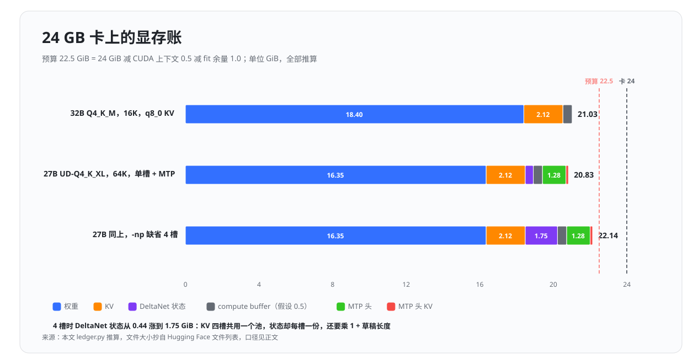
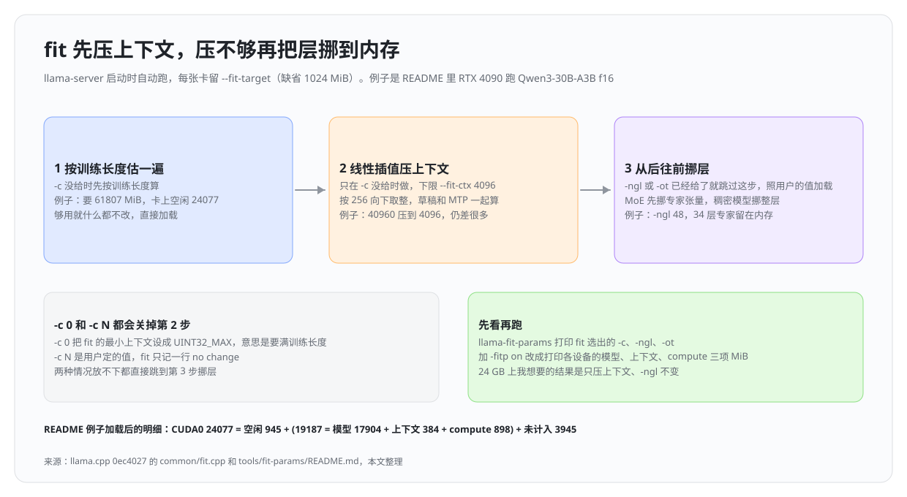
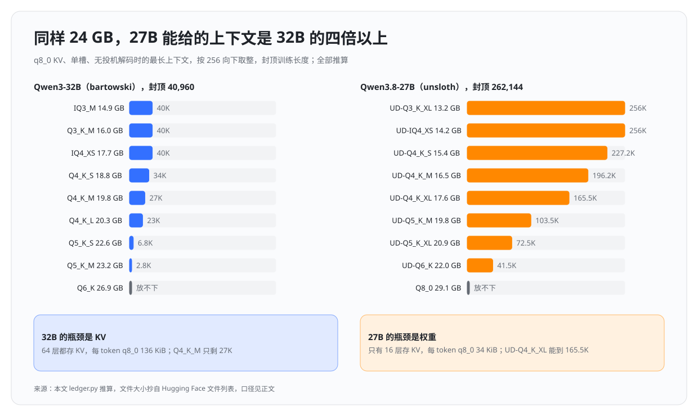
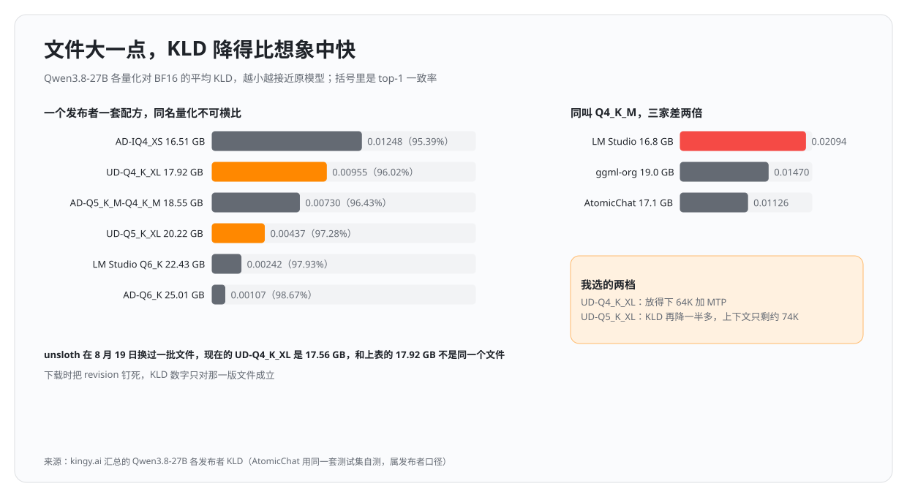
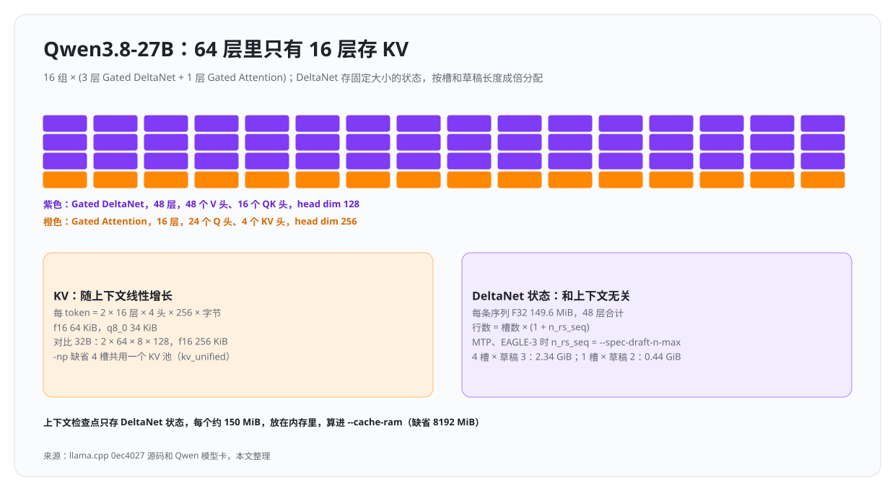
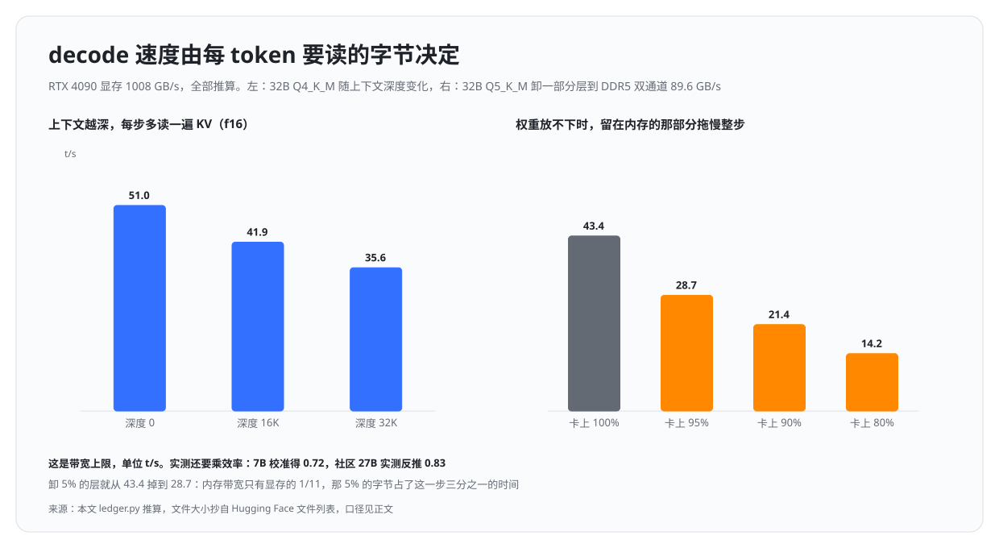
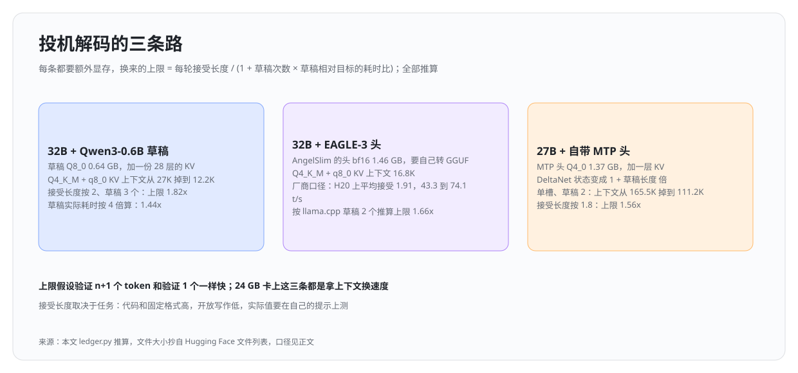
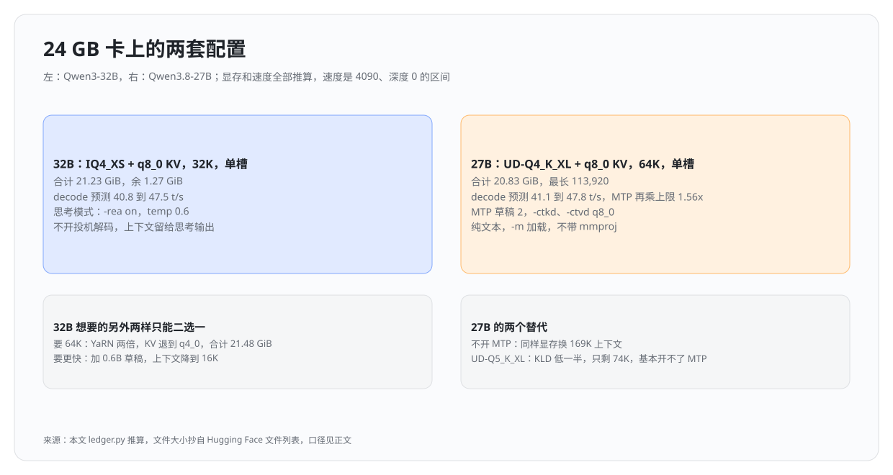

# LCPP-20｜实战｜24 GB 单卡：Qwen3-32B 和 Qwen3.8-27B

> 🎯 **这篇文档解决什么问题**：手上只有一张 24 GB 的卡，RTX 4090 或 3090，想用 llama.cpp 在本地跑 Qwen3-32B 或 Qwen3.8-27B。该下哪档量化，上下文能开多长，-np 和投机解码怎么配，decode 大概多快，这篇一项项算给你看。我手上没有 GPU 机器，所以文中的显存和速度全是按 llama.cpp 0ec4027 的分配逻辑推算出来的，每个数字都标了口径：推算的给公式或 ledger.py 命令，别人测的标厂商口径、发布者口径或社区实测。
>
> 使用方式：只想要命令，直接看第 10 章；想知道每个参数为什么这么填，从第 1 章的账本看起。32B 的读者可以跳过第 5、9 章，27B 的读者可以跳过第 4、8 章。文中版本和数字核对于 2026 年 11 月 2 日。
>
> **代码**：[zero-to-llama/20-qwen-24g](../20-qwen-24g)。ledger.py 复现文中所有推算，run_32b.sh 和 run_27b.sh 是第 10 章的启动命令，我只写了命令，没有在 GPU 上跑过。基线是主干 0ec4027，本篇不启动 llama-server，也不启动任何监听端口的程序。

# 导读 · 先给结论

- **24 GB 卡上真正能分的大约是 22.5 GiB。**4090 启动后空闲 24077 MiB，fit 缺省给每张卡再留 1024 MiB，剩下的才归权重、KV 和 compute buffer[[1]](https://github.com/ggml-org/llama.cpp/blob/0ec4027/tools/fit-params/README.md)[[2]](https://github.com/ggml-org/llama.cpp/blob/0ec4027/common/common.h)。
- **32B 卡在 KV，27B 卡在权重。**32B 的 64 层都存 KV，q8_0 每 token 136 KiB；27B 只有 16 层存，每 token 34 KiB。同样 q8_0 KV，32B Q4_K_M 最长 27,648，27B UD-Q4_K_XL 能到 169,472（推算）[[3]](https://huggingface.co/Qwen/Qwen3-32B)[[4]](https://huggingface.co/Qwen/Qwen3.8-27B)。
- **32B 我选 IQ4_XS 加 q8_0 KV。**上下文 32,768 合计 21.23 GiB（推算），够思考模式推荐的 32,768 输出。要更长就得开 YaRN，2 倍时 64K 只有 IQ4_XS 加 q4_0 KV 放得下。
- **27B 我选 UD-Q4_K_XL、单槽、MTP 草稿 2。**64K 上下文合计 20.83 GiB，最长 113,920（推算）。-np 不写时 llama-server 开 4 个槽，DeltaNet 状态每槽一份，还要乘 1 加草稿长度。
- **decode 速度我只能给区间。**4090 上 32B Q4_K_M 预测 36.6 到 42.5 t/s，27B UD-Q4_K_XL 41.1 到 47.8 t/s，都是带宽上限乘效率的推算；社区实测 4090 跑 27B 的 17.11 GB 文件是 49.1 t/s[[5]](https://kingy.ai/blog/qwen3-8-27b-best-quantization-gguf/)[[6]](https://github.com/ggml-org/llama.cpp/discussions/15013)。
- **24 GB 上的投机解码是拿上下文换速度。**32B 加 0.6B 草稿，Q4_K_M 的上下文从 27,648 掉到 12,544，草稿 KV 改成 q8_0 能回到 15,872；27B 开 MTP 草稿 2，从 169,472 掉到 113,920（都是推算）。
- **别让 fit 在背后挪层。**-c 写了就不压上下文，-ngl 或 -ot 写了就不挪层，放不下时 fit 只打一行 WRN 照常加载。我先用 llama-fit-params 看一遍，再把 -c 和 -ngl 写死[[7]](https://github.com/ggml-org/llama.cpp/blob/0ec4027/common/fit.cpp)。

**📎 与系列其他文档的分工**：显存账的通用写法见 [LCPP-02｜上手｜推理账本：带宽、算力和启动前算出速度上限](./02-ledger.md)，量化格式和 KLD 的测法见 [LCPP-07｜内部｜量化：块结构、配方、imatrix 和用 KLD 选类型](./07-quantization.md) 和 [LCPP-03｜上手｜测量方法：llama-bench、PPL、KLD 和噪声](./03-bench-ppl.md)，KV cache 量化见 [LCPP-08｜内部｜KV cache 与长上下文：账本、深度、量化、SWA 和上下文写满](./08-kv-context.md)，GPU 卸载和 fit 见 [LCPP-11｜内部｜GPU 卸载与 MoE：-ngl、专家放置、fit 和专家缓存](./11-gpu-offload-moe.md)，投机解码的原理见 [LCPP-13｜内部｜投机解码：草稿模型、n-gram 和拒绝采样](./13-speculative.md)，槽位和提示缓存见 [LCPP-14｜内部｜服务端：槽位、连续批处理和提示缓存](./14-server.md)，mmproj 见 [LCPP-15｜内部｜多模态：mmproj、图片切块和音频](./15-multimodal.md)。前面各篇讲的是一个机制，这篇把它们拼到一张 24 GB 卡上，算出两套能直接用的配置。

# 第 1 章 · 24 GB 的账：先算清楚再下载

## 1.1 22.5 GiB 是怎么来的



24 GB 的卡显存总量是 24576 MiB，fit-params 的 README 里那段 RTX 4090 的输出显示，llama.cpp 启动时看到的空闲只有 24077 MiB，驱动和 CUDA 上下文先拿走了将近 0.5 GiB[[1]](https://github.com/ggml-org/llama.cpp/blob/0ec4027/tools/fit-params/README.md)。fit 缺省给每张卡留 1024 MiB 余量，common.h 里写的是 fit_params_target 1024[[2]](https://github.com/ggml-org/llama.cpp/blob/0ec4027/common/common.h)。我把这两项从 24 GiB 里扣掉，剩下 22.5 GiB 当预算。

预算里还要扣 compute buffer，也就是一次前向的中间张量。这一项和 ubatch、词表大小、是否打开 flash attention 都有关，我手上没卡，没法直接读数，只能假设 0.5 GiB。README 那个例子的 compute 是 898 MiB，模型是 Qwen3-30B-A3B，所以 0.5 GiB 可能偏低。好在预算外面还有 1 GiB 的 fit 余量兜着，上机以后用 -fitp on 看到实际值，再用 ledger.py --compute 改掉。

剩下的就是三大项：权重、KV 和 27B 独有的 DeltaNet 状态。权重按文件大小算，GGUF 的张量基本原样搬进显存，Hugging Face 文件列表上的字节数直接能用；后面两项要按模型结构算。

## 1.2 KV 每 token 多少字节

KV 每 token 的字节数等于 2（K 和 V）乘存 KV 的层数，乘 KV 头数，乘 head dim，再乘每个元素的字节。Qwen3-32B 有 64 层，64 个 Q 头配 8 个 KV 头，head dim 128[[3]](https://huggingface.co/Qwen/Qwen3-32B)[[8]](https://arxiv.org/abs/2505.09388)。f16 下每 token 是 2 × 64 × 8 × 128 × 2 字节，等于 256 KiB，32K 上下文就是 8 GiB。q8_0 每 32 个元素占 34 字节，折合 136 KiB；q4_0 每 32 个占 18 字节，折合 72 KiB。

Qwen3.8-27B 的 64 层里只有 16 层是 Gated Attention，存 KV，每层 4 个 KV 头，head dim 256；另外 48 层是 Gated DeltaNet，存的是固定大小的状态，不随上下文变长[[4]](https://huggingface.co/Qwen/Qwen3.8-27B)。它的 text_config 和 Qwen3.6-27B 逐项相同，结构参数我是从后者的 config.json 抄的[[9]](https://huggingface.co/Qwen/Qwen3.6-27B/raw/main/config.json)。f16 下每 token 2 × 16 × 4 × 256 × 2 字节，64 KiB，只有 32B 的四分之一；262,144 的满长度也只要 16 GiB。

| 模型 | 存 KV 的层 | f16 | q8_0 | q4_0 |
|-|-|-|-|-|
| Qwen3-32B | 64 层 × 8 头 × 128 | 256 KiB | 136 KiB | 72 KiB |
| Qwen3.8-27B | 16 层 × 4 头 × 256 | 64 KiB | 34 KiB | 18 KiB |

## 1.3 用 ledger.py 算一遍

我把这些公式写进了 ledger.py，给它模型、量化、上下文、KV 类型、槽数和草稿长度，它按 llama.cpp 的分配方式逐项列出，再和 22.5 GiB 比。不带参数运行，会打印两张表：每档量化在 24 GB 上最长能开多少上下文，以及 4090 和 3090 上的速度区间。

```bash
cd zero-to-llama/20-qwen-24g
python3 ledger.py --model 32b --quant Q4_K_M --ctx 16384 --kv q8_0
  权重 Q4_K_M                      18.40 GiB
  KV q8_0 x 16384                 2.12 GiB
  compute buffer（假设）              0.50 GiB
  合计                             21.03 GiB / 预算 22.50 GiB  OK
  最长上下文 27648

python3 ledger.py --model 27b --quant UD-Q4_K_XL --ctx 65536 --kv q8_0 --np 1 --mtp 2
  权重 UD-Q4_K_XL                  16.35 GiB
  KV q8_0 x 65536                 2.12 GiB
  DeltaNet 状态 1 槽 x 3             0.44 GiB
  compute buffer（假设）              0.50 GiB
  MTP 头 Q4_0                      1.28 GiB
  MTP 头 KV                        0.13 GiB
  合计                             20.83 GiB / 预算 22.50 GiB  OK
  最长上下文 113920
```

文件列表上的 GB 是 10 的 9 次方字节，显存按 GiB 算，19.76 GB 的 Q4_K_M 折合 18.40 GiB。两边单位混着用，账会差出 7%，我在 ledger.py 里统一换成字节再加。

> 🔑 **本章要点**：预算 22.5 GiB = 24 GiB 减 CUDA 上下文 0.5 减 fit 余量 1.0，compute buffer 先按 0.5 GiB 假设。KV 每 token = 2 × 存 KV 的层数 × KV 头数 × head dim × 字节，32B 是 27B 的 4 倍。文件大小是 GB，显存是 GiB，先统一单位再加。

# 第 2 章 · fit 先压上下文，压不够再挪层

## 2.1 fit 的三步



llama-server 启动时缺省会跑一遍 fit，按空闲显存调整参数[[7]](https://github.com/ggml-org/llama.cpp/blob/0ec4027/common/fit.cpp)[[10]](https://github.com/ggml-org/llama.cpp/blob/0ec4027/common/arg.cpp)。它先按当前参数估一遍要用多少，够用就什么都不改。不够时先压上下文，在训练长度和 --fit-ctx 之间线性插值，--fit-ctx 缺省 4096，结果按 256 乘流数向下对齐。草稿模型和 MTP 的上下文跟主模型一起算，加载 mmproj 时也一起计入[[11]](https://github.com/ggml-org/llama.cpp/blob/0ec4027/tools/server/server-context.cpp)。

上下文压到底还不够，第三步从最后一层往前把层挪到内存，MoE 模型先挪专家张量，稠密模型挪整层。README 的例子是 4090 跑 f16 的 Qwen3-30B-A3B：估出来要 61807 MiB，上下文从 40960 压到 4096 仍然不够，最后 -ngl 48，34 层的专家留在内存里。加载以后 CUDA0 的明细是 24077 = 空闲 945 + 已用 19187 + 未计入 3945，已用里模型 17904、上下文 384、compute 898。

## 2.2 写了 -c 或 -ngl，fit 就不管那一步

这三步各有开关：命令行写了 -c N，fit 认为这是用户定的值，第二步只记一行 no change；写 -c 0 意思是要满训练长度，第二步同样不动。写了 -ngl、-ot 或者 tensor split，第三步直接跳过。跳过以后如果放不下，fit 会抛异常、接住、打一行 WRN failed to fit params，然后照用户给的值继续加载，真正的报错要等 CUDA 分配失败才出来。

稠密模型在 24 GB 上，我最怕的是 fit 安静地挪了几层到内存。第 7 章会算到，32B Q5_K_M 只要 5% 的字节留在内存，decode 上限就从 43.4 掉到 28.7 t/s。这种慢不会报错，日志里只多一行分配信息。所以我的做法是先让 fit 看一遍，确认它只压了上下文、层数没动，再把 -c 和 -ngl 99 写死到启动命令里，放不下就在加载时直接失败。

> 💡 **常见误区**：-ngl 99 加上一个放不下的 -c，fit 不会帮你压上下文，只打一行 WRN 就去分配显存。看到 failed to fit params 时，先把 -c 调小，别去调 -ngl。

## 2.3 llama-fit-params 先看再跑

llama-fit-params 只做 fit、不加载权重，把选出的 -c、-ngl、-ot 打印到标准输出。README 的用法是把输出存进 args.txt，再用 xargs 喂给 llama-server；加 -fitp on 会改成按设备打印模型、上下文、compute 三项的 MiB，我用它核对 ledger.py 里那两个假设值。

```bash
# 不写 -c：看 fit 会把上下文压到多少
llama-fit-params -m Qwen_Qwen3-32B-IQ4_XS.gguf -ctk q8_0 -ctv q8_0 -fa on -np 1 | tee args.txt

# 写死 -c 32768：看三项各占多少 MiB，和 ledger.py 对账
llama-fit-params -m Qwen_Qwen3-32B-IQ4_XS.gguf -c 32768 -ctk q8_0 -ctv q8_0 -fa on -np 1 -fitp on

# 确认只压了上下文以后，再把参数交给 llama-server
cat args.txt | xargs llama-server -m Qwen_Qwen3-32B-IQ4_XS.gguf
```

llama-fit-params 第一行打印的是 -c 和 -ngl，fit 没动层数时 -ngl 保持缺省的 -1。我想看到的就是 -c 变了、-ngl 还是 -1。如果它打印出一个具体的层数，比如 32B 的 60，意思是 fit 打算把后面几层放到内存，这套组合在这张卡上放不下，该退一档量化或缩短上下文。

> 🔑 **本章要点**：fit 三步依次是估算、压上下文、挪层。-c 写了就跳过第二步，-ngl、-ot 写了就跳过第三步，放不下只警告不退出。我先跑 llama-fit-params，确认只压了上下文，再把 -c 和 -ngl 99 写死。

# 第 3 章 · 选量化：先看上下文，再看 KLD

## 3.1 每档量化能给多长上下文



我先按文件大小把两边的量化都过一遍。32B 用 bartowski 的文件，27B 用 unsloth 的 UD 系列，大小都抄自 Hugging Face 的文件列表[[12]](https://huggingface.co/bartowski/Qwen_Qwen3-32B-GGUF)[[13]](https://huggingface.co/unsloth/Qwen3.8-27B-GGUF)。图里是 q8_0 KV、单槽、不开投机解码时的最长上下文，按 256 向下取整，封顶训练长度。

32B 这边，IQ4_XS 17.69 GB 能放满 40,960，Q4_K_M 19.76 GB 只剩 27,648。再往上，Q5_K_S 22.64 GB 只剩 6,912，基本没法用，Q6_K 直接放不下。27B 那边，UD-Q4_K_XL 17.56 GB 还能给 169,472，UD-Q5_K_XL 20.88 GB 是 74,240，UD-Q6_K 21.98 GB 也有 42,496。同一张卡，27B 能多上一档量化，上下文还长出好几倍。

| 量化 | 文件 | f16 KV 最长 | q8_0 KV 最长 |
|-|-|-|-|
| 32B IQ4_XS | 17.69 GB | 22,528 | 40,960（封顶） |
| 32B Q4_K_M | 19.76 GB | 14,592 | 27,648 |
| 32B Q4_K_L | 20.34 GB | 12,288 | 23,552 |
| 27B UD-Q4_K_XL | 17.56 GB | 89,856 | 169,472 |
| 27B UD-Q5_K_XL | 20.88 GB | 39,424 | 74,240 |
| 27B UD-Q6_K | 21.98 GB | 22,528 | 42,496 |

## 3.2 同名量化，发布者不同，质量也不同



上下文只回答放不放得下，质量要看 KLD，也就是量化模型和 BF16 原模型在同一批文本上输出分布的差。Kingy AI 汇总了 Qwen3.8-27B 各发布者的 KLD，数字是 AtomicChat 用同一套测试集自己测的，我按发布者口径引用[[5]](https://kingy.ai/blog/qwen3-8-27b-best-quantization-gguf/)。

两个现象对选型有用。同叫 Q4_K_M，LM Studio 的 16.8 GB 文件 KLD 0.02094，ggml-org 的 19.0 GB 是 0.01470，AtomicChat 的 17.1 GB 是 0.01126，前后差了快两倍。各家给不同张量分配位宽的配方不一样，文件名里的量化档只说明主体用什么格式。另一个是文件稍大一点，KLD 降得比想象中快：UD-Q4_K_XL 是 0.00955，UD-Q5_K_XL 降到 0.00437，文件只大了 2.3 GB。

32B 我没找到同一口径的 KLD 对比，只能先按上下文选。IQ4_XS 比 Q4_K_M 小 2 GB，换来 13K 的上下文，24 GB 上这笔账我愿意算。质量差多少，我会按 [LCPP-03｜上手｜测量方法：llama-bench、PPL、KLD 和噪声](./03-bench-ppl.md) 的方法自己用 llama-perplexity 测 KLD，参考 logits 从 Q8_0 文件导出，在自己的业务文本上比，不拿别人的数字代替。

## 3.3 把 revision 钉死

KLD 的数字只对那一版文件成立：unsloth 在 8 月 19 日重新上传过一批 Qwen3.8-27B 的文件，现在的 UD-Q4_K_XL 是 17,559,178,144 字节，Kingy 表里是 17.92 GB，两者不是同一个文件。线上用的模型我会把 commit 记下来，用 huggingface-cli download 加 --revision 拉到本地，再用 -m 指向路径。

用 -hf 直接拉也行，格式是 `用户/仓库:量化档`。它会顺带下载同目录的 mmproj，要关掉加 --no-mmproj[[14]](https://github.com/ggml-org/llama.cpp/blob/0ec4027/common/download.cpp)。打开 MTP 或 EAGLE-3 的 --spec-type 时，它还会找文件名带 mtp- 或 eagle3- 的附带文件。找附带文件只看主模型所在目录和它的上级目录，unsloth 把 MTP 文件放在 MTP/ 子目录里，-hf 找不到，第 9 章会再说。

```bash
huggingface-cli download unsloth/Qwen3.8-27B-GGUF \
  Qwen3.8-27B-UD-Q4_K_XL.gguf MTP/mtp-Qwen3.8-27B-Q4_0.gguf \
  --revision <commit> --local-dir models/qwen38-27b
huggingface-cli download bartowski/Qwen_Qwen3-32B-GGUF \
  Qwen_Qwen3-32B-IQ4_XS.gguf --revision <commit> --local-dir models/qwen3-32b
```

> 🔑 **本章要点**：先按上下文排除放不下的档，再在剩下的里按 KLD 挑。同名量化不能跨发布者横比，Q4_K_M 三家差两倍。KLD 只对某一版文件成立，下载时钉 revision，用 -m 指向本地路径。

# 第 4 章 · 32B 的上下文先靠 KV 量化，再靠 YaRN

## 4.1 q8_0 KV 让 32K 放得下

32B 每 token 的 KV 在 f16 下是 256 KiB，Q4_K_M 配 32K 上下文，KV 就要 8 GiB，合计 26.90 GiB，比预算多出 4 GiB 多（推算）。KV 换成 q8_0 减掉将近一半，IQ4_XS 加 q8_0 KV 开 32,768 合计 21.23 GiB，还剩 1.27 GiB 的余地。这也是我给 32B 定的默认组合。

V cache 量化依赖 flash attention：llama-context.cpp 里，-fa 是缺省的 auto 时，发现 V 是量化类型会自动打开 FA，日志写 enabling flash_attn since it is required for quantized V cache；如果手动写了 -fa off，就直接报错退出[[15]](https://github.com/ggml-org/llama.cpp/blob/0ec4027/src/llama-context.cpp)。所以 -ctv q8_0 和 -fa off 不能同时出现，启动命令里我干脆写明 -fa on。

q4_0 KV 每 token 72 KiB，Q4_K_M 能把 40,960 的满长度装下，合计 21.72 GiB（推算）。KV 量化对质量的影响在 [LCPP-08｜内部｜KV cache 与长上下文：账本、深度、量化、SWA 和上下文写满](./08-kv-context.md) 里测过，K 比 V 更敏感。我只在要开 YaRN、显存实在不够时才退到 q4_0，平时用 q8_0。

## 4.2 YaRN 两倍时，64K 只有 IQ4_XS 加 q4_0 放得下

Qwen3-32B 原生上下文 32,768，模型卡给的扩展办法是 YaRN，最多 4 倍到 131,072[[3]](https://huggingface.co/Qwen/Qwen3-32B)。YaRN 按频率分段调整 RoPE 的插值比例，高频维度基本不动，低频维度按倍数拉伸，再给注意力乘一个温度系数[[16]](https://arxiv.org/abs/2309.00071)。llama.cpp 用三个参数打开它：--rope-scaling yarn、--rope-scale 倍数、--yarn-orig-ctx 32768。

模型卡特别提醒，llama.cpp 这类框架做的是静态 YaRN，缩放系数不随输入长度变，短文本的效果可能会受影响。它的建议是只在确实需要长上下文时打开，倍数按常用长度定：常用 65,536 就设 2，不要直接开到 4。加载时如果倍数和模型训练时的不同，llama.cpp 会打印 custom YaRN scaling detected，把 n_ctx_train 改成 32768 除以缩放系数，槽位上限跟着放宽。

开到 2 倍，64K 上下文的账很紧。IQ4_XS 加 q4_0 KV 合计 21.48 GiB，放得下；IQ4_XS 加 q8_0 是 25.48 GiB，Q4_K_M 加 q4_0 是 23.40 GiB，都超了（推算）。开到 4 倍时，q4_0 KV 下 IQ3_M 最长 117,760，IQ4_XS 80,384，Q4_K_M 52,224；想要满 128K，Q4_K_M 加 q4_0 合计 27.90 GiB，24 GB 卡做不到。

```bash
# 32B 开 YaRN 两倍跑 64K：只有这档组合放得下（推算 21.48 GiB）
python3 ledger.py --model 32b --quant IQ4_XS --ctx 65536 --kv q4_0 --yarn 2

llama-server -m models/qwen3-32b/Qwen_Qwen3-32B-IQ4_XS.gguf \
  -c 65536 -ngl 99 -fa on -ctk q4_0 -ctv q4_0 -np 1 \
  --rope-scaling yarn --rope-scale 2 --yarn-orig-ctx 32768
```

## 4.3 思考模式要给输出留够位置

Qwen3 的思考模式先输出一段推理，再给答案。模型卡推荐思考模式用 temperature 0.6、top_p 0.95、top_k 20、min_p 0，非思考模式用 0.7、0.8、20、0；还说多数任务的输出长度给到 32,768 就够，竞赛级数学和编程题可以放到 38,912[[3]](https://huggingface.co/Qwen/Qwen3-32B)。按这个数，32K 的槽位只够一次很长的思考，提示稍长一点就会撞上限。

llama-server 的 -rea 缺省是 auto，按聊天模板判断是否支持思考；写 on 或 off 会把模板变量 enable_thinking 设成对应的值，单次请求也能在 chat_template_kwargs 里覆盖。--reasoning-budget 限制思考的 token 数，缺省 -1 不限，0 表示立刻结束思考。--reasoning-preserve 缺省打开，但它只对声明支持保留推理的模板生效，Qwen3 的模板不在其列。

上下文满了会怎样，取决于提示和输出谁先撞线。提示本身超过槽位上限，服务端直接返回 exceeds the available context size 的错误。生成过程中撞线时，上下文平移缺省关闭，生成直接停在那里，客户端拿到的是半截思考。我的做法是让 -c 至少比 max_tokens 加上常见提示长度大一截，长任务再配 --reasoning-budget 兜底。

还有一个容易漏的点：-c 写 32768、-np 不写，得到的是 4 个槽共用一个 32K 的 KV 池，单个请求最多能用到 32K，可 4 个长请求同时进来时池子会先被占满。思考模式下一次请求就可能吃掉 30K，所以单卡部署我一律写 -np 1，第 6 章再细说。

> 🔑 **本章要点**：32B 的 KV 是瓶颈，q8_0 是默认，q4_0 留给 YaRN。V 量化需要 FA，写 -fa on，别写 -fa off。YaRN 是静态的，只在需要时开，2 倍时 64K 只有 IQ4_XS 加 q4_0 放得下。思考模式推荐输出 32,768，-c 要给输出留位置。

# 第 5 章 · 27B 的 KV 很小，DeltaNet 状态按槽翻倍

## 5.1 64 层里只有 16 层存 KV



Qwen3.8-27B 的 64 层排成 16 组，每组 3 层 Gated DeltaNet 接 1 层 Gated Attention[[4]](https://huggingface.co/Qwen/Qwen3.8-27B)。只有那 16 层注意力会存 KV，每层 4 个 KV 头，head dim 256，所以每 token 的 KV 只有 32B 的四分之一。DeltaNet 层存的是一个固定大小的矩阵状态，处理新 token 时更新它，不随上下文变长。

llama.cpp 里 qwen35 的 DeltaNet 层读 ssm_d_conv、ssm_d_state、ssm_n_group、ssm_dt_rank 这几个超参数[[17]](https://github.com/ggml-org/llama.cpp/blob/0ec4027/src/models/qwen35.cpp)。换成 config.json 里的数：卷积核 4，状态维度 128，16 个 QK 头，48 个 V 头。对 24 GB 卡来说，关键是这份状态有多大、要分几份。

## 5.2 每条序列的状态 149.6 MiB

llama-hparams.cpp 给了两个公式。n_embd_s 是 DeltaNet 的矩阵状态，等于状态维度乘 V 头的总宽度，128 ×（48 × 128）= 786,432 个元素。n_embd_r 是卷积的滑窗，等于（卷积核 − 1）×（V 头总宽 + 2 × QK 头数 × 状态维度），3 ×（6,144 + 4,096）= 30,720 个元素[[18]](https://github.com/ggml-org/llama.cpp/blob/0ec4027/src/llama-hparams.cpp)。两者都按 F32 存，一层 3.12 MiB，48 层合计 149.6 MiB。

这份状态按行分配，行数等于槽数乘 1 加 n_rs_seq[[19]](https://github.com/ggml-org/llama.cpp/blob/0ec4027/src/llama-memory-recurrent.cpp)。不开投机解码时 n_rs_seq 是 0，一个槽一行；开 MTP 或 EAGLE-3 时，n_rs_seq 等于 --spec-draft-n-max，因为验证草稿时要为每个候选位置留一份状态，被拒的那几个直接丢掉，不用从头重算。

| 槽数 | 草稿长度 | 行数 | DeltaNet 状态 |
|-|-|-|-|
| 1 | 0（不开） | 1 | 0.15 GiB |
| 1 | 2 | 3 | 0.44 GiB |
| 1 | 3 | 4 | 0.58 GiB |
| 4 | 0（不开） | 4 | 0.58 GiB |
| 4 | 2 | 12 | 1.75 GiB |
| 4 | 3 | 16 | 2.34 GiB |

单槽不开投机解码只要 0.15 GiB，几乎可以忽略。4 槽加草稿 3 就是 2.34 GiB，相当于 32B 的 q8_0 KV 存 18K token。这一项在 llama-server 不写 -np、又打开 MTP 时最容易被漏算。

## 5.3 前缀复用靠检查点，检查点放在内存里

DeltaNet 的状态只能往前更新，没法像 KV 那样删掉最后几个 token 回到早先的位置。llama-server 启动时会试一次部分删除，删不掉就按 FULL 类型处理，靠上下文检查点复用前缀：处理提示时在用户消息开头和提示末尾附近把状态存一份，下一轮请求的前缀命中某个检查点，就从那里接着算。

每个检查点就是一份 149.6 MiB 的状态，存在内存里，不占显存。-ctxcp 缺省每槽 32 个，满了合计 4.68 GiB；4 个槽都存满就是 18.7 GiB 内存（推算）[[20]](https://github.com/ggml-org/llama.cpp/blob/0ec4027/tools/server/README.md)。-cms 缺省 8192，两个检查点之间至少隔这么多 token；列表满了以后，先删和前一个靠得太近的，再删最老的，删最老的时打一行 WRN erasing old context checkpoint。

检查点的创建和恢复日志都是 trace 级，缺省的 info 级看不到。想确认前缀到底有没有命中，启动时加 -lv 4，看 created context checkpoint 和 restored context checkpoint 两行；如果看到 forcing full prompt re-processing，说明这次没找到能用的检查点，整段提示从头算了一遍。

> 🔑 **本章要点**：27B 只有 16 层存 KV，DeltaNet 状态每条序列 149.6 MiB，按槽数乘 1 加草稿长度分配。单槽不开投机解码 0.15 GiB，4 槽加草稿 3 是 2.34 GiB。前缀复用靠内存里的检查点，每槽最多 32 个、4.68 GiB，命中情况要用 -lv 4 才看得到。

# 第 6 章 · 单槽最省：-np、提示缓存和 mmproj

## 6.1 -np 不写就是 4 个槽

llama-server 的 -np 缺省是 auto，server.cpp 里 auto 会取 4 个槽，同时打开 kv_unified，让 4 个槽共用一个 KV 池[[21]](https://github.com/ggml-org/llama.cpp/blob/0ec4027/tools/server/server.cpp)。对 32B 来说，共用池不多占显存，-c 32768 就是 4 个槽一共 32K。对 27B 来说，KV 共用，DeltaNet 状态却每槽一份，第 5 章的表里 4 槽就是 4 倍。

换算成上下文：27B UD-Q4_K_XL 不开 MTP 时，单槽最长 169,472，4 槽 155,904；开 MTP 草稿 2，单槽 113,920，4 槽只剩 75,776（推算）。64K 加 MTP 草稿 2，单槽合计 20.83 GiB，4 槽 22.14 GiB，离预算只差 0.36 GiB，compute buffer 一旦比假设的 0.5 GiB 大，就会放不下。

真要多个槽，又想给每个槽设上限，可以用 --kv-unified-per-slot N。不写 -c 时，KV 池按槽数乘 N 分配，每个槽的上下文取池容量、N 和训练长度三者中最小的那个[[20]](https://github.com/ggml-org/llama.cpp/blob/0ec4027/tools/server/README.md)。启动日志会打 capping per-slot context 这一行；如果 N 比池子能分给每个槽的还大，会打一行 WRN，说这个上限没有效果，最后以 initializing, n_slots = …, n_ctx_slot = … 那一行为准。

## 6.2 提示缓存按条计大小，超限的条目不存

-cram 缺省 8192 MiB，是提示缓存在内存里的上限，槽空闲时，它的提示状态会存进缓存，大小是主模型状态加草稿状态加这个槽的全部检查点。server-task.cpp 在存之前先比大小，单条超过上限就打 WRN prompt state size … exceeds cache size limit …, skipping，这一条整个不存[[22]](https://github.com/ggml-org/llama.cpp/blob/0ec4027/tools/server/server-task.cpp)。

27B 64K 的一条缓存有多大，我按满检查点算：q8_0 KV 2.12 GiB，状态 0.15，32 个检查点 4.68，MTP 头的 KV 0.13，合计 7.08 GiB，刚好在 8 GiB 以内。KV 换成 f16，这一条就是 9.07 GiB，超过上限，每次都会被跳过（推算）。看到那行 WRN 时，有两个办法：-ctxcp 降到 8，检查点只占 1.17 GiB；内存够的话把 -cram 调到 16384。

32B 没有循环状态，不建检查点，一条缓存基本就是 KV。32K 的 q8_0 KV 是 4.25 GiB，缺省上限能存一条。只有一个槽时，提示缓存的价值在于切换会话：另一个会话进来占了槽，原来那个会话的前缀还能从内存里找回来。

## 6.3 mmproj 多占 0.87 GiB，不看图就别加载

Qwen3.8-27B 是视觉语言模型，unsloth 的仓库里有 0.93 GB 的 mmproj-F16[[13]](https://huggingface.co/unsloth/Qwen3.8-27B-GGUF)，用 -hf 加载时，llama.cpp 会把同目录的 mmproj 一起下载、加载，要关掉得写 --no-mmproj；用 -m 指向本地文件时，不写 -mm 就不加载[[23]](https://github.com/ggml-org/llama.cpp/blob/0ec4027/docs/multimodal.md)。mmproj 缺省放到 GPU 上，--no-mmproj-offload 可以把它留在内存，代价是处理图片变慢。

放到卡上，mmproj 折合 0.87 GiB。单槽开 MTP 草稿 2 时，上下文从 113,920 掉到 88,832；不开 MTP 时从 169,472 掉到 142,848（推算）。另外，源码里写明带图片的批次之后不建检查点，带图的多轮对话，前缀复用会比纯文本差，所以我的 27B 配置是纯文本，用 -m 加载，不加 mmproj。

**📎 展开阅读：**槽位调度和提示缓存的命中规则，在 [LCPP-14｜内部｜服务端：槽位、连续批处理和提示缓存](./14-server.md)。

> 🔑 **本章要点**：-np 不写是 4 槽共用 KV，27B 的 DeltaNet 状态却是 4 份，单卡写 -np 1。提示缓存单条超过 -cram 就整条跳过，27B 64K f16 KV 的一条是 9.07 GiB，超了。mmproj 占 0.87 GiB，不看图就用 -m 加载、不写 -mm。

# 第 7 章 · decode 速度只能推一个区间

## 7.1 上限是带宽除以每 token 要读的字节



单请求 decode 时，每生成一个 token，GPU 要把全部权重读一遍，再读一遍已有的 KV。计算量相对很小，速度由显存带宽决定。RTX 4090 的显存带宽是 1008 GB/s，3090 是 936 GB/s[[24]](https://www.techpowerup.com/gpu-specs/)。32B Q4_K_M 文件 19.76 GB，4090 上的上限是 1008 ÷ 19.76 = 51.0 t/s；27B UD-Q4_K_XL 17.56 GB，上限 57.4 t/s（推算）。

27B 的 DeltaNet 层每步也要读写状态，单槽只有 0.15 GiB，相对 16 GiB 的权重可以忽略。上下文越深，KV 读得越多：32B Q4_K_M 配 f16 KV，深度 16K 时上限降到 41.9，32K 降到 35.6；换成 q8_0 KV 分别是 45.7 和 41.4。27B 的 KV 小，f16 KV 在 64K 深度还有 46.1（推算）。

## 7.2 效率系数：用两个实测反推

实际速度达不到带宽上限，要乘一个效率。我找了两个实测来反推。Discussion #15013 汇总了各显卡跑 Llama 2 7B Q4_0（3.56 GiB）的 llama-bench，4090 是 188.96 t/s，3090 是 161.89 t/s，除以各自的上限，效率是 0.717 和 0.661[[6]](https://github.com/ggml-org/llama.cpp/discussions/15013)。Kingy AI 在 4090 上跑 27B 的 17.11 GB 文件，测到 49.1 t/s，反推效率 0.833（社区实测）[[5]](https://kingy.ai/blog/qwen3-8-27b-best-quantization-gguf/)。

两个系数差得不小。拿 0.717 去预测 Kingy 那个文件，得到 42.2 t/s，比实测的 49.1 低 14%；我的理解是模型越大，每步的固定开销占比越小，有效带宽越接近峰值。所以我用 7B 的系数当下限，Kingy 的系数当上限，给区间不给单个数。

| 组合 | 4090 上限 | 4090 预测 | 3090 上限 | 3090 预测 |
|-|-|-|-|-|
| 32B Q4_K_M | 51.0 | 36.6 到 42.5 | 47.4 | 31.3 到 39.5 |
| 32B IQ4_XS | 57.0 | 40.8 到 47.5 | 52.9 | 35.0 到 44.1 |
| 27B UD-Q4_K_XL | 57.4 | 41.1 到 47.8 | 53.3 | 35.2 到 44.4 |
| 27B UD-Q5_K_M | 51.0 | 36.5 到 42.5 | 47.3 | 31.3 到 39.5 |

表里单位都是 t/s，深度 0，全部推算。IQ4_XS 比 Q4_K_M 小 2 GB，速度上限也高 12%，在 24 GB 上它同时换来了上下文和速度。27B 比 32B 快一点，主要因为文件小；同样大小的文件，两者的 decode 速度应该差不多。

## 7.3 卸几层到内存，速度先掉三分之一

权重放不下时，fit 会把后面几层挪到内存，那几层由 CPU 读内存来算。我按 DDR5-5600 双通道的理论带宽 89.6 GB/s 算 32B Q5_K_M（23.21 GB）：全在卡上 43.4 t/s，卡上 95% 掉到 28.7，90% 是 21.4，80% 只剩 14.2（推算）。内存带宽只有显存的十一分之一，5% 的字节就占了一步时间的 37%。

这些推算到手上有卡时要实测核对，llama-bench 的 -d 参数让生成测试从一个已有深度开始，-ctk、-ctv 设 KV 类型，-fa 缺省 auto[[25]](https://github.com/ggml-org/llama.cpp/blob/0ec4027/tools/llama-bench/README.md)。我会按下面的命令跑三个深度，把 tg128 那一列和上面的区间对一下；落在区间外，先检查 -ngl 是否真的全放上了卡。

```bash
# 三个深度各测一次 decode，KV 用 q8_0，和第 7 章的区间对账
llama-bench -m models/qwen3-32b/Qwen_Qwen3-32B-IQ4_XS.gguf \
  -ngl 99 -fa on -ctk q8_0 -ctv q8_0 -p 512 -n 128 -d 0,16384,32768 -r 3

# 启动日志里确认层数全在卡上
#   load_tensors: offloaded 65/65 layers to GPU
```

**📎 展开阅读：**部分卸载时怎么挑留在内存的张量，MoE 和稠密模型各自的 -ot 写法，在 [LCPP-11｜内部｜GPU 卸载与 MoE：-ngl、专家放置、fit 和专家缓存](./11-gpu-offload-moe.md)。

> 🔑 **本章要点**：decode 上限 = 显存带宽 ÷ 每 token 要读的字节。4090 上 32B Q4_K_M 上限 51.0，预测 36.6 到 42.5 t/s；27B UD-Q4_K_XL 上限 57.4，预测 41.1 到 47.8。效率系数下限取 7B 实测，上限取社区 27B 实测。卸 5% 到内存就从 43.4 掉到 28.7。

# 第 8 章 · 32B 加草稿：拿上下文换速度

## 8.1 加速上限怎么算

投机解码让一个便宜的草稿先猜几个 token，目标模型一次前向把它们一起验证，接受的直接输出，第一个猜错的位置换成目标模型自己的结果。只要按规则接受和重采样，输出分布和目标模型单独生成完全一样[[26]](https://arxiv.org/abs/2211.17192)。decode 受带宽限制时，验证 3 个 token 和验证 1 个耗时差不多，所以猜中的越多越划算。

我用一个简化的上限来估：每轮输出的 token 数 L，除以 1 加草稿次数乘草稿的相对耗时。相对耗时按每 token 要读的字节之比算，Qwen3-0.6B 的 Q8_0 是 0.64 GB，相对 19.76 GB 的 Q4_K_M 是 0.032。草稿 3 个、每轮平均输出 2 个时，上限是 2 ÷（1 + 3 × 0.032） = 1.82x（推算）。

这个公式偏乐观：小模型的每步固定开销占比大，实际耗时比字节比高得多；按 4 倍算，上限降到 1.44x。套到第 7 章的区间上，4090 跑 32B Q4_K_M 加 0.6B 草稿，上限在 52.6 到 77.5 t/s 之间（推算），区间很宽，要看接受长度和草稿的真实耗时。

## 8.2 草稿模型要一份自己的 KV



Qwen3-0.6B 和 Qwen3-32B 共用词表，可以直接当草稿[[27]](https://huggingface.co/Qwen/Qwen3-0.6B)。它有 28 层，8 个 KV 头，head dim 128，草稿的 KV 长度和主模型相同，-ctkd、-ctvd 缺省 f16，每 token 112 KiB，比 32B 的 q8_0 KV 还多。所以加上草稿，Q4_K_M 的最长上下文从 27,648 掉到 12,544；草稿 KV 改成 q8_0 能回到 15,872（推算）。

换成 IQ4_XS 宽松很多：草稿 KV 用 f16 时最长 20,736，用 q8_0 时 26,368；16K 上下文合计 20.63 GiB（推算）。一个纯 draft 模型要写 --spec-type draft-simple，只给 -md 不够，草稿模型的层缺省由 -ngld auto 决定放不放卡，我写成 all，免得它被 fit 挪到内存。

```bash
# 32B + Qwen3-0.6B 草稿，草稿 KV 用 q8_0；16K 合计约 20.63 GiB（推算）
llama-server -m models/qwen3-32b/Qwen_Qwen3-32B-IQ4_XS.gguf \
  -c 16384 -ngl 99 -fa on -ctk q8_0 -ctv q8_0 -np 1 \
  -md models/qwen3-0.6b/Qwen3-0.6B-Q8_0.gguf --spec-type draft-simple \
  -ngld all -ctkd q8_0 -ctvd q8_0 --spec-draft-n-max 3
```

社区实测给了一个量级：Discussion #10466 里有人在 4070 上用 14B 加 0.5B 草稿，46.77 t/s 涨到草稿 4 个时的 102.74，12 个时 116.84；换成 3B 草稿，最高只到 62.57（社区实测）[[28]](https://github.com/ggml-org/llama.cpp/discussions/10466)。另一个反例在 Discussion #22473：两张 3090 跑 Qwen3.6-27B Q5_K_M 大约 38 t/s，加 0.8B 草稿反而降到 33（社区实测）[[29]](https://github.com/ggml-org/llama.cpp/discussions/22473)。草稿和任务对不上时，投机解码会变慢。

## 8.3 EAGLE-3 和 ngram-mod

EAGLE-3 的草稿是一层 transformer，读目标模型几层的隐藏状态来猜下一个 token，比独立的小模型猜得准[[30]](https://arxiv.org/abs/2503.01840)。llama.cpp 支持的列表里有 AngelSlim/Qwen3-32B_eagle3，要先用 convert_hf_to_gguf.py 加 --target-model-dir 转成 GGUF，运行时写 --spec-type draft-eagle3[[31]](https://github.com/ggml-org/llama.cpp/blob/0ec4027/docs/speculative.md)。

AngelSlim 在 H20 上用 vLLM、草稿 2 个测过，平均接受长度 1.91，吞吐从 43.32 到 74.1 t/s（厂商口径）[[32]](https://huggingface.co/AngelSlim/Qwen3-32B_eagle3)。头的 bf16 文件 1.46 GB，Q4_K_M 加 q8_0 KV 时上下文是 17,152，IQ4_XS 是 32,000，这两个数没算头自己那一层的 KV（推算）。按接受 1.91、草稿 2 个代入公式，上限 1.66x，4090 上 60.9 到 70.8 t/s（推算）。

ngram-mod 不需要额外模型，用最近 n 个 token 的哈希去一个约 16 MB 的池子里查下一个 token，池子所有槽共用。文档给的场景是改写代码、总结，以及思考模型在答案里复述思考内容；建议稠密模型可以调小 n-min 和 n-max。上面 #22473 那位用户试过 ngram-mod，速度降到 18（社区实测），开放式对话不要指望它。

```bash
# EAGLE-3：先转换，再运行
python convert_hf_to_gguf.py AngelSlim/Qwen3-32B_eagle3 \
  --target-model-dir Qwen/Qwen3-32B --outtype bf16 --outfile Qwen3-32B-eagle3.gguf
llama-server -m models/qwen3-32b/Qwen_Qwen3-32B-IQ4_XS.gguf -c 32000 -ngl 99 -fa on \
  -ctk q8_0 -ctv q8_0 -np 1 -md Qwen3-32B-eagle3.gguf --spec-type draft-eagle3 --spec-draft-n-max 2

# 每个请求结束时看这一行，mean len 就是每轮平均输出的 token 数
#   draft acceptance = 0.45000 (  450 accepted /  1000 generated), mean len =  1.90
```

**📎 展开阅读：**投机解码的接受和重采样规则、草稿长度怎么调，在 [LCPP-13｜内部｜投机解码：草稿模型、n-gram 和拒绝采样](./13-speculative.md)。

> 🔑 **本章要点**：加速上限 = 每轮输出 token 数 ÷（1 + 草稿次数 × 相对耗时）。0.6B 草稿在 32B Q4_K_M 上让上下文从 27,648 掉到 12,544，草稿 KV 改 q8_0 回到 15,872。EAGLE-3 猜得准，但要自己转 GGUF。社区数据里加草稿变慢的例子不少，开之前先在自己的提示上看 mean len。

# 第 9 章 · 27B 用自带的 MTP 头，草稿长度从 2 起步

## 9.1 MTP 头是模型自带的草稿

Qwen3.8-27B 训练时带了一个多 token 预测（MTP）头，用主模型最后的隐藏状态预测下一个 token 之后的那个[[4]](https://huggingface.co/Qwen/Qwen3.8-27B)。llama.cpp 在 PR #22673 里加了 qwen35_mtp 架构和 draft-mtp 类型[[33]](https://github.com/ggml-org/llama.cpp/pull/22673)。common/speculative.cpp 里写明 qwen35 只有一个训练好的 MTP 头，草稿 n 个就把这个头反复调 n 次[[34]](https://github.com/ggml-org/llama.cpp/blob/0ec4027/common/speculative.cpp)。

混合模型能做投机解码，靠的是 PR #22400：草稿被拒时 DeltaNet 状态要能退回去，它给循环状态多留 n_rs_seq 行，退回时直接切换到对应的那一行[[35]](https://github.com/ggml-org/llama.cpp/pull/22400)。代价就是第 5 章的表，状态按 1 加草稿长度成倍分配。启动时 llama-server 检测到这种情况会走 RS 类型的部分删除。

MTP 头可以和主模型放在一个文件里，也可以单独放一个 mtp- 开头的附带文件，ggml-org 的 Qwen3.6-27B-MTP-GGUF 就是这种[[36]](https://huggingface.co/ggml-org/Qwen3.6-27B-MTP-GGUF)。unsloth 把 Q4_0 的 MTP 文件放在 MTP/ 子目录，1.37 GB，而第 3 章说过 -hf 只在同级和上级目录找附带文件，所以这里要用 -md 指定路径。

## 9.2 草稿 2 还是 3

unsloth 的 MTP 文档说，开 MTP 大约快 1.4 到 2.2 倍，多占约 2 GB 显存，建议 --spec-draft-n-max 从 2 开始试（发布者口径）[[37]](https://unsloth.ai/docs/models/mtp)。NVIDIA 论坛上有人在 DGX Spark 上比过 Qwen3.6-27B 草稿 4、5、6，5 最快（社区实测）[[38]](https://forums.developer.nvidia.com/t/mtp-llama-cpp-a-look-at-qwen3-6-27b/370298)。那台机器显存多，24 GB 上每加一个草稿，DeltaNet 状态就多一份。

| 配置 | DeltaNet 状态 | 64K 合计 | 最长上下文 |
|-|-|-|-|
| 单槽，不开 MTP | 0.15 GiB | 19.13 GiB | 169,472 |
| 单槽，草稿 2 | 0.44 GiB | 20.83 GiB | 113,920 |
| 单槽，草稿 3 | 0.58 GiB | 20.97 GiB | 109,824 |
| 4 槽，草稿 2 | 1.75 GiB | 22.14 GiB | 75,776 |
| 4 槽，草稿 3 | 2.34 GiB | 22.73 GiB | 58,880 |

表里都是 UD-Q4_K_XL 加 q8_0 KV，全部推算。单槽时草稿 2 和 3 差得不多，4 槽加草稿 3 在 64K 已经超出预算。按接受长度 1.8、草稿 2 个、MTP 头相对耗时 0.078 代入，上限 1.56x，4090 上 64.0 到 74.5 t/s（推算），落在 unsloth 说的 1.4 到 2.2 倍里。

## 9.3 草稿 KV 也要量化

MTP 头本身是一层完整的 Gated Attention，有自己的 KV，长度和主模型一样。草稿 KV 缺省 f16，64K 时是 0.25 GiB；写 -ctkd q8_0 -ctvd q8_0 降到 0.13 GiB。ledger.py 按和主模型相同的 KV 类型算，所以启动命令里我把两组参数写成一样。

spec-type 不写时，llama.cpp 会从附带文件或草稿 GGUF 里推断：草稿文件里有 nextn.eh_proj 张量就当 MTP。推断规则以后可能变，我还是显式写 --spec-type draft-mtp。上线后看每个请求结束时的 draft acceptance 行，mean len 长期低于 1.5，就把草稿降到 1 或者关掉 MTP，把显存还给上下文。

```bash
# 27B + MTP 草稿 2，单槽 64K；合计约 20.83 GiB（推算）
python3 ledger.py --model 27b --quant UD-Q4_K_XL --ctx 65536 --kv q8_0 --np 1 --mtp 2

llama-server -m models/qwen38-27b/Qwen3.8-27B-UD-Q4_K_XL.gguf \
  -c 65536 -ngl 99 -fa on -ctk q8_0 -ctv q8_0 -np 1 \
  -md models/qwen38-27b/MTP/mtp-Qwen3.8-27B-Q4_0.gguf --spec-type draft-mtp \
  --spec-draft-n-max 2 -ngld all -ctkd q8_0 -ctvd q8_0
```

> 🔑 **本章要点**：MTP 头是模型自带的单层草稿，Q4_0 文件 1.37 GB，放在 unsloth 仓库的 MTP/ 子目录，要用 -md 指定。DeltaNet 状态按 1 加草稿长度分配，单槽草稿 2 时 64K 合计 20.83 GiB。草稿 KV 缺省 f16，写 -ctkd、-ctvd q8_0。mean len 长期低于 1.5 就关掉。

# 第 10 章 · 怎么选与上线清单

## 10.1 两套配置

32B 这边，我选 IQ4_XS 加 q8_0 KV、32K 上下文、单槽，不开投机解码，合计 21.23 GiB，4090 上预测 40.8 到 47.5 t/s（推算）。32K 刚好对上模型卡推荐的思考输出长度。要更长就开 YaRN 两倍，KV 退到 q4_0；要更快就加 0.6B 草稿，上下文降到 16K。两者都想要，24 GB 卡给不了。

27B 这边，我选 UD-Q4_K_XL 加 q8_0 KV、64K、单槽、MTP 草稿 2，合计 20.83 GiB，最长能开到 113,920（推算）。不需要 MTP 的话，同样的显存能换到 169K 上下文；想要质量更好，UD-Q5_K_XL 的 KLD 低一半，32K 单槽合计 21.15 GiB，但只剩 74K 上下文，也基本开不了 MTP。



```bash
# run_32b.sh：32B IQ4_XS，32K，q8_0 KV，单槽，思考模式（合计约 21.23 GiB，推算）
llama-server -m models/qwen3-32b/Qwen_Qwen3-32B-IQ4_XS.gguf \
  -c 32768 -ngl 99 -fa on -ctk q8_0 -ctv q8_0 -np 1 \
  -rea on --temp 0.6 --top-p 0.95 --top-k 20 --min-p 0

# run_27b.sh：27B UD-Q4_K_XL，64K，q8_0 KV，单槽，MTP 草稿 2，纯文本（合计约 20.83 GiB，推算）
llama-server -m models/qwen38-27b/Qwen3.8-27B-UD-Q4_K_XL.gguf \
  -c 65536 -ngl 99 -fa on -ctk q8_0 -ctv q8_0 -np 1 \
  -md models/qwen38-27b/MTP/mtp-Qwen3.8-27B-Q4_0.gguf --spec-type draft-mtp \
  --spec-draft-n-max 2 -ngld all -ctkd q8_0 -ctvd q8_0 \
  --temp 1.0 --top-p 0.95 --top-k 20 --min-p 0 --presence-penalty 0
```

27B 的采样参数照模型卡的思考模式：temperature 1.0、top_p 0.95、top_k 20、min_p 0、presence_penalty 0；关掉思考时改成 0.7、0.8、20、0，presence_penalty 1.5[[4]](https://huggingface.co/Qwen/Qwen3.8-27B)。两条命令都把 -c、-ngl 99 和 -np 1 写死，放不下就在加载时报错，fit 不会在背后挪层。

## 10.2 启动后看哪几行

这两套配置上机时，我按下面的表核对日志。前四行在启动阶段出现，后四行要等请求进来才看得到。左列是日志里的原文或现象，中间是我会先查的地方。

| 症状 | 先查什么 | 依据 |
|-|-|-|
| WRN failed to fit params | -c 写大了，先调小 -c；别动 -ngl | 第 2 章：写了 -c 和 -ngl，fit 只警告不改 |
| offloaded 60/65 layers to GPU | 有层被挪到内存，退一档量化或缩短上下文 | 第 7 章：卸 5% 速度掉三分之一 |
| quantized V cache requires flash_attn | 命令里有 -fa off，改成 -fa on | 第 4 章：V 量化依赖 FA |
| initializing, n_slots = 4 | 没写 -np，补上 -np 1 | 第 6 章：27B 状态按槽翻倍 |
| exceeds the available context size | 提示比槽位上限长，调大 -c 或截断提示 | 第 4 章：上下文平移缺省关 |
| prompt state size … exceeds cache size limit | -ctxcp 降到 8，或调大 -cram | 第 6 章：27B 64K f16 一条 9.07 GiB |
| 每轮都 forcing full prompt re-processing | 加 -lv 4 看检查点是否创建，带图的对话不建 | 第 5 章：前缀复用靠检查点 |
| draft acceptance 的 mean len 低于 1.5 | 草稿降到 1 或关掉投机解码 | 第 8、9 章：猜不中反而慢 |

## 10.3 上线前过一遍

> 📌 **上线前核对清单**：我手上没有卡，下面这些要在第一次上机时逐项核对，核对完再把配置交给别人用。
> - 用 llama-fit-params 加 -fitp on 跑一遍，把 compute buffer 的实际值填进 ledger.py --compute，重算合计
> - llama-fit-params 不写 -c 时打印的 -ngl 保持 -1，说明 fit 只压了上下文
> - 启动日志里 offloaded 层数等于总层数，n_slots = 1，n_ctx_slot 等于 -c
> - llama-bench -d 0,16384,32768 的 tg128 落在第 7 章的区间里
> - 模型文件按 commit 下载，commit 记在部署配置里
> - 开投机解码的，跑一批自己的真实提示，mean len 不低于 1.5
> - 27B 多轮对话时用 -lv 4 确认 restored context checkpoint 出现过
> - -cram 和 -ctxcp 乘出来的内存占用，机器的空闲内存放得下

推算的数字上机以后一定会有偏差，compute buffer 和效率系数是最大的两个未知数。ledger.py 把这两项都做成了参数，实测值填进去，整张账会跟着变，这篇的结论也跟着更新。仓库在 [zero-to-llama/20-qwen-24g](../20-qwen-24g)。下一篇 [LCPP-21｜实战｜一台机器跑 DeepSeek-V4.1-Flash](./21-deepseek-v41.md) 换到 MoE，把 DeepSeek-V4.1-Flash 装进一台机器，专家张量怎么在显存和内存之间分，用的还是 [LCPP-11｜内部｜GPU 卸载与 MoE：-ngl、专家放置、fit 和专家缓存](./11-gpu-offload-moe.md) 和这篇的同一套账。和这篇的同一套账。再到 [LCPP-22｜实战｜一张卡跑 Qwen3.8-27B](./22-qwen38-27b.md)，稠密 27B 的四分之三层换成了线性注意力，长上下文只挂在 16 层上，KV 这笔账又和这篇全 full attention 的算法不一样了。

# 参考文献

按正文首次引用顺序编号，资料截至 2026 年 11 月初。

[1] llama.cpp 0ec4027. tools/fit-params/README.md：llama-fit-params 的用法和 RTX 4090 上的示例输出。 [tools/fit-params/README.md](https://github.com/ggml-org/llama.cpp/blob/0ec4027/tools/fit-params/README.md)

[2] llama.cpp 0ec4027. common/common.h：fit 余量 1024 MiB、检查点和 cache-ram 缺省值、need_n_rs_seq。 [common/common.h](https://github.com/ggml-org/llama.cpp/blob/0ec4027/common/common.h)

[3] Qwen. Qwen3-32B 模型卡：64 层、64 个 Q 头和 8 个 KV 头，原生 32,768 上下文，YaRN 扩到 131,072 的配置和 llama-server 参数。 [huggingface.co/Qwen/Qwen3-32B](https://huggingface.co/Qwen/Qwen3-32B)

[4] Qwen. Qwen3.8-27B 模型卡：基于 Qwen3.5 架构，16 组 3 层 Gated DeltaNet 加 1 层 Gated Attention，原生 262,144 上下文，带 MTP。 [huggingface.co/Qwen/Qwen3.8-27B](https://huggingface.co/Qwen/Qwen3.8-27B)

[5] Kingy AI. Which Qwen3.8-27B GGUF Should You Download? Q2 to Q8 Quantization Guide：RTX 4090 上 Q4_K_M 的 llama-bench 实测、各发布者同名量化的 KLD 对比。 [kingy.ai](https://kingy.ai/blog/qwen3-8-27b-best-quantization-gguf/)

[6] llama.cpp Discussion #15013：CUDA 各显卡上 Llama 2 7B Q4_0 的 llama-bench 汇总，FA 打开。 [Discussion #15013](https://github.com/ggml-org/llama.cpp/discussions/15013)

[7] llama.cpp 0ec4027. common/fit.cpp：只在 n_ctx 为 0 时线性插值上下文，按 256 乘流数向下对齐，草稿和 MTP 上下文一起算。 [common/fit.cpp](https://github.com/ggml-org/llama.cpp/blob/0ec4027/common/fit.cpp)

[8] Qwen Team. Qwen3 Technical Report. arXiv:2505.09388, 2025. [arXiv:2505.09388](https://arxiv.org/abs/2505.09388)

[9] Qwen. Qwen3.6-27B config.json：text_config 与 Qwen3.8-27B 逐项相同。 [Qwen3.6-27B config.json](https://huggingface.co/Qwen/Qwen3.6-27B/raw/main/config.json)

[10] llama.cpp 0ec4027. common/arg.cpp：-c、-fit、-fitt、-fitc、-np、--kv-unified-per-slot、-ctxcp、-cram、--spec-type 等参数的定义和缺省值。 [common/arg.cpp](https://github.com/ggml-org/llama.cpp/blob/0ec4027/common/arg.cpp)

[11] llama.cpp 0ec4027. tools/server/server-context.cpp：加载 mmproj 时一起参与 fit。 [server-context.cpp](https://github.com/ggml-org/llama.cpp/blob/0ec4027/tools/server/server-context.cpp)

[12] bartowski. Qwen_Qwen3-32B-GGUF 文件列表：IQ2_M 到 Q8_0 各量化的文件大小。 [bartowski/Qwen_Qwen3-32B-GGUF](https://huggingface.co/bartowski/Qwen_Qwen3-32B-GGUF)

[13] unsloth. Qwen3.8-27B-GGUF 文件列表和模型卡：UD 系列量化的文件大小，mmproj 和 MTP 附带文件。 [unsloth/Qwen3.8-27B-GGUF](https://huggingface.co/unsloth/Qwen3.8-27B-GGUF)

[14] llama.cpp 0ec4027. common/download.cpp：-hf 下载时识别 mmproj、mtp-、eagle3- 等附带文件。 [common/download.cpp](https://github.com/ggml-org/llama.cpp/blob/0ec4027/common/download.cpp)

[15] llama.cpp 0ec4027. src/llama-context.cpp：V cache 量化时自动打开 flash attention，强制关闭则报错。 [src/llama-context.cpp](https://github.com/ggml-org/llama.cpp/blob/0ec4027/src/llama-context.cpp)

[16] Peng B, Quesnelle J, Fan H, Shippole E. YaRN: Efficient Context Window Extension of Large Language Models. arXiv:2309.00071, 2023. [arXiv:2309.00071](https://arxiv.org/abs/2309.00071)

[17] llama.cpp 0ec4027. src/models/qwen35.cpp：Gated DeltaNet 层读 ssm_d_conv、ssm_d_state、ssm_n_group、ssm_dt_rank 等超参数。 [src/models/qwen35.cpp](https://github.com/ggml-org/llama.cpp/blob/0ec4027/src/models/qwen35.cpp)

[18] llama.cpp 0ec4027. src/llama-hparams.cpp：n_embd_r 和 n_embd_s 的公式。 [src/llama-hparams.cpp](https://github.com/ggml-org/llama.cpp/blob/0ec4027/src/llama-hparams.cpp)

[19] llama.cpp 0ec4027. src/llama-memory-recurrent.cpp：循环状态按槽数乘 1 加 n_rs_seq 分配。 [llama-memory-recurrent.cpp](https://github.com/ggml-org/llama.cpp/blob/0ec4027/src/llama-memory-recurrent.cpp)

[20] llama.cpp 0ec4027. tools/server/README.md：-np、-kvu、--kv-unified-per-slot、-ctxcp、-cms、-cram、--spec-draft-n-max 的说明和缺省值。 [tools/server/README.md](https://github.com/ggml-org/llama.cpp/blob/0ec4027/tools/server/README.md)

[21] llama.cpp 0ec4027. tools/server/server.cpp：-np 缺省时取 4 个槽并打开 kv_unified。 [tools/server/server.cpp](https://github.com/ggml-org/llama.cpp/blob/0ec4027/tools/server/server.cpp)

[22] llama.cpp 0ec4027. tools/server/server-task.cpp：提示缓存连同检查点一起按 --cache-ram 计大小，超限的条目直接跳过。 [server-task.cpp](https://github.com/ggml-org/llama.cpp/blob/0ec4027/tools/server/server-task.cpp)

[23] llama.cpp 0ec4027. docs/multimodal.md：-hf 加载时用 --no-mmproj 关掉多模态，mmproj 缺省放到 GPU。 [docs/multimodal.md](https://github.com/ggml-org/llama.cpp/blob/0ec4027/docs/multimodal.md)

[24] TechPowerUp GPU Database：RTX 4090 显存带宽 1008 GB/s，RTX 3090 936 GB/s。 [techpowerup.com/gpu-specs](https://www.techpowerup.com/gpu-specs/)

[25] llama.cpp 0ec4027. tools/llama-bench/README.md：-p、-n、-d（n-depth）、-ctk、-fa 等参数。 [tools/llama-bench/README.md](https://github.com/ggml-org/llama.cpp/blob/0ec4027/tools/llama-bench/README.md)

[26] Leviathan Y, Kalman M, Matias Y. Fast Inference from Transformers via Speculative Decoding. ICML 2023. arXiv:2211.17192. [arXiv:2211.17192](https://arxiv.org/abs/2211.17192)

[27] Qwen. Qwen3-0.6B 模型卡：28 层、8 个 KV 头，和 Qwen3-32B 共用词表。 [huggingface.co/Qwen/Qwen3-0.6B](https://huggingface.co/Qwen/Qwen3-0.6B)

[28] llama.cpp Discussion #10466：投机解码在消费级显卡上的社区实测和参数讨论。 [Discussion #10466](https://github.com/ggml-org/llama.cpp/discussions/10466)

[29] llama.cpp Discussion #22473：两张 RTX 3090 跑 Qwen3.6-27B Q5_K_M 的参数和速度，加小草稿模型反而变慢。 [Discussion #22473](https://github.com/ggml-org/llama.cpp/discussions/22473)

[30] Li Y, Wei F, Zhang C, Zhang H. EAGLE-3: Scaling up Inference Acceleration of Large Language Models via Training-Time Test. arXiv:2503.01840, 2025. [arXiv:2503.01840](https://arxiv.org/abs/2503.01840)

[31] llama.cpp 0ec4027. docs/speculative.md：--spec-type 各类型、EAGLE-3 的转换和运行命令、支持的头列表。 [docs/speculative.md](https://github.com/ggml-org/llama.cpp/blob/0ec4027/docs/speculative.md)

[32] Tencent AngelSlim. Qwen3-32B_eagle3 模型卡：vLLM、单张 H20、草稿 2 个时各任务的接受长度和吞吐。 [AngelSlim/Qwen3-32B_eagle3](https://huggingface.co/AngelSlim/Qwen3-32B_eagle3)

[33] llama.cpp PR #22673. llama + spec: MTP Support：加入 qwen35_mtp 架构和 draft-mtp。 [PR #22673](https://github.com/ggml-org/llama.cpp/pull/22673)

[34] llama.cpp 0ec4027. common/speculative.cpp：MTP 草稿的三种模式，qwen35 只有一个训练好的 MTP 头。 [common/speculative.cpp](https://github.com/ggml-org/llama.cpp/blob/0ec4027/common/speculative.cpp)

[35] llama.cpp PR #22400. allow partial seq_rm for GDN models for speculative decoding：混合模型做投机解码的前提。 [PR #22400](https://github.com/ggml-org/llama.cpp/pull/22400)

[36] ggml-org. Qwen3.6-27B-MTP-GGUF：主模型和单独的 mtp- 附带文件。 [ggml-org/Qwen3.6-27B-MTP-GGUF](https://huggingface.co/ggml-org/Qwen3.6-27B-MTP-GGUF)

[37] unsloth. MTP 文档：在 llama.cpp 里用 Qwen 模型自带的 MTP 头做投机解码。 [unsloth.ai/docs/models/mtp](https://unsloth.ai/docs/models/mtp)

[38] NVIDIA Developer Forums. MTP + llama.cpp: a look at Qwen3.6-27B：DGX Spark 上草稿长度 4、5、6 的对比。 [forums.developer.nvidia.com/370298](https://forums.developer.nvidia.com/t/mtp-llama-cpp-a-look-at-qwen3-6-27b/370298)

---

[在 Colab 里跑本章 CPU 练习](https://colab.research.google.com/github/zyaochen/zero-to-llama/blob/main/colab/20-qwen-24g.ipynb) · 上一章：[LCPP-19｜内部｜测试与贡献：ctest、test-backend-ops、性能对比和 PR](./19-test-contrib.md) · [目录](./README.md) · 下一章：[LCPP-21｜实战｜一台机器跑 DeepSeek-V4.1-Flash](./21-deepseek-v41.md)
