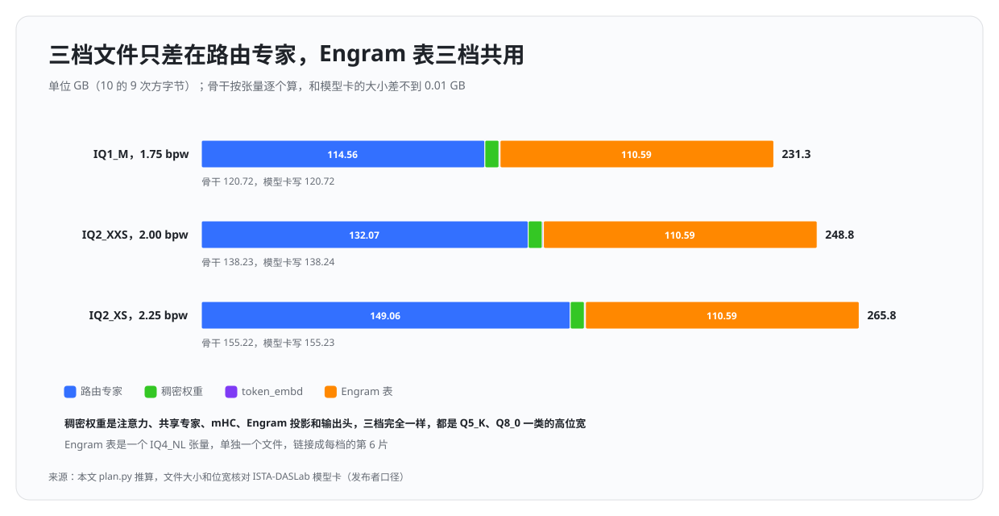
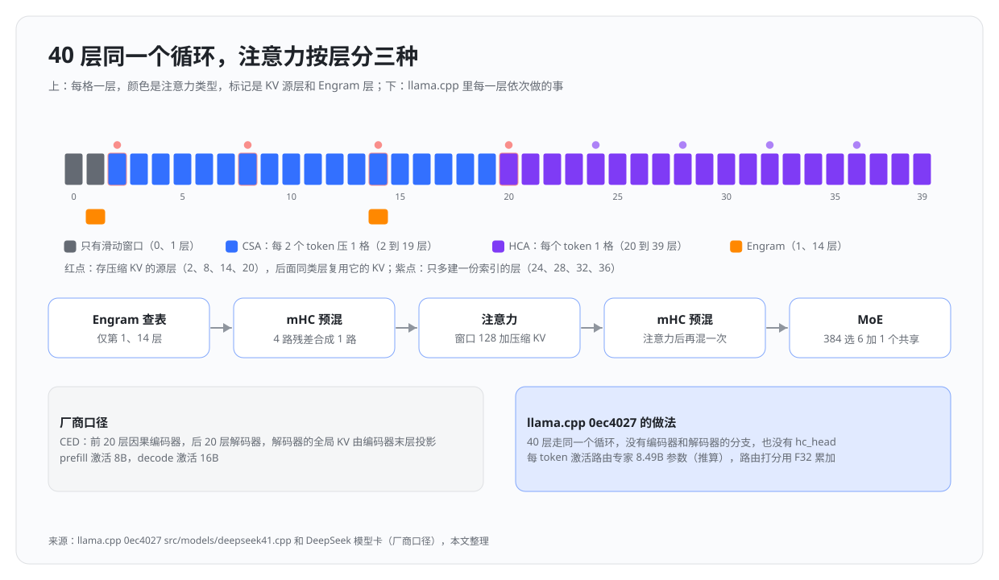
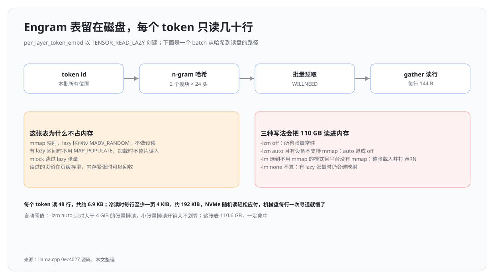
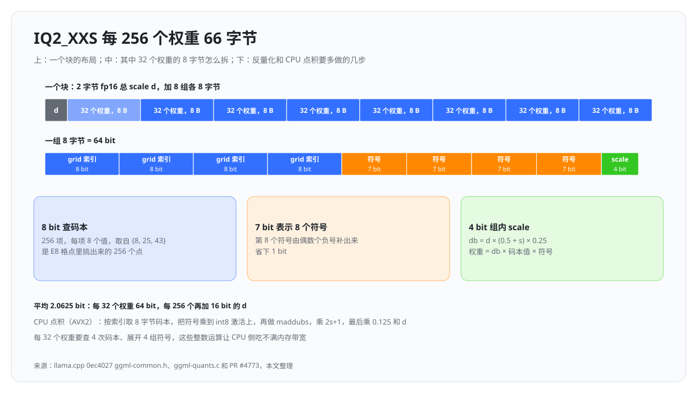
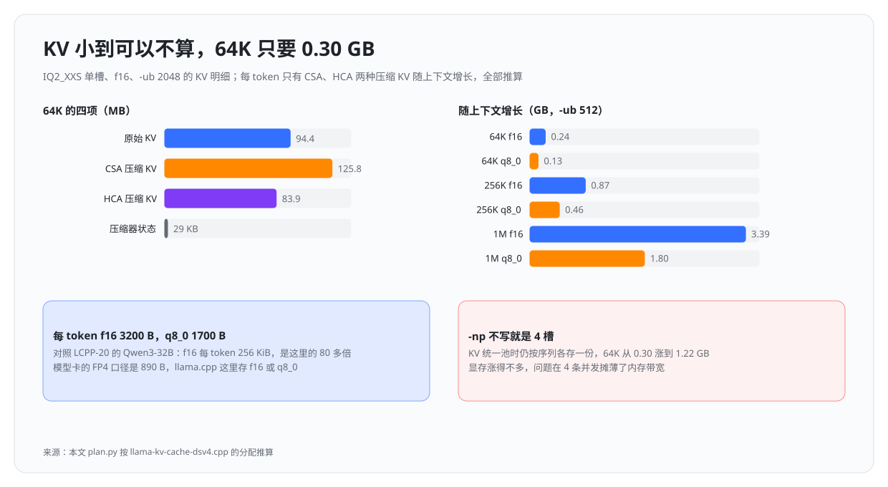
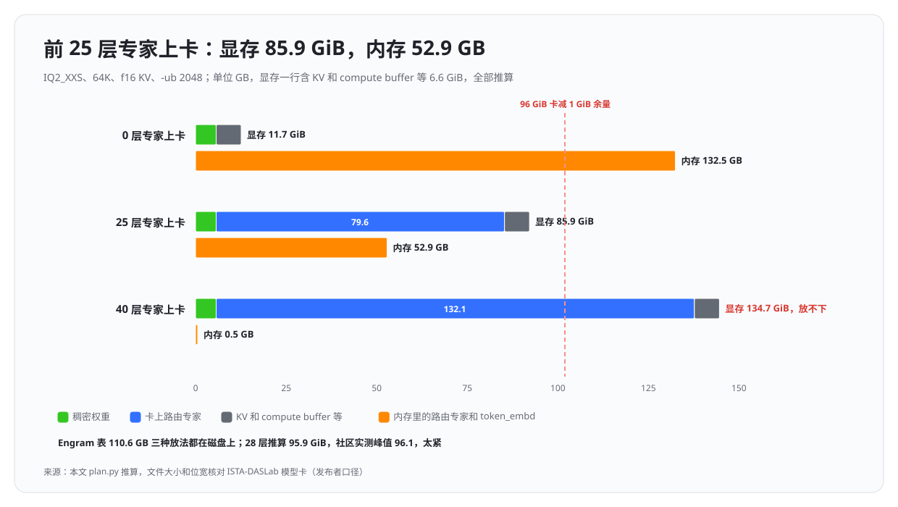
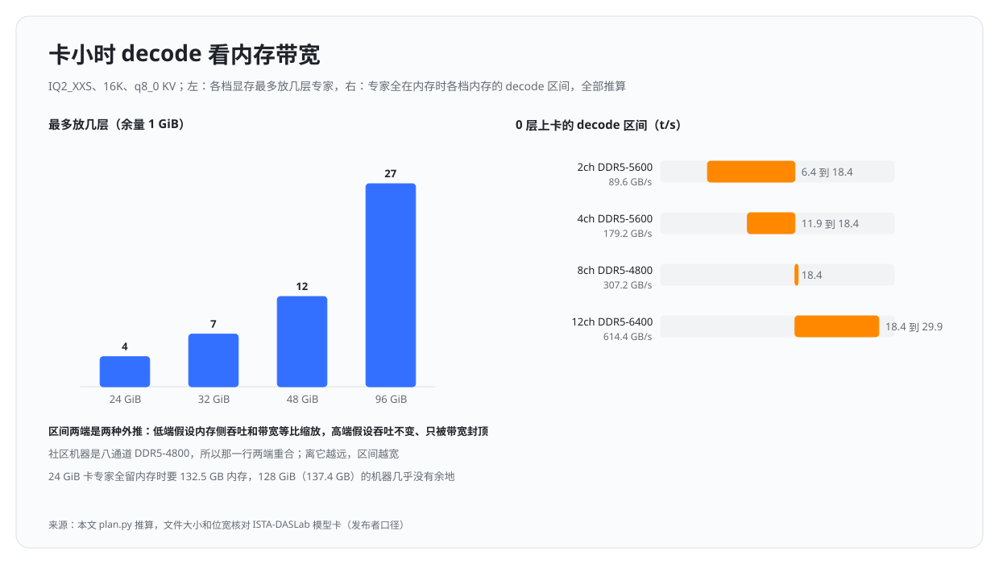
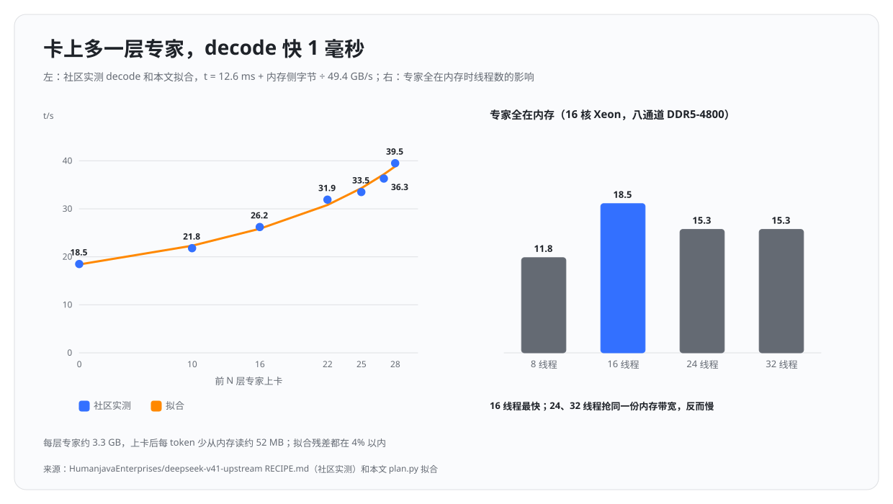
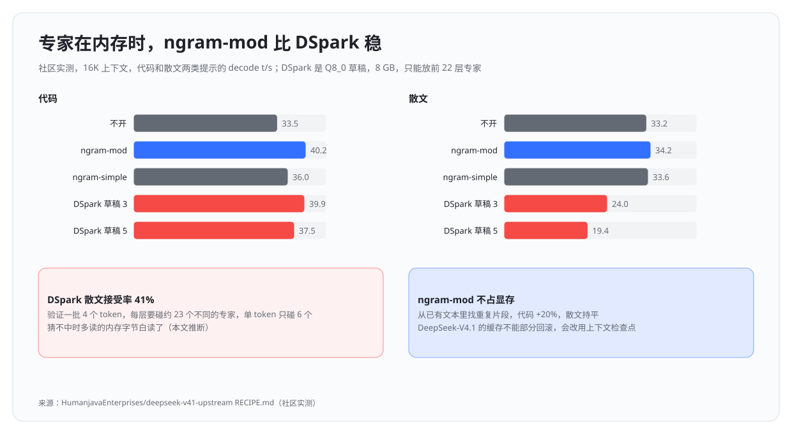
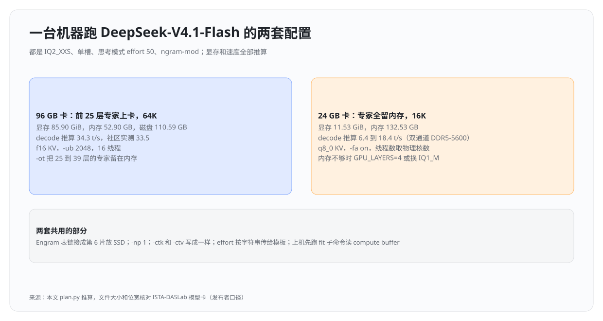

# LCPP-21｜实战｜一台机器跑 DeepSeek-V4.1-Flash

> 🎯 **这篇文档解决什么问题**：DeepSeek-V4.1-Flash 的骨干有 552B 参数，外加一张 196B 参数的 Engram 表，ISTA-DASLab 把它压到了 2 bpw 左右。我想知道它能不能装进一台“一张显卡加一堆内存”的机器：文件怎么摆，Engram 表为什么不占内存，路由专家放几层上卡，decode 大概多快。我手上没有 GPU 机器，所以文中的字节、显存和速度全是按 llama.cpp 0ec4027 的分配逻辑推算的，每个数字都标了口径：推算的给公式或 plan.py 命令，别人测的标厂商口径、发布者口径或社区实测。
>
> 使用方式：只想要命令，直接看第 10 章；只有 24 GB 卡的读者，重点看 6.3 节、第 7 章和第 10 章右边那套配置；想知道这个模型在 llama.cpp 里长什么样，看第 2 章和第 4 章。文中版本和数字核对于 2026 年 11 月 2 日。
>
> **代码**：[zero-to-llama/21-deepseek-v41](../21-deepseek-v41)。plan.py 复现文中所有推算，run_96g.sh 和 run_24g.sh 是第 10 章的启动命令，我只写了命令，没有在 GPU 上跑过。基线是主干 0ec4027，本篇不启动 llama-server，也不启动任何监听端口的程序。

# 导读 · 先给结论

- **三档文件只差在路由专家。**IQ1_M、IQ2_XXS、IQ2_XS 的骨干分别是 120.72、138.24、155.23 GB，稠密权重和 token_embd 三档一样，差出来的全是专家；Engram 表是单独一个 110.60 GB 的 IQ4_NL 文件，三档共用（发布者口径）[[1]](https://huggingface.co/ISTA-DASLab/DeepSeek-V4.1-Flash-1017-GSQ-RCO-GGUF)。
- **Engram 表留在磁盘上。**它以 TENSOR_READ_LAZY 创建，走 mmap 按行读，每个 token 读 48 行、约 6.9 KB，不占显存，也不常驻内存[[2]](https://github.com/ggml-org/llama.cpp/blob/0ec4027/src/models/deepseek41.cpp)[[3]](https://github.com/ggml-org/llama.cpp/blob/0ec4027/src/llama-model-loader.cpp)。-lzm off 或者设备不支持 mmap 时，这 110 GB 会整张读进内存。
- **KV 小到可以不算。**每 token f16 只要 3200 B，64K 单槽 0.30 GB，1M 也只有 3.39 GB（推算）[[4]](https://github.com/ggml-org/llama.cpp/blob/0ec4027/src/llama-kv-cache-dsv4.cpp)。要防的是 -np 不写：缺省 4 个槽，压缩 KV 每槽一份。
- **96 GB 卡放前 25 层专家。**IQ2_XXS、64K、f16 KV 推算显存 85.90 GiB，和社区实测峰值 85.9 对得上；内存 52.90 GB，decode 社区实测 33.5 t/s[[5]](https://github.com/HumanjavaEnterprises/deepseek-v41-upstream/blob/main/RECIPE.md)。28 层推算 95.92 GiB，实测 96.1，太紧。
- **卡上多一层专家，decode 快约 1 ms。**我拿社区的逐层扫描拟合出 t = 12.6 ms + 内存侧字节 ÷ 49.4 GB/s，残差都在 4% 以内。49.4 GB/s 只有八通道 DDR5-4800 理论带宽的 16%，原因在 CPU 侧解 IQ 系列格式的那几步整数运算。
- **24 GB 卡也能跑，瓶颈换成内存。**专家全留内存要 132.5 GB 内存，decode 在双通道 DDR5-5600 上推算 6.4 到 18.4 t/s，区间宽，因为我只有一台机器的实测可以外推。
- **思考强度按字符串传，投机解码用 ngram-mod。**effort 50 时 IQ2_XXS 三项平均和原模型一样（发布者口径）。专家在内存时 DSpark 草稿在散文上从 33.2 掉到 24.0，ngram-mod 代码快 20%、散文持平（社区实测）[[6]](https://github.com/ggml-org/llama.cpp/blob/0ec4027/common/chat.cpp)。

**📎 与系列其他文档的分工**：显存账的通用写法见 [LCPP-02｜上手｜推理账本：带宽、算力和启动前算出速度上限](./02-ledger.md)，GGUF 分卷见 [LCPP-04｜内部｜GGUF：文件结构、元数据、加载方式和分卷](./04-gguf.md)，量化格式见 [LCPP-07｜内部｜量化：块结构、配方、imatrix 和用 KLD 选类型](./07-quantization.md)，KV cache 见 [LCPP-08｜内部｜KV cache 与长上下文：账本、深度、量化、SWA 和上下文写满](./08-kv-context.md)，CPU 线程和内存带宽见 [LCPP-10｜内部｜CPU 调优：线程、绑核、repack、加载方式和带宽上限](./10-cpu-tuning.md)，-ngl、-ot 和 MoE 专家放置见 [LCPP-11｜内部｜GPU 卸载与 MoE：-ngl、专家放置、fit 和专家缓存](./11-gpu-offload-moe.md)，投机解码见 [LCPP-13｜内部｜投机解码：草稿模型、n-gram 和拒绝采样](./13-speculative.md)，槽位和检查点见 [LCPP-14｜内部｜服务端：槽位、连续批处理和提示缓存](./14-server.md)，同样“没卡也先算账”的做法见 [LCPP-20｜实战｜24 GB 单卡：Qwen3-32B 和 Qwen3.8-27B](./20-qwen-24g.md)，四分之三层换成线性注意力的多模态 27B 怎么算同一笔账见 [LCPP-22｜实战｜一张卡跑 Qwen3.8-27B](./22-qwen38-27b.md)。前面各篇讲的是一个机制，这篇把它们拼到一台机器上，算出两套能直接用的配置。

# 第 1 章 · 先拆文件：骨干、专家和 Engram 表分开算

## 1.1 六个分片，第 6 片是链接

DeepSeek-V4.1-Flash-1017 是 40 层的 MoE，每层 1 个共享专家加 384 个路由专家，每个 token 激活 6 个，另外有一张 196B 参数的 Engram 表，按 n-gram 哈希查行，把查到的向量加回隐藏状态（厂商口径）[[7]](https://huggingface.co/deepseek-ai/DeepSeek-V4.1-Flash-1017)。ISTA-DASLab 发布的 GGUF 把这两部分拆开放：骨干是 5 个分片，第 1 片只放元数据，后 4 片放 551.9B 个权重；Engram 表单独一个 DeepSeek-V4.1-Flash-Engram-IQ4_NL.gguf，110.60 GB，三档共用[[1]](https://huggingface.co/ISTA-DASLab/DeepSeek-V4.1-Flash-1017-GSQ-RCO-GGUF)。

llama.cpp 打开第一片以后，按 %s-%05d-of-%05d.gguf 的格式拼出其余分片的文件名，在同一个目录里逐个找[[8]](https://github.com/ggml-org/llama.cpp/blob/0ec4027/src/llama.cpp)。所以 Engram 文件要链接成每档的第 6 片，名字差一个字符就找不到；gguf-split 合并分卷时也只需要指定第一片，规则是同一套[[9]](https://github.com/ggml-org/llama.cpp/blob/0ec4027/tools/gguf-split/README.md)。模型卡要求 llama.cpp b11870 或更新[[10]](https://github.com/ggml-org/llama.cpp/releases/tag/b11870)，10 月 27 日以前下载的旧布局文件加载不了，模型卡给了一个转换脚本，只改元数据，不用重下权重（发布者口径）。

下载用 hf download，--include 只挑 IQ2_XXS 和 Engram 两组文件，--local-dir 指定落盘目录，正式部署时再加 --revision 钉住一个 commit，免得仓库更新后两台机器拿到的文件不一样[[11]](https://huggingface.co/docs/huggingface_hub/guides/cli)。Windows 没有 ln -s 的习惯写法，用 mklink /H 建硬链接，效果一样[[12]](https://learn.microsoft.com/en-us/windows-server/administration/windows-commands/mklink)。mmproj 0.97 GB 是图像输入用的，纯文本不加载，我没有下。

```bash
hf download ISTA-DASLab/DeepSeek-V4.1-Flash-1017-GSQ-RCO-GGUF \
  --include "*IQ2_XXS*" "*Engram*" --local-dir models/ds41
cd models/ds41
ln -s DeepSeek-V4.1-Flash-Engram-IQ4_NL.gguf \
  DeepSeek-V4.1-Flash-1017-GSQ-RCO-IQ2_XXS-00006-of-00006.gguf
# Windows 用 mklink /H；-m 指向 -00001-of-00006 那一片
```

## 1.2 逐个张量算一遍字节



后面所有的放置账都从文件大小出发，所以我先把字节核对清楚。张量形状照 deepseek41.cpp 的加载代码，结构参数取自 config.json[[2]](https://github.com/ggml-org/llama.cpp/blob/0ec4027/src/models/deepseek41.cpp)，每个张量用什么量化类型，看发布者随模型附的那份 RCO 分配表，1043 个张量各占一行。每元素位数按 ggml-common.h 的块大小换算，例如 IQ2_XXS 每 256 个元素 66 字节，合 2.0625 bpw，Q5_K 合 5.5 bpw，IQ4_NL 合 4.5 bpw[[13]](https://github.com/ggml-org/llama.cpp/blob/0ec4027/ggml/src/ggml-common.h)。

算出来三档骨干和模型卡差不到 0.01 GB，位宽和分配表表头写的 measured bpw 一致到小数点后四位。稠密权重 5.70 GB、token_embd 0.46 GB 三档完全一样，差别全在路由专家：114.56、132.07、149.06 GB。Engram 表算出来 110.59 GB，模型卡写 110.60，差的是四舍五入。

| 档 | 骨干（推算） | 模型卡 | 位宽（推算 / 表头） | 其中路由专家 |
|-|-|-|-|-|
| IQ1_M | 120.72 GB | 120.72 GB | 1.7499 / 1.7499 | 114.56 GB |
| IQ2_XXS | 138.23 GB | 138.24 GB | 2.0038 / 2.0038 | 132.07 GB |
| IQ2_XS | 155.22 GB | 155.23 GB | 2.2501 / 2.2501 | 149.06 GB |

```bash
cd zero-to-llama/21-deepseek-v41
python3 plan.py
IQ1_M    骨干 551.9B 参数  120.72 GB（卡上写 120.72 GB）  位宽 1.7499（表头 1.7499）  专家 114.56 GB ...
IQ2_XXS  骨干 551.9B 参数  138.23 GB（卡上写 138.24 GB）  位宽 2.0038（表头 2.0038）  专家 132.07 GB ...
IQ2_XS   骨干 551.9B 参数  155.22 GB（卡上写 155.23 GB）  位宽 2.2501（表头 2.2501）  专家 149.06 GB ...
Engram 表 110.59 GB（卡上写 110.60 GB）
```

## 1.3 稠密权重只占 4%，却每个 token 都要读

IQ2_XXS 这一档的 5.70 GB 稠密权重里，Q5_K 占 4.87 GB，Q8_0 0.39 GB，BF16 0.28 GB，F32 0.16 GB，平均接近 6 bpw，比路由专家的 1.94 bpw 高出两倍多。按参数数看，注意力是大头，attn_q_b、attn_output_b、attn_output_a 三个矩阵合计约 4.7B，加上 attn_q_a 和 attn_kv 一共约 5.1B；共享专家三个矩阵各 0.47B，合 1.42B；输出头 0.66B，Engram 的投影 0.32B，路由器、mHC 和压缩器加起来不到 0.2B（推算）。

这 5.70 GB 只占骨干的 4%，但 decode 每个 token 都要从头到尾读一遍，路由专家每个 token 只碰 384 个里的 6 个。所以我放置时的第一条规则是稠密权重整份上卡，这在 llama.cpp 里就是 -ngl 99 的效果，后面讨论的都是路由专家怎么在显存和内存之间分。

**📎 展开阅读：**GGUF 分卷的命名规则和 gguf-split 的用法，在 [LCPP-04｜内部｜GGUF：文件结构、元数据、加载方式和分卷](./04-gguf.md)。

> 🔑 **本章要点**：骨干 5 片加 Engram 表 1 片，Engram 文件三档共用，用链接补成第 6 片。逐张量算出的骨干和模型卡差不到 0.01 GB，三档只差在路由专家。稠密权重 5.70 GB、接近 6 bpw，每个 token 都要读，整份上卡。

# 第 2 章 · 模型结构：llama.cpp 要扛哪几样东西

## 2.1 40 层走同一个循环



DeepSeek 的模型卡和技术报告把这个模型讲成 CED 结构：40 层 Transformer 里前 20 层是因果编码器，后 20 层是解码器，解码器的全局 KV 由编码器末层的隐藏状态投影出来，prefill 激活 8B 参数，decode 激活 16B（厂商口径）[[7]](https://huggingface.co/deepseek-ai/DeepSeek-V4.1-Flash-1017)[[14]](https://huggingface.co/deepseek-ai/DeepSeek-V4.1-Flash/blob/main/DeepSeek_V41_Tech_Report.pdf)。我读 llama.cpp 的实现时没有找到编码器和解码器的分支：GGUF 里的架构名登记为 deepseek41，deepseek41.cpp 对 40 层用同一个循环，每层依次做 Engram 查表、mHC 预混、注意力、再一次预混和 MoE，最后也没有单独的 hc_head[[15]](https://github.com/ggml-org/llama.cpp/blob/0ec4027/src/llama-arch.cpp)[[2]](https://github.com/ggml-org/llama.cpp/blob/0ec4027/src/models/deepseek41.cpp)。

所以厂商口径的 8B 和 16B，我不拿来算显存和速度。按 llama.cpp 实际建的张量算，每个 token 碰到的路由专家是 8.49B 参数，稠密部分 7.64B，合起来 16.1B，和厂商写的 decode 16B 对得上（推算）；prefill 的 8B 在 llama.cpp 里没有对应的省法，prefill 照样跑满 40 层。

## 2.2 注意力分三种，存 KV 的源层只有 4 个

40 层注意力的底子都是窗口 128 的滑动窗口，区别在窗口之外看什么。第 0、1 层只有窗口；第 2 到 19 层是 CSA，每 2 个 token 压成 1 格；第 20 到 39 层是 HCA，每个 token 1 格。真正存压缩 KV 的只有第 2、8、14、20 四层，代码注释的说法是每个压缩层读它之前最近一个源层的 KV 和 top-k，源层的压缩比必须和使用者一致，压缩比为 0 的层不能当源层。

模型卡说 CSA2 给每层定一种静态模式：Full 自己算 KV 和索引，Reindex 复用 KV 只重算索引，Reuse 两样都复用（厂商口径）[[7]](https://huggingface.co/deepseek-ai/DeepSeek-V4.1-Flash-1017)。按我读的代码，第 2、8、14、20 层建了 attn_comp_wkv 和 indexer_attn_k，对应 Full；第 24、28、32、36 层只多建一份索引，对应 Reindex；其余压缩层对应 Reuse。技术报告里的分层稀疏索引，在代码里是可选的两级选择，先挑候选块，再在块内打分，环境变量 LLAMA_DSV41_SPARSE=0 可以关掉这条稀疏路径。

这套结构决定了第 5 章的结论：随上下文增长的 KV 只有 4 层压缩 KV，而且每格只存 K 和索引，每个 token 只多 2.5 格。模型卡写的 FP4 主 KV 每 token 890 B，是训练和官方推理用的 E2M1 加每 16 通道一个 E4M3 scale 的口径，llama.cpp 这里按 f16 或 q8_0 存，数字会大三四倍。

## 2.3 Engram 和 mHC 是两样新东西

Engram 来自 DeepSeek 团队的论文，思路是把“条件记忆”当成和 MoE 并列的另一种稀疏：用现代化的 n-gram 嵌入做 O(1) 查表，查到的向量加回隐藏状态，论文在 27B 规模上验证，并指出寻址是确定性的，可以从主机内存预取，开销几乎可以忽略[[16]](https://arxiv.org/abs/2601.07372)。这句话正好是 llama.cpp 的做法，第 3 章会细看。在这个模型里 Engram 只在第 1 层和第 14 层各有一个模块，每个模块 24 个头，表一共 196.6B 参数。

mHC 是另一篇论文，它在 Hyper-Connections 的基础上，把加宽后的残差流的混合矩阵约束到一个流形上，恢复恒等映射，训练更稳[[17]](https://arxiv.org/abs/2512.24880)。这里的残差流宽度是 4 路，每个子层前把 4 路合成 1 路，子层后再写回去。llama.cpp 的实现按模型卡的 Single-Pass 写法，代码注释说折叠残差流用的预混比当前子层晚一拍，参数只有每层 0.04B，算量也小，但每一层多了几个小算子，这在第 7 章的固定开销里会体现出来。

## 2.4 384 选 6 的路由专家

MoE 部分沿用 DeepSeekMoE 的两条设计：把专家切得很细，激活其中一小部分，再加几个所有 token 都走的共享专家[[18]](https://arxiv.org/abs/2401.06066)。DeepSeek-V3 是 671B 总参数、每 token 激活 37B[[19]](https://arxiv.org/abs/2412.19437)；V4.1-Flash 的骨干只有 552B，每层 384 个路由专家，每个 35.4M 参数，激活 6 个加 1 个共享专家，激活比例更低，所以骨干里 98% 的字节在路由专家上，而每个 token 只读其中的 1.6%（推算）。

路由打分有两处要留意。代码注释写着路由器用 F32 累加，因为专家选择对接近持平的分数很敏感，量化误差可能把第 6 名和第 7 名换掉。图像 token 用另一组路由偏置 ffn_exp_probs_b_vl，只在输入里有图像嵌入时生效，纯文本场景用不到，但它说明 mmproj 不止是一个外挂的视觉编码器。

**📎 展开阅读：**MoE 专家在 llama.cpp 里怎么分配设备，在 [LCPP-11｜内部｜GPU 卸载与 MoE：-ngl、专家放置、fit 和专家缓存](./11-gpu-offload-moe.md)；KV cache 的通用结构，在 [LCPP-08｜内部｜KV cache 与长上下文：账本、深度、量化、SWA 和上下文写满](./08-kv-context.md)。

> 🔑 **本章要点**：llama.cpp 对 40 层用同一个循环，厂商口径的 CED 编码器和解码器之分在实现里没有分支。注意力是窗口 128 加 CSA、HCA 两种压缩，存压缩 KV 的只有第 2、8、14、20 层。Engram 在第 1、14 层，mHC 把残差流加宽到 4 路。每 token 读路由专家 8.49B 加稠密 7.64B 参数。

# 第 3 章 · Engram 表留在磁盘，每个 token 只读几十行

## 3.1 lazy 读取怎么生效



Engram 表在 deepseek41.cpp 里叫 per_layer_token_embd，两个模块的表首尾相接存在同一个张量里，创建时带 TENSOR_READ_LAZY 标记。计算图里先把本批所有 Engram 层的 n-gram 哈希算完，再一次性调 llama_prefetch_rows 预取要用的行，然后 gather 出来，这几个 gather 紧跟在 token 嵌入后面，落在第一个图切分里，表始终留在主机一侧；图像 token 的门控直接置 0[[2]](https://github.com/ggml-org/llama.cpp/blob/0ec4027/src/models/deepseek41.cpp)[[20]](https://github.com/ggml-org/llama.cpp/blob/0ec4027/src/llama-model.cpp)。

加载器那边，--lazy-mode（-lzm）有 on、auto、off 三档，缺省 auto 只对大于 4 GiB 的张量懒读，代码注释说小张量懒读开销大不划算[[3]](https://github.com/ggml-org/llama.cpp/blob/0ec4027/src/llama-model-loader.cpp)[[21]](https://github.com/ggml-org/llama.cpp/blob/0ec4027/common/arg.cpp)，110 GB 的 Engram 表一定命中。lazy 区间映射时设 MADV_RANDOM 关掉预读，其余区间设 WILLNEED，存在 lazy 区间时不用 MAP_POPULATE，mlock 也会跳过 lazy 张量[[22]](https://github.com/ggml-org/llama.cpp/blob/0ec4027/src/llama-mmap.cpp)。

这几个系统调用的语义查 man 手册就清楚：MADV_RANDOM 告诉内核页会按随机顺序访问，不要预读[[23]](https://man7.org/linux/man-pages/man2/madvise.2.html)；MAP_POPULATE 会在映射时把页全部读进来，对 110 GB 的文件等于加载时整张读一遍[[24]](https://man7.org/linux/man-pages/man2/mmap.2.html)；mlock 把页锁在内存里不许换出，锁住 Engram 表就等于让它常驻[[25]](https://man7.org/linux/man-pages/man2/mlock.2.html)。llama.cpp 对 lazy 区间把这三样都避开了，读过的页留在页缓存里，内存紧张时内核可以回收。

## 3.2 每个 token 读 48 行，盘要是 SSD

每个 token 在两个模块里一共查 48 行，每行 256 维 IQ4_NL，144 字节，合计约 6.9 KB。冷读时每行至少碰一个 4 KiB 的页，约 192 KiB，一秒 30 个 token 也就 6 MB/s 的随机读，NVMe 应付得了；放在机械盘上，每行一次寻道，速度会掉到看不下去，放在网络盘上则是每个 token 几十次远程随机读。

热点会自己留在页缓存里。常用的 n-gram 反复命中同一批行，跑一阵以后大部分读都落在内存里，所以 Engram 表虽然不计入内存账，机器上最好还是留出几 GB 给页缓存，我在第 6 章算内存余量时会扣掉这一块。

## 3.3 三种写法会把 110 GB 读进内存

第一种是显式写 -lzm off，所有张量都常驻。第二种是 -lzm auto 但有设备不支持 mmap，llama-model.cpp 会把 auto 退成 off[[20]](https://github.com/ggml-org/llama.cpp/blob/0ec4027/src/llama-model.cpp)。第三种是选了不用 mmap 的加载模式、平台又没有 mmap，加载器会整张载入并打一行 WRN。这三种情况都会让内存账凭空多出 110 GB，256 GB 的机器也扛不住。

--load-mode none 不在这三种里。init_mappings 的条件是用了 mmap 或者有任何 lazy 张量，所以 -lm none 时 Engram 表照样建映射、照样懒读，只有其余张量改成读进进程自己的缓冲区。第 6 章讨论专家留在内存时会用到这一点。

```text
# 正常：这一行出现，说明 Engram 表在懒读
tensor per_layer_token_embd.weight (size = ... MiB) lazy read enabled
# 出事：这一行出现，110 GB 要读进内存
mmap is not available, so tensor per_layer_token_embd.weight (size = ... MiB) is loaded into RAM in full
```

**📎 展开阅读：**mmap、mlock 和页缓存的关系，在 [LCPP-04｜内部｜GGUF：文件结构、元数据、加载方式和分卷](./04-gguf.md) 讲加载时有更完整的说明。

> 🔑 **本章要点**：Engram 表以 TENSOR_READ_LAZY 创建，-lzm auto 对大于 4 GiB 的张量懒读，设 MADV_RANDOM、不用 MAP_POPULATE、跳过 mlock。每个 token 读 48 行、约 6.9 KB，文件放 SSD。-lzm off、设备不支持 mmap、平台没有 mmap 时整张读进内存，-lm none 不影响懒读。

# 第 4 章 · IQ2_XXS 怎么存 2 bit，CPU 为什么算不快

## 4.1 每 256 个权重 66 字节



IQ2_XXS 来自 llama.cpp 的 PR #4773[[26]](https://github.com/ggml-org/llama.cpp/pull/4773)。一个块管 256 个权重，开头 2 字节是 fp16 的总 scale d，后面 8 组各 8 字节，每组管 32 个权重[[13]](https://github.com/ggml-org/llama.cpp/blob/0ec4027/ggml/src/ggml-common.h)。8 字节拆成四个 8 bit 的码本索引、四个 7 bit 的符号索引和一个 4 bit 的组内 scale：每个码本项是 8 个值，取自 {8, 25, 43}；8 个权重的符号只存 7 bit，第 8 个由“负号个数为偶数”补出来。

反量化公式在 ggml-quants.c 里，组内 scale db = d × (0.5 + s) × 0.25，权重等于 db 乘码本值再乘符号；量化时 quantize_row_iq2_xxs_impl 会读 imatrix 给每个权重的重要性加权[[27]](https://github.com/ggml-org/llama.cpp/blob/0ec4027/ggml/src/ggml-quants.c)。256 个码本项是从 E8 格点里挑出来的：坐标取 1/2、3/2、5/2 的 8 维点一共 6561 个，坐标和为偶数的 3281 个，再按使用频率留下 256 个（PR 描述）。

这条路线的源头是 QuIP 和 QuIP#。QuIP 用随机正交矩阵做非相干处理，让权重分布更均匀，第一次把 2 bit 做到可用[[28]](https://arxiv.org/abs/2307.13304)；QuIP# 换成随机 Hadamard 变换，用 E8 格点码本做 8 维向量量化，因为 E8 是 8 维里最密的球堆积[[29]](https://arxiv.org/abs/2402.04396)。IQ2_XXS 借了 E8 码本和偶数符号这两个点子，但没有做旋转，所以能直接落进 GGUF 的块格式。

## 4.2 CPU 点积多出来的几步

CPU 上的点积在 x86 的 quants.c 里，激活先量化成 Q8_K。AVX2 版本每 32 个权重要按 4 个索引从码本表里取 4 个 8 字节，再查符号表把 7 bit 展开成 8 个符号，用 sign_epi8 乘到 int8 激活上，然后 maddubs 累加、乘 2s+1，最后整体乘 0.125 和 d[[30]](https://github.com/ggml-org/llama.cpp/blob/0ec4027/ggml/src/ggml-cpu/arch/x86/quants.c)。Q4_0 一类格式只需要拆半字节、减偏移，IQ2_XXS 每 32 个权重多了 4 次查表和 4 次符号展开。

PR #4773 里，7B 模型在 Ryzen 5975WX 上 IQ2_XXS 的 TG 是 24.3 t/s，Q4_0 是 15.4，字节少了，速度确实更快（PR 实测）。换算成字节吞吐就是另一回事了：按 6.7B 参数和标称位宽粗算，IQ2_XXS 每秒读约 42 GB，Q4_0 约 58 GB，同一台机器上 IQ2_XXS 吃到的带宽少了四分之一以上（推算）。

第 7 章拟合出社区那台机器的内存侧吞吐只有 49.4 GB/s，按专家平均 2.06 bpw 换算是每秒约 192G 个权重，16 个核平均每核 12G 个（推算）。这个数和上面 PR 的现象方向一致：CPU 侧算 IQ 系列专家，瓶颈在解码码本的整数运算，内存带宽没吃满。

## 4.3 GSQ 和 RCO 决定每个张量用哪种格式

ISTA 的文件名里写着 IQ2_XXS，里面却混着好几种格式。模型卡说流程分三步：先用 GSQ 把每个张量在每种候选格式下都量化一遍，建成一个数据库；再用 RCO 在总大小预算下给每个张量挑一种格式，让骨干的平均位宽正好落在目标上；最后把挑中的版本拼成一个标准 GGUF[[1]](https://huggingface.co/ISTA-DASLab/DeepSeek-V4.1-Flash-1017-GSQ-RCO-GGUF)。稠密张量在 Q5_K、Q6_K、Q8_0 里挑，路由专家在 IQ1_S 到 IQ3_S 里挑，教师模型是专家保持原生 FP4 的发布版，校准数据由模型自己生成。

GSQ 用 Gumbel-Softmax 把格点分配放松成可微的，和组内 scale 一起学，论文说它在 2 到 3 bit 上补上了标量量化和向量量化之间的大部分差距，而且能直接输出 GGUF 的 K 系列格式[[31]](https://arxiv.org/abs/2604.18556)[[32]](https://github.com/IST-DASLab/GSQ)。RCO 把预算约束写成 logit 空间里的一个黎曼流形，在切空间上投影梯度、用二分搜索拉回流形、外面套 Adam，预算严格满足，也不用调约束的超参数[[33]](https://arxiv.org/abs/2605.00649)[[34]](https://github.com/IST-DASLab/RCO)。

## 4.4 RCO 给每层专家不同的位宽

GGUF 没法给同一个张量里的不同专家定不同格式，所以 RCO 的粒度是一层的专家整体，文件名里的 IQ2_XXS 只代表平均位宽[[1]](https://huggingface.co/ISTA-DASLab/DeepSeek-V4.1-Flash-1017-GSQ-RCO-GGUF)。IQ2_XXS 这一档的专家里，IQ1_M 占 59.45 GB，IQ2_XXS 49.05 GB，IQ2_XS 23.57 GB。前面的层多用 IQ1_M，后面的层多用 IQ2_XS，每层专家从 2.97 GB 到 3.93 GB 不等，前 10 层合计 30.08 GB，后 10 层 34.86 GB（推算）。

这一点在第 6 章会用到。社区的放法是前 N 层专家上卡，上卡的恰好是便宜的层；llama.cpp 自带的 -ncmoe 方向相反，把前 N 层留在内存。层数相同时两种写法占的显存不一样，要按字节换算，而不是按层数对齐。

**📎 展开阅读：**IQ 系列格式、imatrix 和 K 系列的块结构，在 [LCPP-07｜内部｜量化：块结构、配方、imatrix 和用 KLD 选类型](./07-quantization.md)。

> 🔑 **本章要点**：IQ2_XXS 每 256 个权重 66 字节，靠 E8 格点码本和偶数符号省位。CPU 点积每 32 个权重多 4 次查表和 4 次符号展开，字节吞吐比 Q4_0 低。GSQ 负责单张量量化，RCO 在预算下按层给专家分格式，前面的层位宽低、后面的层高。

# 第 5 章 · KV 小到可以不算，槽数要写死

## 5.1 每个 token 只多 3200 字节



第 2 章讲过，40 层注意力的底子都是窗口 128 的滑动窗口，原始 KV 只存 K，每格 512 维，格数固定，不随上下文涨。随上下文增长的只有第 2、8、14 层的 CSA 和第 20 层的 HCA：CSA 每 2 个 token 压成 1 格，HCA 每个 token 1 格，每格存 512 维的 K 加 128 维的索引[[4]](https://github.com/ggml-org/llama.cpp/blob/0ec4027/src/llama-kv-cache-dsv4.cpp)[[7]](https://huggingface.co/deepseek-ai/DeepSeek-V4.1-Flash-1017)。所以每多一个 token，三层 CSA 合计多 1.5 格，HCA 多 1 格，一共 2.5 格、每格 640 维，按 f16 存是 3200 B，按 q8_0 存是 1700 B（推算）。

64K 单槽、-ub 2048 时，四项加起来是 0.30 GB。原始 KV 94.4 MB，它的格数按窗口加 ubatch 再对齐到 256 来定，和上下文长度无关；CSA 125.8 MB，HCA 83.9 MB，压缩器的 F32 状态只有 28.7 KB。上下文开到 1M，f16 也只有 3.39 GB，q8_0 是 1.80 GB（推算）。拿 [LCPP-20｜实战｜24 GB 单卡：Qwen3-32B 和 Qwen3.8-27B](./20-qwen-24g.md) 的 Qwen3-32B 对照，那边 f16 每 token 256 KiB，是这里的 80 多倍。

模型卡写的每 token 890 B 是 FP4 主 KV 的口径，llama.cpp 这里存 f16 或 q8_0，所以我的数字大三四倍。对这两台机器来说，两种口径都小到可以从显存账里略掉，显存的大头在专家权重和 compute buffer，后面两章只盯这两样。

## 5.2 -np 不写，压缩 KV 就存 4 份

llama-server 不写 -np 时，日志会出现 n_parallel is set to auto, using n_parallel = 4 and kv_unified = true[[35]](https://github.com/ggml-org/llama.cpp/blob/0ec4027/tools/server/server.cpp)。普通模型在 kv_unified 下 4 个槽共用一个池，总长度还是 -c；这个模型的 dsv4 缓存不合并，每条序列各分一份完整长度[[4]](https://github.com/ggml-org/llama.cpp/blob/0ec4027/src/llama-kv-cache-dsv4.cpp)。64K 的 KV 从 0.30 GB 涨到 1.22 GB（推算），只多 0.9 GB 左右，96 GB 那套的推算显存从 85.90 涨到 86.75 GiB。

显存涨得不多，我还是把 -np 1 写死，原因在速度。专家留在内存时 decode 卡在内存侧，4 条请求同时 decode，每层要碰的不同专家接近翻 4 倍，单条请求的速度会明显掉下来。启动日志里 initializing, n_slots = 1, n_ctx_slot = 65536 这一行能确认槽数和每槽长度；-c 超过模型的训练长度时，还会多一行 capping 的 WRN，槽长度被截到训练长度[[36]](https://github.com/ggml-org/llama.cpp/blob/0ec4027/tools/server/server-context.cpp)。

## 5.3 K 和 V 要用同一种类型

llama-context.cpp 对 MLA、DEEPSEEK4 和 DEEPSEEK41 都检查 -ctk 和 -ctv，两者不同就直接报错，模型加载不起来[[37]](https://github.com/ggml-org/llama.cpp/blob/0ec4027/src/llama-context.cpp)。所以改 KV 类型时两个参数要一起改，只写 -ctk q8_0 是最常见的失败写法。V 用量化类型时还需要 flash attention：-fa 是 auto 会自动打开，并打一行 enabling flash_attn since it is required for quantized V cache；写死 -fa off 就报错退出。

q8_0 在这里省下的绝对量很小，64K 省 113 MB，16K 省 39 MB（推算）。96 GB 那套我留 f16，和社区实测峰值的条件保持一致，第 6 章拿峰值反推其余项时少一个变量。24 GB 那套我写 q8_0，给以后把 -c 往上调留一点余地，代价是 -fa 必须开着。

**📎 展开阅读：**KV cache 的结构和量化，在 [LCPP-08｜内部｜KV cache 与长上下文：账本、深度、量化、SWA 和上下文写满](./08-kv-context.md)；槽位和 kv_unified，在 [LCPP-14｜内部｜服务端：槽位、连续批处理和提示缓存](./14-server.md)。

> 🔑 **本章要点**：每个 token f16 只多 3200 B，64K 单槽 0.30 GB，1M 也只有 3.39 GB。dsv4 缓存按序列各存一份，-np 缺省 4 槽时压缩 KV 乘 4，我把 -np 1 写死。-ctk 和 -ctv 必须相同，量化 V 需要 flash attention。

# 第 6 章 · 路由专家放几层上卡，按字节算

## 6.1 社区的显存峰值要按 GiB 读

我手上的放置数据来自社区仓库 HumanjavaEnterprises/deepseek-v41-upstream。机器是一张 RTX PRO 6000 Max-Q，96 GB 显存、带宽 1792 GB/s，配 16 核的 Xeon w5-3525、八通道 DDR5-4800 和 256 GB 内存[[38]](https://github.com/HumanjavaEnterprises/deepseek-v41-upstream/blob/main/README.md)[[39]](https://www.nvidia.com/en-us/products/workstations/professional-desktop-gpus/rtx-pro-6000-max-q/)[[40]](https://en.wikipedia.org/wiki/Sapphire_Rapids)。它用 -ngl 99 把所有层放上卡，再用 -ot 把第 25 到 39 层的路由专家留在内存，64K、-ub 2048 时记下的显存峰值是 85.9[[5]](https://github.com/HumanjavaEnterprises/deepseek-v41-upstream/blob/main/RECIPE.md)。

显存里能算准的是权重和 KV：稠密权重 5.70 GB，前 25 层专家 79.63 GB，KV 0.30 GB。剩下的 compute buffer 和 CUDA 上下文算不准，我拿峰值反推。RECIPE 写的单位是 GB，按 GB 读，28 层那个点反推出来的其余项是 -0.29 GB，不可能为负。按 GiB 读，25 层和 28 层分别是 6.60 和 6.79 GB，两个点差不到 0.2 GB。nvidia-smi 的显存读数以 MiB 为单位[[41]](https://docs.nvidia.com/deploy/nvidia-smi/index.html)，所以我按 GiB 读，其余项取 25 层那个点的 6.60 GB。



用这个其余项去推 28 层，得到 95.92 GiB，社区实测 96.1，作者的评价是太紧。下表是 25 到 28 层的推算，decode 一列括号里是社区实测，没测过的写“无”。27 层推算 92.56 GiB，余量 3 GiB 多一点，但峰值没人实测过，我不拿它当缺省。

| 上卡的专家 | 显存（推算） | 内存（推算） | decode t/s，拟合（社区实测） |
|-|-|-|-|
| 前 25 层 | 85.90 GiB | 52.90 GB | 34.3（33.5） |
| 前 26 层 | 89.16 GiB | 49.40 GB | 35.7（无） |
| 前 27 层 | 92.56 GiB | 45.75 GB | 37.2（36.3） |
| 前 28 层 | 95.92 GiB | 42.14 GB | 38.8（39.5） |

```bash
python3 plan.py --build IQ2_XXS --gpu-layers 25 --ctx 65536 --kv f16 --ub 2048 --card 96
  稠密权重（注意力、共享专家、mHC、Engram 投影、输出头）   5.70 GB
  路由专家 25 层                                           79.63 GB
  KV f16，65536 x 1 槽                                      0.30 GB
  compute buffer 等（RECIPE 峰值反推）                      6.60 GB
  显存合计  92.23 GB（85.90 GiB）/ 96 GiB  OK
  内存：token_embd + 15 层专家 52.90 GB；磁盘：Engram 表 110.59 GB
  decode 推算 34.3-34.3 t/s（内存带宽 307.2 GB/s）
```

## 6.2 -ncmoe 从前往后留，和 25 层等价的是 17

llama.cpp 自带 -cmoe 和 -ncmoe N 两个开关：-cmoe 把所有专家留在内存，-ncmoe N 把前 N 层的专家留在内存[[21]](https://github.com/ggml-org/llama.cpp/blob/0ec4027/common/arg.cpp)。社区的 -ot 写法方向相反，留在内存的是后 15 层。第 4 章说过 RCO 给前面的层分的位宽低，所以两种写法要按字节对齐，层数对不上。

前 17 层的专家合计 52.48 GB，和社区写法留在内存的 52.45 GB 几乎相等。-ncmoe 17 时卡上是 23 层专家，推算显存 85.87 GiB，内存侧字节一样，decode 推算也是 34.3。照抄“放 25 层”写成 -ncmoe 15 的话，卡上会多出约 6 GB 专家，推算 91.73 GiB、36.8 t/s，余量只剩 3 GiB 出头。我在命令里用 -ot，因为能和社区实测逐行对照。

只要有张量被覆盖到 CPU、同时又在用 mmap，加载器就会打一行 WRN：tensor overrides to CPU are used with mmap enabled - consider using --load-mode none for better performance[[3]](https://github.com/ggml-org/llama.cpp/blob/0ec4027/src/llama-model-loader.cpp)。按我读的代码，-lm none 时留在内存的专家改成读进进程自己的缓冲区，Engram 表因为有 lazy 张量，照样建映射、照样懒读。代价是这 52.9 GB 变成进程私有内存，内核不能再按页缓存回收。两种写法哪个快，社区没测，我把它列进第 10 章的上机清单。

## 6.3 24 GB 卡要 128 GB 以上的内存



同样留 1 GiB 余量，按 16K、q8_0 KV 推算各档显存最多放几层专家。其余项沿用 6.60 GB，这是 64K、-ub 2048 下反推的值，16K 下的 compute buffer 会小一些，所以表里的层数偏保守。

| 档 | 24 GiB | 32 GiB | 48 GiB | 96 GiB |
|-|-|-|-|-|
| IQ1_M | 4 | 7 | 13 | 31 |
| IQ2_XXS | 4 | 7 | 12 | 27 |
| IQ2_XS | 3 | 5 | 10 | 24 |

24 GB 卡上，IQ2_XXS 专家全留内存时显存 11.53 GiB，内存要放 132.53 GB；前 4 层上卡时显存 22.61 GiB，内存 120.64 GB（推算）。128 GiB 内存合 137.4 GB，我按系统和其他进程 4 GB、Engram 热行的页缓存 4 GB 粗估余量。专家全留内存时还差约 3 GB，4 层上卡时剩 8.8 GB，勉强能跑。我自己会选 192 GB 的机器，或者退到 IQ1_M，4 层上卡时内存只要 104.39 GB。

```bash
python3 plan.py --fit-card 24 --build IQ2_XXS --ctx 16384 --kv q8_0 --ram-bw 89.6
IQ2_XXS，24 GiB 卡，16384 上下文 q8_0 KV：最多 4 层专家上卡
  内存要放 120.64 GB，decode 推算 7.0-19.8 t/s
```

上机后先跑 llama-fit-params 加 -fitp on，它按设备打印模型、上下文、compute 三项的 MiB[[42]](https://github.com/ggml-org/llama.cpp/blob/0ec4027/tools/fit-params/README.md)。把 compute 那一项填进 plan.py --other，重算一遍层数，会比我拿 64K 反推的 6.60 GB 准。显存贴着上限的配置，我一律等这一步做完再定层数。

## 6.4 我选 25 层的理由

我把四个候选点放在一起比：25 层实测峰值 85.9，推算对得上，离 96 GiB 还有 10 GiB；26 层没人测过；27 层快 2.8 t/s，推算余量 3.4 GiB，峰值也没人测过；28 层实测 96.1，作者自己说太紧。25 层的余量够大，换一张别的 96 GB 卡、驱动多吃几百 MB 也扛得住。卡上多一层只快 1 ms 左右，为了几个百分点去赌显存，划不来。

另一个理由是内存。25 层时内存只放 52.90 GB，256 GB 的机器还剩大量页缓存给 Engram 表的热行，跑久了查表几乎都落在内存里。层数往下调，内存侧字节增加，decode 变慢，页缓存也被挤占，两头都吃亏。

**📎 展开阅读：**-ngl、-ot 和 MoE 专家放置的通用规则，在 [LCPP-11｜内部｜GPU 卸载与 MoE：-ngl、专家放置、fit 和专家缓存](./11-gpu-offload-moe.md)。

> 🔑 **本章要点**：社区峰值按 GiB 读，反推的其余项是 6.60 GB，用它推 28 层得 95.92 GiB，和实测 96.1 对得上。-ncmoe 从前往后留，和前 25 层上卡等价的是 -ncmoe 17。24 GB 卡专家全留内存要 132.5 GB 内存，128 GiB 的机器要 4 层上卡或换 IQ1_M。

# 第 7 章 · decode 速度卡在 CPU 解码专家

## 7.1 卡上多一层，decode 快约 1 毫秒



decode 一个 token，卡上要读全部稠密权重和卡上专家的 6/384，内存侧要读内存专家的 6/384。专家全在内存时，内存侧每 token 读 2.06 GB；前 25 层上卡后降到 0.82 GB。社区从 0 层到 28 层扫了 7 个点[[5]](https://github.com/HumanjavaEnterprises/deepseek-v41-upstream/blob/main/RECIPE.md)，我对这 7 个点做最小二乘，拟合出 t = 12.6 ms + 内存侧字节 ÷ 49.4 GB/s，7 个点的残差都在 4% 以内。

两个系数都能对上物理量。12.6 ms 里，按 1792 GB/s 读一遍稠密权重的理论下限只有 3.2 ms，其余是 CPU 和 GPU 之间每一层来回交接的开销，第 2 章说的 mHC 那些小算子也落在这里。每层专家平均 3.3 GB，上卡后每 token 少从内存读约 52 MB，按 49.4 GB/s 算就是快约 1 ms。

## 7.2 49.4 GB/s 只有理论带宽的 16%

DDR5 每通道 64 bit，每根内存条再分成两个独立的 32 bit 子通道，带宽等于传输率乘 8 字节乘通道数[[43]](https://en.wikipedia.org/wiki/DDR5_SDRAM)。八通道 DDR5-4800 合 307.2 GB/s，拟合出的 49.4 GB/s 只有它的 16%。差出来的部分我归到计算上，理由是第 4 章那几步整数运算。

第 4 章算过，CPU 点积每 32 个权重要多做 4 次码本查表和 4 次符号展开，16 个核每核每秒只能处理约 12G 个权重。字节到得再快，核来不及解，带宽就空着。所以在这台机器上要提速，该换核数更多或单核整数吞吐更高的 CPU，而不是更快的内存条。这是我从拟合系数推出来的结论，没有在第二台机器上验证。

自己测吞吐时，我用 llama-bench 的缺省参数，prompt 512、生成 128，读 tg128 那一列[[44]](https://github.com/ggml-org/llama.cpp/blob/0ec4027/tools/llama-bench/README.md)。把 tg128 换算成每 token 的毫秒数，减去 12.6 ms，再除内存侧字节，就是你那台机器的内存侧吞吐，填回 plan.py 就能重算整张速度表。

## 7.3 线程数取物理核数

社区在专家全留内存时比过 8、16、24、32 线程，decode 分别是 11.8、18.5、15.3、15.3（社区实测）[[5]](https://github.com/HumanjavaEnterprises/deepseek-v41-upstream/blob/main/RECIPE.md)。w5-3525 是 16 个物理核，超过 16 的线程跑在超线程上，两个逻辑核共用一个物理核的执行单元和缓存[[45]](https://en.wikipedia.org/wiki/Hyper-threading)。CPU 侧本来就卡在整数运算上，超线程不添执行单元，只多出线程同步，所以 24 和 32 反而慢。

我的两套命令都把线程数设成物理核数。24 GB 那套写的是 -t 加物理核数的占位符，你的 CPU 要是有大小核，只数性能核；decode 只有个位数又看到 CPU 占满时，先查这一项，再看有没有别的进程在抢内存带宽。

## 7.4 prefill 和 moe-cache 是另外两笔账

prefill 吃的是另一侧。-ub 从缺省 512 调到 2048，25 层那套的 prefill 从 145 涨到 363 t/s，显存只多约 0.5 GB（社区实测）。README 给的 64K 配置 prefill 约 250 t/s，按这个速度喂满 64K 的提示大约要 262 秒，1M 要 70 分钟左右（推算）。长文档场景里，用户的等待主要花在 prefill 上，decode 的那几毫秒反倒次要。

还有一个开关 --moe-cache-mib，缺省 0。它在显存里划一块缓存，存放内存层里最近反复用到的专家，打开以后会关掉流水线并行[[46]](https://github.com/ggml-org/llama.cpp/blob/0ec4027/src/llama-moe-cache.h)[[21]](https://github.com/ggml-org/llama.cpp/blob/0ec4027/common/arg.cpp)。96 GB 那套还剩约 9 GiB，理论上可以给它用，但我找不到公开的实测，就没写进命令。

24 GB 卡的速度只能给区间。双通道 DDR5-5600 理论带宽 89.6 GB/s，专家全留内存时 decode 推算 6.4 到 18.4 t/s。低端假设内存侧吞吐和带宽等比缩放，高端假设吞吐还是社区那台的 49.4 GB/s、只被带宽封顶。按 7.2 节的分析，台式机的 CPU 核数少，更可能落在低端；我手上只有一台机器的扫描可以外推，所以不收窄这个区间。

**📎 展开阅读：**线程数和内存带宽，在 [LCPP-10｜内部｜CPU 调优：线程、绑核、repack、加载方式和带宽上限](./10-cpu-tuning.md)。

> 🔑 **本章要点**：decode 拟合成 12.6 ms 加内存侧字节除以 49.4 GB/s，卡上多一层快约 1 ms。49.4 GB/s 只有八通道理论带宽的 16%，瓶颈在 CPU 解 IQ 格式，线程数取物理核数。-ub 2048 让 prefill 从 145 涨到 363 t/s，24 GB 卡 decode 推算 6.4 到 18.4 t/s。

# 第 8 章 · IQ2_XXS 够用，IQ1_M 留给内存不够的机器

## 8.1 发布者的成绩

ISTA 在 effort 50 下测了 AIME25、GPQA-Diamond 和 LiveCodeBench v6 三项。IQ2_XXS 三项和原模型完全相同，IQ1_M 平均掉了 1.3%，掉在 GPQA-D 和 LCB 上；IQ2_XS 只在 GPQA-D 上低了 0.51（发布者口径）[[1]](https://huggingface.co/ISTA-DASLab/DeepSeek-V4.1-Flash-1017-GSQ-RCO-GGUF)。

| 档 | AIME25 | GPQA-D | LCB v6 | 平均 | 恢复率 |
|-|-|-|-|-|-|
| 原模型 | 100 | 90.91 | 89.71 | 93.54 | 基准 |
| IQ1_M | 100 | 88.38 | 88.57 | 92.32 | 98.7% |
| IQ2_XXS | 100 | 90.91 | 89.71 | 93.54 | 100% |
| IQ2_XS | 100 | 90.40 | 89.71 | 93.37 | 99.8% |

## 8.2 这张表要打几个折扣

AIME25 一共 30 题，原模型已经满分，量化掉的那部分能力在这一项上看不出来。三项都是推理和代码，没有长上下文、多轮对话和工具调用，而我这两套配置的上下文分别是 64K 和 16K，长上下文的表现只能上机自己测。IQ2_XS 比 IQ2_XXS 低 0.17，落在题量带来的波动里，不能据此说位宽高的反而差。

还有一点要分清：这是发布者自己测的成绩，评测设置照模型卡，没有第三方复现。所以我拿它当排序依据，三档的先后大致可信；具体分数我不当成承诺，上机后用自己的任务各跑一批，再决定要不要换档。

## 8.3 社区在同一台机器上的对比

社区在跑速度的同一台机器上测了 wikitext-2 PPL、GSM8K 和 MMLU，对照组是 unsloth 的 UD-IQ1_M 和 DeepSeek 官方 API（社区实测）[[47]](https://github.com/HumanjavaEnterprises/deepseek-v41-upstream/blob/main/EVALS.md)。UD-IQ1_M 是 5 个分片、合计 250.4 GB，按 unsloth 的动态量化给不同张量分位宽[[48]](https://huggingface.co/unsloth/DeepSeek-V4.1-Flash-1017-GGUF)，和 GSQ-RCO 的骨干加 Engram 表比，总字节也不一样，所以这组对比只能看方向。

|  | GSQ-RCO IQ2_XXS | unsloth UD-IQ1_M | DeepSeek API |
|-|-|-|-|
| wikitext-2 PPL | 3.507 ± 0.040 | 3.333 ± 0.037 | 无 |
| GSM8K | 97.2 | 96.4 | 96.8 |
| MMLU | 84.4 | 84.6 | 87.0 |
| decode t/s | 31.9 | 24.3 | 无 |

PPL 上 unsloth 低一些，GSM8K 和 MMLU 两边差不到 1 分，这个差距在样本误差里。decode 差得明显，31.9 对 24.3。EVALS 没写原因，我也没法核实，只记下这是同一台机器、同一种放法的结果。

## 8.4 我怎么选

96 GB 卡我用 IQ2_XXS：前 25 层上卡，有社区实测可以对照。IQ2_XS 在 96 GB 上最多放 24 层，成绩没高，速度推算慢一点，没有理由换。24 GB 卡我也先选 IQ2_XXS；内存只有 128 GB 时换 IQ1_M，专家省下 17.5 GB，代价是 GPQA-D 掉 2.5 分。发布者成绩和社区速度两个来源方向一致，这是我选 GSQ-RCO 的理由。

模型卡还提到一点：GSQ-RCO 逐层分配的位宽，GGUF 的档位名写不出来，文件名里的 IQ2_XXS 只代表平均位宽[[1]](https://huggingface.co/ISTA-DASLab/DeepSeek-V4.1-Flash-1017-GSQ-RCO-GGUF)。所以别拿它和其他发布者同名的 IQ2_XXS 比大小，要比就看总字节和成绩。

**📎 展开阅读：**IQ 系列格式和 imatrix，在 [LCPP-07｜内部｜量化：块结构、配方、imatrix 和用 KLD 选类型](./07-quantization.md)。

> 🔑 **本章要点**：IQ2_XXS 在 effort 50 的三项上和原模型一样，但题量小、只覆盖推理和代码，又是发布者自测。社区同机对比里 GSM8K、MMLU 和 unsloth UD-IQ1_M 持平，decode 快 30%。内存不够时退到 IQ1_M，专家省 17.5 GB，GPQA-D 掉 2.5 分。

# 第 9 章 · 思考强度按字符串传，投机解码选 ngram-mod

## 9.1 effort 是一个字符串

ISTA 的模型卡给了思考强度的用法：1 到 100 的整数，或者 low、high、max，分别对应 50、75、100，不传时按 high；命令行写 --reasoning on --reasoning-effort 50，请求里写 "reasoning_effort": "50"（发布者口径）[[1]](https://huggingface.co/ISTA-DASLab/DeepSeek-V4.1-Flash-1017-GSQ-RCO-GGUF)。DeepSeek 的模型卡说评测都在 effort 100 下跑，推荐采样 temperature 1.0、top_p 0.95[[7]](https://huggingface.co/deepseek-ai/DeepSeek-V4.1-Flash-1017)。

llama.cpp 这边，server 的 README 列的通用档位是 default、minimal、low、medium、high、xhigh、max，none 表示关掉思考[[49]](https://github.com/ggml-org/llama.cpp/blob/0ec4027/tools/server/README.md)。common/chat.cpp 渲染 DeepSeek-V4.1 的模板时要求 reasoning_effort 是非空字符串，arg.cpp 把命令行的值存成 JSON 字符串，写 default 等于不传[[6]](https://github.com/ggml-org/llama.cpp/blob/0ec4027/common/chat.cpp)[[21]](https://github.com/ggml-org/llama.cpp/blob/0ec4027/common/arg.cpp)。客户端发整数 50，模板拿不到想要的类型。

我在请求里一律写带引号的 "50"，命令行用 --reasoning-effort 50 设缺省值，个别请求要更深的思考时再单独传 "max"。选 50 有两个理由：ISTA 的成绩表就是在 50 下测的，有据可查；思考输出越长，33 t/s 的 decode 摊到每个回答上越慢，effort 100 在这台机器上一个难题要等好几分钟。

```bash
curl -s localhost:8080/v1/chat/completions -H 'Content-Type: application/json' -d '{
  "messages": [{"role": "user", "content": "证明 sqrt(2) 是无理数"}],
  "reasoning_effort": "50",
  "temperature": 1.0, "top_p": 0.95
}' 
```

## 9.2 专家在内存时，草稿模型会拖慢散文



投机解码的思路是先用便宜的办法猜几个 token，再让主模型一次验证，接受规则保证输出分布不变[[50]](https://arxiv.org/abs/2211.17192)。llama.cpp 给这个模型准备了好几种：DSpark 草稿模型、ngram-mod、ngram-simple 等[[51]](https://github.com/ggml-org/llama.cpp/blob/0ec4027/common/speculative.cpp)。社区在 16K 上下文下拿代码和散文两类提示比过一轮（社区实测）[[5]](https://github.com/HumanjavaEnterprises/deepseek-v41-upstream/blob/main/RECIPE.md)。不开时代码 33.5、散文 33.2 t/s；ngram-mod 代码 40.2、散文 34.2，代码快 20%，散文持平；DSpark 草稿 3 个时代码 39.9，散文掉到 24.0，草稿 5 个时散文只剩 19.4。

DSpark 在代码上接受率 95%，在散文上只有 41%。猜不中本来只是白费草稿那一步，这里却拖慢了主模型，我认为原因在专家。验证一个 token，每层碰 6 个专家；一次验证 4 个 token，按 384 选 6 随机抽样算，每层平均碰约 23 个不同的专家（推算）。专家在内存时这些字节都要从内存读，猜错的那部分也读了。这是我的推断，社区没有拆开测过。

DSpark 还有两个代价。草稿本身是 8 GB 的 Q8_0，要放在卡上，社区那套只能放前 22 层专家，基线就从 33.5 掉到 31.9。草稿模型还要给循环状态留回滚行，需要的显存跟着草稿长度涨。所以专家在内存的配置，我不挂 DSpark。

## 9.3 ngram-mod 不占显存，适合重复多的文本

ngram-mod 来自 PR #19164[[52]](https://github.com/ggml-org/llama.cpp/pull/19164)。它不用额外模型，用 LCG 哈希把已出现的 n-gram 映射到一个约 16 MB 的池里，所有槽共用一个池，遇到见过的前缀就把后面的 token 当草稿[[53]](https://github.com/ggml-org/llama.cpp/blob/0ec4027/docs/speculative.md)。池里每个位置是一个 int32 的 token id，空位记 -1，4×1024×1024 个位置正好 16 MB[[54]](https://github.com/ggml-org/llama.cpp/blob/0ec4027/common/ngram-mod.h)。

文档特别提醒 MoE 模型要用长草稿，示例给的是 n-match 24、n-min 48、n-max 64。原因和上一节一样：验证一批 token 的成本主要在读专家，草稿越长，一次读专家摊到的 token 越多。代码、长文改写和多轮对话里反复引用上文的场景，命中率最高；纯创作的散文命中少，速度基本持平，也不会更慢。我两套配置都只写 --spec-type ngram-mod，长度参数先用缺省，上机看接受情况再调。

## 9.4 ngram-mod 会走上下文检查点

DeepSeek-V4.1 的压缩 KV 不能部分回滚：草稿被拒时，没法只删掉最后几个位置。server 发现这一点后会改用上下文检查点，-lv 开到 trace 级别能看到 speculative decoding will use checkpoints[[36]](https://github.com/ggml-org/llama.cpp/blob/0ec4027/tools/server/server-context.cpp)。检查点缺省最多 32 个、最小间隔 8192 个 token，存在 --cache-ram 缺省的 8192 MiB 里[[55]](https://github.com/ggml-org/llama.cpp/blob/0ec4027/common/common.h)。

启动时找 context checkpoints enabled, max = 32 这一行；对话过程中会看到 created context checkpoint 和 erasing old context checkpoint 两种日志，后者说明旧检查点被挤掉了。这个模型的状态小，第 5 章算过 64K 才 0.30 GB，检查点不会把内存吃满，我保留缺省值。

**📎 展开阅读：**投机解码的接受规则和各种草稿类型，在 [LCPP-13｜内部｜投机解码：草稿模型、n-gram 和拒绝采样](./13-speculative.md)；上下文检查点和 --cache-ram，在 [LCPP-14｜内部｜服务端：槽位、连续批处理和提示缓存](./14-server.md)；思考模板，在 [LCPP-09｜内部｜采样、语法与聊天模板：截断链、温度、惩罚、GBNF 和模板](./09-sampling-grammar.md)。

> 🔑 **本章要点**：effort 在请求里写字符串 "50"，命令行 --reasoning-effort 50 设缺省。专家在内存时 DSpark 草稿在散文上从 33.2 掉到 24.0，还多占 8 GB 显存；ngram-mod 代码快 20%、散文持平、不占显存。DeepSeek-V4.1 不能部分回滚，ngram-mod 会改用上下文检查点。

# 第 10 章 · 两套配置和上机清单

## 10.1 96 GB 卡和 24 GB 卡



96 GB 卡这一套：IQ2_XXS，前 25 层专家上卡，64K，f16 KV，-ub 2048，16 线程，单槽，effort 50，ngram-mod。推算显存 85.90 GiB、内存 52.90 GB，Engram 表 110.59 GB 留在磁盘上，decode 拟合 34.3 t/s，社区实测 33.5。

24 GB 卡这一套：IQ2_XXS，专家全留内存，16K，q8_0 KV，-fa on，线程数取物理核数。推算显存 11.53 GiB、内存 132.53 GB，双通道 DDR5-5600 上 decode 6.4 到 18.4 t/s。内存只有 128 GB 时，GPU_LAYERS=4 推算 22.61 GiB、内存 120.64 GB，贴着显存上限，先跑 fit 看实际值；还不够就退到 IQ1_M。

```bash
# run_96g.sh：96 GB 卡，前 25 层专家上卡，64K（显存约 85.90 GiB，内存约 52.90 GB，推算）
llama-server -m models/ds41/DeepSeek-V4.1-Flash-1017-GSQ-RCO-IQ2_XXS-00001-of-00006.gguf \
  -c 65536 -np 1 -ngl 99 -t 16 -ub 2048 \
  -ot 'blk\.(25|26|27|28|29|30|31|32|33|34|35|36|37|38|39)\.ffn_(up|down|gate)_exps=CPU' \
  --spec-type ngram-mod \
  -rea on --reasoning-effort 50 --temp 1.0 --top-p 0.95

# run_24g.sh：24 GB 卡，专家全留内存，16K（显存约 11.53 GiB，内存约 132.53 GB，推算）
llama-server -m models/ds41/DeepSeek-V4.1-Flash-1017-GSQ-RCO-IQ2_XXS-00001-of-00006.gguf \
  -c 16384 -np 1 -ngl 99 -t <物理核数> -ub 2048 -fa on -ctk q8_0 -ctv q8_0 \
  -ot 'exps=CPU' \
  --spec-type ngram-mod \
  -rea on --reasoning-effort 50 --temp 1.0 --top-p 0.95
```

两条命令都写死了 -c、-np 1 和 -ngl 99，加上 -ot，fit 只会照用户给的值加载，不在背后挪层。两个脚本都带一个 fit 子命令，只跑 llama-fit-params 打印估算，不加载权重；正式启动前，脚本还会检查第 6 片的链接在不在。

## 10.2 启动后看哪几行

我按下面的表核对日志。前五行在加载和启动阶段出现，后三行要等请求进来才看得到。左列是日志原文或现象，中间是我会先查的地方，右列指回正文。

| 症状 | 先查什么 | 依据 |
|-|-|-|
| per_layer_token_embd … loaded into RAM in full | 去掉 -lzm off，确认设备支持 mmap | 第 3 章：Engram 表会整张读进内存 |
| 找不到 -00006-of-00006 分片 | 按当前档的前缀重建 Engram 链接 | 第 1 章：第 6 片是链接 |
| tensor overrides to CPU are used with mmap enabled | 可以先忽略，上机后对比 -lm none | 第 6 章：两种写法社区没测 |
| initializing, n_slots = 4 | 没写 -np，补上 -np 1 | 第 5 章：压缩 KV 每槽一份 |
| K 和 V 类型不一致的报错 | -ctk 和 -ctv 写成一样 | 第 5 章：DEEPSEEK41 检查 |
| decode 只有个位数，CPU 占满 | 线程数降到物理核数，确认没有别的进程抢内存带宽 | 第 7 章：24、32 线程反而慢 |
| 模板报 reasoning_effort 类型错 | 请求里改成字符串 "50" | 第 9 章：chat.cpp 要求字符串 |
| 散文 decode 比不开投机解码还慢 | 确认用的是 ngram-mod，不是草稿模型 | 第 9 章：DSpark 散文接受率 41% |

> 💡 **常见误区**：-ncmoe 和社区的 -ot 方向相反。照抄“放 25 层”写成 -ncmoe 15，卡上会多出约 6 GB 专家，96 GB 卡推算 91.73 GiB，余量只剩 3 GiB 出头；等价写法是 -ncmoe 17。

## 10.3 上线前过一遍

> 📌 **上线前核对清单**：我手上没有卡，下面这些要在第一次上机时逐项核对，核对完再把配置交给别人用。
> - 用 fit 子命令跑 llama-fit-params，把 compute 一项填进 plan.py --other，重算显存和层数
> - 启动日志里有 per_layer_token_embd 的 lazy read enabled，没有 loaded into RAM in full
> - n_slots = 1，n_ctx_slot 等于 -c，没有 capping 的 WRN
> - nvidia-smi 的峰值和推算的 85.90 GiB 差不到 1 GiB，差得多就按实测改其余项
> - llama-bench 的 tg128 和 plan.py 的区间对一下，把实测吞吐填回去重新拟合
> - 默认 mmap 和 -lm none 各跑一次，记下加载时间、decode 和常驻内存
> - 用自己的代码和散文提示各跑一批，看 ngram-mod 的接受情况
> - 模型文件按 commit 下载，Engram 文件放在本地 SSD，commit 记进部署配置

## 10.4 两个未知数决定账准不准

这一篇所有的显存和速度都是推算，最大的两个未知数是 compute buffer 和内存侧吞吐。前者我从一台机器的峰值反推，换了驱动、CUDA 版本或者 -ub，它就会变；后者我从同一台机器的 7 个扫描点拟合，换了 CPU，它会变得更多。

plan.py 把这两项做成了参数，上机拿到实测值填进去，整张账会跟着变，两套配置的层数和区间也跟着更新。仓库在 [zero-to-llama/21-deepseek-v41](../21-deepseek-v41)，跑 python3 test_plan.py 可以确认本地的推算和文中一致。到这里，这个系列从读一个 GGUF 文件开始，走到了在一台机器上摆下一个 552B 的模型。

# 参考文献

按正文首次引用顺序编号，资料截至 2026 年 11 月初。

[1] ISTA-DASLab. DeepSeek-V4.1-Flash-1017-GSQ-RCO-GGUF 模型卡：IQ1_M、IQ2_XXS、IQ2_XS 三档的位宽和大小，共享 Engram 文件的链接方式，内存需求说明，reasoning effort 用法和 effort 50 下的 AIME25、GPQA-D、LCB v6 成绩。 [ISTA-DASLab/DeepSeek-V4.1-Flash-1017-GSQ-RCO-GGUF](https://huggingface.co/ISTA-DASLab/DeepSeek-V4.1-Flash-1017-GSQ-RCO-GGUF)

[2] llama.cpp 0ec4027. src/models/deepseek41.cpp：各张量的形状，per_layer_token_embd 以 TENSOR_READ_LAZY 创建，Engram 的 n-gram 哈希查表。 [src/models/deepseek41.cpp](https://github.com/ggml-org/llama.cpp/blob/0ec4027/src/models/deepseek41.cpp)

[3] llama.cpp 0ec4027. src/llama-model-loader.cpp：lazy 读取的 4 GiB 自动阈值，lazy 张量需要 mmap，mlock 跳过 lazy 张量，CPU 覆盖加 mmap 时的性能警告。 [src/llama-model-loader.cpp](https://github.com/ggml-org/llama.cpp/blob/0ec4027/src/llama-model-loader.cpp)

[4] llama.cpp 0ec4027. src/llama-kv-cache-dsv4.cpp：原始 KV、CSA 和 HCA 压缩 KV、压缩器状态的分配，公开 KV 模式为 unified 时仍按序列各存一份。 [src/llama-kv-cache-dsv4.cpp](https://github.com/ggml-org/llama.cpp/blob/0ec4027/src/llama-kv-cache-dsv4.cpp)

[5] HumanjavaEnterprises/deepseek-v41-upstream. RECIPE.md：RTX PRO 6000 Max-Q 加 Xeon w5-3525 上逐层上卡的 decode 扫描、线程数对比、-ub 2048 的 prefill、64K 显存峰值、投机解码对比。 [deepseek-v41-upstream RECIPE.md](https://github.com/HumanjavaEnterprises/deepseek-v41-upstream/blob/main/RECIPE.md)

[6] llama.cpp 0ec4027. common/chat.cpp：DeepSeek-V4.1 的消息渲染。 [common/chat.cpp](https://github.com/ggml-org/llama.cpp/blob/0ec4027/common/chat.cpp)

[7] DeepSeek. DeepSeek-V4.1-Flash-1017 模型卡：552B 骨干，40 层 CED 结构，SWA Bounded Replay、CSA2、FP4 主 KV 每 token 890 B，196B Engram，1 个共享加 384 个路由专家激活 6 个，推荐采样参数。 [deepseek-ai/DeepSeek-V4.1-Flash-1017](https://huggingface.co/deepseek-ai/DeepSeek-V4.1-Flash-1017)

[8] llama.cpp 0ec4027. src/llama.cpp：分卷文件名格式 %s-%05d-of-%05d.gguf。 [src/llama.cpp](https://github.com/ggml-org/llama.cpp/blob/0ec4027/src/llama.cpp)

[9] llama.cpp 0ec4027. tools/gguf-split/README.md：分卷和合并 GGUF，合并时只需指定第一片。 [tools/gguf-split/README.md](https://github.com/ggml-org/llama.cpp/blob/0ec4027/tools/gguf-split/README.md)

[10] llama.cpp release b11870：ISTA 模型卡要求的最低版本。 [llama.cpp b11870](https://github.com/ggml-org/llama.cpp/releases/tag/b11870)

[11] Hugging Face. huggingface_hub CLI 指南：hf download 的 --include、--local-dir 和 --revision。 [huggingface.co hub CLI](https://huggingface.co/docs/huggingface_hub/guides/cli)

[12] Microsoft Learn. mklink：/H 建硬链接。 [learn.microsoft.com mklink](https://learn.microsoft.com/en-us/windows-server/administration/windows-commands/mklink)

[13] llama.cpp 0ec4027. ggml/src/ggml-common.h：IQ1_M、IQ2_XXS、IQ2_XS、Q5_K、Q8_0、IQ4_NL 等格式的块大小。 [ggml/src/ggml-common.h](https://github.com/ggml-org/llama.cpp/blob/0ec4027/ggml/src/ggml-common.h)

[14] DeepSeek-AI. DeepSeek-V4.1-Flash Technical Report：CED、CSA2、Hierarchical Sparse Indexer、FP4 主 KV、Single-Pass mHC、Engram 和 DSpark 的设计说明。 [DeepSeek_V41_Tech_Report.pdf](https://huggingface.co/deepseek-ai/DeepSeek-V4.1-Flash/blob/main/DeepSeek_V41_Tech_Report.pdf)

[15] llama.cpp 0ec4027. src/llama-arch.cpp：架构名 deepseek41 的登记。 [src/llama-arch.cpp](https://github.com/ggml-org/llama.cpp/blob/0ec4027/src/llama-arch.cpp)

[16] Cheng X, Tian R, Zeng W, et al. Conditional Memory via Scalable Lookup: A New Axis of Sparsity for Large Language Models. arXiv:2601.07372, 2026. [arXiv:2601.07372](https://arxiv.org/abs/2601.07372)

[17] Xie Z, Wei Y, Cao H, et al. mHC: Manifold-Constrained Hyper-Connections. arXiv:2512.24880, 2025. [arXiv:2512.24880](https://arxiv.org/abs/2512.24880)

[18] Dai D, Deng C, Zhao C, et al. DeepSeekMoE: Towards Ultimate Expert Specialization in Mixture-of-Experts Language Models. arXiv:2401.06066, 2024. [arXiv:2401.06066](https://arxiv.org/abs/2401.06066)

[19] DeepSeek-AI. DeepSeek-V3 Technical Report. arXiv:2412.19437, 2024. [arXiv:2412.19437](https://arxiv.org/abs/2412.19437)

[20] llama.cpp 0ec4027. src/llama-model.cpp：设备不支持 mmap 时 lazy auto 退成 off，per_layer_tok_embd 的预取，token_embd 固定在 CPU，DEEPSEEK41 的 n_swa 返回 0。 [src/llama-model.cpp](https://github.com/ggml-org/llama.cpp/blob/0ec4027/src/llama-model.cpp)

[21] llama.cpp 0ec4027. common/arg.cpp：--load-mode、--lazy-mode、-ncmoe、-cmoe、--moe-cache-mib、-rea、--reasoning-effort 的定义和缺省值。 [common/arg.cpp](https://github.com/ggml-org/llama.cpp/blob/0ec4027/common/arg.cpp)

[22] llama.cpp 0ec4027. src/llama-mmap.cpp：lazy 区间设 POSIX_MADV_RANDOM，其余区间 WILLNEED，有 lazy 区间时不用 MAP_POPULATE。 [src/llama-mmap.cpp](https://github.com/ggml-org/llama.cpp/blob/0ec4027/src/llama-mmap.cpp)

[23] Linux man-pages. madvise(2)：MADV_RANDOM、MADV_WILLNEED 的语义。 [man7.org madvise(2)](https://man7.org/linux/man-pages/man2/madvise.2.html)

[24] Linux man-pages. mmap(2)：MAP_POPULATE 预先读入映射的页。 [man7.org mmap(2)](https://man7.org/linux/man-pages/man2/mmap.2.html)

[25] Linux man-pages. mlock(2)：把页锁在内存里，不被换出。 [man7.org mlock(2)](https://man7.org/linux/man-pages/man2/mlock.2.html)

[26] ggml-org/llama.cpp Pull Request #4773. SOTA 2-bit quants：IQ2_XXS 的 2.0625 bpw 布局、偶数符号技巧、E8 格点码本和 CPU、GPU 上的速度与 PPL。 [llama.cpp PR #4773](https://github.com/ggml-org/llama.cpp/pull/4773)

[27] llama.cpp 0ec4027. ggml/src/ggml-quants.c：dequantize_row_iq2_xxs 的反量化公式，quantize_row_iq2_xxs_impl 读 imatrix 权重。 [ggml/src/ggml-quants.c](https://github.com/ggml-org/llama.cpp/blob/0ec4027/ggml/src/ggml-quants.c)

[28] Chee J, Cai Y, Kuleshov V, et al. QuIP: 2-Bit Quantization of Large Language Models With Guarantees. arXiv:2307.13304, 2023. [arXiv:2307.13304](https://arxiv.org/abs/2307.13304)

[29] Tseng A, Chee J, Sun Q, et al. QuIP#: Even Better LLM Quantization with Hadamard Incoherence and Lattice Codebooks. arXiv:2402.04396, 2024. [arXiv:2402.04396](https://arxiv.org/abs/2402.04396)

[30] llama.cpp 0ec4027. ggml/src/ggml-cpu/arch/x86/quants.c：ggml_vec_dot_iq2_xxs_q8_K 的 AVX2 实现。 [ggml-cpu/arch/x86/quants.c](https://github.com/ggml-org/llama.cpp/blob/0ec4027/ggml/src/ggml-cpu/arch/x86/quants.c)

[31] Dadgarnia A, Tabesh S, Nikdan M, et al. GSQ: Highly-Accurate Low-Precision Scalar Quantization for LLMs via Gumbel-Softmax Sampling. arXiv:2604.18556, 2026. [arXiv:2604.18556](https://arxiv.org/abs/2604.18556)

[32] IST-DASLab/GSQ：GSQ 的参考实现。 [IST-DASLab/GSQ](https://github.com/IST-DASLab/GSQ)

[33] Helcig M, Alistarh D. Model Compression with Exact Budget Constraints via Riemannian Manifolds. arXiv:2605.00649, 2026. [arXiv:2605.00649](https://arxiv.org/abs/2605.00649)

[34] IST-DASLab/RCO：RCO 的参考实现。 [IST-DASLab/RCO](https://github.com/IST-DASLab/RCO)

[35] llama.cpp 0ec4027. tools/server/server.cpp：-np 缺省时取 4 个槽并打开 kv_unified。 [tools/server/server.cpp](https://github.com/ggml-org/llama.cpp/blob/0ec4027/tools/server/server.cpp)

[36] llama.cpp 0ec4027. tools/server/server-context.cpp：n_slots 和 n_ctx_slot 的启动日志，投机解码改用上下文检查点，超过训练长度时截断。 [server-context.cpp](https://github.com/ggml-org/llama.cpp/blob/0ec4027/tools/server/server-context.cpp)

[37] llama.cpp 0ec4027. src/llama-context.cpp：MLA、DEEPSEEK4、DEEPSEEK41 要求 K 和 V 的缓存类型相同。 [src/llama-context.cpp](https://github.com/ggml-org/llama.cpp/blob/0ec4027/src/llama-context.cpp)

[38] HumanjavaEnterprises/deepseek-v41-upstream. README.md：重打包不重新量化、权重逐字节不变，测试机器配置和两条启动命令。 [deepseek-v41-upstream README.md](https://github.com/HumanjavaEnterprises/deepseek-v41-upstream/blob/main/README.md)

[39] NVIDIA. RTX PRO 6000 Blackwell Max-Q Workstation Edition 规格页：96 GB GDDR7，显存带宽 1792 GB/s，300 W。 [nvidia.com RTX PRO 6000 Max-Q](https://www.nvidia.com/en-us/products/workstations/professional-desktop-gpus/rtx-pro-6000-max-q/)

[40] Wikipedia. Sapphire Rapids：Xeon W-3500 系列八通道 DDR5-4800。 [Wikipedia: Sapphire Rapids](https://en.wikipedia.org/wiki/Sapphire_Rapids)

[41] NVIDIA. nvidia-smi 文档：显存用量按 MiB 显示。 [docs.nvidia.com nvidia-smi](https://docs.nvidia.com/deploy/nvidia-smi/index.html)

[42] llama.cpp 0ec4027. tools/fit-params/README.md：llama-fit-params 的用法，-fitp on 按设备打印模型、上下文、compute 三项。 [tools/fit-params/README.md](https://github.com/ggml-org/llama.cpp/blob/0ec4027/tools/fit-params/README.md)

[43] Wikipedia. DDR5 SDRAM：每通道 64 bit，传输率和带宽的换算。 [Wikipedia: DDR5 SDRAM](https://en.wikipedia.org/wiki/DDR5_SDRAM)

[44] llama.cpp 0ec4027. tools/llama-bench/README.md：-p 缺省 512、-n 缺省 128。 [tools/llama-bench/README.md](https://github.com/ggml-org/llama.cpp/blob/0ec4027/tools/llama-bench/README.md)

[45] Wikipedia. Hyper-threading：两个逻辑核共享一个物理核的执行单元和缓存。 [Wikipedia: Hyper-threading](https://en.wikipedia.org/wiki/Hyper-threading)

[46] llama.cpp 0ec4027. src/llama-moe-cache.h：把留在内存的 MoE 层里最近、反复用到的专家缓存在设备显存里。 [src/llama-moe-cache.h](https://github.com/ggml-org/llama.cpp/blob/0ec4027/src/llama-moe-cache.h)

[47] HumanjavaEnterprises/deepseek-v41-upstream. EVALS.md：同一台机器上 GSQ-RCO IQ2_XXS、unsloth UD-IQ1_M 和 DeepSeek API 的 wikitext-2 PPL、GSM8K、MMLU 对比。 [deepseek-v41-upstream EVALS.md](https://github.com/HumanjavaEnterprises/deepseek-v41-upstream/blob/main/EVALS.md)

[48] unsloth. DeepSeek-V4.1-Flash-1017-GGUF 模型卡：UD-IQ1_M 等动态量化的分片和大小。 [unsloth/DeepSeek-V4.1-Flash-1017-GGUF](https://huggingface.co/unsloth/DeepSeek-V4.1-Flash-1017-GGUF)

[49] llama.cpp 0ec4027. tools/server/README.md：--reasoning-effort 和请求字段 reasoning_effort 的说明。 [tools/server/README.md](https://github.com/ggml-org/llama.cpp/blob/0ec4027/tools/server/README.md)

[50] Leviathan Y, Kalman M, Matias Y. Fast Inference from Transformers via Speculative Decoding. ICML 2023. arXiv:2211.17192. [arXiv:2211.17192](https://arxiv.org/abs/2211.17192)

[51] llama.cpp 0ec4027. common/speculative.cpp：draft-dspark、draft-mtp、ngram-mod 等投机解码类型。 [common/speculative.cpp](https://github.com/ggml-org/llama.cpp/blob/0ec4027/common/speculative.cpp)

[52] ggml-org/llama.cpp Pull Request #19164. spec : add ngram-mod。 [llama.cpp PR #19164](https://github.com/ggml-org/llama.cpp/pull/19164)

[53] llama.cpp 0ec4027. docs/speculative.md：ngram-mod 的 LCG 哈希池，约 16 MB，所有槽共用一个池，MoE 要长草稿。 [docs/speculative.md](https://github.com/ggml-org/llama.cpp/blob/0ec4027/docs/speculative.md)

[54] llama.cpp 0ec4027. common/ngram-mod.h：common_ngram_mod 的结构，槽位是 int32 的 token id，空位记 -1。 [common/ngram-mod.h](https://github.com/ggml-org/llama.cpp/blob/0ec4027/common/ngram-mod.h)

[55] llama.cpp 0ec4027. common/common.h：need_n_rs_seq 只对 MTP、EAGLE-3、DFlash、DSpark 草稿返回 n_max，上下文检查点 32 个、最小间隔 8192、cache-ram 8192 MiB 的缺省值。 [common/common.h](https://github.com/ggml-org/llama.cpp/blob/0ec4027/common/common.h)

---

[在 Colab 里跑本章 CPU 练习](https://colab.research.google.com/github/zyaochen/zero-to-llama/blob/main/colab/21-deepseek-v41.ipynb) · 上一章：[LCPP-20｜实战｜24 GB 单卡：Qwen3-32B 和 Qwen3.8-27B](./20-qwen-24g.md) · [目录](./README.md) · 下一章：[LCPP-22｜实战｜一张卡跑 Qwen3.8-27B](./22-qwen38-27b.md)
