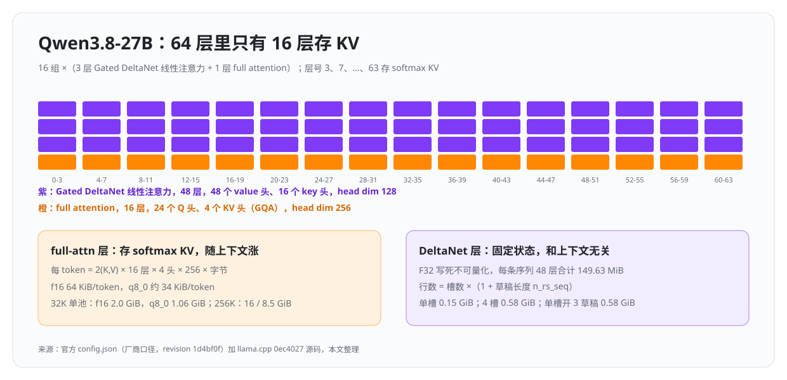
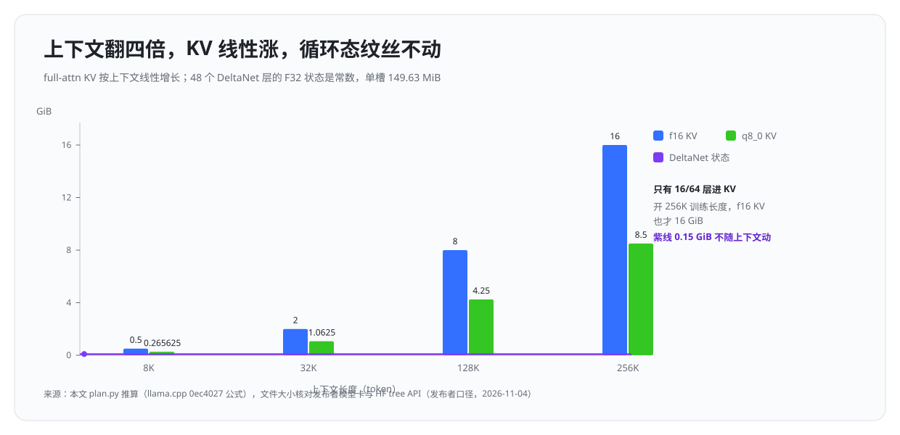
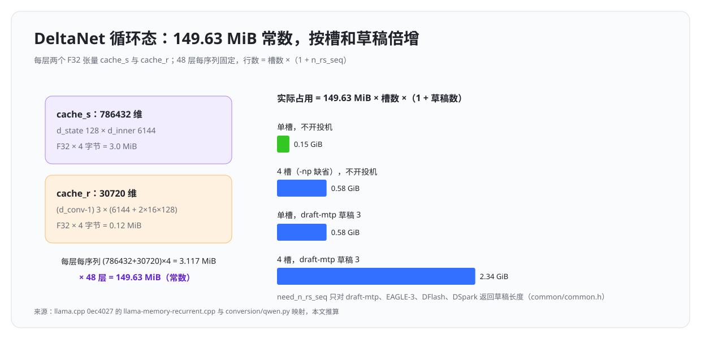
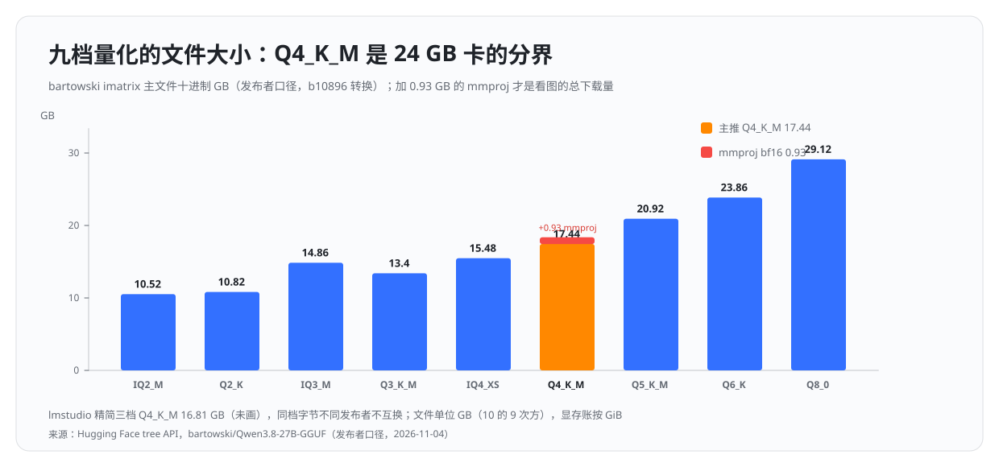
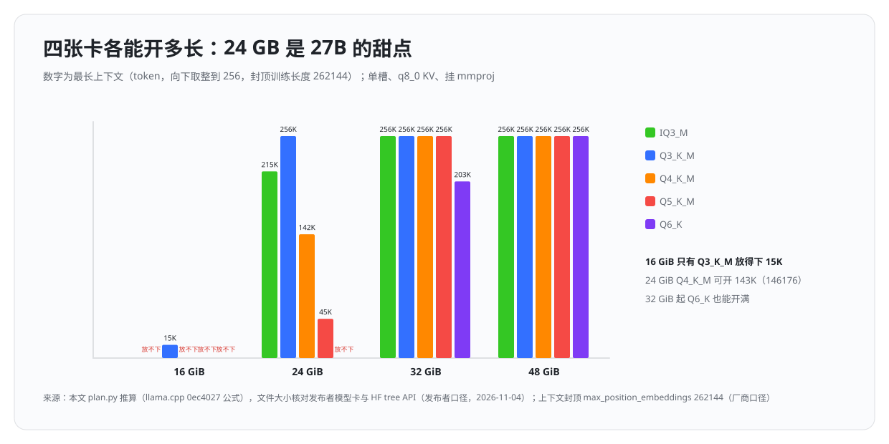
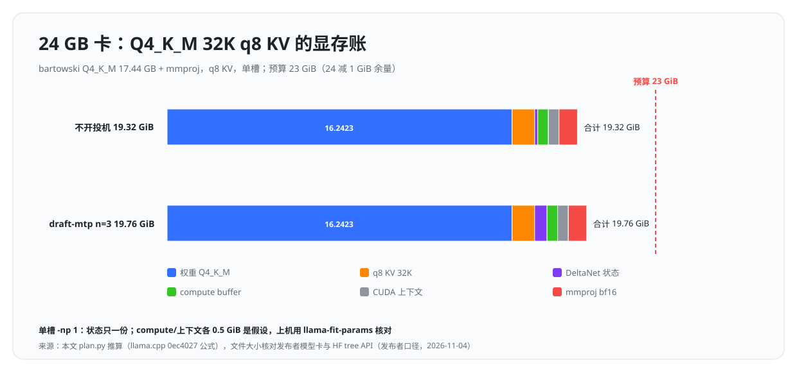
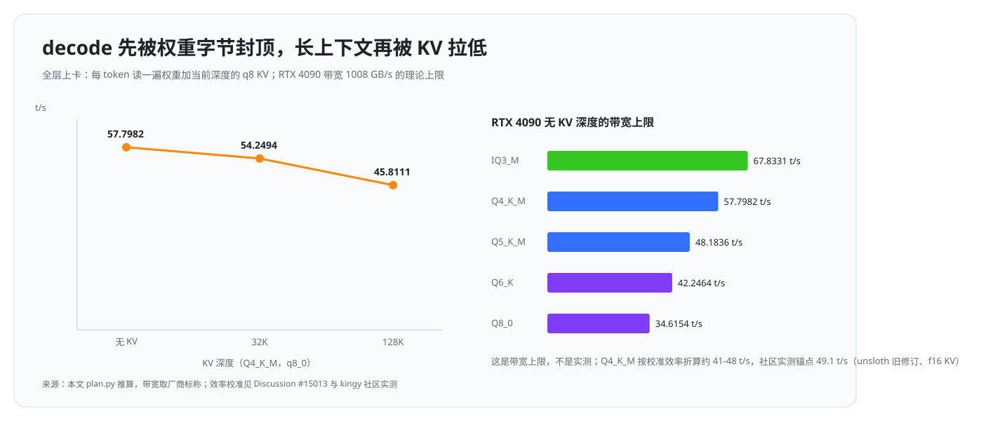

# LCPP-22｜实战｜一张卡跑 Qwen3.8-27B

> 🎯 **这篇文档解决什么问题**：Qwen3.8-27B 不是又一个普通 Transformer。它沿用 Qwen3.5 架构，64 层里只有 16 层是标准 full attention，会存随上下文变长的 softmax KV。另外 48 层（四分之三）是 Gated DeltaNet 线性注意力，只存一份固定大小的循环状态。官方 config 的 model_type 仍是 qwen3_5，GGUF 元数据里的架构名仍是 qwen35。我想搞清楚这套混合注意力在一张卡上的账和普通 27B 差在哪：长上下文的 KV 到底多大，24 GB 单卡选哪档量化、上下文能开多长，自带的 MTP 头怎么开投机解码，看图为什么要挂 mmproj。
>
> **数字怎么来的**：我手上没有 GPU 机器，文中的字节、显存和速度全部按 llama.cpp 0ec4027 的张量形状推算。推算的数字给公式或 plan.py 命令，别人测的标明厂商口径、发布者口径或社区实测。只想要命令直接看第 10 章；24 GB 卡的读者重点看第 5、6、10 章；想先搞懂混合注意力的账为什么和普通 Transformer 不一样，看第 2、3 章。文中版本和数字核对于 2026 年 11 月 4 日。
>
> **代码**：[zero-to-llama/22-qwen38-27b](../22-qwen38-27b)。plan.py 复现文中所有推算，run_24g.sh 和 run_text.sh 是第 10 章的启动命令，我只写了命令，没有在 GPU 上跑过。基线是主干 0ec4027，本篇不启动 llama-server，也不启动任何监听端口的程序。

# 导读 · 先给结论

- **64 层里只有 16 层存 KV。**full_attention_interval 为 4，层号 3、7、…、63 是 full attention，共 16 层，存 softmax KV；其余 48 层是 Gated DeltaNet，只存固定大小的循环状态（厂商口径）[[1]](https://huggingface.co/Qwen/Qwen3.8-27B/raw/main/config.json)[[2]](https://huggingface.co/Qwen/Qwen3.8-27B)。
- **KV 每 token 只有 64 KiB。**16 层合计，f16 是 64 KiB，q8_0 约 34 KiB（推算）。开到训练长度 256K，f16 KV 也才 16 GiB，q8_0 9 GiB 不到；普通 27B 同口径要 64 GiB 起步[[3]](https://github.com/ggml-org/llama.cpp/blob/0ec4027/ggml/src/ggml-common.h)。
- **循环态是 149.63 MiB 常数。**48 个 DeltaNet 层每序列合计这么多，F32 写死、不可量化，和上下文长度无关（代码口径）[[4]](https://github.com/ggml-org/llama.cpp/blob/0ec4027/src/llama-memory-recurrent.cpp)[[5]](https://github.com/ggml-org/llama.cpp/blob/0ec4027/src/llama-hparams.cpp)。它按槽数倍增，开 draft-mtp 再乘 1 加草稿数。
- **24 GB 是甜点。**bartowski Q4_K_M 17.44 GB 加 mmproj，32K、q8 KV、单槽推算 19.32 GiB，最长可开 146176 token；16 GB 卡只有 Q3_K_M 能全层上卡、约 15K 上下文，主流的 Q4_K_M 放不下（推算）[[6]](https://huggingface.co/bartowski/Qwen3.8-27B-GGUF)。
- **MTP 头自带，投机解码很便宜。**bartowski 的主 GGUF 已内嵌 1 个 MTP 层，imatrix 档里存 Q4_0，--spec-type draft-mtp 直接用，不用另下草稿模型；代价是循环态按 1 加草稿数倍增，草稿 3 时 32K 账从 19.32 涨到 19.76 GiB[[7]](https://github.com/ggml-org/llama.cpp/blob/master/docs/speculative.md)[[8]](https://github.com/ggml-org/llama.cpp/blob/0ec4027/common/common.h)。
- **看图要挂 mmproj，纯文本退路选 lmstudio。**lmstudio-community 的精简三档仓里另有 mmproj，但模型卡没写 MTP 头怎么处理，纯文本脚本不挂投影器也不开 MTP（发布者口径）[[9]](https://huggingface.co/lmstudio-community/Qwen3.8-27B-GGUF)。量化质量有发布者自测可查：bartowski 同批 KLD 里 Q4_K_M 0.0139、Q6_K 0.0030，社区汇总的跨发布者 Q4 同档 KLD 在 0.011 到 0.021 之间（发布者自测，可审计但非独立）[[6]](https://huggingface.co/bartowski/Qwen3.8-27B-GGUF)[[10]](https://kingy.ai/blog/qwen3-8-27b-best-quantization-gguf/)。
- **版本地板有两条。**qwen35 架构从 b7990 起支持，内嵌 MTP 层的 GGUF 要 b9180 或更新（代码口径）[[11]](https://github.com/ggml-org/llama.cpp/pull/19468)[[12]](https://github.com/ggml-org/llama.cpp/pull/22673)。现行 bartowski 文件用 b10896 转，lmstudio 用 b10430，直接上不旧于转换版本的构建最省心。

**📎 与系列其他文档的分工**：显存账的通用写法见 [LCPP-02｜上手｜推理账本：带宽、算力和启动前算出速度上限](./02-ledger.md)，KV cache 见 [LCPP-08｜内部｜KV cache 与长上下文：账本、深度、量化、SWA 和上下文写满](./08-kv-context.md)，投机解码和 MTP 见 [LCPP-13｜内部｜投机解码：草稿模型、n-gram 和拒绝采样](./13-speculative.md)，视觉投影器 mmproj 见 [LCPP-15｜内部｜多模态：mmproj、图片切块和音频](./15-multimodal.md)，新架构落地 llama.cpp 见 [LCPP-18｜内部｜新模型接入：转换、计算图和逐层对拍](./18-add-model.md)，同样“没卡也先算账”的稠密 27B 实战是 [LCPP-20｜实战｜24 GB 单卡：Qwen3-32B 和 Qwen3.8-27B](./20-qwen-24g.md)，上一篇单机实战是 [LCPP-21｜实战｜一台机器跑 DeepSeek-V4.1-Flash](./21-deepseek-v41.md)。前面各篇讲普通 Transformer，这篇讲四分之三层换成线性注意力以后，账怎么变。

# 第 1 章 · 先认模型：稠密 27B，原生多模态，四分之三层是线性注意力

## 1.1 模型卡说了什么

Qwen3.8-27B 是 Qwen3.8 系列里的稠密档，2026 年 8 月开源。模型卡写明它建立在 Qwen3.5 的架构基础上，架构类名仍是 Qwen3_5ForConditionalGeneration，model_type 是 qwen3_5，文本部分是 qwen3_5_text（厂商口径）[[2]](https://huggingface.co/Qwen/Qwen3.8-27B)[[1]](https://huggingface.co/Qwen/Qwen3.8-27B/raw/main/config.json)。它不是 MoE，270 多亿个参数每次前向全用。它也不是纯文本模型，视觉塔和语言模型早融合训练，图、视频、文本一起进同一个词表，模型卡把这叫原生视觉语言基座。这一代的提升落在编程、办公、研究和长程智能体任务上，思考深度还能靠 reasoning_effort 调。

文本骨干 64 层，hidden 5120，FFN 中间维 17408，SiLU 激活，词表 248320，输入和输出嵌入不共享。视觉塔 27 层、hidden 1152、16 头，patch 16，输出投到 5120 维接进语言模型；视觉 token 占了 248053、248054、248056、248057 四个专用 id（厂商口径）[[1]](https://huggingface.co/Qwen/Qwen3.8-27B/raw/main/config.json)。采样分两套：思考档照官方 generation_config，temperature 1.0、top_p 0.95、top_k 20。

非思考档 temperature 0.7、top_p 0.8、top_k 20，另加 presence_penalty 1.5。聊天模板默认开思考，渲染必须 --jinja，reasoning_effort 支持 xhigh、medium、low，缺省 xhigh，还能用 preserve_thinking 决定多轮里保不保留历史思考[[13]](https://huggingface.co/Qwen/Qwen3.8-27B/raw/main/generation_config.json)[[2]](https://huggingface.co/Qwen/Qwen3.8-27B)。

## 1.2 训练长度 256K，平台标到 1M

官方 config 里 max_position_embeddings 是 262144，这是原生训练长度；模型卡和 API 平台把可用长度标到 1000000，靠 YaRN 外推（厂商口径）[[1]](https://huggingface.co/Qwen/Qwen3.8-27B/raw/main/config.json)[[2]](https://huggingface.co/Qwen/Qwen3.8-27B)。自部署时这条只用来给本地 -c 封个顶：超过训练长度没有质量保证，本文所有显存推算都封顶在 262144。真要试更长，先在自己的任务上验证外推效果。

阿里云百炼上这个模型的 model id 是 qwen3.8-27b，页面标上下文 1000000、最大输入 991808、思考模式下 983616、最大输出 131072，北京和新加坡地域输入每百万 token 3 元、输出 12 元，缓存命中 0.6 元（平台口径，更新于 2026 年 10 月 10 日）[[14]](https://help.aliyun.com/zh/model-studio/qwen3-8-27b)。自部署时这条信息只有两个用处：确认本地 -c 该封在哪里，再给自己跑的成本一个对照。

## 1.3 llama.cpp 里叫 qwen35，版本地板有两条

llama.cpp 把这个架构登记为 qwen35，旁边还有个 qwen35moe 给同系 MoE 档[[15]](https://github.com/ggml-org/llama.cpp/blob/0ec4027/src/llama-arch.cpp)。qwen35.cpp 的加载代码按层数和 hidden 分尺寸：24 层 hidden 1024 是 0.8B，32 层 hidden 2560 是 4B，64 层 hidden 5120 就是本文的 27B[[16]](https://github.com/ggml-org/llama.cpp/blob/0ec4027/src/models/qwen35.cpp)。版本上有两条线：qwen35 架构随 PR #19468 合入，b7990 起能加载。

MTP 层写进 GGUF 是 PR #22673，b9180 起才认[[11]](https://github.com/ggml-org/llama.cpp/pull/19468)[[17]](https://github.com/ggml-org/llama.cpp/releases/tag/b7990)[[12]](https://github.com/ggml-org/llama.cpp/pull/22673)[[18]](https://github.com/ggml-org/llama.cpp/releases/tag/b9180)。几家发布者的文件都带 MTP，其中 bartowski 和 AtomicChat 把 MTP 内嵌在主文件里，unsloth、ggml-org 单独放一个文件。lmstudio 的模型卡没写 MTP 怎么处理。要开 draft-mtp，实际地板按 b9180 算。量化 V cache 要的 flash attention 在 CUDA 上从 b6325 起就有[[19]](https://github.com/ggml-org/llama.cpp/releases/tag/b6325)。

文件转换版本比地板新得多：bartowski 模型卡写明这批文件用 b10896 量化，lmstudio 用 b10430[[6]](https://huggingface.co/bartowski/Qwen3.8-27B-GGUF)[[9]](https://huggingface.co/lmstudio-community/Qwen3.8-27B-GGUF)。社区实测也在新版本上：kingy 在 RTX 4090 上用 b10453（commit 3cb7ffb）跑通了全层上卡（社区实测）[[10]](https://kingy.ai/blog/qwen3-8-27b-best-quantization-gguf/)。版本太旧的报错一般是 unknown architecture qwen35 或不认 MTP 张量，升级到现行 release 即可。

**📎 展开阅读：**一个新架构怎么进 llama.cpp、张量名怎么映射，在 [LCPP-18｜内部｜新模型接入：转换、计算图和逐层对拍](./18-add-model.md)。

> 🔑 **本章要点**：Qwen3.8-27B 沿用 Qwen3.5 架构，是稠密原生多模态模型，64 层 hidden 5120，思考采样 1.0/0.95/20、非思考 0.7/0.8/20 加 presence 1.5，模板默认思考，reasoning_effort 缺省 xhigh。原生训练长度 256K，1M 靠 YaRN 外推。llama.cpp 架构名仍是 qwen35，能加载要 b7990，内嵌 MTP 头的文件实际要 b9180，现行转换版本已到 b10430 到 b10896。

# 第 2 章 · 64 层里只有 16 层存 KV

## 2.1 三层线性注意力配一层 full attention



config.json 直接给了 layer_types 数组，也给了关键字段 full_attention_interval 等于 4。64 层每 4 层一组，组内前 3 层是 linear_attention，用 Gated DeltaNet，第 4 层是 full_attention，层号 3、7、…、63，一共 16 层（厂商口径）[[1]](https://huggingface.co/Qwen/Qwen3.8-27B/raw/main/config.json)。

模型卡的写法是 16 组“3 个 Gated DeltaNet 加 FFN 再 1 个 Gated Attention 加 FFN”[[2]](https://huggingface.co/Qwen/Qwen3.8-27B)。qwen35.cpp 读不到显式层标记时，就按 (i+1) 能被 4 整除来标 full attention 的补集，MTP 层强制不走循环[[16]](https://github.com/ggml-org/llama.cpp/blob/0ec4027/src/models/qwen35.cpp)。

两种层的内部尺寸也不一样。full attention 是 24 个 Q 头、4 个 KV 头的 GQA，head_dim 256，旋转位置编码只作用在 25% 也就是 64 维上，theta 1e7，多模态用 mrope 三段交错。

DeltaNet 层是 16 个 key 头、48 个 value 头，key 和 value 的 head_dim 都是 128，外加宽度 4 的因果卷积，状态 dtype 写死 float32（厂商口径）[[1]](https://huggingface.co/Qwen/Qwen3.8-27B/raw/main/config.json)。Gated DeltaNet 来自 Yang 等人的论文，思路是把门控和 delta 更新规则合到线性注意力里，既留住线性注意力常数状态的好处，又补回它在检索和长上下文任务上的短板[[20]](https://arxiv.org/abs/2412.06464)。

## 2.2 softmax KV 和循环状态是两样东西

full attention 要把每个历史 token 的 K、V 都存下来，新 token 和全部历史做 softmax，所以 KV 随上下文线性长。线性注意力把历史压进一个固定大小的矩阵状态里，每来一个 token 做一次递推更新，理论上看无限长的历史，状态大小不变。这就是这篇显存账和普通 Transformer 全部差异的根源：随上下文涨的缓存只挂在 16 层上，另外 48 层交一份固定的钱。

要注意循环态不是没有缓存。它在 llama.cpp 里由 llama-memory-recurrent.cpp 单独分配，每个循环层两个 F32 张量，类型写死，量化不了[[4]](https://github.com/ggml-org/llama.cpp/blob/0ec4027/src/llama-memory-recurrent.cpp)。第 3 章会把这 149.63 MiB 拆开算。

## 2.3 和普通 27B 对照，存 KV 的层只剩四分之一

拿 [LCPP-20｜实战｜24 GB 单卡：Qwen3-32B 和 Qwen3.8-27B](./20-qwen-24g.md) 算过的 Qwen3-32B 对照，那个模型 64 层全是 full attention，每 token 的 f16 KV 是 256 KiB 量级。Qwen3.8-27B 这里只有 16 层、每层 4 个 KV 头、head_dim 256，每 token f16 正好 64 KiB，是前者的四分之一。层数和头数的差距就是这篇的主线：长上下文不再是显存杀手，但循环态这笔固定钱和它的倍增规则是新东西，普通 Transformer 没有。

**📎 展开阅读：**GQA、KV cache 的通用结构和 q8_0 量化，在 [LCPP-08｜内部｜KV cache 与长上下文：账本、深度、量化、SWA 和上下文写满](./08-kv-context.md)。

> 🔑 **本章要点**：64 层每 4 层一组，前 3 层 Gated DeltaNet、第 4 层 full attention，存 softmax KV 的只有 16 层。DeltaNet 把历史压进固定大小状态，但状态照样要分配，F32 不可量化。每 token KV 64 KiB，是同尺寸普通 Transformer 的四分之一。

# 第 3 章 · 两笔缓存分开算：线性 KV 和常数循环态

## 3.1 每 token 64 KiB 怎么来的

一个 full attention 层每 token 存 K 和 V 两份，每份 4 个头乘 256 维，f16 每元素 2 字节：2 × 4 × 256 × 2 = 4096 B，16 层乘起来是 65536 B，正好 64 KiB（推算）。q8_0 每个块 32 个权重 34 字节[[3]](https://github.com/ggml-org/llama.cpp/blob/0ec4027/ggml/src/ggml-common.h)，K 和 V 各自独立成块，每元素按 34/32 字节算，16 层合计 34816 B，约 34 KiB，比 f16 省 47%。plan.py 把这两个数钉在 test_plan.py 里，改了几何就报错。

| 上下文 | f16 KV | q8_0 KV |
|-|-|-|
| 8K | 0.50 GiB | 0.27 GiB |
| 32K | 2.00 GiB | 1.06 GiB |
| 128K | 8.00 GiB | 4.25 GiB |
| 256K | 16.00 GiB | 8.50 GiB |

这是单槽、16 层共享一个 KV 池的数字。llama-server 缺省 -np auto 等于 4 个槽，开 kv_unified 后 4 个槽还是共用这一个池，池子总长度按 -c 走，不乘 4[[21]](https://github.com/ggml-org/llama.cpp/blob/master/tools/server/README.md)；真正按槽倍增的是下一节的循环态。



## 3.2 循环态 149.63 MiB 的来历

循环层的状态尺寸在 hparams 里由四个量决定。转换脚本 conversion/qwen.py 把 config 的字段映射过来：d_conv 等于 linear_conv_kernel_dim 4，d_state 等于 linear_key_head_dim 128，key 头数 16，d_inner 等于 value head_dim 128 乘 value 头数 48，等于 6144[[22]](https://github.com/ggml-org/llama.cpp/blob/0ec4027/conversion/qwen.py)。

状态张量 cache_s 是 d_state 乘 d_inner，128 × 6144 = 786432 个 F32；cache_r 存卷积历史，是 conv 宽度减 1 乘 d_inner 加两组 key 头状态，3 ×（6144 + 2 × 16 × 128）= 30720[[5]](https://github.com/ggml-org/llama.cpp/blob/0ec4027/src/llama-hparams.cpp)。

一层一条序列的状态是（786432 + 30720）× 4 字节 = 3,268,608 B，约 3.117 MiB；48 个循环层合计 156893184 B，就是 149.63 MiB（代码口径加推算）[[4]](https://github.com/ggml-org/llama.cpp/blob/0ec4027/src/llama-memory-recurrent.cpp)。这个数和上下文长度无关，prompt 是 8K 还是 256K 都不变。

## 3.3 循环态按槽和草稿倍增



循环态按序列分行存，行数是槽数乘（1 加草稿长度 n_rs_seq）。need_n_rs_seq 只在投机解码用 draft-mtp、EAGLE-3、DFlash、DSpark 这几种时才返回草稿最大 token 数，其余时候是 0[[8]](https://github.com/ggml-org/llama.cpp/blob/0ec4027/common/common.h)。原因是草稿被拒时循环状态要回滚，得为每个草稿位置留一份快照。四个常见配置是：单槽不开投机 0.15 GiB；缺省 4 槽不开投机 0.58 GiB；单槽开 draft-mtp 草稿 3 也是 0.58 GiB；4 槽再加草稿 3 是 2.34 GiB（推算）。

普通 Transformer 的 KV 是一条连续缓存，回滚只要移指针。DeltaNet 的递推状态没法只退最后几个 token，只能预先存快照，这就是草稿倍增的机理。第 7 章开 draft-mtp 时这笔账会算进总预算。

> 🔑 **本章要点**：每 token KV 是 2 × 16 层 × 4 头 × 256 乘元素字节，f16 64 KiB、q8_0 约 34 KiB，256K 单池 f16 16 GiB。循环态每层 cache_s 786432 加 cache_r 30720 个 F32，48 层 149.63 MiB 常数，按槽数乘（1 加草稿数）倍增。

# 第 4 章 · 两套 GGUF：bartowski 看图加投机，lmstudio 只跑文本

## 4.1 bartowski 内嵌 MTP 头，lmstudio 精简三档

这个模型原生多模态，GGUF 化以后视觉部分拆成单独的投影器文件，主 GGUF 只放语言骨干。GGUF 规范把这种随主模型加载的辅助文件叫 sidecar，投影器的前缀是 mmproj，MTP 头也一样，可以单独成 mtp 文件，也可以直接编进主文件[[23]](https://github.com/ggml-org/ggml/blob/master/docs/gguf.md)。

bartowski 的发布是一整套：主文件按 imatrix 量化二十一档，脚本只取常用九档，另带 bf16 和 f16 两个 mmproj，各约 0.93 GB。更要紧的是 MTP 头直接编进主文件，imatrix 档里这个头存 Q4_0，Q8_0 档除外，这批文件用 b10896 转换（发布者口径）[[6]](https://huggingface.co/bartowski/Qwen3.8-27B-GGUF)。要让它看图，启动时除了 -m 主文件，还要 -mm 挂上 mmproj；不挂，模型只认文本。

lmstudio-community 走精简路线，仓里只有 Q4_K_M、Q6_K、Q8_0 三档语言文件和一个 BF16 mmproj，用 b10430 转换（发布者口径）[[9]](https://huggingface.co/lmstudio-community/Qwen3.8-27B-GGUF)。它的模型卡没写 MTP 头怎么处理，所以纯文本脚本既不挂投影器也不开 draft-mtp，投机解码这条只认 bartowski。再往上还有 ggml-org 的官方自动转换仓，MTP 头单独成文件，Q4_0 的 1.68 GB、BF16 的 5.95 GB，另有 dflash 文件[[24]](https://huggingface.co/ggml-org/Qwen3.8-27B-GGUF)。三家打包方式不同，文件不互换。

## 4.2 文件大小：九档主推，三档对照

下面是 bartowski 九档主文件的十进制 GB，旁边放 lmstudio 同档对照，只有三个档能对上。文件大小来自 Hugging Face 文件列表，单位是 GB，和后面显存账的 GiB 不是一回事，比较时 plan.py 先统一换成字节（发布者口径）[[6]](https://huggingface.co/bartowski/Qwen3.8-27B-GGUF)[[9]](https://huggingface.co/lmstudio-community/Qwen3.8-27B-GGUF)。



| 量化档 | bartowski（imatrix，内嵌 MTP） | lmstudio（精简三档） |
|-|-|-|
| IQ2_M | 10.52 GB | — |
| Q2_K | 10.82 GB | — |
| IQ3_M | 14.86 GB | — |
| Q3_K_M | 13.40 GB | — |
| IQ4_XS | 15.48 GB | — |
| Q4_K_M | 17.44 GB | 16.81 GB |
| Q5_K_M | 20.92 GB | — |
| Q6_K | 23.86 GB | 22.43 GB |
| Q8_0 | 29.12 GB | 29.05 GB |

主推还是 Q4_K_M。bartowski 17.44 GB，lmstudio 同档 16.81 GB，差 0.63 GB；bartowski 是带计算布局的 imatrix 档，lmstudio 只标了转换版本，文件组织也可能不同，这 0.63 GB 不直接当质量差。字节只决定下载量和权重显存，质量看下一节的实测。

## 4.3 质量有两条证据：发布者自测和跨发布者 KLD

bartowski 自己在 wiki.test.raw 上切了 100 个窗口，用 b10896 量化，对 bf16 参考算 KL 散度，基线 PPL 6.744（发布者口径）[[6]](https://huggingface.co/bartowski/Qwen3.8-27B-GGUF)。Q4_K_M 的平均 KLD 是 0.0139 加减 0.0004，量化模型和 bf16 首 token 预测一致的比例是 95.00%；Q5_K_M 是 0.0053、96.87%；Q6_K 是 0.0030、97.39%。Q4_K_M 的 PPL 6.76，比基线只高 0.34%。

第二条来自 Kingy AI 的量化指南，它汇总了四家发布者的同档文件，并用 AtomicChat 跑跨发布者 KLD（社区实测，工具口径）[[10]](https://kingy.ai/blog/qwen3-8-27b-best-quantization-gguf/)。LM Studio 那份 16.8 GB 的 Q4_K_M KLD 0.02094，ggml-org 19.0 GB 的 0.01470，Atomic 17.1 GB 的 0.01126。

Unsloth 动态档 Q4_K_XL 0.00955、首 token 一致率 96.02%，Q5_K_XL 0.00437、97.28%。这组数各家文件字节和布局都不同，只能当同档排序看。两条证据合起来指向同一个结论：Q4_K_M 离 bf16 还有约 5% 的首 token 偏差，但日常使用不构成硬妥协，真要定档还是上机跑自己的任务。

## 4.4 怎么下

用 huggingface_hub 的命令行按文件下，别整仓克隆，二十一档整仓几百 GB[[25]](https://huggingface.co/docs/huggingface_hub/guides/cli)。看图加投机这一套下两个文件：

```bash
hf download bartowski/Qwen3.8-27B-GGUF \
  Qwen3.8-27B-Q4_K_M.gguf \
  mmproj-Qwen3.8-27B-bf16.gguf \
  --local-dir models/qwen38-27b
```

纯文本退路只下 lmstudio 一个主文件，模型目录分开，避免和 bartowski 那套混挂：

```bash
hf download lmstudio-community/Qwen3.8-27B-GGUF \
  Qwen3.8-27B-Q4_K_M.gguf \
  --local-dir models/qwen38-27b-lmstudio
```

**📎 展开阅读：**imatrix 是什么、K 档和 Q 档的位宽差异，在 [LCPP-07｜内部｜量化：块结构、配方、imatrix 和用 KLD 选类型](./07-quantization.md)；视觉投影器 mmproj 的结构，在 [LCPP-15｜内部｜多模态：mmproj、图片切块和音频](./15-multimodal.md)。

> 🔑 **本章要点**：bartowski 是 imatrix 多模态版，MTP 头内嵌在主文件、imatrix 档存 Q4_0，另加约 0.93 GB 的 mmproj，b10896 转换；lmstudio 只有三档语言文件加一个 BF16 mmproj，模型卡没写 MTP，纯文本脚本不开投机；ggml-org 把 MTP 单独成文件。Q4_K_M 两版分别 17.44 和 16.81 GB。质量上 bartowski 自测 KLD 0.0139、首 token 一致率 95%，跨发布者 KLD 里同档在 0.0095 到 0.021 之间。

# 第 5 章 · 四张卡各能开多长：24 GB 是甜点

## 5.1 算法：预算先扣固定项，剩下的才给 KV

第 3 章把缓存拆成了两笔。循环态是常数，权重、mmproj、CUDA 上下文和 compute buffer 也不随上下文涨。真正按上下文吃显存的只有 16 个 full-attn 层的 KV，q8_0 每 token 34816 B。所以最长上下文等于预算减去所有固定项，再除以每 token 的 KV 字节，向下取整到 256，并封顶训练长度 262144（推算）。预算按卡的标称显存减 1 GiB 余量算，CUDA 上下文和 compute buffer 各按 0.5 GiB 假设，上机后用 llama-fit-params 核对[[26]](https://github.com/ggml-org/llama.cpp/blob/master/tools/fit-params/README.md)。

这里 KV 池按单槽算。第 3 章说过 kv_unified 下多槽共用一个池，池子长度按 -c 走，所以单用户把 -np 写成 1，循环态也只交一份，上下文能开到最长。这正是单卡实战的口径：一张卡伺候一个长上下文请求，而不是四个短请求分摊。

## 5.2 四张卡五档量化的落点



下面这张表是单槽、q8_0 KV、挂 mmproj 的最长上下文。口径和 run_24g.sh 一致，数字全部由 plan.py 推算，改了文件大小或假设会跟着变。

| 量化档 | 16 GiB | 24 GiB | 32 GiB | 48 GiB |
|-|-|-|-|-|
| IQ3_M | 放不下 | 215K | 256K（封顶） | 256K（封顶） |
| Q3_K_M | 15K | 256K（封顶） | 256K（封顶） | 256K（封顶） |
| Q4_K_M | 放不下 | 142K | 256K（封顶） | 256K（封顶） |
| Q5_K_M | 放不下 | 45K | 256K（封顶） | 256K（封顶） |
| Q6_K | 放不下 | 放不下 | 203K | 256K（封顶） |

16 GiB 这一列基本全黑：这五档里能进的只有 Q3_K_M：13.40 GB，挂上 mmproj 再扣固定项也只挤出 15K 上下文。IQ3_M 看着档位更低，体积反而有 14.86 GB，加上 mmproj 就放不下；主推的 Q4_K_M 17.44 GB，权重本身已经超了。15K 没有实用价值，这一代稠密 27B 对 16 GB 卡不友好，硬要跑只能退回 CPU 卸载或更激进的 2 bit，体验都不好。

24 GiB 是甜点卡。Q4_K_M 能开 146176 token，约 143K，覆盖大多数长文档和代码库场景。往下 IQ3_M 能到 220416，Q3_K_M 直接顶到训练长度。往上 Q5_K_M 只剩 46336，Q6_K 放不下。32 GiB 卡把 Q5_K_M 也拉满到 256K，Q6_K 能开 208640；48 GiB 卡五档全部封顶 256K，多出来的显存留给并发槽和 compute buffer，再长没有意义，因为不能超过训练长度。

## 5.3 32K 是日常默认，143K 是上限不是常态

Q4_K_M 在 24 GiB 上推算最长 146176，run_24g.sh 却把 -c 写死在 32768。这是刻意留余量。32K 的 q8 KV 只占 1.06 GiB，整套账 19.32 GiB，离 23 GiB 预算还有 3.6 GiB，换驱动、换 CUDA 版本、图片多占一点视觉激活都扛得住。把 -c 直接顶到 143K，账面上贴着预算走，compute buffer 那 0.5 GiB 是假设值，实际上浮就可能加载失败。需要长上下文时，先跑 fit 子命令读真实的 compute buffer，再用 --compute 参数重算上限。

CPU 卸载这一篇不当退路推荐。27B 稠密模型每次前向要读全部权重，llama.cpp 官方在 RISC-V 平板上只拿 2B Q4_1 做过演示[[27]](https://github.com/ggml-org/llama.cpp/blob/0ec4027/docs/build-riscv64-spacemit.md)，27B 分到内存侧的层会把 decode 拖到个位数。这一代的正确取舍是换 24 GB 卡，或者用下一章的 lmstudio 纯文本套账省掉 mmproj，而不是 -ngl 砍层。

**📎 展开阅读：**显存账的通用写法和 fit 余量，在 [LCPP-02｜上手｜推理账本：带宽、算力和启动前算出速度上限](./02-ledger.md)；llama-fit-params 的三项 MiB，在 [LCPP-10｜内部｜CPU 调优：线程、绑核、repack、加载方式和带宽上限](./10-cpu-tuning.md)。

> 🔑 **本章要点**：最长上下文等于预算减去权重、mmproj、循环态和两个 0.5 GiB 固定项，再除以每 token 34816 B 的 q8 KV，封顶 262144。16 GiB 主推档全放不下；24 GiB 的 Q4_K_M 能开 146176，是甜点；32 GiB 起 Q6_K 也能开满。日常 -c 用 32K 留余量，顶到 143K 前先跑 fit。

# 第 6 章 · 24 GB 的账：Q4_K_M 加 mmproj，32K 用 19.32 GiB

## 6.1 六项堆叠



把第 3 章的两笔缓存和第 4 章的文件大小叠起来，24 GB 卡看图这一套在 32K、q8 KV、单槽下的账是这样。权重按十进制 GB 换算成 GiB，mmproj 同理，其余项本来就按字节算。

| 项目 | 占用 |
|-|-|
| 权重 Q4_K_M（bartowski） | 16.24 GiB |
| full-attn KV q8_0，16 层 x 32768（1 槽 kv_unified 共池） | 1.06 GiB |
| DeltaNet 循环状态 x 1 槽 x 1 | 0.15 GiB |
| compute buffer（假设） | 0.50 GiB |
| CUDA 上下文（假设） | 0.50 GiB |
| mmproj bf16 | 0.87 GiB |
| 合计 | 19.32 GiB |

权重一项占 16.24 GiB，是绝对大头；q8 KV 在 32K 只 1.06 GiB，循环态 0.15 GiB，这两项加起来只有权重的十三分之一。这就是混合注意力和普通 27B Transformer 最直观的差别：长缓存在这张账里小到几乎不影响决策，选型基本只看权重档。两个 0.5 GiB 是我沿用第 20 篇的假设，前提是 flash attention 打开，真实值上机用 fit 读。

## 6.2 开 draft-mtp 草稿 3，账从 19.32 涨到 19.76

bartowski 的主 GGUF 已经带了 MTP 头，开 draft-mtp 不用另下草稿模型，加两个参数就行；代价是第 3 章讲过的回滚快照，循环态从一份变成四份，0.15 GiB 涨到 0.58 GiB（代码口径加推算）[[7]](https://github.com/ggml-org/llama.cpp/blob/master/docs/speculative.md)[[28]](https://github.com/ggml-org/llama.cpp/blob/0ec4027/common/arg.cpp)。权重和 KV 都不变，总账只多 0.44 GiB，到 19.76 GiB，离预算还有 3.2 GiB。这是这套混合架构在投机解码上的便宜之处：草稿头免费随包，循环态的代价也小。

| 项目（draft-mtp 草稿 3） | 占用 |
|-|-|
| 权重 Q4_K_M（bartowski） | 16.24 GiB |
| full-attn KV q8_0，16 层 x 32768（1 槽 kv_unified 共池） | 1.06 GiB |
| DeltaNet 循环状态 x 1 槽 x 4 | 0.58 GiB |
| compute buffer（假设） | 0.50 GiB |
| CUDA 上下文（假设） | 0.50 GiB |
| mmproj bf16 | 0.87 GiB |
| 合计 | 19.76 GiB |

代价在上下文上限。循环态多占的 0.44 GiB 从 KV 的额度里扣，Q4_K_M 的最长上下文从 146176 掉到 132608。32K 默认配置离上限很远，感觉不到；真要把 -c 往 100K 以上拉、同时开三个草稿，就得重算。

## 6.3 lmstudio 纯文本套账省掉 mmproj，是 17.86 GiB

不看图就用 lmstudio 那档 16.81 GB 的 Q4_K_M，权重 15.66 GiB，比 bartowski 小 0.58 GiB，再省掉 0.87 GiB 的 mmproj，32K 单槽整套账 17.86 GiB，余量超过 5 GiB，最长上下文能推到 190976。代价是模型卡没写 MTP 怎么处理，这套不碰投机解码。确定不看图、也不需要 MTP 时，它更干净。

## 6.4 q8 KV 的前提是 flash attention

把 V cache 量化成 q8_0 省的是随上下文涨的那笔钱，32K 比 f16 省约 0.94 GiB，128K 省 3.75 GiB。但 llama.cpp 要求量化 V cache 时必须开 flash attention，-fa on，写死 -fa off 会在加载阶段报错退出[[29]](https://github.com/ggml-org/llama.cpp/blob/0ec4027/src/llama-context.cpp)。flash attention 用分块 softmax 把注意力的显存读写压到线性，量化 KV 的内核就建在这条路径上[[30]](https://arxiv.org/abs/2307.08691)。CUDA 上 flash attention 从 b6325 起就有[[19]](https://github.com/ggml-org/llama.cpp/releases/tag/b6325)，现行版本不用操心，参数 -ctk 和 -ctv 一起写成 q8_0 即可。

上机第一件事还是 fit。run_24g.sh 的 fit 子命令只跑 llama-fit-params 加 -fitp on，按设备打印模型、上下文、compute 三项的 MiB，不加载全部权重[[26]](https://github.com/ggml-org/llama.cpp/blob/master/tools/fit-params/README.md)。把 compute 那项的真实值填进 plan.py 的 --compute，重算出来的最长上下文才作数；我这套 0.5 GiB 假设只够在没卡时先把账排出来。

**📎 展开阅读：**量化 KV 和 flash attention 的关系，在 [LCPP-08｜内部｜KV cache 与长上下文：账本、深度、量化、SWA 和上下文写满](./08-kv-context.md)；MTP 头和 draft-mtp 的完整机制，在 [LCPP-13｜内部｜投机解码：草稿模型、n-gram 和拒绝采样](./13-speculative.md)。

> 🔑 **本章要点**：看图套账六项合计 19.32 GiB，权重 16.24 是大头，KV 和循环态加起来只有它的十三分之一。开 draft-mtp 草稿 3 只多 0.44 GiB 到 19.76 GiB，上限从 146176 掉到 132608。lmstudio 纯文本套账 17.86 GiB、上限 190976，但不开 MTP。q8 KV 必须配 -fa on，compute buffer 上机用 fit 核对。

# 第 7 章 · 自带的 MTP 头：不开投机解码就白放着

## 7.1 MTP 层是什么

config.json 里 mtp_num_hidden_layers 等于 1，模型在主骨干之外带了一个多 token 预测头。这套用法最早随 DeepSeek-V3 的技术报告定型，训练时用多位置联合损失，推理时这个头在同一个前向里顺序多猜几个候选 token[[31]](https://arxiv.org/abs/2412.19437)。这个头和主模型一起训练、一起打包，bartowski 的现行 GGUF 已经把它编进主文件，不需要再下一个草稿模型（厂商口径）[[1]](https://huggingface.co/Qwen/Qwen3.8-27B/raw/main/config.json)。加载时它随主模型一起进显存，主模型在，它就在[[32]](https://github.com/ggml-org/llama.cpp/blob/0ec4027/src/llama-model.cpp)。

放在普通部署里，这个头默认不工作，属于白占一点加载体积。要让它出草稿，得显式开投机解码：--spec-type draft-mtp，再用 --spec-draft-n-max 指定最多猜几个 token，llama.cpp 的投机解码文档把它列在主模型 MTP 头那一类，缺省草稿数是 3[[7]](https://github.com/ggml-org/llama.cpp/blob/master/docs/speculative.md)[[28]](https://github.com/ggml-org/llama.cpp/blob/0ec4027/common/arg.cpp)。

它和 ngram、draft-eagle 是同一套接口下的不同草稿类型，draft-mtp 的特殊之处是草稿来自模型自身，接受率理论上比外部草稿模型高。注意打包方式因发布者而异：bartowski 把头内嵌在主文件，ggml-org 和 unsloth 的 MTP 是单独文件[[24]](https://huggingface.co/ggml-org/Qwen3.8-27B-GGUF)[[33]](https://huggingface.co/unsloth/Qwen3.8-27B-GGUF)，单文件那条命令只适用 bartowski。

## 7.2 为什么循环态要留快照

第 3 章埋了一个伏笔：开 draft-mtp 后循环态按 1 加草稿数倍增。机理在投机解码的验证环节。草稿是模型连猜的几个 token，主模型要一次性把它们和自己的结果对一遍，对不上的从分歧处丢弃。full attention 的 KV 是连续缓存，回滚只要移一下指针；Gated DeltaNet 的状态是递推矩阵，没法只退最后几步，所以每个草稿位置都得预先存一份状态快照，猜不中就整份恢复。

代码里 need_n_rs_seq 只对 draft-mtp、EAGLE-3、DFlash、DSpark 这几种真出草稿的类型返回草稿长度，其余时候是 0[[8]](https://github.com/ggml-org/llama.cpp/blob/0ec4027/common/common.h)。这就是第 6 章那笔账的来源：草稿 3 个，循环态行数乘 4，单槽从 0.15 涨到 0.58 GiB。投机解码在数学上不改变输出分布，它只调换算 token 的顺序，接受规则保证最终采样和不开时一致[[34]](https://arxiv.org/abs/2211.17192)。

## 7.3 加速多少不给数字

这个模型的 draft-mtp 接受率没有公开实测，我手上也没有卡，所以不给加速倍数。能确定的是代价很小：bartowski 的草稿头随包免费，显存只多 0.44 GiB，不需要第二个模型文件。收益取决于草稿被主模型接受的比例，而这个比例随任务类型变化很大，代码、结构化文本通常高，自由创作通常低。

上机后用 llama-bench 同一组参数对比开和不开的 tg128，再决定要不要把 MTP=3 写进常配。第 6 章算过它把最长上下文从 146176 压到 132608，日常 32K 不受影响，所以在短上下文、高重复的场景先开着试，代价可以忽略。

**📎 展开阅读：**投机解码的接受规则、各种草稿类型和为什么不改变输出，在 [LCPP-13｜内部｜投机解码：草稿模型、n-gram 和拒绝采样](./13-speculative.md)。

> 🔑 **本章要点**：MTP 头在 bartowski 的主 GGUF 里，默认不工作，--spec-type draft-mtp 加 --spec-draft-n-max 才出草稿，不用另下模型；ggml-org 和 unsloth 的头是单独文件。草稿被拒时 DeltaNet 状态要整份回滚，所以状态按 1 加草稿数倍增，草稿 3 单槽多 0.44 GiB。接受率没有实测，加速倍数上机自己用 llama-bench 比。

# 第 8 章 · decode 速度：先被权重字节封顶，再被 KV 拉低

## 8.1 带宽上限怎么算



全层上卡时，decode 每生成一个 token 都要把全部权重从显存读一遍，外加当前深度上那 16 层的 KV。这个阶段算术强度很低，速度被显存带宽封顶，上限就是带宽除以每 token 要读的字节。RTX 4090 厂商标称 24 GB GDDR6X、带宽 1008 GB/s[[35]](https://www.nvidia.com/en-us/geforce/graphics-cards/40-series/rtx-4090/)，Q4_K_M 主文件 17.44 GB，无 KV 深度时上限 57.8 t/s；32K 深度加读 1.06 GiB 的 q8 KV，降到 54.2；128K 深度降到 45.8（推算）。

这里能看出混合注意力的第二个便宜。普通 27B 全 full attention，128K 的 KV 是几十 GB 量级，长上下文 decode 会被 KV 深度拖垮；这个模型只有 16 层存 KV，128K 的 q8 KV 才 4.25 GiB，速度从 57.8 掉到 45.8，降幅两成。长上下文在这一代不再是显存和速度的双料杀手。

## 8.2 上限要打折：两个校准系数

57.8 是读字节的理论极限，真实 kernel 有效率损耗。第 20 篇留了两个校准点：一个是 Llama2 7B Q4_0 在 4090 上的社区实测，效率 0.717（社区实测）[[36]](https://github.com/ggml-org/llama.cpp/discussions/15013)；另一个更贴这个模型，17.11 GB 的 27B Q4_K_M 在同一张 4090 上 llama-bench decode 49.1 t/s，效率 0.833（社区实测）[[10]](https://kingy.ai/blog/qwen3-8-27b-best-quantization-gguf/)。

拿这两个系数夹，Q4_K_M 无 KV 深度的真实速度落在 41 到 48 t/s，32K 深度落在 39 到 45 t/s（推算区间，不是实测）。那个 49.1 的实测要按它自己的文件算：17.11 GB 的 unsloth 钉版带宽上限是 58.9 t/s，49.1 对它的效率 0.833，并没有超限；换到 17.44 GB 的 bartowski，同一效率折算出来约 48 t/s。

| 量化档 | 4090 带宽上限 | 校准后预测区间 |
|-|-|-|
| IQ3_M | 67.8 t/s | 49–57 t/s |
| Q4_K_M | 57.8 t/s | 41–48 t/s |
| Q5_K_M | 48.2 t/s | 35–40 t/s |
| Q6_K | 42.2 t/s | 30–35 t/s |
| Q8_0 | 34.6 t/s | 25–29 t/s |

Q4_K_M 是速度和显存的平衡点。Q5_K_M 预测 35 到 40 t/s，只慢约 15%，但第 5 章算过它在 24 GB 卡上只剩 46336 上下文；Q8_0 预测 25 到 29 t/s，24 GB 卡连权重都放不下。要更快就往下换档，IQ3_M 预测 49 到 57 t/s，上下文也能开更长，代价是第 4 章那张 KLD 表只覆盖 Q4_K_M 以上，IQ3 没有这个模型自己的质量实测。

## 8.3 换卡按带宽等比缩放

decode 上限和带宽近似成正比，按厂商标称带宽排：RTX 5090 1792、4090 1008、3090 936、4070 Ti Super 672 GB/s。Q4_K_M 无 KV 深度的带宽上限分别约 102.8、57.8、53.7、38.5 t/s（推算）。5090 把权重读一遍的时间接近砍半，但它的价值在 24 GB 以上的显存，27B 这个尺寸用不满 32 GB 的卡，预算仍然卡在权重档上。

自己测就用 llama-bench 缺省的 prompt 512、生成 128，读 tg128 那一列[[37]](https://github.com/ggml-org/llama.cpp/blob/0ec4027/tools/llama-bench/README.md)。把实测值除以同参数的带宽上限，就是你这张卡的真实效率，填回 plan.py 后整张速度表按你的机器重算。prefill 是另一笔吃算力的账，和 decode 不一样，这一篇没有实测就不展开。

**📎 展开阅读：**decode 为什么被带宽封顶、tg128 怎么读，在 [LCPP-02｜上手｜推理账本：带宽、算力和启动前算出速度上限](./02-ledger.md) 和 [LCPP-10｜内部｜CPU 调优：线程、绑核、repack、加载方式和带宽上限](./10-cpu-tuning.md)；第 20 篇稠密 27B 的速度校准在 [LCPP-20｜实战｜24 GB 单卡：Qwen3-32B 和 Qwen3.8-27B](./20-qwen-24g.md)。

> 🔑 **本章要点**：decode 上限等于显存带宽除以权重加当前深度 KV 的字节。Q4_K_M 在 4090 上无 KV 57.8、32K 54.2、128K 45.8 t/s；只有 16 层存 KV，长上下文降幅两成。按 0.717 和 0.833 两个效率系数夹，Q4_K_M 真实速度约 41 到 48 t/s。

# 第 9 章 · 模板必须 --jinja，采样分思考和非思考两套

## 9.1 聊天模板和两套采样

Qwen3.8-27B 的聊天模板用 Jinja 写，默认打开思考模式，渲染时必须加 --jinja，不加就只能拿到原始模板字符串，对话格式是错的（厂商口径）[[2]](https://huggingface.co/Qwen/Qwen3.8-27B)。两个 run 脚本都把 --jinja 写死。要关思考，走模板约定的 enable_thinking 开关，在请求里传 false，而不是自己改系统提示词。思考强度还能用 reasoning_effort 调，模型卡标了 xhigh、medium、low 三档，缺省 xhigh。

采样分两套，都照官方 generation_config（厂商口径）[[13]](https://huggingface.co/Qwen/Qwen3.8-27B/raw/main/generation_config.json)。思考档 temperature 1.0、top_p 0.95、top_k 20、min_p 0；非思考档 temperature 0.7、top_p 0.8、top_k 20，另加 presence_penalty 1.5。脚本默认走思考档，THINK=0 切非思考档，同时显式传 --min-p 0，不叠一层官方配置里没有的采样。结束 token 是 248046 和 248044 两个，bos 和 pad 都是 248044。

## 9.2 看图的输入口径

多模态这条路要挂 mmproj。视觉塔把图片切成 patch，经投影器投到 5120 维接进语言模型，图片 token 占用正常的上下文长度，所以一张高清图会吃掉一部分 -c 预算。run_24g.sh 用 bartowski 主文件加 bf16 mmproj，缺一个都看不了图。

run_text.sh 走 lmstudio 那档，命令行里没有 -mm，启动时只加载语言部分，图片传进去不会被处理。lmstudio 仓里其实也放了一个 BF16 mmproj，想看图可以把它一起下下来再挂 -mm，或直接用 run_24g.sh[[9]](https://huggingface.co/lmstudio-community/Qwen3.8-27B-GGUF)。这也是第 10 章把看图和纯文本分成两个脚本的原因：模型目录、-mm 参数、显存账都不一样，混用是这类多模态 GGUF 最常见的翻车点。视频输入模型卡支持，但 24 GB 单卡的激活显存没有现成数据，这一篇不给配置。

**📎 展开阅读：**采样参数和思考模板的通用讲法，在 [LCPP-09｜内部｜采样、语法与聊天模板：截断链、温度、惩罚、GBNF 和模板](./09-sampling-grammar.md)；视觉投影器怎么把图接进语言模型，在 [LCPP-15｜内部｜多模态：mmproj、图片切块和音频](./15-multimodal.md)。

> 🔑 **本章要点**：模板是 Jinja、默认开思考，启动必须 --jinja，关思考用模板的 enable_thinking 开关，思考强度用 reasoning_effort 调，缺省 xhigh。采样两套：思考 1.0/0.95/20，非思考 0.7/0.8/20 加 presence 1.5，结束 token 248046 和 248044。看图要主文件加 mmproj 加 -mm；纯文本脚本不挂投影器，图片不会被处理。

# 第 10 章 · 两套配置和上机清单

## 10.1 看图版和纯文本版

最终就两套命令，对应仓库里两个脚本，都写死 -c 32768、-np 1、-ngl 99、-fa on、q8 KV，默认思考档 1.0/0.95/20 采样，放不下时在加载阶段直接报错，不会在背后把层挪到内存。

```bash
# run_24g.sh：24 GB 卡看图，bartowski Q4_K_M 加 mmproj，约 19.32 GiB（推算）
bash run_24g.sh              # 默认思考档 1.0/0.95/20
THINK=0 bash run_24g.sh      # 非思考档 0.7/0.8/20 加 presence_penalty 1.5
MTP=3 bash run_24g.sh        # 开 draft-mtp 草稿 3，约 19.76 GiB
bash run_24g.sh fit          # 只跑 llama-fit-params，不加载全部权重

# run_text.sh：lmstudio 纯文本退路，约 17.86 GiB（推算），不开 MTP
bash run_text.sh
THINK=0 bash run_text.sh
```

run_24g.sh 展开来就是这条，MTP=3 时在末尾追加 --spec-type draft-mtp --spec-draft-n-max 3：

```bash
llama-server -m models/qwen38-27b/Qwen3.8-27B-Q4_K_M.gguf \
  -mm models/qwen38-27b/mmproj-Qwen3.8-27B-bf16.gguf \
  -c 32768 -np 1 -ngl 99 -fa on -ctk q8_0 -ctv q8_0 --jinja \
  --temp 1.0 --top-p 0.95 --top-k 20 --min-p 0
```

两个脚本都带 fit 子命令，bash run_24g.sh fit 只跑 llama-fit-params 打印模型、上下文、compute 三项 MiB，不加载全部权重。LLAMA_BIN、MD、M、MM、MTP 这几个环境变量可以改二进制路径、模型目录和文件位置。

## 10.2 启动后看哪几行

左列是日志原文或现象，中间是我会先查的地方，右列指回正文。这一篇所有显存和速度都是推算，日志核对比照搬命令更重要。

| 症状 | 先查什么 | 依据 |
|-|-|-|
| unknown architecture qwen35 | llama.cpp 太旧；架构要 b7990，含 MTP 的现行文件实际要 b9180 | 第 1 章：两条版本地板 |
| bartowski 文件加载报 MTP 张量相关错误 | 版本低于 b9180；这批文件用 b10896 转，直接上不旧于 b10896 的构建 | 第 1、7 章：MTP-in-GGUF 的地板 |
| lmstudio 文件行为异常 | 用不旧于 b10430 的构建，和文件转换版本对齐 | 第 1、4 章：转换版本 |
| quantized V cache requires flash attention | 加上 -fa on，别写死 -fa off | 第 6 章：量化 V 的前提 |
| initializing, n_slots = 4 | 没写 -np，补上 -np 1，循环态会差 4 倍 | 第 3、5 章：循环态按槽倍增 |
| 加载阶段 failed to allocate 或 OOM | 先跑 fit 读真实 compute，再降 -c 或换档 | 第 5、6 章：0.5 GiB 是假设 |
| 传了图却只回随图文字 | run_text.sh 没挂 mmproj，换 run_24g.sh 或给 lmstudio 补 mmproj 加 -mm | 第 4、9 章：投影器没加载 |
| 对话格式错乱、思考段没渲染 | 没加 --jinja，补上 | 第 9 章：模板必须 Jinja 渲染 |
| decode 远低于 40 t/s | 确认 -ngl 99 全层上卡，没有层被挪到 CPU | 第 8 章：带宽下限在全层上卡 |

> 💡 **常见误区**：lmstudio 那档语言文件加 bartowski 的 mmproj，或者文件下了却不加 -mm，都看不了图。前者两个发布者的文件不保证配套，后者启动时根本没加载投影器，图片被静默丢掉。要看图就老实用 run_24g.sh，主文件和 mmproj 从同一个仓里下。

## 10.3 上线前过一遍

> 📌 **上线前核对清单**：我手上没有卡，下面这些要在第一次上机时逐项核对，核对完再把配置交给别人用。
> - llama.cpp 不旧于 b10896（lmstudio 套账不旧于 b10430），启动日志能识别 qwen35 和 MTP 头
> - 先跑 fit 子命令，把 compute buffer 的真实 MiB 填进 plan.py --compute 重算
> - 启动日志 n_slots = 1、n_ctx_slot = 32768，没有 capping 到训练长度之外的 WRN
> - 有 enabling flash_attn since it is required for quantized V cache 这一行
> - nvidia-smi 峰值和推算的 19.32 GiB（纯文本 17.86）差不到 1 GiB，差得多按实测改假设
> - llama-bench 的 tg128 落在 Q4_K_M 推算的 41 到 48 t/s，把实测效率填回 plan.py
> - MTP=3 和不开各跑一次 tg128，按自己任务的接受率决定要不要常开
> - 看图用 bartowski 主文件加同仓 mmproj 加 -mm，纯文本才用 lmstudio，两套模型目录分开

## 10.4 两个未知数

这一篇的账最大的两个未知数是 compute buffer 和 draft-mtp 接受率。前者我沿用第 20 篇的 0.5 GiB 假设，换驱动、换 CUDA 版本、换图片大小都会变；后者完全没有公开实测，加速倍数我一个都没写。两个都做成了能回填的量：fit 读前者，llama-bench 测后者。

plan.py 把全部推算写成公式，test_plan.py 钉住正文引用的数值，改了几何或发布者文件大小会报出来。仓库在 [zero-to-llama/22-qwen38-27b](../22-qwen38-27b)，跑 python3 test_plan.py 就能确认本地推算和文中一致。到这里，普通稠密 Transformer 的账在第 20 篇算过，这一篇补上的是四分之三层换成线性注意力以后，KV 这笔钱怎么从显存杀手缩成一张图里最矮的那条。

**延伸阅读**：Maarten Grootendorst 的 [A Visual Guide to Mamba and State Space Models](https://newsletter.maartengrootendorst.com/p/a-visual-guide-to-mamba-and-state)（2024 年 2 月）从 SSM、S4 讲到 Mamba 的选择性扫描，适合先弄清「固定大小的状态为什么能替代随长度增长的 KV」。本篇的 GDN / KDA 属于线性注意力一支，和 Mamba 一样按固定状态记账，但递推形式不同，状态大小和显存账以本篇为准。

# 参考文献

按正文首次引用顺序编号，资料截至 2026 年 11 月初。

[1] Qwen Team. Qwen3.8-27B config.json（canonical revision 1d4bf0f）：64 层、full_attention_interval 4、full-attn 24 Q 头 4 KV 头 head_dim 256，DeltaNet 16 key 头 48 value 头 head_dim 128、conv kernel 4、mamba_ssm_dtype float32，hidden 5120、词表 248320，max_position_embeddings 262144，1 个 MTP 头且不另用嵌入，视觉塔 27 层；model_type 仍是 qwen3_5，文本部分 qwen3_5_text。 [Qwen3.8-27B config.json](https://huggingface.co/Qwen/Qwen3.8-27B/raw/main/config.json)

[2] Qwen Team. Qwen3.8-27B 模型卡：基于 Qwen3.5 架构的新一代稠密原生视觉语言模型，64 层里 16 层 Gated Attention 加 48 层 Gated DeltaNet，原生上下文 262144、YaRN 外推到一百万，reasoning_effort 三档 xhigh/medium/low，Apache-2.0，2026 年 8 月发布。 [Qwen/Qwen3.8-27B](https://huggingface.co/Qwen/Qwen3.8-27B)

[3] llama.cpp 0ec4027. ggml/src/ggml-common.h：q8_0 每块 32 个权重 34 字节，Q4_K_M、Q5_K_M、Q6_K 的块大小。 [ggml/src/ggml-common.h](https://github.com/ggml-org/llama.cpp/blob/0ec4027/ggml/src/ggml-common.h)

[4] llama.cpp 0ec4027. src/llama-memory-recurrent.cpp：循环层的 cache_s、cache_r 分配，类型写死 F32，按序列和槽分行。 [src/llama-memory-recurrent.cpp](https://github.com/ggml-org/llama.cpp/blob/0ec4027/src/llama-memory-recurrent.cpp)

[5] llama.cpp 0ec4027. src/llama-hparams.cpp：循环态的 n_embd_s 等于 d_state 乘 d_inner，n_embd_r 等于 conv 宽度减 1 乘 d_inner 加两组 key 头状态。 [src/llama-hparams.cpp](https://github.com/ggml-org/llama.cpp/blob/0ec4027/src/llama-hparams.cpp)

[6] bartowski. Qwen3.8-27B-GGUF 模型卡和文件列表：imatrix 二十一档，本文取常用九档；Q4_K_M 17.44 GB 等大小、每档 PPL、Mean KLD 与 Same top-p 自测，bf16 和 f16 两个 mmproj，MTP 头内嵌主文件、imatrix 档里存 Q4_0（Q8_0 除外），转换用 llama.cpp b10896，更新于 2026-11-09。 [bartowski/Qwen3.8-27B-GGUF](https://huggingface.co/bartowski/Qwen3.8-27B-GGUF)

[7] llama.cpp. docs/speculative.md（master）：draft-mtp 用模型自带的 MTP 层做草稿，不用额外草稿模型，--spec-draft-n-max 的缺省值是 3。 [docs/speculative.md](https://github.com/ggml-org/llama.cpp/blob/master/docs/speculative.md)

[8] llama.cpp 0ec4027. common/common.h：need_n_rs_seq 只对 draft-mtp、EAGLE-3、DFlash、DSpark 返回草稿最大 token 数。 [common/common.h](https://github.com/ggml-org/llama.cpp/blob/0ec4027/common/common.h)

[9] LM Studio team. lmstudio-community/Qwen3.8-27B-GGUF 模型卡：精简三档 Q4_K_M 16.81 GB、Q6_K 22.43 GB、Q8_0 29.05 GB，用 llama.cpp b10430 转换，另带 mmproj BF16，模型卡没写 MTP 头怎么处理。 [lmstudio-community/Qwen3.8-27B-GGUF](https://huggingface.co/lmstudio-community/Qwen3.8-27B-GGUF)

[10] Curtis Pyke / Kingy AI. Which Qwen3.8-27B GGUF Should You Download（2026-08-16，11-03 资料刷新）：自有 Ryzen 7950X 加 RTX 4090 上，unsloth 钉版 f1bfb12 的常规 Q4_K_M（17,106,775,008 B）五次合成 256-token decode 中位 49.1 t/s（llama.cpp b10453 commit 3cb7ffb，CUDA 11.8，f16 KV）；另一次 64K 是 63508 prompt 加 4 字应答的填充测试、峰值 20266 MiB，RunPod 47.7 t/s 是 512/128、8192 上下文的第三种 workload；并给出 AtomicChat 的跨发布者 Q4 KLD 与四家打包方式。 [kingy.ai 量化指南](https://kingy.ai/blog/qwen3-8-27b-best-quantization-gguf/)

[11] ggml-org/llama.cpp Pull Request #19468. 支持 Qwen3.5 架构（GGUF 架构名 qwen35），合入后随 b7990 发布。 [llama.cpp PR #19468](https://github.com/ggml-org/llama.cpp/pull/19468)

[12] ggml-org/llama.cpp Pull Request #22673. GGUF 支持 MTP 层，随 b9180 发布。 [llama.cpp PR #22673](https://github.com/ggml-org/llama.cpp/pull/22673)

[13] Qwen Team. Qwen3.8-27B generation_config.json：思考档 temperature 1.0、top_p 0.95、top_k 20，do_sample true，eos 是 248046 和 248044，bos 与 pad 248044。 [Qwen3.8-27B generation_config.json](https://huggingface.co/Qwen/Qwen3.8-27B/raw/main/generation_config.json)

[14] 阿里云百炼. qwen3.8-27b 模型页：上下文长度 1000000、最大输入 991808、思考模式下 983616、最大输出 131072，北京新加坡输入每百万 token 3 元、输出 12 元，缓存命中 0.6 元。 [help.aliyun.com 百炼 qwen3.8-27b](https://help.aliyun.com/zh/model-studio/qwen3-8-27b)

[15] llama.cpp 0ec4027. src/llama-arch.cpp：qwen35 和 qwen35moe 架构名的登记。 [src/llama-arch.cpp](https://github.com/ggml-org/llama.cpp/blob/0ec4027/src/llama-arch.cpp)

[16] llama.cpp 0ec4027. src/models/qwen35.cpp：qwen35 架构的加载，读 layer_types 或按 full_attention_interval 标循环层，24 层、32 层、64 层三档尺寸分支，MTP 层强制非循环。 [src/models/qwen35.cpp](https://github.com/ggml-org/llama.cpp/blob/0ec4027/src/models/qwen35.cpp)

[17] llama.cpp release b7990：开始支持 qwen35 架构。 [llama.cpp b7990](https://github.com/ggml-org/llama.cpp/releases/tag/b7990)

[18] llama.cpp release b9180：GGUF 的 MTP 层支持，含内嵌 MTP 头的文件要用这个版本或更新。 [llama.cpp b9180](https://github.com/ggml-org/llama.cpp/releases/tag/b9180)

[19] llama.cpp release b6325：flash attention 在 CUDA 上可用，量化 V cache 需要它。 [llama.cpp b6325](https://github.com/ggml-org/llama.cpp/releases/tag/b6325)

[20] Yang S, Kautz J, Hatamizadeh A. Gated Delta Networks: Improving Mamba2 with Delta Rule. arXiv:2412.06464, 2024. [arXiv:2412.06464](https://arxiv.org/abs/2412.06464)

[21] llama.cpp. tools/server/README.md（master）：llama-server 的 -np 槽位与 kv_unified 说明，缺省多槽共用一个 KV 池。 [tools/server/README.md](https://github.com/ggml-org/llama.cpp/blob/master/tools/server/README.md)

[22] llama.cpp 0ec4027. conversion/qwen.py：linear_conv_kernel_dim、linear_key_head_dim、linear_num_key_heads 等字段到 ssm_d_conv、ssm_d_state、ssm_n_group、ssm_d_inner 的映射。 [conversion/qwen.py](https://github.com/ggml-org/llama.cpp/blob/0ec4027/conversion/qwen.py)

[23] ggml-org. GGUF 文件格式规范：单文件部署与元数据设计，mmproj 是多模态投影器 sidecar，mtp 是投机解码用的多 token 预测头 sidecar，MTP 权重也可以编进主文件而不单独出文件。 [docs/gguf.md](https://github.com/ggml-org/ggml/blob/master/docs/gguf.md)

[24] ggml-org. Qwen3.8-27B-GGUF：上游自动转换，语言文件 BF16/Q4_K_M/Q8_0，MTP 头单独成文件（Q4_0 1.68 GB 到 BF16 5.95 GB），另有 dflash 文件和 mmproj。 [ggml-org/Qwen3.8-27B-GGUF](https://huggingface.co/ggml-org/Qwen3.8-27B-GGUF)

[25] Hugging Face. huggingface_hub CLI 指南：hf download 的文件选择、--include、--local-dir 和 --revision。 [huggingface.co hub CLI](https://huggingface.co/docs/huggingface_hub/guides/cli)

[26] llama.cpp. tools/fit-params/README.md（master）：llama-fit-params 用法，-fitp on 按设备打印模型、上下文、compute 三项 MiB。 [tools/fit-params/README.md](https://github.com/ggml-org/llama.cpp/blob/master/tools/fit-params/README.md)

[27] llama.cpp 0ec4027. docs/build-riscv64-spacemit.md：Qwen3.5-2B Q4_1 在 SpacemiT RISC-V 平板上的 prompt 和 decode 速度，CPU 退路的旁证。 [docs/build-riscv64-spacemit.md](https://github.com/ggml-org/llama.cpp/blob/0ec4027/docs/build-riscv64-spacemit.md)

[28] llama.cpp 0ec4027. common/arg.cpp：--spec-type、--spec-draft-n-max、-ctk、-ctv、-fa、-np 等参数定义和缺省值。 [common/arg.cpp](https://github.com/ggml-org/llama.cpp/blob/0ec4027/common/arg.cpp)

[29] llama.cpp 0ec4027. src/llama-context.cpp：量化 V cache 要求 flash attention 打开。 [src/llama-context.cpp](https://github.com/ggml-org/llama.cpp/blob/0ec4027/src/llama-context.cpp)

[30] Dao T 等. FlashAttention-2: Faster Attention with Better Parallelism and Work Partitioning，2023：分块 softmax 把注意力的 HBM 读写降到线性，量化 KV cache 的内核前提。 [arXiv:2307.08691](https://arxiv.org/abs/2307.08691)

[31] DeepSeek-AI. DeepSeek-V3 Technical Report，2024：多 token 预测模块在主骨干之外顺序预测额外 token，训练用多位置联合损失，推理时作为投机解码的草稿头。arXiv:2412.19437。 [arXiv:2412.19437](https://arxiv.org/abs/2412.19437)

[32] llama.cpp 0ec4027. src/llama-model.cpp：循环态两个张量以 F32 创建，MTP 头随主模型加载。 [src/llama-model.cpp](https://github.com/ggml-org/llama.cpp/blob/0ec4027/src/llama-model.cpp)

[33] unsloth. Qwen3.8-27B-GGUF：Dynamic V3.0 动态档加常规档，MTP 头单独放在 MTP/ 目录；kingy 钉住的实测修订 f1bfb12 常规 Q4_K_M 是 17,106,775,008 B，主分支 2026-08-19 换过文件，同名文件字节会变。 [unsloth/Qwen3.8-27B-GGUF](https://huggingface.co/unsloth/Qwen3.8-27B-GGUF)

[34] Leviathan Y, Kalman M, Matias Y. Fast Inference from Transformers via Speculative Decoding. ICML 2023. arXiv:2211.17192. [arXiv:2211.17192](https://arxiv.org/abs/2211.17192)

[35] NVIDIA. GeForce RTX 4090 产品页：24 GB GDDR6X，显存带宽 1008 GB/s，本文带宽上限的厂商口径来源。 [NVIDIA RTX 4090 spec](https://www.nvidia.com/en-us/geforce/graphics-cards/40-series/rtx-4090/)

[36] llama.cpp Discussion #15013：CUDA 各显卡上 Llama 2 7B Q4_0 的 llama-bench tg128 汇总，flash attention 打开，带宽效率校准点。 [Discussion #15013](https://github.com/ggml-org/llama.cpp/discussions/15013)

[37] llama.cpp 0ec4027. tools/llama-bench/README.md：tg128 是生成 128 个 token 的 decode 速度。 [tools/llama-bench/README.md](https://github.com/ggml-org/llama.cpp/blob/0ec4027/tools/llama-bench/README.md)

---

[在 Colab 里跑本章 CPU 练习](https://colab.research.google.com/github/chenziyaos/zero-to-llama/blob/main/colab/22-qwen38-27b.ipynb) · 上一章：[LCPP-21｜实战｜一台机器跑 DeepSeek-V4.1-Flash](./21-deepseek-v41.md) · [目录](./README.md)
