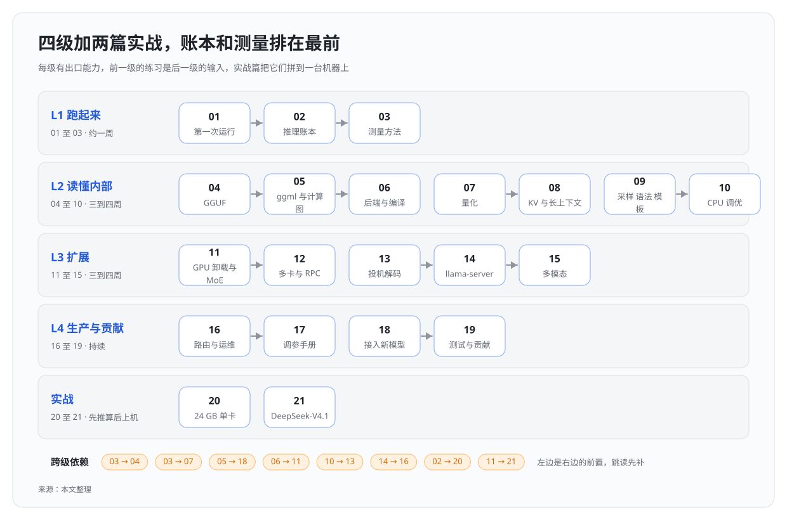
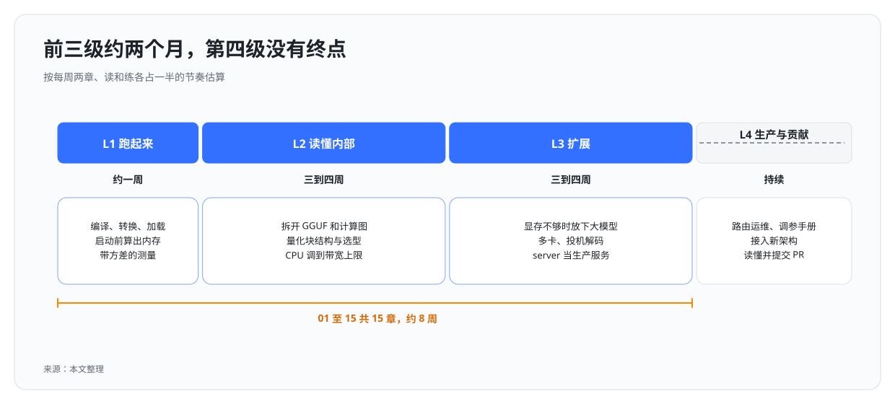
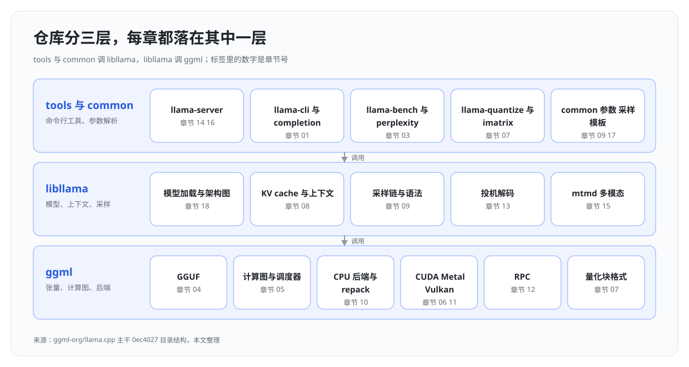
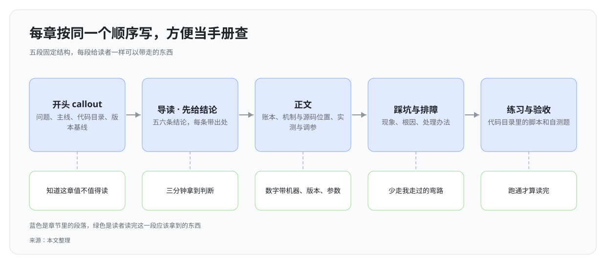
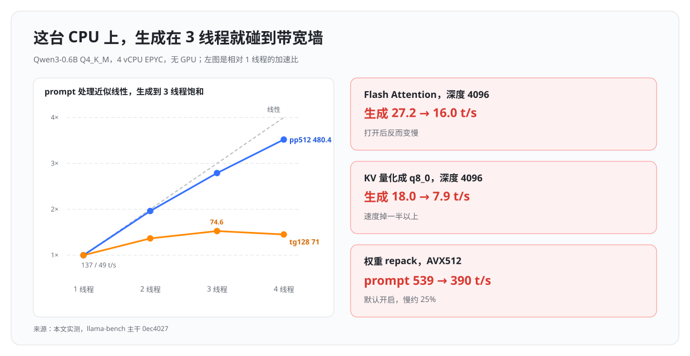
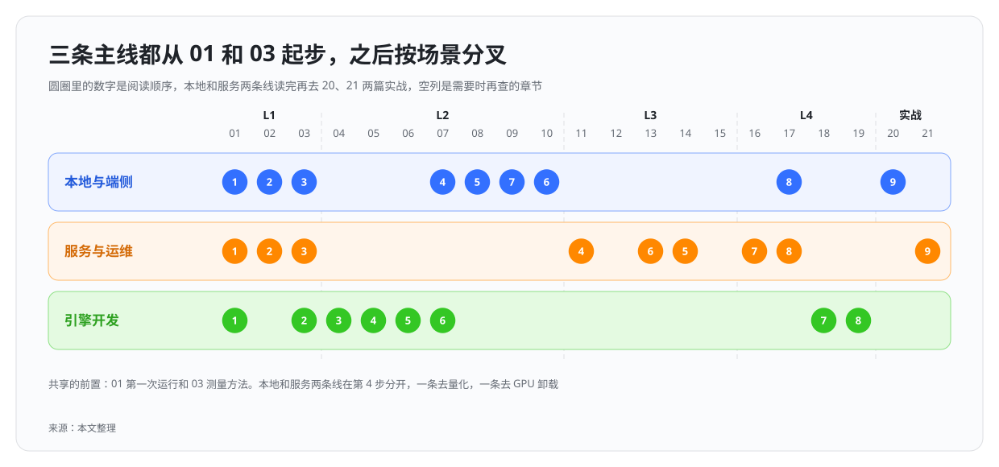
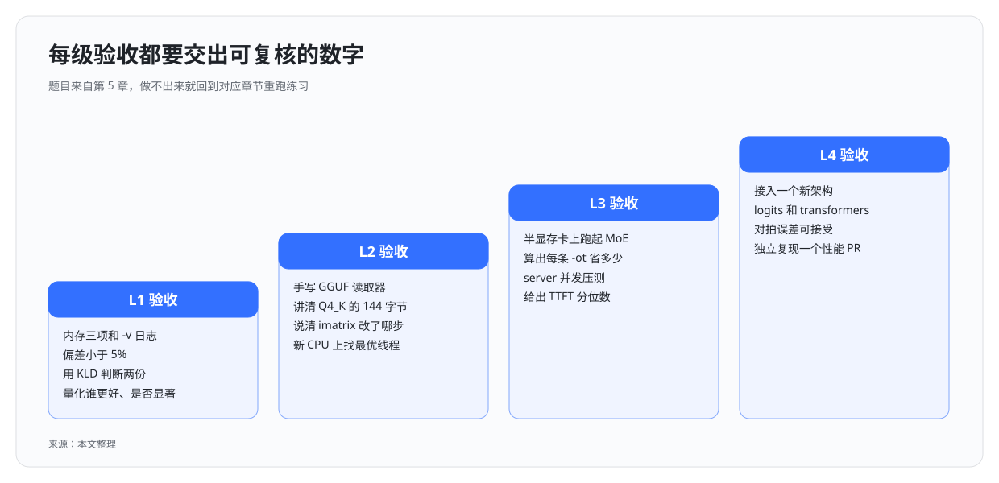

# LCPP-00｜索引｜从 0 开始 llama.cpp：路线、章节与练习

> 本目录是「从 0 开始 llama.cpp」系列文档的 Markdown 版，共 22 章，由飞书原文转换，正文与原文一致，画板导出为图片放在 `assets/`。配套代码在仓库根目录，每章一个目录。

> 🎯 **这篇文档解决什么问题**：llama.cpp 用起来门槛很低，一条命令就能在笔记本上跑起一个模型；用好的门槛很高，参数上百个，量化类型二十多种，后端十几个，大部分人停在“能跑”。这套手册想把我从“能跑”带到“能算、能测、能调、能改”。本篇是 22 章的入口，列出每章交付什么、练习代码放在哪、按什么顺序读。前 19 章各讲一个机制，最后三篇实战把它们拼到一台机器上。
>
> 使用方式：先看导读和路线图，再到第 3 章按自己的场景挑一条主线。每读完一章，跑通对应目录的练习，再用第 5 章的验收题自测。文中版本和数字核对于 2026 年 11 月 4 日。
>
> **代码**：[zero-to-llama](../README.md)，每章一个目录。脚本只依赖 Python 标准库，没有 GPU 也能做完大部分练习。

# 导读 · 先给结论

- **llama.cpp 的核心竞争力是“哪里都能跑”。**同一份 GGUF 文件，在 x86 和 ARM 的 CPU、苹果 Metal、NVIDIA CUDA、AMD HIP、Vulkan、SYCL、昇腾 CANN 上都能直接加载，后端列表在主干 README 里有 17 项[[1]](https://github.com/ggml-org/llama.cpp/blob/0ec4027/README.md)。在一张 H100 上拼高并发吞吐，它比不过 vLLM 和 SGLang。在单用户、低并发、显存不够、甚至没有 GPU 的场景里，它几乎是唯一的成熟选择。
- **单用户 decode 是读权重的速度问题。**每生成一个 token，要把全部激活参数从内存读一遍，算力几乎闲着。我在 4 核 EPYC 上实测 Qwen3-0.6B：prompt 处理随线程数近似线性增长（1 线程 137 t/s，4 线程 480 t/s），生成速度到 3 线程就饱和在 75 t/s 左右。这是 Roofline 模型里典型的带宽受限区[[2]](https://doi.org/10.1145/1498765.1498785)[[3]](https://arxiv.org/abs/2402.16363)，全系列的调参都从这里出发。
- **量化选多小，要用 KLD 量，不要只看 PPL。**同一个 Q4_K_M，加 imatrix 后 KLD 从 0.114 降到 0.072，top-1 一致率从 82.9% 升到 85.7%，文件大小不变。Q2_K 不加 imatrix 时 PPL 从 23.1 飙到 291，基本不可用。llama.cpp 自己的 perplexity 工具就能算 KLD，这是我认为整个工具链里最被低估的功能[[4]](https://github.com/ggml-org/llama.cpp/blob/0ec4027/tools/perplexity/README.md)[[5]](https://arxiv.org/abs/2407.09141)。
- **启动日志是一份内存账单，先预测再启动。**权重、KV cache 和计算缓冲三项加起来就是常驻内存。我写的预测器在 Qwen3-0.6B Q4_K_M、4096 上下文下预测权重 251.4 MiB、KV 448 MiB、计算缓冲 312.8 MiB、CPU_REPACK 204.8 MiB，和 -v 日志的偏差都在 0.2% 以内。会算这本账，-ngl、-c、-ot、-fit 这些参数就不再靠试。
- **“常识”要在自己的机器上重测。**我在这台没有 GPU 的机器上测到：4096 深度下打开 Flash Attention 反而让生成变慢，KV 量化成 q8_0 后生成速度掉一半，默认开启的权重 repack 在这台 AVX512 机器上让 Q4_K_M 的 prompt 处理慢了约 25%（539 对 390 t/s），生成速度不变。网上的调参建议大多来自 GPU，换到 CPU 上未必成立。每条结论我都给出复现命令和方差。
- **出口是能读懂主干的新改动。**llama.cpp 主干几乎每天都有新提交，参数和默认值隔几周就会变。学完的标准是：拿到一个新 PR，能说清它改了哪一层（GGUF、ggml 算子、后端、llama 模型图、common 参数、server），能用 llama-bench 和 perplexity 给出可复现的对比[[6]](https://github.com/ggml-org/llama.cpp/blob/0ec4027/CONTRIBUTING.md)。



**📎 与系列其他文档的分工**：本系列只讲 llama.cpp 这一个引擎，原理讲到能读懂实现、能解释实测为止，不展开通用的推理系统综述。带宽和算力的估算方法在 [LCPP-02｜上手｜推理账本：带宽、算力和启动前算出速度上限](./02-ledger.md)，量化的块结构和选型在 [LCPP-07｜内部｜量化：块结构、配方、imatrix 和用 KLD 选类型](./07-quantization.md)，KV cache 和长上下文在 [LCPP-08｜内部｜KV cache 与长上下文：账本、深度、量化、SWA 和上下文写满](./08-kv-context.md)，显存不够时的卸载和 MoE 在 [LCPP-11｜内部｜GPU 卸载与 MoE：-ngl、专家放置、fit 和专家缓存](./11-gpu-offload-moe.md)，高并发服务和压测在 [LCPP-14｜内部｜服务端：槽位、连续批处理和提示缓存](./14-server.md)。每章开头都写明它依赖哪几章，跳着读时先看那一段。

---

# 第 1 章 · 这套系列怎么组织

## 1.1 四级路线

前 19 章分成四级，每一级有明确的出口能力，前一级的练习是后一级的输入；20 到 22 三篇是实战，不再讲新机制，只拿前面的账本和参数给一台具体的机器出配置。我刻意把“账本”和“测量”放在最前面：不会算内存、不会测质量，后面所有调参都只能凭感觉。

| 级别 | 章节 | 出口能力 | 典型产出 |
|-|-|-|-|
| **L1 跑起来**  <br/>约一周 | 01 至 03 | 从源码编译，转换并加载一个模型；在启动前算出内存占用；用 llama-bench、perplexity 和 KLD 给出带方差的测量 | 一份内存预测和日志对账表；一份写清版本、线程、上下文的测量报告 |
| **L2 读懂内部**  <br/>三到四周 | 04 至 10 | 拆开 GGUF 文件；读懂 ggml 计算图和调度器；知道每种量化类型的块结构和适用场景；会算 KV、会选采样和语法约束；把一台 CPU 机器调到带宽上限 | 自己的 GGUF 检查器；一张覆盖 15 个量化变体的质量和速度表；CPU 调参扫描结果 |
| **L3 扩展**  <br/>三到四周 | 11 至 15 | 在显存不够时用 -ngl、-ot、--cpu-moe、-fit 放下大模型；多卡和 RPC；投机解码；把 llama-server 当成生产服务；接入图像和音频 | 一份 MoE 卸载方案和显存账本；一份 server 压测报告；投机解码接受率测量 |
| **L4 生产与贡献**  <br/>持续 | 16 至 19 | 多模型路由和运维；按症状查参数；给 llama.cpp 接入一个新架构；跑 test-backend-ops，读懂并提交 PR | router 预设文件和监控面板；一个新模型的转换和计算图实现 |
| **实战**  <br/>读完主线后 | 20 至 22 | 把账本、量化、KV、卸载和投机解码拼到一台机器上，启动前算出显存、内存和速度区间，再按清单上机核对 | 24 GB 单卡上两个稠密模型的两套配置；一张卡加一堆内存跑 552B MoE 的放置方案和上机清单；四分之三层换成线性注意力的多模态 27B 在 24 GB 卡上的量化、上下文和投机解码配置 |



## 1.2 章节落在架构上的位置

llama.cpp 仓库其实是三层东西叠在一起。最底下是 ggml：张量库、计算图、各硬件后端和调度器，GGUF 文件格式也定义在这一层[[7]](https://github.com/ggml-org/ggml/blob/master/docs/gguf.md)。中间是 libllama：模型加载、每种架构的计算图构建、KV cache、批处理和采样。最上面是 common 和 tools：参数解析、聊天模板、各个命令行工具和 llama-server。我读源码时一直按这三层定位问题，章节也按这三层分配。



## 1.3 每章的固定结构

每章都按同一个顺序写，方便当手册查：



1. **开头 callout**：这章解决什么问题，主线一句话，读完能做什么，代码目录和版本基线。
2. **导读 · 先给结论**：五六条结论，每条带出处，论文、PR 或主干文档。
3. **正文**：先讲问题和账本，再讲机制和源码位置，最后是实测和调参。每个数字写清楚在什么机器、什么版本、什么参数下测的。
4. **踩坑与排障**：我遇到的现象、根因和处理办法。
5. **练习与验收**：对应代码目录里的脚本，以及读完应该能回答的问题。

## 1.4 版本基线

> 💡 **常见误区**：拿网上的命令直接套在自己的版本上。llama.cpp 主干变化很快，参数名和默认值隔几周就可能变。本系列所有命令、源码行号和默认值都以下面的基线为准，读到不一致时先看自己的版本。

| 项 | 值 |
|-|-|
| llama.cpp | 主干提交 0ec4027（2026-10-30），发行版 v0.8.0（2026-10-28） |
| ggml | 0.28.0（随主干内置） |
| 实测机器 | 4 vCPU AMD EPYC，支持 AVX512、AVX512_VNNI、AVX512_BF16；8 GB 内存；无 GPU |
| 编译 | cmake Release，默认 GGML_NATIVE=ON、GGML_OPENMP=ON、GGML_CPU_REPACK=ON |
| 实测模型 | Qwen3-0.6B，从 Hugging Face 的 bf16 权重自己转 GGUF，再量化成 15 个变体（含 6 个 imatrix 版本） |
| GPU 章节 | 本机没有 GPU，11、12 章的显存数字来自账本计算器和主干文档里的公开日志，文中逐处标明“未在本机实测”；20 到 22 三篇的显存和速度全部是推算，每个数字都标了口径 |

表中的提交是全系列共同的源码基线，所有命令、行号和默认值都对它负责。各篇开头另写了一个核校日期，那只是这一篇文字最后核对的日子，三篇实战篇写得晚，日期就比前 19 篇新；日期不同不代表基线变了，也不代表前后口径不一致。实战篇里发布者构建号、最低版本要求这类条件，仍以那一篇自己的说明为准。



---

# 第 2 章 · 二十二章清单

## 2.1 L1 跑起来

| 章节 | 回答的问题 | 代码目录与交付 |
|---|---|---|
| [LCPP-01｜上手｜第一次运行：编译、转换、加载和读懂内存账单](./01-first-run.md) | 从源码编译，HF 权重转 GGUF，用 llama-cli 和 llama-completion 跑起来；读懂加载日志里每一行内存数字从哪来 | 01-first-run：estimate_memory.py 内存预测器，parse_load_log.py 加载日志对账，run.sh |
| [LCPP-02｜上手｜推理账本：带宽、算力和启动前算出速度上限](./02-ledger.md) | 一个模型在某台机器上 decode 能跑多快、prompt 处理能跑多快、最多能开多长上下文，在启动前怎么算 | 02-ledger：内存、带宽和 Roofline 计算器，fit_ledger.py 拟合速度系数，STREAM 与峰值算力探针 |
| [LCPP-03｜上手｜测量方法：llama-bench、PPL、KLD 和噪声](./03-bench-ppl.md) | llama-bench 的 pp、tg、depth 分别测什么；PPL、KLD、top-1 一致率怎么跑、怎么读；噪声多大才算差异 | 03-bench-ppl：bench_stats.py 多轮方差统计，parse_ppl.py 解析 PPL 和 KLD 报告 |

## 2.2 L2 读懂内部

| 章节 | 回答的问题 | 代码目录与交付 |
|---|---|---|
| [LCPP-04｜内部｜GGUF：文件结构、元数据、加载方式和分卷](./04-gguf.md) | 文件头、元数据键值、张量目录、对齐和 mmap；分词器和聊天模板怎么存进文件；gguf-split 和远程加载 | 04-gguf：gguf_check.py 检查器，gguf_diff.py 差异对比，gguf_write.py，加载方式测速 |
| [LCPP-05｜内部｜ggml 与计算图：建图、内存规划、调度和复用](./05-ggml-graph.md) | 一次前向是怎样一张图；图在哪里分配内存、怎样被切成 split 交给不同后端；为什么 ubatch 决定计算缓冲大小 | 05-ggml-graph：toy_graph 验证 gallocr，n_outputs_max 对照，调度器日志统计，融合和图复用对照 |
| [LCPP-06｜内部｜后端与编译：CPU 变体、BLAS、repack 和 GPU 架构](./06-backends-build.md) | CPU、CUDA、Metal、Vulkan、HIP、SYCL 各自的编译开关；GGML_NATIVE 和动态后端加载；怎么确认编出来的是自己想要的 | 06-backends-build：6 种编译开关和 14 个 CPU 变体对照，check_build.py 自检，BLAS 和 repack 实验 |
| [LCPP-07｜内部｜量化：块结构、配方、imatrix 和用 KLD 选类型](./07-quantization.md) | legacy、k-quants、i-quants 的块结构；imatrix 为什么有效；同等体积下怎么选类型；怎么用 KLD 证明选得对 | 07-quantization：type_mix.py 读配方，dequant.py 拆超级块，quant.sh 和 measure.sh 批量量化测 KLD，collect_results.py 出帕累托前沿 |
| [LCPP-08｜内部｜KV cache 与长上下文：账本、深度、量化、SWA 和上下文写满](./08-kv-context.md) | KV 怎么算、怎么填充；Flash Attention、KV 量化、SWA、上下文移位、RoPE 缩放分别在什么时候值得开 | 08-kv-context：kv_ledger.py KV 账本，FA 与 KV 量化的深度扫描和 KLD 汇总 |
| [LCPP-09｜内部｜采样、语法与聊天模板：截断链、温度、惩罚、GBNF 和模板](./09-sampling-grammar.md) | 采样链的顺序；GBNF 和 JSON Schema 约束；Jinja 聊天模板和工具调用解析；为什么同一个模型在不同客户端回答不一样 | 09-sampling-grammar：samp_sim.py 采样链模拟，render_tmpl.py 渲染聊天模板，samp_bench 采样器测速 |
| [LCPP-10｜内部｜CPU 调优：线程、绑核、repack、加载方式和带宽上限](./10-cpu-tuning.md) | 线程数、ubatch、repack、mmap 与 mlock、NUMA、大页；怎么判断已经到了带宽上限 | 10-cpu-tuning：cpu_probe 拓扑探测，十三组线程、绑核、等待、repack、tiled、加载和带宽实验 |

## 2.3 L3 扩展

| 章节 | 回答的问题 | 代码目录与交付 |
|---|---|---|
| [LCPP-11｜内部｜GPU 卸载与 MoE：-ngl、专家放置、fit 和专家缓存](./11-gpu-offload-moe.md) | -ngl 分层卸载的账本；-ot 按张量名放置；--cpu-moe 把专家留在内存；-fit 自动拟合在背后做了什么 | 11-gpu-offload-moe：moe_trace 抓路由，moe_cache_sim 回放五种放法，vram_ledger 显存账本 |
| [LCPP-12｜内部｜多卡与 RPC：-sm layer、流水线、张量并行和 RPC](./12-multi-gpu-rpc.md) | split-mode layer、row、tensor 的区别；-ts 比例怎么定；RPC 把远端机器当成一个后端的代价 | 12-multi-gpu-rpc：fake_devs 假多卡切层，split_plan 复算，comm_volume 通信量，rpc_msg 消息尺寸 |
| [LCPP-13｜内部｜投机解码：草稿模型、n-gram 和拒绝采样](./13-speculative.md) | 草稿模型、EAGLE-3、MTP、n-gram 几种方案的原理和适用负载；接受率和加速比怎么算 | 13-speculative：spec_model 收益模型和接受率反解，草稿量化与 p_min 实测，n-gram 与 lookahead |
| [LCPP-14｜内部｜服务端：槽位、连续批处理和提示缓存](./14-server.md) | 槽位、连续批处理、前缀缓存复用；OpenAI 兼容接口的行为差异；并发压测和指标 | 14-server：batched-bench 并发与统一 KV，slot_sim 复刻选槽与 RAM 缓存，上下文分账对账 |
| [LCPP-15｜内部｜多模态：mmproj、图片切块和音频](./15-multimodal.md) | mtmd 如何把图像和音频编码成 token；mmproj 文件；图像 token 的预算 | 15-multimodal：mm_probe 计块与编码计时，mm_tokens 复刻三种模型的 token 计数，看图和转写 |

## 2.4 L4 生产与贡献

| 章节 | 回答的问题 | 代码目录与交付 |
|---|---|---|
| [LCPP-16｜内部｜路由与运维：多模型、预设、内存余量和监控](./16-router-ops.md) | router 模式按需加载多模型；预设文件；内存余量和换出；容器化、健康检查和监控 | 16-router-ops：preset_tool 复刻预设合并，router_sim 七个调度场景，metrics_parse，加载耗时与峰值内存 |
| [LCPP-17｜内部｜调参手册：默认值、误配、按症状查参数和上线清单](./17-tuning-playbook.md) | 从“慢、爆内存、输出乱、首 token 久”这些症状反查参数 | 17-tuning-playbook：diagnose.py 把误配分 error、warn、silent 三档，plan 不跑模型算内存，五组症状 benchmark |
| [LCPP-18｜内部｜新模型接入：转换、计算图和逐层对拍](./18-add-model.md) | convert_hf_to_gguf 里注册架构；在 libllama 里写计算图；怎么用 logits 对拍验证 | 18-add-model：dump_logits 取每层出口，compare 算 KLD 和逐层余弦，inject 注入转换错，tok_compare 比分词 |
| [LCPP-19｜内部｜测试与贡献：ctest、test-backend-ops、性能对比和 PR](./19-test-contrib.md) | test-backend-ops 和各种单测；CI 跑什么；怎么读一个性能 PR、怎么写自己的 PR | 19-test-contrib：ctest 标签与 fixture，test-backend-ops 注入融合内核错误，perf_fuse 和 bench_ab 交替 A/B，load_sql 入库 |

## 2.5 实战

| 章节 | 回答的问题 | 代码目录与交付 |
|---|---|---|
| [LCPP-20｜实战｜24 GB 单卡：Qwen3-32B 和 Qwen3.8-27B](./20-qwen-24g.md) | 一张 24 GB 卡上，Qwen3-32B 和 Qwen3.8-27B 各能开多长上下文，选哪档量化，开不开草稿模型 | 20-qwen-24g：ledger.py 推算显存和上下文，run_32b.sh、run_27b.sh 两套启动命令 |
| [LCPP-21｜实战｜一台机器跑 DeepSeek-V4.1-Flash](./21-deepseek-v41.md) | 552B 骨干加 196B Engram 表怎么装进一张卡加一堆内存：文件怎么摆，Engram 为什么不占内存，专家放几层上卡，decode 多快 | 21-deepseek-v41：plan.py 推算三档字节、压缩 KV、专家放置和 decode 区间，run_96g.sh、run_24g.sh，test_plan.py 12 个用例 |
| [LCPP-22｜实战｜一张卡跑 Qwen3.8-27B](./22-qwen38-27b.md) | 64 层里只有 16 层存 KV 的多模态 27B，24 GB 卡选哪档量化、能开多长上下文，自带 MTP 头怎么开投机解码，看图为什么要挂 mmproj | 22-qwen38-27b：plan.py 推算 16 层 KV、48 层常数循环态和各档落点，run_24g.sh、run_text.sh 两套启动命令，test_plan.py 7 个用例 |

---

# 第 3 章 · 三条读法

二十二章全读完要两个月以上。我建议按场景挑一条主线，其余章节需要时再查；主线读完，再到 20、21 或 22 篇看这些机制在一台具体机器上怎么组合。

> 💻 **本地与端侧部署**
>
> 01 → 02 → 03 → 07 → 08 → 10 → 09 → 17 → 20 → 22
>
> 目标：在一台没有 GPU 或显存很小的机器上，挑对量化类型和参数，把单用户体验调到硬件上限。

> 🌐 **服务与运维**
>
> 01 → 02 → 03 → 11 → 14 → 13 → 16 → 17 → 21
>
> 目标：在一两张消费级卡上跑起 llama-server，放下比显存大的 MoE，接入监控，处理多模型路由。

> 🔧 **引擎开发**
>
> 01 → 03 → 04 → 05 → 06 → 07 → 18 → 19
>
> 目标：读懂 ggml 和 libllama 的源码，给新架构写转换和计算图，提交能被合进主干的 PR。



---

# 第 4 章 · 起步前的准备

## 4.1 前置知识

- **Transformer 推理**：知道 prefill 和 decode 的区别、KV cache 存的是什么。不熟的话先跑一遍 [LCPP-01｜上手｜第一次运行：编译、转换、加载和读懂内存账单](./01-first-run.md) 的加载日志对账，再读 [LCPP-02｜上手｜推理账本：带宽、算力和启动前算出速度上限](./02-ledger.md) 的账本和 [LCPP-08｜内部｜KV cache 与长上下文：账本、深度、量化、SWA 和上下文写满](./08-kv-context.md) 的 KV 一章，够用。
- **C 和 C++ 的阅读能力**：能看懂结构体、指针和模板的大意即可，L1 不需要。
- **Python**：所有练习脚本都是 Python 标准库写的。
- **Linux 命令行**：cmake、git、环境变量。

## 4.2 硬件

L1 和 L2 全部可以在一台普通的 x86 或苹果 M 系列机器上完成，我自己就是在一台 4 核 8 GB 的云主机上做的全部实测。L3 的 GPU 章节需要一张 NVIDIA 或 AMD 显卡才能复现，没有的话可以用账本计算器做完练习，再读文中引用的公开日志。20 到 22 三篇实战同样是先推算后上机，文末各有一张上机核对清单。

## 4.3 编译

```bash
git clone https://github.com/ggml-org/llama.cpp
cd llama.cpp
cmake -B build -DCMAKE_BUILD_TYPE=Release
cmake --build build -j
./build/bin/llama-cli --version
```

GPU 版本只需在第一步加上对应开关，比如 -DGGML_CUDA=ON 或 -DGGML_VULKAN=ON，完整矩阵见 LCPP-06 和主干的 build.md[[8]](https://github.com/ggml-org/llama.cpp/blob/0ec4027/docs/build.md)。

## 4.4 配套仓库

```bash
git clone https://github.com/chenziyaos/zero-to-llama.git
cd zero-to-llama/01-first-run
python3 test_first_run.py
python3 parse_load_log.py sample_load.log
```

目录命名与章节号一一对应。estimate\_\* 和 sim\_\* 是启动前的预测器，parse\_\* 和 collect\_\* 从 llama.cpp 的日志和 jsonl 里抽数字，test\_\* 用仓库里的日志夹具做回归测试。

---

# 第 5 章 · 学习节奏、验收和下一步

## 5.1 节奏

我的建议是每周两章，每章花一半时间读、一半时间跑练习。读完不跑，数字记不住；跑了不对账，就不知道自己哪里理解错了。

## 5.2 每级验收

- [ ] **L1**：给一个没见过的 GGUF 文件和上下文长度，在启动前算出权重、KV 和计算缓冲三项，和 -v 日志偏差小于 5%；给两份量化文件，用 KLD 说清哪个更好、差异是否显著。

- [ ] **L2**：手写一个 GGUF 读取器；解释 Q4_K 一个超级块的 144 字节分别存了什么；说清 imatrix 改变了量化中的哪一步；在一台新 CPU 上找到最优线程数并解释原因。

- [ ] **L3**：在显存只有模型一半的卡上跑起一个 MoE，并解释每个 -ot 规则省下多少显存；用 llama-server 做一次并发压测，给出 TTFT 和每 token 延迟的分位数。

- [ ] **L4**：为一个小模型完成转换和计算图实现，logits 和 transformers 对拍误差在可接受范围；独立复现一个性能 PR 的数字。



> 🔑 **小结**：先读 01 和 03，把内存账本和测量方法练熟，再按自己的场景挑一条主线，读完去 20、21 或 22 篇把配置拼出来。每章的数字都绑定在主干 0ec4027、Qwen3-0.6B 和 4 核 EPYC 上，换机器、换版本之后先重跑对应练习，再拿自己的数字下结论。

# 参考文献

按正文首次引用顺序编号，资料截至 2026 年 10 月初。

[1] ggml-org. llama.cpp README, commit 0ec4027. [github.com/ggml-org/llama.cpp](https://github.com/ggml-org/llama.cpp/blob/0ec4027/README.md)

[2] Williams S, Waterman A, Patterson D. Roofline: An Insightful Visual Performance Model for Multicore Architectures. CACM, 2009. [doi:10.1145/1498765.1498785](https://doi.org/10.1145/1498765.1498785)

[3] Yuan Z, et al. LLM Inference Unveiled: Survey and Roofline Model Insights. 2024. [arXiv:2402.16363](https://arxiv.org/abs/2402.16363)

[4] ggml-org. llama.cpp perplexity README. [tools/perplexity/README.md](https://github.com/ggml-org/llama.cpp/blob/0ec4027/tools/perplexity/README.md)

[5] Dutta A, et al. Accuracy is Not All You Need. NeurIPS 2024. [arXiv:2407.09141](https://arxiv.org/abs/2407.09141)

[6] ggml-org. llama.cpp CONTRIBUTING.md. [CONTRIBUTING.md](https://github.com/ggml-org/llama.cpp/blob/0ec4027/CONTRIBUTING.md)

[7] ggml-org. GGUF specification. [ggml/docs/gguf.md](https://github.com/ggml-org/ggml/blob/master/docs/gguf.md)

[8] ggml-org. llama.cpp build guide. [docs/build.md](https://github.com/ggml-org/llama.cpp/blob/0ec4027/docs/build.md)

---

## 章节列表

- [LCPP-01｜上手｜第一次运行：编译、转换、加载和读懂内存账单](./01-first-run.md)
- [LCPP-02｜上手｜推理账本：带宽、算力和启动前算出速度上限](./02-ledger.md)
- [LCPP-03｜上手｜测量方法：llama-bench、PPL、KLD 和噪声](./03-bench-ppl.md)
- [LCPP-04｜内部｜GGUF：文件结构、元数据、加载方式和分卷](./04-gguf.md)
- [LCPP-05｜内部｜ggml 与计算图：建图、内存规划、调度和复用](./05-ggml-graph.md)
- [LCPP-06｜内部｜后端与编译：CPU 变体、BLAS、repack 和 GPU 架构](./06-backends-build.md)
- [LCPP-07｜内部｜量化：块结构、配方、imatrix 和用 KLD 选类型](./07-quantization.md)
- [LCPP-08｜内部｜KV cache 与长上下文：账本、深度、量化、SWA 和上下文写满](./08-kv-context.md)
- [LCPP-09｜内部｜采样、语法与聊天模板：截断链、温度、惩罚、GBNF 和模板](./09-sampling-grammar.md)
- [LCPP-10｜内部｜CPU 调优：线程、绑核、repack、加载方式和带宽上限](./10-cpu-tuning.md)
- [LCPP-11｜内部｜GPU 卸载与 MoE：-ngl、专家放置、fit 和专家缓存](./11-gpu-offload-moe.md)
- [LCPP-12｜内部｜多卡与 RPC：-sm layer、流水线、张量并行和 RPC](./12-multi-gpu-rpc.md)
- [LCPP-13｜内部｜投机解码：草稿模型、n-gram 和拒绝采样](./13-speculative.md)
- [LCPP-14｜内部｜服务端：槽位、连续批处理和提示缓存](./14-server.md)
- [LCPP-15｜内部｜多模态：mmproj、图片切块和音频](./15-multimodal.md)
- [LCPP-16｜内部｜路由与运维：多模型、预设、内存余量和监控](./16-router-ops.md)
- [LCPP-17｜内部｜调参手册：默认值、误配、按症状查参数和上线清单](./17-tuning-playbook.md)
- [LCPP-18｜内部｜新模型接入：转换、计算图和逐层对拍](./18-add-model.md)
- [LCPP-19｜内部｜测试与贡献：ctest、test-backend-ops、性能对比和 PR](./19-test-contrib.md)
- [LCPP-20｜实战｜24 GB 单卡：Qwen3-32B 和 Qwen3.8-27B](./20-qwen-24g.md)
- [LCPP-21｜实战｜一台机器跑 DeepSeek-V4.1-Flash](./21-deepseek-v41.md)
- [LCPP-22｜实战｜一张卡跑 Qwen3.8-27B](./22-qwen38-27b.md)
